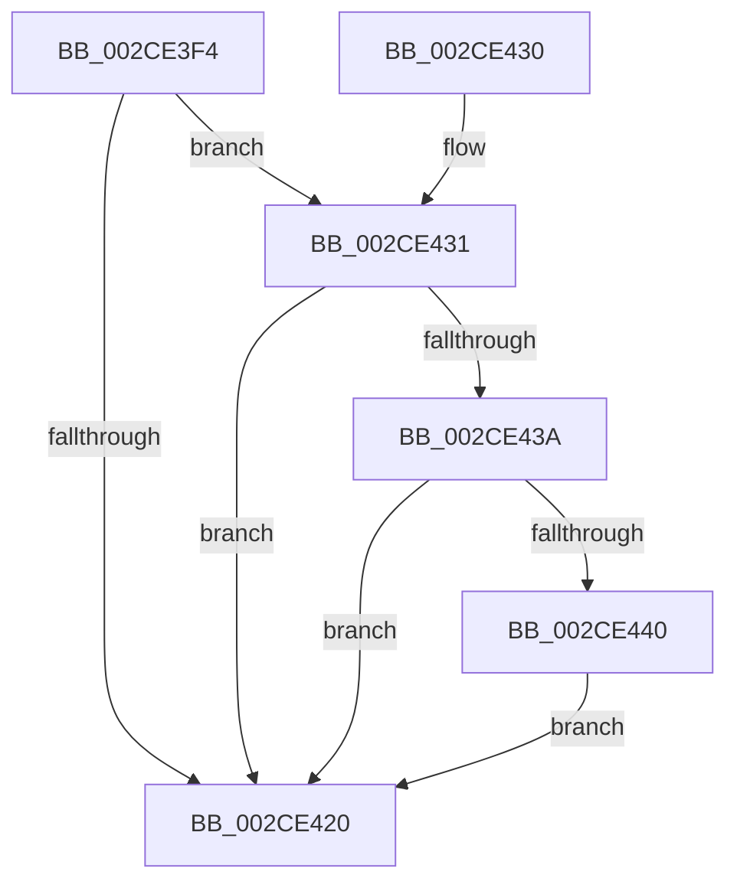

# KiQueueTebUpdateApc

- RVA: `0x002CE3F4`–`0x002CE462` (길이 `110` bytes)
- VA: `0x00000001402CE3F4`
- 실행 섹션: `.text`
- PDB 이름 있음: `예`; PDB Function 태그: `아니요`
- unwind 정보 RVA: `0x0006F5D0`
- 디코드: `28`개 명령, `110/110` bytes 표시
- 미해석 바이트: `0` (있으면 어셈블리에 `.byte`로 보존)

> 이 문서는 커널 이미지의 기계어와 PDB 기호를 분석해 생성했습니다. 4번과 5번은 함수 원형과 자료형을 바이너리 사용 방식에서 추정한 C 해석이며 원본 소스 복구 결과는 아닙니다.

## 1. Dependencies

- 직접 호출 지점: **2**; 고유 호출 대상: **2**
- 직접 호출자로 확인된 함수: **2**
- RIP 상대 이미지 참조: **0**

### Outgoing calls
- `0x002CE447` → [KiInsertQueueApc](../20/KiInsertQueueApc_function_002041F0.md) (function, `0x002041F0`)
- `0x002CE45B` → [KiSignalThreadForApc](../20/KiSignalThreadForApc_function_00204360.md) (function, `0x00204360`)

### Direct callers
- [KiSetAffinityThread](KiSetAffinityThread_function_002CE010.md) at `0x002CE101`
- [KiSetIdealProcessorThread](../2D/KiSetIdealProcessorThread_function_002DCFE0.md) at `0x002DD0EE`

### Static image references
- 디코드된 RIP-relative 메모리 참조가 없습니다.

## 2. Other-region calls and transfers

- 다른 실행 섹션으로 향하는 call: **0**
- 별도 외부 분기/꼬리 이동을 확인하지 못했습니다.

## 3. Assembly (complete function range)

```asm
002CE3F4  48 89 5C 24 08                  mov qword ptr [rsp + 8], rbx
002CE3F9  48 89 74 24 10                  mov qword ptr [rsp + 0x10], rsi
002CE3FE  57                              push rdi
002CE3FF  48 83 EC 20                     sub rsp, 0x20
002CE403  65 48 8B 34 25 20 00 00 00      mov rsi, qword ptr gs:[0x20]
002CE40C  48 8D 99 20 07 00 00            lea rbx, [rcx + 0x720]
002CE413  48 83 B9 F0 00 00 00 00         cmp qword ptr [rcx + 0xf0], 0
002CE41B  40 8A FA                        mov dil, dl
002CE41E  75 11                           jne 0x1402ce431
002CE420  48 8B 5C 24 30                  mov rbx, qword ptr [rsp + 0x30]
002CE425  48 8B 74 24 38                  mov rsi, qword ptr [rsp + 0x38]
002CE42A  48 83 C4 20                     add rsp, 0x20
002CE42E  5F                              pop rdi
002CE42F  C3                              ret
002CE430  CC                              int3
002CE431  F7 41 74 00 40 00 00            test dword ptr [rcx + 0x74], 0x4000
002CE438  74 E6                           je 0x1402ce420
002CE43A  80 7B 52 00                     cmp byte ptr [rbx + 0x52], 0
002CE43E  75 E0                           jne 0x1402ce420
002CE440  48 8B CB                        mov rcx, rbx
002CE443  C6 43 52 01                     mov byte ptr [rbx + 0x52], 1
002CE447  E8 A4 5D F3 FF                  call 0x1402041f0
002CE44C  41 B9 01 00 00 00               mov r9d, 1
002CE452  44 8A C7                        mov r8b, dil
002CE455  48 8B D3                        mov rdx, rbx
002CE458  48 8B CE                        mov rcx, rsi
002CE45B  E8 00 5F F3 FF                  call 0x140204360
002CE460  EB BE                           jmp 0x1402ce420
```

## 4. C-style interpretation (structured pseudocode)

```c
__int64 __fastcall KiQueueTebUpdateApc(__int64 a1, unsigned __int8 a2)
{
    __int64 result;
    __int64 v_rsp;
    unsigned __int64 v_stack_p10;
    unsigned __int64 v_stack_p8;

    v_stack_p8 = v_rbx;
    v_stack_p10 = v_rsi;
    v_rsp = (v_rsp) - (32);
    if ((*(unsigned __int64 *)(a1 + 240)) != 0) goto loc_002CE431;
loc_002CE420:
    v_rsp = (v_rsp) + (32);
    return result;
loc_002CE431:
    if (((*(unsigned int *)(a1 + 116)) & (0x4000ULL)) == 0) goto loc_002CE420;
    if ((*(unsigned __int8 *)(v_stack_p8 + 82)) != 0) goto loc_002CE420;
    *(unsigned __int8 *)(v_stack_p8 + 82) = 1;
    result = KiInsertQueueApc(v_stack_p8, a2, a3, a4);
    result = KiSignalThreadForApc(v_stack_p10, v_stack_p8, a2, 1);
    goto loc_002CE420;
}
```

## 5. (Beta) C Style

```c
int64_t KiQueueTebUpdateApc(void *Arg1, uint8_t Arg2)
{
    uint8_t *arg1 = (uint8_t *)Arg1;

    int64_t result;
    int64_t local_rsp;
    uint64_t v_stack_p10;
    uint64_t v_stack_p8;

    v_stack_p8 = local_rbx;
    v_stack_p10 = local_rsi;
    local_rsp = (local_rsp) - (32);
    if ((*(uint64_t *)(arg1 + 0xF0)) != 0) goto loc_002CE431;
loc_002CE420:
    local_rsp = (local_rsp) + (32);
    return result;
loc_002CE431:
    if (((*(uint32_t *)(arg1 + 0x74)) & (0x4000ULL)) == 0) goto loc_002CE420;
    if ((*(uint8_t *)(v_stack_p8 + 0x52)) != 0) goto loc_002CE420;
    *(uint8_t *)(v_stack_p8 + 0x52) = 1;
    result = KiInsertQueueApc(v_stack_p8, Arg2, a3, a4);
    result = KiSignalThreadForApc(v_stack_p10, v_stack_p8, Arg2, 1);
    goto loc_002CE420;
}
```

### 관측된 메모리 오프셋

구조체 형식이 확인되지 않은 접근은 인자 기준의 오프셋으로만 기록했습니다.

| 기준 인자 | 오프셋 표현 | 폭 (bit) | 접근 |
|---|---:|---:|---|
| `Arg1` | `+ 0x52` | `8` | `R` |
| `Arg1` | `+ 0x52` | `8` | `W` |
| `Arg1` | `+ 0x74` | `32` | `R` |
| `Arg1` | `+ 0xF0` | `64` | `R` |
| `Arg1` | `+ 0x720` | `64` | `R` |

## 6. Execution-region graph

[열기: 2D/3D 그래프와 함수 탐색 컨트롤 패널](../../../control-panel.html?section=text&rva=0x002CE3F4&view=graph)

- 2D 그래프는 위에서 아래로 흐르고, 3D 그래프는 빈 공간을 드래그해 회전합니다. Shift+드래그는 이동, 휠은 확대·축소, 함수 노드 선택은 대상 보고서 이동입니다.

### Static fallback


