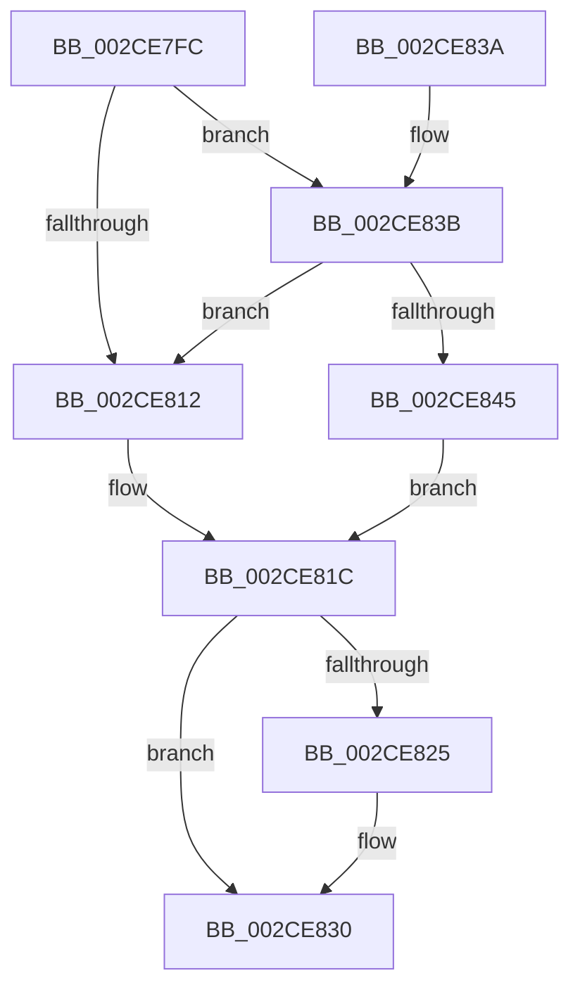

# KiReleaseProcessLockShared

- RVA: `0x002CE7FC`–`0x002CE851` (길이 `85` bytes)
- VA: `0x00000001402CE7FC`
- 실행 섹션: `.text`
- PDB 이름 있음: `예`; PDB Function 태그: `아니요`
- unwind 정보 RVA: `0x00068804`
- 디코드: `24`개 명령, `85/85` bytes 표시
- 미해석 바이트: `0` (있으면 어셈블리에 `.byte`로 보존)

> 이 문서는 커널 이미지의 기계어와 PDB 기호를 분석해 생성했습니다. 4번과 5번은 함수 원형과 자료형을 바이너리 사용 방식에서 추정한 C 해석이며 원본 소스 복구 결과는 아닙니다.

## 1. Dependencies

- 직접 호출 지점: **2**; 고유 호출 대상: **2**
- 직접 호출자로 확인된 함수: **4**
- RIP 상대 이미지 참조: **3**

### Outgoing calls
- `0x002CE82B` → [KiLowerIrqlProcessIrqlFlags](../4F/KiLowerIrqlProcessIrqlFlags_function_004F5698.md) (function, `0x004F5698`)
- `0x002CE84A` → [ExpReleaseSpinLockSharedFromDpcLevelInstrumented](../2F/ExpReleaseSpinLockSharedFromDpcLevelInstrumented_function_002F0F48.md) (function, `0x002F0F48`)

### Direct callers
- [KeQueryAffinityProcess](KeQueryAffinityProcess_function_002CE710.md) at `0x002CE795`
- [KeQueryPrimaryGroupProcess](KeQueryPrimaryGroupProcess_function_002CF958.md) at `0x002CF988`
- [KeQueryPrimaryGroupAffinityProcess](../49/KeQueryPrimaryGroupAffinityProcess_function_00490BA4.md) at `0x00490BF9`
- [KeQueryCpuSetsProcess](../4D/KeQueryCpuSetsProcess_function_004DE068.md) at `0x004DE0AF`

### Static image references
- `0x002CE809` → RVA `0x00FC6B06` (`ALMOSTRO`; read)
- `0x002CE81C` → RVA `0x00FC6D20` (`ALMOSTRO`; read)
- `0x002CE83B` → RVA `0x00F0DE58` (`.data`; read)

## 2. Other-region calls and transfers

- 다른 실행 섹션으로 향하는 call: **0**
- 별도 외부 분기/꼬리 이동을 확인하지 못했습니다.

## 3. Assembly (complete function range)

```asm
002CE7FC  40 53                           push rbx
002CE7FE  48 83 EC 20                     sub rsp, 0x20
002CE802  48 83 C1 40                     add rcx, 0x40
002CE806  0F B6 DA                        movzx ebx, dl
002CE809  F6 05 F6 82 CF 00 01            test byte ptr [rip + 0xcf82f6], 1
002CE810  75 29                           jne 0x1402ce83b
002CE812  F0 81 21 FF FF FF BF            lock and dword ptr [rcx], 0xbfffffff
002CE819  F0 FF 09                        lock dec dword ptr [rcx]
002CE81C  83 3D FD 84 CF 00 00            cmp dword ptr [rip + 0xcf84fd], 0
002CE823  74 0B                           je 0x1402ce830
002CE825  44 0F 20 C1                     mov rcx, cr8
002CE829  8A D3                           mov dl, bl
002CE82B  E8 68 6E 22 00                  call 0x1404f5698
002CE830  44 0F 22 C3                     mov cr8, rbx
002CE834  48 83 C4 20                     add rsp, 0x20
002CE838  5B                              pop rbx
002CE839  C3                              ret
002CE83A  CC                              int3
002CE83B  8B 05 17 F6 C3 00               mov eax, dword ptr [rip + 0xc3f617]
002CE841  85 C0                           test eax, eax
002CE843  75 CD                           jne 0x1402ce812
002CE845  48 8B 54 24 28                  mov rdx, qword ptr [rsp + 0x28]
002CE84A  E8 F9 26 02 00                  call 0x1402f0f48
002CE84F  EB CB                           jmp 0x1402ce81c
```

## 4. C-style interpretation (structured pseudocode)

```c
__int64 __fastcall KiReleaseProcessLockShared(__int64 a1, unsigned __int8 a2)
{
    __int64 result;
    __int64 v_rsp;
    unsigned __int64 v_stack_p28;

    v_rsp = (v_rsp) - (32);
    a1 = (a1) + (64);
    if (((*(unsigned __int8 *)(v_rip + 13599478)) & (1)) != 0) goto loc_002CE83B;
loc_002CE812:
loc_002CE81C:
    if ((*(unsigned int *)(v_rip + 13599997)) != 0) {
        a1 = v_cr8;
        a2 = a2;
        result = KiLowerIrqlProcessIrqlFlags(a1, a2, a3, a4);
    }
    v_rsp = (v_rsp) + (32);
    return result;
loc_002CE83B:
    if ((unsigned int)((unsigned int)(*(unsigned int *)(v_rip + 12842519))) != 0) goto loc_002CE812;
    result = ExpReleaseSpinLockSharedFromDpcLevelInstrumented(a1, v_stack_p28, a3, a4);
    goto loc_002CE81C;
}
```

## 5. (Beta) C Style

```c
int64_t KiReleaseProcessLockShared(void *Arg1, uint8_t Arg2)
{
    uint8_t *arg1 = (uint8_t *)Arg1;

    int64_t result;
    int64_t local_rsp;
    uint64_t v_stack_p28;

    local_rsp = (local_rsp) - (32);
    Arg1 = (Arg1) + (64);
    if (((*(uint8_t *)(v_rip + 0xCF82F6)) & (1)) != 0) goto loc_002CE83B;
loc_002CE812:
loc_002CE81C:
    if ((*(uint32_t *)(v_rip + 0xCF84FD)) != 0) {
        Arg1 = v_cr8;
        Arg2 = Arg2;
        result = KiLowerIrqlProcessIrqlFlags(Arg1, Arg2, a3, a4);
    }
    local_rsp = (local_rsp) + (32);
    return result;
loc_002CE83B:
    if ((uint32_t)((uint32_t)(*(uint32_t *)(v_rip + 0xC3F617))) != 0) goto loc_002CE812;
    result = ExpReleaseSpinLockSharedFromDpcLevelInstrumented(Arg1, v_stack_p28, a3, a4);
    goto loc_002CE81C;
}
```

### 관측된 메모리 오프셋

구조체 형식이 확인되지 않은 접근은 인자 기준의 오프셋으로만 기록했습니다.

| 기준 인자 | 오프셋 표현 | 폭 (bit) | 접근 |
|---|---:|---:|---|
| `Arg1` | `+ 0x0` | `32` | `R/W` |

## 6. Execution-region graph

[열기: 2D/3D 그래프와 함수 탐색 컨트롤 패널](../../../control-panel.html?section=text&rva=0x002CE7FC&view=graph)

- 2D 그래프는 위에서 아래로 흐르고, 3D 그래프는 빈 공간을 드래그해 회전합니다. Shift+드래그는 이동, 휠은 확대·축소, 함수 노드 선택은 대상 보고서 이동입니다.

### Static fallback


