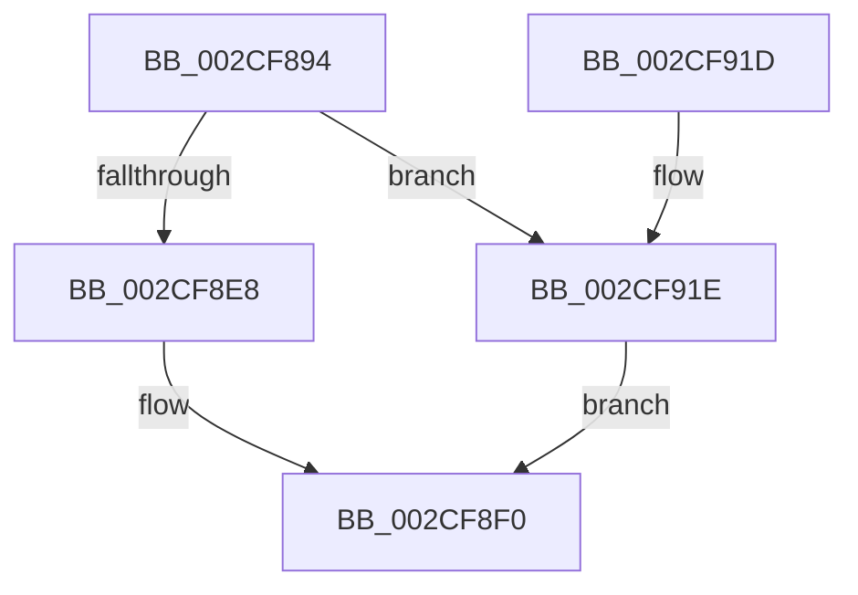

# KiReselectIdealProcessorAfterAffinityChange

- RVA: `0x002CF894`–`0x002CF922` (길이 `142` bytes)
- VA: `0x00000001402CF894`
- 실행 섹션: `.text`
- PDB 이름 있음: `예`; PDB Function 태그: `아니요`
- unwind 정보 RVA: `0x0006F690`
- 디코드: `31`개 명령, `142/142` bytes 표시
- 미해석 바이트: `0` (있으면 어셈블리에 `.byte`로 보존)

> 이 문서는 커널 이미지의 기계어와 PDB 기호를 분석해 생성했습니다. 4번과 5번은 함수 원형과 자료형을 바이너리 사용 방식에서 추정한 C 해석이며 원본 소스 복구 결과는 아닙니다.

## 1. Dependencies

- 직접 호출 지점: **2**; 고유 호출 대상: **2**
- 직접 호출자로 확인된 함수: **1**
- RIP 상대 이미지 참조: **1**

### Outgoing calls
- `0x002CF906` → [KeSelectIdealProcessor](KeSelectIdealProcessor_function_002CE8CC.md) (function, `0x002CE8CC`)
- `0x002CF913` → [_security_check_cookie](../6A/_security_check_cookie_function_006AC640.md) (function, `0x006AC640`)

### Direct callers
- [KiComputeThreadAffinity](../39/KiComputeThreadAffinity_function_00399DE0.md) at `0x0039A194`

### Static image references
- `0x002CF898` → RVA `0x00E0A740` (`.data`; read)

## 2. Other-region calls and transfers

- 다른 실행 섹션으로 향하는 call: **0**
- 별도 외부 분기/꼬리 이동을 확인하지 못했습니다.

## 3. Assembly (complete function range)

```asm
002CF894  48 83 EC 48                     sub rsp, 0x48
002CF898  48 8B 05 A1 AE B3 00            mov rax, qword ptr [rip + 0xb3aea1]
002CF89F  48 33 C4                        xor rax, rsp
002CF8A2  48 89 44 24 38                  mov qword ptr [rsp + 0x38], rax
002CF8A7  48 8B 81 20 02 00 00            mov rax, qword ptr [rcx + 0x220]
002CF8AE  4C 8B D2                        mov r10, rdx
002CF8B1  4D 8B D9                        mov r11, r9
002CF8B4  48 8B 90 B8 00 00 00            mov rdx, qword ptr [rax + 0xb8]
002CF8BB  49 8B 80 70 8E 00 00            mov rax, qword ptr [r8 + 0x8e70]
002CF8C2  48 89 44 24 20                  mov qword ptr [rsp + 0x20], rax
002CF8C7  49 8B 80 C0 00 00 00            mov rax, qword ptr [r8 + 0xc0]
002CF8CE  48 8B 88 80 00 00 00            mov rcx, qword ptr [rax + 0x80]
002CF8D5  41 0F B7 42 08                  movzx eax, word ptr [r10 + 8]
002CF8DA  48 89 4C 24 28                  mov qword ptr [rsp + 0x28], rcx
002CF8DF  66 3B 82 D0 00 00 00            cmp ax, word ptr [rdx + 0xd0]
002CF8E6  73 36                           jae 0x1402cf91e
002CF8E8  48 8B 8C C2 D8 00 00 00         mov rcx, qword ptr [rdx + rax*8 + 0xd8]
002CF8F0  48 89 4C 24 30                  mov qword ptr [rsp + 0x30], rcx
002CF8F5  4C 8D 44 24 20                  lea r8, [rsp + 0x20]
002CF8FA  49 8B CA                        mov rcx, r10
002CF8FD  41 B9 03 00 00 00               mov r9d, 3
002CF903  49 8B D3                        mov rdx, r11
002CF906  E8 C1 EF FF FF                  call 0x1402ce8cc
002CF90B  48 8B 4C 24 38                  mov rcx, qword ptr [rsp + 0x38]
002CF910  48 33 CC                        xor rcx, rsp
002CF913  E8 28 CD 3D 00                  call 0x1406ac640
002CF918  48 83 C4 48                     add rsp, 0x48
002CF91C  C3                              ret
002CF91D  CC                              int3
002CF91E  33 C9                           xor ecx, ecx
002CF920  EB CE                           jmp 0x1402cf8f0
```

## 4. C-style interpretation (structured pseudocode)

```c
__int64 __fastcall KiReselectIdealProcessorAfterAffinityChange(__int64 a1, __int64 a2, __int64 a3, __int64 a4)
{
    __int64 result;
    __int64 v_rsp;
    unsigned __int64 v_stack_m10;
    unsigned __int64 v_stack_m18;
    unsigned __int64 v_stack_m20;
    unsigned __int64 v_stack_m28;

    v_rsp = (v_rsp) - (72);
    result = (*(unsigned __int64 *)(v_rip + 11775649)) ^ (v_rsp);
    v_stack_m10 = result;
    v_stack_m28 = *(unsigned __int64 *)(a3 + 36464);
    v_stack_m20 = *(unsigned __int64 *)(*(unsigned __int64 *)(a3 + 192) + 128);
    if (((unsigned __int16)(*(unsigned __int16 *)(a2 + 8))) >= (*(unsigned __int16 *)(*(unsigned __int64 *)(*(unsigned __int64 *)(a1 + 544) + 184) + 208))) goto loc_002CF91E;
loc_002CF8F0:
    v_stack_m18 = *(unsigned __int64 *)(*(unsigned __int64 *)(*(unsigned __int64 *)(a1 + 544) + 184) + *(unsigned __int16 *)(a2 + 8) * 8 + 216);
    result = KeSelectIdealProcessor(a2, a4, v_stack_m28, 3);
    a1 = (v_stack_m10) ^ (v_rsp);
    result = _security_check_cookie(a1, a4, v_stack_m28, 3);
    v_rsp = (v_rsp) + (72);
    return result;
loc_002CF91E:
    a1 = 0;
    goto loc_002CF8F0;
}
```

## 5. (Beta) C Style

```c
int64_t KiReselectIdealProcessorAfterAffinityChange(void *Arg1, void *Arg2, void *Arg3, int64_t Arg4)
{
    uint8_t *arg1 = (uint8_t *)Arg1;
    uint8_t *arg2 = (uint8_t *)Arg2;
    uint8_t *arg3 = (uint8_t *)Arg3;

    int64_t result;
    int64_t local_rsp;
    uint64_t v_stack_m10;
    uint64_t v_stack_m18;
    uint64_t v_stack_m20;
    uint64_t v_stack_m28;

    local_rsp = (local_rsp) - (72);
    result = (*(uint64_t *)(v_rip + 0xB3AEA1)) ^ (local_rsp);
    v_stack_m10 = result;
    v_stack_m28 = *(uint64_t *)(arg3 + 0x8E70);
    v_stack_m20 = *(uint64_t *)(*(uint64_t *)(arg3 + 0xC0) + 0x80);
    if (((uint16_t)(*(uint16_t *)(arg2 + 0x8))) >= (*(uint16_t *)(*(uint64_t *)(*(uint64_t *)(arg1 + 0x220) + 0xB8) + 0xD0))) goto loc_002CF91E;
loc_002CF8F0:
    v_stack_m18 = *(uint64_t *)(*(uint64_t *)(*(uint64_t *)(arg1 + 0x220) + 0xB8) + *(uint16_t *)(arg2 + 0x8) * 8 + 0xD8);
    result = KeSelectIdealProcessor(Arg2, Arg4, v_stack_m28, 3);
    Arg1 = (v_stack_m10) ^ (local_rsp);
    result = _security_check_cookie(Arg1, Arg4, v_stack_m28, 3);
    local_rsp = (local_rsp) + (72);
    return result;
loc_002CF91E:
    Arg1 = 0;
    goto loc_002CF8F0;
}
```

### 관측된 메모리 오프셋

구조체 형식이 확인되지 않은 접근은 인자 기준의 오프셋으로만 기록했습니다.

| 기준 인자 | 오프셋 표현 | 폭 (bit) | 접근 |
|---|---:|---:|---|
| `Arg1` | `+ 0x220` | `64` | `R` |
| `Arg2` | `+ 0x8` | `16` | `R` |
| `Arg3` | `+ 0xC0` | `64` | `R` |
| `Arg3` | `+ 0x8E70` | `64` | `R` |

## 6. Execution-region graph

[열기: 2D/3D 그래프와 함수 탐색 컨트롤 패널](../../../control-panel.html?section=text&rva=0x002CF894&view=graph)

- 2D 그래프는 위에서 아래로 흐르고, 3D 그래프는 빈 공간을 드래그해 회전합니다. Shift+드래그는 이동, 휠은 확대·축소, 함수 노드 선택은 대상 보고서 이동입니다.

### Static fallback


