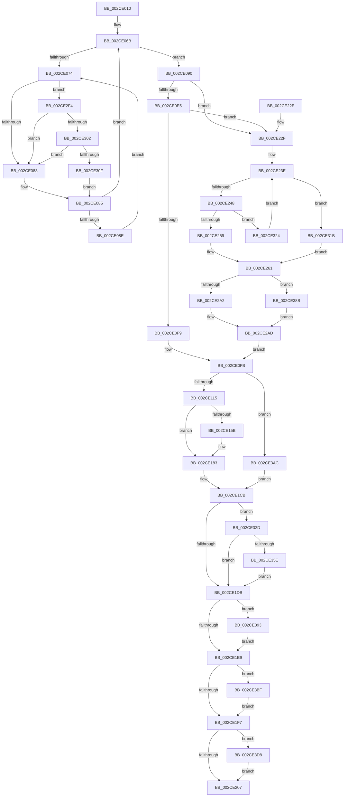

# KiSetAffinityThread

- RVA: `0x002CE010`–`0x002CE3EE` (길이 `990` bytes)
- VA: `0x00000001402CE010`
- 실행 섹션: `.text`
- PDB 이름 있음: `예`; PDB Function 태그: `아니요`
- unwind 정보 RVA: `0x0006F5A8`
- 디코드: `226`개 명령, `990/990` bytes 표시
- 미해석 바이트: `0` (있으면 어셈블리에 `.byte`로 보존)

> 이 문서는 커널 이미지의 기계어와 PDB 기호를 분석해 생성했습니다. 4번과 5번은 함수 원형과 자료형을 바이너리 사용 방식에서 추정한 C 해석이며 원본 소스 복구 결과는 아닙니다.

## 1. Dependencies

- 직접 호출 지점: **17**; 고유 호출 대상: **14**
- 직접 호출자로 확인된 함수: **4**
- RIP 상대 이미지 참조: **7**

### Outgoing calls
- `0x002CE0B6` → [KiCopyAffinityEx](KiCopyAffinityEx_function_002CE860.md) (function, `0x002CE860`)
- `0x002CE101` → [KiQueueTebUpdateApc](KiQueueTebUpdateApc_function_002CE3F4.md) (function, `0x002CE3F4`)
- `0x002CE134` → [KiAcquireThreadStateLockForWrite](../30/KiAcquireThreadStateLockForWrite_function_0030E8C0.md) (function, `0x0030E8C0`)
- `0x002CE14A` → [KiCopyAffinityEx](KiCopyAffinityEx_function_002CE860.md) (function, `0x002CE860`)
- `0x002CE152` → [KiComputeThreadAffinity](../39/KiComputeThreadAffinity_function_00399DE0.md) (function, `0x00399DE0`)
- `0x002CE173` → [KiUpdateNodeAffinitizedFlag](../39/KiUpdateNodeAffinitizedFlag_function_00399B1C.md) (function, `0x00399B1C`)
- `0x002CE17E` → [KiUpdateSharedReadyQueueAffinityThread](KiUpdateSharedReadyQueueAffinityThread_function_002CE470.md) (function, `0x002CE470`)
- `0x002CE1C3` → [KiRescheduleThreadAfterAffinityChange](../30/KiRescheduleThreadAfterAffinityChange_function_0030C9E8.md) (function, `0x0030C9E8`)
- `0x002CE20E` → [_security_check_cookie](../6A/_security_check_cookie_function_006AC640.md) (function, `0x006AC640`)
- `0x002CE2C3` → [KeSelectIdealProcessor](KeSelectIdealProcessor_function_002CE8CC.md) (function, `0x002CE8CC`)
- `0x002CE302` → [KiCheckVpBackingLongSpinWaitHypercall](../30/KiCheckVpBackingLongSpinWaitHypercall_function_0030F490.md) (function, `0x0030F490`)
- `0x002CE311` → [HvlNotifyLongSpinWait](../30/HvlNotifyLongSpinWait_function_0030F460.md) (function, `0x0030F460`)
- `0x002CE350` → [EtwTraceThreadAffinity](../3C/EtwTraceThreadAffinity_function_003C29A0.md) (function, `0x003C29A0`)
- `0x002CE381` → [EtwTraceThreadAffinity](../3C/EtwTraceThreadAffinity_function_003C29A0.md) (function, `0x003C29A0`)
- `0x002CE3A2` → [EtwTraceIdealProcessor](../3C/EtwTraceIdealProcessor_function_003C0808.md) (function, `0x003C0808`)
- `0x002CE3CE` → [EtwTraceIdealProcessor](../3C/EtwTraceIdealProcessor_function_003C0808.md) (function, `0x003C0808`)
- `0x002CE3E4` → [KiCpuPartitionCheckAffinitization](../5C/KiCpuPartitionCheckAffinitization_function_005C1420.md) (function, `0x005C1420`)

### Direct callers
- [KeSetUserGroupAffinityThread](KeSetUserGroupAffinityThread_function_002CD1C4.md) at `0x002CD26C`
- [KiSetLegacyAffinityThread](KiSetLegacyAffinityThread_function_002CDD94.md) at `0x002CDEE5`
- [KeSetUserAffinityThread](KeSetUserAffinityThread_function_002CFA2C.md) at `0x002CFAAC`
- [KeSetAffinityProcess](../3C/KeSetAffinityProcess_function_003C0A60.md) at `0x003C0C03`

### Static image references
- `0x002CE02C` → RVA `0x00E0A740` (`.data`; read)
- `0x002CE077` → RVA `0x00FC52AC` (`ALMOSTRO`; reference)
- `0x002CE0C2` → RVA `0x00FC8C40` (`ALMOSTRO`; read)
- `0x002CE1CB` → RVA `0x00FC6B04` (`ALMOSTRO`; read)
- `0x002CE1DB` → RVA `0x00FC6B10` (`ALMOSTRO`; read)
- `0x002CE1F7` → RVA `0x00FC6B14` (`ALMOSTRO`; read)
- `0x002CE2F4` → RVA `0x00FC6AB8` (`ALMOSTRO`; read)

## 2. Other-region calls and transfers

- 다른 실행 섹션으로 향하는 call: **0**
- 별도 외부 분기/꼬리 이동을 확인하지 못했습니다.

## 3. Assembly (complete function range)

```asm
002CE010  48 89 5C 24 20                  mov qword ptr [rsp + 0x20], rbx
002CE015  55                              push rbp
002CE016  56                              push rsi
002CE017  57                              push rdi
002CE018  41 54                           push r12
002CE01A  41 55                           push r13
002CE01C  41 56                           push r14
002CE01E  41 57                           push r15
002CE020  48 8D 6C 24 D9                  lea rbp, [rsp - 0x27]
002CE025  48 81 EC D0 00 00 00            sub rsp, 0xd0
002CE02C  48 8B 05 0D C7 B3 00            mov rax, qword ptr [rip + 0xb3c70d]
002CE033  48 33 C4                        xor rax, rsp
002CE036  48 89 45 17                     mov qword ptr [rbp + 0x17], rax
002CE03A  33 F6                           xor esi, esi
002CE03C  44 88 4D A7                     mov byte ptr [rbp - 0x59], r9b
002CE040  0F 57 C0                        xorps xmm0, xmm0
002CE043  48 89 55 E7                     mov qword ptr [rbp - 0x19], rdx
002CE047  4D 8B F0                        mov r14, r8
002CE04A  48 89 75 BF                     mov qword ptr [rbp - 0x41], rsi
002CE04E  48 8B D9                        mov rbx, rcx
002CE051  66 89 75 AB                     mov word ptr [rbp - 0x55], si
002CE055  44 8D 6E 01                     lea r13d, [rsi + 1]
002CE059  48 89 75 CF                     mov qword ptr [rbp - 0x31], rsi
002CE05D  0F 11 45 D7                     movups xmmword ptr [rbp - 0x29], xmm0
002CE061  48 89 75 C7                     mov qword ptr [rbp - 0x39], rsi
002CE065  8B FE                           mov edi, esi
002CE067  40 88 75 A8                     mov byte ptr [rbp - 0x58], sil
002CE06B  F0 48 0F BA 6B 40 00            lock bts qword ptr [rbx + 0x40], 0
002CE072  73 1C                           jae 0x1402ce090
002CE074  41 03 FD                        add edi, r13d
002CE077  85 3D 2F 72 CF 00               test dword ptr [rip + 0xcf722f], edi
002CE07D  0F 84 71 02 00 00               je 0x1402ce2f4
002CE083  F3 90                           pause
002CE085  48 8B 43 40                     mov rax, qword ptr [rbx + 0x40]
002CE089  48 85 C0                        test rax, rax
002CE08C  74 DD                           je 0x1402ce06b
002CE08E  EB E4                           jmp 0x1402ce074
002CE090  8B 83 4C 02 00 00               mov eax, dword ptr [rbx + 0x24c]
002CE096  4D 8B C6                        mov r8, r14
002CE099  48 8B 8B 28 02 00 00            mov rcx, qword ptr [rbx + 0x228]
002CE0A0  89 45 B7                        mov dword ptr [rbp - 0x49], eax
002CE0A3  89 45 B3                        mov dword ptr [rbp - 0x4d], eax
002CE0A6  8B 83 C4 00 00 00               mov eax, dword ptr [rbx + 0xc4]
002CE0AC  44 8B F8                        mov r15d, eax
002CE0AF  0F B7 51 02                     movzx edx, word ptr [rcx + 2]
002CE0B3  89 45 BB                        mov dword ptr [rbp - 0x45], eax
002CE0B6  E8 A5 07 00 00                  call 0x1402ce860
002CE0BB  44 8B A3 C4 00 00 00            mov r12d, dword ptr [rbx + 0xc4]
002CE0C2  48 8D 0D 77 AB CF 00            lea rcx, [rip + 0xcfab77]
002CE0C9  4A 8B 34 E1                     mov rsi, qword ptr [rcx + r12*8]
002CE0CD  0F B6 86 D0 00 00 00            movzx eax, byte ptr [rsi + 0xd0]
002CE0D4  4C 8D 86 D1 00 00 00            lea r8, [rsi + 0xd1]
002CE0DB  66 41 3B 06                     cmp ax, word ptr [r14]
002CE0DF  0F 83 4A 01 00 00               jae 0x1402ce22f
002CE0E5  41 8A 08                        mov cl, byte ptr [r8]
002CE0E8  49 8B 54 C6 08                  mov rdx, qword ptr [r14 + rax*8 + 8]
002CE0ED  48 D3 EA                        shr rdx, cl
002CE0F0  41 84 D5                        test r13b, dl
002CE0F3  0F 84 36 01 00 00               je 0x1402ce22f
002CE0F9  33 FF                           xor edi, edi
002CE0FB  8A 55 A7                        mov dl, byte ptr [rbp - 0x59]
002CE0FE  48 8B CB                        mov rcx, rbx
002CE101  E8 EE 02 00 00                  call 0x1402ce3f4
002CE106  8B 43 74                        mov eax, dword ptr [rbx + 0x74]
002CE109  44 8A 6D A8                     mov r13b, byte ptr [rbp - 0x58]
002CE10D  A8 08                           test al, 8
002CE10F  0F 85 97 02 00 00               jne 0x1402ce3ac
002CE115  0F 57 C0                        xorps xmm0, xmm0
002CE118  48 8D 45 EF                     lea rax, [rbp - 0x11]
002CE11C  4C 8D 4D BF                     lea r9, [rbp - 0x41]
002CE120  48 89 44 24 20                  mov qword ptr [rsp + 0x20], rax
002CE125  4C 8D 45 C7                     lea r8, [rbp - 0x39]
002CE129  48 8B CB                        mov rcx, rbx
002CE12C  48 8D 55 CF                     lea rdx, [rbp - 0x31]
002CE130  0F 11 45 EF                     movups xmmword ptr [rbp - 0x11], xmm0
002CE134  E8 87 07 04 00                  call 0x14030e8c0
002CE139  48 8B 8B 40 02 00 00            mov rcx, qword ptr [rbx + 0x240]
002CE140  4D 8B C6                        mov r8, r14
002CE143  44 8A E8                        mov r13b, al
002CE146  0F B7 51 02                     movzx edx, word ptr [rcx + 2]
002CE14A  E8 11 07 00 00                  call 0x1402ce860
002CE14F  48 8B CB                        mov rcx, rbx
002CE152  E8 89 BC 0C 00                  call 0x140399de0
002CE157  85 C0                           test eax, eax
002CE159  75 28                           jne 0x1402ce183
002CE15B  44 89 A3 4C 02 00 00            mov dword ptr [rbx + 0x24c], r12d
002CE162  48 8B CB                        mov rcx, rbx
002CE165  0F B6 86 D0 00 00 00            movzx eax, byte ptr [rsi + 0xd0]
002CE16C  66 89 83 48 02 00 00            mov word ptr [rbx + 0x248], ax
002CE173  E8 A4 B9 0C 00                  call 0x140399b1c
002CE178  48 8B D3                        mov rdx, rbx
002CE17B  48 8B CE                        mov rcx, rsi
002CE17E  E8 ED 02 00 00                  call 0x1402ce470
002CE183  48 8B 45 E7                     mov rax, qword ptr [rbp - 0x19]
002CE187  45 8A CD                        mov r9b, r13b
002CE18A  48 8B 93 40 02 00 00            mov rdx, qword ptr [rbx + 0x240]
002CE191  48 8B CB                        mov rcx, rbx
002CE194  8B B3 4C 02 00 00               mov esi, dword ptr [rbx + 0x24c]
002CE19A  48 89 44 24 40                  mov qword ptr [rsp + 0x40], rax
002CE19F  48 8D 45 EF                     lea rax, [rbp - 0x11]
002CE1A3  48 89 44 24 38                  mov qword ptr [rsp + 0x38], rax
002CE1A8  48 8B 45 BF                     mov rax, qword ptr [rbp - 0x41]
002CE1AC  48 89 44 24 30                  mov qword ptr [rsp + 0x30], rax
002CE1B1  48 8D 45 C7                     lea rax, [rbp - 0x39]
002CE1B5  48 89 44 24 28                  mov qword ptr [rsp + 0x28], rax
002CE1BA  48 8B 45 CF                     mov rax, qword ptr [rbp - 0x31]
002CE1BE  48 89 44 24 20                  mov qword ptr [rsp + 0x20], rax
002CE1C3  E8 20 E8 03 00                  call 0x14030c9e8
002CE1C8  41 B5 01                        mov r13b, 1
002CE1CB  F7 05 2F 89 CF 00 00 10 00 00   test dword ptr [rip + 0xcf892f], 0x1000
002CE1D5  0F 85 52 01 00 00               jne 0x1402ce32d
002CE1DB  0F BA 25 2D 89 CF 00 1B         bt dword ptr [rip + 0xcf892d], 0x1b
002CE1E3  0F 82 AA 01 00 00               jb 0x1402ce393
002CE1E9  0F BA 25 1F 89 CF 00 1B         bt dword ptr [rip + 0xcf891f], 0x1b
002CE1F1  0F 82 C8 01 00 00               jb 0x1402ce3bf
002CE1F7  F7 05 13 89 CF 00 00 02 00 00   test dword ptr [rip + 0xcf8913], 0x200
002CE201  0F 85 D1 01 00 00               jne 0x1402ce3d8
002CE207  48 8B 4D 17                     mov rcx, qword ptr [rbp + 0x17]
002CE20B  48 33 CC                        xor rcx, rsp
002CE20E  E8 2D E4 3D 00                  call 0x1406ac640
002CE213  48 8B 9C 24 28 01 00 00         mov rbx, qword ptr [rsp + 0x128]
002CE21B  48 81 C4 D0 00 00 00            add rsp, 0xd0
002CE222  41 5F                           pop r15
002CE224  41 5E                           pop r14
002CE226  41 5D                           pop r13
002CE228  41 5C                           pop r12
002CE22A  5F                              pop rdi
002CE22B  5E                              pop rsi
002CE22C  5D                              pop rbp
002CE22D  C3                              ret
002CE22E  CC                              int3
002CE22F  F0 0F BA 73 78 00               lock btr dword ptr [rbx + 0x78], 0
002CE235  45 0F B7 0E                     movzx r9d, word ptr [r14]
002CE239  33 FF                           xor edi, edi
002CE23B  0F B7 D7                        movzx edx, di
002CE23E  66 41 3B D1                     cmp dx, r9w
002CE242  0F 83 D3 00 00 00               jae 0x1402ce31b
002CE248  0F B7 C2                        movzx eax, dx
002CE24B  49 8B 4C C6 08                  mov rcx, qword ptr [r14 + rax*8 + 8]
002CE250  48 85 C9                        test rcx, rcx
002CE253  0F 84 CB 00 00 00               je 0x1402ce324
002CE259  66 89 55 DF                     mov word ptr [rbp - 0x21], dx
002CE25D  48 89 4D D7                     mov qword ptr [rbp - 0x29], rcx
002CE261  41 0F B6 00                     movzx eax, byte ptr [r8]
002CE265  66 89 45 AB                     mov word ptr [rbp - 0x55], ax
002CE269  48 8B 83 20 02 00 00            mov rax, qword ptr [rbx + 0x220]
002CE270  4C 8B 80 B8 00 00 00            mov r8, qword ptr [rax + 0xb8]
002CE277  48 8B 86 70 8E 00 00            mov rax, qword ptr [rsi + 0x8e70]
002CE27E  48 89 45 FF                     mov qword ptr [rbp - 1], rax
002CE282  48 8B 86 C0 00 00 00            mov rax, qword ptr [rsi + 0xc0]
002CE289  48 8B 88 80 00 00 00            mov rcx, qword ptr [rax + 0x80]
002CE290  48 89 4D 07                     mov qword ptr [rbp + 7], rcx
002CE294  66 41 3B 90 D0 00 00 00         cmp dx, word ptr [r8 + 0xd0]
002CE29C  0F 83 E9 00 00 00               jae 0x1402ce38b
002CE2A2  0F B7 C2                        movzx eax, dx
002CE2A5  49 8B 8C C0 D8 00 00 00         mov rcx, qword ptr [r8 + rax*8 + 0xd8]
002CE2AD  48 89 4D 0F                     mov qword ptr [rbp + 0xf], rcx
002CE2B1  4C 8D 45 FF                     lea r8, [rbp - 1]
002CE2B5  48 8D 4D D7                     lea rcx, [rbp - 0x29]
002CE2B9  41 B9 03 00 00 00               mov r9d, 3
002CE2BF  48 8D 55 AB                     lea rdx, [rbp - 0x55]
002CE2C3  E8 04 06 00 00                  call 0x1402ce8cc
002CE2C8  44 0F B7 F8                     movzx r15d, ax
002CE2CC  48 8D 35 6D A9 CF 00            lea rsi, [rip + 0xcfa96d]
002CE2D3  44 89 BB C4 00 00 00            mov dword ptr [rbx + 0xc4], r15d
002CE2DA  45 8B E7                        mov r12d, r15d
002CE2DD  4A 8B 34 FE                     mov rsi, qword ptr [rsi + r15*8]
002CE2E1  0F B6 86 D0 00 00 00            movzx eax, byte ptr [rsi + 0xd0]
002CE2E8  66 89 83 30 02 00 00            mov word ptr [rbx + 0x230], ax
002CE2EF  E9 07 FE FF FF                  jmp 0x1402ce0fb
002CE2F4  8B 05 BE 87 CF 00               mov eax, dword ptr [rip + 0xcf87be]
002CE2FA  A8 40                           test al, 0x40
002CE2FC  0F 84 81 FD FF FF               je 0x1402ce083
002CE302  E8 89 11 04 00                  call 0x14030f490
002CE307  84 C0                           test al, al
002CE309  0F 84 74 FD FF FF               je 0x1402ce083
002CE30F  8B CF                           mov ecx, edi
002CE311  E8 4A 11 04 00                  call 0x14030f460
002CE316  E9 6A FD FF FF                  jmp 0x1402ce085
002CE31B  0F B7 55 DF                     movzx edx, word ptr [rbp - 0x21]
002CE31F  E9 3D FF FF FF                  jmp 0x1402ce261
002CE324  66 41 03 D5                     add dx, r13w
002CE328  E9 11 FF FF FF                  jmp 0x1402ce23e
002CE32D  48 8B 83 28 02 00 00            mov rax, qword ptr [rbx + 0x228]
002CE334  45 33 C9                        xor r9d, r9d
002CE337  0F B7 93 30 02 00 00            movzx edx, word ptr [rbx + 0x230]
002CE33E  44 8A C7                        mov r8b, dil
002CE341  66 C7 44 24 28 37 05            mov word ptr [rsp + 0x28], 0x537
002CE348  48 8B CB                        mov rcx, rbx
002CE34B  48 89 44 24 20                  mov qword ptr [rsp + 0x20], rax
002CE350  E8 4B 46 0F 00                  call 0x1403c29a0
002CE355  45 84 ED                        test r13b, r13b
002CE358  0F 84 7D FE FF FF               je 0x1402ce1db
002CE35E  48 8B 83 40 02 00 00            mov rax, qword ptr [rbx + 0x240]
002CE365  45 33 C9                        xor r9d, r9d
002CE368  0F B7 93 48 02 00 00            movzx edx, word ptr [rbx + 0x248]
002CE36F  44 8A C7                        mov r8b, dil
002CE372  66 C7 44 24 28 36 05            mov word ptr [rsp + 0x28], 0x536
002CE379  48 8B CB                        mov rcx, rbx
002CE37C  48 89 44 24 20                  mov qword ptr [rsp + 0x20], rax
002CE381  E8 1A 46 0F 00                  call 0x1403c29a0
002CE386  E9 50 FE FF FF                  jmp 0x1402ce1db
002CE38B  48 8B CF                        mov rcx, rdi
002CE38E  E9 1A FF FF FF                  jmp 0x1402ce2ad
002CE393  44 8B 45 B7                     mov r8d, dword ptr [rbp - 0x49]
002CE397  BA 46 05 00 00                  mov edx, 0x546
002CE39C  44 8B CE                        mov r9d, esi
002CE39F  48 8B CB                        mov rcx, rbx
002CE3A2  E8 61 24 0F 00                  call 0x1403c0808
002CE3A7  E9 3D FE FF FF                  jmp 0x1402ce1e9
002CE3AC  8B 75 B3                        mov esi, dword ptr [rbp - 0x4d]
002CE3AF  40 B7 01                        mov dil, 1
002CE3B2  48 C7 43 40 00 00 00 00         mov qword ptr [rbx + 0x40], 0
002CE3BA  E9 0C FE FF FF                  jmp 0x1402ce1cb
002CE3BF  44 8B 45 BB                     mov r8d, dword ptr [rbp - 0x45]
002CE3C3  BA 47 05 00 00                  mov edx, 0x547
002CE3C8  45 8B CF                        mov r9d, r15d
002CE3CB  48 8B CB                        mov rcx, rbx
002CE3CE  E8 35 24 0F 00                  call 0x1403c0808
002CE3D3  E9 1F FE FF FF                  jmp 0x1402ce1f7
002CE3D8  41 B1 01                        mov r9b, 1
002CE3DB  45 33 C0                        xor r8d, r8d
002CE3DE  49 8B D6                        mov rdx, r14
002CE3E1  48 8B CB                        mov rcx, rbx
002CE3E4  E8 37 30 2F 00                  call 0x1405c1420
002CE3E9  E9 19 FE FF FF                  jmp 0x1402ce207
```

## 4. C-style interpretation (structured pseudocode)

```c
__int64 __fastcall KiSetAffinityThread(__int64 a1, __int64 a2, __int64 a3, unsigned __int8 a4)
{
    __int64 result;
    __int64 v_rdi;
    __int64 v_rsi;
    __int64 v_rsp;
    unsigned __int64 v_stack_m48;
    unsigned __int64 v_stack_m50;
    unsigned __int64 v_stack_m58;
    unsigned __int64 v_stack_m5F;
    unsigned __int64 v_stack_m60;
    unsigned __int64 v_stack_m70;
    unsigned __int64 v_stack_m78;
    unsigned __int16 v_stack_m80;
    unsigned __int64 v_stack_m88;
    unsigned __int64 v_stack_m90;
    unsigned __int64 v_stack_m98;
    unsigned __int64 v_stack_mA0;
    unsigned int v_stack_mA4;
    unsigned int v_stack_mA8;
    unsigned int v_stack_mAC;
    unsigned __int16 v_stack_mB4;
    unsigned __int8 v_stack_mB7;
    unsigned __int8 v_stack_mB8;
    unsigned __int64 v_stack_mC8;
    unsigned __int64 v_stack_mD0;
    unsigned __int64 v_stack_mD8;
    unsigned __int64 v_stack_mE0;
    unsigned __int64 v_stack_mE8;
    unsigned __int64 v_stack_p20;
    unsigned __int16 v_stack_p28;

    v_stack_p20 = v_rbx;
    v_rsp = (v_rsp) - (208);
    result = (*(unsigned __int64 *)(v_rip + 11781901)) ^ (v_rsp);
    v_stack_m48 = result;
    v_rsi = 0;
    v_stack_mB8 = a4;
    v_stack_m78 = a2;
    v_stack_mA0 = 0;
    v_stack_mB4 = 0;
    v_stack_m90 = 0;
    v_stack_m88 = v_xmm0;
    v_stack_m98 = 0;
    v_stack_mB7 = 0;
loc_002CE06B:
    if (condition_is_above_or_equal) goto loc_002CE090;
loc_002CE074:
    v_rdi = (unsigned int)((0) + ((unsigned int)(v_rsi + 1)));
    if (((*(unsigned int *)(v_rip + 13595183)) & ((unsigned int)(v_rdi))) == 0) goto loc_002CE2F4;
loc_002CE083:
loc_002CE085:
    if (*(unsigned __int64 *)(a1 + 64) == 0) goto loc_002CE06B;
    goto loc_002CE074;
loc_002CE090:
    v_stack_mA8 = (unsigned int)((unsigned int)(*(unsigned int *)(a1 + 588)));
    v_stack_mAC = (unsigned int)((unsigned int)(*(unsigned int *)(a1 + 588)));
    v_stack_mA4 = (unsigned int)((unsigned int)(*(unsigned int *)(a1 + 196)));
    result = KiCopyAffinityEx(*(unsigned __int64 *)(a1 + 552), *(unsigned __int16 *)(*(unsigned __int64 *)(a1 + 552) + 2), a3, a4);
    if (((unsigned __int16)(*(unsigned __int8 *)(*(unsigned __int64 *)(v_rip + 13609847 + (unsigned int)(*(unsigned int *)(a1 + 196)) * 8) + 208))) >= (*(unsigned __int16 *)(a3))) goto loc_002CE22F;
    a2 = (*(unsigned __int64 *)(a3 + *(unsigned __int8 *)(*(unsigned __int64 *)(v_rip + 13609847 + (unsigned int)(*(unsigned int *)(a1 + 196)) * 8) + 208) * 8 + 8)) >> ((unsigned __int8)(*(unsigned __int8 *)(*(unsigned __int64 *)(v_rip + 13609847 + (unsigned int)(*(unsigned int *)(a1 + 196)) * 8) + 209)));
    if ((((unsigned __int8)(v_rsi + 1)) & ((unsigned __int8)(a2))) == 0) goto loc_002CE22F;
    v_rdi = 0;
loc_002CE0FB:
    result = KiQueueTebUpdateApc(a1, v_stack_mB8, *(unsigned __int64 *)(v_rip + 13609847 + (unsigned int)(*(unsigned int *)(a1 + 196)) * 8) + 209, a4);
    if ((((unsigned __int8)((unsigned int)(*(unsigned int *)(a1 + 116)))) & (8)) != 0) goto loc_002CE3AC;
    v_stack_mE8 = v_stack_m70;
    v_stack_m70 = v_xmm0;
    result = KiAcquireThreadStateLockForWrite(a1, v_stack_m90, v_stack_m98, v_stack_mA0);
    result = KiCopyAffinityEx(*(unsigned __int64 *)(a1 + 576), *(unsigned __int16 *)(*(unsigned __int64 *)(a1 + 576) + 2), a3, v_stack_mA0);
    result = KiComputeThreadAffinity(a1, *(unsigned __int16 *)(*(unsigned __int64 *)(a1 + 576) + 2), a3, v_stack_mA0);
    if ((unsigned int)(result) == 0) {
        *(unsigned int *)(a1 + 588) = (unsigned int)((unsigned int)(*(unsigned int *)(a1 + 196)));
        a1 = a1;
        result = *(unsigned __int8 *)(*(unsigned __int64 *)(v_rip + 13609847 + (unsigned int)(*(unsigned int *)(a1 + 196)) * 8) + 208);
        *(unsigned __int16 *)(a1 + 584) = (unsigned __int16)(result);
        result = KiUpdateNodeAffinitizedFlag(a1, *(unsigned __int16 *)(*(unsigned __int64 *)(a1 + 576) + 2), a3, v_stack_mA0);
        a2 = a1;
        a1 = *(unsigned __int64 *)(v_rip + 13609847 + (unsigned int)(*(unsigned int *)(a1 + 196)) * 8);
        result = KiUpdateSharedReadyQueueAffinityThread(a1, a2, a3, v_stack_mA0);
    }
    v_stack_mC8 = v_stack_m78;
    v_stack_mD0 = v_stack_m70;
    v_stack_mD8 = v_stack_mA0;
    v_stack_mE0 = v_stack_m98;
    v_stack_mE8 = v_stack_m90;
    result = KiRescheduleThreadAfterAffinityChange(a1, *(unsigned __int64 *)(a1 + 576), a3, (unsigned __int8)((unsigned __int8)(result)));
loc_002CE1CB:
    if (((*(unsigned int *)(v_rip + 13601071)) & (0x1000ULL)) != 0) goto loc_002CE32D;
loc_002CE1DB:
    if (condition_is_below) goto loc_002CE393;
loc_002CE1E9:
    if (condition_is_below) goto loc_002CE3BF;
loc_002CE1F7:
    if (((*(unsigned int *)(v_rip + 13601043)) & (512)) != 0) goto loc_002CE3D8;
loc_002CE207:
    a1 = (v_stack_m48) ^ (v_rsp);
    result = _security_check_cookie(a1, *(unsigned __int64 *)(a1 + 576), a3, (unsigned __int8)((unsigned __int8)(result)));
    v_rsp = (v_rsp) + (208);
    return result;
loc_002CE22F:
    v_rdi = 0;
loc_002CE23E:
    if (0 >= ((unsigned __int16)(*(unsigned __int16 *)(a3)))) goto loc_002CE31B;
    if (*(unsigned __int64 *)(a3 + 0 * 8 + 8) == 0) goto loc_002CE324;
    v_stack_m80 = 0;
    v_stack_m88 = *(unsigned __int64 *)(a3 + 0 * 8 + 8);
loc_002CE261:
    v_stack_mB4 = (unsigned __int16)(*(unsigned __int8 *)(a3));
    v_stack_m60 = *(unsigned __int64 *)((unsigned int)(*(unsigned int *)(a1 + 588)) + 36464);
    v_stack_m58 = *(unsigned __int64 *)(*(unsigned __int64 *)((unsigned int)(*(unsigned int *)(a1 + 588)) + 192) + 128);
    if (0 >= (*(unsigned __int16 *)(*(unsigned __int64 *)(*(unsigned __int64 *)(v_stack_p20 + 544) + 184) + 208))) goto loc_002CE38B;
loc_002CE2AD:
    v_stack_m50 = *(unsigned __int64 *)(*(unsigned __int64 *)(*(unsigned __int64 *)(v_stack_p20 + 544) + 184) + 0 * 8 + 216);
    result = KeSelectIdealProcessor(v_stack_m88, v_stack_mB4, v_stack_m60, 3);
    *(unsigned int *)(v_stack_p20 + 196) = (unsigned int)((unsigned __int16)(result));
    *(unsigned __int16 *)(v_stack_p20 + 560) = (unsigned __int16)(*(unsigned __int8 *)(*(unsigned __int64 *)(v_rip + 13609325 + (unsigned __int16)(result) * 8) + 208));
    goto loc_002CE0FB;
loc_002CE2F4:
    if ((((unsigned __int8)((unsigned int)(*(unsigned int *)(v_rip + 13600702)))) & (64)) == 0) goto loc_002CE083;
    result = KiCheckVpBackingLongSpinWaitHypercall(v_stack_m88, v_stack_mB4, v_stack_m60, 3);
    if ((unsigned __int8)(result) == 0) goto loc_002CE083;
    result = HvlNotifyLongSpinWait(0, v_stack_mB4, v_stack_m60, 3);
    goto loc_002CE085;
loc_002CE31B:
    goto loc_002CE261;
loc_002CE324:
    a2 = (unsigned __int16)((v_stack_m80) + (1));
    goto loc_002CE23E;
loc_002CE32D:
    a4 = 0;
    v_stack_p28 = 0x537ULL;
    v_stack_p20 = *(unsigned __int64 *)(v_stack_p20 + 552);
    result = EtwTraceThreadAffinity(v_stack_p20, *(unsigned __int16 *)(v_stack_p20 + 560), 0, a4);
    if (1 == 0) goto loc_002CE1DB;
    a4 = 0;
    v_stack_p28 = 0x536ULL;
    v_stack_p20 = *(unsigned __int64 *)(v_stack_p20 + 576);
    result = EtwTraceThreadAffinity(v_stack_p20, *(unsigned __int16 *)(v_stack_p20 + 584), 0, a4);
    goto loc_002CE1DB;
loc_002CE38B:
    goto loc_002CE2AD;
loc_002CE393:
    result = EtwTraceIdealProcessor(v_stack_p20, (unsigned int)(0x546ULL), (unsigned int)(v_stack_mA8), (unsigned int)((unsigned int)(*(unsigned __int64 *)(v_rip + 13609325 + (unsigned __int16)(result) * 8))));
    goto loc_002CE1E9;
loc_002CE3AC:
    *(unsigned __int64 *)(v_stack_p20 + 64) = 0;
    goto loc_002CE1CB;
loc_002CE3BF:
    result = EtwTraceIdealProcessor(v_stack_p20, (unsigned int)(0x547ULL), (unsigned int)(v_stack_mA4), (unsigned int)((unsigned int)((unsigned __int16)(result))));
    goto loc_002CE1F7;
loc_002CE3D8:
    a3 = 0;
    result = KiCpuPartitionCheckAffinitization(v_stack_p20, 0, a3, 1);
    goto loc_002CE207;
}
```

## 5. (Beta) C Style

```c
int64_t KiSetAffinityThread(void *Arg1, int64_t Arg2, void *Arg3, uint8_t Arg4)
{
    uint8_t *arg1 = (uint8_t *)Arg1;
    uint8_t *arg3 = (uint8_t *)Arg3;

    int64_t result;
    int64_t local_rdi;
    int64_t local_rsi;
    int64_t local_rsp;
    uint64_t v_stack_m48;
    uint64_t v_stack_m50;
    uint64_t v_stack_m58;
    uint64_t v_stack_m5F;
    uint64_t v_stack_m60;
    uint64_t v_stack_m70;
    uint64_t v_stack_m78;
    uint16_t v_stack_m80;
    uint64_t v_stack_m88;
    uint64_t v_stack_m90;
    uint64_t v_stack_m98;
    uint64_t v_stack_mA0;
    uint32_t v_stack_mA4;
    uint32_t v_stack_mA8;
    uint32_t v_stack_mAC;
    uint16_t v_stack_mB4;
    uint8_t v_stack_mB7;
    uint8_t v_stack_mB8;
    uint64_t v_stack_mC8;
    uint64_t v_stack_mD0;
    uint64_t v_stack_mD8;
    uint64_t v_stack_mE0;
    uint64_t v_stack_mE8;
    uint64_t v_stack_p20;
    uint16_t v_stack_p28;

    v_stack_p20 = local_rbx;
    local_rsp = (local_rsp) - (208);
    result = (*(uint64_t *)(v_rip + 0xB3C70D)) ^ (local_rsp);
    v_stack_m48 = result;
    local_rsi = 0;
    v_stack_mB8 = Arg4;
    v_stack_m78 = Arg2;
    v_stack_mA0 = 0;
    v_stack_mB4 = 0;
    v_stack_m90 = 0;
    v_stack_m88 = v_xmm0;
    v_stack_m98 = 0;
    v_stack_mB7 = 0;
loc_002CE06B:
    if (condition_is_above_or_equal) goto loc_002CE090;
loc_002CE074:
    local_rdi = (uint32_t)((0) + ((uint32_t)(local_rsi + 1)));
    if (((*(uint32_t *)(v_rip + 0xCF722F)) & ((uint32_t)(local_rdi))) == 0) goto loc_002CE2F4;
loc_002CE083:
loc_002CE085:
    if (*(uint64_t *)(arg1 + 0x40) == 0) goto loc_002CE06B;
    goto loc_002CE074;
loc_002CE090:
    v_stack_mA8 = (uint32_t)((uint32_t)(*(uint32_t *)(arg1 + 0x24C)));
    v_stack_mAC = (uint32_t)((uint32_t)(*(uint32_t *)(arg1 + 0x24C)));
    v_stack_mA4 = (uint32_t)((uint32_t)(*(uint32_t *)(arg1 + 0xC4)));
    result = KiCopyAffinityEx(*(uint64_t *)(arg1 + 0x228), *(uint16_t *)(*(uint64_t *)(arg1 + 0x228) + 0x2), Arg3, Arg4);
    if (((uint16_t)(*(uint8_t *)(*(uint64_t *)(v_rip + 0xCFAB77 + (uint32_t)(*(uint32_t *)(arg1 + 0xC4)) * 8) + 0xD0))) >= (*(uint16_t *)(arg3))) goto loc_002CE22F;
    Arg2 = (*(uint64_t *)(arg3 + *(uint8_t *)(*(uint64_t *)(v_rip + 0xCFAB77 + (uint32_t)(*(uint32_t *)(arg1 + 0xC4)) * 8) + 0xD0) * 8 + 0x8)) >> ((uint8_t)(*(uint8_t *)(*(uint64_t *)(v_rip + 0xCFAB77 + (uint32_t)(*(uint32_t *)(arg1 + 0xC4)) * 8) + 0xD1)));
    if ((((uint8_t)(local_rsi + 1)) & ((uint8_t)(Arg2))) == 0) goto loc_002CE22F;
    local_rdi = 0;
loc_002CE0FB:
    result = KiQueueTebUpdateApc(Arg1, v_stack_mB8, *(uint64_t *)(v_rip + 0xCFAB77 + (uint32_t)(*(uint32_t *)(arg1 + 0xC4)) * 8) + 209, Arg4);
    if ((((uint8_t)((uint32_t)(*(uint32_t *)(arg1 + 0x74)))) & (8)) != 0) goto loc_002CE3AC;
    v_stack_mE8 = v_stack_m70;
    v_stack_m70 = v_xmm0;
    result = KiAcquireThreadStateLockForWrite(Arg1, v_stack_m90, v_stack_m98, v_stack_mA0);
    result = KiCopyAffinityEx(*(uint64_t *)(arg1 + 0x240), *(uint16_t *)(*(uint64_t *)(arg1 + 0x240) + 0x2), Arg3, v_stack_mA0);
    result = KiComputeThreadAffinity(Arg1, *(uint16_t *)(*(uint64_t *)(arg1 + 0x240) + 0x2), Arg3, v_stack_mA0);
    if ((uint32_t)(result) == 0) {
        *(uint32_t *)(arg1 + 0x24C) = (uint32_t)((uint32_t)(*(uint32_t *)(arg1 + 0xC4)));
        Arg1 = Arg1;
        result = *(uint8_t *)(*(uint64_t *)(v_rip + 0xCFAB77 + (uint32_t)(*(uint32_t *)(arg1 + 0xC4)) * 8) + 0xD0);
        *(uint16_t *)(arg1 + 0x248) = (uint16_t)(result);
        result = KiUpdateNodeAffinitizedFlag(Arg1, *(uint16_t *)(*(uint64_t *)(arg1 + 0x240) + 0x2), Arg3, v_stack_mA0);
        Arg2 = Arg1;
        Arg1 = *(uint64_t *)(v_rip + 0xCFAB77 + (uint32_t)(*(uint32_t *)(arg1 + 0xC4)) * 8);
        result = KiUpdateSharedReadyQueueAffinityThread(Arg1, Arg2, Arg3, v_stack_mA0);
    }
    v_stack_mC8 = v_stack_m78;
    v_stack_mD0 = v_stack_m70;
    v_stack_mD8 = v_stack_mA0;
    v_stack_mE0 = v_stack_m98;
    v_stack_mE8 = v_stack_m90;
    result = KiRescheduleThreadAfterAffinityChange(Arg1, *(uint64_t *)(arg1 + 0x240), Arg3, (uint8_t)((uint8_t)(result)));
loc_002CE1CB:
    if (((*(uint32_t *)(v_rip + 0xCF892F)) & (0x1000ULL)) != 0) goto loc_002CE32D;
loc_002CE1DB:
    if (condition_is_below) goto loc_002CE393;
loc_002CE1E9:
    if (condition_is_below) goto loc_002CE3BF;
loc_002CE1F7:
    if (((*(uint32_t *)(v_rip + 0xCF8913)) & (512)) != 0) goto loc_002CE3D8;
loc_002CE207:
    Arg1 = (v_stack_m48) ^ (local_rsp);
    result = _security_check_cookie(Arg1, *(uint64_t *)(arg1 + 0x240), Arg3, (uint8_t)((uint8_t)(result)));
    local_rsp = (local_rsp) + (208);
    return result;
loc_002CE22F:
    local_rdi = 0;
loc_002CE23E:
    if (0 >= ((uint16_t)(*(uint16_t *)(arg3)))) goto loc_002CE31B;
    if (*(uint64_t *)(arg3 + 0x0 * 8 + 0x8) == 0) goto loc_002CE324;
    v_stack_m80 = 0;
    v_stack_m88 = *(uint64_t *)(arg3 + 0x0 * 8 + 0x8);
loc_002CE261:
    v_stack_mB4 = (uint16_t)(*(uint8_t *)(arg3));
    v_stack_m60 = *(uint64_t *)((uint32_t)(*(uint32_t *)(arg1 + 0x24C)) + 0x8E70);
    v_stack_m58 = *(uint64_t *)(*(uint64_t *)((uint32_t)(*(uint32_t *)(arg1 + 0x24C)) + 0xC0) + 0x80);
    if (0 >= (*(uint16_t *)(*(uint64_t *)(*(uint64_t *)(v_stack_p20 + 0x220) + 0xB8) + 0xD0))) goto loc_002CE38B;
loc_002CE2AD:
    v_stack_m50 = *(uint64_t *)(*(uint64_t *)(*(uint64_t *)(v_stack_p20 + 0x220) + 0xB8) + 0x0 * 8 + 0xD8);
    result = KeSelectIdealProcessor(v_stack_m88, v_stack_mB4, v_stack_m60, 3);
    *(uint32_t *)(v_stack_p20 + 0xC4) = (uint32_t)((uint16_t)(result));
    *(uint16_t *)(v_stack_p20 + 0x230) = (uint16_t)(*(uint8_t *)(*(uint64_t *)(v_rip + 0xCFA96D + (uint16_t)(result) * 8) + 0xD0));
    goto loc_002CE0FB;
loc_002CE2F4:
    if ((((uint8_t)((uint32_t)(*(uint32_t *)(v_rip + 0xCF87BE)))) & (64)) == 0) goto loc_002CE083;
    result = KiCheckVpBackingLongSpinWaitHypercall(v_stack_m88, v_stack_mB4, v_stack_m60, 3);
    if ((uint8_t)(result) == 0) goto loc_002CE083;
    result = HvlNotifyLongSpinWait(0, v_stack_mB4, v_stack_m60, 3);
    goto loc_002CE085;
loc_002CE31B:
    goto loc_002CE261;
loc_002CE324:
    Arg2 = (uint16_t)((v_stack_m80) + (1));
    goto loc_002CE23E;
loc_002CE32D:
    Arg4 = 0;
    v_stack_p28 = 0x537ULL;
    v_stack_p20 = *(uint64_t *)(v_stack_p20 + 0x228);
    result = EtwTraceThreadAffinity(v_stack_p20, *(uint16_t *)(v_stack_p20 + 0x230), 0, Arg4);
    if (1 == 0) goto loc_002CE1DB;
    Arg4 = 0;
    v_stack_p28 = 0x536ULL;
    v_stack_p20 = *(uint64_t *)(v_stack_p20 + 0x240);
    result = EtwTraceThreadAffinity(v_stack_p20, *(uint16_t *)(v_stack_p20 + 0x248), 0, Arg4);
    goto loc_002CE1DB;
loc_002CE38B:
    goto loc_002CE2AD;
loc_002CE393:
    result = EtwTraceIdealProcessor(v_stack_p20, (uint32_t)(0x546ULL), (uint32_t)(v_stack_mA8), (uint32_t)((uint32_t)(*(uint64_t *)(v_rip + 0xCFA96D + (uint16_t)(result) * 8))));
    goto loc_002CE1E9;
loc_002CE3AC:
    *(uint64_t *)(v_stack_p20 + 0x40) = 0;
    goto loc_002CE1CB;
loc_002CE3BF:
    result = EtwTraceIdealProcessor(v_stack_p20, (uint32_t)(0x547ULL), (uint32_t)(v_stack_mA4), (uint32_t)((uint32_t)((uint16_t)(result))));
    goto loc_002CE1F7;
loc_002CE3D8:
    Arg3 = 0;
    result = KiCpuPartitionCheckAffinitization(v_stack_p20, 0, Arg3, 1);
    goto loc_002CE207;
}
```

### 관측된 메모리 오프셋

구조체 형식이 확인되지 않은 접근은 인자 기준의 오프셋으로만 기록했습니다.

| 기준 인자 | 오프셋 표현 | 폭 (bit) | 접근 |
|---|---:|---:|---|
| `Arg1` | `+ 0x40` | `64` | `R` |
| `Arg1` | `+ 0x40` | `64` | `R/W` |
| `Arg1` | `+ 0x40` | `64` | `W` |
| `Arg1` | `+ 0x74` | `32` | `R` |
| `Arg1` | `+ 0x78` | `32` | `R/W` |
| `Arg1` | `+ 0xC4` | `32` | `R` |
| `Arg1` | `+ 0xC4` | `32` | `W` |
| `Arg1` | `+ 0x220` | `64` | `R` |
| `Arg1` | `+ 0x228` | `64` | `R` |
| `Arg1` | `+ 0x230` | `16` | `R` |
| `Arg1` | `+ 0x230` | `16` | `W` |
| `Arg1` | `+ 0x240` | `64` | `R` |
| `Arg1` | `+ 0x248` | `16` | `R` |
| `Arg1` | `+ 0x248` | `16` | `W` |
| `Arg1` | `+ 0x24C` | `32` | `R` |
| `Arg1` | `+ 0x24C` | `32` | `W` |
| `Arg3` | `+ 0x0` | `16` | `R` |
| `Arg3` | `+ 0x8 + rax*8` | `64` | `R` |

## 6. Execution-region graph

[열기: 2D/3D 그래프와 함수 탐색 컨트롤 패널](../../../control-panel.html?section=text&rva=0x002CE010&view=graph)

- 2D 그래프는 위에서 아래로 흐르고, 3D 그래프는 빈 공간을 드래그해 회전합니다. Shift+드래그는 이동, 휠은 확대·축소, 함수 노드 선택은 대상 보고서 이동입니다.

### Static fallback


