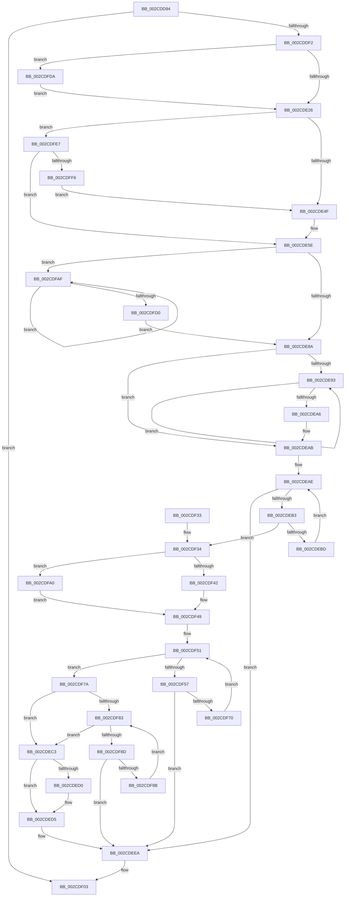

# KiSetLegacyAffinityThread

- RVA: `0x002CDD94`–`0x002CE008` (길이 `628` bytes)
- VA: `0x00000001402CDD94`
- 실행 섹션: `.text`
- PDB 이름 있음: `예`; PDB Function 태그: `아니요`
- unwind 정보 RVA: `0x0006F57C`
- 디코드: `156`개 명령, `628/628` bytes 표시
- 미해석 바이트: `0` (있으면 어셈블리에 `.byte`로 보존)

> 이 문서는 커널 이미지의 기계어와 PDB 기호를 분석해 생성했습니다. 4번과 5번은 함수 원형과 자료형을 바이너리 사용 방식에서 추정한 C 해석이며 원본 소스 복구 결과는 아닙니다.

## 1. Dependencies

- 직접 호출 지점: **8**; 고유 호출 대상: **7**
- 직접 호출자로 확인된 함수: **2**
- RIP 상대 이미지 참조: **4**

### Outgoing calls
- `0x002CDDDB` → [memset](../6C/memset_function_006C6C40.md) (function, `0x006C6C40`)
- `0x002CDE05` → [memset](../6C/memset_function_006C6C40.md) (function, `0x006C6C40`)
- `0x002CDE33` → [ExAcquireSpinLockSharedAtDpcLevel](../24/ExAcquireSpinLockSharedAtDpcLevel_function_00248E30.md) (function, `0x00248E30`)
- `0x002CDEE5` → [KiSetAffinityThread](KiSetAffinityThread_function_002CE010.md) (function, `0x002CE010`)
- `0x002CDEEE` → [ExReleaseSpinLockSharedFromDpcLevel](../24/ExReleaseSpinLockSharedFromDpcLevel_function_0024A590.md) (function, `0x0024A590`)
- `0x002CDEFE` → [KiProcessDeferredReadyList](../25/KiProcessDeferredReadyList_function_00250800.md) (function, `0x00250800`)
- `0x002CDF0D` → [_security_check_cookie](../6A/_security_check_cookie_function_006AC640.md) (function, `0x006AC640`)
- `0x002CDFDD` → [KiRaiseIrqlProcessIrqlFlags](../4F/KiRaiseIrqlProcessIrqlFlags_function_004F56FC.md) (function, `0x004F56FC`)

### Direct callers
- [KeSetAffinityThread](../5B/KeSetAffinityThread_function_005B8FD0.md) at `0x005B8FD4`
- [NtSetInformationThread](../../page/8C/NtSetInformationThread_function_008C9F60.md) at `0x008CAA89`

### Static image references
- `0x002CDDB7` → RVA `0x00E0A740` (`.data`; read)
- `0x002CDE1A` → RVA `0x00FC6D20` (`ALMOSTRO`; read)
- `0x002CDE5E` → RVA `0x00FC7120` (`ALMOSTRO`; read)
- `0x002CDFB2` → RVA `0x00FC7128` (`ALMOSTRO`; read)

## 2. Other-region calls and transfers

- 다른 실행 섹션으로 향하는 call: **0**
- 별도 외부 분기/꼬리 이동을 확인하지 못했습니다.

## 3. Assembly (complete function range)

```asm
002CDD94  48 8B C4                        mov rax, rsp
002CDD97  48 89 58 10                     mov qword ptr [rax + 0x10], rbx
002CDD9B  48 89 70 18                     mov qword ptr [rax + 0x18], rsi
002CDD9F  48 89 78 20                     mov qword ptr [rax + 0x20], rdi
002CDDA3  55                              push rbp
002CDDA4  41 54                           push r12
002CDDA6  41 55                           push r13
002CDDA8  41 56                           push r14
002CDDAA  41 57                           push r15
002CDDAC  48 8D 68 88                     lea rbp, [rax - 0x78]
002CDDB0  48 81 EC 50 01 00 00            sub rsp, 0x150
002CDDB7  48 8B 05 82 C9 B3 00            mov rax, qword ptr [rip + 0xb3c982]
002CDDBE  48 33 C4                        xor rax, rsp
002CDDC1  48 89 45 40                     mov qword ptr [rbp + 0x40], rax
002CDDC5  48 8B FA                        mov rdi, rdx
002CDDC8  48 8B F1                        mov rsi, rcx
002CDDCB  41 BE 00 01 00 00               mov r14d, 0x100
002CDDD1  48 8D 4C 24 38                  lea rcx, [rsp + 0x38]
002CDDD6  45 8B C6                        mov r8d, r14d
002CDDD9  33 D2                           xor edx, edx
002CDDDB  E8 60 8E 3F 00                  call 0x1406c6c40
002CDDE0  4C 8B BE 20 02 00 00            mov r15, qword ptr [rsi + 0x220]
002CDDE7  33 DB                           xor ebx, ebx
002CDDE9  48 85 FF                        test rdi, rdi
002CDDEC  0F 84 11 01 00 00               je 0x1402cdf03
002CDDF2  45 8B C6                        mov r8d, r14d
002CDDF5  48 C7 44 24 30 01 00 20 00      mov qword ptr [rsp + 0x30], 0x200001
002CDDFE  33 D2                           xor edx, edx
002CDE00  48 8D 4C 24 38                  lea rcx, [rsp + 0x38]
002CDE05  E8 36 8E 3F 00                  call 0x1406c6c40
002CDE0A  48 89 5C 24 20                  mov qword ptr [rsp + 0x20], rbx
002CDE0F  45 0F 20 C6                     mov r14, cr8
002CDE13  8D 53 02                        lea edx, [rbx + 2]
002CDE16  44 0F 22 C2                     mov cr8, rdx
002CDE1A  39 1D 00 8F CF 00               cmp dword ptr [rip + 0xcf8f00], ebx
002CDE20  0F 85 B4 01 00 00               jne 0x1402cdfda
002CDE26  65 4C 8B 2C 25 20 00 00 00      mov r13, qword ptr gs:[0x20]
002CDE2F  49 8D 4F 40                     lea rcx, [r15 + 0x40]
002CDE33  E8 F8 AF F7 FF                  call 0x140248e30
002CDE38  44 0F B7 86 30 02 00 00         movzx r8d, word ptr [rsi + 0x230]
002CDE40  0F B7 54 24 30                  movzx edx, word ptr [rsp + 0x30]
002CDE45  66 41 3B D0                     cmp dx, r8w
002CDE49  0F 86 98 01 00 00               jbe 0x1402cdfe7
002CDE4F  4A 09 7C C4 38                  or qword ptr [rsp + r8*8 + 0x38], rdi
002CDE54  0F B7 44 24 32                  movzx eax, word ptr [rsp + 0x32]
002CDE59  0F B7 54 24 30                  movzx edx, word ptr [rsp + 0x30]
002CDE5E  0F B7 0D BB 92 CF 00            movzx ecx, word ptr [rip + 0xcf92bb]
002CDE65  41 B9 01 00 00 00               mov r9d, 1
002CDE6B  66 3B D1                        cmp dx, cx
002CDE6E  66 0F 42 CA                     cmovb cx, dx
002CDE72  0F B7 D3                        movzx edx, bx
002CDE75  66 3B C8                        cmp cx, ax
002CDE78  66 0F 47 C8                     cmova cx, ax
002CDE7C  66 89 4C 24 30                  mov word ptr [rsp + 0x30], cx
002CDE81  66 3B D9                        cmp bx, cx
002CDE84  0F 82 25 01 00 00               jb 0x1402cdfaf
002CDE8A  89 5C 24 34                     mov dword ptr [rsp + 0x34], ebx
002CDE8E  66 3B D0                        cmp dx, ax
002CDE91  73 18                           jae 0x1402cdeab
002CDE93  0F B7 C2                        movzx eax, dx
002CDE96  66 41 03 D1                     add dx, r9w
002CDE9A  48 89 5C C4 38                  mov qword ptr [rsp + rax*8 + 0x38], rbx
002CDE9F  66 3B 54 24 32                  cmp dx, word ptr [rsp + 0x32]
002CDEA4  72 ED                           jb 0x1402cde93
002CDEA6  0F B7 4C 24 30                  movzx ecx, word ptr [rsp + 0x30]
002CDEAB  0F B7 D3                        movzx edx, bx
002CDEAE  66 3B D1                        cmp dx, cx
002CDEB1  73 37                           jae 0x1402cdeea
002CDEB3  0F B7 C2                        movzx eax, dx
002CDEB6  48 39 5C C4 38                  cmp qword ptr [rsp + rax*8 + 0x38], rbx
002CDEBB  75 77                           jne 0x1402cdf34
002CDEBD  66 41 03 D1                     add dx, r9w
002CDEC1  EB EB                           jmp 0x1402cdeae
002CDEC3  48 8B 8E 28 02 00 00            mov rcx, qword ptr [rsi + 0x228]
002CDECA  66 44 3B 01                     cmp r8w, word ptr [rcx]
002CDECE  73 05                           jae 0x1402cded5
002CDED0  4A 8B 5C C1 08                  mov rbx, qword ptr [rcx + r8*8 + 8]
002CDED5  45 8A CE                        mov r9b, r14b
002CDED8  4C 8D 44 24 30                  lea r8, [rsp + 0x30]
002CDEDD  48 8D 54 24 20                  lea rdx, [rsp + 0x20]
002CDEE2  48 8B CE                        mov rcx, rsi
002CDEE5  E8 26 01 00 00                  call 0x1402ce010
002CDEEA  49 8D 4F 40                     lea rcx, [r15 + 0x40]
002CDEEE  E8 9D C6 F7 FF                  call 0x14024a590
002CDEF3  45 8A C6                        mov r8b, r14b
002CDEF6  48 8D 54 24 20                  lea rdx, [rsp + 0x20]
002CDEFB  49 8B CD                        mov rcx, r13
002CDEFE  E8 FD 28 F8 FF                  call 0x140250800
002CDF03  48 8B C3                        mov rax, rbx
002CDF06  48 8B 4D 40                     mov rcx, qword ptr [rbp + 0x40]
002CDF0A  48 33 CC                        xor rcx, rsp
002CDF0D  E8 2E E7 3D 00                  call 0x1406ac640
002CDF12  4C 8D 9C 24 50 01 00 00         lea r11, [rsp + 0x150]
002CDF1A  49 8B 5B 38                     mov rbx, qword ptr [r11 + 0x38]
002CDF1E  49 8B 73 40                     mov rsi, qword ptr [r11 + 0x40]
002CDF22  49 8B 7B 48                     mov rdi, qword ptr [r11 + 0x48]
002CDF26  49 8B E3                        mov rsp, r11
002CDF29  41 5F                           pop r15
002CDF2B  41 5E                           pop r14
002CDF2D  41 5D                           pop r13
002CDF2F  41 5C                           pop r12
002CDF31  5D                              pop rbp
002CDF32  C3                              ret
002CDF33  CC                              int3
002CDF34  4D 8B 4F 50                     mov r9, qword ptr [r15 + 0x50]
002CDF38  45 0F B7 11                     movzx r10d, word ptr [r9]
002CDF3C  66 41 3B CA                     cmp cx, r10w
002CDF40  73 5E                           jae 0x1402cdfa0
002CDF42  44 0F B7 D9                     movzx r11d, cx
002CDF46  49 8B F9                        mov rdi, r9
002CDF49  0F B7 D3                        movzx edx, bx
002CDF4C  B9 01 00 00 00                  mov ecx, 1
002CDF51  66 41 3B D3                     cmp dx, r11w
002CDF55  73 23                           jae 0x1402cdf7a
002CDF57  0F B7 C2                        movzx eax, dx
002CDF5A  48 8B 4C C4 38                  mov rcx, qword ptr [rsp + rax*8 + 0x38]
002CDF5F  49 8B 44 C1 08                  mov rax, qword ptr [r9 + rax*8 + 8]
002CDF64  48 23 C1                        and rax, rcx
002CDF67  48 3B C1                        cmp rax, rcx
002CDF6A  0F 85 7A FF FF FF               jne 0x1402cdeea
002CDF70  B9 01 00 00 00                  mov ecx, 1
002CDF75  66 03 D1                        add dx, cx
002CDF78  EB D7                           jmp 0x1402cdf51
002CDF7A  49 3B F9                        cmp rdi, r9
002CDF7D  0F 84 40 FF FF FF               je 0x1402cdec3
002CDF83  66 41 3B D2                     cmp dx, r10w
002CDF87  0F 83 36 FF FF FF               jae 0x1402cdec3
002CDF8D  0F B7 C2                        movzx eax, dx
002CDF90  48 39 5C C4 38                  cmp qword ptr [rsp + rax*8 + 0x38], rbx
002CDF95  0F 85 4F FF FF FF               jne 0x1402cdeea
002CDF9B  66 03 D1                        add dx, cx
002CDF9E  EB E3                           jmp 0x1402cdf83
002CDFA0  45 0F B7 DA                     movzx r11d, r10w
002CDFA4  48 8D 7C 24 30                  lea rdi, [rsp + 0x30]
002CDFA9  44 0F B7 D1                     movzx r10d, cx
002CDFAD  EB 9A                           jmp 0x1402cdf49
002CDFAF  0F B7 CA                        movzx ecx, dx
002CDFB2  48 8D 05 6F 91 CF 00            lea rax, [rip + 0xcf916f]
002CDFB9  66 41 03 D1                     add dx, r9w
002CDFBD  48 8B 04 C8                     mov rax, qword ptr [rax + rcx*8]
002CDFC1  48 21 44 CC 38                  and qword ptr [rsp + rcx*8 + 0x38], rax
002CDFC6  0F B7 4C 24 30                  movzx ecx, word ptr [rsp + 0x30]
002CDFCB  66 3B D1                        cmp dx, cx
002CDFCE  72 DF                           jb 0x1402cdfaf
002CDFD0  0F B7 44 24 32                  movzx eax, word ptr [rsp + 0x32]
002CDFD5  E9 B0 FE FF FF                  jmp 0x1402cde8a
002CDFDA  41 8A CE                        mov cl, r14b
002CDFDD  E8 1A 77 22 00                  call 0x1404f56fc
002CDFE2  E9 3F FE FF FF                  jmp 0x1402cde26
002CDFE7  0F B7 44 24 32                  movzx eax, word ptr [rsp + 0x32]
002CDFEC  66 41 3B C0                     cmp ax, r8w
002CDFF0  0F 86 68 FE FF FF               jbe 0x1402cde5e
002CDFF6  B8 01 00 00 00                  mov eax, 1
002CDFFB  41 03 C0                        add eax, r8d
002CDFFE  66 89 44 24 30                  mov word ptr [rsp + 0x30], ax
002CE003  E9 47 FE FF FF                  jmp 0x1402cde4f
```

## 4. C-style interpretation (structured pseudocode)

```c
__int64 __fastcall KiSetLegacyAffinityThread(__int64 a1, __int64 a2)
{
    __int64 result;
    __int64 v_rbx;
    __int64 v_rsp;
    unsigned __int16 v_stack_m11E;
    unsigned __int64 v_stack_m120;
    unsigned __int64 v_stack_m140;
    unsigned int v_stack_m144;
    unsigned __int16 v_stack_m146;
    unsigned __int64 v_stack_m148;
    unsigned __int64 v_stack_m158;
    unsigned __int64 v_stack_m28;

    *(unsigned __int64 *)(v_rsp + 16) = v_rbx;
    *(unsigned __int64 *)(v_rsp + 24) = v_rsi;
    *(unsigned __int64 *)(v_rsp + 32) = v_rdi;
    v_rsp = (v_rsp) - (336);
    result = (*(unsigned __int64 *)(v_rip + 11782530)) ^ (v_rsp);
    *(unsigned __int64 *)(v_rsp - 120 + 64) = result;
    a2 = 0;
    result = memset(v_stack_m140, a2, 256, a4);
    v_rbx = 0;
    if (0 == 0) goto loc_002CDF03;
    v_stack_m148 = 0x200001ULL;
    a2 = 0;
    result = memset(v_stack_m140, a2, 256, a4);
    v_stack_m158 = 0;
    if ((*(unsigned int *)(v_rip + 13602560)) != 0) goto loc_002CDFDA;
loc_002CDE26:
    result = ExAcquireSpinLockSharedAtDpcLevel(*(unsigned __int64 *)(a1 + 544) + 64, v_rbx + 2, 256, a4);
    if (((unsigned __int16)(v_stack_m148)) <= ((unsigned __int16)(*(unsigned __int16 *)(a1 + 560)))) goto loc_002CDFE7;
loc_002CDE4F:
loc_002CDE5E:
    a1 = *(unsigned __int16 *)(v_rip + 13603515);
    if (((unsigned __int16)(v_stack_m148)) < ((unsigned __int16)(*(unsigned __int16 *)(v_rip + 13603515)))) { a1 = (unsigned __int16)(v_stack_m148); }
    if (((unsigned __int16)(a1)) > ((unsigned __int16)(v_stack_m146))) { a1 = (unsigned __int16)(v_stack_m146); }
    v_stack_m148 = (unsigned __int16)(a1);
    if (0 < ((unsigned __int16)(a1))) goto loc_002CDFAF;
loc_002CDE8A:
    v_stack_m144 = 0;
    if (0 >= ((unsigned __int16)(v_stack_m146))) goto loc_002CDEAB;
loc_002CDE93:
    a2 = (unsigned __int16)((0) + (1));
    *(unsigned __int64 *)(v_rsp + 0 * 8 + 56) = 0;
    if (((unsigned __int16)(a2)) < v_stack_m146) goto loc_002CDE93;
loc_002CDEAB:
loc_002CDEAE:
    if (0 >= ((unsigned __int16)(v_stack_m148))) goto loc_002CDEEA;
    if ((*(unsigned __int64 *)(v_rsp + 0 * 8 + 56)) != 0) goto loc_002CDF34;
    a2 = (unsigned __int16)((0) + (1));
    goto loc_002CDEAE;
loc_002CDEC3:
    if (((unsigned __int16)(*(unsigned __int16 *)(a1 + 560))) < (*(unsigned __int16 *)(*(unsigned __int64 *)(a1 + 552)))) {
        v_rbx = *(unsigned __int64 *)(*(unsigned __int64 *)(a1 + 552) + *(unsigned __int16 *)(a1 + 560) * 8 + 8);
    }
    result = KiSetAffinityThread(a1, v_stack_m158, v_stack_m148, (unsigned __int8)(v_cr8));
loc_002CDEEA:
    result = ExReleaseSpinLockSharedFromDpcLevel(*(unsigned __int64 *)(a1 + 544) + 64, v_stack_m158, v_stack_m148, (unsigned __int8)(v_cr8));
    result = KiProcessDeferredReadyList(*(unsigned __int64 *)(gs_base + (0 + 32)), v_stack_m158, (unsigned __int8)(v_cr8), (unsigned __int8)(v_cr8));
loc_002CDF03:
    a1 = (*(unsigned __int64 *)(v_rsp - 120 + 64)) ^ (v_rsp);
    result = _security_check_cookie(a1, v_stack_m158, (unsigned __int8)(v_cr8), (unsigned __int8)(v_cr8));
    return result;
loc_002CDF34:
    if (((unsigned __int16)(a1)) >= ((unsigned __int16)(*(unsigned __int16 *)(*(unsigned __int64 *)(*(unsigned __int64 *)(a1 + 544) + 80))))) goto loc_002CDFA0;
loc_002CDF49:
loc_002CDF51:
    if (((unsigned __int16)((unsigned __int16)(*(unsigned __int64 *)(v_stack_m28 + 56)))) >= ((unsigned __int16)((unsigned __int16)(a1)))) goto loc_002CDF7A;
    result = (*(unsigned __int64 *)(*(unsigned __int64 *)(*(unsigned __int64 *)(a1 + 544) + 80) + (unsigned __int16)((unsigned __int16)(*(unsigned __int64 *)(v_stack_m28 + 56))) * 8 + 8)) & (*(unsigned __int64 *)(v_stack_m28 + (unsigned __int16)((unsigned __int16)(*(unsigned __int64 *)(v_stack_m28 + 56))) * 8 + 56));
    if (result != (*(unsigned __int64 *)(v_stack_m28 + (unsigned __int16)((unsigned __int16)(*(unsigned __int64 *)(v_stack_m28 + 56))) * 8 + 56))) goto loc_002CDEEA;
    a2 = (unsigned __int16)(((unsigned __int16)(*(unsigned __int64 *)(v_stack_m28 + 56))) + (1));
    goto loc_002CDF51;
loc_002CDF7A:
    if ((*(unsigned __int64 *)(*(unsigned __int64 *)(a1 + 544) + 80)) == (*(unsigned __int64 *)(*(unsigned __int64 *)(a1 + 544) + 80))) goto loc_002CDEC3;
loc_002CDF83:
    if (((unsigned __int16)(a2)) >= ((unsigned __int16)(*(unsigned __int16 *)(*(unsigned __int64 *)(*(unsigned __int64 *)(a1 + 544) + 80))))) goto loc_002CDEC3;
    if ((*(unsigned __int64 *)(v_stack_m28 + (unsigned __int16)(a2) * 8 + 56)) != (*(unsigned __int64 *)(v_stack_m28 + 56))) goto loc_002CDEEA;
    a2 = (unsigned __int16)((a2) + (1));
    goto loc_002CDF83;
loc_002CDFA0:
    goto loc_002CDF49;
loc_002CDFAF:
    a2 = (unsigned __int16)((a2) + ((unsigned __int16)(*(unsigned __int64 *)(*(unsigned __int64 *)(a1 + 544) + 80))));
    if (((unsigned __int16)(a2)) < ((unsigned __int16)(v_stack_m120))) goto loc_002CDFAF;
    goto loc_002CDE8A;
loc_002CDFDA:
    result = KiRaiseIrqlProcessIrqlFlags((unsigned __int8)(v_cr8), a2, (unsigned __int8)(v_cr8), *(unsigned __int64 *)(*(unsigned __int64 *)(a1 + 544) + 80));
    goto loc_002CDE26;
loc_002CDFE7:
    if (((unsigned __int16)(v_stack_m11E)) <= ((unsigned __int16)((unsigned __int8)(v_cr8)))) goto loc_002CDE5E;
    result = (unsigned int)((1) + ((unsigned int)((unsigned __int8)(v_cr8))));
    v_stack_m120 = (unsigned __int16)(result);
    goto loc_002CDE4F;
}
```

## 5. (Beta) C Style

```c
int64_t KiSetLegacyAffinityThread(void *Arg1, int64_t Arg2)
{
    uint8_t *arg1 = (uint8_t *)Arg1;

    int64_t result;
    int64_t local_rbx;
    int64_t local_rsp;
    uint16_t v_stack_m11E;
    uint64_t v_stack_m120;
    uint64_t v_stack_m140;
    uint32_t v_stack_m144;
    uint16_t v_stack_m146;
    uint64_t v_stack_m148;
    uint64_t v_stack_m158;
    uint64_t v_stack_m28;

    *(uint64_t *)(local_rsp + 0x10) = local_rbx;
    *(uint64_t *)(local_rsp + 0x18) = local_rsi;
    *(uint64_t *)(local_rsp + 0x20) = local_rdi;
    local_rsp = (local_rsp) - (336);
    result = (*(uint64_t *)(v_rip + 0xB3C982)) ^ (local_rsp);
    *(uint64_t *)(local_rsp - 0x78 + 0x40) = result;
    Arg2 = 0;
    result = memset(v_stack_m140, Arg2, 256, a4);
    local_rbx = 0;
    if (0 == 0) goto loc_002CDF03;
    v_stack_m148 = 0x200001ULL;
    Arg2 = 0;
    result = memset(v_stack_m140, Arg2, 256, a4);
    v_stack_m158 = 0;
    if ((*(uint32_t *)(v_rip + 0xCF8F00)) != 0) goto loc_002CDFDA;
loc_002CDE26:
    result = ExAcquireSpinLockSharedAtDpcLevel(*(uint64_t *)(arg1 + 0x220) + 64, local_rbx + 2, 256, a4);
    if (((uint16_t)(v_stack_m148)) <= ((uint16_t)(*(uint16_t *)(arg1 + 0x230)))) goto loc_002CDFE7;
loc_002CDE4F:
loc_002CDE5E:
    Arg1 = *(uint16_t *)(v_rip + 0xCF92BB);
    if (((uint16_t)(v_stack_m148)) < ((uint16_t)(*(uint16_t *)(v_rip + 0xCF92BB)))) { Arg1 = (uint16_t)(v_stack_m148); }
    if (((uint16_t)(Arg1)) > ((uint16_t)(v_stack_m146))) { Arg1 = (uint16_t)(v_stack_m146); }
    v_stack_m148 = (uint16_t)(Arg1);
    if (0 < ((uint16_t)(Arg1))) goto loc_002CDFAF;
loc_002CDE8A:
    v_stack_m144 = 0;
    if (0 >= ((uint16_t)(v_stack_m146))) goto loc_002CDEAB;
loc_002CDE93:
    Arg2 = (uint16_t)((0) + (1));
    *(uint64_t *)(local_rsp + 0x0 * 8 + 0x38) = 0;
    if (((uint16_t)(Arg2)) < v_stack_m146) goto loc_002CDE93;
loc_002CDEAB:
loc_002CDEAE:
    if (0 >= ((uint16_t)(v_stack_m148))) goto loc_002CDEEA;
    if ((*(uint64_t *)(local_rsp + 0x0 * 8 + 0x38)) != 0) goto loc_002CDF34;
    Arg2 = (uint16_t)((0) + (1));
    goto loc_002CDEAE;
loc_002CDEC3:
    if (((uint16_t)(*(uint16_t *)(arg1 + 0x230))) < (*(uint16_t *)(*(uint64_t *)(arg1 + 0x228)))) {
        local_rbx = *(uint64_t *)(*(uint64_t *)(arg1 + 0x228) + *(uint16_t *)(arg1 + 0x230) * 8 + 0x8);
    }
    result = KiSetAffinityThread(Arg1, v_stack_m158, v_stack_m148, (uint8_t)(v_cr8));
loc_002CDEEA:
    result = ExReleaseSpinLockSharedFromDpcLevel(*(uint64_t *)(arg1 + 0x220) + 64, v_stack_m158, v_stack_m148, (uint8_t)(v_cr8));
    result = KiProcessDeferredReadyList(*(uint64_t *)(gs_base + (0 + 0x20)), v_stack_m158, (uint8_t)(v_cr8), (uint8_t)(v_cr8));
loc_002CDF03:
    Arg1 = (*(uint64_t *)(local_rsp - 0x78 + 0x40)) ^ (local_rsp);
    result = _security_check_cookie(Arg1, v_stack_m158, (uint8_t)(v_cr8), (uint8_t)(v_cr8));
    return result;
loc_002CDF34:
    if (((uint16_t)(Arg1)) >= ((uint16_t)(*(uint16_t *)(*(uint64_t *)(*(uint64_t *)(arg1 + 0x220) + 0x50))))) goto loc_002CDFA0;
loc_002CDF49:
loc_002CDF51:
    if (((uint16_t)((uint16_t)(*(uint64_t *)(v_stack_m28 + 0x38)))) >= ((uint16_t)((uint16_t)(Arg1)))) goto loc_002CDF7A;
    result = (*(uint64_t *)(*(uint64_t *)(*(uint64_t *)(arg1 + 0x220) + 0x50) + (uint16_t)((uint16_t)(*(uint64_t *)(v_stack_m28 + 0x38))) * 8 + 0x8)) & (*(uint64_t *)(v_stack_m28 + (uint16_t)((uint16_t)(*(uint64_t *)(v_stack_m28 + 0x38))) * 8 + 0x38));
    if (result != (*(uint64_t *)(v_stack_m28 + (uint16_t)((uint16_t)(*(uint64_t *)(v_stack_m28 + 0x38))) * 8 + 0x38))) goto loc_002CDEEA;
    Arg2 = (uint16_t)(((uint16_t)(*(uint64_t *)(v_stack_m28 + 0x38))) + (1));
    goto loc_002CDF51;
loc_002CDF7A:
    if ((*(uint64_t *)(*(uint64_t *)(arg1 + 0x220) + 0x50)) == (*(uint64_t *)(*(uint64_t *)(arg1 + 0x220) + 0x50))) goto loc_002CDEC3;
loc_002CDF83:
    if (((uint16_t)(Arg2)) >= ((uint16_t)(*(uint16_t *)(*(uint64_t *)(*(uint64_t *)(arg1 + 0x220) + 0x50))))) goto loc_002CDEC3;
    if ((*(uint64_t *)(v_stack_m28 + (uint16_t)(Arg2) * 8 + 0x38)) != (*(uint64_t *)(v_stack_m28 + 0x38))) goto loc_002CDEEA;
    Arg2 = (uint16_t)((Arg2) + (1));
    goto loc_002CDF83;
loc_002CDFA0:
    goto loc_002CDF49;
loc_002CDFAF:
    Arg2 = (uint16_t)((Arg2) + ((uint16_t)(*(uint64_t *)(*(uint64_t *)(arg1 + 0x220) + 0x50))));
    if (((uint16_t)(Arg2)) < ((uint16_t)(v_stack_m120))) goto loc_002CDFAF;
    goto loc_002CDE8A;
loc_002CDFDA:
    result = KiRaiseIrqlProcessIrqlFlags((uint8_t)(v_cr8), Arg2, (uint8_t)(v_cr8), *(uint64_t *)(*(uint64_t *)(arg1 + 0x220) + 0x50));
    goto loc_002CDE26;
loc_002CDFE7:
    if (((uint16_t)(v_stack_m11E)) <= ((uint16_t)((uint8_t)(v_cr8)))) goto loc_002CDE5E;
    result = (uint32_t)((1) + ((uint32_t)((uint8_t)(v_cr8))));
    v_stack_m120 = (uint16_t)(result);
    goto loc_002CDE4F;
}
```

### 관측된 메모리 오프셋

구조체 형식이 확인되지 않은 접근은 인자 기준의 오프셋으로만 기록했습니다.

| 기준 인자 | 오프셋 표현 | 폭 (bit) | 접근 |
|---|---:|---:|---|
| `Arg1` | `+ 0x220` | `64` | `R` |
| `Arg1` | `+ 0x228` | `64` | `R` |
| `Arg1` | `+ 0x230` | `16` | `R` |

## 6. Execution-region graph

[열기: 2D/3D 그래프와 함수 탐색 컨트롤 패널](../../../control-panel.html?section=text&rva=0x002CDD94&view=graph)

- 2D 그래프는 위에서 아래로 흐르고, 3D 그래프는 빈 공간을 드래그해 회전합니다. Shift+드래그는 이동, 휠은 확대·축소, 함수 노드 선택은 대상 보고서 이동입니다.

### Static fallback


