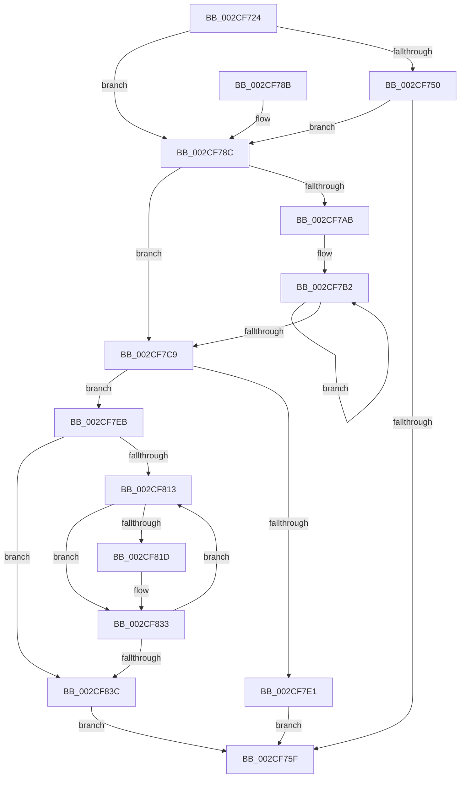

# KiTryPopulateLogicalProcessorInformation

- RVA: `0x002CF724`–`0x002CF843` (길이 `287` bytes)
- VA: `0x00000001402CF724`
- 실행 섹션: `.text`
- PDB 이름 있음: `예`; PDB Function 태그: `아니요`
- unwind 정보 RVA: `0x0006F674`
- 디코드: `88`개 명령, `287/287` bytes 표시
- 미해석 바이트: `0` (있으면 어셈블리에 `.byte`로 보존)

> 이 문서는 커널 이미지의 기계어와 PDB 기호를 분석해 생성했습니다. 4번과 5번은 함수 원형과 자료형을 바이너리 사용 방식에서 추정한 C 해석이며 원본 소스 복구 결과는 아닙니다.

## 1. Dependencies

- 직접 호출 지점: **2**; 고유 호출 대상: **2**
- 직접 호출자로 확인된 함수: **2**
- RIP 상대 이미지 참조: **0**

### Outgoing calls
- `0x002CF756` → [KiAndAffinityExNoResult](KiAndAffinityExNoResult_function_002CF84C.md) (function, `0x002CF84C`)
- `0x002CF795` → [KeOrAffinityEx2](KeOrAffinityEx2_function_002CF930.md) (function, `0x002CF930`)

### Direct callers
- [KeQueryLogicalProcessorRelationship](KeQueryLogicalProcessorRelationship_function_002CEA60.md) at `0x002CEF41`
- [KeQueryLogicalProcessorRelationship](KeQueryLogicalProcessorRelationship_function_002CEA60.md) at `0x002CF1CC`
- [sub_006DCD34](../6D/Unknown_function_006DCD34.md) at `0x006DCD8D`

### Static image references
- 디코드된 RIP-relative 메모리 참조가 없습니다.

## 2. Other-region calls and transfers

- 다른 실행 섹션으로 향하는 call: **0**
- 별도 외부 분기/꼬리 이동을 확인하지 못했습니다.

## 3. Assembly (complete function range)

```asm
002CF724  48 89 5C 24 08                  mov qword ptr [rsp + 8], rbx
002CF729  48 89 6C 24 10                  mov qword ptr [rsp + 0x10], rbp
002CF72E  48 89 74 24 18                  mov qword ptr [rsp + 0x18], rsi
002CF733  57                              push rdi
002CF734  41 56                           push r14
002CF736  41 57                           push r15
002CF738  48 83 EC 20                     sub rsp, 0x20
002CF73C  33 DB                           xor ebx, ebx
002CF73E  45 8B F9                        mov r15d, r9d
002CF741  4C 8B F2                        mov r14, rdx
002CF744  48 8B F1                        mov rsi, rcx
002CF747  8B FB                           mov edi, ebx
002CF749  8B EB                           mov ebp, ebx
002CF74B  45 84 C0                        test r8b, r8b
002CF74E  75 3C                           jne 0x1402cf78c
002CF750  48 8B D1                        mov rdx, rcx
002CF753  49 8B CE                        mov rcx, r14
002CF756  E8 F1 00 00 00                  call 0x1402cf84c
002CF75B  85 C0                           test eax, eax
002CF75D  74 2D                           je 0x1402cf78c
002CF75F  48 8B 8C 24 80 00 00 00         mov rcx, qword ptr [rsp + 0x80]
002CF767  8B C3                           mov eax, ebx
002CF769  48 8B 5C 24 40                  mov rbx, qword ptr [rsp + 0x40]
002CF76E  48 8B 74 24 50                  mov rsi, qword ptr [rsp + 0x50]
002CF773  89 29                           mov dword ptr [rcx], ebp
002CF775  48 8B 4C 24 78                  mov rcx, qword ptr [rsp + 0x78]
002CF77A  48 8B 6C 24 48                  mov rbp, qword ptr [rsp + 0x48]
002CF77F  89 39                           mov dword ptr [rcx], edi
002CF781  48 83 C4 20                     add rsp, 0x20
002CF785  41 5F                           pop r15
002CF787  41 5E                           pop r14
002CF789  5F                              pop rdi
002CF78A  C3                              ret
002CF78B  CC                              int3
002CF78C  4D 8B C6                        mov r8, r14
002CF78F  48 8B D6                        mov rdx, rsi
002CF792  49 8B CE                        mov rcx, r14
002CF795  E8 96 01 00 00                  call 0x1402cf930
002CF79A  0F B7 06                        movzx eax, word ptr [rsi]
002CF79D  0F B7 D3                        movzx edx, bx
002CF7A0  41 BA 01 00 00 00               mov r10d, 1
002CF7A6  66 3B D8                        cmp bx, ax
002CF7A9  73 1E                           jae 0x1402cf7c9
002CF7AB  4C 8D 46 08                     lea r8, [rsi + 8]
002CF7AF  44 8B C8                        mov r9d, eax
002CF7B2  49 39 18                        cmp qword ptr [r8], rbx
002CF7B5  41 8D 0C 12                     lea ecx, [r10 + rdx]
002CF7B9  4D 8D 40 08                     lea r8, [r8 + 8]
002CF7BD  66 0F 44 CA                     cmove cx, dx
002CF7C1  0F B7 D1                        movzx edx, cx
002CF7C4  4D 2B CA                        sub r9, r10
002CF7C7  75 E9                           jne 0x1402cf7b2
002CF7C9  8B 4C 24 70                     mov ecx, dword ptr [rsp + 0x70]
002CF7CD  0F B7 FA                        movzx edi, dx
002CF7D0  C1 E7 04                        shl edi, 4
002CF7D3  83 C7 27                        add edi, 0x27
002CF7D6  83 E7 F8                        and edi, 0xfffffff8
002CF7D9  03 CF                           add ecx, edi
002CF7DB  3B 4C 24 68                     cmp ecx, dword ptr [rsp + 0x68]
002CF7DF  76 0A                           jbe 0x1402cf7eb
002CF7E1  BB 04 00 00 C0                  mov ebx, 0xc0000004
002CF7E6  E9 74 FF FF FF                  jmp 0x1402cf75f
002CF7EB  48 8B 44 24 60                  mov rax, qword ptr [rsp + 0x60]
002CF7F0  33 C9                           xor ecx, ecx
002CF7F2  0F 57 C0                        xorps xmm0, xmm0
002CF7F5  66 89 50 1E                     mov word ptr [rax + 0x1e], dx
002CF7F9  48 8D 50 20                     lea rdx, [rax + 0x20]
002CF7FD  44 89 38                        mov dword ptr [rax], r15d
002CF800  89 78 04                        mov dword ptr [rax + 4], edi
002CF803  66 89 58 08                     mov word ptr [rax + 8], bx
002CF807  0F 11 40 0A                     movups xmmword ptr [rax + 0xa], xmm0
002CF80B  89 48 1A                        mov dword ptr [rax + 0x1a], ecx
002CF80E  66 3B 1E                        cmp bx, word ptr [rsi]
002CF811  73 29                           jae 0x1402cf83c
002CF813  0F B7 C1                        movzx eax, cx
002CF816  48 39 5C C6 08                  cmp qword ptr [rsi + rax*8 + 8], rbx
002CF81B  74 16                           je 0x1402cf833
002CF81D  0F 57 C0                        xorps xmm0, xmm0
002CF820  0F 11 02                        movups xmmword ptr [rdx], xmm0
002CF823  66 89 4A 08                     mov word ptr [rdx + 8], cx
002CF827  48 8B 44 C6 08                  mov rax, qword ptr [rsi + rax*8 + 8]
002CF82C  48 89 02                        mov qword ptr [rdx], rax
002CF82F  48 83 C2 10                     add rdx, 0x10
002CF833  66 41 03 CA                     add cx, r10w
002CF837  66 3B 0E                        cmp cx, word ptr [rsi]
002CF83A  72 D7                           jb 0x1402cf813
002CF83C  8B EF                           mov ebp, edi
002CF83E  E9 1C FF FF FF                  jmp 0x1402cf75f
```

## 4. C-style interpretation (structured pseudocode)

```c
__int64 __fastcall KiTryPopulateLogicalProcessorInformation(__int64 a1, __int64 a2, unsigned __int8 a3, int a4, __int64 a5, unsigned int a6, unsigned int a7, __int64 a8, __int64 a9)
{
    __int64 result;
    __int64 v_rbx;
    __int64 v_rdi;
    __int64 v_rsp;
    unsigned __int64 v_stack_p10;
    unsigned __int64 v_stack_p18;
    unsigned __int64 v_stack_p8;

    v_stack_p8 = v_rbx;
    v_stack_p10 = v_rbp;
    v_stack_p18 = v_rsi;
    v_rsp = (v_rsp) - (32);
    v_rbx = 0;
    if (a3 != 0) goto loc_002CF78C;
    result = KiAndAffinityExNoResult(a2, a1, a3, a4);
    if ((unsigned int)(result) == 0) goto loc_002CF78C;
loc_002CF75F:
    *(unsigned int *)(a9) = 0;
    *(unsigned int *)(a8) = 0;
    v_rsp = (v_rsp) + (32);
    return 0;
loc_002CF78C:
    result = KeOrAffinityEx2(a2, v_stack_p18, a2, a4);
    if (((unsigned __int16)(v_stack_p8)) >= ((unsigned __int16)(*(unsigned __int16 *)(v_stack_p18)))) goto loc_002CF7C9;
loc_002CF7B2:
    a1 = 1 + (unsigned __int16)(v_stack_p8) * 1;
    if ((*(unsigned __int64 *)(v_stack_p18 + 8)) == v_stack_p8) { a1 = (unsigned __int16)((unsigned __int16)(v_stack_p8)); }
    a4 = ((unsigned int)((unsigned int)(*(unsigned __int16 *)(v_stack_p18)))) - (1);
    if (condition_is_not_equal) goto loc_002CF7B2;
loc_002CF7C9:
    v_rdi = (unsigned int)(((unsigned __int16)((unsigned __int16)(a1))) << (4));
    v_rdi = (unsigned int)((v_rdi) + (39));
    v_rdi = (unsigned int)((v_rdi) & (0xFFFFFFF8ULL));
    a1 = (unsigned int)(((unsigned int)(a7)) + ((unsigned int)(v_rdi)));
    if (((unsigned int)(a1)) <= a6) goto loc_002CF7EB;
    goto loc_002CF75F;
loc_002CF7EB:
    a1 = 0;
    *(unsigned __int16 *)(a5 + 30) = (unsigned __int16)((unsigned __int16)(a1));
    *(unsigned int *)(a5) = (unsigned int)((unsigned int)(a4));
    *(unsigned int *)(a5 + 4) = (unsigned int)(v_rdi);
    *(unsigned __int16 *)(a5 + 8) = (unsigned __int16)((unsigned int)(0xC0000004ULL));
    *(unsigned __int64 *)(a5 + 10) = v_xmm0;
    *(unsigned int *)(a5 + 26) = 0;
    if (((unsigned __int16)((unsigned int)(0xC0000004ULL))) >= (*(unsigned __int16 *)(v_stack_p18))) goto loc_002CF83C;
loc_002CF813:
    result = 0;
    if ((*(unsigned __int64 *)(v_stack_p18 + 0 * 8 + 8)) != ((unsigned int)(0xC0000004ULL))) {
        *(unsigned __int64 *)(a5 + 32) = v_xmm0;
        *(unsigned __int16 *)(a5 + 32 + 8) = 0;
        result = *(unsigned __int64 *)(v_stack_p18 + 0 * 8 + 8);
        *(unsigned __int64 *)(a5 + 32) = result;
        a2 = (a5 + 32) + (16);
    }
    a1 = (unsigned __int16)((a1) + (1));
    if (((unsigned __int16)(a1)) < (*(unsigned __int16 *)(v_stack_p18))) goto loc_002CF813;
loc_002CF83C:
    goto loc_002CF75F;
}
```

## 5. (Beta) C Style

```c
int64_t KiTryPopulateLogicalProcessorInformation(void *Arg1, int64_t Arg2, uint8_t Arg3, int32_t Arg4, void *Arg5, uint32_t Arg6, uint32_t Arg7, void *Arg8, void *Arg9)
{
    uint8_t *arg1 = (uint8_t *)Arg1;
    uint8_t *arg5 = (uint8_t *)Arg5;
    uint8_t *arg8 = (uint8_t *)Arg8;
    uint8_t *arg9 = (uint8_t *)Arg9;

    int64_t result;
    int64_t local_rbx;
    int64_t local_rdi;
    int64_t local_rsp;
    uint64_t v_stack_p10;
    uint64_t v_stack_p18;
    uint64_t v_stack_p8;

    v_stack_p8 = local_rbx;
    v_stack_p10 = local_rbp;
    v_stack_p18 = local_rsi;
    local_rsp = (local_rsp) - (32);
    local_rbx = 0;
    if (Arg3 != 0) goto loc_002CF78C;
    result = KiAndAffinityExNoResult(Arg2, Arg1, Arg3, Arg4);
    if ((uint32_t)(result) == 0) goto loc_002CF78C;
loc_002CF75F:
    *(uint32_t *)(arg9) = 0;
    *(uint32_t *)(arg8) = 0;
    local_rsp = (local_rsp) + (32);
    return 0;
loc_002CF78C:
    result = KeOrAffinityEx2(Arg2, v_stack_p18, Arg2, Arg4);
    if (((uint16_t)(v_stack_p8)) >= ((uint16_t)(*(uint16_t *)(v_stack_p18)))) goto loc_002CF7C9;
loc_002CF7B2:
    Arg1 = 1 + (uint16_t)(v_stack_p8) * 1;
    if ((*(uint64_t *)(v_stack_p18 + 0x8)) == v_stack_p8) { Arg1 = (uint16_t)((uint16_t)(v_stack_p8)); }
    Arg4 = ((uint32_t)((uint32_t)(*(uint16_t *)(v_stack_p18)))) - (1);
    if (condition_is_not_equal) goto loc_002CF7B2;
loc_002CF7C9:
    local_rdi = (uint32_t)(((uint16_t)((uint16_t)(Arg1))) << (4));
    local_rdi = (uint32_t)((local_rdi) + (39));
    local_rdi = (uint32_t)((local_rdi) & (0xFFFFFFF8ULL));
    Arg1 = (uint32_t)(((uint32_t)(Arg7)) + ((uint32_t)(local_rdi)));
    if (((uint32_t)(Arg1)) <= Arg6) goto loc_002CF7EB;
    goto loc_002CF75F;
loc_002CF7EB:
    Arg1 = 0;
    *(uint16_t *)(arg5 + 0x1E) = (uint16_t)((uint16_t)(Arg1));
    *(uint32_t *)(arg5) = (uint32_t)((uint32_t)(Arg4));
    *(uint32_t *)(arg5 + 0x4) = (uint32_t)(local_rdi);
    *(uint16_t *)(arg5 + 0x8) = (uint16_t)((uint32_t)(0xC0000004ULL));
    *(uint64_t *)(arg5 + 0xA) = v_xmm0;
    *(uint32_t *)(arg5 + 0x1A) = 0;
    if (((uint16_t)((uint32_t)(0xC0000004ULL))) >= (*(uint16_t *)(v_stack_p18))) goto loc_002CF83C;
loc_002CF813:
    result = 0;
    if ((*(uint64_t *)(v_stack_p18 + 0x0 * 8 + 0x8)) != ((uint32_t)(0xC0000004ULL))) {
        *(uint64_t *)(arg5 + 0x20) = v_xmm0;
        *(uint16_t *)(arg5 + 0x20 + 0x8) = 0;
        result = *(uint64_t *)(v_stack_p18 + 0x0 * 8 + 0x8);
        *(uint64_t *)(arg5 + 0x20) = result;
        Arg2 = (Arg5 + 32) + (16);
    }
    Arg1 = (uint16_t)((Arg1) + (1));
    if (((uint16_t)(Arg1)) < (*(uint16_t *)(v_stack_p18))) goto loc_002CF813;
loc_002CF83C:
    goto loc_002CF75F;
}
```

### 관측된 메모리 오프셋

구조체 형식이 확인되지 않은 접근은 인자 기준의 오프셋으로만 기록했습니다.

| 기준 인자 | 오프셋 표현 | 폭 (bit) | 접근 |
|---|---:|---:|---|
| `Arg1` | `+ 0x0` | `16` | `R` |
| `Arg1` | `+ 0x0` | `64` | `R` |
| `Arg1` | `+ 0x8` | `64` | `R` |
| `Arg1` | `+ 0x8 + rax*8` | `64` | `R` |
| `Arg5` | `+ 0x0` | `32` | `W` |
| `Arg5` | `+ 0x0` | `64` | `W` |
| `Arg5` | `+ 0x0` | `128` | `R` |
| `Arg5` | `+ 0x4` | `32` | `W` |
| `Arg5` | `+ 0x8` | `16` | `W` |
| `Arg5` | `+ 0xA` | `128` | `R` |
| `Arg5` | `+ 0x1A` | `32` | `W` |
| `Arg5` | `+ 0x1E` | `16` | `W` |
| `Arg5` | `+ 0x20` | `64` | `R` |
| `Arg8` | `+ 0x0` | `32` | `W` |
| `Arg9` | `+ 0x0` | `32` | `W` |

## 6. Execution-region graph

[열기: 2D/3D 그래프와 함수 탐색 컨트롤 패널](../../../control-panel.html?section=text&rva=0x002CF724&view=graph)

- 2D 그래프는 위에서 아래로 흐르고, 3D 그래프는 빈 공간을 드래그해 회전합니다. Shift+드래그는 이동, 휠은 확대·축소, 함수 노드 선택은 대상 보고서 이동입니다.

### Static fallback


