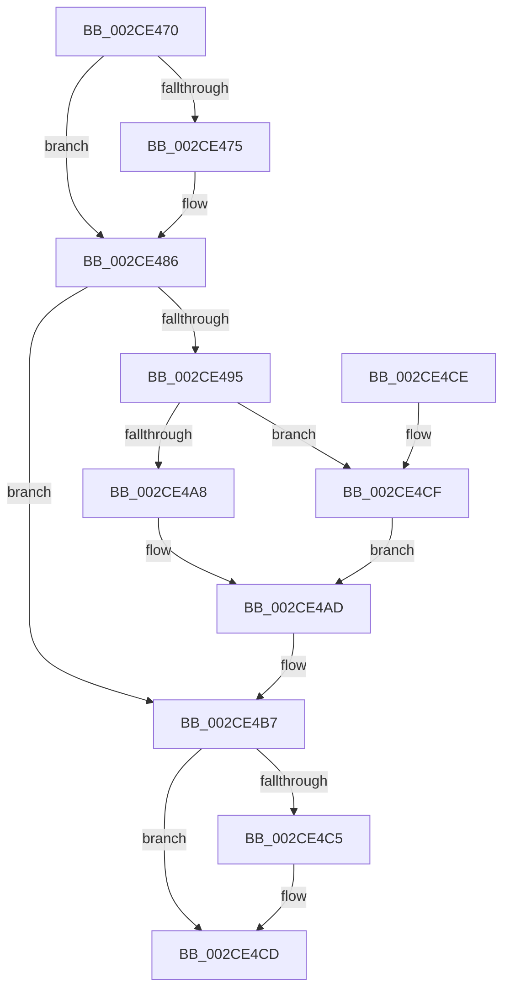

# KiUpdateSharedReadyQueueAffinityThread

- RVA: `0x002CE470`–`0x002CE4D4` (길이 `100` bytes)
- VA: `0x00000001402CE470`
- 실행 섹션: `.text`
- PDB 이름 있음: `예`; PDB Function 태그: `아니요`
- unwind 정보 RVA: `0x000DB714`
- 디코드: `27`개 명령, `100/100` bytes 표시
- 미해석 바이트: `0` (있으면 어셈블리에 `.byte`로 보존)

> 이 문서는 커널 이미지의 기계어와 PDB 기호를 분석해 생성했습니다. 4번과 5번은 함수 원형과 자료형을 바이너리 사용 방식에서 추정한 C 해석이며 원본 소스 복구 결과는 아닙니다.

## 1. Dependencies

- 직접 호출 지점: **0**; 고유 호출 대상: **0**
- 직접 호출자로 확인된 함수: **9**
- RIP 상대 이미지 참조: **1**

### Outgoing calls
- 직접 디코드된 call 명령이 없습니다.

### Direct callers
- [KiRemoveBoostThread](../21/KiRemoveBoostThread_function_00219128.md) at `0x00219239`
- [KiSetPriorityThread](../22/KiSetPriorityThread_function_00220E78.md) at `0x00221022`
- [KiSetAffinityThread](KiSetAffinityThread_function_002CE010.md) at `0x002CE17E`
- [KiSetIdealProcessorThread](../2D/KiSetIdealProcessorThread_function_002DCFE0.md) at `0x002DD0C4`
- [KiComputeThreadAffinity](../39/KiComputeThreadAffinity_function_00399DE0.md) at `0x0039A0A3`
- [KeStartThread](../3C/KeStartThread_function_003C21B8.md) at `0x003C24FC`
- [KiInitializeForegroundBoostThread](../3C/KiInitializeForegroundBoostThread_function_003C28D8.md) at `0x003C293F`
- [KiUpdateThreadSchedulingProperties](../46/KiUpdateThreadSchedulingProperties_function_0046E5DC.md) at `0x0046E603`
- [KiApplyForegroundBoostThread](../4F/KiApplyForegroundBoostThread_function_004F7DC0.md) at `0x004F7F34`

### Static image references
- `0x002CE47B` → RVA `0x00FC8C40` (`ALMOSTRO`; read)

## 2. Other-region calls and transfers

- 다른 실행 섹션으로 향하는 call: **0**
- 별도 외부 분기/꼬리 이동을 확인하지 못했습니다.

## 3. Assembly (complete function range)

```asm
002CE470  48 85 C9                        test rcx, rcx
002CE473  75 11                           jne 0x1402ce486
002CE475  8B 82 4C 02 00 00               mov eax, dword ptr [rdx + 0x24c]
002CE47B  48 8D 0D BE A7 CF 00            lea rcx, [rip + 0xcfa7be]
002CE482  48 8B 0C C1                     mov rcx, qword ptr [rcx + rax*8]
002CE486  4C 8B 89 40 8E 00 00            mov r9, qword ptr [rcx + 0x8e40]
002CE48D  45 33 C0                        xor r8d, r8d
002CE490  4D 85 C9                        test r9, r9
002CE493  74 22                           je 0x1402ce4b7
002CE495  0F B6 81 D0 00 00 00            movzx eax, byte ptr [rcx + 0xd0]
002CE49C  48 8B 8A 40 02 00 00            mov rcx, qword ptr [rdx + 0x240]
002CE4A3  66 3B 01                        cmp ax, word ptr [rcx]
002CE4A6  73 27                           jae 0x1402ce4cf
002CE4A8  48 8B 4C C1 08                  mov rcx, qword ptr [rcx + rax*8 + 8]
002CE4AD  49 23 C9                        and rcx, r9
002CE4B0  49 3B C9                        cmp rcx, r9
002CE4B3  41 0F 94 C0                     sete r8b
002CE4B7  8B 42 78                        mov eax, dword ptr [rdx + 0x78]
002CE4BA  C1 E8 0D                        shr eax, 0xd
002CE4BD  83 E0 01                        and eax, 1
002CE4C0  44 3B C0                        cmp r8d, eax
002CE4C3  74 08                           je 0x1402ce4cd
002CE4C5  F0 81 72 78 00 20 00 00         lock xor dword ptr [rdx + 0x78], 0x2000
002CE4CD  C3                              ret
002CE4CE  CC                              int3
002CE4CF  49 8B C8                        mov rcx, r8
002CE4D2  EB D9                           jmp 0x1402ce4ad
```

## 4. C-style interpretation (structured pseudocode)

```c
__int64 __fastcall KiUpdateSharedReadyQueueAffinityThread(__int64 a1, __int64 a2, int a3)
{
    __int64 result;

    if (a1 == 0) {
        result = *(unsigned int *)(a2 + 588);
        a1 = v_rip + 13608894;
        a1 = *(unsigned __int64 *)(a1 + result * 8);
    }
    a3 = 0;
    if (*(unsigned __int64 *)(a1 + 36416) == 0) goto loc_002CE4B7;
    if (((unsigned __int16)(*(unsigned __int8 *)(a1 + 208))) >= (*(unsigned __int16 *)(*(unsigned __int64 *)(a2 + 576)))) goto loc_002CE4CF;
loc_002CE4AD:
    a1 = (*(unsigned __int64 *)(*(unsigned __int64 *)(a2 + 576) + *(unsigned __int8 *)(a1 + 208) * 8 + 8)) & (*(unsigned __int64 *)(a1 + 36416));
    a3 = (a1 == (*(unsigned __int64 *)(a1 + 36416))) ? 1 : 0;
loc_002CE4B7:
    result = (unsigned int)(((unsigned int)(*(unsigned int *)(a2 + 120))) >> (13));
    result = (unsigned int)((result) & (1));
    if (a3 != ((unsigned int)(result))) {
    }
    return result;
loc_002CE4CF:
    goto loc_002CE4AD;
}
```

## 5. (Beta) C Style

```c
int64_t KiUpdateSharedReadyQueueAffinityThread(int64_t Arg1, void *Arg2, int32_t Arg3)
{
    uint8_t *arg2 = (uint8_t *)Arg2;

    int64_t result;

    if (Arg1 == 0) {
        result = *(uint32_t *)(arg2 + 0x24C);
        Arg1 = v_rip + 13608894;
        Arg1 = *(uint64_t *)(Arg1 + result * 8);
    }
    Arg3 = 0;
    if (*(uint64_t *)(Arg1 + 0x8E40) == 0) goto loc_002CE4B7;
    if (((uint16_t)(*(uint8_t *)(Arg1 + 0xD0))) >= (*(uint16_t *)(*(uint64_t *)(arg2 + 0x240)))) goto loc_002CE4CF;
loc_002CE4AD:
    Arg1 = (*(uint64_t *)(*(uint64_t *)(arg2 + 0x240) + *(uint8_t *)(Arg1 + 0xD0) * 8 + 0x8)) & (*(uint64_t *)(Arg1 + 0x8E40));
    Arg3 = (Arg1 == (*(uint64_t *)(Arg1 + 0x8E40))) ? 1 : 0;
loc_002CE4B7:
    result = (uint32_t)(((uint32_t)(*(uint32_t *)(arg2 + 0x78))) >> (13));
    result = (uint32_t)((result) & (1));
    if (Arg3 != ((uint32_t)(result))) {
    }
    return result;
loc_002CE4CF:
    goto loc_002CE4AD;
}
```

### 관측된 메모리 오프셋

구조체 형식이 확인되지 않은 접근은 인자 기준의 오프셋으로만 기록했습니다.

| 기준 인자 | 오프셋 표현 | 폭 (bit) | 접근 |
|---|---:|---:|---|
| `Arg2` | `+ 0x78` | `32` | `R` |
| `Arg2` | `+ 0x78` | `32` | `R/W` |
| `Arg2` | `+ 0x240` | `64` | `R` |
| `Arg2` | `+ 0x24C` | `32` | `R` |

## 6. Execution-region graph

[열기: 2D/3D 그래프와 함수 탐색 컨트롤 패널](../../../control-panel.html?section=text&rva=0x002CE470&view=graph)

- 2D 그래프는 위에서 아래로 흐르고, 3D 그래프는 빈 공간을 드래그해 회전합니다. Shift+드래그는 이동, 휠은 확대·축소, 함수 노드 선택은 대상 보고서 이동입니다.

### Static fallback


