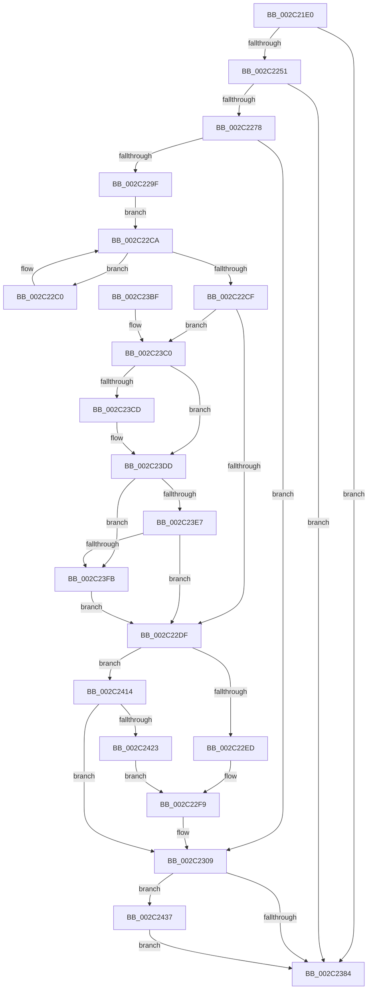

# MiAgeWorkingSet

- RVA: `0x002C21E0`–`0x002C2443` (길이 `611` bytes)
- VA: `0x00000001402C21E0`
- 실행 섹션: `.text`
- PDB 이름 있음: `예`; PDB Function 태그: `아니요`
- unwind 정보 RVA: `0x0006E870`
- 디코드: `152`개 명령, `611/611` bytes 표시
- 미해석 바이트: `0` (있으면 어셈블리에 `.byte`로 보존)

> 이 문서는 커널 이미지의 기계어와 PDB 기호를 분석해 생성했습니다. 4번과 5번은 함수 원형과 자료형을 바이너리 사용 방식에서 추정한 C 해석이며 원본 소스 복구 결과는 아닙니다.

## 1. Dependencies

- 직접 호출 지점: **6**; 고유 호출 대상: **5**
- 직접 호출자로 확인된 함수: **2**
- RIP 상대 이미지 참조: **4**

### Outgoing calls
- `0x002C221A` → [memset](../6C/memset_function_006C6C40.md) (function, `0x006C6C40`)
- `0x002C222C` → [memset](../6C/memset_function_006C6C40.md) (function, `0x006C6C40`)
- `0x002C2267` → [MiComputeAgingAmount](MiComputeAgingAmount_function_002C2520.md) (function, `0x002C2520`)
- `0x002C2373` → [MiWalkPageTables](MiWalkPageTables_function_002C2710.md) (function, `0x002C2710`)
- `0x002C238F` → [MiLogWsAging](MiLogWsAging_function_002C244C.md) (function, `0x002C244C`)
- `0x002C23EE` → [MiIsStoreProcess](../2B/MiIsStoreProcess_function_002B62E0.md) (function, `0x002B62E0`)

### Direct callers
- [MiForcedTrim](../34/MiForcedTrim_function_0034DC0C.md) at `0x0034DD2C`
- [MiTrimOrAgeWorkingSet](../34/MiTrimOrAgeWorkingSet_function_0034EFC0.md) at `0x0034F293`
- [MiTrimOrAgeWorkingSet](../34/MiTrimOrAgeWorkingSet_function_0034EFC0.md) at `0x0034F2D6`
- [MiTrimOrAgeWorkingSet](../34/MiTrimOrAgeWorkingSet_function_0034EFC0.md) at `0x0034F2FF`

### Static image references
- `0x002C2283` → RVA `0x00E30088` (`.data`; read)
- `0x002C2319` → RVA `0x0028F750` (`MiAgePte`; read)
- `0x002C2324` → RVA `0x00428D10` (`MiAgeWorkingSetTail`; read)
- `0x002C2414` → RVA `0x00FC6A88` (`ALMOSTRO`; read)

## 2. Other-region calls and transfers

- 다른 실행 섹션으로 향하는 call: **0**
- 별도 외부 분기/꼬리 이동을 확인하지 못했습니다.

## 3. Assembly (complete function range)

```asm
002C21E0  48 8B C4                        mov rax, rsp
002C21E3  48 89 58 08                     mov qword ptr [rax + 8], rbx
002C21E7  48 89 70 18                     mov qword ptr [rax + 0x18], rsi
002C21EB  48 89 78 20                     mov qword ptr [rax + 0x20], rdi
002C21EF  88 50 10                        mov byte ptr [rax + 0x10], dl
002C21F2  55                              push rbp
002C21F3  41 54                           push r12
002C21F5  41 55                           push r13
002C21F7  41 56                           push r14
002C21F9  41 57                           push r15
002C21FB  48 8D 68 A8                     lea rbp, [rax - 0x58]
002C21FF  48 81 EC 30 01 00 00            sub rsp, 0x130
002C2206  33 D2                           xor edx, edx
002C2208  45 8B F8                        mov r15d, r8d
002C220B  48 8B D9                        mov rbx, rcx
002C220E  45 8B E1                        mov r12d, r9d
002C2211  48 8D 4C 24 20                  lea rcx, [rsp + 0x20]
002C2216  44 8D 42 50                     lea r8d, [rdx + 0x50]
002C221A  E8 21 4A 40 00                  call 0x1406c6c40
002C221F  33 D2                           xor edx, edx
002C2221  48 8D 4C 24 70                  lea rcx, [rsp + 0x70]
002C2226  41 B8 C0 00 00 00               mov r8d, 0xc0
002C222C  E8 0F 4A 40 00                  call 0x1406c6c40
002C2231  4C 8B 6B 10                     mov r13, qword ptr [rbx + 0x10]
002C2235  33 FF                           xor edi, edi
002C2237  41 BE 04 00 00 00               mov r14d, 4
002C223D  49 8B 45 20                     mov rax, qword ptr [r13 + 0x20]
002C2241  48 8B 93 90 00 00 00            mov rdx, qword ptr [rbx + 0x90]
002C2248  48 3B D0                        cmp rdx, rax
002C224B  0F 86 33 01 00 00               jbe 0x1402c2384
002C2251  45 85 E4                        test r12d, r12d
002C2254  8D 77 0A                        lea esi, [rdi + 0xa]
002C2257  45 8B C7                        mov r8d, r15d
002C225A  48 8B CB                        mov rcx, rbx
002C225D  41 0F 45 F4                     cmovne esi, r12d
002C2261  48 2B D0                        sub rdx, rax
002C2264  44 8B CE                        mov r9d, esi
002C2267  E8 B4 02 00 00                  call 0x1402c2520
002C226C  4C 8B C8                        mov r9, rax
002C226F  48 85 C0                        test rax, rax
002C2272  0F 84 0C 01 00 00               je 0x1402c2384
002C2278  0F B7 8B AE 00 00 00            movzx ecx, word ptr [rbx + 0xae]
002C227F  45 8D 66 FD                     lea r12d, [r14 - 3]
002C2283  48 8B 05 FE DD B6 00            mov rax, qword ptr [rip + 0xb6ddfe]
002C228A  89 74 24 2C                     mov dword ptr [rsp + 0x2c], esi
002C228E  48 8B 14 C8                     mov rdx, qword ptr [rax + rcx*8]
002C2292  48 8B B2 C0 44 00 00            mov rsi, qword ptr [rdx + 0x44c0]
002C2299  41 F6 C7 03                     test r15b, 3
002C229D  74 6A                           je 0x1402c2309
002C229F  48 8B 8A C0 0B 00 00            mov rcx, qword ptr [rdx + 0xbc0]
002C22A6  4C 8B 82 40 0B 00 00            mov r8, qword ptr [rdx + 0xb40]
002C22AD  4C 03 C1                        add r8, rcx
002C22B0  48 8D 8A C0 0C 00 00            lea rcx, [rdx + 0xcc0]
002C22B7  48 81 C2 78 0E 00 00            add rdx, 0xe78
002C22BE  EB 0A                           jmp 0x1402c22ca
002C22C0  48 8B 01                        mov rax, qword ptr [rcx]
002C22C3  4C 03 C0                        add r8, rax
002C22C6  48 83 C1 58                     add rcx, 0x58
002C22CA  48 3B CA                        cmp rcx, rdx
002C22CD  72 F1                           jb 0x1402c22c0
002C22CF  48 8B 0A                        mov rcx, qword ptr [rdx]
002C22D2  49 03 C8                        add rcx, r8
002C22D5  48 3B 4E 48                     cmp rcx, qword ptr [rsi + 0x48]
002C22D9  0F 82 E1 00 00 00               jb 0x1402c23c0
002C22DF  8B 83 B8 00 00 00               mov eax, dword ptr [rbx + 0xb8]
002C22E5  A8 0F                           test al, 0xf
002C22E7  0F 85 27 01 00 00               jne 0x1402c2414
002C22ED  48 39 BB 70 02 00 00            cmp qword ptr [rbx + 0x270], rdi
002C22F4  8B CF                           mov ecx, edi
002C22F6  0F 95 C1                        setne cl
002C22F9  48 8B 44 24 68                  mov rax, qword ptr [rsp + 0x68]
002C22FE  85 C9                           test ecx, ecx
002C2300  49 0F 45 C4                     cmovne rax, r12
002C2304  48 89 44 24 68                  mov qword ptr [rsp + 0x68], rax
002C2309  8A 45 68                        mov al, byte ptr [rbp + 0x68]
002C230C  88 44 24 79                     mov byte ptr [rsp + 0x79], al
002C2310  48 8D 44 24 20                  lea rax, [rsp + 0x20]
002C2315  48 89 45 28                     mov qword ptr [rbp + 0x28], rax
002C2319  48 8D 05 30 D4 FC FF            lea rax, [rip - 0x32bd0]
002C2320  48 89 45 18                     mov qword ptr [rbp + 0x18], rax
002C2324  48 8D 05 E5 69 16 00            lea rax, [rip + 0x1669e5]
002C232B  48 89 45 20                     mov qword ptr [rbp + 0x20], rax
002C232F  41 8B C7                        mov eax, r15d
002C2332  24 02                           and al, 2
002C2334  48 89 5D 90                     mov qword ptr [rbp - 0x70], rbx
002C2338  F6 D8                           neg al
002C233A  44 89 7C 24 20                  mov dword ptr [rsp + 0x20], r15d
002C233F  4C 89 4C 24 50                  mov qword ptr [rsp + 0x50], r9
002C2344  48 1B C9                        sbb rcx, rcx
002C2347  C7 44 24 70 0E 00 00 00         mov dword ptr [rsp + 0x70], 0xe
002C234F  83 E1 08                        and ecx, 8
002C2352  48 83 CA FF                     or rdx, 0xffffffffffffffff
002C2356  4A 8B 44 29 08                  mov rax, qword ptr [rcx + r13 + 8]
002C235B  48 8B 4D A0                     mov rcx, qword ptr [rbp - 0x60]
002C235F  48 85 C0                        test rax, rax
002C2362  48 89 45 B0                     mov qword ptr [rbp - 0x50], rax
002C2366  48 0F 44 CA                     cmove rcx, rdx
002C236A  48 89 4D A0                     mov qword ptr [rbp - 0x60], rcx
002C236E  48 8D 4C 24 70                  lea rcx, [rsp + 0x70]
002C2373  E8 98 03 00 00                  call 0x1402c2710
002C2378  44 8B F0                        mov r14d, eax
002C237B  83 F8 05                        cmp eax, 5
002C237E  0F 84 B3 00 00 00               je 0x1402c2437
002C2384  45 8B C7                        mov r8d, r15d
002C2387  48 8D 54 24 20                  lea rdx, [rsp + 0x20]
002C238C  48 8B CB                        mov rcx, rbx
002C238F  E8 B8 00 00 00                  call 0x1402c244c
002C2394  4C 8D 9C 24 30 01 00 00         lea r11, [rsp + 0x130]
002C239C  41 83 FE 05                     cmp r14d, 5
002C23A0  49 8B 5B 30                     mov rbx, qword ptr [r11 + 0x30]
002C23A4  49 8B 73 40                     mov rsi, qword ptr [r11 + 0x40]
002C23A8  40 0F 94 C7                     sete dil
002C23AC  8B C7                           mov eax, edi
002C23AE  49 8B 7B 48                     mov rdi, qword ptr [r11 + 0x48]
002C23B2  49 8B E3                        mov rsp, r11
002C23B5  41 5F                           pop r15
002C23B7  41 5E                           pop r14
002C23B9  41 5D                           pop r13
002C23BB  41 5C                           pop r12
002C23BD  5D                              pop rbp
002C23BE  C3                              ret
002C23BF  CC                              int3
002C23C0  8B 83 B8 00 00 00               mov eax, dword ptr [rbx + 0xb8]
002C23C6  C1 E8 10                        shr eax, 0x10
002C23C9  3C 02                           cmp al, 2
002C23CB  74 10                           je 0x1402c23dd
002C23CD  4C 3B 46 40                     cmp r8, qword ptr [rsi + 0x40]
002C23D1  1B C0                           sbb eax, eax
002C23D3  83 E0 FE                        and eax, 0xfffffffe
002C23D6  83 C0 05                        add eax, 5
002C23D9  89 44 24 28                     mov dword ptr [rsp + 0x28], eax
002C23DD  8B 83 B8 00 00 00               mov eax, dword ptr [rbx + 0xb8]
002C23E3  A8 0F                           test al, 0xf
002C23E5  75 14                           jne 0x1402c23fb
002C23E7  48 8D 8B 00 FC FF FF            lea rcx, [rbx - 0x400]
002C23EE  E8 ED 3E FF FF                  call 0x1402b62e0
002C23F3  85 C0                           test eax, eax
002C23F5  0F 85 E4 FE FF FF               jne 0x1402c22df
002C23FB  8A 86 16 01 00 00               mov al, byte ptr [rsi + 0x116]
002C2401  88 44 24 24                     mov byte ptr [rsp + 0x24], al
002C2405  8A 86 17 01 00 00               mov al, byte ptr [rsi + 0x117]
002C240B  88 44 24 25                     mov byte ptr [rsp + 0x25], al
002C240F  E9 CB FE FF FF                  jmp 0x1402c22df
002C2414  48 0F BA 25 6B 46 D0 00 24      bt qword ptr [rip + 0xd0466b], 0x24
002C241D  0F 83 E6 FE FF FF               jae 0x1402c2309
002C2423  8B 8B B8 00 00 00               mov ecx, dword ptr [rbx + 0xb8]
002C2429  C1 E9 08                        shr ecx, 8
002C242C  C1 E9 03                        shr ecx, 3
002C242F  41 23 CC                        and ecx, r12d
002C2432  E9 C2 FE FF FF                  jmp 0x1402c22f9
002C2437  44 01 A6 F0 01 00 00            add dword ptr [rsi + 0x1f0], r12d
002C243E  E9 41 FF FF FF                  jmp 0x1402c2384
```

## 4. C-style interpretation (structured pseudocode)

```c
__int64 __fastcall MiAgeWorkingSet(__int64 a1, int a2, int a3, int a4)
{
    __int64 result;
    __int64 v_rdi;
    __int64 v_rsi;
    __int64 v_rsp;
    unsigned __int64 v_stack_m108;
    unsigned __int8 v_stack_m10B;
    unsigned __int8 v_stack_m10C;
    unsigned int v_stack_m12C;
    unsigned __int64 v_stack_m138;
    unsigned __int64 v_stack_m28;
    unsigned __int8 v_stack_mDF;
    unsigned __int64 v_stack_mE8;
    unsigned __int64 v_stack_mF0;

    *(unsigned __int64 *)(v_rsp + 8) = v_rbx;
    *(unsigned __int64 *)(v_rsp + 24) = v_rsi;
    *(unsigned __int64 *)(v_rsp + 32) = v_rdi;
    *(unsigned __int8 *)(v_rsp + 16) = (unsigned __int8)(a2);
    v_rsp = (v_rsp) - (304);
    a2 = 0;
    result = memset(v_stack_m138, a2, a2 + 80, a4);
    a2 = 0;
    result = memset(v_stack_mE8, a2, 192, a4);
    v_rdi = 0;
    if ((*(unsigned __int64 *)(a1 + 144)) <= (*(unsigned __int64 *)(*(unsigned __int64 *)(a1 + 16) + 32))) goto loc_002C2384;
    v_rsi = v_rdi + 10;
    if ((unsigned int)((unsigned int)(a4)) != 0) { v_rsi = (unsigned int)((unsigned int)(a4)); }
    a2 = (*(unsigned __int64 *)(a1 + 144)) - (*(unsigned __int64 *)(*(unsigned __int64 *)(a1 + 16) + 32));
    result = MiComputeAgingAmount(a1, a2, (unsigned int)((unsigned int)((unsigned int)(a3))), (unsigned int)((unsigned int)(v_rsi)));
    if (result == 0) goto loc_002C2384;
    v_stack_m12C = (unsigned int)(v_rsi);
    if ((((unsigned __int8)((unsigned int)(a3))) & (3)) == 0) goto loc_002C2309;
    a3 = (*(unsigned __int64 *)(*(unsigned __int64 *)(*(unsigned __int64 *)(v_rip + 11984382) + *(unsigned __int16 *)(a1 + 174) * 8) + 2880)) + (*(unsigned __int64 *)(*(unsigned __int64 *)(*(unsigned __int64 *)(v_rip + 11984382) + *(unsigned __int16 *)(a1 + 174) * 8) + 3008));
    a2 = (*(unsigned __int64 *)(*(unsigned __int64 *)(v_rip + 11984382) + *(unsigned __int16 *)(a1 + 174) * 8)) + (0xE78ULL);
    goto loc_002C22CA;
loc_002C22C0:
    a3 = (a3) + (*(unsigned __int64 *)(*(unsigned __int64 *)(*(unsigned __int64 *)(v_rip + 11984382) + *(unsigned __int16 *)(a1 + 174) * 8) + 3264));
    a1 = (*(unsigned __int64 *)(*(unsigned __int64 *)(v_rip + 11984382) + *(unsigned __int16 *)(a1 + 174) * 8) + 3264) + (88);
loc_002C22CA:
    if (a1 < a2) goto loc_002C22C0;
    a1 = (*(unsigned __int64 *)(a2)) + (a3);
    if (a1 < (*(unsigned __int64 *)(*(unsigned __int64 *)(*(unsigned __int64 *)(*(unsigned __int64 *)(v_rip + 11984382) + *(unsigned __int16 *)(a1 + 174) * 8) + 17600) + 72))) goto loc_002C23C0;
loc_002C22DF:
    if ((((unsigned __int8)((unsigned int)(*(unsigned int *)(a1 + 184)))) & (15)) != 0) goto loc_002C2414;
    a1 = ((*(unsigned __int64 *)(a1 + 624)) != 0) ? 1 : 0;
loc_002C22F9:
    result = v_stack_mF0;
    if ((unsigned int)(a1) != 0) { result = 4 - 3; }
    v_stack_mF0 = result;
loc_002C2309:
    v_stack_mDF = (unsigned __int8)(*(unsigned __int8 *)(v_rsp - 88 + 104));
    *(unsigned __int64 *)(v_rsp - 88 + 40) = v_stack_m138;
    *(unsigned __int64 *)(v_rsp - 88 + 24) = v_rip - 207824;
    *(unsigned __int64 *)(v_rsp - 88 + 32) = v_rip + 1468901;
    result = (unsigned __int8)(((unsigned int)((unsigned int)((unsigned int)(a3)))) & (2));
    *(unsigned __int64 *)(v_rsp - 88 - 112) = a1;
    result = (unsigned __int8)(-(result));
    v_stack_m138 = (unsigned int)((unsigned int)(a3));
    v_stack_m108 = result;
    v_stack_mE8 = 14;
    a1 = (unsigned int)((a1) & (8));
    a2 = (a2) | (-1);
    *(unsigned __int64 *)(v_rsp - 88 - 80) = *(unsigned __int64 *)(a1 + *(unsigned __int64 *)(a1 + 16) * 1 + 8);
    a1 = *(unsigned __int64 *)(v_rsp - 88 - 96);
    if (*(unsigned __int64 *)(a1 + *(unsigned __int64 *)(a1 + 16) * 1 + 8) == 0) { a1 = a2; }
    *(unsigned __int64 *)(v_rsp - 88 - 96) = a1;
    result = MiWalkPageTables(v_stack_mE8, a2, a3, result);
    if (((unsigned int)(result)) == 5) goto loc_002C2437;
loc_002C2384:
    result = MiLogWsAging(a1, v_stack_m138, (unsigned int)((unsigned int)((unsigned int)(a3))), result);
    v_rdi = (((unsigned int)((unsigned int)((unsigned int)(result)))) == 5) ? 1 : 0;
    return (unsigned int)((unsigned int)(v_rdi));
loc_002C23C0:
    result = (unsigned int)(((unsigned int)(*(unsigned int *)(*(unsigned __int64 *)(v_stack_m28 + 48) + 184))) >> (16));
    if (((unsigned __int8)(result)) != 2) {
        result = (unsigned int)((result) & (0xFFFFFFFEULL));
        result = (unsigned int)((result) + (5));
        v_stack_m108 = (unsigned int)(result);
    }
    if ((((unsigned __int8)((unsigned int)(*(unsigned int *)(*(unsigned __int64 *)(v_stack_m28 + 48) + 184)))) & (15)) != 0) goto loc_002C23FB;
    result = MiIsStoreProcess(*(unsigned __int64 *)(v_stack_m28 + 48) - 1024, v_stack_m138, (unsigned int)((unsigned int)((unsigned int)(a3))), result);
    if ((unsigned int)(result) != 0) goto loc_002C22DF;
loc_002C23FB:
    v_stack_m10C = (unsigned __int8)(*(unsigned __int8 *)(*(unsigned __int64 *)(v_stack_m28 + 64) + 278));
    v_stack_m10B = (unsigned __int8)(*(unsigned __int8 *)(*(unsigned __int64 *)(v_stack_m28 + 64) + 279));
    goto loc_002C22DF;
loc_002C2414:
    if (condition_is_above_or_equal) goto loc_002C2309;
    a1 = (unsigned int)(((unsigned int)(*(unsigned int *)(*(unsigned __int64 *)(v_stack_m28 + 48) + 184))) >> (8));
    a1 = (unsigned int)((a1) >> (3));
    a1 = (unsigned int)((a1) & ((unsigned int)(4 - 3)));
    goto loc_002C22F9;
loc_002C2437:
    goto loc_002C2384;
}
```

## 5. (Beta) C Style

```c
int64_t MiAgeWorkingSet(void *Arg1, int32_t Arg2, int32_t Arg3, int32_t Arg4)
{
    uint8_t *arg1 = (uint8_t *)Arg1;

    int64_t result;
    int64_t local_rdi;
    int64_t local_rsi;
    int64_t local_rsp;
    uint64_t v_stack_m108;
    uint8_t v_stack_m10B;
    uint8_t v_stack_m10C;
    uint32_t v_stack_m12C;
    uint64_t v_stack_m138;
    uint64_t v_stack_m28;
    uint8_t v_stack_mDF;
    uint64_t v_stack_mE8;
    uint64_t v_stack_mF0;

    *(uint64_t *)(local_rsp + 0x8) = local_rbx;
    *(uint64_t *)(local_rsp + 0x18) = local_rsi;
    *(uint64_t *)(local_rsp + 0x20) = local_rdi;
    *(uint8_t *)(local_rsp + 0x10) = (uint8_t)(Arg2);
    local_rsp = (local_rsp) - (304);
    Arg2 = 0;
    result = memset(v_stack_m138, Arg2, Arg2 + 80, Arg4);
    Arg2 = 0;
    result = memset(v_stack_mE8, Arg2, 192, Arg4);
    local_rdi = 0;
    if ((*(uint64_t *)(arg1 + 0x90)) <= (*(uint64_t *)(*(uint64_t *)(arg1 + 0x10) + 0x20))) goto loc_002C2384;
    local_rsi = local_rdi + 10;
    if ((uint32_t)((uint32_t)(Arg4)) != 0) { local_rsi = (uint32_t)((uint32_t)(Arg4)); }
    Arg2 = (*(uint64_t *)(arg1 + 0x90)) - (*(uint64_t *)(*(uint64_t *)(arg1 + 0x10) + 0x20));
    result = MiComputeAgingAmount(Arg1, Arg2, (uint32_t)((uint32_t)((uint32_t)(Arg3))), (uint32_t)((uint32_t)(local_rsi)));
    if (result == 0) goto loc_002C2384;
    v_stack_m12C = (uint32_t)(local_rsi);
    if ((((uint8_t)((uint32_t)(Arg3))) & (3)) == 0) goto loc_002C2309;
    Arg3 = (*(uint64_t *)(*(uint64_t *)(*(uint64_t *)(v_rip + 0xB6DDFE) + *(uint16_t *)(arg1 + 0xAE) * 8) + 0xB40)) + (*(uint64_t *)(*(uint64_t *)(*(uint64_t *)(v_rip + 0xB6DDFE) + *(uint16_t *)(arg1 + 0xAE) * 8) + 0xBC0));
    Arg2 = (*(uint64_t *)(*(uint64_t *)(v_rip + 0xB6DDFE) + *(uint16_t *)(arg1 + 0xAE) * 8)) + (0xE78ULL);
    goto loc_002C22CA;
loc_002C22C0:
    Arg3 = (Arg3) + (*(uint64_t *)(*(uint64_t *)(*(uint64_t *)(v_rip + 0xB6DDFE) + *(uint16_t *)(arg1 + 0xAE) * 8) + 0xCC0));
    Arg1 = (*(uint64_t *)(*(uint64_t *)(v_rip + 0xB6DDFE) + *(uint16_t *)(arg1 + 0xAE) * 8) + 3264) + (88);
loc_002C22CA:
    if (Arg1 < Arg2) goto loc_002C22C0;
    Arg1 = (*(uint64_t *)(Arg2)) + (Arg3);
    if (Arg1 < (*(uint64_t *)(*(uint64_t *)(*(uint64_t *)(*(uint64_t *)(v_rip + 0xB6DDFE) + *(uint16_t *)(arg1 + 0xAE) * 8) + 0x44C0) + 0x48))) goto loc_002C23C0;
loc_002C22DF:
    if ((((uint8_t)((uint32_t)(*(uint32_t *)(arg1 + 0xB8)))) & (15)) != 0) goto loc_002C2414;
    Arg1 = ((*(uint64_t *)(arg1 + 0x270)) != 0) ? 1 : 0;
loc_002C22F9:
    result = v_stack_mF0;
    if ((uint32_t)(Arg1) != 0) { result = 4 - 3; }
    v_stack_mF0 = result;
loc_002C2309:
    v_stack_mDF = (uint8_t)(*(uint8_t *)(local_rsp - 0x58 + 0x68));
    *(uint64_t *)(local_rsp - 0x58 + 0x28) = v_stack_m138;
    *(uint64_t *)(local_rsp - 0x58 + 0x18) = v_rip - 207824;
    *(uint64_t *)(local_rsp - 0x58 + 0x20) = v_rip + 1468901;
    result = (uint8_t)(((uint32_t)((uint32_t)((uint32_t)(Arg3)))) & (2));
    *(void **)(local_rsp - 0x58 - 0x70) = Arg1;
    result = (uint8_t)(-(result));
    v_stack_m138 = (uint32_t)((uint32_t)(Arg3));
    v_stack_m108 = result;
    v_stack_mE8 = 14;
    Arg1 = (uint32_t)((Arg1) & (8));
    Arg2 = (Arg2) | (-1);
    *(uint64_t *)(local_rsp - 0x58 - 0x50) = *(uint64_t *)(arg1 + *(uint64_t *)(arg1 + 0x10) * 1 + 0x8);
    Arg1 = *(uint64_t *)(local_rsp - 0x58 - 0x60);
    if (*(uint64_t *)(arg1 + *(uint64_t *)(arg1 + 0x10) * 1 + 0x8) == 0) { Arg1 = Arg2; }
    *(void **)(local_rsp - 0x58 - 0x60) = Arg1;
    result = MiWalkPageTables(v_stack_mE8, Arg2, Arg3, result);
    if (((uint32_t)(result)) == 5) goto loc_002C2437;
loc_002C2384:
    result = MiLogWsAging(Arg1, v_stack_m138, (uint32_t)((uint32_t)((uint32_t)(Arg3))), result);
    local_rdi = (((uint32_t)((uint32_t)((uint32_t)(result)))) == 5) ? 1 : 0;
    return (uint32_t)((uint32_t)(local_rdi));
loc_002C23C0:
    result = (uint32_t)(((uint32_t)(*(uint32_t *)(*(uint64_t *)(v_stack_m28 + 0x30) + 0xB8))) >> (16));
    if (((uint8_t)(result)) != 2) {
        result = (uint32_t)((result) & (0xFFFFFFFEULL));
        result = (uint32_t)((result) + (5));
        v_stack_m108 = (uint32_t)(result);
    }
    if ((((uint8_t)((uint32_t)(*(uint32_t *)(*(uint64_t *)(v_stack_m28 + 0x30) + 0xB8)))) & (15)) != 0) goto loc_002C23FB;
    result = MiIsStoreProcess(*(uint64_t *)(v_stack_m28 + 0x30) - 1024, v_stack_m138, (uint32_t)((uint32_t)((uint32_t)(Arg3))), result);
    if ((uint32_t)(result) != 0) goto loc_002C22DF;
loc_002C23FB:
    v_stack_m10C = (uint8_t)(*(uint8_t *)(*(uint64_t *)(v_stack_m28 + 0x40) + 0x116));
    v_stack_m10B = (uint8_t)(*(uint8_t *)(*(uint64_t *)(v_stack_m28 + 0x40) + 0x117));
    goto loc_002C22DF;
loc_002C2414:
    if (condition_is_above_or_equal) goto loc_002C2309;
    Arg1 = (uint32_t)(((uint32_t)(*(uint32_t *)(*(uint64_t *)(v_stack_m28 + 0x30) + 0xB8))) >> (8));
    Arg1 = (uint32_t)((Arg1) >> (3));
    Arg1 = (uint32_t)((Arg1) & ((uint32_t)(4 - 3)));
    goto loc_002C22F9;
loc_002C2437:
    goto loc_002C2384;
}
```

### 관측된 메모리 오프셋

구조체 형식이 확인되지 않은 접근은 인자 기준의 오프셋으로만 기록했습니다.

| 기준 인자 | 오프셋 표현 | 폭 (bit) | 접근 |
|---|---:|---:|---|
| `Arg1` | `- 0x400` | `64` | `R` |
| `Arg1` | `+ 0x10` | `64` | `R` |
| `Arg1` | `+ 0x90` | `64` | `R` |
| `Arg1` | `+ 0xAE` | `16` | `R` |
| `Arg1` | `+ 0xB8` | `32` | `R` |
| `Arg1` | `+ 0x270` | `64` | `R` |

## 6. Execution-region graph

[열기: 2D/3D 그래프와 함수 탐색 컨트롤 패널](../../../control-panel.html?section=text&rva=0x002C21E0&view=graph)

- 2D 그래프는 위에서 아래로 흐르고, 3D 그래프는 빈 공간을 드래그해 회전합니다. Shift+드래그는 이동, 휠은 확대·축소, 함수 노드 선택은 대상 보고서 이동입니다.

### Static fallback


