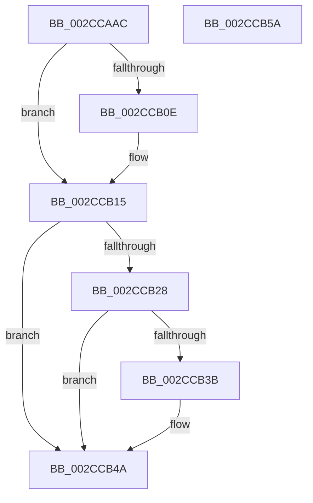

# MiAssignBackgroundZeroThreadToProcessor

- RVA: `0x002CCAAC`–`0x002CCB5B` (길이 `175` bytes)
- VA: `0x00000001402CCAAC`
- 실행 섹션: `.text`
- PDB 이름 있음: `예`; PDB Function 태그: `아니요`
- unwind 정보 RVA: `0x00060BC4`
- 디코드: `44`개 명령, `175/175` bytes 표시
- 미해석 바이트: `0` (있으면 어셈블리에 `.byte`로 보존)

> 이 문서는 커널 이미지의 기계어와 PDB 기호를 분석해 생성했습니다. 4번과 5번은 함수 원형과 자료형을 바이너리 사용 방식에서 추정한 C 해석이며 원본 소스 복구 결과는 아닙니다.

## 1. Dependencies

- 직접 호출 지점: **2**; 고유 호출 대상: **2**
- 직접 호출자로 확인된 함수: **3**
- RIP 상대 이미지 참조: **0**

### Outgoing calls
- `0x002CCB31` → [MiUpdateDomainAvailableAffinity](MiUpdateDomainAvailableAffinity_function_002CDD14.md) (function, `0x002CDD14`)
- `0x002CCB45` → [KeSetUserGroupAffinityThread](KeSetUserGroupAffinityThread_function_002CD1C4.md) (function, `0x002CD1C4`)

### Direct callers
- [MiAddZeroingThreads](MiAddZeroingThreads_function_002CBF78.md) at `0x002CC37A`
- [sub_002CC67B](Unknown_function_002CC67B.md) at `0x002CC6EE`
- [MiBackgroundZeroLocalPages](../31/MiBackgroundZeroLocalPages_function_0031EF30.md) at `0x0031F6DC`

### Static image references
- 디코드된 RIP-relative 메모리 참조가 없습니다.

## 2. Other-region calls and transfers

- 다른 실행 섹션으로 향하는 call: **0**
- 별도 외부 분기/꼬리 이동을 확인하지 못했습니다.

## 3. Assembly (complete function range)

```asm
002CCAAC  48 89 5C 24 08                  mov qword ptr [rsp + 8], rbx
002CCAB1  48 89 74 24 10                  mov qword ptr [rsp + 0x10], rsi
002CCAB6  57                              push rdi
002CCAB7  48 83 EC 20                     sub rsp, 0x20
002CCABB  41 8B 40 2C                     mov eax, dword ptr [r8 + 0x2c]
002CCABF  48 8D B1 60 01 00 00            lea rsi, [rcx + 0x160]
002CCAC6  89 81 58 01 00 00               mov dword ptr [rcx + 0x158], eax
002CCACC  48 8B FA                        mov rdi, rdx
002CCACF  41 0F 10 40 18                  movups xmm0, xmmword ptr [r8 + 0x18]
002CCAD4  48 8B D9                        mov rbx, rcx
002CCAD7  48 8D 14 40                     lea rdx, [rax + rax*2]
002CCADB  F3 0F 7F 06                     movdqu xmmword ptr [rsi], xmm0
002CCADF  48 C1 E2 04                     shl rdx, 4
002CCAE3  48 8D 81 B0 01 00 00            lea rax, [rcx + 0x1b0]
002CCAEA  41 0F 10 48 18                  movups xmm1, xmmword ptr [r8 + 0x18]
002CCAEF  F3 0F 7F 89 70 01 00 00         movdqu xmmword ptr [rcx + 0x170], xmm1
002CCAF7  48 03 97 88 00 00 00            add rdx, qword ptr [rdi + 0x88]
002CCAFE  FF 42 20                        inc dword ptr [rdx + 0x20]
002CCB01  48 8D 4A 10                     lea rcx, [rdx + 0x10]
002CCB05  4C 8B 41 08                     mov r8, qword ptr [rcx + 8]
002CCB09  49 39 08                        cmp qword ptr [r8], rcx
002CCB0C  74 07                           je 0x1402ccb15
002CCB0E  B9 03 00 00 00                  mov ecx, 3
002CCB13  CD 29                           int 0x29
002CCB15  48 89 08                        mov qword ptr [rax], rcx
002CCB18  4C 89 40 08                     mov qword ptr [rax + 8], r8
002CCB1C  49 89 00                        mov qword ptr [r8], rax
002CCB1F  48 89 41 08                     mov qword ptr [rcx + 8], rax
002CCB23  83 3F 00                        cmp dword ptr [rdi], 0
002CCB26  74 22                           je 0x1402ccb4a
002CCB28  41 B8 01 00 00 00               mov r8d, 1
002CCB2E  48 8B CB                        mov rcx, rbx
002CCB31  E8 DE 11 00 00                  call 0x1402cdd14
002CCB36  83 3F 00                        cmp dword ptr [rdi], 0
002CCB39  74 0F                           je 0x1402ccb4a
002CCB3B  48 8B 8B 48 01 00 00            mov rcx, qword ptr [rbx + 0x148]
002CCB42  48 8B D6                        mov rdx, rsi
002CCB45  E8 7A 06 00 00                  call 0x1402cd1c4
002CCB4A  48 8B 5C 24 30                  mov rbx, qword ptr [rsp + 0x30]
002CCB4F  48 8B 74 24 38                  mov rsi, qword ptr [rsp + 0x38]
002CCB54  48 83 C4 20                     add rsp, 0x20
002CCB58  5F                              pop rdi
002CCB59  C3                              ret
002CCB5A  CC                              int3
```

## 4. C-style interpretation (structured pseudocode)

```c
__int64 __fastcall MiAssignBackgroundZeroThreadToProcessor(__int64 a1, __int64 a2, __int64 a3)
{
    __int64 result;
    __int64 v_rsp;
    unsigned __int64 v_stack_p10;
    unsigned __int64 v_stack_p8;

    v_stack_p8 = v_rbx;
    v_stack_p10 = v_rsi;
    v_rsp = (v_rsp) - (32);
    *(unsigned int *)(a1 + 344) = (unsigned int)((unsigned int)(*(unsigned int *)(a3 + 44)));
    *(unsigned __int64 *)(a1 + 352) = v_xmm0;
    a2 = ((unsigned int)(*(unsigned int *)(a3 + 44)) + (unsigned int)(*(unsigned int *)(a3 + 44)) * 2) << (4);
    *(unsigned __int64 *)(a1 + 368) = v_xmm1;
    a2 = (a2) + (*(unsigned __int64 *)(a2 + 136));
    if ((*(unsigned __int64 *)(*(unsigned __int64 *)(a2 + 16 + 8))) != (a2 + 16)) {
        a1 = 3;
    }
    *(unsigned __int64 *)(a1 + 432) = a1;
    *(unsigned __int64 *)(a1 + 432 + 8) = *(unsigned __int64 *)(a2 + 16 + 8);
    *(unsigned __int64 *)(*(unsigned __int64 *)(a2 + 16 + 8)) = a1 + 432;
    *(unsigned __int64 *)(a1 + 8) = a1 + 432;
    if ((*(unsigned int *)(a2)) == 0) goto loc_002CCB4A;
    result = MiUpdateDomainAvailableAffinity(a1, a2, 1, a4);
    if ((*(unsigned int *)(a2)) != 0) {
        a1 = *(unsigned __int64 *)(a1 + 328);
        a2 = a1 + 352;
        result = KeSetUserGroupAffinityThread(a1, a2, 1, a4);
    }
    v_rsp = (v_rsp) + (32);
    return result;
}
```

## 5. (Beta) C Style

```c
int64_t MiAssignBackgroundZeroThreadToProcessor(void *Arg1, void *Arg2, void *Arg3)
{
    uint8_t *arg1 = (uint8_t *)Arg1;
    uint8_t *arg2 = (uint8_t *)Arg2;
    uint8_t *arg3 = (uint8_t *)Arg3;

    int64_t result;
    int64_t local_rsp;
    uint64_t v_stack_p10;
    uint64_t v_stack_p8;

    v_stack_p8 = local_rbx;
    v_stack_p10 = local_rsi;
    local_rsp = (local_rsp) - (32);
    *(uint32_t *)(arg1 + 0x158) = (uint32_t)((uint32_t)(*(uint32_t *)(arg3 + 0x2C)));
    *(uint64_t *)(arg1 + 0x160) = v_xmm0;
    Arg2 = ((uint32_t)(*(uint32_t *)(arg3 + 0x2C)) + (uint32_t)(*(uint32_t *)(arg3 + 0x2C)) * 2) << (4);
    *(uint64_t *)(arg1 + 0x170) = v_xmm1;
    Arg2 = (Arg2) + (*(uint64_t *)(arg2 + 0x88));
    if ((*(uint64_t *)(*(uint64_t *)(arg2 + 0x10 + 0x8))) != (Arg2 + 16)) {
        Arg1 = 3;
    }
    *(void **)(arg1 + 0x1B0) = Arg1;
    *(uint64_t *)(arg1 + 0x1B0 + 0x8) = *(uint64_t *)(arg2 + 0x10 + 0x8);
    *(void **)(*(uint64_t *)(arg2 + 0x10 + 0x8)) = Arg1 + 432;
    *(void **)(arg1 + 0x8) = Arg1 + 432;
    if ((*(uint32_t *)(arg2)) == 0) goto loc_002CCB4A;
    result = MiUpdateDomainAvailableAffinity(Arg1, Arg2, 1, a4);
    if ((*(uint32_t *)(arg2)) != 0) {
        Arg1 = *(uint64_t *)(arg1 + 0x148);
        Arg2 = Arg1 + 352;
        result = KeSetUserGroupAffinityThread(Arg1, Arg2, 1, a4);
    }
    local_rsp = (local_rsp) + (32);
    return result;
}
```

### 관측된 메모리 오프셋

구조체 형식이 확인되지 않은 접근은 인자 기준의 오프셋으로만 기록했습니다.

| 기준 인자 | 오프셋 표현 | 폭 (bit) | 접근 |
|---|---:|---:|---|
| `Arg1` | `+ 0x0` | `64` | `W` |
| `Arg1` | `+ 0x0` | `128` | `W` |
| `Arg1` | `+ 0x8` | `64` | `W` |
| `Arg1` | `+ 0x148` | `64` | `R` |
| `Arg1` | `+ 0x158` | `32` | `W` |
| `Arg1` | `+ 0x160` | `64` | `R` |
| `Arg1` | `+ 0x170` | `128` | `W` |
| `Arg1` | `+ 0x1B0` | `64` | `R` |
| `Arg2` | `+ 0x0` | `32` | `R` |
| `Arg2` | `+ 0x88` | `64` | `R` |
| `Arg3` | `+ 0x18` | `128` | `R` |
| `Arg3` | `+ 0x2C` | `32` | `R` |

## 6. Execution-region graph

[열기: 2D/3D 그래프와 함수 탐색 컨트롤 패널](../../../control-panel.html?section=text&rva=0x002CCAAC&view=graph)

- 2D 그래프는 위에서 아래로 흐르고, 3D 그래프는 빈 공간을 드래그해 회전합니다. Shift+드래그는 이동, 휠은 확대·축소, 함수 노드 선택은 대상 보고서 이동입니다.

### Static fallback


