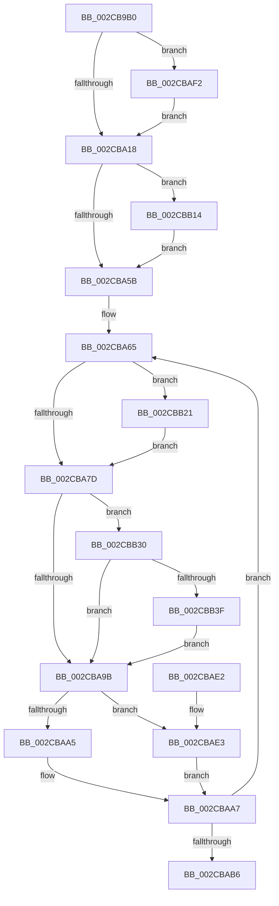

# MiBackgroundZeroNodePages

- RVA: `0x002CB9B0`–`0x002CBB4C` (길이 `412` bytes)
- VA: `0x00000001402CB9B0`
- 실행 섹션: `.text`
- PDB 이름 있음: `예`; PDB Function 태그: `아니요`
- unwind 정보 RVA: `0x0006F32C`
- 디코드: `102`개 명령, `412/412` bytes 표시
- 미해석 바이트: `0` (있으면 어셈블리에 `.byte`로 보존)

> 이 문서는 커널 이미지의 기계어와 PDB 기호를 분석해 생성했습니다. 4번과 5번은 함수 원형과 자료형을 바이너리 사용 방식에서 추정한 C 해석이며 원본 소스 복구 결과는 아닙니다.

## 1. Dependencies

- 직접 호출 지점: **16**; 고유 호출 대상: **11**
- 직접 호출자로 확인된 함수: **0**
- RIP 상대 이미지 참조: **0**

### Outgoing calls
- `0x002CBA02` → [ExAcquireSpinLockExclusive](../24/ExAcquireSpinLockExclusive_function_00248690.md) (function, `0x00248690`)
- `0x002CBA1E` → [MiReleaseSpinLockExclusive](../24/MiReleaseSpinLockExclusive_function_002482C0.md) (function, `0x002482C0`)
- `0x002CBA2F` → [MiSelectBestZeroingProcessor](MiSelectBestZeroingProcessor_function_002CC5E0.md) (function, `0x002CC5E0`)
- `0x002CBA37` → [ExAcquireSpinLockExclusive](../24/ExAcquireSpinLockExclusive_function_00248690.md) (function, `0x00248690`)
- `0x002CBA60` → [MiReleaseSpinLockExclusive](../24/MiReleaseSpinLockExclusive_function_002482C0.md) (function, `0x002482C0`)
- `0x002CBA68` → [MiBackgroundZeroLocalPages](../31/MiBackgroundZeroLocalPages_function_0031EF30.md) (function, `0x0031EF30`)
- `0x002CBA70` → [MiDereferenceAnyActiveHugeContext](MiDereferenceAnyActiveHugeContext_function_002CB928.md) (function, `0x002CB928`)
- `0x002CBA80` → [ExAcquireSpinLockExclusive](../24/ExAcquireSpinLockExclusive_function_00248690.md) (function, `0x00248690`)
- `0x002CBA8B` → [MiDecrementZeroEngineThread](MiDecrementZeroEngineThread_function_002CBC3C.md) (function, `0x002CBC3C`)
- `0x002CBAAD` → [MiReleaseSpinLockExclusive](../24/MiReleaseSpinLockExclusive_function_002482C0.md) (function, `0x002482C0`)
- `0x002CBABE` → [MiDeleteZeroThreadContext](../4D/MiDeleteZeroThreadContext_function_004DF788.md) (function, `0x004DF788`)
- `0x002CBAE6` → [MiRemoveThreadFromEngineLists](MiRemoveThreadFromEngineLists_function_002CAB1C.md) (function, `0x002CAB1C`)
- `0x002CBB03` → [ObfReferenceObjectWithTag](../21/ObfReferenceObjectWithTag_function_00210710.md) (function, `0x00210710`)
- `0x002CBB17` → [MiZeroThreadContextSetExiting](MiZeroThreadContextSetExiting_function_002CC590.md) (function, `0x002CC590`)
- `0x002CBB24` → [MiSignalZeroingPassComplete](../69/MiSignalZeroingPassComplete_function_00696690.md) (function, `0x00696690`)
- `0x002CBB42` → [MiZeroThreadContextSetExiting](MiZeroThreadContextSetExiting_function_002CC590.md) (function, `0x002CC590`)

### Direct callers
- 이 함수 시작 RVA로 연결되는 직접 call은 확인되지 않았습니다. 간접 호출은 완전히 역산할 수 없습니다.

### Static image references
- 디코드된 RIP-relative 메모리 참조가 없습니다.

## 2. Other-region calls and transfers

- 다른 실행 섹션으로 향하는 call: **0**
- 별도 외부 분기/꼬리 이동을 확인하지 못했습니다.

## 3. Assembly (complete function range)

```asm
002CB9B0  48 8B C4                        mov rax, rsp
002CB9B3  48 89 58 08                     mov qword ptr [rax + 8], rbx
002CB9B7  48 89 68 10                     mov qword ptr [rax + 0x10], rbp
002CB9BB  48 89 70 18                     mov qword ptr [rax + 0x18], rsi
002CB9BF  48 89 78 20                     mov qword ptr [rax + 0x20], rdi
002CB9C3  41 55                           push r13
002CB9C5  41 56                           push r14
002CB9C7  41 57                           push r15
002CB9C9  48 83 EC 20                     sub rsp, 0x20
002CB9CD  4C 8B B1 50 01 00 00            mov r14, qword ptr [rcx + 0x150]
002CB9D4  48 8B F9                        mov rdi, rcx
002CB9D7  BD 01 00 00 00                  mov ebp, 1
002CB9DC  49 8B 86 B0 00 00 00            mov rax, qword ptr [r14 + 0xb0]
002CB9E3  4C 8B 68 30                     mov r13, qword ptr [rax + 0x30]
002CB9E7  8B 40 38                        mov eax, dword ptr [rax + 0x38]
002CB9EA  48 69 D0 80 DF 00 00            imul rdx, rax, 0xdf80
002CB9F1  49 8B 75 10                     mov rsi, qword ptr [r13 + 0x10]
002CB9F5  48 81 C2 B0 3B 00 00            add rdx, 0x3bb0
002CB9FC  48 03 F2                        add rsi, rdx
002CB9FF  48 8B CE                        mov rcx, rsi
002CBA02  E8 89 CC F7 FF                  call 0x140248690
002CBA07  48 83 BF 48 01 00 00 00         cmp qword ptr [rdi + 0x148], 0
002CBA0F  44 8A F8                        mov r15b, al
002CBA12  0F 84 DA 00 00 00               je 0x1402cbaf2
002CBA18  41 8A D7                        mov dl, r15b
002CBA1B  48 8B CE                        mov rcx, rsi
002CBA1E  E8 9D C8 F7 FF                  call 0x1402482c0
002CBA23  44 8B CD                        mov r9d, ebp
002CBA26  45 33 C0                        xor r8d, r8d
002CBA29  48 8B D7                        mov rdx, rdi
002CBA2C  49 8B CE                        mov rcx, r14
002CBA2F  E8 AC 0B 00 00                  call 0x1402cc5e0
002CBA34  48 8B CE                        mov rcx, rsi
002CBA37  E8 54 CC F7 FF                  call 0x140248690
002CBA3C  8B 8F 80 01 00 00               mov ecx, dword ptr [rdi + 0x180]
002CBA42  8A D8                           mov bl, al
002CBA44  0B CD                           or ecx, ebp
002CBA46  89 8F 80 01 00 00               mov dword ptr [rdi + 0x180], ecx
002CBA4C  8B 8F 80 01 00 00               mov ecx, dword ptr [rdi + 0x180]
002CBA52  F6 C1 10                        test cl, 0x10
002CBA55  0F 85 B9 00 00 00               jne 0x1402cbb14
002CBA5B  8A D3                           mov dl, bl
002CBA5D  48 8B CE                        mov rcx, rsi
002CBA60  E8 5B C8 F7 FF                  call 0x1402482c0
002CBA65  48 8B CF                        mov rcx, rdi
002CBA68  E8 C3 34 05 00                  call 0x14031ef30
002CBA6D  48 8B CF                        mov rcx, rdi
002CBA70  E8 B3 FE FF FF                  call 0x1402cb928
002CBA75  85 ED                           test ebp, ebp
002CBA77  0F 85 A4 00 00 00               jne 0x1402cbb21
002CBA7D  48 8B CE                        mov rcx, rsi
002CBA80  E8 0B CC F7 FF                  call 0x140248690
002CBA85  48 8B CF                        mov rcx, rdi
002CBA88  44 8A F8                        mov r15b, al
002CBA8B  E8 AC 01 00 00                  call 0x1402cbc3c
002CBA90  41 83 7D 5C 00                  cmp dword ptr [r13 + 0x5c], 0
002CBA95  0F 85 95 00 00 00               jne 0x1402cbb30
002CBA9B  8B 87 80 01 00 00               mov eax, dword ptr [rdi + 0x180]
002CBAA1  A8 04                           test al, 4
002CBAA3  75 3E                           jne 0x1402cbae3
002CBAA5  33 DB                           xor ebx, ebx
002CBAA7  41 8A D7                        mov dl, r15b
002CBAAA  48 8B CE                        mov rcx, rsi
002CBAAD  E8 0E C8 F7 FF                  call 0x1402482c0
002CBAB2  85 DB                           test ebx, ebx
002CBAB4  74 AF                           je 0x1402cba65
002CBAB6  BA 01 00 00 00                  mov edx, 1
002CBABB  48 8B CF                        mov rcx, rdi
002CBABE  E8 C5 3C 21 00                  call 0x1404df788
002CBAC3  48 8B 5C 24 40                  mov rbx, qword ptr [rsp + 0x40]
002CBAC8  48 8B 6C 24 48                  mov rbp, qword ptr [rsp + 0x48]
002CBACD  48 8B 74 24 50                  mov rsi, qword ptr [rsp + 0x50]
002CBAD2  48 8B 7C 24 58                  mov rdi, qword ptr [rsp + 0x58]
002CBAD7  48 83 C4 20                     add rsp, 0x20
002CBADB  41 5F                           pop r15
002CBADD  41 5E                           pop r14
002CBADF  41 5D                           pop r13
002CBAE1  C3                              ret
002CBAE2  CC                              int3
002CBAE3  48 8B CF                        mov rcx, rdi
002CBAE6  E8 31 F0 FF FF                  call 0x1402cab1c
002CBAEB  BB 01 00 00 00                  mov ebx, 1
002CBAF0  EB B5                           jmp 0x1402cbaa7
002CBAF2  65 48 8B 1C 25 88 01 00 00      mov rbx, qword ptr gs:[0x188]
002CBAFB  BA 4D 6D 5A 65                  mov edx, 0x655a6d4d
002CBB00  48 8B CB                        mov rcx, rbx
002CBB03  E8 08 4C F4 FF                  call 0x140210710
002CBB08  48 89 9F 48 01 00 00            mov qword ptr [rdi + 0x148], rbx
002CBB0F  E9 04 FF FF FF                  jmp 0x1402cba18
002CBB14  48 8B CF                        mov rcx, rdi
002CBB17  E8 74 0A 00 00                  call 0x1402cc590
002CBB1C  E9 3A FF FF FF                  jmp 0x1402cba5b
002CBB21  49 8B CE                        mov rcx, r14
002CBB24  E8 67 AB 3C 00                  call 0x140696690
002CBB29  33 ED                           xor ebp, ebp
002CBB2B  E9 4D FF FF FF                  jmp 0x1402cba7d
002CBB30  8B 8F 80 01 00 00               mov ecx, dword ptr [rdi + 0x180]
002CBB36  F6 C1 04                        test cl, 4
002CBB39  0F 85 5C FF FF FF               jne 0x1402cba9b
002CBB3F  48 8B CF                        mov rcx, rdi
002CBB42  E8 49 0A 00 00                  call 0x1402cc590
002CBB47  E9 4F FF FF FF                  jmp 0x1402cba9b
```

## 4. C-style interpretation (structured pseudocode)

```c
__int64 __fastcall MiBackgroundZeroNodePages(__int64 a1, __int64 a2, int a3)
{
    __int64 result;
    __int64 v_rbp;
    __int64 v_rbx;
    __int64 v_rsi;
    __int64 v_rsp;
    unsigned __int64 v_stack_p10;
    unsigned __int64 v_stack_p18;
    unsigned __int64 v_stack_p20;
    unsigned __int64 v_stack_p8;

    *(unsigned __int64 *)(v_rsp + 8) = v_rbx;
    *(unsigned __int64 *)(v_rsp + 16) = v_rbp;
    *(unsigned __int64 *)(v_rsp + 24) = v_rsi;
    *(unsigned __int64 *)(v_rsp + 32) = v_rdi;
    v_rsp = (v_rsp) - (32);
    a2 = (a2) * ((unsigned int)(*(unsigned int *)(*(unsigned __int64 *)(*(unsigned __int64 *)(a1 + 336) + 176) + 56)));
    a2 = (a2) + (0x3BB0ULL);
    v_rsi = (*(unsigned __int64 *)(*(unsigned __int64 *)(*(unsigned __int64 *)(*(unsigned __int64 *)(a1 + 336) + 176) + 48) + 16)) + (a2);
    result = ExAcquireSpinLockExclusive(v_rsi, a2, a3, a4);
    if ((*(unsigned __int64 *)(a1 + 328)) == 0) goto loc_002CBAF2;
loc_002CBA18:
    result = MiReleaseSpinLockExclusive(v_rsi, (unsigned __int8)((unsigned __int8)(result)), a3, a4);
    a3 = 0;
    result = MiSelectBestZeroingProcessor(*(unsigned __int64 *)(a1 + 336), a1, a3, 1);
    result = ExAcquireSpinLockExclusive(v_rsi, a1, a3, 1);
    a1 = (unsigned int)(((unsigned int)(*(unsigned int *)(a1 + 384))) | (1));
    *(unsigned int *)(a1 + 384) = (unsigned int)(a1);
    if ((((unsigned __int8)((unsigned int)(*(unsigned int *)(a1 + 384)))) & (16)) != 0) goto loc_002CBB14;
loc_002CBA5B:
    result = MiReleaseSpinLockExclusive(v_rsi, (unsigned __int8)((unsigned __int8)(result)), a3, 1);
loc_002CBA65:
    result = MiBackgroundZeroLocalPages(a1, (unsigned __int8)((unsigned __int8)(result)), a3, 1);
    result = MiDereferenceAnyActiveHugeContext(a1, (unsigned __int8)((unsigned __int8)(result)), a3, 1);
    if (1 != 0) goto loc_002CBB21;
loc_002CBA7D:
    result = ExAcquireSpinLockExclusive(v_rsi, (unsigned __int8)((unsigned __int8)(result)), a3, 1);
    result = MiDecrementZeroEngineThread(a1, (unsigned __int8)((unsigned __int8)(result)), a3, 1);
    if ((*(unsigned int *)(*(unsigned __int64 *)(*(unsigned __int64 *)(*(unsigned __int64 *)(a1 + 336) + 176) + 48) + 92)) != 0) goto loc_002CBB30;
loc_002CBA9B:
    if ((((unsigned __int8)((unsigned int)(*(unsigned int *)(a1 + 384)))) & (4)) != 0) goto loc_002CBAE3;
    v_rbx = 0;
loc_002CBAA7:
    result = MiReleaseSpinLockExclusive(v_rsi, (unsigned __int8)((unsigned __int8)(result)), a3, 1);
    if (0 == 0) goto loc_002CBA65;
    result = MiDeleteZeroThreadContext(a1, 1, a3, 1);
    v_rsp = (v_rsp) + (32);
    return result;
loc_002CBAE3:
    result = MiRemoveThreadFromEngineLists(v_stack_p20, 1, a3, 1);
    goto loc_002CBAA7;
loc_002CBAF2:
    result = ObfReferenceObjectWithTag(*(unsigned __int64 *)(gs_base + (0 + 392)), (unsigned int)(0x655A6D4DULL), a3, 1);
    *(unsigned __int64 *)(v_stack_p20 + 328) = *(unsigned __int64 *)(gs_base + (0 + 392));
    goto loc_002CBA18;
loc_002CBB14:
    result = MiZeroThreadContextSetExiting(v_stack_p20, (unsigned int)(0x655A6D4DULL), a3, 1);
    goto loc_002CBA5B;
loc_002CBB21:
    result = MiSignalZeroingPassComplete(*(unsigned __int64 *)(a1 + 336), (unsigned int)(0x655A6D4DULL), a3, 1);
    v_rbp = 0;
    goto loc_002CBA7D;
loc_002CBB30:
    if ((((unsigned __int8)((unsigned int)(*(unsigned int *)(v_stack_p20 + 384)))) & (4)) != 0) goto loc_002CBA9B;
    result = MiZeroThreadContextSetExiting(v_stack_p20, (unsigned int)(0x655A6D4DULL), a3, 1);
    goto loc_002CBA9B;
}
```

## 5. (Beta) C Style

```c
int64_t MiBackgroundZeroNodePages(void *Arg1, int64_t Arg2, int32_t Arg3)
{
    uint8_t *arg1 = (uint8_t *)Arg1;

    int64_t result;
    int64_t local_rbp;
    int64_t local_rbx;
    int64_t local_rsi;
    int64_t local_rsp;
    uint64_t v_stack_p10;
    uint64_t v_stack_p18;
    uint64_t v_stack_p20;
    uint64_t v_stack_p8;

    *(uint64_t *)(local_rsp + 0x8) = local_rbx;
    *(uint64_t *)(local_rsp + 0x10) = local_rbp;
    *(uint64_t *)(local_rsp + 0x18) = local_rsi;
    *(uint64_t *)(local_rsp + 0x20) = local_rdi;
    local_rsp = (local_rsp) - (32);
    Arg2 = (Arg2) * ((uint32_t)(*(uint32_t *)(*(uint64_t *)(*(uint64_t *)(arg1 + 0x150) + 0xB0) + 0x38)));
    Arg2 = (Arg2) + (0x3BB0ULL);
    local_rsi = (*(uint64_t *)(*(uint64_t *)(*(uint64_t *)(*(uint64_t *)(arg1 + 0x150) + 0xB0) + 0x30) + 0x10)) + (Arg2);
    result = ExAcquireSpinLockExclusive(local_rsi, Arg2, Arg3, a4);
    if ((*(uint64_t *)(arg1 + 0x148)) == 0) goto loc_002CBAF2;
loc_002CBA18:
    result = MiReleaseSpinLockExclusive(local_rsi, (uint8_t)((uint8_t)(result)), Arg3, a4);
    Arg3 = 0;
    result = MiSelectBestZeroingProcessor(*(uint64_t *)(arg1 + 0x150), Arg1, Arg3, 1);
    result = ExAcquireSpinLockExclusive(local_rsi, Arg1, Arg3, 1);
    Arg1 = (uint32_t)(((uint32_t)(*(uint32_t *)(arg1 + 0x180))) | (1));
    *(uint32_t *)(arg1 + 0x180) = (uint32_t)(Arg1);
    if ((((uint8_t)((uint32_t)(*(uint32_t *)(arg1 + 0x180)))) & (16)) != 0) goto loc_002CBB14;
loc_002CBA5B:
    result = MiReleaseSpinLockExclusive(local_rsi, (uint8_t)((uint8_t)(result)), Arg3, 1);
loc_002CBA65:
    result = MiBackgroundZeroLocalPages(Arg1, (uint8_t)((uint8_t)(result)), Arg3, 1);
    result = MiDereferenceAnyActiveHugeContext(Arg1, (uint8_t)((uint8_t)(result)), Arg3, 1);
    if (1 != 0) goto loc_002CBB21;
loc_002CBA7D:
    result = ExAcquireSpinLockExclusive(local_rsi, (uint8_t)((uint8_t)(result)), Arg3, 1);
    result = MiDecrementZeroEngineThread(Arg1, (uint8_t)((uint8_t)(result)), Arg3, 1);
    if ((*(uint32_t *)(*(uint64_t *)(*(uint64_t *)(*(uint64_t *)(arg1 + 0x150) + 0xB0) + 0x30) + 0x5C)) != 0) goto loc_002CBB30;
loc_002CBA9B:
    if ((((uint8_t)((uint32_t)(*(uint32_t *)(arg1 + 0x180)))) & (4)) != 0) goto loc_002CBAE3;
    local_rbx = 0;
loc_002CBAA7:
    result = MiReleaseSpinLockExclusive(local_rsi, (uint8_t)((uint8_t)(result)), Arg3, 1);
    if (0 == 0) goto loc_002CBA65;
    result = MiDeleteZeroThreadContext(Arg1, 1, Arg3, 1);
    local_rsp = (local_rsp) + (32);
    return result;
loc_002CBAE3:
    result = MiRemoveThreadFromEngineLists(v_stack_p20, 1, Arg3, 1);
    goto loc_002CBAA7;
loc_002CBAF2:
    result = ObfReferenceObjectWithTag(*(uint64_t *)(gs_base + (0 + 0x188)), (uint32_t)(0x655A6D4DULL), Arg3, 1);
    *(uint64_t *)(v_stack_p20 + 0x148) = *(uint64_t *)(gs_base + (0 + 0x188));
    goto loc_002CBA18;
loc_002CBB14:
    result = MiZeroThreadContextSetExiting(v_stack_p20, (uint32_t)(0x655A6D4DULL), Arg3, 1);
    goto loc_002CBA5B;
loc_002CBB21:
    result = MiSignalZeroingPassComplete(*(uint64_t *)(arg1 + 0x150), (uint32_t)(0x655A6D4DULL), Arg3, 1);
    local_rbp = 0;
    goto loc_002CBA7D;
loc_002CBB30:
    if ((((uint8_t)((uint32_t)(*(uint32_t *)(v_stack_p20 + 0x180)))) & (4)) != 0) goto loc_002CBA9B;
    result = MiZeroThreadContextSetExiting(v_stack_p20, (uint32_t)(0x655A6D4DULL), Arg3, 1);
    goto loc_002CBA9B;
}
```

### 관측된 메모리 오프셋

구조체 형식이 확인되지 않은 접근은 인자 기준의 오프셋으로만 기록했습니다.

| 기준 인자 | 오프셋 표현 | 폭 (bit) | 접근 |
|---|---:|---:|---|
| `Arg1` | `+ 0x148` | `64` | `R` |
| `Arg1` | `+ 0x148` | `64` | `W` |
| `Arg1` | `+ 0x150` | `64` | `R` |
| `Arg1` | `+ 0x180` | `32` | `R` |
| `Arg1` | `+ 0x180` | `32` | `W` |

## 6. Execution-region graph

[열기: 2D/3D 그래프와 함수 탐색 컨트롤 패널](../../../control-panel.html?section=text&rva=0x002CB9B0&view=graph)

- 2D 그래프는 위에서 아래로 흐르고, 3D 그래프는 빈 공간을 드래그해 회전합니다. Shift+드래그는 이동, 휠은 확대·축소, 함수 노드 선택은 대상 보고서 이동입니다.

### Static fallback


