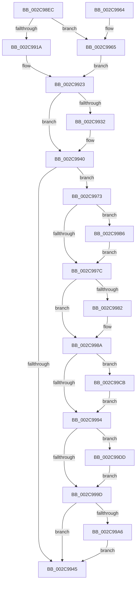

# MiChangePageAttributeAndZeroBatch

- RVA: `0x002C98EC`–`0x002C99EC` (길이 `256` bytes)
- VA: `0x00000001402C98EC`
- 실행 섹션: `.text`
- PDB 이름 있음: `예`; PDB Function 태그: `아니요`
- unwind 정보 RVA: `0x0006F0AC`
- 디코드: `80`개 명령, `256/256` bytes 표시
- 미해석 바이트: `0` (있으면 어셈블리에 `.byte`로 보존)

> 이 문서는 커널 이미지의 기계어와 PDB 기호를 분석해 생성했습니다. 4번과 5번은 함수 원형과 자료형을 바이너리 사용 방식에서 추정한 C 해석이며 원본 소스 복구 결과는 아닙니다.

## 1. Dependencies

- 직접 호출 지점: **6**; 고유 호출 대상: **2**
- 직접 호출자로 확인된 함수: **2**
- RIP 상대 이미지 참조: **0**

### Outgoing calls
- `0x002C993B` → [MiChangePageAttributeBatch](../2A/MiChangePageAttributeBatch_function_002A06E0.md) (function, `0x002A06E0`)
- `0x002C9985` → [MiZeroInParallel](MiZeroInParallel_function_002C9F78.md) (function, `0x002C9F78`)
- `0x002C99AF` → [MiChangePageAttributeBatch](../2A/MiChangePageAttributeBatch_function_002A06E0.md) (function, `0x002A06E0`)
- `0x002C99C4` → [MiChangePageAttributeBatch](../2A/MiChangePageAttributeBatch_function_002A06E0.md) (function, `0x002A06E0`)
- `0x002C99D6` → [MiChangePageAttributeBatch](../2A/MiChangePageAttributeBatch_function_002A06E0.md) (function, `0x002A06E0`)
- `0x002C99E5` → [MiChangePageAttributeBatch](../2A/MiChangePageAttributeBatch_function_002A06E0.md) (function, `0x002A06E0`)

### Direct callers
- [MiInitializeMdlOneNodeBatchPages](MiInitializeMdlOneNodeBatchPages_function_002C9480.md) at `0x002C959F`
- [MiFindLargePageMemory](../../page/AA/MiFindLargePageMemory_function_00AA8334.md) at `0x00AA8650`

### Static image references
- 디코드된 RIP-relative 메모리 참조가 없습니다.

## 2. Other-region calls and transfers

- 다른 실행 섹션으로 향하는 call: **0**
- 별도 외부 분기/꼬리 이동을 확인하지 못했습니다.

## 3. Assembly (complete function range)

```asm
002C98EC  48 8B C4                        mov rax, rsp
002C98EF  48 89 58 08                     mov qword ptr [rax + 8], rbx
002C98F3  48 89 68 10                     mov qword ptr [rax + 0x10], rbp
002C98F7  48 89 70 18                     mov qword ptr [rax + 0x18], rsi
002C98FB  48 89 78 20                     mov qword ptr [rax + 0x20], rdi
002C98FF  41 54                           push r12
002C9901  41 56                           push r14
002C9903  41 57                           push r15
002C9905  48 83 EC 20                     sub rsp, 0x20
002C9909  49 8B D9                        mov rbx, r9
002C990C  45 8B F8                        mov r15d, r8d
002C990F  48 8B F2                        mov rsi, rdx
002C9912  48 8B E9                        mov rbp, rcx
002C9915  48 85 D2                        test rdx, rdx
002C9918  74 4B                           je 0x1402c9965
002C991A  8B 7A 10                        mov edi, dword ptr [rdx + 0x10]
002C991D  C1 EF 03                        shr edi, 3
002C9920  83 E7 01                        and edi, 1
002C9923  49 BC FF FF FF FF 7F 00 00 00   movabs r12, 0x7fffffffff
002C992D  4C 39 21                        cmp qword ptr [rcx], r12
002C9930  74 0E                           je 0x1402c9940
002C9932  44 8B CF                        mov r9d, edi
002C9935  4C 8B C3                        mov r8, rbx
002C9938  41 8B D7                        mov edx, r15d
002C993B  E8 A0 6D FD FF                  call 0x1402a06e0
002C9940  48 85 F6                        test rsi, rsi
002C9943  75 2E                           jne 0x1402c9973
002C9945  48 8B 5C 24 40                  mov rbx, qword ptr [rsp + 0x40]
002C994A  48 8B 6C 24 48                  mov rbp, qword ptr [rsp + 0x48]
002C994F  48 8B 74 24 50                  mov rsi, qword ptr [rsp + 0x50]
002C9954  48 8B 7C 24 58                  mov rdi, qword ptr [rsp + 0x58]
002C9959  48 83 C4 20                     add rsp, 0x20
002C995D  41 5F                           pop r15
002C995F  41 5E                           pop r14
002C9961  41 5C                           pop r12
002C9963  C3                              ret
002C9964  CC                              int3
002C9965  44 0F 20 C0                     mov rax, cr8
002C9969  33 FF                           xor edi, edi
002C996B  3C 02                           cmp al, 2
002C996D  40 0F 94 C7                     sete dil
002C9971  EB B0                           jmp 0x1402c9923
002C9973  4C 8D 75 10                     lea r14, [rbp + 0x10]
002C9977  4D 39 26                        cmp qword ptr [r14], r12
002C997A  75 3A                           jne 0x1402c99b6
002C997C  83 7E 28 00                     cmp dword ptr [rsi + 0x28], 0
002C9980  74 08                           je 0x1402c998a
002C9982  48 8B CE                        mov rcx, rsi
002C9985  E8 EE 05 00 00                  call 0x1402c9f78
002C998A  BE 03 00 00 00                  mov esi, 3
002C998F  4D 39 26                        cmp qword ptr [r14], r12
002C9992  75 37                           jne 0x1402c99cb
002C9994  48 8D 4D 18                     lea rcx, [rbp + 0x18]
002C9998  4C 39 21                        cmp qword ptr [rcx], r12
002C999B  75 40                           jne 0x1402c99dd
002C999D  48 8D 4D 08                     lea rcx, [rbp + 8]
002C99A1  4C 39 21                        cmp qword ptr [rcx], r12
002C99A4  74 9F                           je 0x1402c9945
002C99A6  44 8B CF                        mov r9d, edi
002C99A9  4C 8B C3                        mov r8, rbx
002C99AC  41 8B D7                        mov edx, r15d
002C99AF  E8 2C 6D FD FF                  call 0x1402a06e0
002C99B4  EB 8F                           jmp 0x1402c9945
002C99B6  49 83 C8 FF                     or r8, 0xffffffffffffffff
002C99BA  44 8B CF                        mov r9d, edi
002C99BD  49 8B CE                        mov rcx, r14
002C99C0  41 8D 50 02                     lea edx, [r8 + 2]
002C99C4  E8 17 6D FD FF                  call 0x1402a06e0
002C99C9  EB B1                           jmp 0x1402c997c
002C99CB  44 8B CF                        mov r9d, edi
002C99CE  4C 8B C3                        mov r8, rbx
002C99D1  8B D6                           mov edx, esi
002C99D3  49 8B CE                        mov rcx, r14
002C99D6  E8 05 6D FD FF                  call 0x1402a06e0
002C99DB  EB B7                           jmp 0x1402c9994
002C99DD  44 8B CF                        mov r9d, edi
002C99E0  4C 8B C3                        mov r8, rbx
002C99E3  8B D6                           mov edx, esi
002C99E5  E8 F6 6C FD FF                  call 0x1402a06e0
002C99EA  EB B1                           jmp 0x1402c999d
```

## 4. C-style interpretation (structured pseudocode)

```c
__int64 __fastcall MiChangePageAttributeAndZeroBatch(__int64 a1, __int64 a2, int a3, __int64 a4)
{
    __int64 result;
    __int64 v_rdi;
    __int64 v_rsp;
    unsigned __int64 v_stack_p10;
    unsigned __int64 v_stack_p18;
    unsigned __int64 v_stack_p20;
    unsigned __int64 v_stack_p8;

    *(unsigned __int64 *)(v_rsp + 8) = v_rbx;
    *(unsigned __int64 *)(v_rsp + 16) = v_rbp;
    *(unsigned __int64 *)(v_rsp + 24) = v_rsi;
    *(unsigned __int64 *)(v_rsp + 32) = v_rdi;
    v_rsp = (v_rsp) - (32);
    if (a2 == 0) goto loc_002C9965;
    v_rdi = (unsigned int)(((unsigned int)(*(unsigned int *)(a2 + 16))) >> (3));
    v_rdi = (unsigned int)((v_rdi) & (1));
loc_002C9923:
    result = v_rsp;
    if ((*(unsigned __int64 *)(a1)) != v_r12) {
        a4 = (unsigned int)(v_rdi);
        a3 = a4;
        a2 = (unsigned int)((unsigned int)(a3));
        result = MiChangePageAttributeBatch(a1, a2, a3, a4);
    }
    if (a2 != 0) goto loc_002C9973;
loc_002C9945:
    v_rsp = (v_rsp) + (32);
    return result;
loc_002C9965:
    v_rdi = 0;
    v_rdi = (((unsigned __int8)(v_cr8)) == 2) ? 1 : 0;
    goto loc_002C9923;
loc_002C9973:
    if ((*(unsigned __int64 *)(v_stack_p10 + 16)) != v_r12) goto loc_002C99B6;
loc_002C997C:
    result = v_cr8;
    if ((*(unsigned int *)(v_stack_p18 + 40)) != 0) {
        a1 = v_stack_p18;
        result = MiZeroInParallel(a1, a2, a3, a4);
    }
    if ((*(unsigned __int64 *)(v_stack_p10 + 16)) != v_r12) goto loc_002C99CB;
loc_002C9994:
    if ((*(unsigned __int64 *)(v_stack_p10 + 24)) != v_r12) goto loc_002C99DD;
loc_002C999D:
    if ((*(unsigned __int64 *)(v_stack_p10 + 8)) == v_r12) goto loc_002C9945;
    result = MiChangePageAttributeBatch(v_stack_p10 + 8, (unsigned int)((unsigned int)((unsigned int)(a3))), v_stack_p8, (unsigned int)((unsigned int)(v_rdi)));
    goto loc_002C9945;
loc_002C99B6:
    a3 = (v_stack_p8) | (-1);
    result = MiChangePageAttributeBatch(v_stack_p10 + 16, a3 + 2, a3, (unsigned int)((unsigned int)(v_rdi)));
    goto loc_002C997C;
loc_002C99CB:
    result = MiChangePageAttributeBatch(v_stack_p10 + 16, 3, v_stack_p8, (unsigned int)((unsigned int)(v_rdi)));
    goto loc_002C9994;
loc_002C99DD:
    result = MiChangePageAttributeBatch(v_stack_p10 + 16, 3, v_stack_p8, (unsigned int)((unsigned int)(v_rdi)));
    goto loc_002C999D;
}
```

## 5. (Beta) C Style

```c
int64_t MiChangePageAttributeAndZeroBatch(void *Arg1, int64_t Arg2, int32_t Arg3, int64_t Arg4)
{
    uint8_t *arg1 = (uint8_t *)Arg1;

    int64_t result;
    int64_t local_rdi;
    int64_t local_rsp;
    uint64_t v_stack_p10;
    uint64_t v_stack_p18;
    uint64_t v_stack_p20;
    uint64_t v_stack_p8;

    *(uint64_t *)(local_rsp + 0x8) = local_rbx;
    *(uint64_t *)(local_rsp + 0x10) = local_rbp;
    *(uint64_t *)(local_rsp + 0x18) = local_rsi;
    *(uint64_t *)(local_rsp + 0x20) = local_rdi;
    local_rsp = (local_rsp) - (32);
    if (Arg2 == 0) goto loc_002C9965;
    local_rdi = (uint32_t)(((uint32_t)(*(uint32_t *)(Arg2 + 0x10))) >> (3));
    local_rdi = (uint32_t)((local_rdi) & (1));
loc_002C9923:
    result = local_rsp;
    if ((*(uint64_t *)(arg1)) != local_r12) {
        Arg4 = (uint32_t)(local_rdi);
        Arg3 = Arg4;
        Arg2 = (uint32_t)((uint32_t)(Arg3));
        result = MiChangePageAttributeBatch(Arg1, Arg2, Arg3, Arg4);
    }
    if (Arg2 != 0) goto loc_002C9973;
loc_002C9945:
    local_rsp = (local_rsp) + (32);
    return result;
loc_002C9965:
    local_rdi = 0;
    local_rdi = (((uint8_t)(v_cr8)) == 2) ? 1 : 0;
    goto loc_002C9923;
loc_002C9973:
    if ((*(uint64_t *)(v_stack_p10 + 0x10)) != local_r12) goto loc_002C99B6;
loc_002C997C:
    result = v_cr8;
    if ((*(uint32_t *)(v_stack_p18 + 0x28)) != 0) {
        Arg1 = v_stack_p18;
        result = MiZeroInParallel(Arg1, Arg2, Arg3, Arg4);
    }
    if ((*(uint64_t *)(v_stack_p10 + 0x10)) != local_r12) goto loc_002C99CB;
loc_002C9994:
    if ((*(uint64_t *)(v_stack_p10 + 0x18)) != local_r12) goto loc_002C99DD;
loc_002C999D:
    if ((*(uint64_t *)(v_stack_p10 + 0x8)) == local_r12) goto loc_002C9945;
    result = MiChangePageAttributeBatch(v_stack_p10 + 8, (uint32_t)((uint32_t)((uint32_t)(Arg3))), v_stack_p8, (uint32_t)((uint32_t)(local_rdi)));
    goto loc_002C9945;
loc_002C99B6:
    Arg3 = (v_stack_p8) | (-1);
    result = MiChangePageAttributeBatch(v_stack_p10 + 16, Arg3 + 2, Arg3, (uint32_t)((uint32_t)(local_rdi)));
    goto loc_002C997C;
loc_002C99CB:
    result = MiChangePageAttributeBatch(v_stack_p10 + 16, 3, v_stack_p8, (uint32_t)((uint32_t)(local_rdi)));
    goto loc_002C9994;
loc_002C99DD:
    result = MiChangePageAttributeBatch(v_stack_p10 + 16, 3, v_stack_p8, (uint32_t)((uint32_t)(local_rdi)));
    goto loc_002C999D;
}
```

### 관측된 메모리 오프셋

구조체 형식이 확인되지 않은 접근은 인자 기준의 오프셋으로만 기록했습니다.

| 기준 인자 | 오프셋 표현 | 폭 (bit) | 접근 |
|---|---:|---:|---|
| `Arg1` | `+ 0x0` | `64` | `R` |
| `Arg1` | `+ 0x8` | `64` | `R` |
| `Arg1` | `+ 0x10` | `64` | `R` |
| `Arg1` | `+ 0x18` | `64` | `R` |

## 6. Execution-region graph

[열기: 2D/3D 그래프와 함수 탐색 컨트롤 패널](../../../control-panel.html?section=text&rva=0x002C98EC&view=graph)

- 2D 그래프는 위에서 아래로 흐르고, 3D 그래프는 빈 공간을 드래그해 회전합니다. Shift+드래그는 이동, 휠은 확대·축소, 함수 노드 선택은 대상 보고서 이동입니다.

### Static fallback


