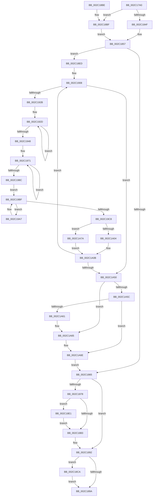

# MiClearNonPagedPtes

- RVA: `0x002C17A0`–`0x002C1A84` (길이 `740` bytes)
- VA: `0x00000001402C17A0`
- 실행 섹션: `.text`
- PDB 이름 있음: `예`; PDB Function 태그: `아니요`
- unwind 정보 RVA: `0x0006E744`
- 디코드: `184`개 명령, `740/740` bytes 표시
- 미해석 바이트: `0` (있으면 어셈블리에 `.byte`로 보존)

> 이 문서는 커널 이미지의 기계어와 PDB 기호를 분석해 생성했습니다. 4번과 5번은 함수 원형과 자료형을 바이너리 사용 방식에서 추정한 C 해석이며 원본 소스 복구 결과는 아닙니다.

## 1. Dependencies

- 직접 호출 지점: **15**; 고유 호출 대상: **13**
- 직접 호출자로 확인된 함수: **3**
- RIP 상대 이미지 참조: **4**

### Outgoing calls
- `0x002C17DF` → [memset](../6C/memset_function_006C6C40.md) (function, `0x006C6C40`)
- `0x002C17EF` → [memset](../6C/memset_function_006C6C40.md) (function, `0x006C6C40`)
- `0x002C184F` → [MiLockWorkingSetShared](../27/MiLockWorkingSetShared_function_0027CBF0.md) (function, `0x0027CBF0`)
- `0x002C186B` → [MiUnlockWorkingSetShared](../27/MiUnlockWorkingSetShared_function_0027D690.md) (function, `0x0027D690`)
- `0x002C188D` → [MiReturnPhysicalPoolPages](../32/MiReturnPhysicalPoolPages_function_00328568.md) (function, `0x00328568`)
- `0x002C18C3` → [MiLockWorkingSetSharedAtDpc](../23/MiLockWorkingSetSharedAtDpc_function_00239574.md) (function, `0x00239574`)
- `0x002C18DA` → [MiReturnPhysicalPoolPages](../32/MiReturnPhysicalPoolPages_function_00328568.md) (function, `0x00328568`)
- `0x002C18E6` → [MiLogNonPagedPoolReleaseEvent](../4D/MiLogNonPagedPoolReleaseEvent_function_004DF938.md) (function, `0x004DF938`)
- `0x002C191E` → [MiFastLockLeafPageTable](../27/MiFastLockLeafPageTable_function_00276340.md) (function, `0x00276340`)
- `0x002C19AD` → [MiDeleteNonPagedPoolPte](MiDeleteNonPagedPoolPte_function_002C1A90.md) (function, `0x002C1A90`)
- `0x002C19C8` → [MiDeleteNonPagedPoolTail](MiDeleteNonPagedPoolTail_function_002C20F0.md) (function, `0x002C20F0`)
- `0x002C19D0` → [MI_READ_PTE_LOCK_FREE](../28/MI_READ_PTE_LOCK_FREE_function_002828A0.md) (function, `0x002828A0`)
- `0x002C1A23` → [MiUnlockPageTable](../21/MiUnlockPageTable_function_00216EC0.md) (function, `0x00216EC0`)
- `0x002C1A2B` → [MiGetLeafVa](../27/MiGetLeafVa_function_0027C0A0.md) (function, `0x0027C0A0`)
- `0x002C1A69` → [MiWalkPageTables](MiWalkPageTables_function_002C2710.md) (function, `0x002C2710`)

### Direct callers
- [MmFreePoolMemory](MmFreePoolMemory_function_002C1578.md) at `0x002C170D`
- [MiCommitPoolMemory](../32/MiCommitPoolMemory_function_00329520.md) at `0x00329786`
- [MmFreeSecurePoolMemory](../68/MmFreeSecurePoolMemory_function_00682E10.md) at `0x00682E9D`

### Static image references
- `0x002C17F4` → RVA `0x002C1A90` (`MiDeleteNonPagedPoolPte`; read)
- `0x002C1807` → RVA `0x002C20F0` (`MiDeleteNonPagedPoolTail`; read)
- `0x002C182C` → RVA `0x00E38480` (`.data`; read)
- `0x002C1878` → RVA `0x00FC6B04` (`ALMOSTRO`; read)

## 2. Other-region calls and transfers

- 다른 실행 섹션으로 향하는 call: **0**
- 별도 외부 분기/꼬리 이동을 확인하지 못했습니다.

## 3. Assembly (complete function range)

```asm
002C17A0  48 8B C4                        mov rax, rsp
002C17A3  48 89 58 08                     mov qword ptr [rax + 8], rbx
002C17A7  48 89 70 10                     mov qword ptr [rax + 0x10], rsi
002C17AB  48 89 78 18                     mov qword ptr [rax + 0x18], rdi
002C17AF  44 89 48 20                     mov dword ptr [rax + 0x20], r9d
002C17B3  55                              push rbp
002C17B4  41 54                           push r12
002C17B6  41 55                           push r13
002C17B8  41 56                           push r14
002C17BA  41 57                           push r15
002C17BC  48 8D 68 88                     lea rbp, [rax - 0x78]
002C17C0  48 81 EC 50 01 00 00            sub rsp, 0x150
002C17C7  41 8B F8                        mov edi, r8d
002C17CA  48 8B DA                        mov rbx, rdx
002C17CD  48 8B F1                        mov rsi, rcx
002C17D0  33 D2                           xor edx, edx
002C17D2  41 B8 C0 00 00 00               mov r8d, 0xc0
002C17D8  48 8D 4D 90                     lea rcx, [rbp - 0x70]
002C17DC  45 8B F1                        mov r14d, r9d
002C17DF  E8 5C 54 40 00                  call 0x1406c6c40
002C17E4  33 D2                           xor edx, edx
002C17E6  48 8D 4C 24 40                  lea rcx, [rsp + 0x40]
002C17EB  44 8D 42 50                     lea r8d, [rdx + 0x50]
002C17EF  E8 4C 54 40 00                  call 0x1406c6c40
002C17F4  48 8D 05 95 02 00 00            lea rax, [rip + 0x295]
002C17FB  48 C1 E3 0C                     shl rbx, 0xc
002C17FF  48 89 45 38                     mov qword ptr [rbp + 0x38], rax
002C1803  4C 8D 7E FF                     lea r15, [rsi - 1]
002C1807  48 8D 05 E2 08 00 00            lea rax, [rip + 0x8e2]
002C180E  C7 45 90 87 00 00 00            mov dword ptr [rbp - 0x70], 0x87
002C1815  45 32 E4                        xor r12b, r12b
002C1818  48 89 45 40                     mov qword ptr [rbp + 0x40], rax
002C181C  4C 03 FB                        add r15, rbx
002C181F  48 89 75 B8                     mov qword ptr [rbp - 0x48], rsi
002C1823  48 8D 44 24 40                  lea rax, [rsp + 0x40]
002C1828  4C 89 7D C0                     mov qword ptr [rbp - 0x40], r15
002C182C  48 8D 1D 4D 6C B7 00            lea rbx, [rip + 0xb76c4d]
002C1833  48 89 45 48                     mov qword ptr [rbp + 0x48], rax
002C1837  89 7C 24 78                     mov dword ptr [rsp + 0x78], edi
002C183B  44 89 74 24 7C                  mov dword ptr [rsp + 0x7c], r14d
002C1840  48 89 5D B0                     mov qword ptr [rbp - 0x50], rbx
002C1844  44 0F 20 C0                     mov rax, cr8
002C1848  48 8B CB                        mov rcx, rbx
002C184B  3C 02                           cmp al, 2
002C184D  74 70                           je 0x1402c18bf
002C184F  E8 9C B3 FB FF                  call 0x14027cbf0
002C1854  88 45 99                        mov byte ptr [rbp - 0x67], al
002C1857  BF 01 00 00 00                  mov edi, 1
002C185C  49 3B F7                        cmp rsi, r15
002C185F  0F 86 88 00 00 00               jbe 0x1402c18ed
002C1865  8A 55 99                        mov dl, byte ptr [rbp - 0x67]
002C1868  48 8B CB                        mov rcx, rbx
002C186B  E8 20 BE FB FF                  call 0x14027d690
002C1870  48 83 7C 24 58 00               cmp qword ptr [rsp + 0x58], 0
002C1876  74 1A                           je 0x1402c1892
002C1878  8B 05 86 52 D0 00               mov eax, dword ptr [rip + 0xd05286]
002C187E  40 84 C7                        test dil, al
002C1881  75 5E                           jne 0x1402c18e1
002C1883  BA 02 00 00 00                  mov edx, 2
002C1888  48 8D 4C 24 48                  lea rcx, [rsp + 0x48]
002C188D  E8 D6 6C 06 00                  call 0x140328568
002C1892  48 83 7C 24 70 00               cmp qword ptr [rsp + 0x70], 0
002C1898  75 30                           jne 0x1402c18ca
002C189A  8B 45 84                        mov eax, dword ptr [rbp - 0x7c]
002C189D  4C 8D 9C 24 50 01 00 00         lea r11, [rsp + 0x150]
002C18A5  49 8B 5B 30                     mov rbx, qword ptr [r11 + 0x30]
002C18A9  49 8B 73 38                     mov rsi, qword ptr [r11 + 0x38]
002C18AD  49 8B 7B 40                     mov rdi, qword ptr [r11 + 0x40]
002C18B1  49 8B E3                        mov rsp, r11
002C18B4  41 5F                           pop r15
002C18B6  41 5E                           pop r14
002C18B8  41 5D                           pop r13
002C18BA  41 5C                           pop r12
002C18BC  5D                              pop rbp
002C18BD  C3                              ret
002C18BE  CC                              int3
002C18BF  C6 45 99 11                     mov byte ptr [rbp - 0x67], 0x11
002C18C3  E8 AC 7C F7 FF                  call 0x140239574
002C18C8  EB 8D                           jmp 0x1402c1857
002C18CA  41 83 E6 02                     and r14d, 2
002C18CE  48 8D 4C 24 60                  lea rcx, [rsp + 0x60]
002C18D3  43 8D 14 36                     lea edx, [r14 + r14]
002C18D7  83 CA 03                        or edx, 3
002C18DA  E8 89 6C 06 00                  call 0x140328568
002C18DF  EB B9                           jmp 0x1402c189a
002C18E1  48 8D 4C 24 48                  lea rcx, [rsp + 0x48]
002C18E6  E8 4D E0 21 00                  call 0x1404df938
002C18EB  EB 96                           jmp 0x1402c1883
002C18ED  49 BD F8 FF FF FF 7F 00 00 00   movabs r13, 0x7ffffffff8
002C18F7  48 BB 00 00 00 00 80 F6 FF FF   movabs rbx, 0xfffff68000000000
002C1901  4C 8D 35 78 6B B7 00            lea r14, [rip + 0xb76b78]
002C1908  0F 57 C0                        xorps xmm0, xmm0
002C190B  45 33 C0                        xor r8d, r8d
002C190E  48 8B D6                        mov rdx, rsi
002C1911  49 8B CE                        mov rcx, r14
002C1914  0F 11 44 24 20                  movups xmmword ptr [rsp + 0x20], xmm0
002C1919  0F 11 44 24 30                  movups xmmword ptr [rsp + 0x30], xmm0
002C191E  E8 1D 4A FB FF                  call 0x140276340
002C1923  85 C0                           test eax, eax
002C1925  0F 84 25 01 00 00               je 0x1402c1a50
002C192B  33 D2                           xor edx, edx
002C192D  48 C1 EE 09                     shr rsi, 9
002C1931  49 23 F5                        and rsi, r13
002C1934  48 8B CB                        mov rcx, rbx
002C1937  48 03 F1                        add rsi, rcx
002C193A  48 89 74 D4 20                  mov qword ptr [rsp + rdx*8 + 0x20], rsi
002C193F  48 03 D7                        add rdx, rdi
002C1942  48 83 FA 04                     cmp rdx, 4
002C1946  7C E5                           jl 0x1402c192d
002C1948  48 63 F8                        movsxd rdi, eax
002C194B  8D 70 FF                        lea esi, [rax - 1]
002C194E  49 8B CF                        mov rcx, r15
002C1951  49 B8 00 00 00 00 80 F6 FF FF   movabs r8, 0xfffff68000000000
002C195B  33 D2                           xor edx, edx
002C195D  49 B9 F8 FF FF FF 7F 00 00 00   movabs r9, 0x7ffffffff8
002C1967  4C 8B 6C FC 20                  mov r13, qword ptr [rsp + rdi*8 + 0x20]
002C196C  48 8B 5C FC 18                  mov rbx, qword ptr [rsp + rdi*8 + 0x18]
002C1971  48 C1 E9 09                     shr rcx, 9
002C1975  49 23 C9                        and rcx, r9
002C1978  49 8B C0                        mov rax, r8
002C197B  48 03 C8                        add rcx, rax
002C197E  48 89 4C D4 20                  mov qword ptr [rsp + rdx*8 + 0x20], rcx
002C1983  48 FF C2                        inc rdx
002C1986  48 83 FA 04                     cmp rdx, 4
002C198A  7C E5                           jl 0x1402c1971
002C198C  48 8B 7C FC 18                  mov rdi, qword ptr [rsp + rdi*8 + 0x18]
002C1991  48 8B C3                        mov rax, rbx
002C1994  48 83 E0 F8                     and rax, 0xfffffffffffffff8
002C1998  48 0D F8 0F 00 00               or rax, 0xff8
002C199E  48 3B F8                        cmp rdi, rax
002C19A1  48 0F 47 F8                     cmova rdi, rax
002C19A5  EB 18                           jmp 0x1402c19bf
002C19A7  44 8B C6                        mov r8d, esi
002C19AA  48 8B D3                        mov rdx, rbx
002C19AD  E8 DE 00 00 00                  call 0x1402c1a90
002C19B2  8B 45 9C                        mov eax, dword ptr [rbp - 0x64]
002C19B5  FF C0                           inc eax
002C19B7  83 65 9C 00                     and dword ptr [rbp - 0x64], 0
002C19BB  48 8D 1C C3                     lea rbx, [rbx + rax*8]
002C19BF  48 8D 4D 90                     lea rcx, [rbp - 0x70]
002C19C3  48 3B DF                        cmp rbx, rdi
002C19C6  76 DF                           jbe 0x1402c19a7
002C19C8  E8 23 07 00 00                  call 0x1402c20f0
002C19CD  49 8B CD                        mov rcx, r13
002C19D0  E8 CB 0E FC FF                  call 0x1402828a0
002C19D5  48 B9 FF FF FF FF FF 00 00 00   movabs rcx, 0xffffffffff
002C19DF  48 C1 E8 0C                     shr rax, 0xc
002C19E3  48 23 C1                        and rax, rcx
002C19E6  48 8D 0C 40                     lea rcx, [rax + rax*2]
002C19EA  48 C1 E1 04                     shl rcx, 4
002C19EE  48 B8 00 00 00 00 00 DE FF FF   movabs rax, 0xffffde0000000000
002C19F8  48 03 C8                        add rcx, rax
002C19FB  8B 41 24                        mov eax, dword ptr [rcx + 0x24]
002C19FE  0F BA E0 1A                     bt eax, 0x1a
002C1A02  73 76                           jae 0x1402c1a7a
002C1A04  48 8B 01                        mov rax, qword ptr [rcx]
002C1A07  48 C1 E8 20                     shr rax, 0x20
002C1A0B  A9 FF 03 00 00                  test eax, 0x3ff
002C1A10  45 0F B6 E4                     movzx r12d, r12b
002C1A14  BF 01 00 00 00                  mov edi, 1
002C1A19  49 8B D5                        mov rdx, r13
002C1A1C  49 8B CE                        mov rcx, r14
002C1A1F  44 0F 44 E7                     cmove r12d, edi
002C1A23  E8 98 54 F5 FF                  call 0x140216ec0
002C1A28  48 8B CB                        mov rcx, rbx
002C1A2B  E8 70 A6 FB FF                  call 0x14027c0a0
002C1A30  48 BB 00 00 00 00 80 F6 FF FF   movabs rbx, 0xfffff68000000000
002C1A3A  48 8B F0                        mov rsi, rax
002C1A3D  49 BD F8 FF FF FF 7F 00 00 00   movabs r13, 0x7ffffffff8
002C1A47  49 3B C7                        cmp rax, r15
002C1A4A  0F 86 B8 FE FF FF               jbe 0x1402c1908
002C1A50  44 8B B5 98 00 00 00            mov r14d, dword ptr [rbp + 0x98]
002C1A57  45 84 E4                        test r12b, r12b
002C1A5A  75 09                           jne 0x1402c1a65
002C1A5C  49 3B F7                        cmp rsi, r15
002C1A5F  77 0D                           ja 0x1402c1a6e
002C1A61  48 89 75 B8                     mov qword ptr [rbp - 0x48], rsi
002C1A65  48 8D 4D 90                     lea rcx, [rbp - 0x70]
002C1A69  E8 A2 0C 00 00                  call 0x1402c2710
002C1A6E  48 8D 1D 0B 6A B7 00            lea rbx, [rip + 0xb76a0b]
002C1A75  E9 EB FD FF FF                  jmp 0x1402c1865
002C1A7A  48 8B 41 10                     mov rax, qword ptr [rcx + 0x10]
002C1A7E  48 C1 E8 10                     shr rax, 0x10
002C1A82  EB 87                           jmp 0x1402c1a0b
```

## 4. C-style interpretation (structured pseudocode)

```c
__int64 __fastcall MiClearNonPagedPtes(__int64 a1, __int64 a2, int a3, int a4)
{
    __int64 result;
    __int64 v_r12;
    __int64 v_r14;
    __int64 v_r15;
    __int64 v_rbx;
    __int64 v_rdi;
    __int64 v_rsi;
    __int64 v_rsp;
    unsigned int v_stack_m100;
    unsigned __int64 v_stack_m108;
    unsigned __int64 v_stack_m120;
    unsigned __int64 v_stack_m130;
    unsigned __int64 v_stack_m138;
    unsigned __int64 v_stack_m28;
    unsigned __int64 v_stack_mF0;
    unsigned int v_stack_mFC;

    *(unsigned __int64 *)(v_rsp + 8) = v_rbx;
    *(unsigned __int64 *)(v_rsp + 16) = v_rsi;
    *(unsigned __int64 *)(v_rsp + 24) = v_rdi;
    *(unsigned int *)(v_rsp + 32) = a4;
    v_rsp = (v_rsp) - (336);
    a2 = 0;
    result = memset(v_rsp - 120 - 112, a2, 192, a4);
    a2 = 0;
    result = memset(v_stack_m138, a2, a2 + 80, a4);
    v_rbx = (a2) << (12);
    *(unsigned __int64 *)(v_rsp - 120 + 56) = v_rip + 661;
    *(unsigned int *)(v_rsp - 120 - 112) = 135;
    v_r12 = 0;
    *(unsigned __int64 *)(v_rsp - 120 + 64) = v_rip + 2274;
    v_r15 = (a1 - 1) + (v_rbx);
    *(unsigned __int64 *)(v_rsp - 120 - 72) = a1;
    *(unsigned __int64 *)(v_rsp - 120 - 64) = v_r15;
    *(unsigned __int64 *)(v_rsp - 120 + 72) = v_stack_m138;
    v_stack_m100 = (unsigned int)((unsigned int)(a3));
    v_stack_mFC = (unsigned int)((unsigned int)(a4));
    *(unsigned __int64 *)(v_rsp - 120 - 80) = v_rip + 12020813;
    if (((unsigned __int8)(v_cr8)) == 2) goto loc_002C18BF;
    result = MiLockWorkingSetShared(v_rip + 12020813, a2, a2 + 80, a4);
    *(unsigned __int8 *)(v_rsp - 120 - 103) = (unsigned __int8)(result);
loc_002C1857:
    if (a1 <= v_r15) goto loc_002C18ED;
loc_002C1865:
    result = MiUnlockWorkingSetShared(v_rip + 12020813, *(unsigned __int8 *)(v_rsp - 120 - 103), a2 + 80, a4);
    if (v_stack_m120 == 0) goto loc_002C1892;
    if (((1) & ((unsigned __int8)((unsigned int)(*(unsigned int *)(v_rip + 13652614))))) != 0) goto loc_002C18E1;
loc_002C1883:
    result = MiReturnPhysicalPoolPages(v_stack_m130, 2, a2 + 80, a4);
loc_002C1892:
    if (v_stack_m108 != 0) goto loc_002C18CA;
loc_002C189A:
    return (unsigned int)(*(unsigned int *)(v_rsp - 120 - 124));
loc_002C18BF:
    *(unsigned __int8 *)(v_rsp - 120 - 103) = 17;
    result = MiLockWorkingSetSharedAtDpc(v_stack_m130, 2, a2 + 80, a4);
    goto loc_002C1857;
loc_002C18CA:
    v_r14 = (unsigned int)(((unsigned int)(a4)) & (2));
    a2 = (unsigned int)((v_r14 + v_r14 * 1) | (3));
    result = MiReturnPhysicalPoolPages(v_stack_mF0, a2, a2 + 80, a4);
    goto loc_002C189A;
loc_002C18E1:
    result = MiLogNonPagedPoolReleaseEvent(v_stack_m108, a2, a2 + 80, a4);
    goto loc_002C1883;
loc_002C18ED:
loc_002C1908:
    a3 = 0;
    v_stack_m130 = v_xmm0;
    v_stack_m120 = v_xmm0;
    result = MiFastLockLeafPageTable(v_rip + 12020600, *(unsigned __int64 *)(v_stack_m28 + 56), a3, a4);
    if ((unsigned int)(result) == 0) goto loc_002C1A50;
    a2 = 0;
loc_002C192D:
    v_rsi = (*(unsigned __int64 *)(v_stack_m28 + 56)) >> (9);
    v_rsi = (v_rsi) & (v_r13);
    v_rsi = (v_rsi) + (*(unsigned __int64 *)(v_stack_m28 + 48));
    *(unsigned __int64 *)(v_stack_m28 + a2 * 8 + 32) = v_rsi;
    a2 = (a2) + (*(unsigned __int64 *)(v_stack_m28 + 64));
    if (a2 < 4) goto loc_002C192D;
    a2 = 0;
loc_002C1971:
    a1 = (v_r15) >> (9);
    a1 = (a1) & (a4);
    a1 = (a1) + (0);
    *(unsigned __int64 *)(v_stack_m28 + a2 * 8 + 32) = a1;
    a2 = (a2) + 1;
    if (a2 < 4) goto loc_002C1971;
    result = (*(unsigned __int64 *)(v_stack_m28 + (int)((unsigned int)(result)) * 8 + 24)) & (-8);
    result = (result) | (0xFF8ULL);
    v_rdi = *(unsigned __int64 *)(v_stack_m28 + (int)((unsigned int)(result)) * 8 + 24);
    if ((*(unsigned __int64 *)(v_stack_m28 + (int)((unsigned int)(result)) * 8 + 24)) > result) { v_rdi = result; }
    goto loc_002C19BF;
loc_002C19A7:
    result = MiDeleteNonPagedPoolPte(a1, *(unsigned __int64 *)(v_stack_m28 + (int)((unsigned int)(result)) * 8 + 24), (unsigned int)((unsigned int)(result - 1)), a4);
    result = (unsigned int)(((unsigned int)(*(unsigned int *)(v_rsp - 120 - 100))) + 1);
loc_002C19BF:
    if ((*(unsigned __int64 *)(v_stack_m28 + (int)((unsigned int)(result)) * 8 + 24) + result * 8) <= v_rdi) goto loc_002C19A7;
    result = MiDeleteNonPagedPoolTail(v_rsp - 120 - 112, *(unsigned __int64 *)(v_stack_m28 + (int)((unsigned int)(result)) * 8 + 24), (unsigned int)((unsigned int)(result - 1)), a4);
    result = MI_READ_PTE_LOCK_FREE(*(unsigned __int64 *)(v_stack_m28 + (int)((unsigned int)(result)) * 8 + 32), *(unsigned __int64 *)(v_stack_m28 + (int)((unsigned int)(result)) * 8 + 24), (unsigned int)((unsigned int)(result - 1)), a4);
    result = (result) >> (12);
    result = (result) & (*(unsigned __int64 *)(v_stack_m28 + (int)((unsigned int)(result)) * 8 + 32));
    a1 = (result + result * 2) << (4);
    a1 = (a1) + (result);
    if (condition_is_above_or_equal) goto loc_002C1A7A;
    result = (*(unsigned __int64 *)(a1)) >> (32);
loc_002C1A0B:
    v_r12 = 0;
    if ((((unsigned int)(result)) & (0x3FFULL)) == 0) { v_r12 = 1; }
    result = MiUnlockPageTable(v_rip + 12020600, *(unsigned __int64 *)(v_stack_m28 + (int)((unsigned int)(result)) * 8 + 32), (unsigned int)((unsigned int)(result - 1)), a4);
    result = MiGetLeafVa(*(unsigned __int64 *)(v_stack_m28 + (int)((unsigned int)(result)) * 8 + 24) + result * 8, *(unsigned __int64 *)(v_stack_m28 + (int)((unsigned int)(result)) * 8 + 32), (unsigned int)((unsigned int)(result - 1)), a4);
    if (result <= v_r15) goto loc_002C1908;
loc_002C1A50:
    if ((unsigned __int8)(v_r12) != 0) goto loc_002C1A65;
    if (result > v_r15) goto loc_002C1A6E;
    *(unsigned __int64 *)(v_rsp - 120 - 72) = result;
loc_002C1A65:
    result = MiWalkPageTables(v_rsp - 120 - 112, *(unsigned __int64 *)(v_stack_m28 + (int)((unsigned int)(result)) * 8 + 32), (unsigned int)((unsigned int)(result - 1)), a4);
loc_002C1A6E:
    goto loc_002C1865;
loc_002C1A7A:
    result = (*(unsigned __int64 *)(v_rsp - 120 - 112 + 16)) >> (16);
    goto loc_002C1A0B;
}
```

## 5. (Beta) C Style

```c
int64_t MiClearNonPagedPtes(void *Arg1, int64_t Arg2, int32_t Arg3, int32_t Arg4)
{
    uint8_t *arg1 = (uint8_t *)Arg1;

    int64_t result;
    int64_t local_r12;
    int64_t local_r14;
    int64_t local_r15;
    int64_t local_rbx;
    int64_t local_rdi;
    int64_t local_rsi;
    int64_t local_rsp;
    uint32_t v_stack_m100;
    uint64_t v_stack_m108;
    uint64_t v_stack_m120;
    uint64_t v_stack_m130;
    uint64_t v_stack_m138;
    uint64_t v_stack_m28;
    uint64_t v_stack_mF0;
    uint32_t v_stack_mFC;

    *(uint64_t *)(local_rsp + 0x8) = local_rbx;
    *(uint64_t *)(local_rsp + 0x10) = local_rsi;
    *(uint64_t *)(local_rsp + 0x18) = local_rdi;
    *(uint32_t *)(local_rsp + 0x20) = Arg4;
    local_rsp = (local_rsp) - (336);
    Arg2 = 0;
    result = memset(local_rsp - 120 - 112, Arg2, 192, Arg4);
    Arg2 = 0;
    result = memset(v_stack_m138, Arg2, Arg2 + 80, Arg4);
    local_rbx = (Arg2) << (12);
    *(uint64_t *)(local_rsp - 0x78 + 0x38) = v_rip + 661;
    *(uint32_t *)(local_rsp - 0x78 - 0x70) = 135;
    local_r12 = 0;
    *(uint64_t *)(local_rsp - 0x78 + 0x40) = v_rip + 2274;
    local_r15 = (Arg1 - 1) + (local_rbx);
    *(void **)(local_rsp - 0x78 - 0x48) = Arg1;
    *(uint64_t *)(local_rsp - 0x78 - 0x40) = local_r15;
    *(uint64_t *)(local_rsp - 0x78 + 0x48) = v_stack_m138;
    v_stack_m100 = (uint32_t)((uint32_t)(Arg3));
    v_stack_mFC = (uint32_t)((uint32_t)(Arg4));
    *(uint64_t *)(local_rsp - 0x78 - 0x50) = v_rip + 12020813;
    if (((uint8_t)(v_cr8)) == 2) goto loc_002C18BF;
    result = MiLockWorkingSetShared(v_rip + 12020813, Arg2, Arg2 + 80, Arg4);
    *(uint8_t *)(local_rsp - 0x78 - 0x67) = (uint8_t)(result);
loc_002C1857:
    if (Arg1 <= local_r15) goto loc_002C18ED;
loc_002C1865:
    result = MiUnlockWorkingSetShared(v_rip + 12020813, *(uint8_t *)(local_rsp - 0x78 - 0x67), Arg2 + 80, Arg4);
    if (v_stack_m120 == 0) goto loc_002C1892;
    if (((1) & ((uint8_t)((uint32_t)(*(uint32_t *)(v_rip + 0xD05286))))) != 0) goto loc_002C18E1;
loc_002C1883:
    result = MiReturnPhysicalPoolPages(v_stack_m130, 2, Arg2 + 80, Arg4);
loc_002C1892:
    if (v_stack_m108 != 0) goto loc_002C18CA;
loc_002C189A:
    return (uint32_t)(*(uint32_t *)(local_rsp - 0x78 - 0x7C));
loc_002C18BF:
    *(uint8_t *)(local_rsp - 0x78 - 0x67) = 17;
    result = MiLockWorkingSetSharedAtDpc(v_stack_m130, 2, Arg2 + 80, Arg4);
    goto loc_002C1857;
loc_002C18CA:
    local_r14 = (uint32_t)(((uint32_t)(Arg4)) & (2));
    Arg2 = (uint32_t)((local_r14 + local_r14 * 1) | (3));
    result = MiReturnPhysicalPoolPages(v_stack_mF0, Arg2, Arg2 + 80, Arg4);
    goto loc_002C189A;
loc_002C18E1:
    result = MiLogNonPagedPoolReleaseEvent(v_stack_m108, Arg2, Arg2 + 80, Arg4);
    goto loc_002C1883;
loc_002C18ED:
loc_002C1908:
    Arg3 = 0;
    v_stack_m130 = v_xmm0;
    v_stack_m120 = v_xmm0;
    result = MiFastLockLeafPageTable(v_rip + 12020600, *(uint64_t *)(v_stack_m28 + 0x38), Arg3, Arg4);
    if ((uint32_t)(result) == 0) goto loc_002C1A50;
    Arg2 = 0;
loc_002C192D:
    local_rsi = (*(uint64_t *)(v_stack_m28 + 0x38)) >> (9);
    local_rsi = (local_rsi) & (local_r13);
    local_rsi = (local_rsi) + (*(uint64_t *)(v_stack_m28 + 0x30));
    *(uint64_t *)(v_stack_m28 + Arg2 * 8 + 0x20) = local_rsi;
    Arg2 = (Arg2) + (*(uint64_t *)(v_stack_m28 + 0x40));
    if (Arg2 < 4) goto loc_002C192D;
    Arg2 = 0;
loc_002C1971:
    Arg1 = (local_r15) >> (9);
    Arg1 = (Arg1) & (Arg4);
    Arg1 = (Arg1) + (0);
    *(void **)(v_stack_m28 + Arg2 * 8 + 0x20) = Arg1;
    Arg2 = (Arg2) + 1;
    if (Arg2 < 4) goto loc_002C1971;
    result = (*(uint64_t *)(v_stack_m28 + (int32_t)((uint32_t)(result)) * 8 + 0x18)) & (-8);
    result = (result) | (0xFF8ULL);
    local_rdi = *(uint64_t *)(v_stack_m28 + (int32_t)((uint32_t)(result)) * 8 + 0x18);
    if ((*(uint64_t *)(v_stack_m28 + (int32_t)((uint32_t)(result)) * 8 + 0x18)) > result) { local_rdi = result; }
    goto loc_002C19BF;
loc_002C19A7:
    result = MiDeleteNonPagedPoolPte(Arg1, *(uint64_t *)(v_stack_m28 + (int32_t)((uint32_t)(result)) * 8 + 0x18), (uint32_t)((uint32_t)(result - 1)), Arg4);
    result = (uint32_t)(((uint32_t)(*(uint32_t *)(local_rsp - 0x78 - 0x64))) + 1);
loc_002C19BF:
    if ((*(uint64_t *)(v_stack_m28 + (int32_t)((uint32_t)(result)) * 8 + 0x18) + result * 8) <= local_rdi) goto loc_002C19A7;
    result = MiDeleteNonPagedPoolTail(local_rsp - 120 - 112, *(uint64_t *)(v_stack_m28 + (int32_t)((uint32_t)(result)) * 8 + 0x18), (uint32_t)((uint32_t)(result - 1)), Arg4);
    result = MI_READ_PTE_LOCK_FREE(*(uint64_t *)(v_stack_m28 + (int32_t)((uint32_t)(result)) * 8 + 0x20), *(uint64_t *)(v_stack_m28 + (int32_t)((uint32_t)(result)) * 8 + 0x18), (uint32_t)((uint32_t)(result - 1)), Arg4);
    result = (result) >> (12);
    result = (result) & (*(uint64_t *)(v_stack_m28 + (int32_t)((uint32_t)(result)) * 8 + 0x20));
    Arg1 = (result + result * 2) << (4);
    Arg1 = (Arg1) + (result);
    if (condition_is_above_or_equal) goto loc_002C1A7A;
    result = (*(uint64_t *)(arg1)) >> (32);
loc_002C1A0B:
    local_r12 = 0;
    if ((((uint32_t)(result)) & (0x3FFULL)) == 0) { local_r12 = 1; }
    result = MiUnlockPageTable(v_rip + 12020600, *(uint64_t *)(v_stack_m28 + (int32_t)((uint32_t)(result)) * 8 + 0x20), (uint32_t)((uint32_t)(result - 1)), Arg4);
    result = MiGetLeafVa(*(uint64_t *)(v_stack_m28 + (int32_t)((uint32_t)(result)) * 8 + 0x18) + result * 8, *(uint64_t *)(v_stack_m28 + (int32_t)((uint32_t)(result)) * 8 + 0x20), (uint32_t)((uint32_t)(result - 1)), Arg4);
    if (result <= local_r15) goto loc_002C1908;
loc_002C1A50:
    if ((uint8_t)(local_r12) != 0) goto loc_002C1A65;
    if (result > local_r15) goto loc_002C1A6E;
    *(uint64_t *)(local_rsp - 0x78 - 0x48) = result;
loc_002C1A65:
    result = MiWalkPageTables(local_rsp - 120 - 112, *(uint64_t *)(v_stack_m28 + (int32_t)((uint32_t)(result)) * 8 + 0x20), (uint32_t)((uint32_t)(result - 1)), Arg4);
loc_002C1A6E:
    goto loc_002C1865;
loc_002C1A7A:
    result = (*(uint64_t *)(local_rsp - 0x78 - 0x70 + 0x10)) >> (16);
    goto loc_002C1A0B;
}
```

### 관측된 메모리 오프셋

구조체 형식이 확인되지 않은 접근은 인자 기준의 오프셋으로만 기록했습니다.

| 기준 인자 | 오프셋 표현 | 폭 (bit) | 접근 |
|---|---:|---:|---|
| `Arg1` | `- 0x1` | `64` | `R` |

## 6. Execution-region graph

[열기: 2D/3D 그래프와 함수 탐색 컨트롤 패널](../../../control-panel.html?section=text&rva=0x002C17A0&view=graph)

- 2D 그래프는 위에서 아래로 흐르고, 3D 그래프는 빈 공간을 드래그해 회전합니다. Shift+드래그는 이동, 휠은 확대·축소, 함수 노드 선택은 대상 보고서 이동입니다.

### Static fallback


