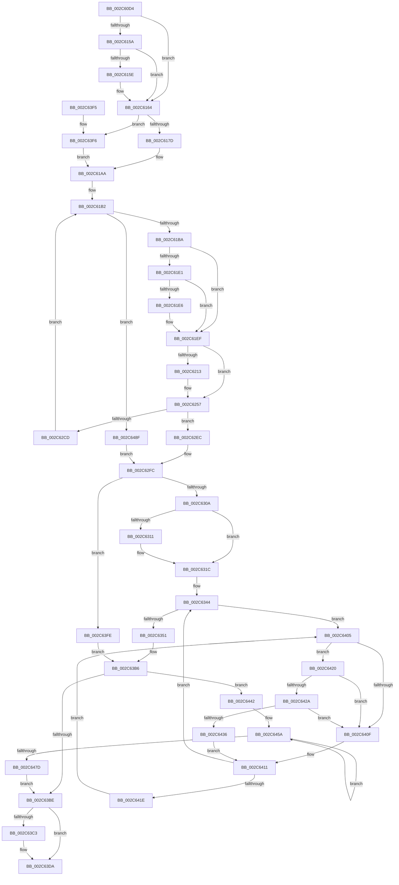

# MiCompleteRestrictedImageFault

- RVA: `0x002C60D4`–`0x002C649C` (길이 `968` bytes)
- VA: `0x00000001402C60D4`
- 실행 섹션: `.text`
- PDB 이름 있음: `예`; PDB Function 태그: `아니요`
- unwind 정보 RVA: `0x0006EBD0`
- 디코드: `241`개 명령, `968/968` bytes 표시
- 미해석 바이트: `0` (있으면 어셈블리에 `.byte`로 보존)

> 이 문서는 커널 이미지의 기계어와 PDB 기호를 분석해 생성했습니다. 4번과 5번은 함수 원형과 자료형을 바이너리 사용 방식에서 추정한 C 해석이며 원본 소스 복구 결과는 아닙니다.

## 1. Dependencies

- 직접 호출 지점: **15**; 고유 호출 대상: **15**
- 직접 호출자로 확인된 함수: **1**
- RIP 상대 이미지 참조: **4**

### Outgoing calls
- `0x002C6188` → [MiReferenceControlAreaFileWithTag](../34/MiReferenceControlAreaFileWithTag_function_00348390.md) (function, `0x00348390`)
- `0x002C6232` → [MiGetSessionIdForVa](../34/MiGetSessionIdForVa_function_00346C60.md) (function, `0x00346C60`)
- `0x002C6241` → [MiStartingOffset](../34/MiStartingOffset_function_003482E0.md) (function, `0x003482E0`)
- `0x002C6252` → [PfSnLogPageFault](../34/PfSnLogPageFault_function_00344950.md) (function, `0x00344950`)
- `0x002C625A` → [MI_READ_PTE_LOCK_FREE](../28/MI_READ_PTE_LOCK_FREE_function_002828A0.md) (function, `0x002828A0`)
- `0x002C626F` → [MiMakeValidPte](MiMakeValidPte_function_002C5590.md) (function, `0x002C5590`)
- `0x002C6284` → [MiQueueCoreWorkingSetEntries](../27/MiQueueCoreWorkingSetEntries_function_0027EAD0.md) (function, `0x0027EAD0`)
- `0x002C62BA` → [MiAllocateWsle](../33/MiAllocateWsle_function_003332C0.md) (function, `0x003332C0`)
- `0x002C6314` → [MiEmptyDeferredWorkingSetEntries](../34/MiEmptyDeferredWorkingSetEntries_function_00347910.md) (function, `0x00347910`)
- `0x002C631F` → [MiGetContainingPageTable](../34/MiGetContainingPageTable_function_003467F0.md) (function, `0x003467F0`)
- `0x002C63AA` → [MiIncreaseUsedPtes](../24/MiIncreaseUsedPtes_function_00243630.md) (function, `0x00243630`)
- `0x002C63D5` → [ObFastDereferenceObjectDeferDelete](../23/ObFastDereferenceObjectDeferDelete_function_002378C0.md) (function, `0x002378C0`)
- `0x002C642A` → [KiCheckVpBackingLongSpinWaitHypercall](../30/KiCheckVpBackingLongSpinWaitHypercall_function_0030F490.md) (function, `0x0030F490`)
- `0x002C6438` → [HvlNotifyLongSpinWait](../30/HvlNotifyLongSpinWait_function_0030F460.md) (function, `0x0030F460`)
- `0x002C6471` → [MiLockAndDecrementShareCount](../2A/MiLockAndDecrementShareCount_function_002A2854.md) (function, `0x002A2854`)

### Direct callers
- [MiSoftFaultMappedView](../36/MiSoftFaultMappedView_function_00365364.md) at `0x003656BA`
- [MiSoftFaultMappedView](../36/MiSoftFaultMappedView_function_00365364.md) at `0x003657B2`
- [MiSoftFaultMappedView](../36/MiSoftFaultMappedView_function_00365364.md) at `0x003657E7`
- [MiSoftFaultMappedView](../36/MiSoftFaultMappedView_function_00365364.md) at `0x0036586E`

### Static image references
- `0x002C6149` → RVA `0x00E2DC80` (`.data`; read)
- `0x002C6168` → RVA `0x00E67248` (`.data`; read)
- `0x002C6407` → RVA `0x00FC52AC` (`ALMOSTRO`; reference)
- `0x002C6420` → RVA `0x00FC6AB8` (`ALMOSTRO`; read)

## 2. Other-region calls and transfers

- 다른 실행 섹션으로 향하는 call: **0**
- 별도 외부 분기/꼬리 이동을 확인하지 못했습니다.

## 3. Assembly (complete function range)

```asm
002C60D4  48 89 5C 24 10                  mov qword ptr [rsp + 0x10], rbx
002C60D9  44 89 4C 24 20                  mov dword ptr [rsp + 0x20], r9d
002C60DE  4C 89 44 24 18                  mov qword ptr [rsp + 0x18], r8
002C60E3  55                              push rbp
002C60E4  56                              push rsi
002C60E5  57                              push rdi
002C60E6  41 54                           push r12
002C60E8  41 55                           push r13
002C60EA  41 56                           push r14
002C60EC  41 57                           push r15
002C60EE  48 83 EC 60                     sub rsp, 0x60
002C60F2  48 8B 01                        mov rax, qword ptr [rcx]
002C60F5  4C 8B FA                        mov r15, rdx
002C60F8  48 89 44 24 50                  mov qword ptr [rsp + 0x50], rax
002C60FD  BA 01 00 00 00                  mov edx, 1
002C6102  49 8B 00                        mov rax, qword ptr [r8]
002C6105  41 8B E9                        mov ebp, r9d
002C6108  4D 8B C8                        mov r9, r8
002C610B  89 94 24 A0 00 00 00            mov dword ptr [rsp + 0xa0], edx
002C6112  48 8B F1                        mov rsi, rcx
002C6115  49 BB 00 00 00 00 00 DE FF FF   movabs r11, 0xffffde0000000000
002C611F  4C 8D 14 40                     lea r10, [rax + rax*2]
002C6123  49 C1 E2 04                     shl r10, 4
002C6127  49 8B C3                        mov rax, r11
002C612A  4C 03 D0                        add r10, rax
002C612D  48 B8 00 00 00 00 00 00 00 80   movabs rax, 0x8000000000000000
002C6137  4D 8B 42 08                     mov r8, qword ptr [r10 + 8]
002C613B  4C 0B C0                        or r8, rax
002C613E  49 8B 42 28                     mov rax, qword ptr [r10 + 0x28]
002C6142  49 8B 42 10                     mov rax, qword ptr [r10 + 0x10]
002C6146  45 33 D2                        xor r10d, r10d
002C6149  48 8B 0D 30 7B B6 00            mov rcx, qword ptr [rip + 0xb67b30]
002C6150  4C 89 44 24 40                  mov qword ptr [rsp + 0x40], r8
002C6155  48 85 C9                        test rcx, rcx
002C6158  74 0A                           je 0x1402c6164
002C615A  A8 10                           test al, 0x10
002C615C  75 06                           jne 0x1402c6164
002C615E  48 F7 D1                        not rcx
002C6161  48 23 C1                        and rax, rcx
002C6164  48 C1 F8 10                     sar rax, 0x10
002C6168  44 39 15 D9 10 BA 00            cmp dword ptr [rip + 0xba10d9], r10d
002C616F  4C 8B 28                        mov r13, qword ptr [rax]
002C6172  4C 89 6C 24 58                  mov qword ptr [rsp + 0x58], r13
002C6177  0F 84 79 02 00 00               je 0x1402c63f6
002C617D  44 8B C2                        mov r8d, edx
002C6180  49 8B CD                        mov rcx, r13
002C6183  BA 4D 6D 53 63                  mov edx, 0x63536d4d
002C6188  E8 03 22 08 00                  call 0x140348390
002C618D  4C 8B 44 24 40                  mov r8, qword ptr [rsp + 0x40]
002C6192  4C 8B F0                        mov r14, rax
002C6195  4C 8B 8C 24 B0 00 00 00         mov r9, qword ptr [rsp + 0xb0]
002C619D  45 33 D2                        xor r10d, r10d
002C61A0  49 BB 00 00 00 00 00 DE FF FF   movabs r11, 0xffffde0000000000
002C61AA  4C 89 74 24 48                  mov qword ptr [rsp + 0x48], r14
002C61AF  41 8B FA                        mov edi, r10d
002C61B2  3B FD                           cmp edi, ebp
002C61B4  0F 83 D5 02 00 00               jae 0x1402c648f
002C61BA  8B C7                           mov eax, edi
002C61BC  4D 8B 24 C1                     mov r12, qword ptr [r9 + rax*8]
002C61C0  4B 8D 2C 64                     lea rbp, [r12 + r12*2]
002C61C4  48 C1 E5 04                     shl rbp, 4
002C61C8  49 8B C3                        mov rax, r11
002C61CB  48 03 E8                        add rbp, rax
002C61CE  48 8B 05 AB 7A B6 00            mov rax, qword ptr [rip + 0xb67aab]
002C61D5  48 8B 5D 10                     mov rbx, qword ptr [rbp + 0x10]
002C61D9  4C 8B CB                        mov r9, rbx
002C61DC  48 85 C0                        test rax, rax
002C61DF  74 0E                           je 0x1402c61ef
002C61E1  F6 C3 10                        test bl, 0x10
002C61E4  75 09                           jne 0x1402c61ef
002C61E6  4C 8B C8                        mov r9, rax
002C61E9  49 F7 D1                        not r9
002C61EC  4C 23 CB                        and r9, rbx
002C61EF  48 8B 55 08                     mov rdx, qword ptr [rbp + 8]
002C61F3  48 B8 00 00 00 00 00 00 00 80   movabs rax, 0x8000000000000000
002C61FD  48 0B D0                        or rdx, rax
002C6200  48 8B C2                        mov rax, rdx
002C6203  49 2B C0                        sub rax, r8
002C6206  48 C1 F8 03                     sar rax, 3
002C620A  4D 8D 2C C7                     lea r13, [r15 + rax*8]
002C620E  4D 85 F6                        test r14, r14
002C6211  74 44                           je 0x1402c6257
002C6213  49 8B CD                        mov rcx, r13
002C6216  48 B8 00 00 00 00 80 F6 FF FF   movabs rax, 0xfffff68000000000
002C6220  48 C1 E1 19                     shl rcx, 0x19
002C6224  48 8B C0                        mov rax, rax
002C6227  48 C1 E0 19                     shl rax, 0x19
002C622B  48 2B C8                        sub rcx, rax
002C622E  48 C1 F9 10                     sar rcx, 0x10
002C6232  E8 29 0A 08 00                  call 0x140346c60
002C6237  49 C1 F9 10                     sar r9, 0x10
002C623B  44 8B C0                        mov r8d, eax
002C623E  49 8B C9                        mov rcx, r9
002C6241  E8 9A 20 08 00                  call 0x1403482e0
002C6246  41 B8 01 00 00 00               mov r8d, 1
002C624C  48 8B D0                        mov rdx, rax
002C624F  49 8B CE                        mov rcx, r14
002C6252  E8 F9 E6 07 00                  call 0x140344950
002C6257  49 8B CD                        mov rcx, r13
002C625A  E8 41 C6 FB FF                  call 0x1402828a0
002C625F  48 C1 EB 05                     shr rbx, 5
002C6263  49 8B D4                        mov rdx, r12
002C6266  83 E3 1F                        and ebx, 0x1f
002C6269  49 8B CD                        mov rcx, r13
002C626C  44 8B C3                        mov r8d, ebx
002C626F  E8 1C F3 FF FF                  call 0x1402c5590
002C6274  48 8B D8                        mov rbx, rax
002C6277  4C 8B C5                        mov r8, rbp
002C627A  49 8B D5                        mov rdx, r13
002C627D  48 8B CE                        mov rcx, rsi
002C6280  48 83 E3 DF                     and rbx, 0xffffffffffffffdf
002C6284  E8 47 88 FB FF                  call 0x14027ead0
002C6289  0F B6 46 0D                     movzx eax, byte ptr [rsi + 0xd]
002C628D  33 C9                           xor ecx, ecx
002C628F  48 89 4C 24 30                  mov qword ptr [rsp + 0x30], rcx
002C6294  41 BC 01 00 00 00               mov r12d, 1
002C629A  48 8B 4C 24 50                  mov rcx, qword ptr [rsp + 0x50]
002C629F  41 23 C4                        and eax, r12d
002C62A2  C1 E0 04                        shl eax, 4
002C62A5  45 33 C9                        xor r9d, r9d
002C62A8  83 C0 0C                        add eax, 0xc
002C62AB  4C 8B C5                        mov r8, rbp
002C62AE  89 44 24 28                     mov dword ptr [rsp + 0x28], eax
002C62B2  49 8B D5                        mov rdx, r13
002C62B5  48 89 5C 24 20                  mov qword ptr [rsp + 0x20], rbx
002C62BA  E8 01 D0 06 00                  call 0x1403332c0
002C62BF  8B AC 24 B8 00 00 00            mov ebp, dword ptr [rsp + 0xb8]
002C62C6  45 33 D2                        xor r10d, r10d
002C62C9  85 C0                           test eax, eax
002C62CB  74 1F                           je 0x1402c62ec
002C62CD  4C 8B 44 24 40                  mov r8, qword ptr [rsp + 0x40]
002C62D2  41 03 FC                        add edi, r12d
002C62D5  4C 8B 8C 24 B0 00 00 00         mov r9, qword ptr [rsp + 0xb0]
002C62DD  49 BB 00 00 00 00 00 DE FF FF   movabs r11, 0xffffde0000000000
002C62E7  E9 C6 FE FF FF                  jmp 0x1402c61b2
002C62EC  66 44 29 66 0A                  sub word ptr [rsi + 0xa], r12w
002C62F1  45 8B E2                        mov r12d, r10d
002C62F4  44 89 94 24 A0 00 00 00         mov dword ptr [rsp + 0xa0], r10d
002C62FC  41 BD 02 00 00 00               mov r13d, 2
002C6302  85 FF                           test edi, edi
002C6304  0F 84 F4 00 00 00               je 0x1402c63fe
002C630A  66 44 39 56 0A                  cmp word ptr [rsi + 0xa], r10w
002C630F  74 0B                           je 0x1402c631c
002C6311  48 8B CE                        mov rcx, rsi
002C6314  E8 F7 15 08 00                  call 0x140347910
002C6319  45 33 D2                        xor r10d, r10d
002C631C  49 8B CF                        mov rcx, r15
002C631F  E8 CC 04 08 00                  call 0x1403467f0
002C6324  48 8D 1C 40                     lea rbx, [rax + rax*2]
002C6328  48 B8 00 00 00 00 00 DE FF FF   movabs rax, 0xffffde0000000000
002C6332  48 C1 E3 04                     shl rbx, 4
002C6336  48 8B C0                        mov rax, rax
002C6339  48 03 D8                        add rbx, rax
002C633C  41 8B F2                        mov esi, r10d
002C633F  BD 01 00 00 00                  mov ebp, 1
002C6344  F0 48 0F BA 6B 18 3F            lock bts qword ptr [rbx + 0x18], 0x3f
002C634B  0F 82 B4 00 00 00               jb 0x1402c6405
002C6351  48 8B 43 18                     mov rax, qword ptr [rbx + 0x18]
002C6355  8B D7                           mov edx, edi
002C6357  48 03 D0                        add rdx, rax
002C635A  48 8B CA                        mov rcx, rdx
002C635D  48 33 C8                        xor rcx, rax
002C6360  48 B8 00 00 00 00 00 00 00 C0   movabs rax, 0xc000000000000000
002C636A  48 23 C8                        and rcx, rax
002C636D  48 B8 FF FF FF FF FF FF FF 7F   movabs rax, 0x7fffffffffffffff
002C6377  48 33 CA                        xor rcx, rdx
002C637A  48 89 4B 18                     mov qword ptr [rbx + 0x18], rcx
002C637E  F0 48 21 43 18                  lock and qword ptr [rbx + 0x18], rax
002C6383  49 C1 EF 09                     shr r15, 9
002C6387  48 BA F8 FF FF FF 7F 00 00 00   movabs rdx, 0x7ffffffff8
002C6391  49 23 D7                        and rdx, r15
002C6394  48 B8 00 00 00 00 80 F6 FF FF   movabs rax, 0xfffff68000000000
002C639E  48 8B C0                        mov rax, rax
002C63A1  48 03 D0                        add rdx, rax
002C63A4  45 8B CD                        mov r9d, r13d
002C63A7  44 8B C7                        mov r8d, edi
002C63AA  E8 81 D2 F7 FF                  call 0x140243630
002C63AF  8B AC 24 B8 00 00 00            mov ebp, dword ptr [rsp + 0xb8]
002C63B6  3B FD                           cmp edi, ebp
002C63B8  0F 85 84 00 00 00               jne 0x1402c6442
002C63BE  4D 85 F6                        test r14, r14
002C63C1  74 17                           je 0x1402c63da
002C63C3  48 8B 4C 24 58                  mov rcx, qword ptr [rsp + 0x58]
002C63C8  41 B8 4D 6D 53 63               mov r8d, 0x63536d4d
002C63CE  48 83 C1 40                     add rcx, 0x40
002C63D2  49 8B D6                        mov rdx, r14
002C63D5  E8 E6 14 F7 FF                  call 0x1402378c0
002C63DA  48 8B 9C 24 A8 00 00 00         mov rbx, qword ptr [rsp + 0xa8]
002C63E2  41 8B C4                        mov eax, r12d
002C63E5  48 83 C4 60                     add rsp, 0x60
002C63E9  41 5F                           pop r15
002C63EB  41 5E                           pop r14
002C63ED  41 5D                           pop r13
002C63EF  41 5C                           pop r12
002C63F1  5F                              pop rdi
002C63F2  5E                              pop rsi
002C63F3  5D                              pop rbp
002C63F4  C3                              ret
002C63F5  CC                              int3
002C63F6  4D 8B F2                        mov r14, r10
002C63F9  E9 AC FD FF FF                  jmp 0x1402c61aa
002C63FE  66 44 89 56 0A                  mov word ptr [rsi + 0xa], r10w
002C6403  EB B1                           jmp 0x1402c63b6
002C6405  03 F5                           add esi, ebp
002C6407  85 35 9F EE CF 00               test dword ptr [rip + 0xcfee9f], esi
002C640D  74 11                           je 0x1402c6420
002C640F  F3 90                           pause
002C6411  48 8B 43 18                     mov rax, qword ptr [rbx + 0x18]
002C6415  48 85 C0                        test rax, rax
002C6418  0F 89 26 FF FF FF               jns 0x1402c6344
002C641E  EB E5                           jmp 0x1402c6405
002C6420  8B 05 92 06 D0 00               mov eax, dword ptr [rip + 0xd00692]
002C6426  A8 40                           test al, 0x40
002C6428  74 E5                           je 0x1402c640f
002C642A  E8 61 90 04 00                  call 0x14030f490
002C642F  45 33 D2                        xor r10d, r10d
002C6432  84 C0                           test al, al
002C6434  74 D9                           je 0x1402c640f
002C6436  8B CE                           mov ecx, esi
002C6438  E8 23 90 04 00                  call 0x14030f460
002C643D  45 33 D2                        xor r10d, r10d
002C6440  EB CF                           jmp 0x1402c6411
002C6442  48 8B 9C 24 B0 00 00 00         mov rbx, qword ptr [rsp + 0xb0]
002C644A  41 BC 01 00 00 00               mov r12d, 1
002C6450  49 BE 00 00 00 00 00 DE FF FF   movabs r14, 0xffffde0000000000
002C645A  8B C7                           mov eax, edi
002C645C  48 8B 0C C3                     mov rcx, qword ptr [rbx + rax*8]
002C6460  48 8D 0C 49                     lea rcx, [rcx + rcx*2]
002C6464  48 C1 E1 04                     shl rcx, 4
002C6468  49 8B C6                        mov rax, r14
002C646B  48 03 C8                        add rcx, rax
002C646E  41 8B D5                        mov edx, r13d
002C6471  E8 DE C3 FD FF                  call 0x1402a2854
002C6476  41 03 FC                        add edi, r12d
002C6479  3B FD                           cmp edi, ebp
002C647B  75 DD                           jne 0x1402c645a
002C647D  4C 8B 74 24 48                  mov r14, qword ptr [rsp + 0x48]
002C6482  44 8B A4 24 A0 00 00 00         mov r12d, dword ptr [rsp + 0xa0]
002C648A  E9 2F FF FF FF                  jmp 0x1402c63be
002C648F  44 8B A4 24 A0 00 00 00         mov r12d, dword ptr [rsp + 0xa0]
002C6497  E9 60 FE FF FF                  jmp 0x1402c62fc
```

## 4. C-style interpretation (structured pseudocode)

```c
__int64 __fastcall MiCompleteRestrictedImageFault(__int64 a1, __int64 a2, __int64 a3, int a4)
{
    __int64 result;
    __int64 v_r10;
    __int64 v_r15;
    __int64 v_rbp;
    __int64 v_rbx;
    __int64 v_rdi;
    __int64 v_rsi;
    __int64 v_rsp;
    unsigned __int64 v_stack_m40;
    unsigned __int64 v_stack_m48;
    unsigned __int64 v_stack_m50;
    unsigned __int64 v_stack_m58;
    unsigned __int64 v_stack_m68;
    unsigned int v_stack_m70;
    unsigned __int64 v_stack_m78;
    unsigned __int64 v_stack_p10;
    unsigned __int64 v_stack_p18;
    unsigned int v_stack_p20;
    unsigned __int64 v_stack_p48;
    unsigned int v_stack_p8;
    unsigned int v_stack_pA0;
    unsigned __int64 v_stack_pB0;

    v_stack_p10 = v_rbx;
    v_stack_p20 = a4;
    v_stack_p18 = a3;
    v_rsp = (v_rsp) - (96);
    v_stack_m48 = *(unsigned __int64 *)(a1);
    v_stack_p8 = 1;
    v_r10 = (*(unsigned __int64 *)(a3) + *(unsigned __int64 *)(a3) * 2) << (4);
    v_r10 = (v_r10) + (v_r11);
    a3 = (*(unsigned __int64 *)(v_r10 + 8)) | (v_r11);
    v_r10 = 0;
    v_stack_m58 = a3;
    if (*(unsigned __int64 *)(v_rip + 11959088) == 0) goto loc_002C6164;
    result = *(unsigned __int64 *)(v_r10 + 16);
    if ((((unsigned __int8)(*(unsigned __int64 *)(v_r10 + 16))) & (16)) == 0) {
        a1 = ~(*(unsigned __int64 *)(v_rip + 11959088));
        result = (*(unsigned __int64 *)(v_r10 + 16)) & (a1);
    }
    result = (result) >> (16);
    v_stack_m40 = *(unsigned __int64 *)(result);
    if ((*(unsigned int *)(v_rip + 12194009)) == 0) goto loc_002C63F6;
    result = MiReferenceControlAreaFileWithTag(*(unsigned __int64 *)(result), (unsigned int)(0x63536D4DULL), 1, a3);
    v_r10 = 0;
loc_002C61AA:
    v_stack_m50 = result;
loc_002C61B2:
    if (0 >= ((unsigned int)((unsigned int)(a4)))) goto loc_002C648F;
    v_rbp = (*(unsigned __int64 *)(v_stack_p18 + 0 * 8) + *(unsigned __int64 *)(v_stack_p18 + 0 * 8) * 2) << (4);
    v_rbp = (v_rbp) + (v_r11);
    if (*(unsigned __int64 *)(v_rip + 11958955) == 0) goto loc_002C61EF;
    if ((((unsigned __int8)(*(unsigned __int64 *)(v_rbp + 16))) & (16)) == 0) {
        a4 = *(unsigned __int64 *)(v_rip + 11958955);
        a4 = ~(a4);
        a4 = (a4) & (*(unsigned __int64 *)(v_rbp + 16));
    }
    a2 = (*(unsigned __int64 *)(v_rbp + 8)) | (*(unsigned __int64 *)(v_rip + 11958955));
    result = (a2) - (v_stack_m58);
    result = (result) >> (3);
    if (result != 0) {
        a1 = a2 + result * 8;
        a1 = (a1) << (25);
        result = result;
        result = (result) << (25);
        a1 = (a1) - (result);
        a1 = (a1) >> (16);
        result = MiGetSessionIdForVa(a1, a2, v_stack_m58, a4);
        a4 = (a4) >> (16);
        a3 = (unsigned int)(result);
        a1 = a4;
        result = MiStartingOffset(a1, a2, a3, a4);
        a3 = 1;
        a2 = result;
        a1 = result;
        result = PfSnLogPageFault(a1, a2, a3, a4);
    }
    result = MI_READ_PTE_LOCK_FREE(a2 + result * 8, a2, a3, a4);
    v_rbx = (*(unsigned __int64 *)(v_rbp + 16)) >> (5);
    v_rbx = (unsigned int)((v_rbx) & (31));
    result = MiMakeValidPte(a2 + result * 8, *(unsigned __int64 *)(v_stack_p18 + 0 * 8), (unsigned int)((unsigned int)(v_rbx)), a4);
    v_rbx = (result) & (-33);
    result = MiQueueCoreWorkingSetEntries(a1, a2 + result * 8, v_rbp, a4);
    a1 = 0;
    v_stack_m68 = 0;
    result = (unsigned int)((*(unsigned __int8 *)(a1 + 13)) & (1));
    result = (unsigned int)((result) << (4));
    a4 = 0;
    result = (unsigned int)((result) + (12));
    v_stack_m70 = (unsigned int)(result);
    v_stack_m78 = v_rbx;
    result = MiAllocateWsle(v_stack_m48, a2 + result * 8, v_rbp, a4);
    v_r10 = 0;
    if ((unsigned int)(result) == 0) goto loc_002C62EC;
    v_rdi = (unsigned int)((0) + (1));
    goto loc_002C61B2;
loc_002C62EC:
    v_stack_p8 = 0;
loc_002C62FC:
    if ((unsigned int)(v_rdi) == 0) goto loc_002C63FE;
    if ((*(unsigned __int16 *)(a1 + 10)) != 0) {
        a1 = 0;
        result = MiEmptyDeferredWorkingSetEntries(a1, a2 + result * 8, v_stack_m58, v_stack_p18);
        v_r10 = 0;
    }
    result = MiGetContainingPageTable(a2, a2 + result * 8, v_stack_m58, v_stack_p18);
    v_rbx = (result + result * 2) << (4);
    v_rbx = (v_rbx) + (result);
loc_002C6344:
    if (condition_is_below) goto loc_002C6405;
    a2 = ((unsigned int)((unsigned int)(v_rdi))) + (*(unsigned __int64 *)(v_rbx + 24));
    a1 = (a2) ^ (*(unsigned __int64 *)(v_rbx + 24));
    a1 = (a1) & (*(unsigned __int64 *)(v_rbx + 24));
    a1 = (a1) ^ (a2);
    *(unsigned __int64 *)(v_rbx + 24) = a1;
    v_r15 = (a2) >> (9);
    a2 = (a2) & (v_r15);
    a2 = (a2) + (*(unsigned __int64 *)(v_rbx + 24));
    result = MiIncreaseUsedPtes(a1, a2, (unsigned int)((unsigned int)(v_rdi)), 2);
loc_002C63B6:
    if (((unsigned int)(v_rdi)) != ((unsigned int)((unsigned int)(v_stack_p20)))) goto loc_002C6442;
loc_002C63BE:
    if (result != 0) {
        a1 = v_stack_m40;
        a3 = 0x63536D4DULL;
        a1 = (a1) + (64);
        a2 = result;
        result = ObFastDereferenceObjectDeferDelete(a1, a2, a3, 2);
    }
    v_rsp = (v_rsp) + (96);
    return 0;
loc_002C63F6:
    goto loc_002C61AA;
loc_002C63FE:
    *(unsigned __int16 *)(0 + 10) = 0;
    goto loc_002C63B6;
loc_002C6405:
    v_rsi = (unsigned int)((0) + ((unsigned int)((unsigned int)(v_stack_p20))));
    if (((*(unsigned int *)(v_rip + 13627039)) & ((unsigned int)(v_rsi))) == 0) goto loc_002C6420;
loc_002C640F:
loc_002C6411:
    if (!sign_flag) goto loc_002C6344;
    goto loc_002C6405;
loc_002C6420:
    if ((((unsigned __int8)((unsigned int)(*(unsigned int *)(v_rip + 13633170)))) & (64)) == 0) goto loc_002C640F;
    result = KiCheckVpBackingLongSpinWaitHypercall(a1, a2, a3, 2);
    v_r10 = 0;
    if ((unsigned __int8)(result) == 0) goto loc_002C640F;
    result = HvlNotifyLongSpinWait((unsigned int)((unsigned int)(v_rsi)), a2, a3, 2);
    v_r10 = 0;
    goto loc_002C6411;
loc_002C6442:
loc_002C645A:
    a1 = (*(unsigned __int64 *)(v_stack_pB0 + (unsigned int)((unsigned int)(v_rdi)) * 8) + *(unsigned __int64 *)(v_stack_pB0 + (unsigned int)((unsigned int)(v_rdi)) * 8) * 2) << (4);
    a1 = (a1) + (0);
    result = MiLockAndDecrementShareCount(a1, 2, a3, 2);
    v_rdi = (unsigned int)((v_rdi) + (1));
    if (((unsigned int)(v_rdi)) != ((unsigned int)((unsigned int)(v_stack_p20)))) goto loc_002C645A;
    goto loc_002C63BE;
loc_002C648F:
    goto loc_002C62FC;
}
```

## 5. (Beta) C Style

```c
int64_t MiCompleteRestrictedImageFault(void *Arg1, void *Arg2, void *Arg3, int32_t Arg4)
{
    uint8_t *arg1 = (uint8_t *)Arg1;
    uint8_t *arg2 = (uint8_t *)Arg2;
    uint8_t *arg3 = (uint8_t *)Arg3;

    int64_t result;
    int64_t local_r10;
    int64_t local_r15;
    int64_t local_rbp;
    int64_t local_rbx;
    int64_t local_rdi;
    int64_t local_rsi;
    int64_t local_rsp;
    uint64_t v_stack_m40;
    uint64_t v_stack_m48;
    uint64_t v_stack_m50;
    uint64_t v_stack_m58;
    uint64_t v_stack_m68;
    uint32_t v_stack_m70;
    uint64_t v_stack_m78;
    uint64_t v_stack_p10;
    uint64_t v_stack_p18;
    uint32_t v_stack_p20;
    uint64_t v_stack_p48;
    uint32_t v_stack_p8;
    uint32_t v_stack_pA0;
    uint64_t v_stack_pB0;

    v_stack_p10 = local_rbx;
    v_stack_p20 = Arg4;
    v_stack_p18 = Arg3;
    local_rsp = (local_rsp) - (96);
    v_stack_m48 = *(uint64_t *)(arg1);
    v_stack_p8 = 1;
    local_r10 = (*(uint64_t *)(arg3) + *(uint64_t *)(arg3) * 2) << (4);
    local_r10 = (local_r10) + (local_r11);
    Arg3 = (*(uint64_t *)(local_r10 + 0x8)) | (local_r11);
    local_r10 = 0;
    v_stack_m58 = Arg3;
    if (*(uint64_t *)(v_rip + 0xB67B30) == 0) goto loc_002C6164;
    result = *(uint64_t *)(local_r10 + 0x10);
    if ((((uint8_t)(*(uint64_t *)(local_r10 + 0x10))) & (16)) == 0) {
        Arg1 = ~(*(uint64_t *)(v_rip + 0xB67B30));
        result = (*(uint64_t *)(local_r10 + 0x10)) & (Arg1);
    }
    result = (result) >> (16);
    v_stack_m40 = *(uint64_t *)(result);
    if ((*(uint32_t *)(v_rip + 0xBA10D9)) == 0) goto loc_002C63F6;
    result = MiReferenceControlAreaFileWithTag(*(uint64_t *)(result), (uint32_t)(0x63536D4DULL), 1, Arg3);
    local_r10 = 0;
loc_002C61AA:
    v_stack_m50 = result;
loc_002C61B2:
    if (0 >= ((uint32_t)((uint32_t)(Arg4)))) goto loc_002C648F;
    local_rbp = (*(uint64_t *)(v_stack_p18 + 0x0 * 8) + *(uint64_t *)(v_stack_p18 + 0x0 * 8) * 2) << (4);
    local_rbp = (local_rbp) + (local_r11);
    if (*(uint64_t *)(v_rip + 0xB67AAB) == 0) goto loc_002C61EF;
    if ((((uint8_t)(*(uint64_t *)(local_rbp + 0x10))) & (16)) == 0) {
        Arg4 = *(uint64_t *)(v_rip + 0xB67AAB);
        Arg4 = ~(Arg4);
        Arg4 = (Arg4) & (*(uint64_t *)(local_rbp + 0x10));
    }
    Arg2 = (*(uint64_t *)(local_rbp + 0x8)) | (*(uint64_t *)(v_rip + 0xB67AAB));
    result = (Arg2) - (v_stack_m58);
    result = (result) >> (3);
    if (result != 0) {
        Arg1 = Arg2 + result * 8;
        Arg1 = (Arg1) << (25);
        result = result;
        result = (result) << (25);
        Arg1 = (Arg1) - (result);
        Arg1 = (Arg1) >> (16);
        result = MiGetSessionIdForVa(Arg1, Arg2, v_stack_m58, Arg4);
        Arg4 = (Arg4) >> (16);
        Arg3 = (uint32_t)(result);
        Arg1 = Arg4;
        result = MiStartingOffset(Arg1, Arg2, Arg3, Arg4);
        Arg3 = 1;
        Arg2 = result;
        Arg1 = result;
        result = PfSnLogPageFault(Arg1, Arg2, Arg3, Arg4);
    }
    result = MI_READ_PTE_LOCK_FREE(Arg2 + result * 8, Arg2, Arg3, Arg4);
    local_rbx = (*(uint64_t *)(local_rbp + 0x10)) >> (5);
    local_rbx = (uint32_t)((local_rbx) & (31));
    result = MiMakeValidPte(Arg2 + result * 8, *(uint64_t *)(v_stack_p18 + 0x0 * 8), (uint32_t)((uint32_t)(local_rbx)), Arg4);
    local_rbx = (result) & (-33);
    result = MiQueueCoreWorkingSetEntries(Arg1, Arg2 + result * 8, local_rbp, Arg4);
    Arg1 = 0;
    v_stack_m68 = 0;
    result = (uint32_t)((*(uint8_t *)(arg1 + 0xD)) & (1));
    result = (uint32_t)((result) << (4));
    Arg4 = 0;
    result = (uint32_t)((result) + (12));
    v_stack_m70 = (uint32_t)(result);
    v_stack_m78 = local_rbx;
    result = MiAllocateWsle(v_stack_m48, Arg2 + result * 8, local_rbp, Arg4);
    local_r10 = 0;
    if ((uint32_t)(result) == 0) goto loc_002C62EC;
    local_rdi = (uint32_t)((0) + (1));
    goto loc_002C61B2;
loc_002C62EC:
    v_stack_p8 = 0;
loc_002C62FC:
    if ((uint32_t)(local_rdi) == 0) goto loc_002C63FE;
    if ((*(uint16_t *)(arg1 + 0xA)) != 0) {
        Arg1 = 0;
        result = MiEmptyDeferredWorkingSetEntries(Arg1, Arg2 + result * 8, v_stack_m58, v_stack_p18);
        local_r10 = 0;
    }
    result = MiGetContainingPageTable(Arg2, Arg2 + result * 8, v_stack_m58, v_stack_p18);
    local_rbx = (result + result * 2) << (4);
    local_rbx = (local_rbx) + (result);
loc_002C6344:
    if (condition_is_below) goto loc_002C6405;
    Arg2 = ((uint32_t)((uint32_t)(local_rdi))) + (*(uint64_t *)(local_rbx + 0x18));
    Arg1 = (Arg2) ^ (*(uint64_t *)(local_rbx + 0x18));
    Arg1 = (Arg1) & (*(uint64_t *)(local_rbx + 0x18));
    Arg1 = (Arg1) ^ (Arg2);
    *(void **)(local_rbx + 0x18) = Arg1;
    local_r15 = (Arg2) >> (9);
    Arg2 = (Arg2) & (local_r15);
    Arg2 = (Arg2) + (*(uint64_t *)(local_rbx + 0x18));
    result = MiIncreaseUsedPtes(Arg1, Arg2, (uint32_t)((uint32_t)(local_rdi)), 2);
loc_002C63B6:
    if (((uint32_t)(local_rdi)) != ((uint32_t)((uint32_t)(v_stack_p20)))) goto loc_002C6442;
loc_002C63BE:
    if (result != 0) {
        Arg1 = v_stack_m40;
        Arg3 = 0x63536D4DULL;
        Arg1 = (Arg1) + (64);
        Arg2 = result;
        result = ObFastDereferenceObjectDeferDelete(Arg1, Arg2, Arg3, 2);
    }
    local_rsp = (local_rsp) + (96);
    return 0;
loc_002C63F6:
    goto loc_002C61AA;
loc_002C63FE:
    *(uint16_t *)(0 + 0xA) = 0;
    goto loc_002C63B6;
loc_002C6405:
    local_rsi = (uint32_t)((0) + ((uint32_t)((uint32_t)(v_stack_p20))));
    if (((*(uint32_t *)(v_rip + 0xCFEE9F)) & ((uint32_t)(local_rsi))) == 0) goto loc_002C6420;
loc_002C640F:
loc_002C6411:
    if (!sign_flag) goto loc_002C6344;
    goto loc_002C6405;
loc_002C6420:
    if ((((uint8_t)((uint32_t)(*(uint32_t *)(v_rip + 0xD00692)))) & (64)) == 0) goto loc_002C640F;
    result = KiCheckVpBackingLongSpinWaitHypercall(Arg1, Arg2, Arg3, 2);
    local_r10 = 0;
    if ((uint8_t)(result) == 0) goto loc_002C640F;
    result = HvlNotifyLongSpinWait((uint32_t)((uint32_t)(local_rsi)), Arg2, Arg3, 2);
    local_r10 = 0;
    goto loc_002C6411;
loc_002C6442:
loc_002C645A:
    Arg1 = (*(uint64_t *)(v_stack_pB0 + (uint32_t)((uint32_t)(local_rdi)) * 8) + *(uint64_t *)(v_stack_pB0 + (uint32_t)((uint32_t)(local_rdi)) * 8) * 2) << (4);
    Arg1 = (Arg1) + (0);
    result = MiLockAndDecrementShareCount(Arg1, 2, Arg3, 2);
    local_rdi = (uint32_t)((local_rdi) + (1));
    if (((uint32_t)(local_rdi)) != ((uint32_t)((uint32_t)(v_stack_p20)))) goto loc_002C645A;
    goto loc_002C63BE;
loc_002C648F:
    goto loc_002C62FC;
}
```

### 관측된 메모리 오프셋

구조체 형식이 확인되지 않은 접근은 인자 기준의 오프셋으로만 기록했습니다.

| 기준 인자 | 오프셋 표현 | 폭 (bit) | 접근 |
|---|---:|---:|---|
| `Arg1` | `+ 0x0` | `64` | `R` |
| `Arg1` | `+ 0xA` | `16` | `R` |
| `Arg1` | `+ 0xA` | `16` | `R/W` |
| `Arg1` | `+ 0xA` | `16` | `W` |
| `Arg1` | `+ 0xD` | `8` | `R` |
| `Arg2` | `+ 0x0 + rax*8` | `64` | `R` |
| `Arg3` | `+ 0x0` | `64` | `R` |

## 6. Execution-region graph

[열기: 2D/3D 그래프와 함수 탐색 컨트롤 패널](../../../control-panel.html?section=text&rva=0x002C60D4&view=graph)

- 2D 그래프는 위에서 아래로 흐르고, 3D 그래프는 빈 공간을 드래그해 회전합니다. Shift+드래그는 이동, 휠은 확대·축소, 함수 노드 선택은 대상 보고서 이동입니다.

### Static fallback


