# MiComputeAgingAmount

- RVA: `0x002C2520`–`0x002C26FF` (길이 `479` bytes)
- VA: `0x00000001402C2520`
- 실행 섹션: `.text`
- PDB 이름 있음: `예`; PDB Function 태그: `아니요`
- unwind 정보 RVA: `0x0006E8C8`
- 디코드: `128`개 명령, `479/479` bytes 표시
- 미해석 바이트: `0` (있으면 어셈블리에 `.byte`로 보존)

> 이 문서는 커널 이미지의 기계어와 PDB 기호를 분석해 생성했습니다. 4번과 5번은 함수 원형과 자료형을 바이너리 사용 방식에서 추정한 C 해석이며 원본 소스 복구 결과는 아닙니다.

## 1. Dependencies

- 직접 호출 지점: **5**; 고유 호출 대상: **5**
- 직접 호출자로 확인된 함수: **2**
- RIP 상대 이미지 참조: **5**

### Outgoing calls
- `0x002C257E` → [ExpWaitForSpinLockExclusiveAndAcquire](../32/ExpWaitForSpinLockExclusiveAndAcquire_function_003239A0.md) (function, `0x003239A0`)
- `0x002C267C` → [ExpAcquireSpinLockExclusiveAtDpcLevelInstrumented](../32/ExpAcquireSpinLockExclusiveAtDpcLevelInstrumented_function_00323A70.md) (function, `0x00323A70`)
- `0x002C26A8` → [KiCheckVpBackingLongSpinWaitHypercall](../30/KiCheckVpBackingLongSpinWaitHypercall_function_0030F490.md) (function, `0x0030F490`)
- `0x002C26B8` → [HvlNotifyLongSpinWait](../30/HvlNotifyLongSpinWait_function_0030F460.md) (function, `0x0030F460`)
- `0x002C26DD` → [ExpReleaseSpinLockExclusiveFromDpcLevelInstrumented](ExpReleaseSpinLockExclusiveFromDpcLevelInstrumented_function_002C0F44.md) (function, `0x002C0F44`)

### Direct callers
- [sub_0028FA07](../28/Unknown_function_0028FA07.md) at `0x0028FA35`
- [MiAgeWorkingSet](MiAgeWorkingSet_function_002C21E0.md) at `0x002C2267`

### Static image references
- `0x002C253F` → RVA `0x00E38880` (`.data`; read)
- `0x002C2562` → RVA `0x00FC6B06` (`ALMOSTRO`; read)
- `0x002C25A6` → RVA `0x00FC52AC` (`ALMOSTRO`; reference)
- `0x002C2669` → RVA `0x00F0DE58` (`.data`; read)
- `0x002C269A` → RVA `0x00FC6AB8` (`ALMOSTRO`; read)

## 2. Other-region calls and transfers

- 다른 실행 섹션으로 향하는 call: **0**
- 별도 외부 분기/꼬리 이동을 확인하지 못했습니다.

## 3. Assembly (complete function range)

```asm
002C2520  48 89 5C 24 08                  mov qword ptr [rsp + 8], rbx
002C2525  44 89 44 24 18                  mov dword ptr [rsp + 0x18], r8d
002C252A  55                              push rbp
002C252B  56                              push rsi
002C252C  57                              push rdi
002C252D  41 54                           push r12
002C252F  41 55                           push r13
002C2531  41 56                           push r14
002C2533  41 57                           push r15
002C2535  48 83 EC 20                     sub rsp, 0x20
002C2539  8B 81 B8 00 00 00               mov eax, dword ptr [rcx + 0xb8]
002C253F  4C 8D 3D 3A 63 B7 00            lea r15, [rip + 0xb7633a]
002C2546  4C 8B 69 10                     mov r13, qword ptr [rcx + 0x10]
002C254A  24 0F                           and al, 0xf
002C254C  45 8B E1                        mov r12d, r9d
002C254F  48 8B EA                        mov rbp, rdx
002C2552  48 8B F1                        mov rsi, rcx
002C2555  3C 01                           cmp al, 1
002C2557  0F 85 8A 01 00 00               jne 0x1402c26e7
002C255D  49 8B DF                        mov rbx, r15
002C2560  33 FF                           xor edi, edi
002C2562  F6 05 9D 45 D0 00 21            test byte ptr [rip + 0xd0459d], 0x21
002C2569  0F 85 FA 00 00 00               jne 0x1402c2669
002C256F  F0 0F BA 2B 1F                  lock bts dword ptr [rbx], 0x1f
002C2574  44 8B F7                        mov r14d, edi
002C2577  73 0D                           jae 0x1402c2586
002C2579  B2 FF                           mov dl, 0xff
002C257B  48 8B CB                        mov rcx, rbx
002C257E  E8 1D 14 06 00                  call 0x1403239a0
002C2583  44 8B F0                        mov r14d, eax
002C2586  8B 13                           mov edx, dword ptr [rbx]
002C2588  8B CA                           mov ecx, edx
002C258A  0F BA F1 1E                     btr ecx, 0x1e
002C258E  81 F9 00 00 00 80               cmp ecx, 0x80000000
002C2594  74 2E                           je 0x1402c25c4
002C2596  0F BA E2 1E                     bt edx, 0x1e
002C259A  72 07                           jb 0x1402c25a3
002C259C  F0 81 0B 00 00 00 40            lock or dword ptr [rbx], 0x40000000
002C25A3  41 FF C6                        inc r14d
002C25A6  44 85 35 FF 2C D0 00            test dword ptr [rip + 0xd02cff], r14d
002C25AD  0F 84 E7 00 00 00               je 0x1402c269a
002C25B3  F3 90                           pause
002C25B5  8B 13                           mov edx, dword ptr [rbx]
002C25B7  8B C2                           mov eax, edx
002C25B9  0F BA F0 1E                     btr eax, 0x1e
002C25BD  3D 00 00 00 80                  cmp eax, 0x80000000
002C25C2  75 D2                           jne 0x1402c2596
002C25C4  33 D2                           xor edx, edx
002C25C6  49 8B DC                        mov rbx, r12
002C25C9  F6 44 24 70 02                  test byte ptr [rsp + 0x70], 2
002C25CE  0F 85 B2 00 00 00               jne 0x1402c2686
002C25D4  45 8B 75 1C                     mov r14d, dword ptr [r13 + 0x1c]
002C25D8  49 8D 04 2E                     lea rax, [r14 + rbp]
002C25DC  48 F7 F3                        div rbx
002C25DF  41 89 55 1C                     mov dword ptr [r13 + 0x1c], edx
002C25E3  8B 86 B8 00 00 00               mov eax, dword ptr [rsi + 0xb8]
002C25E9  24 0F                           and al, 0xf
002C25EB  3C 01                           cmp al, 1
002C25ED  0F 85 00 01 00 00               jne 0x1402c26f3
002C25F3  F6 05 0C 45 D0 00 01            test byte ptr [rip + 0xd0450c], 1
002C25FA  0F 85 C7 00 00 00               jne 0x1402c26c7
002C2600  41 89 3F                        mov dword ptr [r15], edi
002C2603  49 8D 04 2E                     lea rax, [r14 + rbp]
002C2607  48 B9 77 BE 9F 1A 2F DD 24 06   movabs rcx, 0x624dd2f1a9fbe77
002C2611  48 3B C5                        cmp rax, rbp
002C2614  48 8B C1                        mov rax, rcx
002C2617  49 0F 43 FE                     cmovae rdi, r14
002C261B  48 03 FD                        add rdi, rbp
002C261E  48 0F AF FB                     imul rdi, rbx
002C2622  48 F7 E7                        mul rdi
002C2625  48 2B FA                        sub rdi, rdx
002C2628  48 D1 EF                        shr rdi, 1
002C262B  48 03 FA                        add rdi, rdx
002C262E  48 C1 EF 09                     shr rdi, 9
002C2632  48 3B FD                        cmp rdi, rbp
002C2635  0F 86 87 00 00 00               jbe 0x1402c26c2
002C263B  48 0F AF DD                     imul rbx, rbp
002C263F  48 8B C1                        mov rax, rcx
002C2642  48 F7 E3                        mul rbx
002C2645  48 2B DA                        sub rbx, rdx
002C2648  48 D1 EB                        shr rbx, 1
002C264B  48 8D 04 1A                     lea rax, [rdx + rbx]
002C264F  48 C1 E8 09                     shr rax, 9
002C2653  48 8B 5C 24 60                  mov rbx, qword ptr [rsp + 0x60]
002C2658  48 83 C4 20                     add rsp, 0x20
002C265C  41 5F                           pop r15
002C265E  41 5E                           pop r14
002C2660  41 5D                           pop r13
002C2662  41 5C                           pop r12
002C2664  5F                              pop rdi
002C2665  5E                              pop rsi
002C2666  5D                              pop rbp
002C2667  C3                              ret
002C2668  CC                              int3
002C2669  8B 05 E9 B7 C4 00               mov eax, dword ptr [rip + 0xc4b7e9]
002C266F  85 C0                           test eax, eax
002C2671  0F 85 F8 FE FF FF               jne 0x1402c256f
002C2677  B2 FF                           mov dl, 0xff
002C2679  48 8B CB                        mov rcx, rbx
002C267C  E8 EF 13 06 00                  call 0x140323a70
002C2681  E9 3E FF FF FF                  jmp 0x1402c25c4
002C2686  45 8B 75 18                     mov r14d, dword ptr [r13 + 0x18]
002C268A  49 8D 04 2E                     lea rax, [r14 + rbp]
002C268E  48 F7 F3                        div rbx
002C2691  41 89 55 18                     mov dword ptr [r13 + 0x18], edx
002C2695  E9 49 FF FF FF                  jmp 0x1402c25e3
002C269A  8B 05 18 44 D0 00               mov eax, dword ptr [rip + 0xd04418]
002C26A0  A8 40                           test al, 0x40
002C26A2  0F 84 0B FF FF FF               je 0x1402c25b3
002C26A8  E8 E3 CD 04 00                  call 0x14030f490
002C26AD  84 C0                           test al, al
002C26AF  0F 84 FE FE FF FF               je 0x1402c25b3
002C26B5  41 8B CE                        mov ecx, r14d
002C26B8  E8 A3 CD 04 00                  call 0x14030f460
002C26BD  E9 F3 FE FF FF                  jmp 0x1402c25b5
002C26C2  48 8B C7                        mov rax, rdi
002C26C5  EB 8C                           jmp 0x1402c2653
002C26C7  8B 05 8B B7 C4 00               mov eax, dword ptr [rip + 0xc4b78b]
002C26CD  85 C0                           test eax, eax
002C26CF  0F 85 2B FF FF FF               jne 0x1402c2600
002C26D5  48 8B 54 24 58                  mov rdx, qword ptr [rsp + 0x58]
002C26DA  49 8B CF                        mov rcx, r15
002C26DD  E8 62 E8 FF FF                  call 0x1402c0f44
002C26E2  E9 1C FF FF FF                  jmp 0x1402c2603
002C26E7  48 8D 99 00 01 00 00            lea rbx, [rcx + 0x100]
002C26EE  E9 6D FE FF FF                  jmp 0x1402c2560
002C26F3  4C 8D BE 00 01 00 00            lea r15, [rsi + 0x100]
002C26FA  E9 F4 FE FF FF                  jmp 0x1402c25f3
```

## 4. C-style interpretation (structured pseudocode)

```c
__int64 __fastcall MiComputeAgingAmount(__int64 a1, __int64 a2, int a3, int a4)
{
    __int64 result;
    __int64 v_r14;
    __int64 v_rbx;
    __int64 v_rdi;
    __int64 v_rsp;
    unsigned int v_stack_p18;
    unsigned __int64 v_stack_p58;
    unsigned __int64 v_stack_p8;

    v_stack_p8 = v_rbx;
    v_stack_p18 = a3;
    v_rsp = (v_rsp) - (32);
    result = (unsigned __int8)(((unsigned int)(*(unsigned int *)(a1 + 184))) & (15));
    if (((unsigned __int8)(result)) != 1) goto loc_002C26E7;
loc_002C2560:
    v_rdi = 0;
    if (((*(unsigned __int8 *)(v_rip + 13649309)) & (33)) != 0) goto loc_002C2669;
loc_002C256F:
    v_r14 = 0;
    if (!(condition_is_above_or_equal)) {
        a2 = 255;
        a1 = v_rip + 12018490;
        result = ExpWaitForSpinLockExclusiveAndAcquire(a1, a2, a3, a4);
        v_r14 = (unsigned int)(result);
    }
    if (((unsigned int)((unsigned int)((unsigned int)((unsigned int)(*(unsigned int *)(v_rip + 12018490)))))) == 0x80000000ULL) goto loc_002C25C4;
loc_002C2596:
    if (((unsigned int)((unsigned int)((unsigned int)((unsigned int)(*(unsigned int *)(v_rip + 12018490)))))) >= 0x80000000ULL) {
    }
    v_r14 = (unsigned int)((v_r14) + 1);
    if (((*(unsigned int *)(v_rip + 13643007)) & ((unsigned int)(v_r14))) == 0) goto loc_002C269A;
loc_002C25B3:
loc_002C25B5:
    if (((unsigned int)((unsigned int)((unsigned int)((unsigned int)(*(unsigned int *)(v_rip + 12018490)))))) != 0x80000000ULL) goto loc_002C2596;
loc_002C25C4:
    a2 = 0;
    if (((v_stack_p18) & (2)) != 0) goto loc_002C2686;
    *(unsigned int *)(*(unsigned __int64 *)(a1 + 16) + 28) = 0;
loc_002C25E3:
    result = (unsigned __int8)(((unsigned int)(*(unsigned int *)(a1 + 184))) & (15));
    if (((unsigned __int8)(result)) != 1) goto loc_002C26F3;
loc_002C25F3:
    if (((*(unsigned __int8 *)(v_rip + 13649164)) & (1)) != 0) goto loc_002C26C7;
loc_002C2600:
    *(unsigned int *)(v_rip + 12018490) = 0;
loc_002C2603:
    if (((unsigned int)(*(unsigned int *)(*(unsigned __int64 *)(a1 + 16) + 28)) + a2 * 1) >= 0) { v_rdi = (unsigned int)(*(unsigned int *)(*(unsigned __int64 *)(a1 + 16) + 28)); }
    v_rdi = (v_rdi) + (0);
    v_rdi = (v_rdi) * ((unsigned int)(a4));
    v_rdi = (v_rdi) - (0);
    v_rdi = (v_rdi) >> (1);
    v_rdi = (v_rdi) + (0);
    v_rdi = (v_rdi) >> (9);
    if (v_rdi <= 0) goto loc_002C26C2;
    v_rbx = ((unsigned int)(a4)) * (0);
    v_rbx = (v_rbx) - (0);
    v_rbx = (v_rbx) >> (1);
    result = (a2 + v_rbx * 1) >> (9);
loc_002C2653:
    v_rsp = (v_rsp) + (32);
    return result;
loc_002C2669:
    if ((unsigned int)((unsigned int)(*(unsigned int *)(v_rip + 12892137))) != 0) goto loc_002C256F;
    result = ExpAcquireSpinLockExclusiveAtDpcLevelInstrumented(v_stack_p8, 255, a3, a4);
    goto loc_002C25C4;
loc_002C2686:
    *(unsigned int *)(*(unsigned __int64 *)(a1 + 16) + 24) = 255;
    goto loc_002C25E3;
loc_002C269A:
    if ((((unsigned __int8)((unsigned int)(*(unsigned int *)(v_rip + 13648920)))) & (64)) == 0) goto loc_002C25B3;
    result = KiCheckVpBackingLongSpinWaitHypercall(v_stack_p8, 255, a3, a4);
    if ((unsigned __int8)(result) == 0) goto loc_002C25B3;
    result = HvlNotifyLongSpinWait((unsigned int)((unsigned int)((unsigned int)(*(unsigned int *)(*(unsigned __int64 *)(a1 + 16) + 24)))), 255, a3, a4);
    goto loc_002C25B5;
loc_002C26C2:
    goto loc_002C2653;
loc_002C26C7:
    if ((unsigned int)((unsigned int)(*(unsigned int *)(v_rip + 12892043))) != 0) goto loc_002C2600;
    result = ExpReleaseSpinLockExclusiveFromDpcLevelInstrumented(v_rip + 12018490, v_stack_p58, a3, a4);
    goto loc_002C2603;
loc_002C26E7:
    goto loc_002C2560;
loc_002C26F3:
    goto loc_002C25F3;
}
```

## 5. (Beta) C Style

```c
int64_t MiComputeAgingAmount(void *Arg1, int64_t Arg2, int32_t Arg3, int32_t Arg4)
{
    uint8_t *arg1 = (uint8_t *)Arg1;

    int64_t result;
    int64_t local_r14;
    int64_t local_rbx;
    int64_t local_rdi;
    int64_t local_rsp;
    uint32_t v_stack_p18;
    uint64_t v_stack_p58;
    uint64_t v_stack_p8;

    v_stack_p8 = local_rbx;
    v_stack_p18 = Arg3;
    local_rsp = (local_rsp) - (32);
    result = (uint8_t)(((uint32_t)(*(uint32_t *)(arg1 + 0xB8))) & (15));
    if (((uint8_t)(result)) != 1) goto loc_002C26E7;
loc_002C2560:
    local_rdi = 0;
    if (((*(uint8_t *)(v_rip + 0xD0459D)) & (33)) != 0) goto loc_002C2669;
loc_002C256F:
    local_r14 = 0;
    if (!(condition_is_above_or_equal)) {
        Arg2 = 255;
        Arg1 = v_rip + 12018490;
        result = ExpWaitForSpinLockExclusiveAndAcquire(Arg1, Arg2, Arg3, Arg4);
        local_r14 = (uint32_t)(result);
    }
    if (((uint32_t)((uint32_t)((uint32_t)((uint32_t)(*(uint32_t *)(v_rip + 0xB7633A)))))) == 0x80000000ULL) goto loc_002C25C4;
loc_002C2596:
    if (((uint32_t)((uint32_t)((uint32_t)((uint32_t)(*(uint32_t *)(v_rip + 0xB7633A)))))) >= 0x80000000ULL) {
    }
    local_r14 = (uint32_t)((local_r14) + 1);
    if (((*(uint32_t *)(v_rip + 0xD02CFF)) & ((uint32_t)(local_r14))) == 0) goto loc_002C269A;
loc_002C25B3:
loc_002C25B5:
    if (((uint32_t)((uint32_t)((uint32_t)((uint32_t)(*(uint32_t *)(v_rip + 0xB7633A)))))) != 0x80000000ULL) goto loc_002C2596;
loc_002C25C4:
    Arg2 = 0;
    if (((v_stack_p18) & (2)) != 0) goto loc_002C2686;
    *(uint32_t *)(*(uint64_t *)(arg1 + 0x10) + 0x1C) = 0;
loc_002C25E3:
    result = (uint8_t)(((uint32_t)(*(uint32_t *)(arg1 + 0xB8))) & (15));
    if (((uint8_t)(result)) != 1) goto loc_002C26F3;
loc_002C25F3:
    if (((*(uint8_t *)(v_rip + 0xD0450C)) & (1)) != 0) goto loc_002C26C7;
loc_002C2600:
    *(uint32_t *)(v_rip + 0xB7633A) = 0;
loc_002C2603:
    if (((uint32_t)(*(uint32_t *)(*(uint64_t *)(arg1 + 0x10) + 0x1C)) + Arg2 * 1) >= 0) { local_rdi = (uint32_t)(*(uint32_t *)(*(uint64_t *)(arg1 + 0x10) + 0x1C)); }
    local_rdi = (local_rdi) + (0);
    local_rdi = (local_rdi) * ((uint32_t)(Arg4));
    local_rdi = (local_rdi) - (0);
    local_rdi = (local_rdi) >> (1);
    local_rdi = (local_rdi) + (0);
    local_rdi = (local_rdi) >> (9);
    if (local_rdi <= 0) goto loc_002C26C2;
    local_rbx = ((uint32_t)(Arg4)) * (0);
    local_rbx = (local_rbx) - (0);
    local_rbx = (local_rbx) >> (1);
    result = (Arg2 + local_rbx * 1) >> (9);
loc_002C2653:
    local_rsp = (local_rsp) + (32);
    return result;
loc_002C2669:
    if ((uint32_t)((uint32_t)(*(uint32_t *)(v_rip + 0xC4B7E9))) != 0) goto loc_002C256F;
    result = ExpAcquireSpinLockExclusiveAtDpcLevelInstrumented(v_stack_p8, 255, Arg3, Arg4);
    goto loc_002C25C4;
loc_002C2686:
    *(uint32_t *)(*(uint64_t *)(arg1 + 0x10) + 0x18) = 255;
    goto loc_002C25E3;
loc_002C269A:
    if ((((uint8_t)((uint32_t)(*(uint32_t *)(v_rip + 0xD04418)))) & (64)) == 0) goto loc_002C25B3;
    result = KiCheckVpBackingLongSpinWaitHypercall(v_stack_p8, 255, Arg3, Arg4);
    if ((uint8_t)(result) == 0) goto loc_002C25B3;
    result = HvlNotifyLongSpinWait((uint32_t)((uint32_t)((uint32_t)(*(uint32_t *)(*(uint64_t *)(arg1 + 0x10) + 0x18)))), 255, Arg3, Arg4);
    goto loc_002C25B5;
loc_002C26C2:
    goto loc_002C2653;
loc_002C26C7:
    if ((uint32_t)((uint32_t)(*(uint32_t *)(v_rip + 0xC4B78B))) != 0) goto loc_002C2600;
    result = ExpReleaseSpinLockExclusiveFromDpcLevelInstrumented(v_rip + 12018490, v_stack_p58, Arg3, Arg4);
    goto loc_002C2603;
loc_002C26E7:
    goto loc_002C2560;
loc_002C26F3:
    goto loc_002C25F3;
}
```

### 관측된 메모리 오프셋

구조체 형식이 확인되지 않은 접근은 인자 기준의 오프셋으로만 기록했습니다.

| 기준 인자 | 오프셋 표현 | 폭 (bit) | 접근 |
|---|---:|---:|---|
| `Arg1` | `+ 0x10` | `64` | `R` |
| `Arg1` | `+ 0xB8` | `32` | `R` |
| `Arg1` | `+ 0x100` | `64` | `R` |

## 6. Execution-region graph

[열기: 2D/3D 그래프와 함수 탐색 컨트롤 패널](../../../control-panel.html?section=text&rva=0x002C2520&view=graph)

- 2D 그래프는 위에서 아래로 흐르고, 3D 그래프는 빈 공간을 드래그해 회전합니다. Shift+드래그는 이동, 휠은 확대·축소, 함수 노드 선택은 대상 보고서 이동입니다.

### Static fallback

```mermaid
flowchart TD
  bb_002C2520[BB_002C2520]
  bb_002C255D[BB_002C255D]
  bb_002C2560[BB_002C2560]
  bb_002C256F[BB_002C256F]
  bb_002C2579[BB_002C2579]
  bb_002C2586[BB_002C2586]
  bb_002C2596[BB_002C2596]
  bb_002C259C[BB_002C259C]
  bb_002C25A3[BB_002C25A3]
  bb_002C25B3[BB_002C25B3]
  bb_002C25B5[BB_002C25B5]
  bb_002C25C4[BB_002C25C4]
  bb_002C25D4[BB_002C25D4]
  bb_002C25E3[BB_002C25E3]
  bb_002C25F3[BB_002C25F3]
  bb_002C2600[BB_002C2600]
  bb_002C2603[BB_002C2603]
  bb_002C263B[BB_002C263B]
  bb_002C2653[BB_002C2653]
  bb_002C2668[BB_002C2668]
  bb_002C2669[BB_002C2669]
  bb_002C2677[BB_002C2677]
  bb_002C2686[BB_002C2686]
  bb_002C269A[BB_002C269A]
  bb_002C26A8[BB_002C26A8]
  bb_002C26B5[BB_002C26B5]
  bb_002C26C2[BB_002C26C2]
  bb_002C26C7[BB_002C26C7]
  bb_002C26D5[BB_002C26D5]
  bb_002C26E7[BB_002C26E7]
  bb_002C26F3[BB_002C26F3]
  bb_002C2520 -->|branch| bb_002C26E7
  bb_002C2520 -->|fallthrough| bb_002C255D
  bb_002C255D -->|flow| bb_002C2560
  bb_002C2560 -->|branch| bb_002C2669
  bb_002C2560 -->|fallthrough| bb_002C256F
  bb_002C256F -->|branch| bb_002C2586
  bb_002C256F -->|fallthrough| bb_002C2579
  bb_002C2579 -->|flow| bb_002C2586
  bb_002C2586 -->|branch| bb_002C25C4
  bb_002C2586 -->|fallthrough| bb_002C2596
  bb_002C2596 -->|branch| bb_002C25A3
  bb_002C2596 -->|fallthrough| bb_002C259C
  bb_002C259C -->|flow| bb_002C25A3
  bb_002C25A3 -->|branch| bb_002C269A
  bb_002C25A3 -->|fallthrough| bb_002C25B3
  bb_002C25B3 -->|flow| bb_002C25B5
  bb_002C25B5 -->|branch| bb_002C2596
  bb_002C25B5 -->|fallthrough| bb_002C25C4
  bb_002C25C4 -->|branch| bb_002C2686
  bb_002C25C4 -->|fallthrough| bb_002C25D4
  bb_002C25D4 -->|flow| bb_002C25E3
  bb_002C25E3 -->|branch| bb_002C26F3
  bb_002C25E3 -->|fallthrough| bb_002C25F3
  bb_002C25F3 -->|branch| bb_002C26C7
  bb_002C25F3 -->|fallthrough| bb_002C2600
  bb_002C2600 -->|flow| bb_002C2603
  bb_002C2603 -->|branch| bb_002C26C2
  bb_002C2603 -->|fallthrough| bb_002C263B
  bb_002C263B -->|flow| bb_002C2653
  bb_002C2668 -->|flow| bb_002C2669
  bb_002C2669 -->|branch| bb_002C256F
  bb_002C2669 -->|fallthrough| bb_002C2677
  bb_002C2677 -->|branch| bb_002C25C4
  bb_002C2686 -->|branch| bb_002C25E3
  bb_002C269A -->|branch| bb_002C25B3
  bb_002C269A -->|fallthrough| bb_002C26A8
  bb_002C26A8 -->|branch| bb_002C25B3
  bb_002C26A8 -->|fallthrough| bb_002C26B5
  bb_002C26B5 -->|branch| bb_002C25B5
  bb_002C26C2 -->|branch| bb_002C2653
  bb_002C26C7 -->|branch| bb_002C2600
  bb_002C26C7 -->|fallthrough| bb_002C26D5
  bb_002C26D5 -->|branch| bb_002C2603
  bb_002C26E7 -->|branch| bb_002C2560
  bb_002C26F3 -->|branch| bb_002C25F3
```


