# MiComputePageCommitment

- RVA: `0x002C5C34`–`0x002C5F84` (길이 `848` bytes)
- VA: `0x00000001402C5C34`
- 실행 섹션: `.text`
- PDB 이름 있음: `예`; PDB Function 태그: `예`
- unwind 정보 RVA: `0x0006EB98`
- 디코드: `188`개 명령, `848/848` bytes 표시
- 미해석 바이트: `0` (있으면 어셈블리에 `.byte`로 보존)

> 이 문서는 커널 이미지의 기계어와 PDB 기호를 분석해 생성했습니다. 4번과 5번은 함수 원형과 자료형을 바이너리 사용 방식에서 추정한 C 해석이며 원본 소스 복구 결과는 아닙니다.

## 1. Dependencies

- 직접 호출 지점: **5**; 고유 호출 대상: **5**
- 직접 호출자로 확인된 함수: **5**
- RIP 상대 이미지 참조: **1**

### Outgoing calls
- `0x002C5D04` → [MiGetNextPageTable](MiGetNextPageTable_function_002C2EE0.md) (function, `0x002C2EE0`)
- `0x002C5D63` → [MI_READ_PTE_LOCK_FREE](../28/MI_READ_PTE_LOCK_FREE_function_002828A0.md) (function, `0x002828A0`)
- `0x002C5D73` → [MiIsPteDecommittedPage](MiIsPteDecommittedPage_function_002C5F90.md) (function, `0x002C5F90`)
- `0x002C5E0E` → [MiUnlockPageTable](../21/MiUnlockPageTable_function_00216EC0.md) (function, `0x00216EC0`)
- `0x002C5EEA` → [MiLocateCloneAddress](../3D/MiLocateCloneAddress_function_003D26B4.md) (function, `0x003D26B4`)

### Direct callers
- [MiPerformVadSplitting](../2A/MiPerformVadSplitting_function_002A5A80.md) at `0x002A5DD0`
- [MiPerformVadSplitting](../2A/MiPerformVadSplitting_function_002A5A80.md) at `0x002A603F`
- [sub_002C3A7C](Unknown_function_002C3A7C.md) at `0x002C429D`
- [MiProtectPrivateMemory](MiProtectPrivateMemory_function_002C45B0.md) at `0x002C46DE`
- [MiCountCommittedPages](MiCountCommittedPages_function_002C7950.md) at `0x002C799C`
- [MiCommitExistingVad](../32/MiCommitExistingVad_function_0032A860.md) at `0x0032B0BF`

### Static image references
- `0x002C5F57` → RVA `0x00E30088` (`.data`; read)

## 2. Other-region calls and transfers

- 다른 실행 섹션으로 향하는 call: **0**
- call이 아닌 외부 분기/꼬리 이동: **5**
  - `0x002C5E78` → [sub_006DC6C6 + 0x32](../6D/Unknown_function_006DC6C6.md) (`tail-transfer`)
  - `0x002C5EBD` → [sub_006DC6C6 + 0x1C](../6D/Unknown_function_006DC6C6.md) (`tail-transfer`)
  - `0x002C5ECA` → [sub_006DC6C6 + 0x1C](../6D/Unknown_function_006DC6C6.md) (`tail-transfer`)
  - `0x002C5EDD` → [sub_006DC6C6 + 0x1C](../6D/Unknown_function_006DC6C6.md) (`tail-transfer`)
  - `0x002C5F2D` → [sub_006DC6C6](../6D/Unknown_function_006DC6C6.md) (`tail-transfer`)

## 3. Assembly (complete function range)

```asm
002C5C34  48 8B C4                        mov rax, rsp
002C5C37  44 88 48 20                     mov byte ptr [rax + 0x20], r9b
002C5C3B  53                              push rbx
002C5C3C  55                              push rbp
002C5C3D  56                              push rsi
002C5C3E  57                              push rdi
002C5C3F  41 54                           push r12
002C5C41  41 55                           push r13
002C5C43  41 56                           push r14
002C5C45  41 57                           push r15
002C5C47  48 83 EC 48                     sub rsp, 0x48
002C5C4B  83 60 08 00                     and dword ptr [rax + 8], 0
002C5C4F  48 8B E9                        mov rbp, rcx
002C5C52  65 48 8B 04 25 88 01 00 00      mov rax, qword ptr gs:[0x188]
002C5C5B  45 8A D1                        mov r10b, r9b
002C5C5E  48 C1 ED 09                     shr rbp, 9
002C5C62  4C 8B E2                        mov r12, rdx
002C5C65  33 DB                           xor ebx, ebx
002C5C67  49 BE 00 00 00 00 80 F6 FF FF   movabs r14, 0xfffff68000000000
002C5C71  48 8B 80 B8 00 00 00            mov rax, qword ptr [rax + 0xb8]
002C5C78  48 89 84 24 A0 00 00 00         mov qword ptr [rsp + 0xa0], rax
002C5C80  48 8D 88 00 04 00 00            lea rcx, [rax + 0x400]
002C5C87  48 8B 80 10 04 00 00            mov rax, qword ptr [rax + 0x410]
002C5C8E  48 89 4C 24 30                  mov qword ptr [rsp + 0x30], rcx
002C5C93  48 B9 F8 FF FF FF 7F 00 00 00   movabs rcx, 0x7ffffffff8
002C5C9D  48 23 E9                        and rbp, rcx
002C5CA0  48 89 84 24 98 00 00 00         mov qword ptr [rsp + 0x98], rax
002C5CA8  49 8B C6                        mov rax, r14
002C5CAB  49 C1 EC 09                     shr r12, 9
002C5CAF  48 03 E8                        add rbp, rax
002C5CB2  4C 23 E1                        and r12, rcx
002C5CB5  49 8B C6                        mov rax, r14
002C5CB8  4C 03 E0                        add r12, rax
002C5CBB  41 F7 40 30 00 00 00 02         test dword ptr [r8 + 0x30], 0x2000000
002C5CC3  0F 85 8B 01 00 00               jne 0x1402c5e54
002C5CC9  33 FF                           xor edi, edi
002C5CCB  4C 8B AC 24 B8 00 00 00         mov r13, qword ptr [rsp + 0xb8]
002C5CD3  4D 85 ED                        test r13, r13
002C5CD6  74 05                           je 0x1402c5cdd
002C5CD8  49 83 65 00 00                  and qword ptr [r13], 0
002C5CDD  49 3B EC                        cmp rbp, r12
002C5CE0  0F 87 44 01 00 00               ja 0x1402c5e2a
002C5CE6  44 8B 8C 24 B0 00 00 00         mov r9d, dword ptr [rsp + 0xb0]
002C5CEE  48 8D 84 24 90 00 00 00         lea rax, [rsp + 0x90]
002C5CF6  45 8A C2                        mov r8b, r10b
002C5CF9  48 89 44 24 20                  mov qword ptr [rsp + 0x20], rax
002C5CFE  49 8B D4                        mov rdx, r12
002C5D01  48 8B CD                        mov rcx, rbp
002C5D04  E8 D7 D1 FF FF                  call 0x1402c2ee0
002C5D09  48 8B E8                        mov rbp, rax
002C5D0C  48 85 C0                        test rax, rax
002C5D0F  0F 84 15 01 00 00               je 0x1402c5e2a
002C5D15  41 BF 01 00 00 00               mov r15d, 1
002C5D1B  48 8B F0                        mov rsi, rax
002C5D1E  44 39 BC 24 90 00 00 00         cmp dword ptr [rsp + 0x90], r15d
002C5D26  0F 83 F0 01 00 00               jae 0x1402c5f1c
002C5D2C  48 B8 F8 FF FF FF 7F 00 00 00   movabs rax, 0x7ffffffff8
002C5D36  4C 8B F6                        mov r14, rsi
002C5D39  49 C1 EE 09                     shr r14, 9
002C5D3D  4C 23 F0                        and r14, rax
002C5D40  48 B8 00 00 00 00 80 F6 FF FF   movabs rax, 0xfffff68000000000
002C5D4A  48 8B C0                        mov rax, rax
002C5D4D  4C 03 F0                        add r14, rax
002C5D50  4C 89 B4 24 B8 00 00 00         mov qword ptr [rsp + 0xb8], r14
002C5D58  4C 8B B4 24 C0 00 00 00         mov r14, qword ptr [rsp + 0xc0]
002C5D60  48 8B CE                        mov rcx, rsi
002C5D63  E8 38 CB FB FF                  call 0x1402828a0
002C5D68  4C 8B C0                        mov r8, rax
002C5D6B  48 85 C0                        test rax, rax
002C5D6E  74 5B                           je 0x1402c5dcb
002C5D70  48 8B C8                        mov rcx, rax
002C5D73  E8 18 02 00 00                  call 0x1402c5f90
002C5D78  8B CB                           mov ecx, ebx
002C5D7A  83 CB 01                        or ebx, 1
002C5D7D  83 E1 FE                        and ecx, 0xfffffffe
002C5D80  85 C0                           test eax, eax
002C5D82  0F 44 D9                        cmove ebx, ecx
002C5D85  44 8B CB                        mov r9d, ebx
002C5D88  41 83 E1 01                     and r9d, 1
002C5D8C  F6 C3 02                        test bl, 2
002C5D8F  0F 85 AA 00 00 00               jne 0x1402c5e3f
002C5D95  45 85 C9                        test r9d, r9d
002C5D98  75 03                           jne 0x1402c5d9d
002C5D9A  49 03 FF                        add rdi, r15
002C5D9D  4D 85 ED                        test r13, r13
002C5DA0  74 16                           je 0x1402c5db8
002C5DA2  4C 8B 9C 24 98 00 00 00         mov r11, qword ptr [rsp + 0x98]
002C5DAA  49 83 BB 28 04 00 00 00         cmp qword ptr [r11 + 0x428], 0
002C5DB2  0F 85 B3 00 00 00               jne 0x1402c5e6b
002C5DB8  48 B9 FF FF FF FF FF 00 00 00   movabs rcx, 0xffffffffff
002C5DC2  4D 85 F6                        test r14, r14
002C5DC5  0F 85 67 01 00 00               jne 0x1402c5f32
002C5DCB  4A 8D 04 FD 00 00 00 00         lea rax, [r15*8]
002C5DD3  48 83 C6 08                     add rsi, 8
002C5DD7  48 03 E8                        add rbp, rax
002C5DDA  48 F7 C6 FF 0F 00 00            test rsi, 0xfff
002C5DE1  74 09                           je 0x1402c5dec
002C5DE3  49 3B EC                        cmp rbp, r12
002C5DE6  0F 86 74 FF FF FF               jbe 0x1402c5d60
002C5DEC  F6 84 24 B0 00 00 00 04         test byte ptr [rsp + 0xb0], 4
002C5DF4  4C 8B B4 24 B8 00 00 00         mov r14, qword ptr [rsp + 0xb8]
002C5DFC  44 8A 94 24 A8 00 00 00         mov r10b, byte ptr [rsp + 0xa8]
002C5E04  75 15                           jne 0x1402c5e1b
002C5E06  48 8B 4C 24 30                  mov rcx, qword ptr [rsp + 0x30]
002C5E0B  49 8B D6                        mov rdx, r14
002C5E0E  E8 AD 10 F5 FF                  call 0x140216ec0
002C5E13  44 8A 94 24 A8 00 00 00         mov r10b, byte ptr [rsp + 0xa8]
002C5E1B  49 BE 00 00 00 00 80 F6 FF FF   movabs r14, 0xfffff68000000000
002C5E25  E9 B3 FE FF FF                  jmp 0x1402c5cdd
002C5E2A  48 8B C7                        mov rax, rdi
002C5E2D  48 83 C4 48                     add rsp, 0x48
002C5E31  41 5F                           pop r15
002C5E33  41 5E                           pop r14
002C5E35  41 5D                           pop r13
002C5E37  41 5C                           pop r12
002C5E39  5F                              pop rdi
002C5E3A  5E                              pop rsi
002C5E3B  5D                              pop rbp
002C5E3C  5B                              pop rbx
002C5E3D  C3                              ret
002C5E3E  CC                              int3
002C5E3F  48 8B C7                        mov rax, rdi
002C5E42  49 2B C7                        sub rax, r15
002C5E45  45 85 C9                        test r9d, r9d
002C5E48  48 0F 44 C7                     cmove rax, rdi
002C5E4C  48 8B F8                        mov rdi, rax
002C5E4F  E9 49 FF FF FF                  jmp 0x1402c5d9d
002C5E54  49 8B FC                        mov rdi, r12
002C5E57  BB 02 00 00 00                  mov ebx, 2
002C5E5C  48 2B FD                        sub rdi, rbp
002C5E5F  48 C1 FF 03                     sar rdi, 3
002C5E63  48 FF C7                        inc rdi
002C5E66  E9 60 FE FF FF                  jmp 0x1402c5ccb
002C5E6B  45 85 C9                        test r9d, r9d
002C5E6E  0F 85 44 FF FF FF               jne 0x1402c5db8
002C5E74  41 F6 C0 01                     test r8b, 1
002C5E78  0F 84 7A 68 41 00               je 0x1406dc6f8
002C5E7E  49 8B C0                        mov rax, r8
002C5E81  48 B9 FF FF FF FF FF 00 00 00   movabs rcx, 0xffffffffff
002C5E8B  48 C1 E8 0C                     shr rax, 0xc
002C5E8F  48 23 C1                        and rax, rcx
002C5E92  48 8D 14 40                     lea rdx, [rax + rax*2]
002C5E96  48 C1 E2 04                     shl rdx, 4
002C5E9A  48 B8 00 00 00 00 00 DE FF FF   movabs rax, 0xffffde0000000000
002C5EA4  48 03 D0                        add rdx, rax
002C5EA7  48 8B 42 28                     mov rax, qword ptr [rdx + 0x28]
002C5EAB  48 85 C0                        test rax, rax
002C5EAE  0F 89 0E FF FF FF               jns 0x1402c5dc2
002C5EB4  48 8B 42 28                     mov rax, qword ptr [rdx + 0x28]
002C5EB8  48 0F BA E0 28                  bt rax, 0x28
002C5EBD  0F 82 1F 68 41 00               jb 0x1406dc6e2
002C5EC3  48 8B 42 08                     mov rax, qword ptr [rdx + 8]
002C5EC7  48 85 C0                        test rax, rax
002C5ECA  0F 88 12 68 41 00               js 0x1406dc6e2
002C5ED0  48 8B 42 08                     mov rax, qword ptr [rdx + 8]
002C5ED4  48 85 C0                        test rax, rax
002C5ED7  0F 85 E5 FE FF FF               jne 0x1402c5dc2
002C5EDD  E9 00 68 41 00                  jmp 0x1406dc6e2
002C5EE2  48 8B 8C 24 A0 00 00 00         mov rcx, qword ptr [rsp + 0xa0]
002C5EEA  E8 C5 C7 10 00                  call 0x1403d26b4
002C5EEF  48 85 C0                        test rax, rax
002C5EF2  0F 84 C0 FE FF FF               je 0x1402c5db8
002C5EF8  48 8B 40 60                     mov rax, qword ptr [rax + 0x60]
002C5EFC  48 B9 FF FF FF FF FF 00 00 00   movabs rcx, 0xffffffffff
002C5F06  49 39 83 28 04 00 00            cmp qword ptr [r11 + 0x428], rax
002C5F0D  0F 86 AF FE FF FF               jbe 0x1402c5dc2
002C5F13  49 FF 45 00                     inc qword ptr [r13]
002C5F17  E9 A6 FE FF FF                  jmp 0x1402c5dc2
002C5F1C  8B 8C 24 90 00 00 00            mov ecx, dword ptr [rsp + 0x90]
002C5F23  48 BA F8 FF FF FF 7F 00 00 00   movabs rdx, 0x7ffffffff8
002C5F2D  E9 94 67 41 00                  jmp 0x1406dc6c6
002C5F32  45 85 C9                        test r9d, r9d
002C5F35  0F 85 90 FE FF FF               jne 0x1402c5dcb
002C5F3B  49 C1 E8 0C                     shr r8, 0xc
002C5F3F  4C 23 C1                        and r8, rcx
002C5F42  4B 8D 04 40                     lea rax, [r8 + r8*2]
002C5F46  48 03 C0                        add rax, rax
002C5F49  48 B9 28 00 00 00 00 DE FF FF   movabs rcx, 0xffffde0000000028
002C5F53  48 8B 04 C1                     mov rax, qword ptr [rcx + rax*8]
002C5F57  48 8B 0D 2A A1 B6 00            mov rcx, qword ptr [rip + 0xb6a12a]
002C5F5E  48 C1 E8 2B                     shr rax, 0x2b
002C5F62  25 FF 03 00 00                  and eax, 0x3ff
002C5F67  48 8B 14 C1                     mov rdx, qword ptr [rcx + rax*8]
002C5F6B  49 8B 06                        mov rax, qword ptr [r14]
002C5F6E  48 39 82 B8 00 00 00            cmp qword ptr [rdx + 0xb8], rax
002C5F75  0F 84 50 FE FF FF               je 0x1402c5dcb
002C5F7B  49 83 26 00                     and qword ptr [r14], 0
002C5F7F  E9 47 FE FF FF                  jmp 0x1402c5dcb
```

## 4. C-style interpretation (structured pseudocode)

```c
__int64 __fastcall MiComputePageCommitment(__int64 a1, __int64 a2, __int64 a3, unsigned __int8 a4, unsigned __int8 a5, __int64 a6, __int64 a7)
{
    __int64 result;
    __int64 v_r10;
    __int64 v_r12;
    __int64 v_r14;
    __int64 v_rbp;
    __int64 v_rbx;
    __int64 v_rdi;
    __int64 v_rsi;
    __int64 v_rsp;
    unsigned __int64 v_stack_m58;
    unsigned __int64 v_stack_m68;
    unsigned __int64 v_stack_p10;
    unsigned __int64 v_stack_p18;
    unsigned __int8 v_stack_p20;
    unsigned __int64 v_stack_p30;
    unsigned __int64 v_stack_p8;
    unsigned int v_stack_p90;
    unsigned __int64 v_stack_pA0;

    *(unsigned __int8 *)(v_rsp + 32) = a4;
    v_rsp = (v_rsp) - (72);
    v_rbp = (a1) >> (9);
    v_rbx = 0;
    v_stack_p18 = *(unsigned __int64 *)(*(unsigned __int64 *)(gs_base + (0 + 392)) + 184);
    v_stack_m58 = *(unsigned __int64 *)(*(unsigned __int64 *)(gs_base + (0 + 392)) + 184) + 1024;
    v_rbp = (v_rbp) & (*(unsigned __int64 *)(*(unsigned __int64 *)(gs_base + (0 + 392)) + 184) + 1024);
    v_stack_p10 = *(unsigned __int64 *)(*(unsigned __int64 *)(*(unsigned __int64 *)(gs_base + (0 + 392)) + 184) + 1040);
    v_r12 = (a2) >> (9);
    v_rbp = (v_rbp) + (v_r14);
    v_r12 = (v_r12) & (*(unsigned __int64 *)(*(unsigned __int64 *)(gs_base + (0 + 392)) + 184) + 1024);
    v_r12 = (v_r12) + (v_r14);
    if (((*(unsigned int *)(a3 + 48)) & (0x2000000ULL)) != 0) goto loc_002C5E54;
    v_rdi = 0;
loc_002C5CCB:
    if (a6 != 0) {
    }
    if (v_rbp > v_r12) goto loc_002C5E2A;
    v_stack_m68 = v_stack_p8;
    result = MiGetNextPageTable(v_rbp, v_r12, a4, (unsigned int)(a5));
    if (result == 0) goto loc_002C5E2A;
    if (v_stack_p8 >= 1) goto loc_002C5F1C;
    v_r14 = (result) >> (9);
    v_r14 = (v_r14) & (result);
    v_r14 = (v_r14) + (result);
    v_stack_p30 = v_r14;
loc_002C5D60:
    result = MI_READ_PTE_LOCK_FREE(result, v_r12, a4, (unsigned int)(a5));
    if (result == 0) goto loc_002C5DCB;
    result = MiIsPteDecommittedPage(result, v_r12, result, (unsigned int)(a5));
    v_rbx = (unsigned int)((v_rbx) | (1));
    a1 = (unsigned int)((0) & (0xFFFFFFFEULL));
    if ((unsigned int)(result) == 0) { v_rbx = (unsigned int)(a1); }
    a4 = (unsigned int)(((unsigned int)((unsigned int)(v_rbx))) & (1));
    if ((((unsigned __int8)(v_rbx)) & (2)) != 0) goto loc_002C5E3F;
    if (a4 == 0) {
        v_rdi = (v_rdi) + (1);
    }
    if (a6 == 0) goto loc_002C5DB8;
    if ((*(unsigned __int64 *)(v_stack_p10 + 1064)) != 0) goto loc_002C5E6B;
loc_002C5DB8:
loc_002C5DC2:
    if (a7 != 0) goto loc_002C5F32;
loc_002C5DCB:
    v_rsi = (result) + (8);
    v_rbp = (result) + (1 * 8);
    if (((v_rsi) & (0xFFFULL)) == 0) goto loc_002C5DEC;
    if (v_rbp <= v_r12) goto loc_002C5D60;
loc_002C5DEC:
    result = 1 * 8;
    v_r10 = v_stack_p20;
    if (((a5) & (4)) == 0) {
        a1 = v_stack_m58;
        a2 = a6;
        result = MiUnlockPageTable(a1, a2, result, a4);
        v_r10 = v_stack_p20;
    }
    goto loc_002C5CDD;
loc_002C5E2A:
    v_rsp = (v_rsp) + (72);
    return v_rdi;
loc_002C5E3F:
    result = (v_rdi) - (1);
    if (a4 == 0) { result = v_rdi; }
    goto loc_002C5D9D;
loc_002C5E54:
    v_rdi = (v_r12) - (v_rbp);
    v_rdi = (v_rdi) >> (3);
    v_rdi = (v_rdi) + 1;
    goto loc_002C5CCB;
loc_002C5E6B:
    if (a4 != 0) goto loc_002C5DB8;
    result = (result) >> (12);
    result = (result) & (a1);
    a2 = (result + result * 2) << (4);
    a2 = (a2) + (result);
    if (!sign_flag) goto loc_002C5DC2;
    if (*(unsigned __int64 *)(a2 + 8) != 0) goto loc_002C5DC2;
loc_002C5F1C:
loc_002C5F32:
    if (a4 != 0) goto loc_002C5DCB;
    a3 = (result) >> (12);
    a3 = (a3) & ((unsigned int)(v_stack_p90));
    result = (a3 + a3 * 2) + (a3 + a3 * 2);
    result = (*(unsigned __int64 *)((unsigned int)(v_stack_p90) + result * 8)) >> (43);
    result = (unsigned int)((result) & (0x3FFULL));
    if ((*(unsigned __int64 *)(*(unsigned __int64 *)(*(unsigned __int64 *)(v_rip + 11968810) + result * 8) + 184)) == (*(unsigned __int64 *)(a6))) goto loc_002C5DCB;
    goto loc_002C5DCB;
}
```

## 5. (Beta) C Style

```c
int64_t MiComputePageCommitment(int64_t Arg1, int64_t Arg2, void *Arg3, uint8_t Arg4, uint8_t Arg5, int64_t Arg6, int64_t Arg7)
{
    uint8_t *arg3 = (uint8_t *)Arg3;

    int64_t result;
    int64_t local_r10;
    int64_t local_r12;
    int64_t local_r14;
    int64_t local_rbp;
    int64_t local_rbx;
    int64_t local_rdi;
    int64_t local_rsi;
    int64_t local_rsp;
    uint64_t v_stack_m58;
    uint64_t v_stack_m68;
    uint64_t v_stack_p10;
    uint64_t v_stack_p18;
    uint8_t v_stack_p20;
    uint64_t v_stack_p30;
    uint64_t v_stack_p8;
    uint32_t v_stack_p90;
    uint64_t v_stack_pA0;

    *(uint8_t *)(local_rsp + 0x20) = Arg4;
    local_rsp = (local_rsp) - (72);
    local_rbp = (Arg1) >> (9);
    local_rbx = 0;
    v_stack_p18 = *(uint64_t *)(*(uint64_t *)(gs_base + (0 + 0x188)) + 0xB8);
    v_stack_m58 = *(uint64_t *)(*(uint64_t *)(gs_base + (0 + 0x188)) + 0xB8) + 1024;
    local_rbp = (local_rbp) & (*(uint64_t *)(*(uint64_t *)(gs_base + (0 + 0x188)) + 0xB8) + 1024);
    v_stack_p10 = *(uint64_t *)(*(uint64_t *)(*(uint64_t *)(gs_base + (0 + 0x188)) + 0xB8) + 0x410);
    local_r12 = (Arg2) >> (9);
    local_rbp = (local_rbp) + (local_r14);
    local_r12 = (local_r12) & (*(uint64_t *)(*(uint64_t *)(gs_base + (0 + 0x188)) + 0xB8) + 1024);
    local_r12 = (local_r12) + (local_r14);
    if (((*(uint32_t *)(arg3 + 0x30)) & (0x2000000ULL)) != 0) goto loc_002C5E54;
    local_rdi = 0;
loc_002C5CCB:
    if (Arg6 != 0) {
    }
    if (local_rbp > local_r12) goto loc_002C5E2A;
    v_stack_m68 = v_stack_p8;
    result = MiGetNextPageTable(local_rbp, local_r12, Arg4, (uint32_t)(Arg5));
    if (result == 0) goto loc_002C5E2A;
    if (v_stack_p8 >= 1) goto loc_002C5F1C;
    local_r14 = (result) >> (9);
    local_r14 = (local_r14) & (result);
    local_r14 = (local_r14) + (result);
    v_stack_p30 = local_r14;
loc_002C5D60:
    result = MI_READ_PTE_LOCK_FREE(result, local_r12, Arg4, (uint32_t)(Arg5));
    if (result == 0) goto loc_002C5DCB;
    result = MiIsPteDecommittedPage(result, local_r12, result, (uint32_t)(Arg5));
    local_rbx = (uint32_t)((local_rbx) | (1));
    Arg1 = (uint32_t)((0) & (0xFFFFFFFEULL));
    if ((uint32_t)(result) == 0) { local_rbx = (uint32_t)(Arg1); }
    Arg4 = (uint32_t)(((uint32_t)((uint32_t)(local_rbx))) & (1));
    if ((((uint8_t)(local_rbx)) & (2)) != 0) goto loc_002C5E3F;
    if (Arg4 == 0) {
        local_rdi = (local_rdi) + (1);
    }
    if (Arg6 == 0) goto loc_002C5DB8;
    if ((*(uint64_t *)(v_stack_p10 + 0x428)) != 0) goto loc_002C5E6B;
loc_002C5DB8:
loc_002C5DC2:
    if (Arg7 != 0) goto loc_002C5F32;
loc_002C5DCB:
    local_rsi = (result) + (8);
    local_rbp = (result) + (1 * 8);
    if (((local_rsi) & (0xFFFULL)) == 0) goto loc_002C5DEC;
    if (local_rbp <= local_r12) goto loc_002C5D60;
loc_002C5DEC:
    result = 1 * 8;
    local_r10 = v_stack_p20;
    if (((Arg5) & (4)) == 0) {
        Arg1 = v_stack_m58;
        Arg2 = Arg6;
        result = MiUnlockPageTable(Arg1, Arg2, result, Arg4);
        local_r10 = v_stack_p20;
    }
    goto loc_002C5CDD;
loc_002C5E2A:
    local_rsp = (local_rsp) + (72);
    return local_rdi;
loc_002C5E3F:
    result = (local_rdi) - (1);
    if (Arg4 == 0) { result = local_rdi; }
    goto loc_002C5D9D;
loc_002C5E54:
    local_rdi = (local_r12) - (local_rbp);
    local_rdi = (local_rdi) >> (3);
    local_rdi = (local_rdi) + 1;
    goto loc_002C5CCB;
loc_002C5E6B:
    if (Arg4 != 0) goto loc_002C5DB8;
    result = (result) >> (12);
    result = (result) & (Arg1);
    Arg2 = (result + result * 2) << (4);
    Arg2 = (Arg2) + (result);
    if (!sign_flag) goto loc_002C5DC2;
    if (*(uint64_t *)(Arg2 + 0x8) != 0) goto loc_002C5DC2;
loc_002C5F1C:
loc_002C5F32:
    if (Arg4 != 0) goto loc_002C5DCB;
    Arg3 = (result) >> (12);
    Arg3 = (Arg3) & ((uint32_t)(v_stack_p90));
    result = (Arg3 + Arg3 * 2) + (Arg3 + Arg3 * 2);
    result = (*(uint64_t *)((uint32_t)(v_stack_p90) + result * 8)) >> (43);
    result = (uint32_t)((result) & (0x3FFULL));
    if ((*(uint64_t *)(*(uint64_t *)(*(uint64_t *)(v_rip + 0xB6A12A) + result * 8) + 0xB8)) == (*(uint64_t *)(Arg6))) goto loc_002C5DCB;
    goto loc_002C5DCB;
}
```

### 관측된 메모리 오프셋

구조체 형식이 확인되지 않은 접근은 인자 기준의 오프셋으로만 기록했습니다.

| 기준 인자 | 오프셋 표현 | 폭 (bit) | 접근 |
|---|---:|---:|---|
| `Arg3` | `+ 0x30` | `32` | `R` |

## 6. Execution-region graph

[열기: 2D/3D 그래프와 함수 탐색 컨트롤 패널](../../../control-panel.html?section=text&rva=0x002C5C34&view=graph)

- 2D 그래프는 위에서 아래로 흐르고, 3D 그래프는 빈 공간을 드래그해 회전합니다. Shift+드래그는 이동, 휠은 확대·축소, 함수 노드 선택은 대상 보고서 이동입니다.

### Static fallback

```mermaid
flowchart TD
  bb_002C5C34[BB_002C5C34]
  bb_002C5CC9[BB_002C5CC9]
  bb_002C5CCB[BB_002C5CCB]
  bb_002C5CD8[BB_002C5CD8]
  bb_002C5CDD[BB_002C5CDD]
  bb_002C5CE6[BB_002C5CE6]
  bb_002C5D15[BB_002C5D15]
  bb_002C5D2C[BB_002C5D2C]
  bb_002C5D60[BB_002C5D60]
  bb_002C5D70[BB_002C5D70]
  bb_002C5D95[BB_002C5D95]
  bb_002C5D9A[BB_002C5D9A]
  bb_002C5D9D[BB_002C5D9D]
  bb_002C5DA2[BB_002C5DA2]
  bb_002C5DB8[BB_002C5DB8]
  bb_002C5DC2[BB_002C5DC2]
  bb_002C5DCB[BB_002C5DCB]
  bb_002C5DE3[BB_002C5DE3]
  bb_002C5DEC[BB_002C5DEC]
  bb_002C5E06[BB_002C5E06]
  bb_002C5E1B[BB_002C5E1B]
  bb_002C5E2A[BB_002C5E2A]
  bb_002C5E3E[BB_002C5E3E]
  bb_002C5E3F[BB_002C5E3F]
  bb_002C5E54[BB_002C5E54]
  bb_002C5E6B[BB_002C5E6B]
  bb_002C5E74[BB_002C5E74]
  bb_002C5E7E[BB_002C5E7E]
  bb_002C5EB4[BB_002C5EB4]
  bb_002C5EC3[BB_002C5EC3]
  bb_002C5ED0[BB_002C5ED0]
  bb_002C5EDD[BB_002C5EDD]
  bb_002C5EE2[BB_002C5EE2]
  bb_002C5EF8[BB_002C5EF8]
  bb_002C5F13[BB_002C5F13]
  bb_002C5F1C[BB_002C5F1C]
  bb_002C5F32[BB_002C5F32]
  bb_002C5F3B[BB_002C5F3B]
  bb_002C5F7B[BB_002C5F7B]
  bb_002C5C34 -->|branch| bb_002C5E54
  bb_002C5C34 -->|fallthrough| bb_002C5CC9
  bb_002C5CC9 -->|flow| bb_002C5CCB
  bb_002C5CCB -->|branch| bb_002C5CDD
  bb_002C5CCB -->|fallthrough| bb_002C5CD8
  bb_002C5CD8 -->|flow| bb_002C5CDD
  bb_002C5CDD -->|branch| bb_002C5E2A
  bb_002C5CDD -->|fallthrough| bb_002C5CE6
  bb_002C5CE6 -->|branch| bb_002C5E2A
  bb_002C5CE6 -->|fallthrough| bb_002C5D15
  bb_002C5D15 -->|branch| bb_002C5F1C
  bb_002C5D15 -->|fallthrough| bb_002C5D2C
  bb_002C5D2C -->|flow| bb_002C5D60
  bb_002C5D60 -->|branch| bb_002C5DCB
  bb_002C5D60 -->|fallthrough| bb_002C5D70
  bb_002C5D70 -->|branch| bb_002C5E3F
  bb_002C5D70 -->|fallthrough| bb_002C5D95
  bb_002C5D95 -->|branch| bb_002C5D9D
  bb_002C5D95 -->|fallthrough| bb_002C5D9A
  bb_002C5D9A -->|flow| bb_002C5D9D
  bb_002C5D9D -->|branch| bb_002C5DB8
  bb_002C5D9D -->|fallthrough| bb_002C5DA2
  bb_002C5DA2 -->|branch| bb_002C5E6B
  bb_002C5DA2 -->|fallthrough| bb_002C5DB8
  bb_002C5DB8 -->|flow| bb_002C5DC2
  bb_002C5DC2 -->|branch| bb_002C5F32
  bb_002C5DC2 -->|fallthrough| bb_002C5DCB
  bb_002C5DCB -->|branch| bb_002C5DEC
  bb_002C5DCB -->|fallthrough| bb_002C5DE3
  bb_002C5DE3 -->|branch| bb_002C5D60
  bb_002C5DE3 -->|fallthrough| bb_002C5DEC
  bb_002C5DEC -->|branch| bb_002C5E1B
  bb_002C5DEC -->|fallthrough| bb_002C5E06
  bb_002C5E06 -->|flow| bb_002C5E1B
  bb_002C5E1B -->|branch| bb_002C5CDD
  bb_002C5E3E -->|flow| bb_002C5E3F
  bb_002C5E3F -->|branch| bb_002C5D9D
  bb_002C5E54 -->|branch| bb_002C5CCB
  bb_002C5E6B -->|branch| bb_002C5DB8
  bb_002C5E6B -->|fallthrough| bb_002C5E74
  bb_002C5E74 -->|fallthrough| bb_002C5E7E
  bb_002C5E7E -->|branch| bb_002C5DC2
  bb_002C5E7E -->|fallthrough| bb_002C5EB4
  bb_002C5EB4 -->|fallthrough| bb_002C5EC3
  bb_002C5EC3 -->|fallthrough| bb_002C5ED0
  bb_002C5ED0 -->|branch| bb_002C5DC2
  bb_002C5ED0 -->|fallthrough| bb_002C5EDD
  bb_002C5EE2 -->|branch| bb_002C5DB8
  bb_002C5EE2 -->|fallthrough| bb_002C5EF8
  bb_002C5EF8 -->|branch| bb_002C5DC2
  bb_002C5EF8 -->|fallthrough| bb_002C5F13
  bb_002C5F13 -->|branch| bb_002C5DC2
  bb_002C5F32 -->|branch| bb_002C5DCB
  bb_002C5F32 -->|fallthrough| bb_002C5F3B
  bb_002C5F3B -->|branch| bb_002C5DCB
  bb_002C5F3B -->|fallthrough| bb_002C5F7B
  bb_002C5F7B -->|branch| bb_002C5DCB
```


