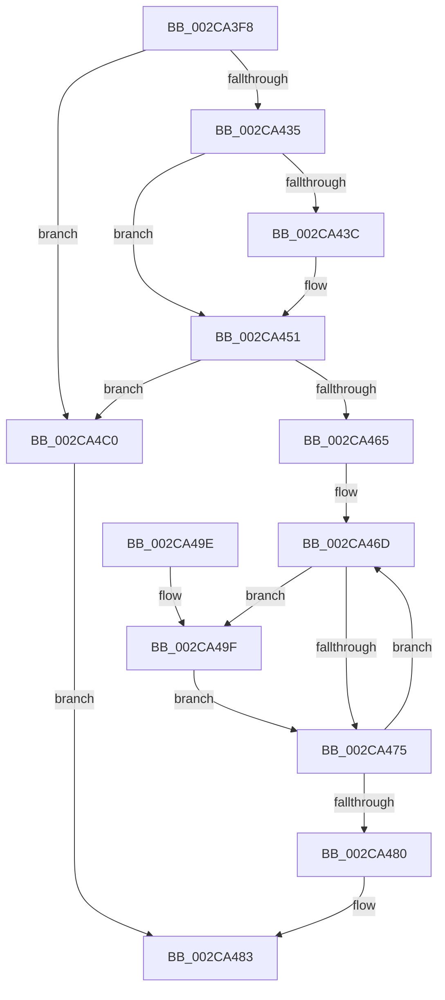

# MiComputeSoloZeroingTime

- RVA: `0x002CA3F8`–`0x002CA4C4` (길이 `204` bytes)
- VA: `0x00000001402CA3F8`
- 실행 섹션: `.text`
- PDB 이름 있음: `예`; PDB Function 태그: `아니요`
- unwind 정보 RVA: `0x0006F19C`
- 디코드: `55`개 명령, `204/204` bytes 표시
- 미해석 바이트: `0` (있으면 어셈블리에 `.byte`로 보존)

> 이 문서는 커널 이미지의 기계어와 PDB 기호를 분석해 생성했습니다. 4번과 5번은 함수 원형과 자료형을 바이너리 사용 방식에서 추정한 C 해석이며 원본 소스 복구 결과는 아닙니다.

## 1. Dependencies

- 직접 호출 지점: **1**; 고유 호출 대상: **1**
- 직접 호출자로 확인된 함수: **1**
- RIP 상대 이미지 참조: **1**

### Outgoing calls
- `0x002CA4B6` → [MiTimeToWriteMemory](MiTimeToWriteMemory_function_002CA4CC.md) (function, `0x002CA4CC`)

### Direct callers
- [MiQuantifyZeroWork](MiQuantifyZeroWork_function_002CA2A0.md) at `0x002CA2A9`

### Static image references
- `0x002CA41E` → RVA `0x00E38D10` (`.data`; read)

## 2. Other-region calls and transfers

- 다른 실행 섹션으로 향하는 call: **0**
- 별도 외부 분기/꼬리 이동을 확인하지 못했습니다.

## 3. Assembly (complete function range)

```asm
002CA3F8  48 8B C4                        mov rax, rsp
002CA3FB  48 89 58 08                     mov qword ptr [rax + 8], rbx
002CA3FF  48 89 68 10                     mov qword ptr [rax + 0x10], rbp
002CA403  48 89 70 18                     mov qword ptr [rax + 0x18], rsi
002CA407  48 89 78 20                     mov qword ptr [rax + 0x20], rdi
002CA40B  41 56                           push r14
002CA40D  48 83 EC 30                     sub rsp, 0x30
002CA411  8B 41 58                        mov eax, dword ptr [rcx + 0x58]
002CA414  48 8B F1                        mov rsi, rcx
002CA417  48 69 D0 80 DF 00 00            imul rdx, rax, 0xdf80
002CA41E  48 03 15 EB E8 B6 00            add rdx, qword ptr [rip + 0xb6e8eb]
002CA425  4C 8B 82 A8 3B 00 00            mov r8, qword ptr [rdx + 0x3ba8]
002CA42C  4D 85 C0                        test r8, r8
002CA42F  0F 84 8B 00 00 00               je 0x1402ca4c0
002CA435  33 DB                           xor ebx, ebx
002CA437  39 59 60                        cmp dword ptr [rcx + 0x60], ebx
002CA43A  75 15                           jne 0x1402ca451
002CA43C  65 48 8B 04 25 20 00 00 00      mov rax, qword ptr gs:[0x20]
002CA445  80 B8 08 8A 00 00 01            cmp byte ptr [rax + 0x8a08], 1
002CA44C  0F 95 C3                        setne bl
002CA44F  FF C3                           inc ebx
002CA451  8B C3                           mov eax, ebx
002CA453  48 69 C8 30 01 00 00            imul rcx, rax, 0x130
002CA45A  42 83 BC 01 8C 00 00 00 00      cmp dword ptr [rcx + r8 + 0x8c], 0
002CA463  74 5B                           je 0x1402ca4c0
002CA465  33 ED                           xor ebp, ebp
002CA467  4C 8D 76 30                     lea r14, [rsi + 0x30]
002CA46B  33 FF                           xor edi, edi
002CA46D  49 8B 06                        mov rax, qword ptr [r14]
002CA470  48 85 C0                        test rax, rax
002CA473  75 2A                           jne 0x1402ca49f
002CA475  FF C7                           inc edi
002CA477  49 83 C6 08                     add r14, 8
002CA47B  83 FF 04                        cmp edi, 4
002CA47E  72 ED                           jb 0x1402ca46d
002CA480  48 8B C5                        mov rax, rbp
002CA483  48 8B 5C 24 40                  mov rbx, qword ptr [rsp + 0x40]
002CA488  48 8B 6C 24 48                  mov rbp, qword ptr [rsp + 0x48]
002CA48D  48 8B 74 24 50                  mov rsi, qword ptr [rsp + 0x50]
002CA492  48 8B 7C 24 58                  mov rdi, qword ptr [rsp + 0x58]
002CA497  48 83 C4 30                     add rsp, 0x30
002CA49B  41 5E                           pop r14
002CA49D  C3                              ret
002CA49E  CC                              int3
002CA49F  8B 4E 58                        mov ecx, dword ptr [rsi + 0x58]
002CA4A2  41 B9 01 00 00 00               mov r9d, 1
002CA4A8  48 C1 E0 0C                     shl rax, 0xc
002CA4AC  44 8B C7                        mov r8d, edi
002CA4AF  8B D3                           mov edx, ebx
002CA4B1  48 89 44 24 20                  mov qword ptr [rsp + 0x20], rax
002CA4B6  E8 11 00 00 00                  call 0x1402ca4cc
002CA4BB  48 03 E8                        add rbp, rax
002CA4BE  EB B5                           jmp 0x1402ca475
002CA4C0  33 C0                           xor eax, eax
002CA4C2  EB BF                           jmp 0x1402ca483
```

## 4. C-style interpretation (structured pseudocode)

```c
__int64 __fastcall MiComputeSoloZeroingTime(__int64 a1)
{
    __int64 result;
    __int64 v_r14;
    __int64 v_rbp;
    __int64 v_rbx;
    __int64 v_rdi;
    __int64 v_rsp;
    unsigned __int64 v_stack_p10;
    unsigned __int64 v_stack_p18;
    unsigned __int64 v_stack_p20;
    unsigned __int64 v_stack_p8;

    *(unsigned __int64 *)(v_rsp + 8) = v_rbx;
    *(unsigned __int64 *)(v_rsp + 16) = v_rbp;
    *(unsigned __int64 *)(v_rsp + 24) = v_rsi;
    *(unsigned __int64 *)(v_rsp + 32) = v_rdi;
    v_rsp = (v_rsp) - (48);
    a2 = (a2) * ((unsigned int)(*(unsigned int *)(a1 + 88)));
    a2 = (a2) + (*(unsigned __int64 *)(v_rip + 11987179));
    if (*(unsigned __int64 *)(a2 + 15272) == 0) goto loc_002CA4C0;
    v_rbx = 0;
    result = (unsigned int)(*(unsigned int *)(a1 + 88));
    if ((*(unsigned int *)(a1 + 96)) == 0) {
        result = *(unsigned __int64 *)(gs_base + (0 + 32));
        v_rbx = ((*(unsigned __int8 *)(result + 35336)) != 1) ? 1 : 0;
        v_rbx = (unsigned int)((v_rbx) + 1);
    }
    a1 = (a1) * ((unsigned int)((unsigned int)(v_rbx)));
    if ((*(unsigned int *)(a1 + *(unsigned __int64 *)(a2 + 15272) * 1 + 140)) == 0) goto loc_002CA4C0;
    v_rbp = 0;
    v_rdi = 0;
loc_002CA46D:
    if (*(unsigned __int64 *)(a1 + 48) != 0) goto loc_002CA49F;
loc_002CA475:
    v_rdi = (unsigned int)((v_rdi) + 1);
    v_r14 = (a1 + 48) + (8);
    if (((unsigned int)(v_rdi)) < 4) goto loc_002CA46D;
loc_002CA483:
    v_rsp = (v_rsp) + (48);
    return 0;
loc_002CA49F:
    result = (0) << (12);
    v_stack_p20 = result;
    result = MiTimeToWriteMemory((unsigned int)(*(unsigned int *)(v_stack_p18 + 88)), (unsigned int)((unsigned int)(v_stack_p8)), (unsigned int)((unsigned int)(v_stack_p20)), 1);
    v_rbp = (v_stack_p10) + (result);
    goto loc_002CA475;
loc_002CA4C0:
    result = 0;
    goto loc_002CA483;
}
```

## 5. (Beta) C Style

```c
int64_t MiComputeSoloZeroingTime(void *Arg1)
{
    uint8_t *arg1 = (uint8_t *)Arg1;

    int64_t result;
    int64_t local_r14;
    int64_t local_rbp;
    int64_t local_rbx;
    int64_t local_rdi;
    int64_t local_rsp;
    uint64_t v_stack_p10;
    uint64_t v_stack_p18;
    uint64_t v_stack_p20;
    uint64_t v_stack_p8;

    *(uint64_t *)(local_rsp + 0x8) = local_rbx;
    *(uint64_t *)(local_rsp + 0x10) = local_rbp;
    *(uint64_t *)(local_rsp + 0x18) = local_rsi;
    *(uint64_t *)(local_rsp + 0x20) = local_rdi;
    local_rsp = (local_rsp) - (48);
    a2 = (a2) * ((uint32_t)(*(uint32_t *)(arg1 + 0x58)));
    a2 = (a2) + (*(uint64_t *)(v_rip + 0xB6E8EB));
    if (*(uint64_t *)(a2 + 0x3BA8) == 0) goto loc_002CA4C0;
    local_rbx = 0;
    result = (uint32_t)(*(uint32_t *)(arg1 + 0x58));
    if ((*(uint32_t *)(arg1 + 0x60)) == 0) {
        result = *(uint64_t *)(gs_base + (0 + 0x20));
        local_rbx = ((*(uint8_t *)(result + 0x8A08)) != 1) ? 1 : 0;
        local_rbx = (uint32_t)((local_rbx) + 1);
    }
    Arg1 = (Arg1) * ((uint32_t)((uint32_t)(local_rbx)));
    if ((*(uint32_t *)(arg1 + *(uint64_t *)(a2 + 0x3BA8) * 1 + 0x8C)) == 0) goto loc_002CA4C0;
    local_rbp = 0;
    local_rdi = 0;
loc_002CA46D:
    if (*(uint64_t *)(arg1 + 0x30) != 0) goto loc_002CA49F;
loc_002CA475:
    local_rdi = (uint32_t)((local_rdi) + 1);
    local_r14 = (Arg1 + 48) + (8);
    if (((uint32_t)(local_rdi)) < 4) goto loc_002CA46D;
loc_002CA483:
    local_rsp = (local_rsp) + (48);
    return 0;
loc_002CA49F:
    result = (0) << (12);
    v_stack_p20 = result;
    result = MiTimeToWriteMemory((uint32_t)(*(uint32_t *)(v_stack_p18 + 0x58)), (uint32_t)((uint32_t)(v_stack_p8)), (uint32_t)((uint32_t)(v_stack_p20)), 1);
    local_rbp = (v_stack_p10) + (result);
    goto loc_002CA475;
loc_002CA4C0:
    result = 0;
    goto loc_002CA483;
}
```

### 관측된 메모리 오프셋

구조체 형식이 확인되지 않은 접근은 인자 기준의 오프셋으로만 기록했습니다.

| 기준 인자 | 오프셋 표현 | 폭 (bit) | 접근 |
|---|---:|---:|---|
| `Arg1` | `+ 0x0` | `64` | `R` |
| `Arg1` | `+ 0x30` | `64` | `R` |
| `Arg1` | `+ 0x58` | `32` | `R` |
| `Arg1` | `+ 0x60` | `32` | `R` |
| `Arg1` | `+ 0x8C + r8*1` | `32` | `R` |

## 6. Execution-region graph

[열기: 2D/3D 그래프와 함수 탐색 컨트롤 패널](../../../control-panel.html?section=text&rva=0x002CA3F8&view=graph)

- 2D 그래프는 위에서 아래로 흐르고, 3D 그래프는 빈 공간을 드래그해 회전합니다. Shift+드래그는 이동, 휠은 확대·축소, 함수 노드 선택은 대상 보고서 이동입니다.

### Static fallback


