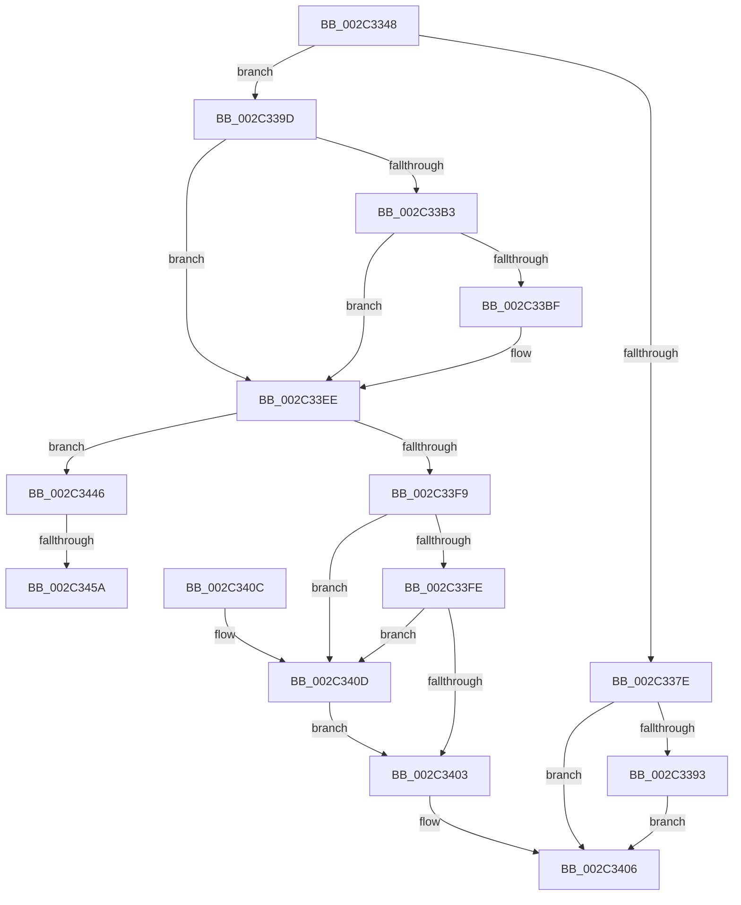

# MiComputeVadCharges

- RVA: `0x002C3348`–`0x002C3470` (길이 `296` bytes)
- VA: `0x00000001402C3348`
- 실행 섹션: `.text`
- PDB 이름 있음: `예`; PDB Function 태그: `예`
- unwind 정보 RVA: `0x0006E9C8`
- 디코드: `78`개 명령, `296/296` bytes 표시
- 미해석 바이트: `0` (있으면 어셈블리에 `.byte`로 보존)

> 이 문서는 커널 이미지의 기계어와 PDB 기호를 분석해 생성했습니다. 4번과 5번은 함수 원형과 자료형을 바이너리 사용 방식에서 추정한 C 해석이며 원본 소스 복구 결과는 아닙니다.

## 1. Dependencies

- 직접 호출 지점: **3**; 고유 호출 대상: **3**
- 직접 호출자로 확인된 함수: **3**
- RIP 상대 이미지 참조: **0**

### Outgoing calls
- `0x002C33B6` → [MiVadPureReserve](MiVadPureReserve_function_002C34C0.md) (function, `0x002C34C0`)
- `0x002C343C` → [MiResidentPagesForSpan](../../page/9B/MiResidentPagesForSpan_function_009BB300.md) (function, `0x009BB300`)
- `0x002C3462` → [MiLocateLockedVadEvent](../2A/MiLocateLockedVadEvent_function_002A7A0C.md) (function, `0x002A7A0C`)

### Direct callers
- [MiDeletePartialVad](../2A/MiDeletePartialVad_function_002A7A30.md) at `0x002A7AAA`
- [MiDeletePartialVad](../2A/MiDeletePartialVad_function_002A7A30.md) at `0x002A7B47`
- [MiDeleteNewlyCreatedPartialVads](../../page/81/MiDeleteNewlyCreatedPartialVads_function_00810374.md) at `0x008103CA`
- [MiInsertVadCharges](../../page/88/MiInsertVadCharges_function_00886AA8.md) at `0x00886B0B`

### Static image references
- 디코드된 RIP-relative 메모리 참조가 없습니다.

## 2. Other-region calls and transfers

- 다른 실행 섹션으로 향하는 call: **1**
  - `0x002C343C` → [MiResidentPagesForSpan](../../page/9B/MiResidentPagesForSpan_function_009BB300.md) (`.text` → `PAGE`)
- call이 아닌 외부 분기/꼬리 이동: **2**
  - `0x002C3454` → [sub_006DC410](../6D/Unknown_function_006DC410.md) (`tail-transfer`)
  - `0x002C346B` → [sub_006DC410](../6D/Unknown_function_006DC410.md) (`tail-transfer`)

## 3. Assembly (complete function range)

```asm
002C3348  40 53                           push rbx
002C334A  48 83 EC 20                     sub rsp, 0x20
002C334E  44 8B 41 34                     mov r8d, dword ptr [rcx + 0x34]
002C3352  4C 8B C9                        mov r9, rcx
002C3355  0F B6 49 22                     movzx ecx, byte ptr [rcx + 0x22]
002C3359  33 C0                           xor eax, eax
002C335B  48 C1 E1 20                     shl rcx, 0x20
002C335F  0F 57 C0                        xorps xmm0, xmm0
002C3362  49 0B C8                        or rcx, r8
002C3365  48 8B DA                        mov rbx, rdx
002C3368  49 B8 FD FF FF FF 07 00 00 00   movabs r8, 0x7fffffffd
002C3372  0F 11 02                        movups xmmword ptr [rdx], xmm0
002C3375  48 89 42 10                     mov qword ptr [rdx + 0x10], rax
002C3379  49 3B C8                        cmp rcx, r8
002C337C  72 1F                           jb 0x1402c339d
002C337E  41 8B 49 34                     mov ecx, dword ptr [r9 + 0x34]
002C3382  41 0F B6 51 22                  movzx edx, byte ptr [r9 + 0x22]
002C3387  48 C1 E2 20                     shl rdx, 0x20
002C338B  48 0B D1                        or rdx, rcx
002C338E  49 3B D0                        cmp rdx, r8
002C3391  75 73                           jne 0x1402c3406
002C3393  48 C7 43 10 40 00 00 00         mov qword ptr [rbx + 0x10], 0x40
002C339B  EB 69                           jmp 0x1402c3406
002C339D  45 8B 51 30                     mov r10d, dword ptr [r9 + 0x30]
002C33A1  45 33 C0                        xor r8d, r8d
002C33A4  48 C7 42 10 88 00 00 00         mov qword ptr [rdx + 0x10], 0x88
002C33AC  41 0F BA E2 15                  bt r10d, 0x15
002C33B1  72 3B                           jb 0x1402c33ee
002C33B3  49 8B C9                        mov rcx, r9
002C33B6  E8 05 01 00 00                  call 0x1402c34c0
002C33BB  85 C0                           test eax, eax
002C33BD  75 2F                           jne 0x1402c33ee
002C33BF  41 8B 41 1C                     mov eax, dword ptr [r9 + 0x1c]
002C33C3  41 0F B6 51 21                  movzx edx, byte ptr [r9 + 0x21]
002C33C8  41 0F B6 49 20                  movzx ecx, byte ptr [r9 + 0x20]
002C33CD  48 C1 E2 20                     shl rdx, 0x20
002C33D1  48 0B D0                        or rdx, rax
002C33D4  48 C1 E1 20                     shl rcx, 0x20
002C33D8  41 8B 41 18                     mov eax, dword ptr [r9 + 0x18]
002C33DC  48 0B C8                        or rcx, rax
002C33DF  48 2B D1                        sub rdx, rcx
002C33E2  48 8D 04 D5 08 00 00 00         lea rax, [rdx*8 + 8]
002C33EA  48 89 43 08                     mov qword ptr [rbx + 8], rax
002C33EE  41 8B C2                        mov eax, r10d
002C33F1  83 E0 70                        and eax, 0x70
002C33F4  83 F8 30                        cmp eax, 0x30
002C33F7  74 4D                           je 0x1402c3446
002C33F9  83 F8 10                        cmp eax, 0x10
002C33FC  74 0F                           je 0x1402c340d
002C33FE  83 F8 40                        cmp eax, 0x40
002C3401  74 0A                           je 0x1402c340d
002C3403  4C 89 03                        mov qword ptr [rbx], r8
002C3406  48 83 C4 20                     add rsp, 0x20
002C340A  5B                              pop rbx
002C340B  C3                              ret
002C340C  CC                              int3
002C340D  41 8B 41 1C                     mov eax, dword ptr [r9 + 0x1c]
002C3411  41 0F B6 51 21                  movzx edx, byte ptr [r9 + 0x21]
002C3416  41 0F B6 49 20                  movzx ecx, byte ptr [r9 + 0x20]
002C341B  48 C1 E2 20                     shl rdx, 0x20
002C341F  48 0B D0                        or rdx, rax
002C3422  48 C1 E1 20                     shl rcx, 0x20
002C3426  41 8B 41 18                     mov eax, dword ptr [r9 + 0x18]
002C342A  48 0B C8                        or rcx, rax
002C342D  48 C1 E2 0C                     shl rdx, 0xc
002C3431  48 C1 E1 0C                     shl rcx, 0xc
002C3435  48 81 CA FF 0F 00 00            or rdx, 0xfff
002C343C  E8 BF 7E 6F 00                  call 0x1409bb300
002C3441  4C 8B C0                        mov r8, rax
002C3444  EB BD                           jmp 0x1402c3403
002C3446  41 81 E2 00 00 20 0C            and r10d, 0xc200000
002C344D  41 81 FA 00 00 20 08            cmp r10d, 0x8200000
002C3454  0F 84 B6 8F 41 00               je 0x1406dc410
002C345A  BA 00 01 00 00                  mov edx, 0x100
002C345F  49 8B C9                        mov rcx, r9
002C3462  E8 A5 45 FE FF                  call 0x1402a7a0c
002C3467  4C 8D 40 08                     lea r8, [rax + 8]
002C346B  E9 A0 8F 41 00                  jmp 0x1406dc410
```

## 4. C-style interpretation (structured pseudocode)

```c
__int64 __fastcall MiComputeVadCharges(__int64 a1, __int64 a2)
{
    __int64 result;
    __int64 v_r10;
    __int64 v_rsp;

    v_rsp = (v_rsp) - (32);
    result = 0;
    a1 = (*(unsigned __int8 *)(a1 + 34)) << (32);
    a1 = (a1) | ((unsigned int)(*(unsigned int *)(a1 + 52)));
    *(unsigned __int64 *)(a2) = v_xmm0;
    *(unsigned __int64 *)(a2 + 16) = 0;
    if (a1 < ((unsigned int)(*(unsigned int *)(a1 + 52)))) goto loc_002C339D;
    a2 = (*(unsigned __int8 *)(a1 + 34)) << (32);
    a2 = (a2) | ((unsigned int)(*(unsigned int *)(a1 + 52)));
    if (a2 != ((unsigned int)(*(unsigned int *)(a1 + 52)))) goto loc_002C3406;
    *(unsigned __int64 *)(a2 + 16) = 64;
    goto loc_002C3406;
loc_002C339D:
    a3 = 0;
    *(unsigned __int64 *)(a2 + 16) = 136;
    if (condition_is_below) goto loc_002C33EE;
    result = MiVadPureReserve(a1, a2, a3, a1);
    if ((unsigned int)(result) == 0) {
        result = *(unsigned int *)(a1 + 28);
        a2 = *(unsigned __int8 *)(a1 + 33);
        a1 = *(unsigned __int8 *)(a1 + 32);
        a2 = (a2) << (32);
        a2 = (a2) | (result);
        a1 = (a1) << (32);
        result = *(unsigned int *)(a1 + 24);
        a1 = (a1) | (result);
        a2 = (a2) - (a1);
        result = a2 * 8 + 8;
        *(unsigned __int64 *)(a2 + 8) = result;
    }
    result = (unsigned int)(((unsigned int)((unsigned int)((unsigned int)(*(unsigned int *)(a1 + 48))))) & (112));
    if (((unsigned int)(result)) == 48) goto loc_002C3446;
    if (((unsigned int)(result)) == 16) goto loc_002C340D;
    if (((unsigned int)(result)) == 64) goto loc_002C340D;
loc_002C3403:
    *(unsigned __int64 *)(a2) = 0;
loc_002C3406:
    v_rsp = (v_rsp) + (32);
    return result;
loc_002C340D:
    a2 = (*(unsigned __int8 *)(a1 + 33)) << (32);
    a2 = (a2) | ((unsigned int)(*(unsigned int *)(a1 + 28)));
    a1 = (*(unsigned __int8 *)(a1 + 32)) << (32);
    a1 = (a1) | ((unsigned int)(*(unsigned int *)(a1 + 24)));
    a2 = (a2) << (12);
    a1 = (a1) << (12);
    a2 = (a2) | (0xFFFULL);
    result = MiResidentPagesForSpan(a1, a2, a3, a1);
    goto loc_002C3403;
loc_002C3446:
    v_r10 = (unsigned int)(((unsigned int)(*(unsigned int *)(a1 + 48))) & (0xC200000ULL));
    result = MiLocateLockedVadEvent(a1, 256, result, a1);
}
```

## 5. (Beta) C Style

```c
int64_t MiComputeVadCharges(void *Arg1, void *Arg2)
{
    uint8_t *arg1 = (uint8_t *)Arg1;
    uint8_t *arg2 = (uint8_t *)Arg2;

    int64_t result;
    int64_t local_r10;
    int64_t local_rsp;

    local_rsp = (local_rsp) - (32);
    result = 0;
    Arg1 = (*(uint8_t *)(arg1 + 0x22)) << (32);
    Arg1 = (Arg1) | ((uint32_t)(*(uint32_t *)(arg1 + 0x34)));
    *(uint64_t *)(arg2) = v_xmm0;
    *(uint64_t *)(arg2 + 0x10) = 0;
    if (Arg1 < ((uint32_t)(*(uint32_t *)(arg1 + 0x34)))) goto loc_002C339D;
    Arg2 = (*(uint8_t *)(arg1 + 0x22)) << (32);
    Arg2 = (Arg2) | ((uint32_t)(*(uint32_t *)(arg1 + 0x34)));
    if (Arg2 != ((uint32_t)(*(uint32_t *)(arg1 + 0x34)))) goto loc_002C3406;
    *(uint64_t *)(arg2 + 0x10) = 64;
    goto loc_002C3406;
loc_002C339D:
    a3 = 0;
    *(uint64_t *)(arg2 + 0x10) = 136;
    if (condition_is_below) goto loc_002C33EE;
    result = MiVadPureReserve(Arg1, Arg2, a3, Arg1);
    if ((uint32_t)(result) == 0) {
        result = *(uint32_t *)(arg1 + 0x1C);
        Arg2 = *(uint8_t *)(arg1 + 0x21);
        Arg1 = *(uint8_t *)(arg1 + 0x20);
        Arg2 = (Arg2) << (32);
        Arg2 = (Arg2) | (result);
        Arg1 = (Arg1) << (32);
        result = *(uint32_t *)(arg1 + 0x18);
        Arg1 = (Arg1) | (result);
        Arg2 = (Arg2) - (Arg1);
        result = Arg2 * 8 + 8;
        *(uint64_t *)(arg2 + 0x8) = result;
    }
    result = (uint32_t)(((uint32_t)((uint32_t)((uint32_t)(*(uint32_t *)(arg1 + 0x30))))) & (112));
    if (((uint32_t)(result)) == 48) goto loc_002C3446;
    if (((uint32_t)(result)) == 16) goto loc_002C340D;
    if (((uint32_t)(result)) == 64) goto loc_002C340D;
loc_002C3403:
    *(uint64_t *)(arg2) = 0;
loc_002C3406:
    local_rsp = (local_rsp) + (32);
    return result;
loc_002C340D:
    Arg2 = (*(uint8_t *)(arg1 + 0x21)) << (32);
    Arg2 = (Arg2) | ((uint32_t)(*(uint32_t *)(arg1 + 0x1C)));
    Arg1 = (*(uint8_t *)(arg1 + 0x20)) << (32);
    Arg1 = (Arg1) | ((uint32_t)(*(uint32_t *)(arg1 + 0x18)));
    Arg2 = (Arg2) << (12);
    Arg1 = (Arg1) << (12);
    Arg2 = (Arg2) | (0xFFFULL);
    result = MiResidentPagesForSpan(Arg1, Arg2, a3, Arg1);
    goto loc_002C3403;
loc_002C3446:
    local_r10 = (uint32_t)(((uint32_t)(*(uint32_t *)(arg1 + 0x30))) & (0xC200000ULL));
    result = MiLocateLockedVadEvent(Arg1, 256, result, Arg1);
}
```

### 관측된 메모리 오프셋

구조체 형식이 확인되지 않은 접근은 인자 기준의 오프셋으로만 기록했습니다.

| 기준 인자 | 오프셋 표현 | 폭 (bit) | 접근 |
|---|---:|---:|---|
| `Arg1` | `+ 0x22` | `8` | `R` |
| `Arg1` | `+ 0x30` | `32` | `R` |
| `Arg1` | `+ 0x34` | `32` | `R` |
| `Arg2` | `+ 0x0` | `64` | `W` |
| `Arg2` | `+ 0x0` | `128` | `R` |
| `Arg2` | `+ 0x8` | `64` | `W` |
| `Arg2` | `+ 0x10` | `64` | `W` |

## 6. Execution-region graph

[열기: 2D/3D 그래프와 함수 탐색 컨트롤 패널](../../../control-panel.html?section=text&rva=0x002C3348&view=graph)

- 2D 그래프는 위에서 아래로 흐르고, 3D 그래프는 빈 공간을 드래그해 회전합니다. Shift+드래그는 이동, 휠은 확대·축소, 함수 노드 선택은 대상 보고서 이동입니다.

### Static fallback


