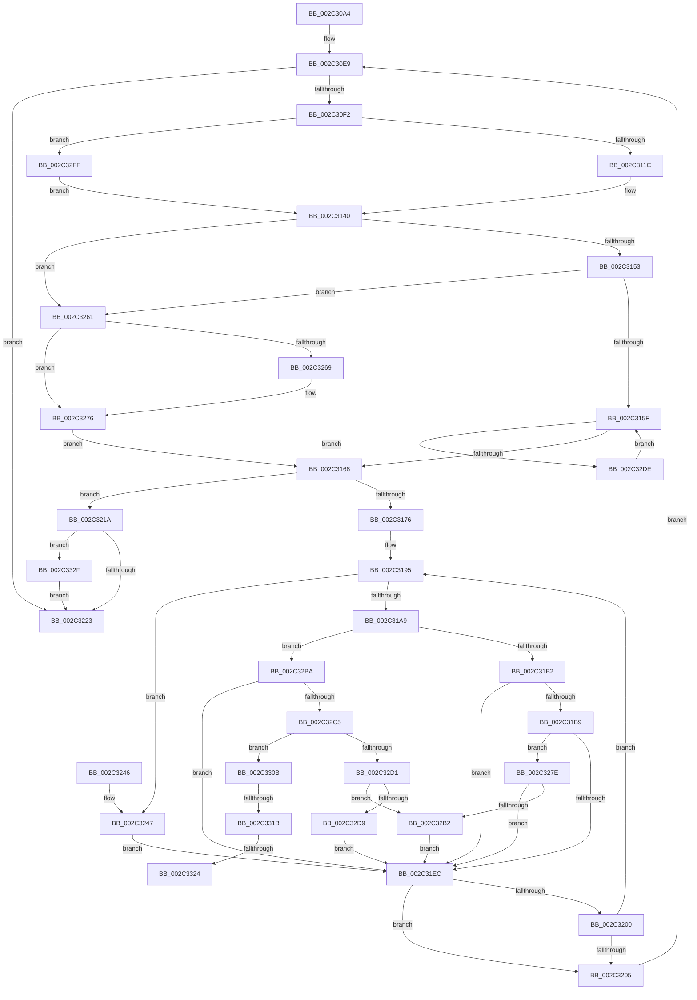

# MiCountSharedPages

- RVA: `0x002C30A4`–`0x002C333F` (길이 `667` bytes)
- VA: `0x00000001402C30A4`
- 실행 섹션: `.text`
- PDB 이름 있음: `예`; PDB Function 태그: `예`
- unwind 정보 RVA: `0x0006E99C`
- 디코드: `172`개 명령, `667/667` bytes 표시
- 미해석 바이트: `0` (있으면 어셈블리에 `.byte`로 보존)

> 이 문서는 커널 이미지의 기계어와 PDB 기호를 분석해 생성했습니다. 4번과 5번은 함수 원형과 자료형을 바이너리 사용 방식에서 추정한 C 해석이며 원본 소스 복구 결과는 아닙니다.

## 1. Dependencies

- 직접 호출 지점: **10**; 고유 호출 대상: **8**
- 직접 호출자로 확인된 함수: **3**
- RIP 상대 이미지 참조: **1**

### Outgoing calls
- `0x002C30DD` → [MiLockWorkingSetShared](../27/MiLockWorkingSetShared_function_0027CBF0.md) (function, `0x0027CBF0`)
- `0x002C310B` → [MiGetNextPageTable](MiGetNextPageTable_function_002C2EE0.md) (function, `0x002C2EE0`)
- `0x002C3198` → [MI_READ_PTE_LOCK_FREE](../28/MI_READ_PTE_LOCK_FREE_function_002828A0.md) (function, `0x002828A0`)
- `0x002C320B` → [MiUnlockPageTable](../21/MiUnlockPageTable_function_00216EC0.md) (function, `0x00216EC0`)
- `0x002C3229` → [MiUnlockWorkingSetShared](../27/MiUnlockWorkingSetShared_function_0027D690.md) (function, `0x0027D690`)
- `0x002C324D` → [MiPteNeedsCommitCharge](MiPteNeedsCommitCharge_function_002C13B0.md) (function, `0x002C13B0`)
- `0x002C3297` → [MiGetProtoPteAddress](../32/MiGetProtoPteAddress_function_0032E970.md) (function, `0x0032E970`)
- `0x002C32C8` → [MiIsPrototypePteVadLookup](../32/MiIsPrototypePteVadLookup_function_00328B70.md) (function, `0x00328B70`)
- `0x002C32E4` → [MiPteNeedsCommitCharge](MiPteNeedsCommitCharge_function_002C13B0.md) (function, `0x002C13B0`)
- `0x002C3335` → [MiUnlockPageTable](../21/MiUnlockPageTable_function_00216EC0.md) (function, `0x00216EC0`)

### Direct callers
- [MiPerformVadSplitting](../2A/MiPerformVadSplitting_function_002A5A80.md) at `0x002A5E5F`
- [MiPerformVadSplitting](../2A/MiPerformVadSplitting_function_002A5A80.md) at `0x002A5E9C`
- [sub_002C3A7C](Unknown_function_002C3A7C.md) at `0x002C3A85`
- [MiPrepareImagePagesForHotPatch](../68/MiPrepareImagePagesForHotPatch_function_00683800.md) at `0x006838AA`

### Static image references
- `0x002C330B` → RVA `0x00E2DC80` (`.data`; read)

## 2. Other-region calls and transfers

- 다른 실행 섹션으로 향하는 call: **0**
- call이 아닌 외부 분기/꼬리 이동: **3**
  - `0x002C3315` → [sub_006DC3C4 + 0x4](../6D/Unknown_function_006DC3C4.md) (`tail-transfer`)
  - `0x002C331E` → [sub_006DC3C4](../6D/Unknown_function_006DC3C4.md) (`tail-transfer`)
  - `0x002C332A` → [sub_006DC3C4 + 0x4](../6D/Unknown_function_006DC3C4.md) (`tail-transfer`)

## 3. Assembly (complete function range)

```asm
002C30A4  48 89 5C 24 08                  mov qword ptr [rsp + 8], rbx
002C30A9  55                              push rbp
002C30AA  56                              push rsi
002C30AB  57                              push rdi
002C30AC  41 54                           push r12
002C30AE  41 55                           push r13
002C30B0  41 56                           push r14
002C30B2  41 57                           push r15
002C30B4  48 83 EC 30                     sub rsp, 0x30
002C30B8  65 48 8B 04 25 88 01 00 00      mov rax, qword ptr gs:[0x188]
002C30C1  4C 8B E9                        mov r13, rcx
002C30C4  33 FF                           xor edi, edi
002C30C6  4D 8B E0                        mov r12, r8
002C30C9  48 8B F2                        mov rsi, rdx
002C30CC  4C 8B B8 B8 00 00 00            mov r15, qword ptr [rax + 0xb8]
002C30D3  49 81 C7 00 04 00 00            add r15, 0x400
002C30DA  49 8B CF                        mov rcx, r15
002C30DD  E8 0E 9B FB FF                  call 0x14027cbf0
002C30E2  44 8A F0                        mov r14b, al
002C30E5  88 44 24 78                     mov byte ptr [rsp + 0x78], al
002C30E9  49 3B F4                        cmp rsi, r12
002C30EC  0F 87 31 01 00 00               ja 0x1402c3223
002C30F2  48 8D 84 24 80 00 00 00         lea rax, [rsp + 0x80]
002C30FA  45 33 C9                        xor r9d, r9d
002C30FD  45 8A C6                        mov r8b, r14b
002C3100  48 89 44 24 20                  mov qword ptr [rsp + 0x20], rax
002C3105  49 8B D4                        mov rdx, r12
002C3108  48 8B CE                        mov rcx, rsi
002C310B  E8 D0 FD FF FF                  call 0x1402c2ee0
002C3110  48 8B D8                        mov rbx, rax
002C3113  48 85 C0                        test rax, rax
002C3116  0F 84 E3 01 00 00               je 0x1402c32ff
002C311C  48 8B E8                        mov rbp, rax
002C311F  48 B8 F8 FF FF FF 7F 00 00 00   movabs rax, 0x7ffffffff8
002C3129  48 C1 ED 09                     shr rbp, 9
002C312D  48 23 E8                        and rbp, rax
002C3130  48 B8 00 00 00 00 80 F6 FF FF   movabs rax, 0xfffff68000000000
002C313A  48 8B C0                        mov rax, rax
002C313D  48 03 E8                        add rbp, rax
002C3140  41 8B 45 30                     mov eax, dword ptr [r13 + 0x30]
002C3144  8B C8                           mov ecx, eax
002C3146  C1 E9 07                        shr ecx, 7
002C3149  24 70                           and al, 0x70
002C314B  3C 20                           cmp al, 0x20
002C314D  0F 85 0E 01 00 00               jne 0x1402c3261
002C3153  8B C1                           mov eax, ecx
002C3155  24 1F                           and al, 0x1f
002C3157  3C 01                           cmp al, 1
002C3159  0F 84 02 01 00 00               je 0x1402c3261
002C315F  48 3B F3                        cmp rsi, rbx
002C3162  0F 82 76 01 00 00               jb 0x1402c32de
002C3168  49 8D 44 24 08                  lea rax, [r12 + 8]
002C316D  48 3B F0                        cmp rsi, rax
002C3170  0F 84 A4 00 00 00               je 0x1402c321a
002C3176  4C 8B F6                        mov r14, rsi
002C3179  48 B8 00 00 00 00 80 F6 FF FF   movabs rax, 0xfffff68000000000
002C3183  49 C1 E6 19                     shl r14, 0x19
002C3187  48 8B C0                        mov rax, rax
002C318A  48 C1 E0 19                     shl rax, 0x19
002C318E  4C 2B F0                        sub r14, rax
002C3191  49 C1 FE 10                     sar r14, 0x10
002C3195  48 8B CE                        mov rcx, rsi
002C3198  E8 03 F7 FB FF                  call 0x1402828a0
002C319D  48 8B D8                        mov rbx, rax
002C31A0  48 85 C0                        test rax, rax
002C31A3  0F 84 9E 00 00 00               je 0x1402c3247
002C31A9  F6 C3 01                        test bl, 1
002C31AC  0F 84 08 01 00 00               je 0x1402c32ba
002C31B2  48 0F BA E0 09                  bt rax, 9
002C31B7  72 33                           jb 0x1402c31ec
002C31B9  48 C1 EB 0C                     shr rbx, 0xc
002C31BD  48 B8 FF FF FF FF FF 00 00 00   movabs rax, 0xffffffffff
002C31C7  48 23 D8                        and rbx, rax
002C31CA  48 8D 1C 5B                     lea rbx, [rbx + rbx*2]
002C31CE  48 C1 E3 04                     shl rbx, 4
002C31D2  48 B8 00 00 00 00 00 DE FF FF   movabs rax, 0xffffde0000000000
002C31DC  48 03 D8                        add rbx, rax
002C31DF  48 8B 43 28                     mov rax, qword ptr [rbx + 0x28]
002C31E3  48 85 C0                        test rax, rax
002C31E6  0F 88 92 00 00 00               js 0x1402c327e
002C31EC  48 83 C6 08                     add rsi, 8
002C31F0  49 81 C6 00 10 00 00            add r14, 0x1000
002C31F7  48 F7 C6 FF 0F 00 00            test rsi, 0xfff
002C31FE  74 05                           je 0x1402c3205
002C3200  49 3B F4                        cmp rsi, r12
002C3203  76 90                           jbe 0x1402c3195
002C3205  48 8B D5                        mov rdx, rbp
002C3208  49 8B CF                        mov rcx, r15
002C320B  E8 B0 3C F5 FF                  call 0x140216ec0
002C3210  44 8A 74 24 78                  mov r14b, byte ptr [rsp + 0x78]
002C3215  E9 CF FE FF FF                  jmp 0x1402c30e9
002C321A  48 85 ED                        test rbp, rbp
002C321D  0F 85 0C 01 00 00               jne 0x1402c332f
002C3223  41 8A D6                        mov dl, r14b
002C3226  49 8B CF                        mov rcx, r15
002C3229  E8 62 A4 FB FF                  call 0x14027d690
002C322E  48 8B 5C 24 70                  mov rbx, qword ptr [rsp + 0x70]
002C3233  48 8B C7                        mov rax, rdi
002C3236  48 83 C4 30                     add rsp, 0x30
002C323A  41 5F                           pop r15
002C323C  41 5E                           pop r14
002C323E  41 5D                           pop r13
002C3240  41 5C                           pop r12
002C3242  5F                              pop rdi
002C3243  5E                              pop rsi
002C3244  5D                              pop rbp
002C3245  C3                              ret
002C3246  CC                              int3
002C3247  48 8B D6                        mov rdx, rsi
002C324A  49 8B CD                        mov rcx, r13
002C324D  E8 5E E1 FF FF                  call 0x1402c13b0
002C3252  48 8D 4F 01                     lea rcx, [rdi + 1]
002C3256  85 C0                           test eax, eax
002C3258  48 0F 44 CF                     cmove rcx, rdi
002C325C  48 8B F9                        mov rdi, rcx
002C325F  EB 8B                           jmp 0x1402c31ec
002C3261  83 E1 05                        and ecx, 5
002C3264  80 F9 05                        cmp cl, 5
002C3267  74 0D                           je 0x1402c3276
002C3269  48 8B C3                        mov rax, rbx
002C326C  48 2B C6                        sub rax, rsi
002C326F  48 C1 F8 03                     sar rax, 3
002C3273  48 03 F8                        add rdi, rax
002C3276  48 8B F3                        mov rsi, rbx
002C3279  E9 EA FE FF FF                  jmp 0x1402c3168
002C327E  48 8B 5B 08                     mov rbx, qword ptr [rbx + 8]
002C3282  4C 8D 8C 24 80 00 00 00         lea r9, [rsp + 0x80]
002C328A  49 8B D6                        mov rdx, r14
002C328D  45 33 C0                        xor r8d, r8d
002C3290  48 C1 EA 0C                     shr rdx, 0xc
002C3294  49 8B CD                        mov rcx, r13
002C3297  E8 D4 B6 06 00                  call 0x14032e970
002C329C  48 B9 00 00 00 00 00 00 00 80   movabs rcx, 0x8000000000000000
002C32A6  48 0B D9                        or rbx, rcx
002C32A9  48 3B D8                        cmp rbx, rax
002C32AC  0F 85 3A FF FF FF               jne 0x1402c31ec
002C32B2  48 FF C7                        inc rdi
002C32B5  E9 32 FF FF FF                  jmp 0x1402c31ec
002C32BA  48 0F BA E3 0A                  bt rbx, 0xa
002C32BF  0F 83 27 FF FF FF               jae 0x1402c31ec
002C32C5  48 8B CB                        mov rcx, rbx
002C32C8  E8 A3 58 06 00                  call 0x140328b70
002C32CD  85 C0                           test eax, eax
002C32CF  74 3A                           je 0x1402c330b
002C32D1  80 E3 A0                        and bl, 0xa0
002C32D4  80 FB A0                        cmp bl, 0xa0
002C32D7  75 D9                           jne 0x1402c32b2
002C32D9  E9 0E FF FF FF                  jmp 0x1402c31ec
002C32DE  48 8B D6                        mov rdx, rsi
002C32E1  49 8B CD                        mov rcx, r13
002C32E4  E8 C7 E0 FF FF                  call 0x1402c13b0
002C32E9  85 C0                           test eax, eax
002C32EB  48 8D 4F 01                     lea rcx, [rdi + 1]
002C32EF  48 0F 44 CF                     cmove rcx, rdi
002C32F3  48 83 C6 08                     add rsi, 8
002C32F7  48 8B F9                        mov rdi, rcx
002C32FA  E9 60 FE FF FF                  jmp 0x1402c315f
002C32FF  33 ED                           xor ebp, ebp
002C3301  49 8D 5C 24 08                  lea rbx, [r12 + 8]
002C3306  E9 35 FE FF FF                  jmp 0x1402c3140
002C330B  48 8B 05 6E A9 B6 00            mov rax, qword ptr [rip + 0xb6a96e]
002C3312  48 85 C0                        test rax, rax
002C3315  0F 84 AD 90 41 00               je 0x1406dc3c8
002C331B  F6 C3 10                        test bl, 0x10
002C331E  0F 85 A0 90 41 00               jne 0x1406dc3c4
002C3324  48 F7 D0                        not rax
002C3327  48 23 D8                        and rbx, rax
002C332A  E9 99 90 41 00                  jmp 0x1406dc3c8
002C332F  48 8B D5                        mov rdx, rbp
002C3332  49 8B CF                        mov rcx, r15
002C3335  E8 86 3B F5 FF                  call 0x140216ec0
002C333A  E9 E4 FE FF FF                  jmp 0x1402c3223
```

## 4. C-style interpretation (structured pseudocode)

```c
__int64 __fastcall MiCountSharedPages(__int64 a1, __int64 a2, __int64 a3, int a4)
{
    __int64 result;
    __int64 v_r14;
    __int64 v_r15;
    __int64 v_rbp;
    __int64 v_rbx;
    __int64 v_rdi;
    __int64 v_rsi;
    __int64 v_rsp;
    unsigned __int64 v_stack_m48;
    unsigned __int8 v_stack_p10;
    unsigned __int64 v_stack_p18;
    unsigned __int64 v_stack_p8;
    unsigned __int64 v_stack_p80;

    v_stack_p8 = v_rbx;
    v_rsp = (v_rsp) - (48);
    v_rdi = 0;
    v_r15 = (*(unsigned __int64 *)(*(unsigned __int64 *)(gs_base + (0 + 392)) + 184)) + (0x400ULL);
    result = MiLockWorkingSetShared(v_r15, a2, a3, a4);
    v_stack_p10 = (unsigned __int8)(result);
loc_002C30E9:
    if (a2 > a3) goto loc_002C3223;
    a4 = 0;
    v_stack_m48 = v_stack_p18;
    result = MiGetNextPageTable(a2, a3, (unsigned __int8)((unsigned __int8)(result)), a4);
    if (result == 0) goto loc_002C32FF;
    v_rbp = (result) >> (9);
    v_rbp = (v_rbp) & (result);
    v_rbp = (v_rbp) + (result);
loc_002C3140:
    a1 = (unsigned int)(((unsigned int)((unsigned int)((unsigned int)(*(unsigned int *)(a1 + 48))))) >> (7));
    result = (unsigned __int8)(((unsigned int)(*(unsigned int *)(a1 + 48))) & (112));
    if (((unsigned __int8)(result)) != 32) goto loc_002C3261;
    result = (unsigned __int8)(((unsigned int)((unsigned int)(a1))) & (31));
    if (((unsigned __int8)(result)) == 1) goto loc_002C3261;
loc_002C315F:
    if (a2 < result) goto loc_002C32DE;
loc_002C3168:
    if (a2 == (a3 + 8)) goto loc_002C321A;
    v_r14 = (a2) << (25);
    result = (a3 + 8) << (25);
    v_r14 = (v_r14) - (result);
    v_r14 = (v_r14) >> (16);
loc_002C3195:
    result = MI_READ_PTE_LOCK_FREE(a2, a3, (unsigned __int8)((unsigned __int8)(result)), a4);
    if (result == 0) goto loc_002C3247;
    if ((((unsigned __int8)(result)) & (1)) == 0) goto loc_002C32BA;
    if (condition_is_below) goto loc_002C31EC;
    v_rbx = (result) >> (12);
    v_rbx = (v_rbx) & (result);
    v_rbx = (v_rbx + v_rbx * 2) << (4);
    v_rbx = (v_rbx) + (result);
    if (sign_flag) goto loc_002C327E;
loc_002C31EC:
    v_rsi = (a2) + (8);
    v_r14 = (v_r14) + (0x1000ULL);
    if (((v_rsi) & (0xFFFULL)) == 0) goto loc_002C3205;
    if (v_rsi <= a3) goto loc_002C3195;
loc_002C3205:
    result = MiUnlockPageTable(v_r15, v_rbp, (unsigned __int8)((unsigned __int8)(result)), a4);
    goto loc_002C30E9;
loc_002C321A:
    if (v_rbp != 0) goto loc_002C332F;
loc_002C3223:
    result = MiUnlockWorkingSetShared(v_r15, (unsigned __int8)(v_stack_p10), (unsigned __int8)((unsigned __int8)(result)), a4);
    v_rsp = (v_rsp) + (48);
    return 0;
loc_002C3247:
    result = MiPteNeedsCommitCharge(a1, v_rsi, (unsigned __int8)((unsigned __int8)(result)), a4);
    a1 = v_rdi + 1;
    if ((unsigned int)(result) == 0) { a1 = 0; }
    goto loc_002C31EC;
loc_002C3261:
    a1 = (unsigned int)((a1) & (5));
    v_rdi = a1;
    if (((unsigned __int8)(a1)) != 5) {
        result = v_stack_p8;
        result = (result) - (v_rsi);
        result = (result) >> (3);
        v_rdi = (a1) + (result);
    }
    goto loc_002C3168;
loc_002C327E:
    a3 = 0;
    a2 = (v_stack_p10) >> (12);
    result = MiGetProtoPteAddress(a1, a2, a3, v_stack_p80);
    v_rbx = (*(unsigned __int64 *)(v_stack_p8 + 8)) | (a1);
    if (v_rbx != result) goto loc_002C31EC;
loc_002C32B2:
    v_rdi = (v_rdi) + 1;
    goto loc_002C31EC;
loc_002C32BA:
    if (v_rbx >= result) goto loc_002C31EC;
    result = MiIsPrototypePteVadLookup(v_rbx, a2, a3, v_stack_p80);
    if ((unsigned int)(result) == 0) goto loc_002C330B;
    v_rbx = (unsigned __int8)((v_rbx) & (160));
    if (((unsigned __int8)(v_rbx)) != 160) goto loc_002C32B2;
    goto loc_002C31EC;
loc_002C32DE:
    result = MiPteNeedsCommitCharge(a1, v_stack_p8, a3, v_stack_p80);
    a1 = v_rdi + 1;
    if ((unsigned int)(result) == 0) { a1 = v_rdi; }
    v_rsi = (v_stack_p8) + (8);
    goto loc_002C315F;
loc_002C32FF:
    v_rbp = 0;
    goto loc_002C3140;
loc_002C330B:
    result = ~(*(unsigned __int64 *)(v_rip + 11970926));
    v_rbx = (a3 + 8) & (result);
loc_002C332F:
    result = MiUnlockPageTable(v_r15, 0, a3, v_stack_p80);
    goto loc_002C3223;
}
```

## 5. (Beta) C Style

```c
int64_t MiCountSharedPages(void *Arg1, int64_t Arg2, void *Arg3, int32_t Arg4)
{
    uint8_t *arg1 = (uint8_t *)Arg1;
    uint8_t *arg3 = (uint8_t *)Arg3;

    int64_t result;
    int64_t local_r14;
    int64_t local_r15;
    int64_t local_rbp;
    int64_t local_rbx;
    int64_t local_rdi;
    int64_t local_rsi;
    int64_t local_rsp;
    uint64_t v_stack_m48;
    uint8_t v_stack_p10;
    uint64_t v_stack_p18;
    uint64_t v_stack_p8;
    uint64_t v_stack_p80;

    v_stack_p8 = local_rbx;
    local_rsp = (local_rsp) - (48);
    local_rdi = 0;
    local_r15 = (*(uint64_t *)(*(uint64_t *)(gs_base + (0 + 0x188)) + 0xB8)) + (0x400ULL);
    result = MiLockWorkingSetShared(local_r15, Arg2, Arg3, Arg4);
    v_stack_p10 = (uint8_t)(result);
loc_002C30E9:
    if (Arg2 > Arg3) goto loc_002C3223;
    Arg4 = 0;
    v_stack_m48 = v_stack_p18;
    result = MiGetNextPageTable(Arg2, Arg3, (uint8_t)((uint8_t)(result)), Arg4);
    if (result == 0) goto loc_002C32FF;
    local_rbp = (result) >> (9);
    local_rbp = (local_rbp) & (result);
    local_rbp = (local_rbp) + (result);
loc_002C3140:
    Arg1 = (uint32_t)(((uint32_t)((uint32_t)((uint32_t)(*(uint32_t *)(arg1 + 0x30))))) >> (7));
    result = (uint8_t)(((uint32_t)(*(uint32_t *)(arg1 + 0x30))) & (112));
    if (((uint8_t)(result)) != 32) goto loc_002C3261;
    result = (uint8_t)(((uint32_t)((uint32_t)(Arg1))) & (31));
    if (((uint8_t)(result)) == 1) goto loc_002C3261;
loc_002C315F:
    if (Arg2 < result) goto loc_002C32DE;
loc_002C3168:
    if (Arg2 == (Arg3 + 8)) goto loc_002C321A;
    local_r14 = (Arg2) << (25);
    result = (Arg3 + 8) << (25);
    local_r14 = (local_r14) - (result);
    local_r14 = (local_r14) >> (16);
loc_002C3195:
    result = MI_READ_PTE_LOCK_FREE(Arg2, Arg3, (uint8_t)((uint8_t)(result)), Arg4);
    if (result == 0) goto loc_002C3247;
    if ((((uint8_t)(result)) & (1)) == 0) goto loc_002C32BA;
    if (condition_is_below) goto loc_002C31EC;
    local_rbx = (result) >> (12);
    local_rbx = (local_rbx) & (result);
    local_rbx = (local_rbx + local_rbx * 2) << (4);
    local_rbx = (local_rbx) + (result);
    if (sign_flag) goto loc_002C327E;
loc_002C31EC:
    local_rsi = (Arg2) + (8);
    local_r14 = (local_r14) + (0x1000ULL);
    if (((local_rsi) & (0xFFFULL)) == 0) goto loc_002C3205;
    if (local_rsi <= Arg3) goto loc_002C3195;
loc_002C3205:
    result = MiUnlockPageTable(local_r15, local_rbp, (uint8_t)((uint8_t)(result)), Arg4);
    goto loc_002C30E9;
loc_002C321A:
    if (local_rbp != 0) goto loc_002C332F;
loc_002C3223:
    result = MiUnlockWorkingSetShared(local_r15, (uint8_t)(v_stack_p10), (uint8_t)((uint8_t)(result)), Arg4);
    local_rsp = (local_rsp) + (48);
    return 0;
loc_002C3247:
    result = MiPteNeedsCommitCharge(Arg1, local_rsi, (uint8_t)((uint8_t)(result)), Arg4);
    Arg1 = local_rdi + 1;
    if ((uint32_t)(result) == 0) { Arg1 = 0; }
    goto loc_002C31EC;
loc_002C3261:
    Arg1 = (uint32_t)((Arg1) & (5));
    local_rdi = Arg1;
    if (((uint8_t)(Arg1)) != 5) {
        result = v_stack_p8;
        result = (result) - (local_rsi);
        result = (result) >> (3);
        local_rdi = (Arg1) + (result);
    }
    goto loc_002C3168;
loc_002C327E:
    Arg3 = 0;
    Arg2 = (v_stack_p10) >> (12);
    result = MiGetProtoPteAddress(Arg1, Arg2, Arg3, v_stack_p80);
    local_rbx = (*(uint64_t *)(v_stack_p8 + 0x8)) | (Arg1);
    if (local_rbx != result) goto loc_002C31EC;
loc_002C32B2:
    local_rdi = (local_rdi) + 1;
    goto loc_002C31EC;
loc_002C32BA:
    if (local_rbx >= result) goto loc_002C31EC;
    result = MiIsPrototypePteVadLookup(local_rbx, Arg2, Arg3, v_stack_p80);
    if ((uint32_t)(result) == 0) goto loc_002C330B;
    local_rbx = (uint8_t)((local_rbx) & (160));
    if (((uint8_t)(local_rbx)) != 160) goto loc_002C32B2;
    goto loc_002C31EC;
loc_002C32DE:
    result = MiPteNeedsCommitCharge(Arg1, v_stack_p8, Arg3, v_stack_p80);
    Arg1 = local_rdi + 1;
    if ((uint32_t)(result) == 0) { Arg1 = local_rdi; }
    local_rsi = (v_stack_p8) + (8);
    goto loc_002C315F;
loc_002C32FF:
    local_rbp = 0;
    goto loc_002C3140;
loc_002C330B:
    result = ~(*(uint64_t *)(v_rip + 0xB6A96E));
    local_rbx = (Arg3 + 8) & (result);
loc_002C332F:
    result = MiUnlockPageTable(local_r15, 0, Arg3, v_stack_p80);
    goto loc_002C3223;
}
```

### 관측된 메모리 오프셋

구조체 형식이 확인되지 않은 접근은 인자 기준의 오프셋으로만 기록했습니다.

| 기준 인자 | 오프셋 표현 | 폭 (bit) | 접근 |
|---|---:|---:|---|
| `Arg1` | `+ 0x30` | `32` | `R` |
| `Arg3` | `+ 0x8` | `64` | `R` |

## 6. Execution-region graph

[열기: 2D/3D 그래프와 함수 탐색 컨트롤 패널](../../../control-panel.html?section=text&rva=0x002C30A4&view=graph)

- 2D 그래프는 위에서 아래로 흐르고, 3D 그래프는 빈 공간을 드래그해 회전합니다. Shift+드래그는 이동, 휠은 확대·축소, 함수 노드 선택은 대상 보고서 이동입니다.

### Static fallback


