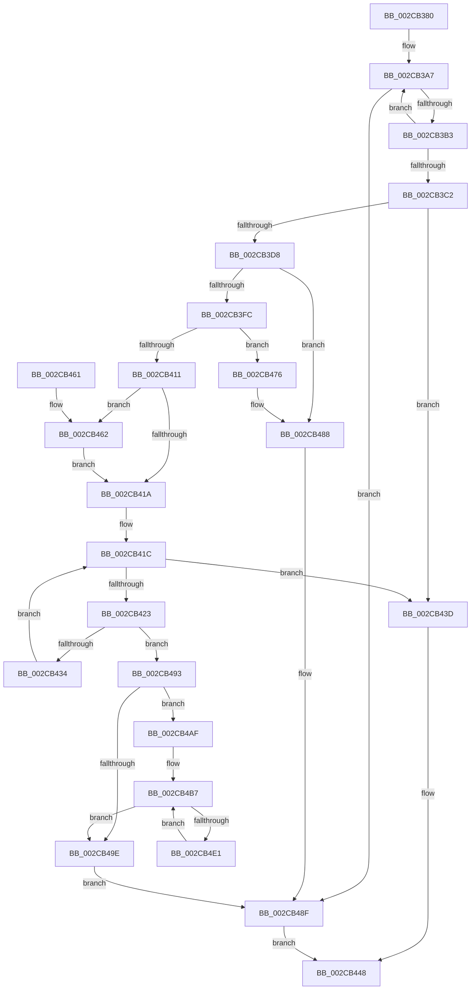

# MiCreateUltraThreadContextHelper

- RVA: `0x002CB380`–`0x002CB4E3` (길이 `355` bytes)
- VA: `0x00000001402CB380`
- 실행 섹션: `.text`
- PDB 이름 있음: `예`; PDB Function 태그: `아니요`
- unwind 정보 RVA: `0x0006F298`
- 디코드: `95`개 명령, `355/355` bytes 표시
- 미해석 바이트: `0` (있으면 어셈블리에 `.byte`로 보존)

> 이 문서는 커널 이미지의 기계어와 PDB 기호를 분석해 생성했습니다. 4번과 5번은 함수 원형과 자료형을 바이너리 사용 방식에서 추정한 C 해석이며 원본 소스 복구 결과는 아닙니다.

## 1. Dependencies

- 직접 호출 지점: **7**; 고유 호출 대상: **7**
- 직접 호출자로 확인된 함수: **1**
- RIP 상대 이미지 참조: **6**

### Outgoing calls
- `0x002CB3EF` → [MiChargeCommit](../28/MiChargeCommit_function_00286EB0.md) (function, `0x00286EB0`)
- `0x002CB408` → [MiChargeResident](../28/MiChargeResident_function_0028A0F0.md) (function, `0x0028A0F0`)
- `0x002CB429` → [MiGetUltraPage](../28/MiGetUltraPage_function_002883D0.md) (function, `0x002883D0`)
- `0x002CB46F` → [MiReplenishUltraPageTables](MiReplenishUltraPageTables_function_002CB4EC.md) (function, `0x002CB4EC`)
- `0x002CB483` → [MiReturnCommit](../24/MiReturnCommit_function_00248410.md) (function, `0x00248410`)
- `0x002CB4A8` → [MiReleaseNonPagedResources](../32/MiReleaseNonPagedResources_function_0032299C.md) (function, `0x0032299C`)
- `0x002CB4D3` → [MiReleaseFreshPage](../33/MiReleaseFreshPage_function_00334AE0.md) (function, `0x00334AE0`)

### Direct callers
- [sub_006F9120](../6F/Unknown_function_006F9120.md) at `0x006F9170`

### Static image references
- `0x002CB398` → RVA `0x00E3601C` (`.data`; read)
- `0x002CB3A7` → RVA `0x00E36018` (`.data`; read)
- `0x002CB3C6` → RVA `0x00010850` (`.rdata`; read)
- `0x002CB3DD` → RVA `0x00E38D00` (`.data`; read)
- `0x002CB411` → RVA `0x00E2DC41` (`.data`; read)
- `0x002CB488` → RVA `0x00E3601C` (`.data`; read/write)

## 2. Other-region calls and transfers

- 다른 실행 섹션으로 향하는 call: **0**
- 별도 외부 분기/꼬리 이동을 확인하지 못했습니다.

## 3. Assembly (complete function range)

```asm
002CB380  48 89 5C 24 08                  mov qword ptr [rsp + 8], rbx
002CB385  48 89 6C 24 10                  mov qword ptr [rsp + 0x10], rbp
002CB38A  48 89 74 24 18                  mov qword ptr [rsp + 0x18], rsi
002CB38F  57                              push rdi
002CB390  41 56                           push r14
002CB392  41 57                           push r15
002CB394  48 83 EC 20                     sub rsp, 0x20
002CB398  8B 05 7E AC B6 00               mov eax, dword ptr [rip + 0xb6ac7e]
002CB39E  45 8B F1                        mov r14d, r9d
002CB3A1  4D 8B F8                        mov r15, r8
002CB3A4  48 8B F1                        mov rsi, rcx
002CB3A7  3B 05 6B AC B6 00               cmp eax, dword ptr [rip + 0xb6ac6b]
002CB3AD  0F 84 DC 00 00 00               je 0x1402cb48f
002CB3B3  44 8D 50 01                     lea r10d, [rax + 1]
002CB3B7  F0 44 0F B1 15 5C AC B6 00      lock cmpxchg dword ptr [rip + 0xb6ac5c], r10d
002CB3C0  75 E5                           jne 0x1402cb3a7
002CB3C2  48 83 21 00                     and qword ptr [rcx], 0
002CB3C6  66 0F 6F 05 82 54 D4 FF         movdqa xmm0, xmmword ptr [rip - 0x2bab7e]
002CB3CE  8B FA                           mov edi, edx
002CB3D0  0F 11 41 08                     movups xmmword ptr [rcx + 8], xmm0
002CB3D4  85 D2                           test edx, edx
002CB3D6  74 65                           je 0x1402cb43d
002CB3D8  B8 02 00 00 00                  mov eax, 2
002CB3DD  48 8D 0D 1C D9 B6 00            lea rcx, [rip + 0xb6d91c]
002CB3E4  48 3B F8                        cmp rdi, rax
002CB3E7  0F 47 F8                        cmova edi, eax
002CB3EA  45 33 C0                        xor r8d, r8d
002CB3ED  8B D7                           mov edx, edi
002CB3EF  E8 BC BA FB FF                  call 0x140286eb0
002CB3F4  85 C0                           test eax, eax
002CB3F6  0F 84 8C 00 00 00               je 0x1402cb488
002CB3FC  45 33 C0                        xor r8d, r8d
002CB3FF  48 8D 0D FA D8 B6 00            lea rcx, [rip + 0xb6d8fa]
002CB406  8B D7                           mov edx, edi
002CB408  E8 E3 EC FB FF                  call 0x14028a0f0
002CB40D  85 C0                           test eax, eax
002CB40F  74 65                           je 0x1402cb476
002CB411  80 3D 29 28 B6 00 00            cmp byte ptr [rip + 0xb62829], 0
002CB418  75 48                           jne 0x1402cb462
002CB41A  33 DB                           xor ebx, ebx
002CB41C  8B EB                           mov ebp, ebx
002CB41E  48 3B EF                        cmp rbp, rdi
002CB421  73 1A                           jae 0x1402cb43d
002CB423  41 8B D6                        mov edx, r14d
002CB426  49 8B CF                        mov rcx, r15
002CB429  E8 A2 CF FB FF                  call 0x1402883d0
002CB42E  48 83 F8 FF                     cmp rax, -1
002CB432  74 5F                           je 0x1402cb493
002CB434  48 89 44 DE 08                  mov qword ptr [rsi + rbx*8 + 8], rax
002CB439  FF C3                           inc ebx
002CB43B  EB DF                           jmp 0x1402cb41c
002CB43D  66 C7 46 18 01 00               mov word ptr [rsi + 0x18], 1
002CB443  B8 01 00 00 00                  mov eax, 1
002CB448  48 8B 5C 24 40                  mov rbx, qword ptr [rsp + 0x40]
002CB44D  48 8B 6C 24 48                  mov rbp, qword ptr [rsp + 0x48]
002CB452  48 8B 74 24 50                  mov rsi, qword ptr [rsp + 0x50]
002CB457  48 83 C4 20                     add rsp, 0x20
002CB45B  41 5F                           pop r15
002CB45D  41 5E                           pop r14
002CB45F  5F                              pop rdi
002CB460  C3                              ret
002CB461  CC                              int3
002CB462  41 8B 4F 08                     mov ecx, dword ptr [r15 + 8]
002CB466  41 8B D6                        mov edx, r14d
002CB469  C1 E9 09                        shr ecx, 9
002CB46C  83 E1 3F                        and ecx, 0x3f
002CB46F  E8 78 00 00 00                  call 0x1402cb4ec
002CB474  EB A4                           jmp 0x1402cb41a
002CB476  45 33 C0                        xor r8d, r8d
002CB479  48 8D 0D 80 D8 B6 00            lea rcx, [rip + 0xb6d880]
002CB480  48 8B D7                        mov rdx, rdi
002CB483  E8 88 CF F7 FF                  call 0x140248410
002CB488  F0 FF 0D 8D AB B6 00            lock dec dword ptr [rip + 0xb6ab8d]
002CB48F  33 C0                           xor eax, eax
002CB491  EB B5                           jmp 0x1402cb448
002CB493  F0 FF 0D 82 AB B6 00            lock dec dword ptr [rip + 0xb6ab82]
002CB49A  85 DB                           test ebx, ebx
002CB49C  75 11                           jne 0x1402cb4af
002CB49E  48 8B D7                        mov rdx, rdi
002CB4A1  48 8D 0D 58 D8 B6 00            lea rcx, [rip + 0xb6d858]
002CB4A8  E8 EF 74 05 00                  call 0x14032299c
002CB4AD  EB E0                           jmp 0x1402cb48f
002CB4AF  48 8D 34 DE                     lea rsi, [rsi + rbx*8]
002CB4B3  48 83 C6 08                     add rsi, 8
002CB4B7  48 8D 76 F8                     lea rsi, [rsi - 8]
002CB4BB  48 8B 06                        mov rax, qword ptr [rsi]
002CB4BE  48 8D 0C 40                     lea rcx, [rax + rax*2]
002CB4C2  48 C1 E1 04                     shl rcx, 4
002CB4C6  48 B8 00 00 00 00 00 DE FF FF   movabs rax, 0xffffde0000000000
002CB4D0  48 03 C8                        add rcx, rax
002CB4D3  E8 08 96 06 00                  call 0x140334ae0
002CB4D8  48 83 0E FF                     or qword ptr [rsi], 0xffffffffffffffff
002CB4DC  83 C3 FF                        add ebx, -1
002CB4DF  74 BD                           je 0x1402cb49e
002CB4E1  EB D4                           jmp 0x1402cb4b7
```

## 4. C-style interpretation (structured pseudocode)

```c
__int64 __fastcall MiCreateUltraThreadContextHelper(__int64 a1, int a2, __int64 a3, int a4)
{
    __int64 result;
    __int64 v_rbx;
    __int64 v_rdi;
    __int64 v_rsi;
    __int64 v_rsp;
    unsigned __int64 v_stack_p10;
    unsigned __int64 v_stack_p18;
    unsigned __int64 v_stack_p8;

    v_stack_p8 = v_rbx;
    v_stack_p10 = v_rbp;
    v_stack_p18 = v_rsi;
    v_rsp = (v_rsp) - (32);
loc_002CB3A7:
    if (((unsigned int)((unsigned int)(*(unsigned int *)(v_rip + 11971710)))) == (*(unsigned int *)(v_rip + 11971691))) goto loc_002CB48F;
    if (((unsigned int)((unsigned int)(*(unsigned int *)(v_rip + 11971710)))) != (*(unsigned int *)(v_rip + 11971691))) goto loc_002CB3A7;
    *(unsigned __int64 *)(a1 + 8) = v_xmm0;
    if (a2 == 0) goto loc_002CB43D;
    v_rdi = (unsigned int)(a2);
    if (((unsigned int)(a2)) > 2) { v_rdi = 2; }
    a3 = 0;
    result = MiChargeCommit(v_rip + 11983132, (unsigned int)((unsigned int)(v_rdi)), a3, a4);
    if ((unsigned int)(result) == 0) goto loc_002CB488;
    a3 = 0;
    result = MiChargeResident(v_rip + 11983098, (unsigned int)((unsigned int)(v_rdi)), a3, a4);
    if ((unsigned int)(result) == 0) goto loc_002CB476;
    if ((*(unsigned __int8 *)(v_rip + 11937833)) != 0) goto loc_002CB462;
loc_002CB41A:
    v_rbx = 0;
loc_002CB41C:
    if (0 >= v_rdi) goto loc_002CB43D;
    result = MiGetUltraPage(0, (unsigned int)((unsigned int)((unsigned int)(a4))), a3, a4);
    if (result == -1) goto loc_002CB493;
    *(unsigned __int64 *)(a1 + v_rbx * 8 + 8) = result;
    v_rbx = (unsigned int)((v_rbx) + 1);
    goto loc_002CB41C;
loc_002CB43D:
    *(unsigned __int16 *)(a1 + 24) = 1;
loc_002CB448:
    v_rsp = (v_rsp) + (32);
    return 1;
loc_002CB462:
    a1 = (unsigned int)(((unsigned int)(*(unsigned int *)(a3 + 8))) >> (9));
    a1 = (unsigned int)((a1) & (63));
    result = MiReplenishUltraPageTables(a1, (unsigned int)((unsigned int)((unsigned int)(a4))), a3, a4);
    goto loc_002CB41A;
loc_002CB476:
    a3 = 0;
    result = MiReturnCommit(v_rip + 11982976, v_rdi, a3, a4);
loc_002CB488:
loc_002CB48F:
    result = 0;
    goto loc_002CB448;
loc_002CB493:
    if ((unsigned int)(v_stack_p8) != 0) goto loc_002CB4AF;
loc_002CB49E:
    result = MiReleaseNonPagedResources(v_rip + 11982936, v_rdi, a3, a4);
    goto loc_002CB48F;
loc_002CB4AF:
    v_rsi = (v_stack_p18 + v_stack_p8 * 8) + (8);
loc_002CB4B7:
    a1 = (*(unsigned __int64 *)(v_rsi - 8) + *(unsigned __int64 *)(v_rsi - 8) * 2) << (4);
    a1 = (a1) + (*(unsigned __int64 *)(v_rsi - 8));
    result = MiReleaseFreshPage(a1, v_rdi, a3, a4);
    v_rbx = (unsigned int)((v_stack_p8) + (-1));
    if (condition_is_equal) goto loc_002CB49E;
    goto loc_002CB4B7;
}
```

## 5. (Beta) C Style

```c
int64_t MiCreateUltraThreadContextHelper(void *Arg1, int32_t Arg2, void *Arg3, int32_t Arg4)
{
    uint8_t *arg1 = (uint8_t *)Arg1;
    uint8_t *arg3 = (uint8_t *)Arg3;

    int64_t result;
    int64_t local_rbx;
    int64_t local_rdi;
    int64_t local_rsi;
    int64_t local_rsp;
    uint64_t v_stack_p10;
    uint64_t v_stack_p18;
    uint64_t v_stack_p8;

    v_stack_p8 = local_rbx;
    v_stack_p10 = local_rbp;
    v_stack_p18 = local_rsi;
    local_rsp = (local_rsp) - (32);
loc_002CB3A7:
    if (((uint32_t)((uint32_t)(*(uint32_t *)(v_rip + 0xB6AC7E)))) == (*(uint32_t *)(v_rip + 0xB6AC6B))) goto loc_002CB48F;
    if (((uint32_t)((uint32_t)(*(uint32_t *)(v_rip + 0xB6AC7E)))) != (*(uint32_t *)(v_rip + 0xB6AC6B))) goto loc_002CB3A7;
    *(uint64_t *)(arg1 + 0x8) = v_xmm0;
    if (Arg2 == 0) goto loc_002CB43D;
    local_rdi = (uint32_t)(Arg2);
    if (((uint32_t)(Arg2)) > 2) { local_rdi = 2; }
    Arg3 = 0;
    result = MiChargeCommit(v_rip + 11983132, (uint32_t)((uint32_t)(local_rdi)), Arg3, Arg4);
    if ((uint32_t)(result) == 0) goto loc_002CB488;
    Arg3 = 0;
    result = MiChargeResident(v_rip + 11983098, (uint32_t)((uint32_t)(local_rdi)), Arg3, Arg4);
    if ((uint32_t)(result) == 0) goto loc_002CB476;
    if ((*(uint8_t *)(v_rip + 0xB62829)) != 0) goto loc_002CB462;
loc_002CB41A:
    local_rbx = 0;
loc_002CB41C:
    if (0 >= local_rdi) goto loc_002CB43D;
    result = MiGetUltraPage(0, (uint32_t)((uint32_t)((uint32_t)(Arg4))), Arg3, Arg4);
    if (result == -1) goto loc_002CB493;
    *(uint64_t *)(arg1 + local_rbx * 8 + 0x8) = result;
    local_rbx = (uint32_t)((local_rbx) + 1);
    goto loc_002CB41C;
loc_002CB43D:
    *(uint16_t *)(arg1 + 0x18) = 1;
loc_002CB448:
    local_rsp = (local_rsp) + (32);
    return 1;
loc_002CB462:
    Arg1 = (uint32_t)(((uint32_t)(*(uint32_t *)(arg3 + 0x8))) >> (9));
    Arg1 = (uint32_t)((Arg1) & (63));
    result = MiReplenishUltraPageTables(Arg1, (uint32_t)((uint32_t)((uint32_t)(Arg4))), Arg3, Arg4);
    goto loc_002CB41A;
loc_002CB476:
    Arg3 = 0;
    result = MiReturnCommit(v_rip + 11982976, local_rdi, Arg3, Arg4);
loc_002CB488:
loc_002CB48F:
    result = 0;
    goto loc_002CB448;
loc_002CB493:
    if ((uint32_t)(v_stack_p8) != 0) goto loc_002CB4AF;
loc_002CB49E:
    result = MiReleaseNonPagedResources(v_rip + 11982936, local_rdi, Arg3, Arg4);
    goto loc_002CB48F;
loc_002CB4AF:
    local_rsi = (v_stack_p18 + v_stack_p8 * 8) + (8);
loc_002CB4B7:
    Arg1 = (*(uint64_t *)(local_rsi - 0x8) + *(uint64_t *)(local_rsi - 0x8) * 2) << (4);
    Arg1 = (Arg1) + (*(uint64_t *)(local_rsi - 0x8));
    result = MiReleaseFreshPage(Arg1, local_rdi, Arg3, Arg4);
    local_rbx = (uint32_t)((v_stack_p8) + (-1));
    if (condition_is_equal) goto loc_002CB49E;
    goto loc_002CB4B7;
}
```

### 관측된 메모리 오프셋

구조체 형식이 확인되지 않은 접근은 인자 기준의 오프셋으로만 기록했습니다.

| 기준 인자 | 오프셋 표현 | 폭 (bit) | 접근 |
|---|---:|---:|---|
| `Arg1` | `- 0x8` | `64` | `R` |
| `Arg1` | `+ 0x0` | `64` | `R` |
| `Arg1` | `+ 0x0` | `64` | `R/W` |
| `Arg1` | `+ 0x0 + rbx*8` | `64` | `R` |
| `Arg1` | `+ 0x8` | `128` | `R` |
| `Arg1` | `+ 0x8 + rbx*8` | `64` | `W` |
| `Arg1` | `+ 0x18` | `16` | `W` |
| `Arg3` | `+ 0x8` | `32` | `R` |

## 6. Execution-region graph

[열기: 2D/3D 그래프와 함수 탐색 컨트롤 패널](../../../control-panel.html?section=text&rva=0x002CB380&view=graph)

- 2D 그래프는 위에서 아래로 흐르고, 3D 그래프는 빈 공간을 드래그해 회전합니다. Shift+드래그는 이동, 휠은 확대·축소, 함수 노드 선택은 대상 보고서 이동입니다.

### Static fallback


