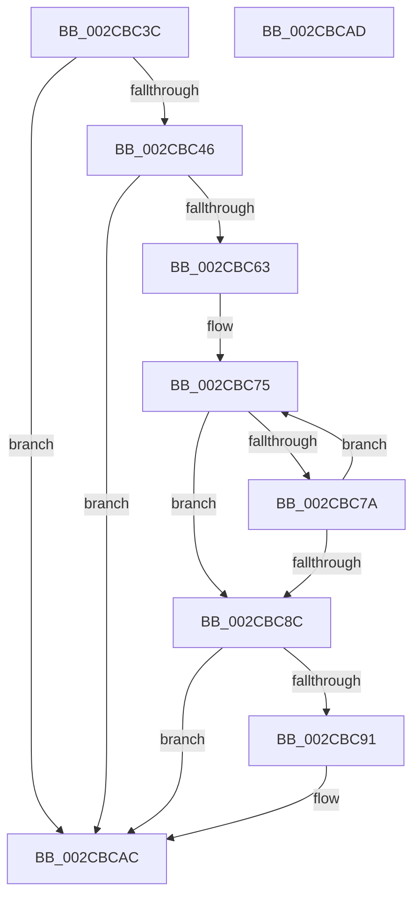

# MiDecrementZeroEngineThread

- RVA: `0x002CBC3C`–`0x002CBCAE` (길이 `114` bytes)
- VA: `0x00000001402CBC3C`
- 실행 섹션: `.text`
- PDB 이름 있음: `예`; PDB Function 태그: `아니요`
- unwind 정보 RVA: `0x000DB714`
- 디코드: `29`개 명령, `114/114` bytes 표시
- 미해석 바이트: `0` (있으면 어셈블리에 `.byte`로 보존)

> 이 문서는 커널 이미지의 기계어와 PDB 기호를 분석해 생성했습니다. 4번과 5번은 함수 원형과 자료형을 바이너리 사용 방식에서 추정한 C 해석이며 원본 소스 복구 결과는 아닙니다.

## 1. Dependencies

- 직접 호출 지점: **0**; 고유 호출 대상: **0**
- 직접 호출자로 확인된 함수: **5**
- RIP 상대 이미지 참조: **0**

### Outgoing calls
- 직접 디코드된 call 명령이 없습니다.

### Direct callers
- [MiRemoveThreadFromEngineLists](MiRemoveThreadFromEngineLists_function_002CAB1C.md) at `0x002CAB51`
- [MiReduceZeroingThreads](MiReduceZeroingThreads_function_002CACF8.md) at `0x002CAEFF`
- [MiBackgroundZeroNodePages](MiBackgroundZeroNodePages_function_002CB9B0.md) at `0x002CBA8B`
- [sub_002CC724](Unknown_function_002CC724.md) at `0x002CC724`
- [MiBackgroundZeroLocalPages](../31/MiBackgroundZeroLocalPages_function_0031EF30.md) at `0x0031F76D`

### Static image references
- 디코드된 RIP-relative 메모리 참조가 없습니다.

## 2. Other-region calls and transfers

- 다른 실행 섹션으로 향하는 call: **0**
- 별도 외부 분기/꼬리 이동을 확인하지 못했습니다.

## 3. Assembly (complete function range)

```asm
002CBC3C  8B 81 80 01 00 00               mov eax, dword ptr [rcx + 0x180]
002CBC42  A8 02                           test al, 2
002CBC44  75 66                           jne 0x1402cbcac
002CBC46  8B 81 80 01 00 00               mov eax, dword ptr [rcx + 0x180]
002CBC4C  83 C8 02                        or eax, 2
002CBC4F  89 81 80 01 00 00               mov dword ptr [rcx + 0x180], eax
002CBC55  4C 8B 81 50 01 00 00            mov r8, qword ptr [rcx + 0x150]
002CBC5C  41 83 40 0C FF                  add dword ptr [r8 + 0xc], -1
002CBC61  75 49                           jne 0x1402cbcac
002CBC63  4D 8B 80 B0 00 00 00            mov r8, qword ptr [r8 + 0xb0]
002CBC6A  33 C0                           xor eax, eax
002CBC6C  33 D2                           xor edx, edx
002CBC6E  49 8D 88 94 00 00 00            lea rcx, [r8 + 0x94]
002CBC75  83 39 00                        cmp dword ptr [rcx], 0
002CBC78  75 12                           jne 0x1402cbc8c
002CBC7A  FF C0                           inc eax
002CBC7C  48 FF C2                        inc rdx
002CBC7F  48 81 C1 30 01 00 00            add rcx, 0x130
002CBC86  48 83 FA 03                     cmp rdx, 3
002CBC8A  7C E9                           jl 0x1402cbc75
002CBC8C  83 F8 03                        cmp eax, 3
002CBC8F  75 1B                           jne 0x1402cbcac
002CBC91  41 8B 40 38                     mov eax, dword ptr [r8 + 0x38]
002CBC95  48 69 D0 80 DF 00 00            imul rdx, rax, 0xdf80
002CBC9C  49 8B 40 30                     mov rax, qword ptr [r8 + 0x30]
002CBCA0  48 8B 48 10                     mov rcx, qword ptr [rax + 0x10]
002CBCA4  C6 84 0A C0 3B 00 00 00         mov byte ptr [rdx + rcx + 0x3bc0], 0
002CBCAC  C3                              ret
002CBCAD  CC                              int3
```

## 4. C-style interpretation (structured pseudocode)

```c
__int64 __fastcall MiDecrementZeroEngineThread(__int64 a1, int a2)
{
    __int64 result;

    if ((((unsigned __int8)((unsigned int)(*(unsigned int *)(a1 + 384)))) & (2)) != 0) goto loc_002CBCAC;
    result = (unsigned int)(((unsigned int)(*(unsigned int *)(a1 + 384))) | (2));
    *(unsigned int *)(a1 + 384) = (unsigned int)(result);
    if (condition_is_not_equal) goto loc_002CBCAC;
    result = 0;
    a2 = 0;
loc_002CBC75:
    if ((*(unsigned int *)(*(unsigned __int64 *)(*(unsigned __int64 *)(a1 + 336) + 176) + 148)) != 0) goto loc_002CBC8C;
    result = (unsigned int)((result) + 1);
    a2 = (a2) + 1;
    a1 = (*(unsigned __int64 *)(*(unsigned __int64 *)(a1 + 336) + 176) + 148) + (304);
    if (a2 < 3) goto loc_002CBC75;
loc_002CBC8C:
    if (((unsigned int)(result)) == 3) {
        result = *(unsigned int *)(*(unsigned __int64 *)(*(unsigned __int64 *)(a1 + 336) + 176) + 56);
        a2 = (a2) * (result);
        result = *(unsigned __int64 *)(*(unsigned __int64 *)(*(unsigned __int64 *)(a1 + 336) + 176) + 48);
        a1 = *(unsigned __int64 *)(result + 16);
        *(unsigned __int8 *)(a2 + a1 * 1 + 15296) = 0;
    }
    return result;
}
```

## 5. (Beta) C Style

```c
int64_t MiDecrementZeroEngineThread(void *Arg1, int32_t Arg2)
{
    uint8_t *arg1 = (uint8_t *)Arg1;

    int64_t result;

    if ((((uint8_t)((uint32_t)(*(uint32_t *)(arg1 + 0x180)))) & (2)) != 0) goto loc_002CBCAC;
    result = (uint32_t)(((uint32_t)(*(uint32_t *)(arg1 + 0x180))) | (2));
    *(uint32_t *)(arg1 + 0x180) = (uint32_t)(result);
    if (condition_is_not_equal) goto loc_002CBCAC;
    result = 0;
    Arg2 = 0;
loc_002CBC75:
    if ((*(uint32_t *)(*(uint64_t *)(*(uint64_t *)(arg1 + 0x150) + 0xB0) + 0x94)) != 0) goto loc_002CBC8C;
    result = (uint32_t)((result) + 1);
    Arg2 = (Arg2) + 1;
    Arg1 = (*(uint64_t *)(*(uint64_t *)(arg1 + 0x150) + 0xB0) + 148) + (304);
    if (Arg2 < 3) goto loc_002CBC75;
loc_002CBC8C:
    if (((uint32_t)(result)) == 3) {
        result = *(uint32_t *)(*(uint64_t *)(*(uint64_t *)(arg1 + 0x150) + 0xB0) + 0x38);
        Arg2 = (Arg2) * (result);
        result = *(uint64_t *)(*(uint64_t *)(*(uint64_t *)(arg1 + 0x150) + 0xB0) + 0x30);
        Arg1 = *(uint64_t *)(result + 0x10);
        *(uint8_t *)(Arg2 + arg1 * 1 + 0x3BC0) = 0;
    }
    return result;
}
```

### 관측된 메모리 오프셋

구조체 형식이 확인되지 않은 접근은 인자 기준의 오프셋으로만 기록했습니다.

| 기준 인자 | 오프셋 표현 | 폭 (bit) | 접근 |
|---|---:|---:|---|
| `Arg1` | `+ 0x150` | `64` | `R` |
| `Arg1` | `+ 0x180` | `32` | `R` |
| `Arg1` | `+ 0x180` | `32` | `W` |

## 6. Execution-region graph

[열기: 2D/3D 그래프와 함수 탐색 컨트롤 패널](../../../control-panel.html?section=text&rva=0x002CBC3C&view=graph)

- 2D 그래프는 위에서 아래로 흐르고, 3D 그래프는 빈 공간을 드래그해 회전합니다. Shift+드래그는 이동, 휠은 확대·축소, 함수 노드 선택은 대상 보고서 이동입니다.

### Static fallback


