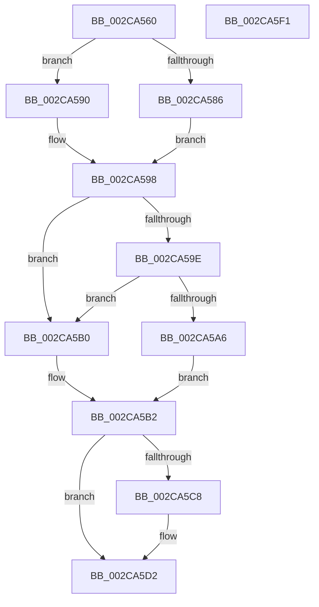

# MiDeleteAcceleratorDescriptor

- RVA: `0x002CA560`–`0x002CA5F2` (길이 `146` bytes)
- VA: `0x00000001402CA560`
- 실행 섹션: `.text`
- PDB 이름 있음: `예`; PDB Function 태그: `아니요`
- unwind 정보 RVA: `0x00060BC4`
- 디코드: `40`개 명령, `146/146` bytes 표시
- 미해석 바이트: `0` (있으면 어셈블리에 `.byte`로 보존)

> 이 문서는 커널 이미지의 기계어와 PDB 기호를 분석해 생성했습니다. 4번과 5번은 함수 원형과 자료형을 바이너리 사용 방식에서 추정한 C 해석이며 원본 소스 복구 결과는 아닙니다.

## 1. Dependencies

- 직접 호출 지점: **4**; 고유 호출 대상: **4**
- 직접 호출자로 확인된 함수: **9**
- RIP 상대 이미지 참조: **3**

### Outgoing calls
- `0x002CA589` → [ExAcquireSpinLockExclusiveAtDpcLevel](../24/ExAcquireSpinLockExclusiveAtDpcLevel_function_00248E80.md) (function, `0x00248E80`)
- `0x002CA590` → [ExAcquireSpinLockExclusive](../24/ExAcquireSpinLockExclusive_function_00248690.md) (function, `0x00248690`)
- `0x002CA5A9` → [MiUnlinkAccelerator](../69/MiUnlinkAccelerator_function_00697860.md) (function, `0x00697860`)
- `0x002CA5DC` → [MiReleaseSpinLockExclusive](../24/MiReleaseSpinLockExclusive_function_002482C0.md) (function, `0x002482C0`)

### Direct callers
- [MiZeroLargePage](MiZeroLargePage_function_002C6914.md) at `0x002C6B19`
- [MiRevertProcessorMove](MiRevertProcessorMove_function_002C7420.md) at `0x002C7470`
- [MiWaitForZeroWorkers](MiWaitForZeroWorkers_function_002C9FC4.md) at `0x002C9FF8`
- [MiFreeHardwareDescriptor](../4B/MiFreeHardwareDescriptor_function_004B6078.md) at `0x004B612F`
- [MiSoloZeroHugeRange](../68/MiSoloZeroHugeRange_function_0068C6E4.md) at `0x0068C858`
- [MiDrainEngineDescriptors](../69/MiDrainEngineDescriptors_function_00695F20.md) at `0x00695FA4`
- [MiZeroNodeExiting](../69/MiZeroNodeExiting_function_00696A04.md) at `0x00696B6E`
- [MiAllocateAcceleratorDescriptor](../69/MiAllocateAcceleratorDescriptor_function_00697124.md) at `0x006972C8`
- [MiZeroPageCalibrate](../69/MiZeroPageCalibrate_function_0069A69C.md) at `0x0069AA2D`

### Static image references
- `0x002CA57B` → RVA `0x00E37568` (`.data`; read)
- `0x002CA5B2` → RVA `0x00E37558` (`.data`; read)
- `0x002CA5BC` → RVA `0x00E37558` (`.data`; write)

## 2. Other-region calls and transfers

- 다른 실행 섹션으로 향하는 call: **0**
- 별도 외부 분기/꼬리 이동을 확인하지 못했습니다.

## 3. Assembly (complete function range)

```asm
002CA560  48 89 5C 24 08                  mov qword ptr [rsp + 8], rbx
002CA565  48 89 74 24 10                  mov qword ptr [rsp + 0x10], rsi
002CA56A  57                              push rdi
002CA56B  48 83 EC 20                     sub rsp, 0x20
002CA56F  48 8D 79 E0                     lea rdi, [rcx - 0x20]
002CA573  48 8B 5F 18                     mov rbx, qword ptr [rdi + 0x18]
002CA577  44 0F 20 C0                     mov rax, cr8
002CA57B  48 8D 0D E6 CF B6 00            lea rcx, [rip + 0xb6cfe6]
002CA582  3C 02                           cmp al, 2
002CA584  75 0A                           jne 0x1402ca590
002CA586  40 B6 11                        mov sil, 0x11
002CA589  E8 F2 E8 F7 FF                  call 0x140248e80
002CA58E  EB 08                           jmp 0x1402ca598
002CA590  E8 FB E0 F7 FF                  call 0x140248690
002CA595  40 8A F0                        mov sil, al
002CA598  83 43 30 FF                     add dword ptr [rbx + 0x30], -1
002CA59C  75 12                           jne 0x1402ca5b0
002CA59E  8B 4B 34                        mov ecx, dword ptr [rbx + 0x34]
002CA5A1  F6 C1 01                        test cl, 1
002CA5A4  74 0A                           je 0x1402ca5b0
002CA5A6  48 8B CB                        mov rcx, rbx
002CA5A9  E8 B2 D2 3C 00                  call 0x140697860
002CA5AE  EB 02                           jmp 0x1402ca5b2
002CA5B0  33 DB                           xor ebx, ebx
002CA5B2  48 8B 05 9F CF B6 00            mov rax, qword ptr [rip + 0xb6cf9f]
002CA5B9  48 89 07                        mov qword ptr [rdi], rax
002CA5BC  48 89 3D 95 CF B6 00            mov qword ptr [rip + 0xb6cf95], rdi
002CA5C3  48 85 DB                        test rbx, rbx
002CA5C6  74 0A                           je 0x1402ca5d2
002CA5C8  48 89 3B                        mov qword ptr [rbx], rdi
002CA5CB  48 89 1D 86 CF B6 00            mov qword ptr [rip + 0xb6cf86], rbx
002CA5D2  40 8A D6                        mov dl, sil
002CA5D5  48 8D 0D 8C CF B6 00            lea rcx, [rip + 0xb6cf8c]
002CA5DC  E8 DF DC F7 FF                  call 0x1402482c0
002CA5E1  48 8B 5C 24 30                  mov rbx, qword ptr [rsp + 0x30]
002CA5E6  48 8B 74 24 38                  mov rsi, qword ptr [rsp + 0x38]
002CA5EB  48 83 C4 20                     add rsp, 0x20
002CA5EF  5F                              pop rdi
002CA5F0  C3                              ret
002CA5F1  CC                              int3
```

## 4. C-style interpretation (structured pseudocode)

```c
__int64 __fastcall MiDeleteAcceleratorDescriptor(__int64 a1)
{
    __int64 result;
    __int64 v_rbx;
    __int64 v_rsp;
    unsigned __int64 v_stack_p10;
    unsigned __int64 v_stack_p8;

    v_stack_p8 = v_rbx;
    v_stack_p10 = v_rsi;
    v_rsp = (v_rsp) - (32);
    if (((unsigned __int8)(v_cr8)) != 2) goto loc_002CA590;
    result = ExAcquireSpinLockExclusiveAtDpcLevel(v_rip + 11980774, a2, a3, a4);
    goto loc_002CA598;
loc_002CA590:
    result = ExAcquireSpinLockExclusive(v_rip + 11980774, a2, a3, a4);
loc_002CA598:
    if (((unsigned __int8)(v_cr8)) != 2) goto loc_002CA5B0;
    if ((((unsigned __int8)((unsigned int)(*(unsigned int *)(*(unsigned __int64 *)(a1 - 32 + 24) + 52)))) & (1)) == 0) goto loc_002CA5B0;
    result = MiUnlinkAccelerator(*(unsigned __int64 *)(a1 - 32 + 24), a2, a3, a4);
    goto loc_002CA5B2;
loc_002CA5B0:
    v_rbx = 0;
loc_002CA5B2:
    *(unsigned __int64 *)(a1 - 32) = *(unsigned __int64 *)(v_rip + 11980703);
    *(unsigned __int64 *)(v_rip + 11980693) = a1 - 32;
    if (0 != 0) {
        *(unsigned __int64 *)(v_rbx) = a1 - 32;
        *(unsigned __int64 *)(v_rip + 11980678) = 0;
    }
    result = MiReleaseSpinLockExclusive(v_rip + 11980684, (unsigned __int8)((unsigned __int8)(result)), a3, a4);
    v_rsp = (v_rsp) + (32);
    return result;
}
```

## 5. (Beta) C Style

```c
int64_t MiDeleteAcceleratorDescriptor(void *Arg1)
{
    uint8_t *arg1 = (uint8_t *)Arg1;

    int64_t result;
    int64_t local_rbx;
    int64_t local_rsp;
    uint64_t v_stack_p10;
    uint64_t v_stack_p8;

    v_stack_p8 = local_rbx;
    v_stack_p10 = local_rsi;
    local_rsp = (local_rsp) - (32);
    if (((uint8_t)(v_cr8)) != 2) goto loc_002CA590;
    result = ExAcquireSpinLockExclusiveAtDpcLevel(v_rip + 11980774, a2, a3, a4);
    goto loc_002CA598;
loc_002CA590:
    result = ExAcquireSpinLockExclusive(v_rip + 11980774, a2, a3, a4);
loc_002CA598:
    if (((uint8_t)(v_cr8)) != 2) goto loc_002CA5B0;
    if ((((uint8_t)((uint32_t)(*(uint32_t *)(*(uint64_t *)(arg1 - 0x20 + 0x18) + 0x34)))) & (1)) == 0) goto loc_002CA5B0;
    result = MiUnlinkAccelerator(*(uint64_t *)(arg1 - 0x20 + 0x18), a2, a3, a4);
    goto loc_002CA5B2;
loc_002CA5B0:
    local_rbx = 0;
loc_002CA5B2:
    *(uint64_t *)(arg1 - 0x20) = *(uint64_t *)(v_rip + 0xB6CF9F);
    *(void **)(v_rip + 0xB6CF95) = Arg1 - 32;
    if (0 != 0) {
        *(void **)(local_rbx) = Arg1 - 32;
        *(uint64_t *)(v_rip + 0xB6CF86) = 0;
    }
    result = MiReleaseSpinLockExclusive(v_rip + 11980684, (uint8_t)((uint8_t)(result)), a3, a4);
    local_rsp = (local_rsp) + (32);
    return result;
}
```

### 관측된 메모리 오프셋

구조체 형식이 확인되지 않은 접근은 인자 기준의 오프셋으로만 기록했습니다.

| 기준 인자 | 오프셋 표현 | 폭 (bit) | 접근 |
|---|---:|---:|---|
| `Arg1` | `- 0x20` | `64` | `R` |
| `Arg1` | `+ 0x0` | `64` | `W` |
| `Arg1` | `+ 0x18` | `64` | `R` |

## 6. Execution-region graph

[열기: 2D/3D 그래프와 함수 탐색 컨트롤 패널](../../../control-panel.html?section=text&rva=0x002CA560&view=graph)

- 2D 그래프는 위에서 아래로 흐르고, 3D 그래프는 빈 공간을 드래그해 회전합니다. Shift+드래그는 이동, 휠은 확대·축소, 함수 노드 선택은 대상 보고서 이동입니다.

### Static fallback


