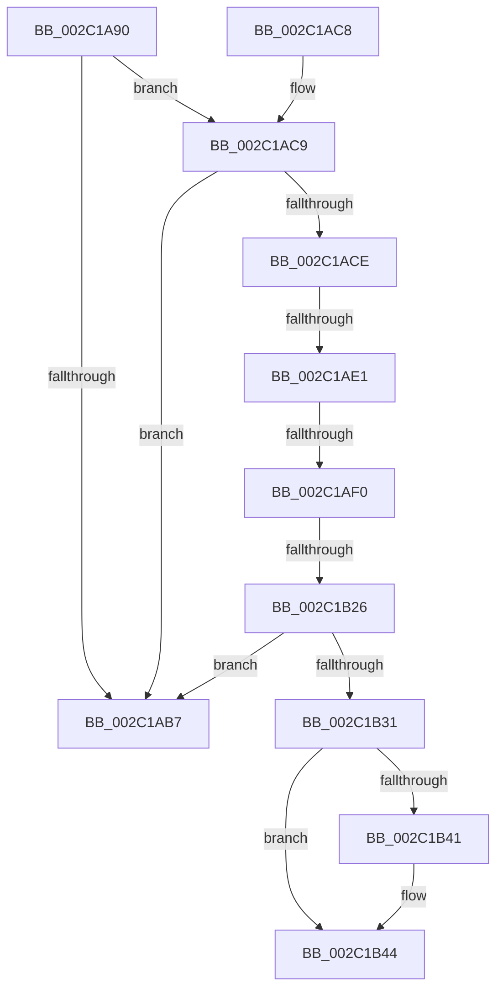

# MiDeleteNonPagedPoolPte

- RVA: `0x002C1A90`–`0x002C1B47` (길이 `183` bytes)
- VA: `0x00000001402C1A90`
- 실행 섹션: `.text`
- PDB 이름 있음: `예`; PDB Function 태그: `예`
- unwind 정보 RVA: `0x0006E768`
- 디코드: `56`개 명령, `183/183` bytes 표시
- 미해석 바이트: `0` (있으면 어셈블리에 `.byte`로 보존)

> 이 문서는 커널 이미지의 기계어와 PDB 기호를 분석해 생성했습니다. 4번과 5번은 함수 원형과 자료형을 바이너리 사용 방식에서 추정한 C 해석이며 원본 소스 복구 결과는 아닙니다.

## 1. Dependencies

- 직접 호출 지점: **0**; 고유 호출 대상: **0**
- 직접 호출자로 확인된 함수: **1**
- RIP 상대 이미지 참조: **2**

### Outgoing calls
- 직접 디코드된 call 명령이 없습니다.

### Direct callers
- [MiClearNonPagedPtes](MiClearNonPagedPtes_function_002C17A0.md) at `0x002C19AD`

### Static image references
- `0x002C1B16` → RVA `0x00E38480` (`.data`; read)
- `0x002C1B31` → RVA `0x00010880` (`.rdata`; read)

## 2. Other-region calls and transfers

- 다른 실행 섹션으로 향하는 call: **0**
- call이 아닌 외부 분기/꼬리 이동: **3**
  - `0x002C1ADB` → [sub_002C1DF6 + 0x2A](Unknown_function_002C1DF6.md) (`tail-transfer`)
  - `0x002C1AEA` → [sub_002C1E57](Unknown_function_002C1E57.md) (`tail-transfer`)
  - `0x002C1B20` → [sub_002C1DF6](Unknown_function_002C1DF6.md) (`tail-transfer`)

## 3. Assembly (complete function range)

```asm
002C1A90  40 53                           push rbx
002C1A92  55                              push rbp
002C1A93  56                              push rsi
002C1A94  57                              push rdi
002C1A95  41 55                           push r13
002C1A97  41 56                           push r14
002C1A99  41 57                           push r15
002C1A9B  48 83 EC 40                     sub rsp, 0x40
002C1A9F  48 8B 02                        mov rax, qword ptr [rdx]
002C1AA2  41 8B E8                        mov ebp, r8d
002C1AA5  48 89 84 24 98 00 00 00         mov qword ptr [rsp + 0x98], rax
002C1AAD  4C 8B F2                        mov r14, rdx
002C1AB0  4C 8B D1                        mov r10, rcx
002C1AB3  A8 01                           test al, 1
002C1AB5  75 12                           jne 0x1402c1ac9
002C1AB7  33 C0                           xor eax, eax
002C1AB9  48 83 C4 40                     add rsp, 0x40
002C1ABD  41 5F                           pop r15
002C1ABF  41 5E                           pop r14
002C1AC1  41 5D                           pop r13
002C1AC3  5F                              pop rdi
002C1AC4  5E                              pop rsi
002C1AC5  5D                              pop rbp
002C1AC6  5B                              pop rbx
002C1AC7  C3                              ret
002C1AC8  CC                              int3
002C1AC9  83 FD 01                        cmp ebp, 1
002C1ACC  7F E9                           jg 0x1402c1ab7
002C1ACE  41 BF 01 00 00 00               mov r15d, 1
002C1AD4  8B CD                           mov ecx, ebp
002C1AD6  41 8B DF                        mov ebx, r15d
002C1AD9  85 ED                           test ebp, ebp
002C1ADB  0F 85 3F 03 00 00               jne 0x1402c1e20
002C1AE1  49 8B BA B8 00 00 00            mov rdi, qword ptr [r10 + 0xb8]
002C1AE8  84 C0                           test al, al
002C1AEA  0F 88 67 03 00 00               js 0x1402c1e57
002C1AF0  48 C1 E8 0C                     shr rax, 0xc
002C1AF4  48 B9 FF FF FF FF FF 00 00 00   movabs rcx, 0xffffffffff
002C1AFE  48 23 C1                        and rax, rcx
002C1B01  48 8D 34 40                     lea rsi, [rax + rax*2]
002C1B05  48 C1 E6 04                     shl rsi, 4
002C1B09  48 B8 00 00 00 00 00 DE FF FF   movabs rax, 0xffffde0000000000
002C1B13  48 03 F0                        add rsi, rax
002C1B16  4C 8D 2D 63 69 B7 00            lea r13, [rip + 0xb76963]
002C1B1D  41 3B EF                        cmp ebp, r15d
002C1B20  0F 84 D0 02 00 00               je 0x1402c1df6
002C1B26  8B 47 3C                        mov eax, dword ptr [rdi + 0x3c]
002C1B29  4C 8D 7F 3C                     lea r15, [rdi + 0x3c]
002C1B2D  A8 01                           test al, 1
002C1B2F  74 86                           je 0x1402c1ab7
002C1B31  48 8B 05 48 ED D4 FF            mov rax, qword ptr [rip - 0x2b12b8]
002C1B38  48 89 02                        mov qword ptr [rdx], rax
002C1B3B  F6 46 23 10                     test byte ptr [rsi + 0x23], 0x10
002C1B3F  75 03                           jne 0x1402c1b44
002C1B41  FF 47 44                        inc dword ptr [rdi + 0x44]
002C1B44  8B 57 40                        mov edx, dword ptr [rdi + 0x40]
```

## 4. C-style interpretation (structured pseudocode)

```c
__int64 __fastcall MiDeleteNonPagedPoolPte(__int64 a1, __int64 a2, int a3)
{
    __int64 result;
    __int64 v_rsi;
    __int64 v_rsp;
    unsigned __int64 v_stack_p20;

    v_rsp = (v_rsp) - (64);
    v_stack_p20 = *(unsigned __int64 *)(a2);
    if ((((unsigned __int8)(*(unsigned __int64 *)(a2))) & (1)) != 0) goto loc_002C1AC9;
loc_002C1AB7:
    result = 0;
    v_rsp = (v_rsp) + (64);
    return result;
loc_002C1AC9:
    if (((unsigned int)((unsigned int)(a3))) > 1) goto loc_002C1AB7;
    result = (result) >> (12);
    result = (result) & ((unsigned int)((unsigned int)((unsigned int)(a3))));
    v_rsi = (result + result * 2) << (4);
    v_rsi = (v_rsi) + (result);
    if ((((unsigned __int8)((unsigned int)(*(unsigned int *)(*(unsigned __int64 *)(a1 + 184) + 60)))) & (1)) == 0) goto loc_002C1AB7;
    *(unsigned __int64 *)(a2) = *(unsigned __int64 *)(v_rip - 2822840);
    if (((*(unsigned __int8 *)(v_rsi + 35)) & (16)) == 0) {
    }
    return *(unsigned __int64 *)(v_rip - 2822840);
}
```

## 5. (Beta) C Style

```c
int64_t MiDeleteNonPagedPoolPte(void *Arg1, void *Arg2, int32_t Arg3)
{
    uint8_t *arg1 = (uint8_t *)Arg1;
    uint8_t *arg2 = (uint8_t *)Arg2;

    int64_t result;
    int64_t local_rsi;
    int64_t local_rsp;
    uint64_t v_stack_p20;

    local_rsp = (local_rsp) - (64);
    v_stack_p20 = *(uint64_t *)(arg2);
    if ((((uint8_t)(*(uint64_t *)(arg2))) & (1)) != 0) goto loc_002C1AC9;
loc_002C1AB7:
    result = 0;
    local_rsp = (local_rsp) + (64);
    return result;
loc_002C1AC9:
    if (((uint32_t)((uint32_t)(Arg3))) > 1) goto loc_002C1AB7;
    result = (result) >> (12);
    result = (result) & ((uint32_t)((uint32_t)((uint32_t)(Arg3))));
    local_rsi = (result + result * 2) << (4);
    local_rsi = (local_rsi) + (result);
    if ((((uint8_t)((uint32_t)(*(uint32_t *)(*(uint64_t *)(arg1 + 0xB8) + 0x3C)))) & (1)) == 0) goto loc_002C1AB7;
    *(uint64_t *)(arg2) = *(uint64_t *)(v_rip - 0x2B12B8);
    if (((*(uint8_t *)(local_rsi + 0x23)) & (16)) == 0) {
    }
    return *(uint64_t *)(v_rip - 0x2B12B8);
}
```

### 관측된 메모리 오프셋

구조체 형식이 확인되지 않은 접근은 인자 기준의 오프셋으로만 기록했습니다.

| 기준 인자 | 오프셋 표현 | 폭 (bit) | 접근 |
|---|---:|---:|---|
| `Arg1` | `+ 0xB8` | `64` | `R` |
| `Arg2` | `+ 0x0` | `64` | `R` |
| `Arg2` | `+ 0x0` | `64` | `W` |

## 6. Execution-region graph

[열기: 2D/3D 그래프와 함수 탐색 컨트롤 패널](../../../control-panel.html?section=text&rva=0x002C1A90&view=graph)

- 2D 그래프는 위에서 아래로 흐르고, 3D 그래프는 빈 공간을 드래그해 회전합니다. Shift+드래그는 이동, 휠은 확대·축소, 함수 노드 선택은 대상 보고서 이동입니다.

### Static fallback


