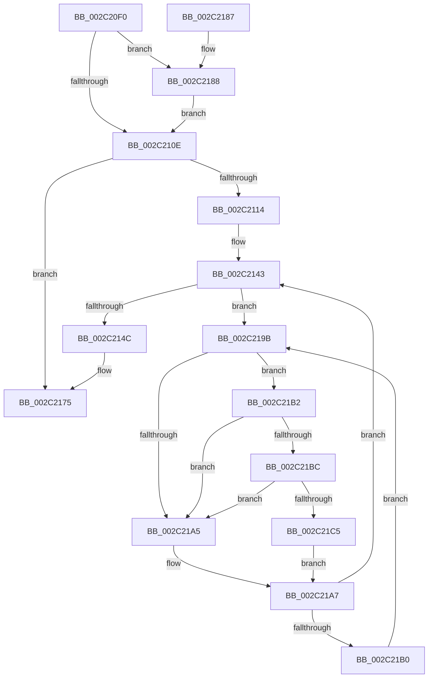

# MiDeleteNonPagedPoolTail

- RVA: `0x002C20F0`–`0x002C21CE` (길이 `222` bytes)
- VA: `0x00000001402C20F0`
- 실행 섹션: `.text`
- PDB 이름 있음: `예`; PDB Function 태그: `아니요`
- unwind 정보 RVA: `0x0006E85C`
- 디코드: `59`개 명령, `222/222` bytes 표시
- 미해석 바이트: `0` (있으면 어셈블리에 `.byte`로 보존)

> 이 문서는 커널 이미지의 기계어와 PDB 기호를 분석해 생성했습니다. 4번과 5번은 함수 원형과 자료형을 바이너리 사용 방식에서 추정한 C 해석이며 원본 소스 복구 결과는 아닙니다.

## 1. Dependencies

- 직접 호출 지점: **6**; 고유 호출 대상: **6**
- 직접 호출자로 확인된 함수: **1**
- RIP 상대 이미지 참조: **2**

### Outgoing calls
- `0x002C2152` → [MiReduceShareCount](../37/MiReduceShareCount_function_00370E90.md) (function, `0x00370E90`)
- `0x002C215D` → [MiDecreaseUsedPtesInPfn](../2A/MiDecreaseUsedPtesInPfn_function_002A27AC.md) (function, `0x002A27AC`)
- `0x002C2188` → [MiFlushTbList](../31/MiFlushTbList_function_00311FC0.md) (function, `0x00311FC0`)
- `0x002C218D` → [MiReleaseProcessorFlushList](../31/MiReleaseProcessorFlushList_function_00313C70.md) (function, `0x00313C70`)
- `0x002C21BC` → [KiCheckVpBackingLongSpinWaitHypercall](../30/KiCheckVpBackingLongSpinWaitHypercall_function_0030F490.md) (function, `0x0030F490`)
- `0x002C21C7` → [HvlNotifyLongSpinWait](../30/HvlNotifyLongSpinWait_function_0030F460.md) (function, `0x0030F460`)

### Direct callers
- [MiClearNonPagedPtes](MiClearNonPagedPtes_function_002C17A0.md) at `0x002C19C8`

### Static image references
- `0x002C219D` → RVA `0x00FC52AC` (`ALMOSTRO`; reference)
- `0x002C21B2` → RVA `0x00FC6AB8` (`ALMOSTRO`; read)

## 2. Other-region calls and transfers

- 다른 실행 섹션으로 향하는 call: **0**
- 별도 외부 분기/꼬리 이동을 확인하지 못했습니다.

## 3. Assembly (complete function range)

```asm
002C20F0  48 89 5C 24 08                  mov qword ptr [rsp + 8], rbx
002C20F5  48 89 74 24 10                  mov qword ptr [rsp + 0x10], rsi
002C20FA  57                              push rdi
002C20FB  48 83 EC 20                     sub rsp, 0x20
002C20FF  48 8B B9 B8 00 00 00            mov rdi, qword ptr [rcx + 0xb8]
002C2106  48 8B 0F                        mov rcx, qword ptr [rdi]
002C2109  48 85 C9                        test rcx, rcx
002C210C  75 7A                           jne 0x1402c2188
002C210E  83 7F 40 00                     cmp dword ptr [rdi + 0x40], 0
002C2112  74 61                           je 0x1402c2175
002C2114  48 8B 47 48                     mov rax, qword ptr [rdi + 0x48]
002C2118  48 B9 FF FF FF FF FF 00 00 00   movabs rcx, 0xffffffffff
002C2122  48 8B 00                        mov rax, qword ptr [rax]
002C2125  48 C1 E8 0C                     shr rax, 0xc
002C2129  48 23 C1                        and rax, rcx
002C212C  48 8D 1C 40                     lea rbx, [rax + rax*2]
002C2130  48 C1 E3 04                     shl rbx, 4
002C2134  48 B8 00 00 00 00 00 DE FF FF   movabs rax, 0xffffde0000000000
002C213E  48 03 D8                        add rbx, rax
002C2141  33 F6                           xor esi, esi
002C2143  F0 48 0F BA 6B 18 3F            lock bts qword ptr [rbx + 0x18], 0x3f
002C214A  72 4F                           jb 0x1402c219b
002C214C  8B 57 40                        mov edx, dword ptr [rdi + 0x40]
002C214F  48 8B CB                        mov rcx, rbx
002C2152  E8 39 ED 0A 00                  call 0x140370e90
002C2157  8B 57 40                        mov edx, dword ptr [rdi + 0x40]
002C215A  48 8B CB                        mov rcx, rbx
002C215D  E8 4A 06 FE FF                  call 0x1402a27ac
002C2162  48 B8 FF FF FF FF FF FF FF 7F   movabs rax, 0x7fffffffffffffff
002C216C  F0 48 21 43 18                  lock and qword ptr [rbx + 0x18], rax
002C2171  83 67 40 00                     and dword ptr [rdi + 0x40], 0
002C2175  48 8B 5C 24 30                  mov rbx, qword ptr [rsp + 0x30]
002C217A  33 C0                           xor eax, eax
002C217C  48 8B 74 24 38                  mov rsi, qword ptr [rsp + 0x38]
002C2181  48 83 C4 20                     add rsp, 0x20
002C2185  5F                              pop rdi
002C2186  C3                              ret
002C2187  CC                              int3
002C2188  E8 33 FE 04 00                  call 0x140311fc0
002C218D  E8 DE 1A 05 00                  call 0x140313c70
002C2192  48 83 27 00                     and qword ptr [rdi], 0
002C2196  E9 73 FF FF FF                  jmp 0x1402c210e
002C219B  FF C6                           inc esi
002C219D  85 35 09 31 D0 00               test dword ptr [rip + 0xd03109], esi
002C21A3  74 0D                           je 0x1402c21b2
002C21A5  F3 90                           pause
002C21A7  48 8B 43 18                     mov rax, qword ptr [rbx + 0x18]
002C21AB  48 85 C0                        test rax, rax
002C21AE  79 93                           jns 0x1402c2143
002C21B0  EB E9                           jmp 0x1402c219b
002C21B2  8B 05 00 49 D0 00               mov eax, dword ptr [rip + 0xd04900]
002C21B8  A8 40                           test al, 0x40
002C21BA  74 E9                           je 0x1402c21a5
002C21BC  E8 CF D2 04 00                  call 0x14030f490
002C21C1  84 C0                           test al, al
002C21C3  74 E0                           je 0x1402c21a5
002C21C5  8B CE                           mov ecx, esi
002C21C7  E8 94 D2 04 00                  call 0x14030f460
002C21CC  EB D9                           jmp 0x1402c21a7
```

## 4. C-style interpretation (structured pseudocode)

```c
__int64 __fastcall MiDeleteNonPagedPoolTail(__int64 a1)
{
    __int64 result;
    __int64 v_rbx;
    __int64 v_rsi;
    __int64 v_rsp;
    unsigned __int64 v_stack_p10;
    unsigned __int64 v_stack_p8;

    v_stack_p8 = v_rbx;
    v_stack_p10 = v_rsi;
    v_rsp = (v_rsp) - (32);
    if (*(unsigned __int64 *)(*(unsigned __int64 *)(a1 + 184)) != 0) goto loc_002C2188;
loc_002C210E:
    if ((*(unsigned int *)(*(unsigned __int64 *)(a1 + 184) + 64)) == 0) goto loc_002C2175;
    result = (*(unsigned __int64 *)(*(unsigned __int64 *)(*(unsigned __int64 *)(a1 + 184) + 72))) >> (12);
    result = (result) & (*(unsigned __int64 *)(*(unsigned __int64 *)(a1 + 184)));
    v_rbx = (result + result * 2) << (4);
    v_rbx = (v_rbx) + (result);
    v_rsi = 0;
loc_002C2143:
    if (condition_is_below) goto loc_002C219B;
    result = MiReduceShareCount(v_rbx, (unsigned int)(*(unsigned int *)(*(unsigned __int64 *)(a1 + 184) + 64)), a3, a4);
    result = MiDecreaseUsedPtesInPfn(v_rbx, (unsigned int)(*(unsigned int *)(*(unsigned __int64 *)(a1 + 184) + 64)), a3, a4);
loc_002C2175:
    result = 0;
    v_rsp = (v_rsp) + (32);
    return result;
loc_002C2188:
    result = MiFlushTbList(v_rbx, (unsigned int)(*(unsigned int *)(*(unsigned __int64 *)(a1 + 184) + 64)), a3, a4);
    result = MiReleaseProcessorFlushList(v_rbx, (unsigned int)(*(unsigned int *)(*(unsigned __int64 *)(a1 + 184) + 64)), a3, a4);
    goto loc_002C210E;
loc_002C219B:
    v_rsi = (unsigned int)((v_stack_p10) + 1);
    if (((*(unsigned int *)(v_rip + 13644041)) & ((unsigned int)(v_rsi))) == 0) goto loc_002C21B2;
loc_002C21A5:
loc_002C21A7:
    if (!sign_flag) goto loc_002C2143;
    goto loc_002C219B;
loc_002C21B2:
    if ((((unsigned __int8)((unsigned int)(*(unsigned int *)(v_rip + 13650176)))) & (64)) == 0) goto loc_002C21A5;
    result = KiCheckVpBackingLongSpinWaitHypercall(v_rbx, (unsigned int)(*(unsigned int *)(*(unsigned __int64 *)(a1 + 184) + 64)), a3, a4);
    if ((unsigned __int8)(result) == 0) goto loc_002C21A5;
    result = HvlNotifyLongSpinWait((unsigned int)((unsigned int)(v_rsi)), (unsigned int)(*(unsigned int *)(*(unsigned __int64 *)(a1 + 184) + 64)), a3, a4);
    goto loc_002C21A7;
}
```

## 5. (Beta) C Style

```c
int64_t MiDeleteNonPagedPoolTail(void *Arg1)
{
    uint8_t *arg1 = (uint8_t *)Arg1;

    int64_t result;
    int64_t local_rbx;
    int64_t local_rsi;
    int64_t local_rsp;
    uint64_t v_stack_p10;
    uint64_t v_stack_p8;

    v_stack_p8 = local_rbx;
    v_stack_p10 = local_rsi;
    local_rsp = (local_rsp) - (32);
    if (*(uint64_t *)(*(uint64_t *)(arg1 + 0xB8)) != 0) goto loc_002C2188;
loc_002C210E:
    if ((*(uint32_t *)(*(uint64_t *)(arg1 + 0xB8) + 0x40)) == 0) goto loc_002C2175;
    result = (*(uint64_t *)(*(uint64_t *)(*(uint64_t *)(arg1 + 0xB8) + 0x48))) >> (12);
    result = (result) & (*(uint64_t *)(*(uint64_t *)(arg1 + 0xB8)));
    local_rbx = (result + result * 2) << (4);
    local_rbx = (local_rbx) + (result);
    local_rsi = 0;
loc_002C2143:
    if (condition_is_below) goto loc_002C219B;
    result = MiReduceShareCount(local_rbx, (uint32_t)(*(uint32_t *)(*(uint64_t *)(arg1 + 0xB8) + 0x40)), a3, a4);
    result = MiDecreaseUsedPtesInPfn(local_rbx, (uint32_t)(*(uint32_t *)(*(uint64_t *)(arg1 + 0xB8) + 0x40)), a3, a4);
loc_002C2175:
    result = 0;
    local_rsp = (local_rsp) + (32);
    return result;
loc_002C2188:
    result = MiFlushTbList(local_rbx, (uint32_t)(*(uint32_t *)(*(uint64_t *)(arg1 + 0xB8) + 0x40)), a3, a4);
    result = MiReleaseProcessorFlushList(local_rbx, (uint32_t)(*(uint32_t *)(*(uint64_t *)(arg1 + 0xB8) + 0x40)), a3, a4);
    goto loc_002C210E;
loc_002C219B:
    local_rsi = (uint32_t)((v_stack_p10) + 1);
    if (((*(uint32_t *)(v_rip + 0xD03109)) & ((uint32_t)(local_rsi))) == 0) goto loc_002C21B2;
loc_002C21A5:
loc_002C21A7:
    if (!sign_flag) goto loc_002C2143;
    goto loc_002C219B;
loc_002C21B2:
    if ((((uint8_t)((uint32_t)(*(uint32_t *)(v_rip + 0xD04900)))) & (64)) == 0) goto loc_002C21A5;
    result = KiCheckVpBackingLongSpinWaitHypercall(local_rbx, (uint32_t)(*(uint32_t *)(*(uint64_t *)(arg1 + 0xB8) + 0x40)), a3, a4);
    if ((uint8_t)(result) == 0) goto loc_002C21A5;
    result = HvlNotifyLongSpinWait((uint32_t)((uint32_t)(local_rsi)), (uint32_t)(*(uint32_t *)(*(uint64_t *)(arg1 + 0xB8) + 0x40)), a3, a4);
    goto loc_002C21A7;
}
```

### 관측된 메모리 오프셋

구조체 형식이 확인되지 않은 접근은 인자 기준의 오프셋으로만 기록했습니다.

| 기준 인자 | 오프셋 표현 | 폭 (bit) | 접근 |
|---|---:|---:|---|
| `Arg1` | `+ 0xB8` | `64` | `R` |

## 6. Execution-region graph

[열기: 2D/3D 그래프와 함수 탐색 컨트롤 패널](../../../control-panel.html?section=text&rva=0x002C20F0&view=graph)

- 2D 그래프는 위에서 아래로 흐르고, 3D 그래프는 빈 공간을 드래그해 회전합니다. Shift+드래그는 이동, 휠은 확대·축소, 함수 노드 선택은 대상 보고서 이동입니다.

### Static fallback


