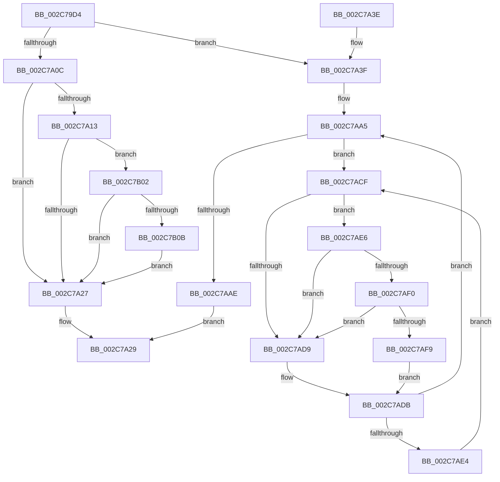

# MiDeleteRotateVa

- RVA: `0x002C79D4`–`0x002C7B47` (길이 `371` bytes)
- VA: `0x00000001402C79D4`
- 실행 섹션: `.text`
- PDB 이름 있음: `예`; PDB Function 태그: `아니요`
- unwind 정보 RVA: `0x0006EE24`
- 디코드: `96`개 명령, `371/371` bytes 표시
- 미해석 바이트: `0` (있으면 어셈블리에 `.byte`로 보존)

> 이 문서는 커널 이미지의 기계어와 PDB 기호를 분석해 생성했습니다. 4번과 5번은 함수 원형과 자료형을 바이너리 사용 방식에서 추정한 C 해석이며 원본 소스 복구 결과는 아닙니다.

## 1. Dependencies

- 직접 호출 지점: **8**; 고유 호출 대상: **8**
- 직접 호출자로 확인된 함수: **1**
- RIP 상대 이미지 참조: **2**

### Outgoing calls
- `0x002C7A03` → [MiRotatedToFrameBuffer](MiRotatedToFrameBuffer_function_002C5FE4.md) (function, `0x002C5FE4`)
- `0x002C7A4F` → [MiUnmapFrameBuffer](../2A/MiUnmapFrameBuffer_function_002AAF14.md) (function, `0x002AAF14`)
- `0x002C7A81` → [MiInsertTbFlushEntry](../29/MiInsertTbFlushEntry_function_00293670.md) (function, `0x00293670`)
- `0x002C7A89` → [MiGetContainingPageTable](../34/MiGetContainingPageTable_function_003467F0.md) (function, `0x003467F0`)
- `0x002C7AB4` → [MiReduceShareCount](../37/MiReduceShareCount_function_00370E90.md) (function, `0x00370E90`)
- `0x002C7AF0` → [KiCheckVpBackingLongSpinWaitHypercall](../30/KiCheckVpBackingLongSpinWaitHypercall_function_0030F490.md) (function, `0x0030F490`)
- `0x002C7AFB` → [HvlNotifyLongSpinWait](../30/HvlNotifyLongSpinWait_function_0030F460.md) (function, `0x0030F460`)
- `0x002C7B3D` → [MiCaptureWriteWatchDirtyBit](../46/MiCaptureWriteWatchDirtyBit_function_00465224.md) (function, `0x00465224`)

### Direct callers
- [MiDeleteVa](../27/MiDeleteVa_function_002789E0.md) at `0x00278F0E`

### Static image references
- `0x002C7AD1` → RVA `0x00FC52AC` (`ALMOSTRO`; reference)
- `0x002C7AE6` → RVA `0x00FC6AB8` (`ALMOSTRO`; read)

## 2. Other-region calls and transfers

- 다른 실행 섹션으로 향하는 call: **0**
- 별도 외부 분기/꼬리 이동을 확인하지 못했습니다.

## 3. Assembly (complete function range)

```asm
002C79D4  48 89 5C 24 08                  mov qword ptr [rsp + 8], rbx
002C79D9  48 89 6C 24 10                  mov qword ptr [rsp + 0x10], rbp
002C79DE  48 89 74 24 18                  mov qword ptr [rsp + 0x18], rsi
002C79E3  57                              push rdi
002C79E4  48 83 EC 20                     sub rsp, 0x20
002C79E8  48 8B 81 B8 00 00 00            mov rax, qword ptr [rcx + 0xb8]
002C79EF  41 8B E8                        mov ebp, r8d
002C79F2  48 8B CA                        mov rcx, rdx
002C79F5  48 8B FA                        mov rdi, rdx
002C79F8  48 8B 18                        mov rbx, qword ptr [rax]
002C79FB  48 8B 40 08                     mov rax, qword ptr [rax + 8]
002C79FF  48 8B 70 20                     mov rsi, qword ptr [rax + 0x20]
002C7A03  E8 DC E5 FF FF                  call 0x1402c5fe4
002C7A08  85 C0                           test eax, eax
002C7A0A  75 33                           jne 0x1402c7a3f
002C7A0C  48 8B 07                        mov rax, qword ptr [rdi]
002C7A0F  A8 42                           test al, 0x42
002C7A11  74 14                           je 0x1402c7a27
002C7A13  8B 4E 30                        mov ecx, dword ptr [rsi + 0x30]
002C7A16  BA 00 00 60 00                  mov edx, 0x600000
002C7A1B  8B C1                           mov eax, ecx
002C7A1D  23 C2                           and eax, edx
002C7A1F  3B C2                           cmp eax, edx
002C7A21  0F 84 DB 00 00 00               je 0x1402c7b02
002C7A27  33 C0                           xor eax, eax
002C7A29  48 8B 5C 24 30                  mov rbx, qword ptr [rsp + 0x30]
002C7A2E  48 8B 6C 24 38                  mov rbp, qword ptr [rsp + 0x38]
002C7A33  48 8B 74 24 40                  mov rsi, qword ptr [rsp + 0x40]
002C7A38  48 83 C4 20                     add rsp, 0x20
002C7A3C  5F                              pop rdi
002C7A3D  C3                              ret
002C7A3E  CC                              int3
002C7A3F  48 8B 5B 10                     mov rbx, qword ptr [rbx + 0x10]
002C7A43  41 B8 03 00 00 00               mov r8d, 3
002C7A49  48 8B D7                        mov rdx, rdi
002C7A4C  48 8B CE                        mov rcx, rsi
002C7A4F  E8 C0 34 FE FF                  call 0x1402aaf14
002C7A54  48 8B D7                        mov rdx, rdi
002C7A57  48 B8 00 00 00 00 80 F6 FF FF   movabs rax, 0xfffff68000000000
002C7A61  48 C1 E2 19                     shl rdx, 0x19
002C7A65  48 8B C0                        mov rax, rax
002C7A68  48 C1 E0 19                     shl rax, 0x19
002C7A6C  BE 01 00 00 00                  mov esi, 1
002C7A71  48 2B D0                        sub rdx, rax
002C7A74  44 8B CD                        mov r9d, ebp
002C7A77  48 C1 FA 10                     sar rdx, 0x10
002C7A7B  44 8B C6                        mov r8d, esi
002C7A7E  48 8B CB                        mov rcx, rbx
002C7A81  E8 EA BB FC FF                  call 0x140293670
002C7A86  48 8B CF                        mov rcx, rdi
002C7A89  E8 62 ED 07 00                  call 0x1403467f0
002C7A8E  48 8D 1C 40                     lea rbx, [rax + rax*2]
002C7A92  48 C1 E3 04                     shl rbx, 4
002C7A96  48 B8 00 00 00 00 00 DE FF FF   movabs rax, 0xffffde0000000000
002C7AA0  48 03 D8                        add rbx, rax
002C7AA3  33 FF                           xor edi, edi
002C7AA5  F0 48 0F BA 6B 18 3F            lock bts qword ptr [rbx + 0x18], 0x3f
002C7AAC  72 21                           jb 0x1402c7acf
002C7AAE  48 8B D6                        mov rdx, rsi
002C7AB1  48 8B CB                        mov rcx, rbx
002C7AB4  E8 D7 93 0A 00                  call 0x140370e90
002C7AB9  48 B9 FF FF FF FF FF FF FF 7F   movabs rcx, 0x7fffffffffffffff
002C7AC3  F0 48 21 4B 18                  lock and qword ptr [rbx + 0x18], rcx
002C7AC8  8B C6                           mov eax, esi
002C7ACA  E9 5A FF FF FF                  jmp 0x1402c7a29
002C7ACF  03 FE                           add edi, esi
002C7AD1  85 3D D5 D7 CF 00               test dword ptr [rip + 0xcfd7d5], edi
002C7AD7  74 0D                           je 0x1402c7ae6
002C7AD9  F3 90                           pause
002C7ADB  48 8B 43 18                     mov rax, qword ptr [rbx + 0x18]
002C7ADF  48 85 C0                        test rax, rax
002C7AE2  79 C1                           jns 0x1402c7aa5
002C7AE4  EB E9                           jmp 0x1402c7acf
002C7AE6  8B 05 CC EF CF 00               mov eax, dword ptr [rip + 0xcfefcc]
002C7AEC  A8 40                           test al, 0x40
002C7AEE  74 E9                           je 0x1402c7ad9
002C7AF0  E8 9B 79 04 00                  call 0x14030f490
002C7AF5  84 C0                           test al, al
002C7AF7  74 E0                           je 0x1402c7ad9
002C7AF9  8B CF                           mov ecx, edi
002C7AFB  E8 60 79 04 00                  call 0x14030f460
002C7B00  EB D9                           jmp 0x1402c7adb
002C7B02  F6 C1 04                        test cl, 4
002C7B05  0F 85 1C FF FF FF               jne 0x1402c7a27
002C7B0B  48 C1 E7 19                     shl rdi, 0x19
002C7B0F  48 B8 00 00 00 00 80 F6 FF FF   movabs rax, 0xfffff68000000000
002C7B19  48 8B C0                        mov rax, rax
002C7B1C  65 48 8B 0C 25 88 01 00 00      mov rcx, qword ptr gs:[0x188]
002C7B25  4C 8B C6                        mov r8, rsi
002C7B28  48 C1 E0 19                     shl rax, 0x19
002C7B2C  48 2B F8                        sub rdi, rax
002C7B2F  48 C1 FF 10                     sar rdi, 0x10
002C7B33  48 8B 89 B8 00 00 00            mov rcx, qword ptr [rcx + 0xb8]
002C7B3A  48 8B D7                        mov rdx, rdi
002C7B3D  E8 E2 D6 19 00                  call 0x140465224
002C7B42  E9 E0 FE FF FF                  jmp 0x1402c7a27
```

## 4. C-style interpretation (structured pseudocode)

```c
__int64 __fastcall MiDeleteRotateVa(__int64 a1, __int64 a2, int a3)
{
    __int64 result;
    __int64 v_rbx;
    __int64 v_rdi;
    __int64 v_rsp;
    unsigned __int64 v_stack_p10;
    unsigned __int64 v_stack_p18;
    unsigned __int64 v_stack_p8;

    v_stack_p8 = v_rbx;
    v_stack_p10 = v_rbp;
    v_stack_p18 = v_rsi;
    v_rsp = (v_rsp) - (32);
    result = MiRotatedToFrameBuffer(a2, a2, a3, a4);
    if ((unsigned int)(result) != 0) goto loc_002C7A3F;
    if ((((unsigned __int8)(*(unsigned __int64 *)(a2))) & (66)) == 0) goto loc_002C7A27;
    result = (unsigned int)(((unsigned int)((unsigned int)((unsigned int)(*(unsigned int *)(*(unsigned __int64 *)(*(unsigned __int64 *)(*(unsigned __int64 *)(a1 + 184) + 8) + 32) + 48))))) & ((unsigned int)((unsigned int)(0x600000ULL))));
    if (((unsigned int)(result)) == ((unsigned int)((unsigned int)(0x600000ULL)))) goto loc_002C7B02;
loc_002C7A27:
    result = 0;
loc_002C7A29:
    v_rsp = (v_rsp) + (32);
    return result;
loc_002C7A3F:
    result = MiUnmapFrameBuffer(v_stack_p18, a2, 3, a4);
    a2 = (a2) << (25);
    result = (result) << (25);
    a2 = (a2) - (result);
    a2 = (a2) >> (16);
    result = MiInsertTbFlushEntry(*(unsigned __int64 *)(v_stack_p8 + 16), a2, 1, (unsigned int)((unsigned int)(v_stack_p10)));
    result = MiGetContainingPageTable(a2, a2, 1, (unsigned int)((unsigned int)(v_stack_p10)));
    v_rbx = (result + result * 2) << (4);
    v_rbx = (v_rbx) + (result);
    v_rdi = 0;
loc_002C7AA5:
    if (condition_is_below) goto loc_002C7ACF;
    result = MiReduceShareCount(v_rbx, 1, 1, (unsigned int)((unsigned int)(v_stack_p10)));
    goto loc_002C7A29;
loc_002C7ACF:
    v_rdi = (unsigned int)((v_rdi) + (1));
    if (((*(unsigned int *)(v_rip + 13621205)) & ((unsigned int)(v_rdi))) == 0) goto loc_002C7AE6;
loc_002C7AD9:
loc_002C7ADB:
    if (!sign_flag) goto loc_002C7AA5;
    goto loc_002C7ACF;
loc_002C7AE6:
    if ((((unsigned __int8)((unsigned int)(*(unsigned int *)(v_rip + 13627340)))) & (64)) == 0) goto loc_002C7AD9;
    result = KiCheckVpBackingLongSpinWaitHypercall(v_rbx, 1, 1, (unsigned int)((unsigned int)(v_stack_p10)));
    if ((unsigned __int8)(result) == 0) goto loc_002C7AD9;
    result = HvlNotifyLongSpinWait((unsigned int)((unsigned int)(v_rdi)), 1, 1, (unsigned int)((unsigned int)(v_stack_p10)));
    goto loc_002C7ADB;
loc_002C7B02:
    if ((((unsigned __int8)((unsigned int)((unsigned int)(v_rdi)))) & (4)) != 0) goto loc_002C7A27;
    v_rdi = (v_rdi) << (25);
    result = (result) << (25);
    v_rdi = (v_rdi) - (result);
    v_rdi = (v_rdi) >> (16);
    result = MiCaptureWriteWatchDirtyBit(*(unsigned __int64 *)(*(unsigned __int64 *)(gs_base + (0 + 392)) + 184), v_rdi, 1, (unsigned int)((unsigned int)(v_stack_p10)));
    goto loc_002C7A27;
}
```

## 5. (Beta) C Style

```c
int64_t MiDeleteRotateVa(void *Arg1, void *Arg2, int32_t Arg3)
{
    uint8_t *arg1 = (uint8_t *)Arg1;
    uint8_t *arg2 = (uint8_t *)Arg2;

    int64_t result;
    int64_t local_rbx;
    int64_t local_rdi;
    int64_t local_rsp;
    uint64_t v_stack_p10;
    uint64_t v_stack_p18;
    uint64_t v_stack_p8;

    v_stack_p8 = local_rbx;
    v_stack_p10 = local_rbp;
    v_stack_p18 = local_rsi;
    local_rsp = (local_rsp) - (32);
    result = MiRotatedToFrameBuffer(Arg2, Arg2, Arg3, a4);
    if ((uint32_t)(result) != 0) goto loc_002C7A3F;
    if ((((uint8_t)(*(uint64_t *)(arg2))) & (66)) == 0) goto loc_002C7A27;
    result = (uint32_t)(((uint32_t)((uint32_t)((uint32_t)(*(uint32_t *)(*(uint64_t *)(*(uint64_t *)(*(uint64_t *)(arg1 + 0xB8) + 0x8) + 0x20) + 0x30))))) & ((uint32_t)((uint32_t)(0x600000ULL))));
    if (((uint32_t)(result)) == ((uint32_t)((uint32_t)(0x600000ULL)))) goto loc_002C7B02;
loc_002C7A27:
    result = 0;
loc_002C7A29:
    local_rsp = (local_rsp) + (32);
    return result;
loc_002C7A3F:
    result = MiUnmapFrameBuffer(v_stack_p18, Arg2, 3, a4);
    Arg2 = (Arg2) << (25);
    result = (result) << (25);
    Arg2 = (Arg2) - (result);
    Arg2 = (Arg2) >> (16);
    result = MiInsertTbFlushEntry(*(uint64_t *)(v_stack_p8 + 0x10), Arg2, 1, (uint32_t)((uint32_t)(v_stack_p10)));
    result = MiGetContainingPageTable(Arg2, Arg2, 1, (uint32_t)((uint32_t)(v_stack_p10)));
    local_rbx = (result + result * 2) << (4);
    local_rbx = (local_rbx) + (result);
    local_rdi = 0;
loc_002C7AA5:
    if (condition_is_below) goto loc_002C7ACF;
    result = MiReduceShareCount(local_rbx, 1, 1, (uint32_t)((uint32_t)(v_stack_p10)));
    goto loc_002C7A29;
loc_002C7ACF:
    local_rdi = (uint32_t)((local_rdi) + (1));
    if (((*(uint32_t *)(v_rip + 0xCFD7D5)) & ((uint32_t)(local_rdi))) == 0) goto loc_002C7AE6;
loc_002C7AD9:
loc_002C7ADB:
    if (!sign_flag) goto loc_002C7AA5;
    goto loc_002C7ACF;
loc_002C7AE6:
    if ((((uint8_t)((uint32_t)(*(uint32_t *)(v_rip + 0xCFEFCC)))) & (64)) == 0) goto loc_002C7AD9;
    result = KiCheckVpBackingLongSpinWaitHypercall(local_rbx, 1, 1, (uint32_t)((uint32_t)(v_stack_p10)));
    if ((uint8_t)(result) == 0) goto loc_002C7AD9;
    result = HvlNotifyLongSpinWait((uint32_t)((uint32_t)(local_rdi)), 1, 1, (uint32_t)((uint32_t)(v_stack_p10)));
    goto loc_002C7ADB;
loc_002C7B02:
    if ((((uint8_t)((uint32_t)((uint32_t)(local_rdi)))) & (4)) != 0) goto loc_002C7A27;
    local_rdi = (local_rdi) << (25);
    result = (result) << (25);
    local_rdi = (local_rdi) - (result);
    local_rdi = (local_rdi) >> (16);
    result = MiCaptureWriteWatchDirtyBit(*(uint64_t *)(*(uint64_t *)(gs_base + (0 + 0x188)) + 0xB8), local_rdi, 1, (uint32_t)((uint32_t)(v_stack_p10)));
    goto loc_002C7A27;
}
```

### 관측된 메모리 오프셋

구조체 형식이 확인되지 않은 접근은 인자 기준의 오프셋으로만 기록했습니다.

| 기준 인자 | 오프셋 표현 | 폭 (bit) | 접근 |
|---|---:|---:|---|
| `Arg1` | `+ 0xB8` | `64` | `R` |
| `Arg2` | `+ 0x0` | `64` | `R` |

## 6. Execution-region graph

[열기: 2D/3D 그래프와 함수 탐색 컨트롤 패널](../../../control-panel.html?section=text&rva=0x002C79D4&view=graph)

- 2D 그래프는 위에서 아래로 흐르고, 3D 그래프는 빈 공간을 드래그해 회전합니다. Shift+드래그는 이동, 휠은 확대·축소, 함수 노드 선택은 대상 보고서 이동입니다.

### Static fallback


