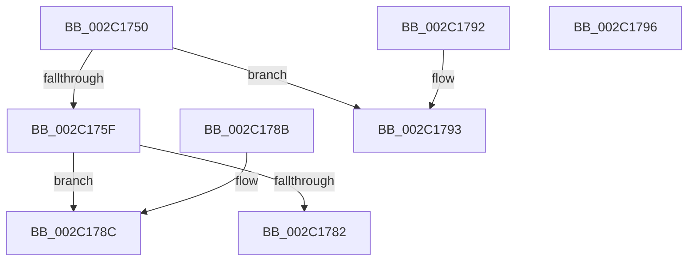

# MiDeterminePoolType

- RVA: `0x002C1750`–`0x002C1797` (길이 `71` bytes)
- VA: `0x00000001402C1750`
- 실행 섹션: `.text`
- PDB 이름 있음: `예`; PDB Function 태그: `아니요`
- unwind 정보 RVA: `0x000DB714`
- 디코드: `23`개 명령, `71/71` bytes 표시
- 미해석 바이트: `0` (있으면 어셈블리에 `.byte`로 보존)

> 이 문서는 커널 이미지의 기계어와 PDB 기호를 분석해 생성했습니다. 4번과 5번은 함수 원형과 자료형을 바이너리 사용 방식에서 추정한 C 해석이며 원본 소스 복구 결과는 아닙니다.

## 1. Dependencies

- 직접 호출 지점: **0**; 고유 호출 대상: **0**
- 직접 호출자로 확인된 함수: **2**
- RIP 상대 이미지 참조: **1**

### Outgoing calls
- 직접 디코드된 call 명령이 없습니다.

### Direct callers
- [MmFreePoolMemory](MmFreePoolMemory_function_002C1578.md) at `0x002C15BC`
- [MiGenerateAccessViolation](../34/MiGenerateAccessViolation_function_0034B50C.md) at `0x0034B526`

### Static image references
- `0x002C1772` → RVA `0x00E38AA8` (`.data`; read)

## 2. Other-region calls and transfers

- 다른 실행 섹션으로 향하는 call: **0**
- 별도 외부 분기/꼬리 이동을 확인하지 못했습니다.

## 3. Assembly (complete function range)

```asm
002C1750  48 B8 00 00 00 00 00 80 FF FF   movabs rax, 0xffff800000000000
002C175A  48 3B C8                        cmp rcx, rax
002C175D  72 34                           jb 0x1402c1793
002C175F  48 C1 E9 27                     shr rcx, 0x27
002C1763  BA 00 01 00 00                  mov edx, 0x100
002C1768  81 E1 FF 01 00 00               and ecx, 0x1ff
002C176E  2B CA                           sub ecx, edx
002C1770  8B C1                           mov eax, ecx
002C1772  48 8D 0D 2F 73 B7 00            lea rcx, [rip + 0xb7732f]
002C1779  0F B6 0C 08                     movzx ecx, byte ptr [rax + rcx]
002C177D  83 F9 04                        cmp ecx, 4
002C1780  74 0A                           je 0x1402c178c
002C1782  33 C0                           xor eax, eax
002C1784  83 F9 05                        cmp ecx, 5
002C1787  0F 44 C2                        cmove eax, edx
002C178A  C3                              ret
002C178B  CC                              int3
002C178C  B8 40 00 00 00                  mov eax, 0x40
002C1791  C3                              ret
002C1792  CC                              int3
002C1793  33 C0                           xor eax, eax
002C1795  C3                              ret
002C1796  CC                              int3
```

## 4. C-style interpretation (structured pseudocode)

```c
__int64 __fastcall MiDeterminePoolType(__int64 a1)
{
    __int64 result;

    if (a1 < result) goto loc_002C1793;
    a1 = (a1) >> (39);
    a1 = (unsigned int)((a1) & (511));
    a1 = (unsigned int)((a1) - (256));
    if (((unsigned int)(*(unsigned __int8 *)((unsigned int)((unsigned int)(a1)) + v_rip + 12022575 * 1))) == 4) goto loc_002C178C;
    result = 0;
    if (((unsigned int)(*(unsigned __int8 *)((unsigned int)((unsigned int)(a1)) + v_rip + 12022575 * 1))) == 5) { result = 256; }
    return result;
loc_002C178C:
    return 64;
loc_002C1793:
    result = 0;
    return result;
}
```

## 5. (Beta) C Style

```c
int64_t MiDeterminePoolType(int64_t Arg1)
{
    int64_t result;

    if (Arg1 < result) goto loc_002C1793;
    Arg1 = (Arg1) >> (39);
    Arg1 = (uint32_t)((Arg1) & (511));
    Arg1 = (uint32_t)((Arg1) - (256));
    if (((uint32_t)(*(uint8_t *)((uint32_t)((uint32_t)(Arg1)) + v_rip + 0xB7732F * 1))) == 4) goto loc_002C178C;
    result = 0;
    if (((uint32_t)(*(uint8_t *)((uint32_t)((uint32_t)(Arg1)) + v_rip + 0xB7732F * 1))) == 5) { result = 256; }
    return result;
loc_002C178C:
    return 64;
loc_002C1793:
    result = 0;
    return result;
}
```

## 6. Execution-region graph

[열기: 2D/3D 그래프와 함수 탐색 컨트롤 패널](../../../control-panel.html?section=text&rva=0x002C1750&view=graph)

- 2D 그래프는 위에서 아래로 흐르고, 3D 그래프는 빈 공간을 드래그해 회전합니다. Shift+드래그는 이동, 휠은 확대·축소, 함수 노드 선택은 대상 보고서 이동입니다.

### Static fallback


