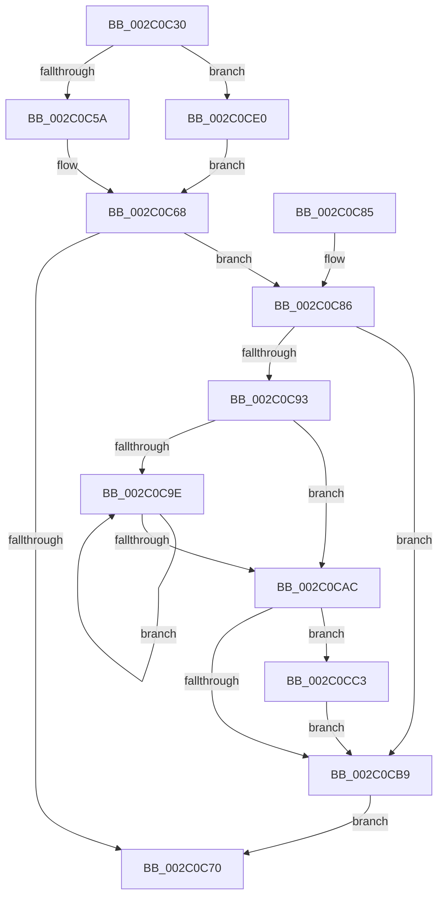

# MiDrainOldAccessBuffers

- RVA: `0x002C0C30`–`0x002C0CF3` (길이 `195` bytes)
- VA: `0x00000001402C0C30`
- 실행 섹션: `.text`
- PDB 이름 있음: `예`; PDB Function 태그: `아니요`
- unwind 정보 RVA: `0x0006E658`
- 디코드: `52`개 명령, `195/195` bytes 표시
- 미해석 바이트: `0` (있으면 어셈블리에 `.byte`로 보존)

> 이 문서는 커널 이미지의 기계어와 PDB 기호를 분석해 생성했습니다. 4번과 5번은 함수 원형과 자료형을 바이너리 사용 방식에서 추정한 C 해석이며 원본 소스 복구 결과는 아닙니다.

## 1. Dependencies

- 직접 호출 지점: **4**; 고유 호출 대상: **4**
- 직접 호출자로 확인된 함수: **1**
- RIP 상대 이미지 참조: **3**

### Outgoing calls
- `0x002C0C86` → [MiLockWorkingSetCoreExclusive](MiLockWorkingSetCoreExclusive_function_002C0CFC.md) (function, `0x002C0CFC`)
- `0x002C0CBC` → [MiUnlockWorkingSetCoreExclusive](MiUnlockWorkingSetCoreExclusive_function_002C0DC4.md) (function, `0x002C0DC4`)
- `0x002C0CC6` → [MiGetVmAccessLoggingPartition](../38/MiGetVmAccessLoggingPartition_function_003815A0.md) (function, `0x003815A0`)
- `0x002C0CD1` → [MiEmptyPageAccessLog](../34/MiEmptyPageAccessLog_function_00348700.md) (function, `0x00348700`)

### Direct callers
- [MiTrimOrAgeWorkingSet](../34/MiTrimOrAgeWorkingSet_function_0034EFC0.md) at `0x0034F226`

### Static image references
- `0x002C0C5A` → RVA `0x00E38840` (`.data`; read)
- `0x002C0C61` → RVA `0x00E38868` (`.data`; read)
- `0x002C0CB0` → RVA `0x00F0F220` (`.data`; read)

## 2. Other-region calls and transfers

- 다른 실행 섹션으로 향하는 call: **0**
- 별도 외부 분기/꼬리 이동을 확인하지 못했습니다.

## 3. Assembly (complete function range)

```asm
002C0C30  48 89 5C 24 08                  mov qword ptr [rsp + 8], rbx
002C0C35  48 89 6C 24 10                  mov qword ptr [rsp + 0x10], rbp
002C0C3A  48 89 74 24 18                  mov qword ptr [rsp + 0x18], rsi
002C0C3F  57                              push rdi
002C0C40  48 83 EC 20                     sub rsp, 0x20
002C0C44  8B 81 B8 00 00 00               mov eax, dword ptr [rcx + 0xb8]
002C0C4A  48 8B F2                        mov rsi, rdx
002C0C4D  24 0F                           and al, 0xf
002C0C4F  48 8B D9                        mov rbx, rcx
002C0C52  3C 01                           cmp al, 1
002C0C54  0F 85 86 00 00 00               jne 0x1402c0ce0
002C0C5A  48 8D 2D DF 7B B7 00            lea rbp, [rip + 0xb77bdf]
002C0C61  48 8D 3D 00 7C B7 00            lea rdi, [rip + 0xb77c00]
002C0C68  48 8B 07                        mov rax, qword ptr [rdi]
002C0C6B  48 85 C0                        test rax, rax
002C0C6E  75 16                           jne 0x1402c0c86
002C0C70  48 8B 5C 24 30                  mov rbx, qword ptr [rsp + 0x30]
002C0C75  48 8B 6C 24 38                  mov rbp, qword ptr [rsp + 0x38]
002C0C7A  48 8B 74 24 40                  mov rsi, qword ptr [rsp + 0x40]
002C0C7F  48 83 C4 20                     add rsp, 0x20
002C0C83  5F                              pop rdi
002C0C84  C3                              ret
002C0C85  CC                              int3
002C0C86  E8 71 00 00 00                  call 0x1402c0cfc
002C0C8B  4C 8B 07                        mov r8, qword ptr [rdi]
002C0C8E  4D 85 C0                        test r8, r8
002C0C91  74 26                           je 0x1402c0cb9
002C0C93  49 8B 08                        mov rcx, qword ptr [r8]
002C0C96  49 8B D0                        mov rdx, r8
002C0C99  48 85 C9                        test rcx, rcx
002C0C9C  74 0E                           je 0x1402c0cac
002C0C9E  48 8B 01                        mov rax, qword ptr [rcx]
002C0CA1  48 8B D1                        mov rdx, rcx
002C0CA4  48 8B C8                        mov rcx, rax
002C0CA7  48 85 C0                        test rax, rax
002C0CAA  75 F2                           jne 0x1402c0c9e
002C0CAC  48 2B 72 10                     sub rsi, qword ptr [rdx + 0x10]
002C0CB0  48 3B 35 69 E5 C4 00            cmp rsi, qword ptr [rip + 0xc4e569]
002C0CB7  77 0A                           ja 0x1402c0cc3
002C0CB9  48 8B CB                        mov rcx, rbx
002C0CBC  E8 03 01 00 00                  call 0x1402c0dc4
002C0CC1  EB AD                           jmp 0x1402c0c70
002C0CC3  48 8B CB                        mov rcx, rbx
002C0CC6  E8 D5 08 0C 00                  call 0x1403815a0
002C0CCB  48 8B C8                        mov rcx, rax
002C0CCE  49 8B D0                        mov rdx, r8
002C0CD1  E8 2A 7A 08 00                  call 0x140348700
002C0CD6  48 C7 45 28 00 00 00 00         mov qword ptr [rbp + 0x28], 0
002C0CDE  EB D9                           jmp 0x1402c0cb9
002C0CE0  48 8D A9 C0 00 00 00            lea rbp, [rcx + 0xc0]
002C0CE7  48 8D B9 E8 00 00 00            lea rdi, [rcx + 0xe8]
002C0CEE  E9 75 FF FF FF                  jmp 0x1402c0c68
```

## 4. C-style interpretation (structured pseudocode)

```c
__int64 __fastcall MiDrainOldAccessBuffers(__int64 a1, __int64 a2)
{
    __int64 result;
    __int64 v_rsi;
    __int64 v_rsp;
    unsigned __int64 v_stack_p10;
    unsigned __int64 v_stack_p18;
    unsigned __int64 v_stack_p8;

    v_stack_p8 = v_rbx;
    v_stack_p10 = v_rbp;
    v_stack_p18 = v_rsi;
    v_rsp = (v_rsp) - (32);
    result = (unsigned __int8)(((unsigned int)(*(unsigned int *)(a1 + 184))) & (15));
    if (((unsigned __int8)(result)) != 1) goto loc_002C0CE0;
loc_002C0C68:
    if (*(unsigned __int64 *)(v_rip + 12024832) != 0) goto loc_002C0C86;
loc_002C0C70:
    v_rsp = (v_rsp) + (32);
    return *(unsigned __int64 *)(v_rip + 12024832);
loc_002C0C86:
    result = MiLockWorkingSetCoreExclusive(a1, a2, a3, a4);
    if (*(unsigned __int64 *)(v_rip + 12024832) == 0) goto loc_002C0CB9;
    if (*(unsigned __int64 *)(*(unsigned __int64 *)(v_rip + 12024832)) == 0) goto loc_002C0CAC;
loc_002C0C9E:
    if (*(unsigned __int64 *)(*(unsigned __int64 *)(*(unsigned __int64 *)(v_rip + 12024832))) != 0) goto loc_002C0C9E;
loc_002C0CAC:
    v_rsi = (v_stack_p18) - (*(unsigned __int64 *)(*(unsigned __int64 *)(*(unsigned __int64 *)(v_rip + 12024832)) + 16));
    if (v_rsi > (*(unsigned __int64 *)(v_rip + 12903785))) goto loc_002C0CC3;
loc_002C0CB9:
    result = MiUnlockWorkingSetCoreExclusive(v_stack_p8, *(unsigned __int64 *)(*(unsigned __int64 *)(v_rip + 12024832)), *(unsigned __int64 *)(v_rip + 12024832), a4);
    goto loc_002C0C70;
loc_002C0CC3:
    result = MiGetVmAccessLoggingPartition(v_stack_p8, *(unsigned __int64 *)(*(unsigned __int64 *)(v_rip + 12024832)), *(unsigned __int64 *)(v_rip + 12024832), a4);
    result = MiEmptyPageAccessLog(result, *(unsigned __int64 *)(v_rip + 12024832), *(unsigned __int64 *)(v_rip + 12024832), a4);
    *(unsigned __int64 *)(v_stack_p10 + 40) = 0;
    goto loc_002C0CB9;
loc_002C0CE0:
    goto loc_002C0C68;
}
```

## 5. (Beta) C Style

```c
int64_t MiDrainOldAccessBuffers(void *Arg1, int64_t Arg2)
{
    uint8_t *arg1 = (uint8_t *)Arg1;

    int64_t result;
    int64_t local_rsi;
    int64_t local_rsp;
    uint64_t v_stack_p10;
    uint64_t v_stack_p18;
    uint64_t v_stack_p8;

    v_stack_p8 = local_rbx;
    v_stack_p10 = local_rbp;
    v_stack_p18 = local_rsi;
    local_rsp = (local_rsp) - (32);
    result = (uint8_t)(((uint32_t)(*(uint32_t *)(arg1 + 0xB8))) & (15));
    if (((uint8_t)(result)) != 1) goto loc_002C0CE0;
loc_002C0C68:
    if (*(uint64_t *)(v_rip + 0xB77C00) != 0) goto loc_002C0C86;
loc_002C0C70:
    local_rsp = (local_rsp) + (32);
    return *(uint64_t *)(v_rip + 0xB77C00);
loc_002C0C86:
    result = MiLockWorkingSetCoreExclusive(Arg1, Arg2, a3, a4);
    if (*(uint64_t *)(v_rip + 0xB77C00) == 0) goto loc_002C0CB9;
    if (*(uint64_t *)(*(uint64_t *)(v_rip + 0xB77C00)) == 0) goto loc_002C0CAC;
loc_002C0C9E:
    if (*(uint64_t *)(*(uint64_t *)(*(uint64_t *)(v_rip + 0xB77C00))) != 0) goto loc_002C0C9E;
loc_002C0CAC:
    local_rsi = (v_stack_p18) - (*(uint64_t *)(*(uint64_t *)(*(uint64_t *)(v_rip + 0xB77C00)) + 0x10));
    if (local_rsi > (*(uint64_t *)(v_rip + 0xC4E569))) goto loc_002C0CC3;
loc_002C0CB9:
    result = MiUnlockWorkingSetCoreExclusive(v_stack_p8, *(uint64_t *)(*(uint64_t *)(v_rip + 0xB77C00)), *(uint64_t *)(v_rip + 0xB77C00), a4);
    goto loc_002C0C70;
loc_002C0CC3:
    result = MiGetVmAccessLoggingPartition(v_stack_p8, *(uint64_t *)(*(uint64_t *)(v_rip + 0xB77C00)), *(uint64_t *)(v_rip + 0xB77C00), a4);
    result = MiEmptyPageAccessLog(result, *(uint64_t *)(v_rip + 0xB77C00), *(uint64_t *)(v_rip + 0xB77C00), a4);
    *(uint64_t *)(v_stack_p10 + 0x28) = 0;
    goto loc_002C0CB9;
loc_002C0CE0:
    goto loc_002C0C68;
}
```

### 관측된 메모리 오프셋

구조체 형식이 확인되지 않은 접근은 인자 기준의 오프셋으로만 기록했습니다.

| 기준 인자 | 오프셋 표현 | 폭 (bit) | 접근 |
|---|---:|---:|---|
| `Arg1` | `+ 0xB8` | `32` | `R` |
| `Arg1` | `+ 0xC0` | `64` | `R` |
| `Arg1` | `+ 0xE8` | `64` | `R` |

## 6. Execution-region graph

[열기: 2D/3D 그래프와 함수 탐색 컨트롤 패널](../../../control-panel.html?section=text&rva=0x002C0C30&view=graph)

- 2D 그래프는 위에서 아래로 흐르고, 3D 그래프는 빈 공간을 드래그해 회전합니다. Shift+드래그는 이동, 휠은 확대·축소, 함수 노드 선택은 대상 보고서 이동입니다.

### Static fallback


