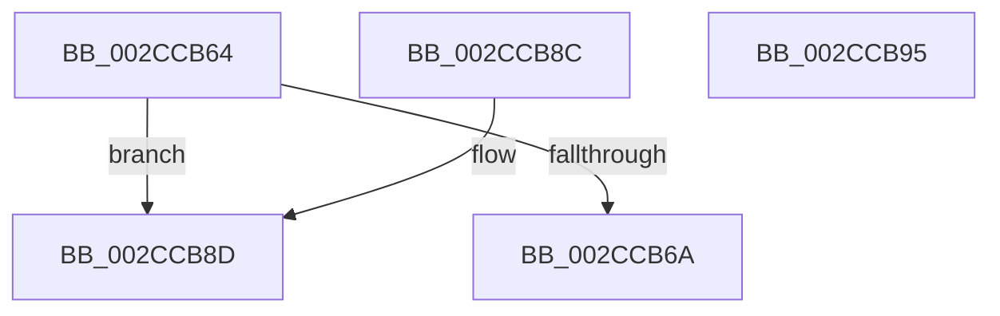

# MiEngineAffinity

- RVA: `0x002CCB64`–`0x002CCB96` (길이 `50` bytes)
- VA: `0x00000001402CCB64`
- 실행 섹션: `.text`
- PDB 이름 있음: `예`; PDB Function 태그: `아니요`
- unwind 정보 RVA: `0x000DB714`
- 디코드: `13`개 명령, `50/50` bytes 표시
- 미해석 바이트: `0` (있으면 어셈블리에 `.byte`로 보존)

> 이 문서는 커널 이미지의 기계어와 PDB 기호를 분석해 생성했습니다. 4번과 5번은 함수 원형과 자료형을 바이너리 사용 방식에서 추정한 C 해석이며 원본 소스 복구 결과는 아닙니다.

## 1. Dependencies

- 직접 호출 지점: **0**; 고유 호출 대상: **0**
- 직접 호출자로 확인된 함수: **4**
- RIP 상대 이미지 참조: **2**

### Outgoing calls
- 직접 디코드된 call 명령이 없습니다.

### Direct callers
- [MiMoveZeroThreadsToOtherCores](MiMoveZeroThreadsToOtherCores_function_002CB798.md) at `0x002CB7BA`
- [MiFindBestZeroingProcessor](MiFindBestZeroingProcessor_function_002CC73C.md) at `0x002CC7C2`
- [MiInsertNewZeroThread](../69/MiInsertNewZeroThread_function_00696140.md) at `0x0069623A`
- [MiInitializeZeroEngineCurrentPassDpcAffinity](../69/MiInitializeZeroEngineCurrentPassDpcAffinity_function_00699F04.md) at `0x00699F54`

### Static image references
- `0x002CCB74` → RVA `0x00E2DBF8` (`.data`; read)
- `0x002CCB8D` → RVA `0x00E2DBD8` (`.data`; read)

## 2. Other-region calls and transfers

- 다른 실행 섹션으로 향하는 call: **0**
- 별도 외부 분기/꼬리 이동을 확인하지 못했습니다.

## 3. Assembly (complete function range)

```asm
002CCB64  80 79 24 00                     cmp byte ptr [rcx + 0x24], 0
002CCB68  75 23                           jne 0x1402ccb8d
002CCB6A  48 8B 81 B0 00 00 00            mov rax, qword ptr [rcx + 0xb0]
002CCB71  8B 48 38                        mov ecx, dword ptr [rax + 0x38]
002CCB74  48 8B 05 7D 10 B6 00            mov rax, qword ptr [rip + 0xb6107d]
002CCB7B  48 8D 14 49                     lea rdx, [rcx + rcx*2]
002CCB7F  48 C1 E2 07                     shl rdx, 7
002CCB83  48 8B 84 02 78 01 00 00         mov rax, qword ptr [rdx + rax + 0x178]
002CCB8B  C3                              ret
002CCB8C  CC                              int3
002CCB8D  48 8D 05 44 10 B6 00            lea rax, [rip + 0xb61044]
002CCB94  C3                              ret
002CCB95  CC                              int3
```

## 4. C-style interpretation (structured pseudocode)

```c
__int64 __fastcall MiEngineAffinity(__int64 a1)
{
    if ((*(unsigned __int8 *)(a1 + 36)) != 0) goto loc_002CCB8D;
    a2 = ((unsigned int)(*(unsigned int *)(*(unsigned __int64 *)(a1 + 176) + 56)) + (unsigned int)(*(unsigned int *)(*(unsigned __int64 *)(a1 + 176) + 56)) * 2) << (7);
    return *(unsigned __int64 *)(a2 + *(unsigned __int64 *)(v_rip + 11931773) * 1 + 376);
loc_002CCB8D:
    return v_rip + 11931716;
}
```

## 5. (Beta) C Style

```c
int64_t MiEngineAffinity(void *Arg1)
{
    uint8_t *arg1 = (uint8_t *)Arg1;

    if ((*(uint8_t *)(arg1 + 0x24)) != 0) goto loc_002CCB8D;
    a2 = ((uint32_t)(*(uint32_t *)(*(uint64_t *)(arg1 + 0xB0) + 0x38)) + (uint32_t)(*(uint32_t *)(*(uint64_t *)(arg1 + 0xB0) + 0x38)) * 2) << (7);
    return *(uint64_t *)(a2 + *(uint64_t *)(v_rip + 0xB6107D) * 1 + 0x178);
loc_002CCB8D:
    return v_rip + 11931716;
}
```

### 관측된 메모리 오프셋

구조체 형식이 확인되지 않은 접근은 인자 기준의 오프셋으로만 기록했습니다.

| 기준 인자 | 오프셋 표현 | 폭 (bit) | 접근 |
|---|---:|---:|---|
| `Arg1` | `+ 0x24` | `8` | `R` |
| `Arg1` | `+ 0xB0` | `64` | `R` |

## 6. Execution-region graph

[열기: 2D/3D 그래프와 함수 탐색 컨트롤 패널](../../../control-panel.html?section=text&rva=0x002CCB64&view=graph)

- 2D 그래프는 위에서 아래로 흐르고, 3D 그래프는 빈 공간을 드래그해 회전합니다. Shift+드래그는 이동, 휠은 확대·축소, 함수 노드 선택은 대상 보고서 이동입니다.

### Static fallback


