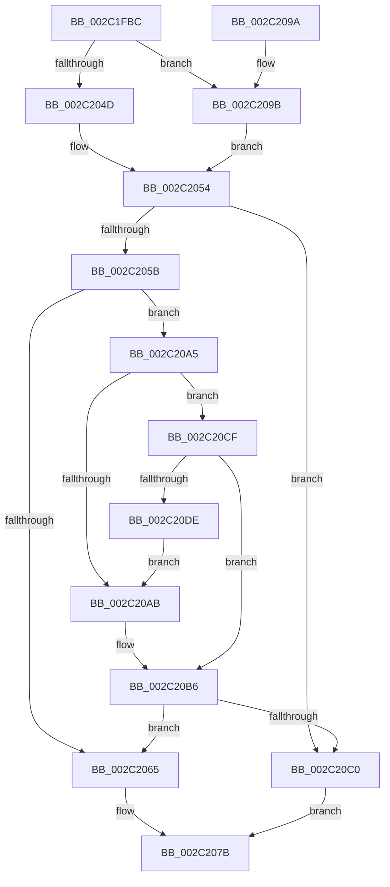

# MiEvictPageTableLock

- RVA: `0x002C1FBC`–`0x002C20E0` (길이 `292` bytes)
- VA: `0x00000001402C1FBC`
- 실행 섹션: `.text`
- PDB 이름 있음: `예`; PDB Function 태그: `아니요`
- unwind 정보 RVA: `0x0006E83C`
- 디코드: `82`개 명령, `292/292` bytes 표시
- 미해석 바이트: `0` (있으면 어셈블리에 `.byte`로 보존)

> 이 문서는 커널 이미지의 기계어와 PDB 기호를 분석해 생성했습니다. 4번과 5번은 함수 원형과 자료형을 바이너리 사용 방식에서 추정한 C 해석이며 원본 소스 복구 결과는 아닙니다.

## 1. Dependencies

- 직접 호출 지점: **7**; 고유 호출 대상: **6**
- 직접 호출자로 확인된 함수: **2**
- RIP 상대 이미지 참조: **0**

### Outgoing calls
- `0x002C1FE8` → [MI_READ_PTE_LOCK_FREE](../28/MI_READ_PTE_LOCK_FREE_function_002828A0.md) (function, `0x002828A0`)
- `0x002C2022` → [MiLockNestedPageTable](../23/MiLockNestedPageTable_function_0023E890.md) (function, `0x0023E890`)
- `0x002C202A` → [MI_READ_PTE_LOCK_FREE](../28/MI_READ_PTE_LOCK_FREE_function_002828A0.md) (function, `0x002828A0`)
- `0x002C2071` → [MiUnlockNestedPageTableWritePte](../23/MiUnlockNestedPageTableWritePte_function_0023F4E4.md) (function, `0x0023F4E4`)
- `0x002C20B1` → [MiCleanupLazyStampedPageTable](../32/MiCleanupLazyStampedPageTable_function_0032A43C.md) (function, `0x0032A43C`)
- `0x002C20C6` → [MiUnlockPageTable](../21/MiUnlockPageTable_function_00216EC0.md) (function, `0x00216EC0`)
- `0x002C20D4` → [MiGetAnyMultiplexedVm](../44/MiGetAnyMultiplexedVm_function_00448BD0.md) (function, `0x00448BD0`)

### Direct callers
- [sub_002C1DF6](Unknown_function_002C1DF6.md) at `0x002C1E03`
- [MiDeleteSystemPageTable](../49/MiDeleteSystemPageTable_function_004916B0.md) at `0x0049176C`

### Static image references
- 디코드된 RIP-relative 메모리 참조가 없습니다.

## 2. Other-region calls and transfers

- 다른 실행 섹션으로 향하는 call: **0**
- 별도 외부 분기/꼬리 이동을 확인하지 못했습니다.

## 3. Assembly (complete function range)

```asm
002C1FBC  48 8B C4                        mov rax, rsp
002C1FBF  48 89 58 08                     mov qword ptr [rax + 8], rbx
002C1FC3  48 89 68 10                     mov qword ptr [rax + 0x10], rbp
002C1FC7  48 89 70 18                     mov qword ptr [rax + 0x18], rsi
002C1FCB  48 89 78 20                     mov qword ptr [rax + 0x20], rdi
002C1FCF  41 54                           push r12
002C1FD1  41 56                           push r14
002C1FD3  41 57                           push r15
002C1FD5  48 83 EC 20                     sub rsp, 0x20
002C1FD9  48 8B F9                        mov rdi, rcx
002C1FDC  49 8B D9                        mov rbx, r9
002C1FDF  48 8B CA                        mov rcx, rdx
002C1FE2  45 8B F0                        mov r14d, r8d
002C1FE5  48 8B F2                        mov rsi, rdx
002C1FE8  E8 B3 08 FC FF                  call 0x1402828a0
002C1FED  48 C1 E8 0C                     shr rax, 0xc
002C1FF1  49 BC FF FF FF FF FF 00 00 00   movabs r12, 0xffffffffff
002C1FFB  49 23 C4                        and rax, r12
002C1FFE  49 BF 00 00 00 00 00 DE FF FF   movabs r15, 0xffffde0000000000
002C2008  48 8D 2C 40                     lea rbp, [rax + rax*2]
002C200C  48 C1 E5 04                     shl rbp, 4
002C2010  49 8B C7                        mov rax, r15
002C2013  48 03 E8                        add rbp, rax
002C2016  48 8B D6                        mov rdx, rsi
002C2019  8B 87 B8 00 00 00               mov eax, dword ptr [rdi + 0xb8]
002C201F  48 8B CF                        mov rcx, rdi
002C2022  E8 69 C8 F7 FF                  call 0x14023e890
002C2027  48 8B CE                        mov rcx, rsi
002C202A  E8 71 08 FC FF                  call 0x1402828a0
002C202F  48 C1 E8 0C                     shr rax, 0xc
002C2033  49 23 C4                        and rax, r12
002C2036  48 8D 0C 40                     lea rcx, [rax + rax*2]
002C203A  48 C1 E1 04                     shl rcx, 4
002C203E  49 8B C7                        mov rax, r15
002C2041  48 03 C8                        add rcx, rax
002C2044  8B 41 24                        mov eax, dword ptr [rcx + 0x24]
002C2047  0F BA E0 1A                     bt eax, 0x1a
002C204B  73 4E                           jae 0x1402c209b
002C204D  48 8B 01                        mov rax, qword ptr [rcx]
002C2050  48 C1 E8 20                     shr rax, 0x20
002C2054  A9 FF 03 00 00                  test eax, 0x3ff
002C2059  75 65                           jne 0x1402c20c0
002C205B  8B 87 B8 00 00 00               mov eax, dword ptr [rdi + 0xb8]
002C2061  A8 0F                           test al, 0xf
002C2063  75 40                           jne 0x1402c20a5
002C2065  45 33 C9                        xor r9d, r9d
002C2068  4C 8B C3                        mov r8, rbx
002C206B  48 8B D6                        mov rdx, rsi
002C206E  48 8B CF                        mov rcx, rdi
002C2071  E8 6E D4 F7 FF                  call 0x14023f4e4
002C2076  B8 01 00 00 00                  mov eax, 1
002C207B  48 8B 5C 24 40                  mov rbx, qword ptr [rsp + 0x40]
002C2080  48 8B 6C 24 48                  mov rbp, qword ptr [rsp + 0x48]
002C2085  48 8B 74 24 50                  mov rsi, qword ptr [rsp + 0x50]
002C208A  48 8B 7C 24 58                  mov rdi, qword ptr [rsp + 0x58]
002C208F  48 83 C4 20                     add rsp, 0x20
002C2093  41 5F                           pop r15
002C2095  41 5E                           pop r14
002C2097  41 5C                           pop r12
002C2099  C3                              ret
002C209A  CC                              int3
002C209B  48 8B 41 10                     mov rax, qword ptr [rcx + 0x10]
002C209F  48 C1 E8 10                     shr rax, 0x10
002C20A3  EB AF                           jmp 0x1402c2054
002C20A5  41 83 FE 01                     cmp r14d, 1
002C20A9  75 24                           jne 0x1402c20cf
002C20AB  48 8B D6                        mov rdx, rsi
002C20AE  48 8B CF                        mov rcx, rdi
002C20B1  E8 86 83 06 00                  call 0x14032a43c
002C20B6  48 8B 4D 18                     mov rcx, qword ptr [rbp + 0x18]
002C20BA  66 83 F9 01                     cmp cx, 1
002C20BE  74 A5                           je 0x1402c2065
002C20C0  48 8B D6                        mov rdx, rsi
002C20C3  48 8B CF                        mov rcx, rdi
002C20C6  E8 F5 4D F5 FF                  call 0x140216ec0
002C20CB  33 C0                           xor eax, eax
002C20CD  EB AC                           jmp 0x1402c207b
002C20CF  B9 04 00 00 00                  mov ecx, 4
002C20D4  E8 F7 6A 18 00                  call 0x140448bd0
002C20D9  48 3B F8                        cmp rdi, rax
002C20DC  75 D8                           jne 0x1402c20b6
002C20DE  EB CB                           jmp 0x1402c20ab
```

## 4. C-style interpretation (structured pseudocode)

```c
__int64 __fastcall MiEvictPageTableLock(__int64 a1, __int64 a2, int a3, __int64 a4)
{
    __int64 result;
    __int64 v_rbp;
    __int64 v_rsp;
    unsigned __int64 v_stack_p10;
    unsigned __int64 v_stack_p18;
    unsigned __int64 v_stack_p20;
    unsigned __int64 v_stack_p8;

    *(unsigned __int64 *)(v_rsp + 8) = v_rbx;
    *(unsigned __int64 *)(v_rsp + 16) = v_rbp;
    *(unsigned __int64 *)(v_rsp + 24) = v_rsi;
    *(unsigned __int64 *)(v_rsp + 32) = v_rdi;
    v_rsp = (v_rsp) - (32);
    result = MI_READ_PTE_LOCK_FREE(a2, a2, a3, a4);
    result = (result) >> (12);
    result = (result) & (v_r12);
    v_rbp = (result + result * 2) << (4);
    v_rbp = (v_rbp) + (v_r15);
    result = MiLockNestedPageTable(a1, a2, a3, a4);
    result = MI_READ_PTE_LOCK_FREE(a2, a2, a3, a4);
    result = (result) >> (12);
    result = (result) & (v_r12);
    a1 = (result + result * 2) << (4);
    a1 = (a1) + (v_r15);
    if (condition_is_above_or_equal) goto loc_002C209B;
    result = (*(unsigned __int64 *)(a1)) >> (32);
loc_002C2054:
    if ((((unsigned int)(result)) & (0x3FFULL)) != 0) goto loc_002C20C0;
    if ((((unsigned __int8)((unsigned int)(*(unsigned int *)(a1 + 184)))) & (15)) != 0) goto loc_002C20A5;
loc_002C2065:
    a4 = 0;
    result = MiUnlockNestedPageTableWritePte(a1, a2, 0, a4);
loc_002C207B:
    v_rsp = (v_rsp) + (32);
    return 1;
loc_002C209B:
    result = (*(unsigned __int64 *)(a1 + 16)) >> (16);
    goto loc_002C2054;
loc_002C20A5:
    if (((unsigned int)((unsigned int)(a3))) != 1) goto loc_002C20CF;
loc_002C20AB:
    result = MiCleanupLazyStampedPageTable(v_stack_p20, v_stack_p18, 0, a4);
loc_002C20B6:
    if (((unsigned __int16)(*(unsigned __int64 *)(v_stack_p10 + 24))) == 1) goto loc_002C2065;
loc_002C20C0:
    result = MiUnlockPageTable(v_stack_p20, v_stack_p18, 0, a4);
    result = 0;
    goto loc_002C207B;
loc_002C20CF:
    result = MiGetAnyMultiplexedVm(4, v_stack_p18, 0, a4);
    if (v_stack_p20 != result) goto loc_002C20B6;
    goto loc_002C20AB;
}
```

## 5. (Beta) C Style

```c
int64_t MiEvictPageTableLock(void *Arg1, int64_t Arg2, int32_t Arg3, int64_t Arg4)
{
    uint8_t *arg1 = (uint8_t *)Arg1;

    int64_t result;
    int64_t local_rbp;
    int64_t local_rsp;
    uint64_t v_stack_p10;
    uint64_t v_stack_p18;
    uint64_t v_stack_p20;
    uint64_t v_stack_p8;

    *(uint64_t *)(local_rsp + 0x8) = local_rbx;
    *(uint64_t *)(local_rsp + 0x10) = local_rbp;
    *(uint64_t *)(local_rsp + 0x18) = local_rsi;
    *(uint64_t *)(local_rsp + 0x20) = local_rdi;
    local_rsp = (local_rsp) - (32);
    result = MI_READ_PTE_LOCK_FREE(Arg2, Arg2, Arg3, Arg4);
    result = (result) >> (12);
    result = (result) & (local_r12);
    local_rbp = (result + result * 2) << (4);
    local_rbp = (local_rbp) + (local_r15);
    result = MiLockNestedPageTable(Arg1, Arg2, Arg3, Arg4);
    result = MI_READ_PTE_LOCK_FREE(Arg2, Arg2, Arg3, Arg4);
    result = (result) >> (12);
    result = (result) & (local_r12);
    Arg1 = (result + result * 2) << (4);
    Arg1 = (Arg1) + (local_r15);
    if (condition_is_above_or_equal) goto loc_002C209B;
    result = (*(uint64_t *)(arg1)) >> (32);
loc_002C2054:
    if ((((uint32_t)(result)) & (0x3FFULL)) != 0) goto loc_002C20C0;
    if ((((uint8_t)((uint32_t)(*(uint32_t *)(arg1 + 0xB8)))) & (15)) != 0) goto loc_002C20A5;
loc_002C2065:
    Arg4 = 0;
    result = MiUnlockNestedPageTableWritePte(Arg1, Arg2, 0, Arg4);
loc_002C207B:
    local_rsp = (local_rsp) + (32);
    return 1;
loc_002C209B:
    result = (*(uint64_t *)(arg1 + 0x10)) >> (16);
    goto loc_002C2054;
loc_002C20A5:
    if (((uint32_t)((uint32_t)(Arg3))) != 1) goto loc_002C20CF;
loc_002C20AB:
    result = MiCleanupLazyStampedPageTable(v_stack_p20, v_stack_p18, 0, Arg4);
loc_002C20B6:
    if (((uint16_t)(*(uint64_t *)(v_stack_p10 + 0x18))) == 1) goto loc_002C2065;
loc_002C20C0:
    result = MiUnlockPageTable(v_stack_p20, v_stack_p18, 0, Arg4);
    result = 0;
    goto loc_002C207B;
loc_002C20CF:
    result = MiGetAnyMultiplexedVm(4, v_stack_p18, 0, Arg4);
    if (v_stack_p20 != result) goto loc_002C20B6;
    goto loc_002C20AB;
}
```

### 관측된 메모리 오프셋

구조체 형식이 확인되지 않은 접근은 인자 기준의 오프셋으로만 기록했습니다.

| 기준 인자 | 오프셋 표현 | 폭 (bit) | 접근 |
|---|---:|---:|---|
| `Arg1` | `+ 0xB8` | `32` | `R` |

## 6. Execution-region graph

[열기: 2D/3D 그래프와 함수 탐색 컨트롤 패널](../../../control-panel.html?section=text&rva=0x002C1FBC&view=graph)

- 2D 그래프는 위에서 아래로 흐르고, 3D 그래프는 빈 공간을 드래그해 회전합니다. Shift+드래그는 이동, 휠은 확대·축소, 함수 노드 선택은 대상 보고서 이동입니다.

### Static fallback


