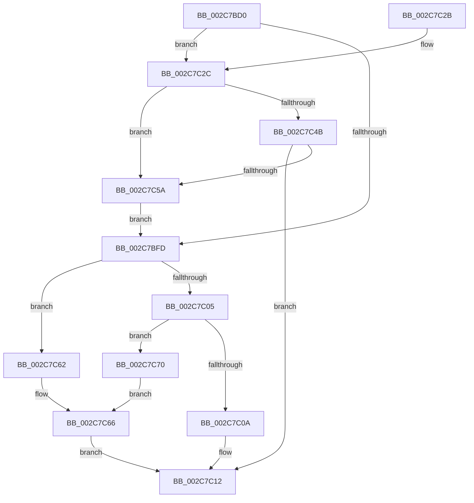

# MiFillMemory

- RVA: `0x002C7BD0`–`0x002C7C74` (길이 `164` bytes)
- VA: `0x00000001402C7BD0`
- 실행 섹션: `.text`
- PDB 이름 있음: `예`; PDB Function 태그: `아니요`
- unwind 정보 RVA: `0x0006EE4C`
- 디코드: `51`개 명령, `164/164` bytes 표시
- 미해석 바이트: `0` (있으면 어셈블리에 `.byte`로 보존)

> 이 문서는 커널 이미지의 기계어와 PDB 기호를 분석해 생성했습니다. 4번과 5번은 함수 원형과 자료형을 바이너리 사용 방식에서 추정한 C 해석이며 원본 소스 복구 결과는 아닙니다.

## 1. Dependencies

- 직접 호출 지점: **4**; 고유 호출 대상: **4**
- 직접 호출자로 확인된 함수: **4**
- RIP 상대 이미지 참조: **1**

### Outgoing calls
- `0x002C7C0D` → [KeZeroPages](../6B/KeZeroPages_function_006BA070.md) (function, `0x006BA070`)
- `0x002C7C42` → [AccelBuildDescriptorMemoryFill](AccelBuildDescriptorMemoryFill_function_002C7CBC.md) (function, `0x002C7CBC`)
- `0x002C7C51` → [AccelpSubmitWork](AccelpSubmitWork_function_002C8190.md) (function, `0x002C8190`)
- `0x002C7C69` → [memset](../6C/memset_function_006C6C40.md) (function, `0x006C6C40`)

### Direct callers
- [MiSoloZeroHugeRange](../68/MiSoloZeroHugeRange_function_0068C6E4.md) at `0x0068C7C2`
- [MiZeroHugeRangeWorker](../68/MiZeroHugeRangeWorker_function_0068C960.md) at `0x0068CA04`
- [MiComputeCacheAttributeSpeeds](../69/MiComputeCacheAttributeSpeeds_function_006999E8.md) at `0x00699C88`
- [MiZeroPageCalibrateDpc](../69/MiZeroPageCalibrateDpc_function_0069AA90.md) at `0x0069AC4A`

### Static image references
- `0x002C7C5A` → RVA `0x00EF508C` (`.data`; read/write)

## 2. Other-region calls and transfers

- 다른 실행 섹션으로 향하는 call: **0**
- 별도 외부 분기/꼬리 이동을 확인하지 못했습니다.

## 3. Assembly (complete function range)

```asm
002C7BD0  48 89 5C 24 08                  mov qword ptr [rsp + 8], rbx
002C7BD5  48 89 6C 24 10                  mov qword ptr [rsp + 0x10], rbp
002C7BDA  48 89 74 24 18                  mov qword ptr [rsp + 0x18], rsi
002C7BDF  57                              push rdi
002C7BE0  41 56                           push r14
002C7BE2  41 57                           push r15
002C7BE4  48 83 EC 30                     sub rsp, 0x30
002C7BE8  8B 5C 24 70                     mov ebx, dword ptr [rsp + 0x70]
002C7BEC  49 8B F9                        mov rdi, r9
002C7BEF  49 8B F0                        mov rsi, r8
002C7BF2  48 8B EA                        mov rbp, rdx
002C7BF5  4C 8B F1                        mov r14, rcx
002C7BF8  48 85 C9                        test rcx, rcx
002C7BFB  75 2F                           jne 0x1402c7c2c
002C7BFD  48 8B CD                        mov rcx, rbp
002C7C00  48 85 FF                        test rdi, rdi
002C7C03  75 5D                           jne 0x1402c7c62
002C7C05  83 FB 01                        cmp ebx, 1
002C7C08  75 66                           jne 0x1402c7c70
002C7C0A  48 8B D6                        mov rdx, rsi
002C7C0D  E8 5E 24 3F 00                  call 0x1406ba070
002C7C12  48 8B 5C 24 50                  mov rbx, qword ptr [rsp + 0x50]
002C7C17  48 8B 6C 24 58                  mov rbp, qword ptr [rsp + 0x58]
002C7C1C  48 8B 74 24 60                  mov rsi, qword ptr [rsp + 0x60]
002C7C21  48 83 C4 30                     add rsp, 0x30
002C7C25  41 5F                           pop r15
002C7C27  41 5E                           pop r14
002C7C29  5F                              pop rdi
002C7C2A  C3                              ret
002C7C2B  CC                              int3
002C7C2C  B8 01 00 00 00                  mov eax, 1
002C7C31  41 BF 03 00 00 00               mov r15d, 3
002C7C37  3B D8                           cmp ebx, eax
002C7C39  44 0F 45 F8                     cmovne r15d, eax
002C7C3D  4C 89 7C 24 20                  mov qword ptr [rsp + 0x20], r15
002C7C42  E8 75 00 00 00                  call 0x1402c7cbc
002C7C47  85 C0                           test eax, eax
002C7C49  78 0F                           js 0x1402c7c5a
002C7C4B  41 8B D7                        mov edx, r15d
002C7C4E  49 8B CE                        mov rcx, r14
002C7C51  E8 3A 05 00 00                  call 0x1402c8190
002C7C56  85 C0                           test eax, eax
002C7C58  79 B8                           jns 0x1402c7c12
002C7C5A  FF 05 2C D4 C2 00               inc dword ptr [rip + 0xc2d42c]
002C7C60  EB 9B                           jmp 0x1402c7bfd
002C7C62  40 0F B6 D7                     movzx edx, dil
002C7C66  4C 8B C6                        mov r8, rsi
002C7C69  E8 D2 EF 3F 00                  call 0x1406c6c40
002C7C6E  EB A2                           jmp 0x1402c7c12
002C7C70  33 D2                           xor edx, edx
002C7C72  EB F2                           jmp 0x1402c7c66
```

## 4. C-style interpretation (structured pseudocode)

```c
__int64 __fastcall MiFillMemory(__int64 a1, __int64 a2, __int64 a3, __int64 a4, unsigned int a5)
{
    __int64 result;
    __int64 v_r15;
    __int64 v_rsp;
    unsigned __int64 v_stack_p10;
    unsigned __int64 v_stack_p18;
    unsigned __int64 v_stack_p20;
    unsigned __int64 v_stack_p8;

    v_stack_p8 = v_rbx;
    v_stack_p10 = v_rbp;
    v_stack_p18 = v_rsi;
    v_rsp = (v_rsp) - (48);
    if (a1 != 0) goto loc_002C7C2C;
loc_002C7BFD:
    if (a4 != 0) goto loc_002C7C62;
    if (((unsigned int)((unsigned int)(a5))) != 1) goto loc_002C7C70;
    result = KeZeroPages(a2, a3, a3, a4);
loc_002C7C12:
    v_rsp = (v_rsp) + (48);
    return result;
loc_002C7C2C:
    v_r15 = 3;
    if (((unsigned int)(v_stack_p8)) != 1) { v_r15 = 1; }
    v_stack_p20 = v_r15;
    result = AccelBuildDescriptorMemoryFill(a2, a3, a3, a4);
    if (sign_flag) goto loc_002C7C5A;
    result = AccelpSubmitWork(a1, (unsigned int)((unsigned int)(v_r15)), a3, a4);
    if (!sign_flag) goto loc_002C7C12;
loc_002C7C5A:
    goto loc_002C7BFD;
loc_002C7C62:
loc_002C7C66:
    result = memset(a1, (unsigned __int8)(a4), v_stack_p18, a4);
    goto loc_002C7C12;
loc_002C7C70:
    a2 = 0;
    goto loc_002C7C66;
}
```

## 5. (Beta) C Style

```c
int64_t MiFillMemory(int64_t Arg1, int64_t Arg2, int64_t Arg3, int64_t Arg4, uint32_t Arg5)
{
    int64_t result;
    int64_t local_r15;
    int64_t local_rsp;
    uint64_t v_stack_p10;
    uint64_t v_stack_p18;
    uint64_t v_stack_p20;
    uint64_t v_stack_p8;

    v_stack_p8 = local_rbx;
    v_stack_p10 = local_rbp;
    v_stack_p18 = local_rsi;
    local_rsp = (local_rsp) - (48);
    if (Arg1 != 0) goto loc_002C7C2C;
loc_002C7BFD:
    if (Arg4 != 0) goto loc_002C7C62;
    if (((uint32_t)((uint32_t)(Arg5))) != 1) goto loc_002C7C70;
    result = KeZeroPages(Arg2, Arg3, Arg3, Arg4);
loc_002C7C12:
    local_rsp = (local_rsp) + (48);
    return result;
loc_002C7C2C:
    local_r15 = 3;
    if (((uint32_t)(v_stack_p8)) != 1) { local_r15 = 1; }
    v_stack_p20 = local_r15;
    result = AccelBuildDescriptorMemoryFill(Arg2, Arg3, Arg3, Arg4);
    if (sign_flag) goto loc_002C7C5A;
    result = AccelpSubmitWork(Arg1, (uint32_t)((uint32_t)(local_r15)), Arg3, Arg4);
    if (!sign_flag) goto loc_002C7C12;
loc_002C7C5A:
    goto loc_002C7BFD;
loc_002C7C62:
loc_002C7C66:
    result = memset(Arg1, (uint8_t)(Arg4), v_stack_p18, Arg4);
    goto loc_002C7C12;
loc_002C7C70:
    Arg2 = 0;
    goto loc_002C7C66;
}
```

## 6. Execution-region graph

[열기: 2D/3D 그래프와 함수 탐색 컨트롤 패널](../../../control-panel.html?section=text&rva=0x002C7BD0&view=graph)

- 2D 그래프는 위에서 아래로 흐르고, 3D 그래프는 빈 공간을 드래그해 회전합니다. Shift+드래그는 이동, 휠은 확대·축소, 함수 노드 선택은 대상 보고서 이동입니다.

### Static fallback


