# MiFindBestZeroingProcessor

- RVA: `0x002CC73C`–`0x002CCAA3` (길이 `871` bytes)
- VA: `0x00000001402CC73C`
- 실행 섹션: `.text`
- PDB 이름 있음: `예`; PDB Function 태그: `아니요`
- unwind 정보 RVA: `0x0006F48C`
- 디코드: `219`개 명령, `871/871` bytes 표시
- 미해석 바이트: `0` (있으면 어셈블리에 `.byte`로 보존)

> 이 문서는 커널 이미지의 기계어와 PDB 기호를 분석해 생성했습니다. 4번과 5번은 함수 원형과 자료형을 바이너리 사용 방식에서 추정한 C 해석이며 원본 소스 복구 결과는 아닙니다.

## 1. Dependencies

- 직접 호출 지점: **8**; 고유 호출 대상: **8**
- 직접 호출자로 확인된 함수: **4**
- RIP 상대 이미지 참조: **3**

### Outgoing calls
- `0x002CC788` → [memset](../6C/memset_function_006C6C40.md) (function, `0x006C6C40`)
- `0x002CC7C2` → [MiEngineAffinity](MiEngineAffinity_function_002CCB64.md) (function, `0x002CCB64`)
- `0x002CC7F6` → [ExAcquireSpinLockSharedAtDpcLevel](../24/ExAcquireSpinLockSharedAtDpcLevel_function_00248E30.md) (function, `0x00248E30`)
- `0x002CC867` → [MiReleaseSpinLockShared](../34/MiReleaseSpinLockShared_function_00348BF0.md) (function, `0x00348BF0`)
- `0x002CC944` → [memcpy](../6C/memcpy_function_006C6840.md) (function, `0x006C6840`)
- `0x002CC97E` → [MiGetNextAffinityWalker](MiGetNextAffinityWalker_function_002CCC28.md) (function, `0x002CCC28`)
- `0x002CC9FD` → [_security_check_cookie](../6A/_security_check_cookie_function_006AC640.md) (function, `0x006AC640`)
- `0x002CCA46` → [KeBugCheckEx](../4F/KeBugCheckEx_function_004FD660.md) (function, `0x004FD660`)

### Direct callers
- [MiAddZeroingThreads](MiAddZeroingThreads_function_002CBF78.md) at `0x002CC171`
- [MiGetEngineBackgroundQualifications](MiGetEngineBackgroundQualifications_function_002CC4BC.md) at `0x002CC53C`
- [sub_002CC67B](Unknown_function_002CC67B.md) at `0x002CC6C5`
- [MiBackgroundZeroLocalPages](../31/MiBackgroundZeroLocalPages_function_0031EF30.md) at `0x0031F6B1`

### Static image references
- `0x002CC75B` → RVA `0x00E0A740` (`.data`; read)
- `0x002CC7EF` → RVA `0x00E2ED40` (`.data`; read)
- `0x002CC803` → RVA `0x00E2ED48` (`.data`; read)

## 2. Other-region calls and transfers

- 다른 실행 섹션으로 향하는 call: **0**
- 별도 외부 분기/꼬리 이동을 확인하지 못했습니다.

## 3. Assembly (complete function range)

```asm
002CC73C  48 89 5C 24 18                  mov qword ptr [rsp + 0x18], rbx
002CC741  55                              push rbp
002CC742  56                              push rsi
002CC743  57                              push rdi
002CC744  41 54                           push r12
002CC746  41 55                           push r13
002CC748  41 56                           push r14
002CC74A  41 57                           push r15
002CC74C  48 8D AC 24 F0 FE FF FF         lea rbp, [rsp - 0x110]
002CC754  48 81 EC 10 02 00 00            sub rsp, 0x210
002CC75B  48 8B 05 DE DF B3 00            mov rax, qword ptr [rip + 0xb3dfde]
002CC762  48 33 C4                        xor rax, rsp
002CC765  48 89 85 00 01 00 00            mov qword ptr [rbp + 0x100], rax
002CC76C  44 89 44 24 30                  mov dword ptr [rsp + 0x30], r8d
002CC771  48 8B FA                        mov rdi, rdx
002CC774  48 8B D9                        mov rbx, rcx
002CC777  44 89 4C 24 34                  mov dword ptr [rsp + 0x34], r9d
002CC77C  33 D2                           xor edx, edx
002CC77E  48 8D 4D 80                     lea rcx, [rbp - 0x80]
002CC782  41 B8 78 01 00 00               mov r8d, 0x178
002CC788  E8 B3 A4 3F 00                  call 0x1406c6c40
002CC78D  0F 57 C9                        xorps xmm1, xmm1
002CC790  33 C0                           xor eax, eax
002CC792  0F 11 0B                        movups xmmword ptr [rbx], xmm1
002CC795  48 8B CF                        mov rcx, rdi
002CC798  48 89 44 24 70                  mov qword ptr [rsp + 0x70], rax
002CC79D  0F 11 4B 10                     movups xmmword ptr [rbx + 0x10], xmm1
002CC7A1  0F 11 4B 20                     movups xmmword ptr [rbx + 0x20], xmm1
002CC7A5  48 89 43 30                     mov qword ptr [rbx + 0x30], rax
002CC7A9  4C 8B 87 B0 00 00 00            mov r8, qword ptr [rdi + 0xb0]
002CC7B0  0F 57 C0                        xorps xmm0, xmm0
002CC7B3  0F 11 44 24 40                  movups xmmword ptr [rsp + 0x40], xmm0
002CC7B8  0F 11 44 24 50                  movups xmmword ptr [rsp + 0x50], xmm0
002CC7BD  0F 11 44 24 60                  movups xmmword ptr [rsp + 0x60], xmm0
002CC7C2  E8 9D 03 00 00                  call 0x1402ccb64
002CC7C7  8B 0F                           mov ecx, dword ptr [rdi]
002CC7C9  45 33 F6                        xor r14d, r14d
002CC7CC  48 8B F0                        mov rsi, rax
002CC7CF  48 89 44 24 38                  mov qword ptr [rsp + 0x38], rax
002CC7D4  44 8B 68 08                     mov r13d, dword ptr [rax + 8]
002CC7D8  89 4D 8C                        mov dword ptr [rbp - 0x74], ecx
002CC7DB  41 8B 48 38                     mov ecx, dword ptr [r8 + 0x38]
002CC7DF  89 4D 80                        mov dword ptr [rbp - 0x80], ecx
002CC7E2  41 8B 48 38                     mov ecx, dword ptr [r8 + 0x38]
002CC7E6  89 4D 84                        mov dword ptr [rbp - 0x7c], ecx
002CC7E9  8A 4F 24                        mov cl, byte ptr [rdi + 0x24]
002CC7EC  88 4D 88                        mov byte ptr [rbp - 0x78], cl
002CC7EF  48 8D 0D 4A 25 B6 00            lea rcx, [rip + 0xb6254a]
002CC7F6  E8 35 C6 F7 FF                  call 0x140248e30
002CC7FB  45 8D 46 02                     lea r8d, [r14 + 2]
002CC7FF  48 8D 55 90                     lea rdx, [rbp - 0x70]
002CC803  48 8D 05 3E 25 B6 00            lea rax, [rip + 0xb6253e]
002CC80A  45 8D 48 7E                     lea r9d, [r8 + 0x7e]
002CC80E  0F 10 00                        movups xmm0, xmmword ptr [rax]
002CC811  0F 10 48 10                     movups xmm1, xmmword ptr [rax + 0x10]
002CC815  0F 11 02                        movups xmmword ptr [rdx], xmm0
002CC818  0F 10 40 20                     movups xmm0, xmmword ptr [rax + 0x20]
002CC81C  0F 11 4A 10                     movups xmmword ptr [rdx + 0x10], xmm1
002CC820  0F 10 48 30                     movups xmm1, xmmword ptr [rax + 0x30]
002CC824  0F 11 42 20                     movups xmmword ptr [rdx + 0x20], xmm0
002CC828  0F 10 40 40                     movups xmm0, xmmword ptr [rax + 0x40]
002CC82C  0F 11 4A 30                     movups xmmword ptr [rdx + 0x30], xmm1
002CC830  0F 10 48 50                     movups xmm1, xmmword ptr [rax + 0x50]
002CC834  0F 11 42 40                     movups xmmword ptr [rdx + 0x40], xmm0
002CC838  0F 10 40 60                     movups xmm0, xmmword ptr [rax + 0x60]
002CC83C  0F 11 4A 50                     movups xmmword ptr [rdx + 0x50], xmm1
002CC840  0F 10 48 70                     movups xmm1, xmmword ptr [rax + 0x70]
002CC844  49 03 C1                        add rax, r9
002CC847  0F 11 42 60                     movups xmmword ptr [rdx + 0x60], xmm0
002CC84B  49 03 D1                        add rdx, r9
002CC84E  0F 11 4A F0                     movups xmmword ptr [rdx - 0x10], xmm1
002CC852  49 83 E8 01                     sub r8, 1
002CC856  75 B6                           jne 0x1402cc80e
002CC858  48 8B 00                        mov rax, qword ptr [rax]
002CC85B  48 8D 0D DE 24 B6 00            lea rcx, [rip + 0xb624de]
002CC862  48 89 02                        mov qword ptr [rdx], rax
002CC865  B2 11                           mov dl, 0x11
002CC867  E8 84 C3 07 00                  call 0x140348bf0
002CC86C  4C 63 3F                        movsxd r15, dword ptr [rdi]
002CC86F  45 33 D2                        xor r10d, r10d
002CC872  49 C1 E7 05                     shl r15, 5
002CC876  45 8B E2                        mov r12d, r10d
002CC879  83 C8 FF                        or eax, 0xffffffff
002CC87C  C7 43 28 05 00 00 00            mov dword ptr [rbx + 0x28], 5
002CC883  89 43 2C                        mov dword ptr [rbx + 0x2c], eax
002CC886  46 89 94 3D 9C 00 00 00         mov dword ptr [rbp + r15 + 0x9c], r10d
002CC88E  46 89 94 3D B0 00 00 00         mov dword ptr [rbp + r15 + 0xb0], r10d
002CC896  42 89 84 3D B4 00 00 00         mov dword ptr [rbp + r15 + 0xb4], eax
002CC89E  45 3B E5                        cmp r12d, r13d
002CC8A1  0F 83 41 01 00 00               jae 0x1402cc9e8
002CC8A7  49 8B D2                        mov rdx, r10
002CC8AA  45 85 ED                        test r13d, r13d
002CC8AD  0F 84 35 01 00 00               je 0x1402cc9e8
002CC8B3  48 8B 8F 88 00 00 00            mov rcx, qword ptr [rdi + 0x88]
002CC8BA  4D 8B DD                        mov r11, r13
002CC8BD  44 39 51 28                     cmp dword ptr [rcx + 0x28], r10d
002CC8C1  74 36                           je 0x1402cc8f9
002CC8C3  44 0F B7 4E 10                  movzx r9d, word ptr [rsi + 0x10]
002CC8C8  45 8B C2                        mov r8d, r10d
002CC8CB  45 85 C9                        test r9d, r9d
002CC8CE  74 18                           je 0x1402cc8e8
002CC8D0  4C 8B 51 08                     mov r10, qword ptr [rcx + 8]
002CC8D4  41 8B C0                        mov eax, r8d
002CC8D7  48 03 C0                        add rax, rax
002CC8DA  49 83 3C C2 00                  cmp qword ptr [r10 + rax*8], 0
002CC8DF  0F 84 78 01 00 00               je 0x1402cca5d
002CC8E5  45 33 D2                        xor r10d, r10d
002CC8E8  45 3B C1                        cmp r8d, r9d
002CC8EB  74 0C                           je 0x1402cc8f9
002CC8ED  48 85 D2                        test rdx, rdx
002CC8F0  0F 85 9E 01 00 00               jne 0x1402cca94
002CC8F6  48 8B D1                        mov rdx, rcx
002CC8F9  48 83 C1 30                     add rcx, 0x30
002CC8FD  49 83 EB 01                     sub r11, 1
002CC901  75 BA                           jne 0x1402cc8bd
002CC903  48 85 D2                        test rdx, rdx
002CC906  0F 84 DC 00 00 00               je 0x1402cc9e8
002CC90C  48 8B F2                        mov rsi, rdx
002CC90F  48 B8 AB AA AA AA AA AA AA AA   movabs rax, 0xaaaaaaaaaaaaaaab
002CC919  48 2B B7 88 00 00 00            sub rsi, qword ptr [rdi + 0x88]
002CC920  48 C1 FE 04                     sar rsi, 4
002CC924  48 0F AF F0                     imul rsi, rax
002CC928  44 39 17                        cmp dword ptr [rdi], r10d
002CC92B  0F 84 4D 01 00 00               je 0x1402cca7e
002CC931  44 8B 47 14                     mov r8d, dword ptr [rdi + 0x14]
002CC935  48 8B 52 08                     mov rdx, qword ptr [rdx + 8]
002CC939  48 8B 8F A0 00 00 00            mov rcx, qword ptr [rdi + 0xa0]
002CC940  49 C1 E0 04                     shl r8, 4
002CC944  E8 F7 9E 3F 00                  call 0x1406c6840
002CC949  48 8B 4C 24 38                  mov rcx, qword ptr [rsp + 0x38]
002CC94E  48 8D 54 24 40                  lea rdx, [rsp + 0x40]
002CC953  0F B7 41 10                     movzx eax, word ptr [rcx + 0x10]
002CC957  48 8D 4D 80                     lea rcx, [rbp - 0x80]
002CC95B  42 89 84 3D A0 00 00 00         mov dword ptr [rbp + r15 + 0xa0], eax
002CC963  48 8B 87 A0 00 00 00            mov rax, qword ptr [rdi + 0xa0]
002CC96A  4A 89 84 3D A8 00 00 00         mov qword ptr [rbp + r15 + 0xa8], rax
002CC972  42 C7 84 3D 98 00 00 00 01 00 00 00  mov dword ptr [rbp + r15 + 0x98], 1
002CC97E  E8 A5 02 00 00                  call 0x1402ccc28
002CC983  45 33 D2                        xor r10d, r10d
002CC986  85 C0                           test eax, eax
002CC988  78 5E                           js 0x1402cc9e8
002CC98A  8B 4C 24 68                     mov ecx, dword ptr [rsp + 0x68]
002CC98E  8D 41 FF                        lea eax, [rcx - 1]
002CC991  A9 FD FF FF FF                  test eax, 0xfffffffd
002CC996  75 1D                           jne 0x1402cc9b5
002CC998  44 39 54 24 30                  cmp dword ptr [rsp + 0x30], r10d
002CC99D  75 16                           jne 0x1402cc9b5
002CC99F  41 8D 42 01                     lea eax, [r10 + 1]
002CC9A3  D3 E0                           shl eax, cl
002CC9A5  44 0B F0                        or r14d, eax
002CC9A8  48 8B 74 24 38                  mov rsi, qword ptr [rsp + 0x38]
002CC9AD  41 FF C4                        inc r12d
002CC9B0  E9 E9 FE FF FF                  jmp 0x1402cc89e
002CC9B5  3B 4B 28                        cmp ecx, dword ptr [rbx + 0x28]
002CC9B8  7D 28                           jge 0x1402cc9e2
002CC9BA  0F 10 44 24 40                  movups xmm0, xmmword ptr [rsp + 0x40]
002CC9BF  0F 10 4C 24 50                  movups xmm1, xmmword ptr [rsp + 0x50]
002CC9C4  0F 11 03                        movups xmmword ptr [rbx], xmm0
002CC9C7  0F 10 44 24 60                  movups xmm0, xmmword ptr [rsp + 0x60]
002CC9CC  0F 11 4B 10                     movups xmmword ptr [rbx + 0x10], xmm1
002CC9D0  F2 0F 10 4C 24 70               movsd xmm1, qword ptr [rsp + 0x70]
002CC9D6  0F 11 43 20                     movups xmmword ptr [rbx + 0x20], xmm0
002CC9DA  F2 0F 11 4B 30                  movsd qword ptr [rbx + 0x30], xmm1
002CC9DF  89 73 2C                        mov dword ptr [rbx + 0x2c], esi
002CC9E2  44 39 53 28                     cmp dword ptr [rbx + 0x28], r10d
002CC9E6  75 C0                           jne 0x1402cc9a8
002CC9E8  45 85 F6                        test r14d, r14d
002CC9EB  75 5F                           jne 0x1402cca4c
002CC9ED  83 7B 2C FF                     cmp dword ptr [rbx + 0x2c], -1
002CC9F1  74 2B                           je 0x1402cca1e
002CC9F3  48 8B 8D 00 01 00 00            mov rcx, qword ptr [rbp + 0x100]
002CC9FA  48 33 CC                        xor rcx, rsp
002CC9FD  E8 3E FC 3D 00                  call 0x1406ac640
002CCA02  48 8B 9C 24 60 02 00 00         mov rbx, qword ptr [rsp + 0x260]
002CCA0A  48 81 C4 10 02 00 00            add rsp, 0x210
002CCA11  41 5F                           pop r15
002CCA13  41 5E                           pop r14
002CCA15  41 5D                           pop r13
002CCA17  41 5C                           pop r12
002CCA19  5F                              pop rdi
002CCA1A  5E                              pop rsi
002CCA1B  5D                              pop rbp
002CCA1C  C3                              ret
002CCA1D  CC                              int3
002CCA1E  C7 43 28 05 00 00 00            mov dword ptr [rbx + 0x28], 5
002CCA25  44 39 54 24 34                  cmp dword ptr [rsp + 0x34], r10d
002CCA2A  74 C7                           je 0x1402cc9f3
002CCA2C  45 85 F6                        test r14d, r14d
002CCA2F  75 C2                           jne 0x1402cc9f3
002CCA31  4C 8D 4D 80                     lea r9, [rbp - 0x80]
002CCA35  4C 89 54 24 20                  mov qword ptr [rsp + 0x20], r10
002CCA3A  45 33 C0                        xor r8d, r8d
002CCA3D  41 8D 4E 1A                     lea ecx, [r14 + 0x1a]
002CCA41  BA 00 61 00 00                  mov edx, 0x6100
002CCA46  E8 15 0C 23 00                  call 0x1404fd660
002CCA4B  CC                              int3
002CCA4C  41 F6 C6 02                     test r14b, 2
002CCA50  74 1C                           je 0x1402cca6e
002CCA52  83 7B 28 01                     cmp dword ptr [rbx + 0x28], 1
002CCA56  7E 95                           jle 0x1402cc9ed
002CCA58  FF 47 18                        inc dword ptr [rdi + 0x18]
002CCA5B  EB 90                           jmp 0x1402cc9ed
002CCA5D  41 FF C0                        inc r8d
002CCA60  45 3B C1                        cmp r8d, r9d
002CCA63  0F 83 7C FE FF FF               jae 0x1402cc8e5
002CCA69  E9 66 FE FF FF                  jmp 0x1402cc8d4
002CCA6E  41 F6 C6 08                     test r14b, 8
002CCA72  0F 84 75 FF FF FF               je 0x1402cc9ed
002CCA78  83 7B 28 03                     cmp dword ptr [rbx + 0x28], 3
002CCA7C  EB D8                           jmp 0x1402cca56
002CCA7E  48 83 4B 18 FF                  or qword ptr [rbx + 0x18], 0xffffffffffffffff
002CCA83  89 73 2C                        mov dword ptr [rbx + 0x2c], esi
002CCA86  44 89 53 28                     mov dword ptr [rbx + 0x28], r10d
002CCA8A  66 44 89 53 20                  mov word ptr [rbx + 0x20], r10w
002CCA8F  E9 54 FF FF FF                  jmp 0x1402cc9e8
002CCA94  8B 42 20                        mov eax, dword ptr [rdx + 0x20]
002CCA97  39 41 20                        cmp dword ptr [rcx + 0x20], eax
002CCA9A  48 0F 42 D1                     cmovb rdx, rcx
002CCA9E  E9 56 FE FF FF                  jmp 0x1402cc8f9
```

## 4. C-style interpretation (structured pseudocode)

```c
__int64 __fastcall MiFindBestZeroingProcessor(__int64 a1, __int64 a2, int a3, int a4)
{
    __int64 result;
    __int64 v_r10;
    __int64 v_r11;
    __int64 v_r12;
    __int64 v_r14;
    __int64 v_r15;
    __int64 v_rsi;
    __int64 v_rsp;
    unsigned __int64 v_stack_m148;
    unsigned __int64 v_stack_m1B8;
    unsigned int v_stack_m1BC;
    unsigned __int8 v_stack_m1C0;
    unsigned int v_stack_m1C4;
    unsigned __int64 v_stack_m1C8;
    unsigned __int64 v_stack_m1D8;
    unsigned int v_stack_m1E0;
    unsigned __int64 v_stack_m1E8;
    unsigned __int64 v_stack_m1F8;
    unsigned __int64 v_stack_m208;
    unsigned __int64 v_stack_m210;
    unsigned int v_stack_m214;
    unsigned int v_stack_m218;
    unsigned __int64 v_stack_m48;
    unsigned __int64 v_stack_p18;
    unsigned __int64 v_stack_p20;
    unsigned int v_stack_p34;

    v_stack_p18 = v_rbx;
    v_rsp = (v_rsp) - (528);
    result = (*(unsigned __int64 *)(v_rip + 11788254)) ^ (v_rsp);
    v_stack_m48 = result;
    v_stack_m218 = a3;
    v_stack_m214 = a4;
    a2 = 0;
    result = memset(v_stack_m1C8, a2, 376, a4);
    result = 0;
    *(unsigned __int64 *)(a1) = v_xmm1;
    v_stack_m1D8 = 0;
    *(unsigned __int64 *)(a1 + 16) = v_xmm1;
    *(unsigned __int64 *)(a1 + 32) = v_xmm1;
    *(unsigned __int64 *)(a1 + 48) = 0;
    v_stack_m208 = v_xmm0;
    v_stack_m1F8 = v_xmm0;
    v_stack_m1E8 = v_xmm0;
    result = MiEngineAffinity(0, a2, *(unsigned __int64 *)(a2 + 176), a4);
    v_r14 = 0;
    v_stack_m210 = result;
    v_stack_m1BC = (unsigned int)((unsigned int)(*(unsigned int *)(a2)));
    v_stack_m1C8 = (unsigned int)((unsigned int)(*(unsigned int *)(*(unsigned __int64 *)(a2 + 176) + 56)));
    v_stack_m1C4 = (unsigned int)((unsigned int)(*(unsigned int *)(*(unsigned __int64 *)(a2 + 176) + 56)));
    v_stack_m1C0 = (unsigned __int8)(*(unsigned __int8 *)(a2 + 36));
    result = ExAcquireSpinLockSharedAtDpcLevel(v_rip + 11937098, a2, *(unsigned __int64 *)(a2 + 176), a4);
loc_002CC80E:
    *(unsigned __int64 *)(v_stack_m1B8) = v_xmm0;
    *(unsigned __int64 *)(v_stack_m1B8 + 16) = v_xmm1;
    *(unsigned __int64 *)(v_stack_m1B8 + 32) = v_xmm0;
    *(unsigned __int64 *)(v_stack_m1B8 + 48) = v_xmm1;
    *(unsigned __int64 *)(v_stack_m1B8 + 64) = v_xmm0;
    *(unsigned __int64 *)(v_stack_m1B8 + 80) = v_xmm1;
    result = (v_rip + 11937086) + (v_r14 + 2 + 126);
    *(unsigned __int64 *)(v_stack_m1B8 + 96) = v_xmm0;
    a2 = (v_stack_m1B8) + (v_r14 + 2 + 126);
    *(unsigned __int64 *)(a2 - 16) = v_xmm1;
    a3 = (v_r14 + 2) - (1);
    if (condition_is_not_equal) goto loc_002CC80E;
    *(unsigned __int64 *)(a2) = *(unsigned __int64 *)(result);
    result = MiReleaseSpinLockShared(v_rip + 11936990, 17, a3, v_r14 + 2 + 126);
    v_r10 = 0;
    v_r15 = ((int)(*(unsigned int *)(a2))) << (5);
    result = (unsigned int)((result) | (0xFFFFFFFFULL));
    *(unsigned int *)(a1 + 40) = 5;
    *(unsigned int *)(a1 + 44) = (unsigned int)(result);
    *(unsigned int *)(v_stack_m148 + v_r15 * 1 + 156) = 0;
    *(unsigned int *)(v_stack_m148 + v_r15 * 1 + 176) = 0;
    *(unsigned int *)(v_stack_m148 + v_r15 * 1 + 180) = (unsigned int)(result);
loc_002CC89E:
    if (0 >= ((unsigned int)((unsigned int)(*(unsigned int *)(result + 8))))) goto loc_002CC9E8;
    if ((unsigned int)((unsigned int)(*(unsigned int *)(result + 8))) == 0) goto loc_002CC9E8;
loc_002CC8BD:
    if ((*(unsigned int *)(*(unsigned __int64 *)(a2 + 136) + 40)) == 0) goto loc_002CC8F9;
    if ((unsigned int)(*(unsigned __int16 *)(result + 16)) == 0) goto loc_002CC8E8;
loc_002CC8D4:
    result = (0) + (0);
    if ((*(unsigned __int64 *)(*(unsigned __int64 *)(*(unsigned __int64 *)(a2 + 136) + 8) + result * 8)) == 0) goto loc_002CCA5D;
loc_002CC8E5:
    v_r10 = 0;
loc_002CC8E8:
    if (0 == ((unsigned int)(*(unsigned __int16 *)(result + 16)))) goto loc_002CC8F9;
    if (0 != 0) goto loc_002CCA94;
loc_002CC8F9:
    a1 = (*(unsigned __int64 *)(a2 + 136)) + (48);
    v_r11 = ((unsigned int)(*(unsigned int *)(result + 8))) - (1);
    if (condition_is_not_equal) goto loc_002CC8BD;
    if (*(unsigned __int64 *)(a2 + 136) == 0) goto loc_002CC9E8;
    v_rsi = (*(unsigned __int64 *)(a2 + 136)) - (*(unsigned __int64 *)(a2 + 136));
    v_rsi = (v_rsi) >> (4);
    v_rsi = (v_rsi) * (result);
    if ((*(unsigned int *)(a2)) == 0) goto loc_002CCA7E;
    a3 = ((unsigned int)(*(unsigned int *)(a2 + 20))) << (4);
    result = memcpy(*(unsigned __int64 *)(a2 + 160), *(unsigned __int64 *)(*(unsigned __int64 *)(a2 + 136) + 8), a3, *(unsigned __int16 *)(result + 16));
    *(unsigned int *)(v_stack_m148 + v_r15 * 1 + 160) = (unsigned int)(*(unsigned __int16 *)(v_stack_m210 + 16));
    *(unsigned __int64 *)(v_stack_m148 + v_r15 * 1 + 168) = *(unsigned __int64 *)(a2 + 160);
    *(unsigned int *)(v_stack_m148 + v_r15 * 1 + 152) = 1;
    result = MiGetNextAffinityWalker(v_stack_m1C8, v_stack_m208, a3, *(unsigned __int16 *)(result + 16));
    v_r10 = 0;
    if (sign_flag) goto loc_002CC9E8;
    if ((((unsigned int)((unsigned int)(v_stack_m1E0) - 1)) & (0xFFFFFFFDULL)) != 0) goto loc_002CC9B5;
    if (v_stack_m218 != 0) goto loc_002CC9B5;
    result = (unsigned int)((v_r10 + 1) << ((unsigned __int8)((unsigned int)(v_stack_m1E0))));
    v_r14 = (unsigned int)((v_r14) | ((unsigned int)(result)));
loc_002CC9A8:
    v_r12 = (unsigned int)((0) + 1);
    goto loc_002CC89E;
loc_002CC9B5:
    if (((unsigned int)((unsigned int)(v_stack_m1E0))) < (*(unsigned int *)(a1 + 40))) {
        *(unsigned __int64 *)(a1) = v_xmm0;
        *(unsigned __int64 *)(a1 + 16) = v_xmm1;
        *(unsigned __int64 *)(a1 + 32) = v_xmm0;
        *(unsigned __int64 *)(a1 + 48) = v_xmm1;
        *(unsigned int *)(a1 + 44) = (unsigned int)(v_stack_m210);
    }
    if ((*(unsigned int *)(a1 + 40)) != 0) goto loc_002CC9A8;
loc_002CC9E8:
    if ((unsigned int)(v_r14) != 0) goto loc_002CCA4C;
loc_002CC9ED:
    if ((*(unsigned int *)(a1 + 44)) == -1) goto loc_002CCA1E;
loc_002CC9F3:
    a1 = (v_stack_m48) ^ (v_rsp);
    result = _security_check_cookie(a1, v_stack_m208, a3, *(unsigned __int16 *)(result + 16));
    v_rsp = (v_rsp) + (528);
    return result;
loc_002CCA1E:
    *(unsigned int *)(v_stack_p18 + 40) = 5;
    if (v_stack_p34 == 0) goto loc_002CC9F3;
    if ((unsigned int)(v_r14) != 0) goto loc_002CC9F3;
    v_stack_p20 = 0;
    a3 = 0;
    result = KeBugCheckEx(v_r14 + 26, (unsigned int)(0x6100ULL), a3, v_stack_m1C8);
loc_002CCA4C:
    if ((((unsigned __int8)(v_r14)) & (2)) == 0) goto loc_002CCA6E;
loc_002CCA56:
    if ((*(unsigned int *)(v_stack_p18 + 40)) <= 1) goto loc_002CC9ED;
    goto loc_002CC9ED;
loc_002CCA5D:
    a3 = (unsigned int)((a3) + 1);
    if (a3 >= ((unsigned int)(v_stack_m1C8))) goto loc_002CC8E5;
    goto loc_002CC8D4;
loc_002CCA6E:
    if ((((unsigned __int8)(v_r14)) & (8)) == 0) goto loc_002CC9ED;
    goto loc_002CCA56;
loc_002CCA7E:
    *(unsigned int *)(v_stack_p18 + 44) = (unsigned int)(v_stack_m210);
    *(unsigned int *)(v_stack_p18 + 40) = 0;
    *(unsigned __int16 *)(v_stack_p18 + 32) = 0;
    goto loc_002CC9E8;
loc_002CCA94:
    a2 = (unsigned int)(0x6100ULL);
    if ((*(unsigned int *)(v_r14 + 26 + 32)) < ((unsigned int)((unsigned int)(*(unsigned int *)((unsigned int)(0x6100ULL) + 32))))) { a2 = v_r14 + 26; }
    goto loc_002CC8F9;
}
```

## 5. (Beta) C Style

```c
int64_t MiFindBestZeroingProcessor(void *Arg1, void *Arg2, int32_t Arg3, int32_t Arg4)
{
    uint8_t *arg1 = (uint8_t *)Arg1;
    uint8_t *arg2 = (uint8_t *)Arg2;

    int64_t result;
    int64_t local_r10;
    int64_t local_r11;
    int64_t local_r12;
    int64_t local_r14;
    int64_t local_r15;
    int64_t local_rsi;
    int64_t local_rsp;
    uint64_t v_stack_m148;
    uint64_t v_stack_m1B8;
    uint32_t v_stack_m1BC;
    uint8_t v_stack_m1C0;
    uint32_t v_stack_m1C4;
    uint64_t v_stack_m1C8;
    uint64_t v_stack_m1D8;
    uint32_t v_stack_m1E0;
    uint64_t v_stack_m1E8;
    uint64_t v_stack_m1F8;
    uint64_t v_stack_m208;
    uint64_t v_stack_m210;
    uint32_t v_stack_m214;
    uint32_t v_stack_m218;
    uint64_t v_stack_m48;
    uint64_t v_stack_p18;
    uint64_t v_stack_p20;
    uint32_t v_stack_p34;

    v_stack_p18 = local_rbx;
    local_rsp = (local_rsp) - (528);
    result = (*(uint64_t *)(v_rip + 0xB3DFDE)) ^ (local_rsp);
    v_stack_m48 = result;
    v_stack_m218 = Arg3;
    v_stack_m214 = Arg4;
    Arg2 = 0;
    result = memset(v_stack_m1C8, Arg2, 376, Arg4);
    result = 0;
    *(uint64_t *)(arg1) = v_xmm1;
    v_stack_m1D8 = 0;
    *(uint64_t *)(arg1 + 0x10) = v_xmm1;
    *(uint64_t *)(arg1 + 0x20) = v_xmm1;
    *(uint64_t *)(arg1 + 0x30) = 0;
    v_stack_m208 = v_xmm0;
    v_stack_m1F8 = v_xmm0;
    v_stack_m1E8 = v_xmm0;
    result = MiEngineAffinity(0, Arg2, *(uint64_t *)(arg2 + 0xB0), Arg4);
    local_r14 = 0;
    v_stack_m210 = result;
    v_stack_m1BC = (uint32_t)((uint32_t)(*(uint32_t *)(arg2)));
    v_stack_m1C8 = (uint32_t)((uint32_t)(*(uint32_t *)(*(uint64_t *)(arg2 + 0xB0) + 0x38)));
    v_stack_m1C4 = (uint32_t)((uint32_t)(*(uint32_t *)(*(uint64_t *)(arg2 + 0xB0) + 0x38)));
    v_stack_m1C0 = (uint8_t)(*(uint8_t *)(arg2 + 0x24));
    result = ExAcquireSpinLockSharedAtDpcLevel(v_rip + 11937098, Arg2, *(uint64_t *)(arg2 + 0xB0), Arg4);
loc_002CC80E:
    *(uint64_t *)(v_stack_m1B8) = v_xmm0;
    *(uint64_t *)(v_stack_m1B8 + 0x10) = v_xmm1;
    *(uint64_t *)(v_stack_m1B8 + 0x20) = v_xmm0;
    *(uint64_t *)(v_stack_m1B8 + 0x30) = v_xmm1;
    *(uint64_t *)(v_stack_m1B8 + 0x40) = v_xmm0;
    *(uint64_t *)(v_stack_m1B8 + 0x50) = v_xmm1;
    result = (v_rip + 11937086) + (local_r14 + 2 + 126);
    *(uint64_t *)(v_stack_m1B8 + 0x60) = v_xmm0;
    Arg2 = (v_stack_m1B8) + (local_r14 + 2 + 126);
    *(uint64_t *)(arg2 - 0x10) = v_xmm1;
    Arg3 = (local_r14 + 2) - (1);
    if (condition_is_not_equal) goto loc_002CC80E;
    *(uint64_t *)(arg2) = *(uint64_t *)(result);
    result = MiReleaseSpinLockShared(v_rip + 11936990, 17, Arg3, local_r14 + 2 + 126);
    local_r10 = 0;
    local_r15 = ((int32_t)(*(uint32_t *)(arg2))) << (5);
    result = (uint32_t)((result) | (0xFFFFFFFFULL));
    *(uint32_t *)(arg1 + 0x28) = 5;
    *(uint32_t *)(arg1 + 0x2C) = (uint32_t)(result);
    *(uint32_t *)(v_stack_m148 + local_r15 * 1 + 0x9C) = 0;
    *(uint32_t *)(v_stack_m148 + local_r15 * 1 + 0xB0) = 0;
    *(uint32_t *)(v_stack_m148 + local_r15 * 1 + 0xB4) = (uint32_t)(result);
loc_002CC89E:
    if (0 >= ((uint32_t)((uint32_t)(*(uint32_t *)(result + 0x8))))) goto loc_002CC9E8;
    if ((uint32_t)((uint32_t)(*(uint32_t *)(result + 0x8))) == 0) goto loc_002CC9E8;
loc_002CC8BD:
    if ((*(uint32_t *)(*(uint64_t *)(arg2 + 0x88) + 0x28)) == 0) goto loc_002CC8F9;
    if ((uint32_t)(*(uint16_t *)(result + 0x10)) == 0) goto loc_002CC8E8;
loc_002CC8D4:
    result = (0) + (0);
    if ((*(uint64_t *)(*(uint64_t *)(*(uint64_t *)(arg2 + 0x88) + 0x8) + result * 8)) == 0) goto loc_002CCA5D;
loc_002CC8E5:
    local_r10 = 0;
loc_002CC8E8:
    if (0 == ((uint32_t)(*(uint16_t *)(result + 0x10)))) goto loc_002CC8F9;
    if (0 != 0) goto loc_002CCA94;
loc_002CC8F9:
    Arg1 = (*(uint64_t *)(arg2 + 0x88)) + (48);
    local_r11 = ((uint32_t)(*(uint32_t *)(result + 0x8))) - (1);
    if (condition_is_not_equal) goto loc_002CC8BD;
    if (*(uint64_t *)(arg2 + 0x88) == 0) goto loc_002CC9E8;
    local_rsi = (*(uint64_t *)(arg2 + 0x88)) - (*(uint64_t *)(arg2 + 0x88));
    local_rsi = (local_rsi) >> (4);
    local_rsi = (local_rsi) * (result);
    if ((*(uint32_t *)(arg2)) == 0) goto loc_002CCA7E;
    Arg3 = ((uint32_t)(*(uint32_t *)(arg2 + 0x14))) << (4);
    result = memcpy(*(uint64_t *)(arg2 + 0xA0), *(uint64_t *)(*(uint64_t *)(arg2 + 0x88) + 0x8), Arg3, *(uint16_t *)(result + 0x10));
    *(uint32_t *)(v_stack_m148 + local_r15 * 1 + 0xA0) = (uint32_t)(*(uint16_t *)(v_stack_m210 + 0x10));
    *(uint64_t *)(v_stack_m148 + local_r15 * 1 + 0xA8) = *(uint64_t *)(arg2 + 0xA0);
    *(uint32_t *)(v_stack_m148 + local_r15 * 1 + 0x98) = 1;
    result = MiGetNextAffinityWalker(v_stack_m1C8, v_stack_m208, Arg3, *(uint16_t *)(result + 0x10));
    local_r10 = 0;
    if (sign_flag) goto loc_002CC9E8;
    if ((((uint32_t)((uint32_t)(v_stack_m1E0) - 1)) & (0xFFFFFFFDULL)) != 0) goto loc_002CC9B5;
    if (v_stack_m218 != 0) goto loc_002CC9B5;
    result = (uint32_t)((local_r10 + 1) << ((uint8_t)((uint32_t)(v_stack_m1E0))));
    local_r14 = (uint32_t)((local_r14) | ((uint32_t)(result)));
loc_002CC9A8:
    local_r12 = (uint32_t)((0) + 1);
    goto loc_002CC89E;
loc_002CC9B5:
    if (((uint32_t)((uint32_t)(v_stack_m1E0))) < (*(uint32_t *)(arg1 + 0x28))) {
        *(uint64_t *)(arg1) = v_xmm0;
        *(uint64_t *)(arg1 + 0x10) = v_xmm1;
        *(uint64_t *)(arg1 + 0x20) = v_xmm0;
        *(uint64_t *)(arg1 + 0x30) = v_xmm1;
        *(uint32_t *)(arg1 + 0x2C) = (uint32_t)(v_stack_m210);
    }
    if ((*(uint32_t *)(arg1 + 0x28)) != 0) goto loc_002CC9A8;
loc_002CC9E8:
    if ((uint32_t)(local_r14) != 0) goto loc_002CCA4C;
loc_002CC9ED:
    if ((*(uint32_t *)(arg1 + 0x2C)) == -1) goto loc_002CCA1E;
loc_002CC9F3:
    Arg1 = (v_stack_m48) ^ (local_rsp);
    result = _security_check_cookie(Arg1, v_stack_m208, Arg3, *(uint16_t *)(result + 0x10));
    local_rsp = (local_rsp) + (528);
    return result;
loc_002CCA1E:
    *(uint32_t *)(v_stack_p18 + 0x28) = 5;
    if (v_stack_p34 == 0) goto loc_002CC9F3;
    if ((uint32_t)(local_r14) != 0) goto loc_002CC9F3;
    v_stack_p20 = 0;
    Arg3 = 0;
    result = KeBugCheckEx(local_r14 + 26, (uint32_t)(0x6100ULL), Arg3, v_stack_m1C8);
loc_002CCA4C:
    if ((((uint8_t)(local_r14)) & (2)) == 0) goto loc_002CCA6E;
loc_002CCA56:
    if ((*(uint32_t *)(v_stack_p18 + 0x28)) <= 1) goto loc_002CC9ED;
    goto loc_002CC9ED;
loc_002CCA5D:
    Arg3 = (uint32_t)((Arg3) + 1);
    if (Arg3 >= ((uint32_t)(v_stack_m1C8))) goto loc_002CC8E5;
    goto loc_002CC8D4;
loc_002CCA6E:
    if ((((uint8_t)(local_r14)) & (8)) == 0) goto loc_002CC9ED;
    goto loc_002CCA56;
loc_002CCA7E:
    *(uint32_t *)(v_stack_p18 + 0x2C) = (uint32_t)(v_stack_m210);
    *(uint32_t *)(v_stack_p18 + 0x28) = 0;
    *(uint16_t *)(v_stack_p18 + 0x20) = 0;
    goto loc_002CC9E8;
loc_002CCA94:
    Arg2 = (uint32_t)(0x6100ULL);
    if ((*(uint32_t *)(local_r14 + 0x1A + 0x20)) < ((uint32_t)((uint32_t)(*(uint32_t *)((uint32_t)(0x6100ULL) + 0x20))))) { Arg2 = local_r14 + 26; }
    goto loc_002CC8F9;
}
```

### 관측된 메모리 오프셋

구조체 형식이 확인되지 않은 접근은 인자 기준의 오프셋으로만 기록했습니다.

| 기준 인자 | 오프셋 표현 | 폭 (bit) | 접근 |
|---|---:|---:|---|
| `Arg1` | `+ 0x0` | `128` | `R` |
| `Arg1` | `+ 0x10` | `128` | `R` |
| `Arg1` | `+ 0x18` | `64` | `R/W` |
| `Arg1` | `+ 0x20` | `16` | `W` |
| `Arg1` | `+ 0x20` | `128` | `R` |
| `Arg1` | `+ 0x28` | `32` | `R` |
| `Arg1` | `+ 0x28` | `32` | `W` |
| `Arg1` | `+ 0x2C` | `32` | `R` |
| `Arg1` | `+ 0x2C` | `32` | `W` |
| `Arg1` | `+ 0x30` | `64` | `W` |
| `Arg2` | `+ 0x0` | `32` | `R` |
| `Arg2` | `+ 0x14` | `32` | `R` |
| `Arg2` | `+ 0x18` | `32` | `R/W` |
| `Arg2` | `+ 0x24` | `8` | `R` |
| `Arg2` | `+ 0x88` | `64` | `R` |
| `Arg2` | `+ 0xA0` | `64` | `R` |
| `Arg2` | `+ 0xB0` | `64` | `R` |

## 6. Execution-region graph

[열기: 2D/3D 그래프와 함수 탐색 컨트롤 패널](../../../control-panel.html?section=text&rva=0x002CC73C&view=graph)

- 2D 그래프는 위에서 아래로 흐르고, 3D 그래프는 빈 공간을 드래그해 회전합니다. Shift+드래그는 이동, 휠은 확대·축소, 함수 노드 선택은 대상 보고서 이동입니다.

### Static fallback

```mermaid
flowchart TD
  bb_002CC73C[BB_002CC73C]
  bb_002CC80E[BB_002CC80E]
  bb_002CC858[BB_002CC858]
  bb_002CC89E[BB_002CC89E]
  bb_002CC8A7[BB_002CC8A7]
  bb_002CC8B3[BB_002CC8B3]
  bb_002CC8BD[BB_002CC8BD]
  bb_002CC8C3[BB_002CC8C3]
  bb_002CC8D0[BB_002CC8D0]
  bb_002CC8D4[BB_002CC8D4]
  bb_002CC8E5[BB_002CC8E5]
  bb_002CC8E8[BB_002CC8E8]
  bb_002CC8ED[BB_002CC8ED]
  bb_002CC8F6[BB_002CC8F6]
  bb_002CC8F9[BB_002CC8F9]
  bb_002CC903[BB_002CC903]
  bb_002CC90C[BB_002CC90C]
  bb_002CC931[BB_002CC931]
  bb_002CC98A[BB_002CC98A]
  bb_002CC998[BB_002CC998]
  bb_002CC99F[BB_002CC99F]
  bb_002CC9A8[BB_002CC9A8]
  bb_002CC9B5[BB_002CC9B5]
  bb_002CC9BA[BB_002CC9BA]
  bb_002CC9E2[BB_002CC9E2]
  bb_002CC9E8[BB_002CC9E8]
  bb_002CC9ED[BB_002CC9ED]
  bb_002CC9F3[BB_002CC9F3]
  bb_002CCA1D[BB_002CCA1D]
  bb_002CCA1E[BB_002CCA1E]
  bb_002CCA2C[BB_002CCA2C]
  bb_002CCA31[BB_002CCA31]
  bb_002CCA4C[BB_002CCA4C]
  bb_002CCA52[BB_002CCA52]
  bb_002CCA56[BB_002CCA56]
  bb_002CCA58[BB_002CCA58]
  bb_002CCA5D[BB_002CCA5D]
  bb_002CCA69[BB_002CCA69]
  bb_002CCA6E[BB_002CCA6E]
  bb_002CCA78[BB_002CCA78]
  bb_002CCA7E[BB_002CCA7E]
  bb_002CCA94[BB_002CCA94]
  bb_002CC73C -->|flow| bb_002CC80E
  bb_002CC80E -->|branch| bb_002CC80E
  bb_002CC80E -->|fallthrough| bb_002CC858
  bb_002CC858 -->|flow| bb_002CC89E
  bb_002CC89E -->|branch| bb_002CC9E8
  bb_002CC89E -->|fallthrough| bb_002CC8A7
  bb_002CC8A7 -->|branch| bb_002CC9E8
  bb_002CC8A7 -->|fallthrough| bb_002CC8B3
  bb_002CC8B3 -->|flow| bb_002CC8BD
  bb_002CC8BD -->|branch| bb_002CC8F9
  bb_002CC8BD -->|fallthrough| bb_002CC8C3
  bb_002CC8C3 -->|branch| bb_002CC8E8
  bb_002CC8C3 -->|fallthrough| bb_002CC8D0
  bb_002CC8D0 -->|flow| bb_002CC8D4
  bb_002CC8D4 -->|branch| bb_002CCA5D
  bb_002CC8D4 -->|fallthrough| bb_002CC8E5
  bb_002CC8E5 -->|flow| bb_002CC8E8
  bb_002CC8E8 -->|branch| bb_002CC8F9
  bb_002CC8E8 -->|fallthrough| bb_002CC8ED
  bb_002CC8ED -->|branch| bb_002CCA94
  bb_002CC8ED -->|fallthrough| bb_002CC8F6
  bb_002CC8F6 -->|flow| bb_002CC8F9
  bb_002CC8F9 -->|branch| bb_002CC8BD
  bb_002CC8F9 -->|fallthrough| bb_002CC903
  bb_002CC903 -->|branch| bb_002CC9E8
  bb_002CC903 -->|fallthrough| bb_002CC90C
  bb_002CC90C -->|branch| bb_002CCA7E
  bb_002CC90C -->|fallthrough| bb_002CC931
  bb_002CC931 -->|branch| bb_002CC9E8
  bb_002CC931 -->|fallthrough| bb_002CC98A
  bb_002CC98A -->|branch| bb_002CC9B5
  bb_002CC98A -->|fallthrough| bb_002CC998
  bb_002CC998 -->|branch| bb_002CC9B5
  bb_002CC998 -->|fallthrough| bb_002CC99F
  bb_002CC99F -->|flow| bb_002CC9A8
  bb_002CC9A8 -->|branch| bb_002CC89E
  bb_002CC9B5 -->|branch| bb_002CC9E2
  bb_002CC9B5 -->|fallthrough| bb_002CC9BA
  bb_002CC9BA -->|flow| bb_002CC9E2
  bb_002CC9E2 -->|branch| bb_002CC9A8
  bb_002CC9E2 -->|fallthrough| bb_002CC9E8
  bb_002CC9E8 -->|branch| bb_002CCA4C
  bb_002CC9E8 -->|fallthrough| bb_002CC9ED
  bb_002CC9ED -->|branch| bb_002CCA1E
  bb_002CC9ED -->|fallthrough| bb_002CC9F3
  bb_002CCA1D -->|flow| bb_002CCA1E
  bb_002CCA1E -->|branch| bb_002CC9F3
  bb_002CCA1E -->|fallthrough| bb_002CCA2C
  bb_002CCA2C -->|branch| bb_002CC9F3
  bb_002CCA2C -->|fallthrough| bb_002CCA31
  bb_002CCA31 -->|flow| bb_002CCA4C
  bb_002CCA4C -->|branch| bb_002CCA6E
  bb_002CCA4C -->|fallthrough| bb_002CCA52
  bb_002CCA52 -->|flow| bb_002CCA56
  bb_002CCA56 -->|branch| bb_002CC9ED
  bb_002CCA56 -->|fallthrough| bb_002CCA58
  bb_002CCA58 -->|branch| bb_002CC9ED
  bb_002CCA5D -->|branch| bb_002CC8E5
  bb_002CCA5D -->|fallthrough| bb_002CCA69
  bb_002CCA69 -->|branch| bb_002CC8D4
  bb_002CCA6E -->|branch| bb_002CC9ED
  bb_002CCA6E -->|fallthrough| bb_002CCA78
  bb_002CCA78 -->|branch| bb_002CCA56
  bb_002CCA7E -->|branch| bb_002CC9E8
  bb_002CCA94 -->|branch| bb_002CC8F9
```


