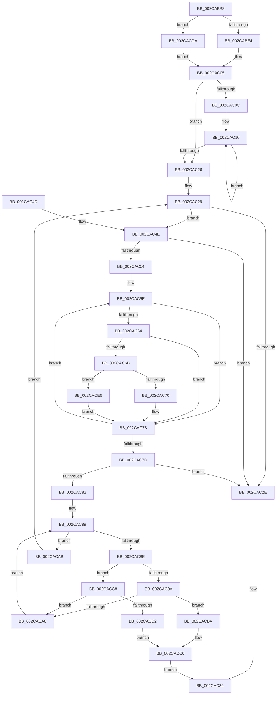

# MiFindReductionContendingThread

- RVA: `0x002CABB8`–`0x002CACEF` (길이 `311` bytes)
- VA: `0x00000001402CABB8`
- 실행 섹션: `.text`
- PDB 이름 있음: `예`; PDB Function 태그: `아니요`
- unwind 정보 RVA: `0x0006F210`
- 디코드: `91`개 명령, `311/311` bytes 표시
- 미해석 바이트: `0` (있으면 어셈블리에 `.byte`로 보존)

> 이 문서는 커널 이미지의 기계어와 PDB 기호를 분석해 생성했습니다. 4번과 5번은 함수 원형과 자료형을 바이너리 사용 방식에서 추정한 C 해석이며 원본 소스 복구 결과는 아닙니다.

## 1. Dependencies

- 직접 호출 지점: **1**; 고유 호출 대상: **1**
- 직접 호출자로 확인된 함수: **1**
- RIP 상대 이미지 참조: **2**

### Outgoing calls
- `0x002CAC9D` → [MiZeroThreadContending](MiZeroThreadContending_function_002CB854.md) (function, `0x002CB854`)

### Direct callers
- [MiReduceZeroingThreads](MiReduceZeroingThreads_function_002CACF8.md) at `0x002CAE49`
- [MiReduceZeroingThreads](MiReduceZeroingThreads_function_002CACF8.md) at `0x002CAECB`
- [MiReduceZeroingThreads](MiReduceZeroingThreads_function_002CACF8.md) at `0x002CAEE5`

### Static image references
- `0x002CABEE` → RVA `0x00E2DBF8` (`.data`; read)
- `0x002CACDA` → RVA `0x00E2DBD8` (`.data`; read)

## 2. Other-region calls and transfers

- 다른 실행 섹션으로 향하는 call: **0**
- 별도 외부 분기/꼬리 이동을 확인하지 못했습니다.

## 3. Assembly (complete function range)

```asm
002CABB8  48 89 5C 24 08                  mov qword ptr [rsp + 8], rbx
002CABBD  48 89 6C 24 10                  mov qword ptr [rsp + 0x10], rbp
002CABC2  48 89 74 24 18                  mov qword ptr [rsp + 0x18], rsi
002CABC7  57                              push rdi
002CABC8  41 54                           push r12
002CABCA  41 55                           push r13
002CABCC  41 56                           push r14
002CABCE  41 57                           push r15
002CABD0  48 83 EC 20                     sub rsp, 0x20
002CABD4  80 79 24 00                     cmp byte ptr [rcx + 0x24], 0
002CABD8  44 8B EA                        mov r13d, edx
002CABDB  48 8B D9                        mov rbx, rcx
002CABDE  0F 85 F6 00 00 00               jne 0x1402cacda
002CABE4  48 8B 81 B0 00 00 00            mov rax, qword ptr [rcx + 0xb0]
002CABEB  8B 48 38                        mov ecx, dword ptr [rax + 0x38]
002CABEE  48 8B 05 03 30 B6 00            mov rax, qword ptr [rip + 0xb63003]
002CABF5  48 8D 14 49                     lea rdx, [rcx + rcx*2]
002CABF9  48 C1 E2 07                     shl rdx, 7
002CABFD  48 8B 84 02 78 01 00 00         mov rax, qword ptr [rdx + rax + 0x178]
002CAC05  8B 68 08                        mov ebp, dword ptr [rax + 8]
002CAC08  85 ED                           test ebp, ebp
002CAC0A  74 1A                           je 0x1402cac26
002CAC0C  33 C9                           xor ecx, ecx
002CAC0E  8B D5                           mov edx, ebp
002CAC10  48 8B 83 88 00 00 00            mov rax, qword ptr [rbx + 0x88]
002CAC17  48 8D 49 30                     lea rcx, [rcx + 0x30]
002CAC1B  83 64 01 F4 00                  and dword ptr [rcx + rax - 0xc], 0
002CAC20  48 83 EA 01                     sub rdx, 1
002CAC24  75 EA                           jne 0x1402cac10
002CAC26  45 33 E4                        xor r12d, r12d
002CAC29  44 3B E5                        cmp r12d, ebp
002CAC2C  72 20                           jb 0x1402cac4e
002CAC2E  33 C0                           xor eax, eax
002CAC30  48 8B 5C 24 50                  mov rbx, qword ptr [rsp + 0x50]
002CAC35  48 8B 6C 24 58                  mov rbp, qword ptr [rsp + 0x58]
002CAC3A  48 8B 74 24 60                  mov rsi, qword ptr [rsp + 0x60]
002CAC3F  48 83 C4 20                     add rsp, 0x20
002CAC43  41 5F                           pop r15
002CAC45  41 5E                           pop r14
002CAC47  41 5D                           pop r13
002CAC49  41 5C                           pop r12
002CAC4B  5F                              pop rdi
002CAC4C  C3                              ret
002CAC4D  CC                              int3
002CAC4E  33 FF                           xor edi, edi
002CAC50  85 ED                           test ebp, ebp
002CAC52  74 DA                           je 0x1402cac2e
002CAC54  48 8B 83 88 00 00 00            mov rax, qword ptr [rbx + 0x88]
002CAC5B  48 8B D5                        mov rdx, rbp
002CAC5E  83 78 24 00                     cmp dword ptr [rax + 0x24], 0
002CAC62  75 0F                           jne 0x1402cac73
002CAC64  8B 48 20                        mov ecx, dword ptr [rax + 0x20]
002CAC67  85 C9                           test ecx, ecx
002CAC69  74 08                           je 0x1402cac73
002CAC6B  48 85 FF                        test rdi, rdi
002CAC6E  75 76                           jne 0x1402cace6
002CAC70  48 8B F8                        mov rdi, rax
002CAC73  48 83 C0 30                     add rax, 0x30
002CAC77  48 83 EA 01                     sub rdx, 1
002CAC7B  75 E1                           jne 0x1402cac5e
002CAC7D  48 85 FF                        test rdi, rdi
002CAC80  74 AC                           je 0x1402cac2e
002CAC82  4C 8D 7F 10                     lea r15, [rdi + 0x10]
002CAC86  4D 8B 37                        mov r14, qword ptr [r15]
002CAC89  4D 3B F7                        cmp r14, r15
002CAC8C  74 1D                           je 0x1402cacab
002CAC8E  49 8D B6 50 FE FF FF            lea rsi, [r14 - 0x1b0]
002CAC95  45 85 ED                        test r13d, r13d
002CAC98  74 2E                           je 0x1402cacc8
002CAC9A  48 8B CE                        mov rcx, rsi
002CAC9D  E8 B2 0B 00 00                  call 0x1402cb854
002CACA2  85 C0                           test eax, eax
002CACA4  75 14                           jne 0x1402cacba
002CACA6  4D 8B 36                        mov r14, qword ptr [r14]
002CACA9  EB DE                           jmp 0x1402cac89
002CACAB  C7 47 24 01 00 00 00            mov dword ptr [rdi + 0x24], 1
002CACB2  41 FF C4                        inc r12d
002CACB5  E9 6F FF FF FF                  jmp 0x1402cac29
002CACBA  FF 83 F0 00 00 00               inc dword ptr [rbx + 0xf0]
002CACC0  48 8B C6                        mov rax, rsi
002CACC3  E9 68 FF FF FF                  jmp 0x1402cac30
002CACC8  8B 86 80 01 00 00               mov eax, dword ptr [rsi + 0x180]
002CACCE  A8 02                           test al, 2
002CACD0  75 D4                           jne 0x1402caca6
002CACD2  FF 83 F4 00 00 00               inc dword ptr [rbx + 0xf4]
002CACD8  EB E6                           jmp 0x1402cacc0
002CACDA  48 8D 05 F7 2E B6 00            lea rax, [rip + 0xb62ef7]
002CACE1  E9 1F FF FF FF                  jmp 0x1402cac05
002CACE6  39 4F 20                        cmp dword ptr [rdi + 0x20], ecx
002CACE9  48 0F 42 F8                     cmovb rdi, rax
002CACED  EB 84                           jmp 0x1402cac73
```

## 4. C-style interpretation (structured pseudocode)

```c
__int64 __fastcall MiFindReductionContendingThread(__int64 a1, int a2)
{
    __int64 result;
    __int64 v_r12;
    __int64 v_rdi;
    __int64 v_rsp;
    unsigned __int64 v_stack_p10;
    unsigned __int64 v_stack_p18;
    unsigned __int64 v_stack_p8;

    v_stack_p8 = v_rbx;
    v_stack_p10 = v_rbp;
    v_stack_p18 = v_rsi;
    v_rsp = (v_rsp) - (32);
    if ((*(unsigned __int8 *)(a1 + 36)) != 0) goto loc_002CACDA;
    a2 = ((unsigned int)(*(unsigned int *)(*(unsigned __int64 *)(a1 + 176) + 56)) + (unsigned int)(*(unsigned int *)(*(unsigned __int64 *)(a1 + 176) + 56)) * 2) << (7);
loc_002CAC05:
    if ((unsigned int)((unsigned int)(*(unsigned int *)(*(unsigned __int64 *)(a2 + *(unsigned __int64 *)(v_rip + 11939843) * 1 + 376) + 8))) == 0) goto loc_002CAC26;
    a1 = 0;
loc_002CAC10:
    a2 = ((unsigned int)((unsigned int)((unsigned int)(*(unsigned int *)(*(unsigned __int64 *)(a2 + *(unsigned __int64 *)(v_rip + 11939843) * 1 + 376) + 8))))) - (1);
    if (condition_is_not_equal) goto loc_002CAC10;
loc_002CAC26:
    v_r12 = 0;
loc_002CAC29:
    if (0 < ((unsigned int)((unsigned int)(*(unsigned int *)(*(unsigned __int64 *)(a2 + *(unsigned __int64 *)(v_rip + 11939843) * 1 + 376) + 8))))) goto loc_002CAC4E;
loc_002CAC2E:
    result = 0;
loc_002CAC30:
    v_rsp = (v_rsp) + (32);
    return result;
loc_002CAC4E:
    v_rdi = 0;
    if ((unsigned int)(v_stack_p10) == 0) goto loc_002CAC2E;
loc_002CAC5E:
    if ((*(unsigned int *)(*(unsigned __int64 *)(v_stack_p8 + 136) + 36)) != 0) goto loc_002CAC73;
    if ((unsigned int)((unsigned int)(*(unsigned int *)(*(unsigned __int64 *)(v_stack_p8 + 136) + 32))) == 0) goto loc_002CAC73;
    if (0 != 0) goto loc_002CACE6;
loc_002CAC73:
    result = (*(unsigned __int64 *)(v_stack_p8 + 136)) + (48);
    a2 = (v_stack_p10) - (1);
    if (condition_is_not_equal) goto loc_002CAC5E;
    if (*(unsigned __int64 *)(v_stack_p8 + 136) == 0) goto loc_002CAC2E;
loc_002CAC89:
    if ((*(unsigned __int64 *)(*(unsigned __int64 *)(v_stack_p8 + 136) + 16)) == (*(unsigned __int64 *)(v_stack_p8 + 136) + 16)) goto loc_002CACAB;
    if ((unsigned int)((unsigned int)(a2)) == 0) goto loc_002CACC8;
    result = MiZeroThreadContending(*(unsigned __int64 *)(*(unsigned __int64 *)(v_stack_p8 + 136) + 16) - 432, a2, a3, a4);
    if ((unsigned int)(result) != 0) goto loc_002CACBA;
loc_002CACA6:
    goto loc_002CAC89;
loc_002CACAB:
    *(unsigned int *)(*(unsigned __int64 *)(v_stack_p8 + 136) + 36) = 1;
    v_r12 = (unsigned int)((v_r12) + 1);
    goto loc_002CAC29;
loc_002CACBA:
loc_002CACC0:
    goto loc_002CAC30;
loc_002CACC8:
    if ((((unsigned __int8)((unsigned int)(*(unsigned int *)(*(unsigned __int64 *)(*(unsigned __int64 *)(v_stack_p8 + 136) + 16) - 432 + 384)))) & (2)) != 0) goto loc_002CACA6;
    goto loc_002CACC0;
loc_002CACDA:
    goto loc_002CAC05;
loc_002CACE6:
    v_rdi = *(unsigned __int64 *)(v_stack_p8 + 136);
    if ((*(unsigned int *)(*(unsigned __int64 *)(v_stack_p8 + 136) + 32)) < ((unsigned int)(*(unsigned __int64 *)(*(unsigned __int64 *)(v_stack_p8 + 136) + 16) - 432))) { v_rdi = v_rip + 11939575; }
    goto loc_002CAC73;
}
```

## 5. (Beta) C Style

```c
int64_t MiFindReductionContendingThread(void *Arg1, int32_t Arg2)
{
    uint8_t *arg1 = (uint8_t *)Arg1;

    int64_t result;
    int64_t local_r12;
    int64_t local_rdi;
    int64_t local_rsp;
    uint64_t v_stack_p10;
    uint64_t v_stack_p18;
    uint64_t v_stack_p8;

    v_stack_p8 = local_rbx;
    v_stack_p10 = local_rbp;
    v_stack_p18 = local_rsi;
    local_rsp = (local_rsp) - (32);
    if ((*(uint8_t *)(arg1 + 0x24)) != 0) goto loc_002CACDA;
    Arg2 = ((uint32_t)(*(uint32_t *)(*(uint64_t *)(arg1 + 0xB0) + 0x38)) + (uint32_t)(*(uint32_t *)(*(uint64_t *)(arg1 + 0xB0) + 0x38)) * 2) << (7);
loc_002CAC05:
    if ((uint32_t)((uint32_t)(*(uint32_t *)(*(uint64_t *)(Arg2 + *(uint64_t *)(v_rip + 0xB63003) * 1 + 0x178) + 0x8))) == 0) goto loc_002CAC26;
    Arg1 = 0;
loc_002CAC10:
    Arg2 = ((uint32_t)((uint32_t)((uint32_t)(*(uint32_t *)(*(uint64_t *)(Arg2 + *(uint64_t *)(v_rip + 0xB63003) * 1 + 0x178) + 0x8))))) - (1);
    if (condition_is_not_equal) goto loc_002CAC10;
loc_002CAC26:
    local_r12 = 0;
loc_002CAC29:
    if (0 < ((uint32_t)((uint32_t)(*(uint32_t *)(*(uint64_t *)(Arg2 + *(uint64_t *)(v_rip + 0xB63003) * 1 + 0x178) + 0x8))))) goto loc_002CAC4E;
loc_002CAC2E:
    result = 0;
loc_002CAC30:
    local_rsp = (local_rsp) + (32);
    return result;
loc_002CAC4E:
    local_rdi = 0;
    if ((uint32_t)(v_stack_p10) == 0) goto loc_002CAC2E;
loc_002CAC5E:
    if ((*(uint32_t *)(*(uint64_t *)(v_stack_p8 + 0x88) + 0x24)) != 0) goto loc_002CAC73;
    if ((uint32_t)((uint32_t)(*(uint32_t *)(*(uint64_t *)(v_stack_p8 + 0x88) + 0x20))) == 0) goto loc_002CAC73;
    if (0 != 0) goto loc_002CACE6;
loc_002CAC73:
    result = (*(uint64_t *)(v_stack_p8 + 0x88)) + (48);
    Arg2 = (v_stack_p10) - (1);
    if (condition_is_not_equal) goto loc_002CAC5E;
    if (*(uint64_t *)(v_stack_p8 + 0x88) == 0) goto loc_002CAC2E;
loc_002CAC89:
    if ((*(uint64_t *)(*(uint64_t *)(v_stack_p8 + 0x88) + 0x10)) == (*(uint64_t *)(v_stack_p8 + 0x88) + 16)) goto loc_002CACAB;
    if ((uint32_t)((uint32_t)(Arg2)) == 0) goto loc_002CACC8;
    result = MiZeroThreadContending(*(uint64_t *)(*(uint64_t *)(v_stack_p8 + 0x88) + 0x10) - 432, Arg2, a3, a4);
    if ((uint32_t)(result) != 0) goto loc_002CACBA;
loc_002CACA6:
    goto loc_002CAC89;
loc_002CACAB:
    *(uint32_t *)(*(uint64_t *)(v_stack_p8 + 0x88) + 0x24) = 1;
    local_r12 = (uint32_t)((local_r12) + 1);
    goto loc_002CAC29;
loc_002CACBA:
loc_002CACC0:
    goto loc_002CAC30;
loc_002CACC8:
    if ((((uint8_t)((uint32_t)(*(uint32_t *)(*(uint64_t *)(*(uint64_t *)(v_stack_p8 + 0x88) + 0x10) - 0x1B0 + 0x180)))) & (2)) != 0) goto loc_002CACA6;
    goto loc_002CACC0;
loc_002CACDA:
    goto loc_002CAC05;
loc_002CACE6:
    local_rdi = *(uint64_t *)(v_stack_p8 + 0x88);
    if ((*(uint32_t *)(*(uint64_t *)(v_stack_p8 + 0x88) + 0x20)) < ((uint32_t)(*(uint64_t *)(*(uint64_t *)(v_stack_p8 + 0x88) + 0x10) - 432))) { local_rdi = v_rip + 11939575; }
    goto loc_002CAC73;
}
```

### 관측된 메모리 오프셋

구조체 형식이 확인되지 않은 접근은 인자 기준의 오프셋으로만 기록했습니다.

| 기준 인자 | 오프셋 표현 | 폭 (bit) | 접근 |
|---|---:|---:|---|
| `Arg1` | `+ 0x24` | `8` | `R` |
| `Arg1` | `+ 0x88` | `64` | `R` |
| `Arg1` | `+ 0xB0` | `64` | `R` |
| `Arg1` | `+ 0xF0` | `32` | `R/W` |
| `Arg1` | `+ 0xF4` | `32` | `R/W` |

## 6. Execution-region graph

[열기: 2D/3D 그래프와 함수 탐색 컨트롤 패널](../../../control-panel.html?section=text&rva=0x002CABB8&view=graph)

- 2D 그래프는 위에서 아래로 흐르고, 3D 그래프는 빈 공간을 드래그해 회전합니다. Shift+드래그는 이동, 휠은 확대·축소, 함수 노드 선택은 대상 보고서 이동입니다.

### Static fallback


