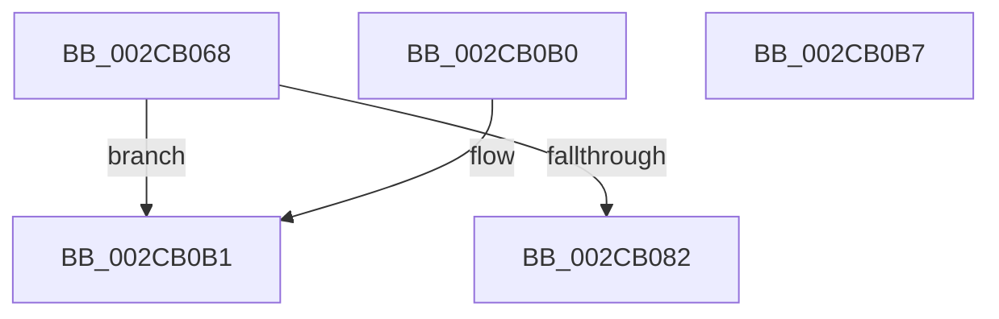

# MiGetDesiredZeroTime

- RVA: `0x002CB068`–`0x002CB0B8` (길이 `80` bytes)
- VA: `0x00000001402CB068`
- 실행 섹션: `.text`
- PDB 이름 있음: `예`; PDB Function 태그: `아니요`
- unwind 정보 RVA: `0x000DB714`
- 디코드: `22`개 명령, `80/80` bytes 표시
- 미해석 바이트: `0` (있으면 어셈블리에 `.byte`로 보존)

> 이 문서는 커널 이미지의 기계어와 PDB 기호를 분석해 생성했습니다. 4번과 5번은 함수 원형과 자료형을 바이너리 사용 방식에서 추정한 C 해석이며 원본 소스 복구 결과는 아닙니다.

## 1. Dependencies

- 직접 호출 지점: **0**; 고유 호출 대상: **0**
- 직접 호출자로 확인된 함수: **1**
- RIP 상대 이미지 참조: **0**

### Outgoing calls
- 직접 디코드된 call 명령이 없습니다.

### Direct callers
- [MiReassessZeroThreads](MiReassessZeroThreads_function_002CB0C0.md) at `0x002CB1D9`

### Static image references
- 디코드된 RIP-relative 메모리 참조가 없습니다.

## 2. Other-region calls and transfers

- 다른 실행 섹션으로 향하는 call: **0**
- 별도 외부 분기/꼬리 이동을 확인하지 못했습니다.

## 3. Assembly (complete function range)

```asm
002CB068  48 63 C2                        movsxd rax, edx
002CB06B  48 69 D0 A8 00 00 00            imul rdx, rax, 0xa8
002CB072  45 8B D0                        mov r10d, r8d
002CB075  4C 8B 8C 0A B0 00 00 00         mov r9, qword ptr [rdx + rcx + 0xb0]
002CB07D  4D 85 C9                        test r9, r9
002CB080  74 2F                           je 0x1402cb0b1
002CB082  8B 84 0A 80 00 00 00            mov eax, dword ptr [rdx + rcx + 0x80]
002CB089  48 0F AF 84 0A 88 00 00 00      imul rax, qword ptr [rdx + rcx + 0x88]
002CB092  33 D2                           xor edx, edx
002CB094  49 F7 F2                        div r10
002CB097  41 8D 52 FF                     lea edx, [r10 - 1]
002CB09B  48 03 D2                        add rdx, rdx
002CB09E  4C 8B C0                        mov r8, rax
002CB0A1  49 8B 44 D1 08                  mov rax, qword ptr [r9 + rdx*8 + 8]
002CB0A6  33 D2                           xor edx, edx
002CB0A8  48 C1 E0 15                     shl rax, 0x15
002CB0AC  49 F7 F0                        div r8
002CB0AF  C3                              ret
002CB0B0  CC                              int3
002CB0B1  B8 C0 04 00 00                  mov eax, 0x4c0
002CB0B6  C3                              ret
002CB0B7  CC                              int3
```

## 4. C-style interpretation (structured pseudocode)

```c
__int64 __fastcall MiGetDesiredZeroTime(__int64 a1, int a2, int a3)
{
    __int64 result;

    a2 = (a2) * ((int)(a2));
    if (*(unsigned __int64 *)(a2 + a1 * 1 + 176) == 0) goto loc_002CB0B1;
    result = ((unsigned int)(*(unsigned int *)(a2 + a1 * 1 + 128))) * (*(unsigned __int64 *)(a2 + a1 * 1 + 136));
    a2 = 0;
    a2 = ((unsigned int)(a3) - 1) + ((unsigned int)(a3) - 1);
    a2 = 0;
    result = (*(unsigned __int64 *)(*(unsigned __int64 *)(a2 + a1 * 1 + 176) + a2 * 8 + 8)) << (21);
    return result;
loc_002CB0B1:
    return (unsigned int)(0x4C0ULL);
}
```

## 5. (Beta) C Style

```c
int64_t MiGetDesiredZeroTime(int64_t Arg1, void *Arg2, int32_t Arg3)
{
    uint8_t *arg2 = (uint8_t *)Arg2;

    int64_t result;

    Arg2 = (Arg2) * ((int32_t)(Arg2));
    if (*(uint64_t *)(arg2 + Arg1 * 1 + 0xB0) == 0) goto loc_002CB0B1;
    result = ((uint32_t)(*(uint32_t *)(arg2 + Arg1 * 1 + 0x80))) * (*(uint64_t *)(arg2 + Arg1 * 1 + 0x88));
    Arg2 = 0;
    Arg2 = ((uint32_t)(Arg3) - 1) + ((uint32_t)(Arg3) - 1);
    Arg2 = 0;
    result = (*(uint64_t *)(*(uint64_t *)(arg2 + Arg1 * 1 + 0xB0) + arg2 * 8 + 0x8)) << (21);
    return result;
loc_002CB0B1:
    return (uint32_t)(0x4C0ULL);
}
```

### 관측된 메모리 오프셋

구조체 형식이 확인되지 않은 접근은 인자 기준의 오프셋으로만 기록했습니다.

| 기준 인자 | 오프셋 표현 | 폭 (bit) | 접근 |
|---|---:|---:|---|
| `Arg2` | `+ 0x80 + rcx*1` | `32` | `R` |
| `Arg2` | `+ 0x88 + rcx*1` | `64` | `R` |
| `Arg2` | `+ 0xB0 + rcx*1` | `64` | `R` |

## 6. Execution-region graph

[열기: 2D/3D 그래프와 함수 탐색 컨트롤 패널](../../../control-panel.html?section=text&rva=0x002CB068&view=graph)

- 2D 그래프는 위에서 아래로 흐르고, 3D 그래프는 빈 공간을 드래그해 회전합니다. Shift+드래그는 이동, 휠은 확대·축소, 함수 노드 선택은 대상 보고서 이동입니다.

### Static fallback


