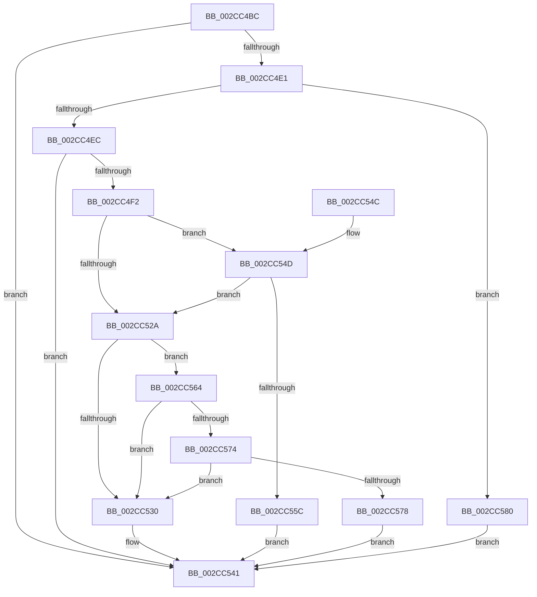

# MiGetEngineBackgroundQualifications

- RVA: `0x002CC4BC`–`0x002CC588` (길이 `204` bytes)
- VA: `0x00000001402CC4BC`
- 실행 섹션: `.text`
- PDB 이름 있음: `예`; PDB Function 태그: `아니요`
- unwind 정보 RVA: `0x00069D3C`
- 디코드: `55`개 명령, `204/204` bytes 표시
- 미해석 바이트: `0` (있으면 어셈블리에 `.byte`로 보존)

> 이 문서는 커널 이미지의 기계어와 PDB 기호를 분석해 생성했습니다. 4번과 5번은 함수 원형과 자료형을 바이너리 사용 방식에서 추정한 C 해석이며 원본 소스 복구 결과는 아닙니다.

## 1. Dependencies

- 직접 호출 지점: **1**; 고유 호출 대상: **1**
- 직접 호출자로 확인된 함수: **1**
- RIP 상대 이미지 참조: **4**

### Outgoing calls
- `0x002CC53C` → [MiFindBestZeroingProcessor](MiFindBestZeroingProcessor_function_002CC73C.md) (function, `0x002CC73C`)

### Direct callers
- [MiAddZeroingThreads](MiAddZeroingThreads_function_002CBF78.md) at `0x002CC0AB`

### Static image references
- `0x002CC4FF` → RVA `0x00E2DBF8` (`.data`; read)
- `0x002CC55C` → RVA `0x00EF500C` (`.data`; read/write)
- `0x002CC578` → RVA `0x00EF5008` (`.data`; read/write)
- `0x002CC580` → RVA `0x00EF5000` (`.data`; read/write)

## 2. Other-region calls and transfers

- 다른 실행 섹션으로 향하는 call: **0**
- 별도 외부 분기/꼬리 이동을 확인하지 못했습니다.

## 3. Assembly (complete function range)

```asm
002CC4BC  48 89 5C 24 08                  mov qword ptr [rsp + 8], rbx
002CC4C1  57                              push rdi
002CC4C2  48 83 EC 20                     sub rsp, 0x20
002CC4C6  4D 8B D9                        mov r11, r9
002CC4C9  48 8B DA                        mov rbx, rdx
002CC4CC  4D 8B C8                        mov r9, r8
002CC4CF  4C 8B D1                        mov r10, rcx
002CC4D2  41 C7 43 28 05 00 00 00         mov dword ptr [r11 + 0x28], 5
002CC4DA  8B 41 04                        mov eax, dword ptr [rcx + 4]
002CC4DD  85 C0                           test eax, eax
002CC4DF  74 60                           je 0x1402cc541
002CC4E1  8B 49 0C                        mov ecx, dword ptr [rcx + 0xc]
002CC4E4  3B C1                           cmp eax, ecx
002CC4E6  0F 84 94 00 00 00               je 0x1402cc580
002CC4EC  41 3B 4A 08                     cmp ecx, dword ptr [r10 + 8]
002CC4F0  73 4F                           jae 0x1402cc541
002CC4F2  49 8B 82 B0 00 00 00            mov rax, qword ptr [r10 + 0xb0]
002CC4F9  49 63 3A                        movsxd rdi, dword ptr [r10]
002CC4FC  8B 48 38                        mov ecx, dword ptr [rax + 0x38]
002CC4FF  48 8B 05 F2 16 B6 00            mov rax, qword ptr [rip + 0xb616f2]
002CC506  48 8D 14 49                     lea rdx, [rcx + rcx*2]
002CC50A  48 C1 E2 07                     shl rdx, 7
002CC50E  48 69 CF A8 00 00 00            imul rcx, rdi, 0xa8
002CC515  80 3B 00                        cmp byte ptr [rbx], 0
002CC518  4C 8B 84 02 78 01 00 00         mov r8, qword ptr [rdx + rax + 0x178]
002CC520  4A 8B 94 01 90 00 00 00         mov rdx, qword ptr [rcx + r8 + 0x90]
002CC528  75 23                           jne 0x1402cc54d
002CC52A  80 7B 01 00                     cmp byte ptr [rbx + 1], 0
002CC52E  75 34                           jne 0x1402cc564
002CC530  45 33 C9                        xor r9d, r9d
002CC533  45 33 C0                        xor r8d, r8d
002CC536  49 8B D2                        mov rdx, r10
002CC539  49 8B CB                        mov rcx, r11
002CC53C  E8 FB 01 00 00                  call 0x1402cc73c
002CC541  48 8B 5C 24 30                  mov rbx, qword ptr [rsp + 0x30]
002CC546  48 83 C4 20                     add rsp, 0x20
002CC54A  5F                              pop rdi
002CC54B  C3                              ret
002CC54C  CC                              int3
002CC54D  49 8B 09                        mov rcx, qword ptr [r9]
002CC550  48 03 CA                        add rcx, rdx
002CC553  49 3B 88 40 02 00 00            cmp rcx, qword ptr [r8 + 0x240]
002CC55A  76 CE                           jbe 0x1402cc52a
002CC55C  FF 05 AA 8A C2 00               inc dword ptr [rip + 0xc28aaa]
002CC562  EB DD                           jmp 0x1402cc541
002CC564  49 8B 49 08                     mov rcx, qword ptr [r9 + 8]
002CC568  48 03 CA                        add rcx, rdx
002CC56B  49 3B 88 48 02 00 00            cmp rcx, qword ptr [r8 + 0x248]
002CC572  76 BC                           jbe 0x1402cc530
002CC574  85 FF                           test edi, edi
002CC576  74 B8                           je 0x1402cc530
002CC578  FF 05 8A 8A C2 00               inc dword ptr [rip + 0xc28a8a]
002CC57E  EB C1                           jmp 0x1402cc541
002CC580  FF 05 7A 8A C2 00               inc dword ptr [rip + 0xc28a7a]
002CC586  EB B9                           jmp 0x1402cc541
```

## 4. C-style interpretation (structured pseudocode)

```c
__int64 __fastcall MiGetEngineBackgroundQualifications(__int64 a1, __int64 a2, __int64 a3, __int64 a4)
{
    __int64 result;
    __int64 v_rsp;
    unsigned __int64 v_stack_p8;

    v_stack_p8 = v_rbx;
    v_rsp = (v_rsp) - (32);
    *(unsigned int *)(a4 + 40) = 5;
    if ((unsigned int)((unsigned int)(*(unsigned int *)(a1 + 4))) == 0) goto loc_002CC541;
    if (((unsigned int)((unsigned int)(*(unsigned int *)(a1 + 4)))) == ((unsigned int)((unsigned int)(*(unsigned int *)(a1 + 12))))) goto loc_002CC580;
    if (((unsigned int)((unsigned int)(*(unsigned int *)(a1 + 12)))) >= (*(unsigned int *)(a1 + 8))) goto loc_002CC541;
    a2 = ((unsigned int)(*(unsigned int *)(*(unsigned __int64 *)(a1 + 176) + 56)) + (unsigned int)(*(unsigned int *)(*(unsigned __int64 *)(a1 + 176) + 56)) * 2) << (7);
    a1 = ((unsigned int)(*(unsigned int *)(*(unsigned __int64 *)(a1 + 176) + 56))) * ((int)(*(unsigned int *)(a1)));
    if ((*(unsigned __int8 *)(a2)) != 0) goto loc_002CC54D;
loc_002CC52A:
    if ((*(unsigned __int8 *)(a2 + 1)) != 0) goto loc_002CC564;
loc_002CC530:
    a4 = 0;
    a3 = 0;
    result = MiFindBestZeroingProcessor(0, a1, a3, a4);
loc_002CC541:
    v_rsp = (v_rsp) + (32);
    return result;
loc_002CC54D:
    a1 = (*(unsigned __int64 *)(a4)) + (a1);
    if (a1 <= (*(unsigned __int64 *)(a3 + 576))) goto loc_002CC52A;
    goto loc_002CC541;
loc_002CC564:
    a1 = (*(unsigned __int64 *)(a4 + 8)) + (a1);
    if (a1 <= (*(unsigned __int64 *)(a3 + 584))) goto loc_002CC530;
    if ((unsigned int)((int)(*(unsigned int *)(a1))) == 0) goto loc_002CC530;
    goto loc_002CC541;
loc_002CC580:
    goto loc_002CC541;
}
```

## 5. (Beta) C Style

```c
int64_t MiGetEngineBackgroundQualifications(void *Arg1, void *Arg2, void *Arg3, void *Arg4)
{
    uint8_t *arg1 = (uint8_t *)Arg1;
    uint8_t *arg2 = (uint8_t *)Arg2;
    uint8_t *arg3 = (uint8_t *)Arg3;
    uint8_t *arg4 = (uint8_t *)Arg4;

    int64_t result;
    int64_t local_rsp;
    uint64_t v_stack_p8;

    v_stack_p8 = local_rbx;
    local_rsp = (local_rsp) - (32);
    *(uint32_t *)(arg4 + 0x28) = 5;
    if ((uint32_t)((uint32_t)(*(uint32_t *)(arg1 + 0x4))) == 0) goto loc_002CC541;
    if (((uint32_t)((uint32_t)(*(uint32_t *)(arg1 + 0x4)))) == ((uint32_t)((uint32_t)(*(uint32_t *)(arg1 + 0xC))))) goto loc_002CC580;
    if (((uint32_t)((uint32_t)(*(uint32_t *)(arg1 + 0xC)))) >= (*(uint32_t *)(arg1 + 0x8))) goto loc_002CC541;
    Arg2 = ((uint32_t)(*(uint32_t *)(*(uint64_t *)(arg1 + 0xB0) + 0x38)) + (uint32_t)(*(uint32_t *)(*(uint64_t *)(arg1 + 0xB0) + 0x38)) * 2) << (7);
    Arg1 = ((uint32_t)(*(uint32_t *)(*(uint64_t *)(arg1 + 0xB0) + 0x38))) * ((int32_t)(*(uint32_t *)(arg1)));
    if ((*(uint8_t *)(arg2)) != 0) goto loc_002CC54D;
loc_002CC52A:
    if ((*(uint8_t *)(arg2 + 0x1)) != 0) goto loc_002CC564;
loc_002CC530:
    Arg4 = 0;
    Arg3 = 0;
    result = MiFindBestZeroingProcessor(0, Arg1, Arg3, Arg4);
loc_002CC541:
    local_rsp = (local_rsp) + (32);
    return result;
loc_002CC54D:
    Arg1 = (*(uint64_t *)(arg4)) + (Arg1);
    if (Arg1 <= (*(uint64_t *)(arg3 + 0x240))) goto loc_002CC52A;
    goto loc_002CC541;
loc_002CC564:
    Arg1 = (*(uint64_t *)(arg4 + 0x8)) + (Arg1);
    if (Arg1 <= (*(uint64_t *)(arg3 + 0x248))) goto loc_002CC530;
    if ((uint32_t)((int32_t)(*(uint32_t *)(arg1))) == 0) goto loc_002CC530;
    goto loc_002CC541;
loc_002CC580:
    goto loc_002CC541;
}
```

### 관측된 메모리 오프셋

구조체 형식이 확인되지 않은 접근은 인자 기준의 오프셋으로만 기록했습니다.

| 기준 인자 | 오프셋 표현 | 폭 (bit) | 접근 |
|---|---:|---:|---|
| `Arg1` | `+ 0x0` | `32` | `R` |
| `Arg1` | `+ 0x4` | `32` | `R` |
| `Arg1` | `+ 0x8` | `32` | `R` |
| `Arg1` | `+ 0xC` | `32` | `R` |
| `Arg1` | `+ 0xB0` | `64` | `R` |
| `Arg2` | `+ 0x0` | `8` | `R` |
| `Arg2` | `+ 0x1` | `8` | `R` |
| `Arg3` | `+ 0x0` | `64` | `R` |
| `Arg3` | `+ 0x8` | `64` | `R` |
| `Arg4` | `+ 0x28` | `32` | `W` |

## 6. Execution-region graph

[열기: 2D/3D 그래프와 함수 탐색 컨트롤 패널](../../../control-panel.html?section=text&rva=0x002CC4BC&view=graph)

- 2D 그래프는 위에서 아래로 흐르고, 3D 그래프는 빈 공간을 드래그해 회전합니다. Shift+드래그는 이동, 휠은 확대·축소, 함수 노드 선택은 대상 보고서 이동입니다.

### Static fallback


