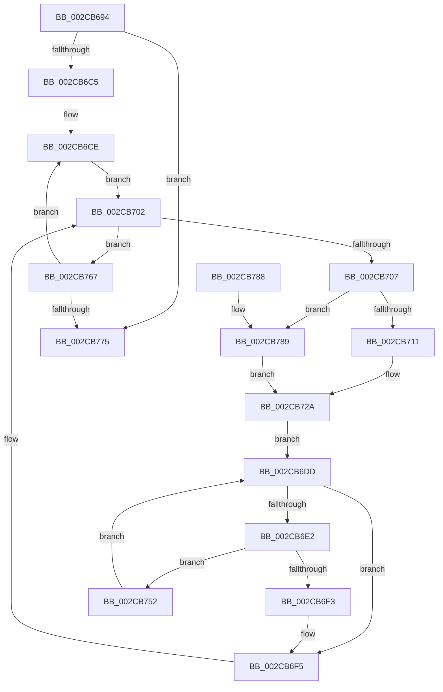

# MiGetIdleProcessorCount

- RVA: `0x002CB694`–`0x002CB78F` (길이 `251` bytes)
- VA: `0x00000001402CB694`
- 실행 섹션: `.text`
- PDB 이름 있음: `예`; PDB Function 태그: `아니요`
- unwind 정보 RVA: `0x0006F2D4`
- 디코드: `69`개 명령, `251/251` bytes 표시
- 미해석 바이트: `0` (있으면 어셈블리에 `.byte`로 보존)

> 이 문서는 커널 이미지의 기계어와 PDB 기호를 분석해 생성했습니다. 4번과 5번은 함수 원형과 자료형을 바이너리 사용 방식에서 추정한 C 해석이며 원본 소스 복구 결과는 아닙니다.

## 1. Dependencies

- 직접 호출 지점: **0**; 고유 호출 대상: **0**
- 직접 호출자로 확인된 함수: **1**
- RIP 상대 이미지 참조: **2**

### Outgoing calls
- 직접 디코드된 call 명령이 없습니다.

### Direct callers
- [MiMoveZeroThreadsToOtherCores](MiMoveZeroThreadsToOtherCores_function_002CB798.md) at `0x002CB7DA`

### Static image references
- `0x002CB6C7` → RVA `0x00FC8C40` (`ALMOSTRO`; read)
- `0x002CB71F` → RVA `0x00F231B8` (`.data`; read)

## 2. Other-region calls and transfers

- 다른 실행 섹션으로 향하는 call: **0**
- 별도 외부 분기/꼬리 이동을 확인하지 못했습니다.

## 3. Assembly (complete function range)

```asm
002CB694  48 89 5C 24 08                  mov qword ptr [rsp + 8], rbx
002CB699  48 89 74 24 18                  mov qword ptr [rsp + 0x18], rsi
002CB69E  57                              push rdi
002CB69F  48 83 EC 10                     sub rsp, 0x10
002CB6A3  8B C2                           mov eax, edx
002CB6A5  45 33 C0                        xor r8d, r8d
002CB6A8  48 8D 14 40                     lea rdx, [rax + rax*2]
002CB6AC  48 8B 81 88 00 00 00            mov rax, qword ptr [rcx + 0x88]
002CB6B3  48 03 D2                        add rdx, rdx
002CB6B6  4C 8B 1C D0                     mov r11, qword ptr [rax + rdx*8]
002CB6BA  8B 41 14                        mov eax, dword ptr [rcx + 0x14]
002CB6BD  85 C0                           test eax, eax
002CB6BF  0F 84 B0 00 00 00               je 0x1402cb775
002CB6C5  8B D8                           mov ebx, eax
002CB6C7  48 8D 35 72 D5 CF 00            lea rsi, [rip + 0xcfd572]
002CB6CE  41 0F 10 03                     movups xmm0, xmmword ptr [r11]
002CB6D2  0F 11 04 24                     movups xmmword ptr [rsp], xmm0
002CB6D6  66 48 0F 7E C2                  movq rdx, xmm0
002CB6DB  EB 25                           jmp 0x1402cb702
002CB6DD  4D 85 C9                        test r9, r9
002CB6E0  74 13                           je 0x1402cb6f5
002CB6E2  41 8B C2                        mov eax, r10d
002CB6E5  48 8B 0C C6                     mov rcx, qword ptr [rsi + rax*8]
002CB6E9  48 8B 41 18                     mov rax, qword ptr [rcx + 0x18]
002CB6ED  48 39 41 08                     cmp qword ptr [rcx + 8], rax
002CB6F1  74 5F                           je 0x1402cb752
002CB6F3  33 FF                           xor edi, edi
002CB6F5  41 8D 40 01                     lea eax, [r8 + 1]
002CB6F9  85 FF                           test edi, edi
002CB6FB  41 0F 44 C0                     cmove eax, r8d
002CB6FF  44 8B C0                        mov r8d, eax
002CB702  48 85 D2                        test rdx, rdx
002CB705  74 60                           je 0x1402cb767
002CB707  83 64 24 28 00                  and dword ptr [rsp + 0x28], 0
002CB70C  48 85 D2                        test rdx, rdx
002CB70F  74 78                           je 0x1402cb789
002CB711  0F B7 44 24 08                  movzx eax, word ptr [rsp + 8]
002CB716  48 0F BC CA                     bsf rcx, rdx
002CB71A  C1 E0 06                        shl eax, 6
002CB71D  03 C8                           add ecx, eax
002CB71F  48 8B 05 92 7A C5 00            mov rax, qword ptr [rip + 0xc57a92]
002CB726  44 8B 14 88                     mov r10d, dword ptr [rax + rcx*4]
002CB72A  41 8B C2                        mov eax, r10d
002CB72D  BF 01 00 00 00                  mov edi, 1
002CB732  48 8B 0C C6                     mov rcx, qword ptr [rsi + rax*8]
002CB736  4C 8B 89 60 8E 00 00            mov r9, qword ptr [rcx + 0x8e60]
002CB73D  4C 23 CA                        and r9, rdx
002CB740  4C 0B 89 C8 00 00 00            or r9, qword ptr [rcx + 0xc8]
002CB747  49 8B C1                        mov rax, r9
002CB74A  48 F7 D0                        not rax
002CB74D  48 23 D0                        and rdx, rax
002CB750  EB 8B                           jmp 0x1402cb6dd
002CB752  48 8B 81 C8 00 00 00            mov rax, qword ptr [rcx + 0xc8]
002CB759  48 F7 D0                        not rax
002CB75C  4C 23 C8                        and r9, rax
002CB75F  41 FF C2                        inc r10d
002CB762  E9 76 FF FF FF                  jmp 0x1402cb6dd
002CB767  49 83 C3 10                     add r11, 0x10
002CB76B  48 83 EB 01                     sub rbx, 1
002CB76F  0F 85 59 FF FF FF               jne 0x1402cb6ce
002CB775  48 8B 5C 24 20                  mov rbx, qword ptr [rsp + 0x20]
002CB77A  41 8B C0                        mov eax, r8d
002CB77D  48 8B 74 24 30                  mov rsi, qword ptr [rsp + 0x30]
002CB782  48 83 C4 10                     add rsp, 0x10
002CB786  5F                              pop rdi
002CB787  C3                              ret
002CB788  CC                              int3
002CB789  41 83 CA FF                     or r10d, 0xffffffff
002CB78D  EB 9B                           jmp 0x1402cb72a
```

## 4. C-style interpretation (structured pseudocode)

```c
__int64 __fastcall MiGetIdleProcessorCount(__int64 a1, int a2, int a3, __int64 a4)
{
    __int64 result;
    __int64 v_r10;
    __int64 v_r11;
    __int64 v_rbx;
    __int64 v_rdi;
    __int64 v_rsp;
    unsigned __int16 v_stack_m10;
    unsigned __int64 v_stack_m18;
    unsigned int v_stack_p10;
    unsigned __int64 v_stack_p18;
    unsigned __int64 v_stack_p8;

    v_stack_p8 = v_rbx;
    v_stack_p18 = v_rsi;
    v_rsp = (v_rsp) - (16);
    a3 = 0;
    a2 = ((unsigned int)(a2) + (unsigned int)(a2) * 2) + ((unsigned int)(a2) + (unsigned int)(a2) * 2);
    if ((unsigned int)((unsigned int)(*(unsigned int *)(a1 + 20))) == 0) goto loc_002CB775;
loc_002CB6CE:
    v_stack_m18 = v_xmm0;
    goto loc_002CB702;
loc_002CB6DD:
    if (a4 == 0) goto loc_002CB6F5;
    if ((*(unsigned __int64 *)(*(unsigned __int64 *)(v_rip + 13620594 + (unsigned int)((unsigned int)(v_r10)) * 8) + 8)) == (*(unsigned __int64 *)(*(unsigned __int64 *)(v_rip + 13620594 + (unsigned int)((unsigned int)(v_r10)) * 8) + 24))) goto loc_002CB752;
    v_rdi = 0;
loc_002CB6F5:
    result = a3 + 1;
    if (0 == 0) { result = 0; }
loc_002CB702:
    if (a2 == 0) goto loc_002CB767;
    if (a2 == 0) goto loc_002CB789;
    result = (unsigned int)((v_stack_m10) << (6));
    a1 = (unsigned int)((*(unsigned __int64 *)(v_rip + 13620594 + (unsigned int)((unsigned int)(v_r10)) * 8)) + ((unsigned int)(result)));
loc_002CB72A:
    a4 = (*(unsigned __int64 *)(*(unsigned __int64 *)(v_rip + 13620594 + (unsigned int)((unsigned int)((unsigned int)(*(unsigned int *)(*(unsigned __int64 *)(v_rip + 12941970) + a1 * 4)))) * 8) + 36448)) & (a2);
    a4 = (a4) | (*(unsigned __int64 *)(*(unsigned __int64 *)(v_rip + 13620594 + (unsigned int)((unsigned int)((unsigned int)(*(unsigned int *)(*(unsigned __int64 *)(v_rip + 12941970) + a1 * 4)))) * 8) + 200));
    result = ~(a4);
    a2 = (a2) & (result);
    goto loc_002CB6DD;
loc_002CB752:
    result = ~(*(unsigned __int64 *)(*(unsigned __int64 *)(v_rip + 13620594 + (unsigned int)((unsigned int)((unsigned int)(*(unsigned int *)(*(unsigned __int64 *)(v_rip + 12941970) + a1 * 4)))) * 8) + 200));
    a4 = (a4) & (result);
    v_r10 = (unsigned int)(((unsigned int)(*(unsigned int *)(*(unsigned __int64 *)(v_rip + 12941970) + a1 * 4))) + 1);
    goto loc_002CB6DD;
loc_002CB767:
    v_r11 = (*(unsigned __int64 *)(*(unsigned __int64 *)(a1 + 136) + a2 * 8)) + (16);
    v_rbx = ((unsigned int)((unsigned int)((unsigned int)(*(unsigned int *)(a1 + 20))))) - (1);
    if (condition_is_not_equal) goto loc_002CB6CE;
loc_002CB775:
    v_rsp = (v_rsp) + (16);
    return (unsigned int)((unsigned int)((unsigned int)((unsigned int)(result))));
loc_002CB789:
    v_r10 = (unsigned int)((v_r10) | (0xFFFFFFFFULL));
    goto loc_002CB72A;
}
```

## 5. (Beta) C Style

```c
int64_t MiGetIdleProcessorCount(void *Arg1, void *Arg2, int32_t Arg3, int64_t Arg4)
{
    uint8_t *arg1 = (uint8_t *)Arg1;
    uint8_t *arg2 = (uint8_t *)Arg2;

    int64_t result;
    int64_t local_r10;
    int64_t local_r11;
    int64_t local_rbx;
    int64_t local_rdi;
    int64_t local_rsp;
    uint16_t v_stack_m10;
    uint64_t v_stack_m18;
    uint32_t v_stack_p10;
    uint64_t v_stack_p18;
    uint64_t v_stack_p8;

    v_stack_p8 = local_rbx;
    v_stack_p18 = local_rsi;
    local_rsp = (local_rsp) - (16);
    Arg3 = 0;
    Arg2 = ((uint32_t)(Arg2) + (uint32_t)(Arg2) * 2) + ((uint32_t)(Arg2) + (uint32_t)(Arg2) * 2);
    if ((uint32_t)((uint32_t)(*(uint32_t *)(arg1 + 0x14))) == 0) goto loc_002CB775;
loc_002CB6CE:
    v_stack_m18 = v_xmm0;
    goto loc_002CB702;
loc_002CB6DD:
    if (Arg4 == 0) goto loc_002CB6F5;
    if ((*(uint64_t *)(*(uint64_t *)(v_rip + 0xCFD572 + (uint32_t)((uint32_t)(local_r10)) * 8) + 0x8)) == (*(uint64_t *)(*(uint64_t *)(v_rip + 0xCFD572 + (uint32_t)((uint32_t)(local_r10)) * 8) + 0x18))) goto loc_002CB752;
    local_rdi = 0;
loc_002CB6F5:
    result = Arg3 + 1;
    if (0 == 0) { result = 0; }
loc_002CB702:
    if (Arg2 == NULL) goto loc_002CB767;
    if (Arg2 == NULL) goto loc_002CB789;
    result = (uint32_t)((v_stack_m10) << (6));
    Arg1 = (uint32_t)((*(uint64_t *)(v_rip + 0xCFD572 + (uint32_t)((uint32_t)(local_r10)) * 8)) + ((uint32_t)(result)));
loc_002CB72A:
    Arg4 = (*(uint64_t *)(*(uint64_t *)(v_rip + 0xCFD572 + (uint32_t)((uint32_t)((uint32_t)(*(uint32_t *)(*(uint64_t *)(v_rip + 0xC57A92) + arg1 * 4)))) * 8) + 0x8E60)) & (Arg2);
    Arg4 = (Arg4) | (*(uint64_t *)(*(uint64_t *)(v_rip + 0xCFD572 + (uint32_t)((uint32_t)((uint32_t)(*(uint32_t *)(*(uint64_t *)(v_rip + 0xC57A92) + arg1 * 4)))) * 8) + 0xC8));
    result = ~(Arg4);
    Arg2 = (Arg2) & (result);
    goto loc_002CB6DD;
loc_002CB752:
    result = ~(*(uint64_t *)(*(uint64_t *)(v_rip + 0xCFD572 + (uint32_t)((uint32_t)((uint32_t)(*(uint32_t *)(*(uint64_t *)(v_rip + 0xC57A92) + arg1 * 4)))) * 8) + 0xC8));
    Arg4 = (Arg4) & (result);
    local_r10 = (uint32_t)(((uint32_t)(*(uint32_t *)(*(uint64_t *)(v_rip + 0xC57A92) + arg1 * 4))) + 1);
    goto loc_002CB6DD;
loc_002CB767:
    local_r11 = (*(uint64_t *)(*(uint64_t *)(arg1 + 0x88) + arg2 * 8)) + (16);
    local_rbx = ((uint32_t)((uint32_t)((uint32_t)(*(uint32_t *)(arg1 + 0x14))))) - (1);
    if (condition_is_not_equal) goto loc_002CB6CE;
loc_002CB775:
    local_rsp = (local_rsp) + (16);
    return (uint32_t)((uint32_t)((uint32_t)((uint32_t)(result))));
loc_002CB789:
    local_r10 = (uint32_t)((local_r10) | (0xFFFFFFFFULL));
    goto loc_002CB72A;
}
```

### 관측된 메모리 오프셋

구조체 형식이 확인되지 않은 접근은 인자 기준의 오프셋으로만 기록했습니다.

| 기준 인자 | 오프셋 표현 | 폭 (bit) | 접근 |
|---|---:|---:|---|
| `Arg1` | `+ 0x14` | `32` | `R` |
| `Arg1` | `+ 0x88` | `64` | `R` |
| `Arg2` | `+ 0x0 + rax*2` | `64` | `R` |

## 6. Execution-region graph

[열기: 2D/3D 그래프와 함수 탐색 컨트롤 패널](../../../control-panel.html?section=text&rva=0x002CB694&view=graph)

- 2D 그래프는 위에서 아래로 흐르고, 3D 그래프는 빈 공간을 드래그해 회전합니다. Shift+드래그는 이동, 휠은 확대·축소, 함수 노드 선택은 대상 보고서 이동입니다.

### Static fallback


