# MiGetNextAffinityWalker

- RVA: `0x002CCC28`–`0x002CD089` (길이 `1,121` bytes)
- VA: `0x00000001402CCC28`
- 실행 섹션: `.text`
- PDB 이름 있음: `예`; PDB Function 태그: `아니요`
- unwind 정보 RVA: `0x0006F4B4`
- 디코드: `268`개 명령, `1,121/1,121` bytes 표시
- 미해석 바이트: `0` (있으면 어셈블리에 `.byte`로 보존)

> 이 문서는 커널 이미지의 기계어와 PDB 기호를 분석해 생성했습니다. 4번과 5번은 함수 원형과 자료형을 바이너리 사용 방식에서 추정한 C 해석이며 원본 소스 복구 결과는 아닙니다.

## 1. Dependencies

- 직접 호출 지점: **2**; 고유 호출 대상: **2**
- 직접 호출자로 확인된 함수: **4**
- RIP 상대 이미지 참조: **4**

### Outgoing calls
- `0x002CCF26` → [_security_check_cookie](../6A/_security_check_cookie_function_006AC640.md) (function, `0x006AC640`)
- `0x002CD083` → [KeBugCheckEx](../4F/KeBugCheckEx_function_004FD660.md) (function, `0x004FD660`)

### Direct callers
- [MiLaunchZeroWorkers](MiLaunchZeroWorkers_function_002CAF28.md) at `0x002CAFA3`
- [MiFindBestZeroingProcessor](MiFindBestZeroingProcessor_function_002CC73C.md) at `0x002CC97E`
- [MiComputeIdealDpcGang](../43/MiComputeIdealDpcGang_function_0043EAAC.md) at `0x0043EDDF`
- [sub_006DCC66](../6D/Unknown_function_006DCC66.md) at `0x006DCC6A`

### Static image references
- `0x002CCC47` → RVA `0x00E0A740` (`.data`; read)
- `0x002CCCC8` → RVA `0x00FC8C40` (`ALMOSTRO`; read)
- `0x002CCD2C` → RVA `0x00F231B8` (`.data`; read)
- `0x002CD053` → RVA `0x00E2DBF8` (`.data`; read)

## 2. Other-region calls and transfers

- 다른 실행 섹션으로 향하는 call: **0**
- 별도 외부 분기/꼬리 이동을 확인하지 못했습니다.

## 3. Assembly (complete function range)

```asm
002CCC28  48 89 5C 24 18                  mov qword ptr [rsp + 0x18], rbx
002CCC2D  55                              push rbp
002CCC2E  56                              push rsi
002CCC2F  57                              push rdi
002CCC30  41 54                           push r12
002CCC32  41 55                           push r13
002CCC34  41 56                           push r14
002CCC36  41 57                           push r15
002CCC38  48 8D AC 24 30 FF FF FF         lea rbp, [rsp - 0xd0]
002CCC40  48 81 EC D0 01 00 00            sub rsp, 0x1d0
002CCC47  48 8B 05 F2 DA B3 00            mov rax, qword ptr [rip + 0xb3daf2]
002CCC4E  48 33 C4                        xor rax, rsp
002CCC51  48 89 85 C0 00 00 00            mov qword ptr [rbp + 0xc0], rax
002CCC58  33 DB                           xor ebx, ebx
002CCC5A  48 89 55 88                     mov qword ptr [rbp - 0x78], rdx
002CCC5E  48 89 4D 80                     mov qword ptr [rbp - 0x80], rcx
002CCC62  48 8B F9                        mov rdi, rcx
002CCC65  48 85 C9                        test rcx, rcx
002CCC68  0F 84 F1 02 00 00               je 0x1402ccf5f
002CCC6E  48 63 47 0C                     movsxd rax, dword ptr [rdi + 0xc]
002CCC72  48 8B F0                        mov rsi, rax
002CCC75  83 F8 03                        cmp eax, 3
002CCC78  0F 8D F0 03 00 00               jge 0x1402cd06e
002CCC7E  48 C1 E6 05                     shl rsi, 5
002CCC82  8B 8C 3E 18 01 00 00            mov ecx, dword ptr [rsi + rdi + 0x118]
002CCC89  85 C9                           test ecx, ecx
002CCC8B  0F 84 AC 03 00 00               je 0x1402cd03d
002CCC91  8B 94 3E 30 01 00 00            mov edx, dword ptr [rsi + rdi + 0x130]
002CCC98  8D 41 FF                        lea eax, [rcx - 1]
002CCC9B  89 84 3E 18 01 00 00            mov dword ptr [rsi + rdi + 0x118], eax
002CCCA2  B9 05 00 00 00                  mov ecx, 5
002CCCA7  48 8D 45 CC                     lea rax, [rbp - 0x34]
002CCCAB  89 54 24 4C                     mov dword ptr [rsp + 0x4c], edx
002CCCAF  83 48 D8 FF                     or dword ptr [rax - 0x28], 0xffffffff
002CCCB3  83 08 FF                        or dword ptr [rax], 0xffffffff
002CCCB6  48 8D 40 38                     lea rax, [rax + 0x38]
002CCCBA  48 83 E9 01                     sub rcx, 1
002CCCBE  75 EF                           jne 0x1402cccaf
002CCCC0  44 8B 8C 3E 20 01 00 00         mov r9d, dword ptr [rsi + rdi + 0x120]
002CCCC8  4C 8D 15 71 BF CF 00            lea r10, [rip + 0xcfbf71]
002CCCCF  44 8B 84 3E 34 01 00 00         mov r8d, dword ptr [rsi + rdi + 0x134]
002CCCD7  8B 4D A4                        mov ecx, dword ptr [rbp - 0x5c]
002CCCDA  44 89 4C 24 48                  mov dword ptr [rsp + 0x48], r9d
002CCCDF  44 89 44 24 44                  mov dword ptr [rsp + 0x44], r8d
002CCCE4  89 5C 24 40                     mov dword ptr [rsp + 0x40], ebx
002CCCE8  8B C3                           mov eax, ebx
002CCCEA  45 85 C9                        test r9d, r9d
002CCCED  0F 84 B6 01 00 00               je 0x1402ccea9
002CCCF3  48 8B 94 3E 28 01 00 00         mov rdx, qword ptr [rsi + rdi + 0x128]
002CCCFB  48 89 54 24 50                  mov qword ptr [rsp + 0x50], rdx
002CCD00  0F 10 02                        movups xmm0, xmmword ptr [rdx]
002CCD03  66 0F C5 D0 04                  pextrw edx, xmm0, 4
002CCD08  0F 29 44 24 70                  movaps xmmword ptr [rsp + 0x70], xmm0
002CCD0D  66 49 0F 7E C7                  movq r15, xmm0
002CCD12  66 89 54 24 30                  mov word ptr [rsp + 0x30], dx
002CCD17  4D 85 FF                        test r15, r15
002CCD1A  0F 84 74 01 00 00               je 0x1402cce94
002CCD20  49 0F BC CF                     bsf rcx, r15
002CCD24  0F B7 C2                        movzx eax, dx
002CCD27  C1 E0 06                        shl eax, 6
002CCD2A  03 C8                           add ecx, eax
002CCD2C  48 8B 05 85 64 C5 00            mov rax, qword ptr [rip + 0xc56485]
002CCD33  44 8B 2C 88                     mov r13d, dword ptr [rax + rcx*4]
002CCD37  4F 8B 24 EA                     mov r12, qword ptr [r10 + r13*8]
002CCD3B  41 83 F8 FF                     cmp r8d, -1
002CCD3F  0F 85 87 02 00 00               jne 0x1402ccfcc
002CCD45  66 0F 7F 45 90                  movdqa xmmword ptr [rbp - 0x70], xmm0
002CCD4A  66 0F 7F 44 24 60               movdqa xmmword ptr [rsp + 0x60], xmm0
002CCD50  39 5F 0C                        cmp dword ptr [rdi + 0xc], ebx
002CCD53  0F 84 66 02 00 00               je 0x1402ccfbf
002CCD59  4D 8B A4 24 60 8E 00 00         mov r12, qword ptr [r12 + 0x8e60]
002CCD61  4D 23 E7                        and r12, r15
002CCD64  41 FF CD                        dec r13d
002CCD67  49 8B C4                        mov rax, r12
002CCD6A  4C 89 64 24 60                  mov qword ptr [rsp + 0x60], r12
002CCD6F  48 F7 D0                        not rax
002CCD72  48 8B CB                        mov rcx, rbx
002CCD75  4C 23 F8                        and r15, rax
002CCD78  4C 8B F3                        mov r14, rbx
002CCD7B  4C 89 7C 24 70                  mov qword ptr [rsp + 0x70], r15
002CCD80  44 8B DB                        mov r11d, ebx
002CCD83  44 8B D3                        mov r10d, ebx
002CCD86  4D 85 E4                        test r12, r12
002CCD89  74 69                           je 0x1402ccdf4
002CCD8B  8B FB                           mov edi, ebx
002CCD8D  8B C3                           mov eax, ebx
002CCD8F  48 8D 1D AA BE CF 00            lea rbx, [rip + 0xcfbeaa]
002CCD96  44 8B D8                        mov r11d, eax
002CCD99  41 FF C5                        inc r13d
002CCD9C  48 8B D1                        mov rdx, rcx
002CCD9F  49 8B C6                        mov rax, r14
002CCDA2  4A 8B 0C EB                     mov rcx, qword ptr [rbx + r13*8]
002CCDA6  4C 8B 91 C8 00 00 00            mov r10, qword ptr [rcx + 0xc8]
002CCDAD  4C 8B 49 08                     mov r9, qword ptr [rcx + 8]
002CCDB1  49 0B C2                        or rax, r10
002CCDB4  4C 8B 41 18                     mov r8, qword ptr [rcx + 0x18]
002CCDB8  49 8B CA                        mov rcx, r10
002CCDBB  4D 3B C8                        cmp r9, r8
002CCDBE  49 F7 D2                        not r10
002CCDC1  4C 0F 45 F0                     cmovne r14, rax
002CCDC5  48 0B CA                        or rcx, rdx
002CCDC8  4D 3B C8                        cmp r9, r8
002CCDCB  8D 47 01                        lea eax, [rdi + 1]
002CCDCE  0F 45 F8                        cmovne edi, eax
002CCDD1  48 0F 45 CA                     cmovne rcx, rdx
002CCDD5  41 8D 43 01                     lea eax, [r11 + 1]
002CCDD9  41 0F 45 C3                     cmovne eax, r11d
002CCDDD  4D 23 E2                        and r12, r10
002CCDE0  75 B4                           jne 0x1402ccd96
002CCDE2  89 7C 24 3C                     mov dword ptr [rsp + 0x3c], edi
002CCDE6  33 DB                           xor ebx, ebx
002CCDE8  44 8B 54 24 3C                  mov r10d, dword ptr [rsp + 0x3c]
002CCDED  44 8B D8                        mov r11d, eax
002CCDF0  48 8B 7D 80                     mov rdi, qword ptr [rbp - 0x80]
002CCDF4  0F B7 44 24 68                  movzx eax, word ptr [rsp + 0x68]
002CCDF9  41 BC 04 00 00 00               mov r12d, 4
002CCDFF  0F 28 4C 24 60                  movaps xmm1, xmmword ptr [rsp + 0x60]
002CCE04  41 8B D4                        mov edx, r12d
002CCE07  45 8B C4                        mov r8d, r12d
002CCE0A  4C 8B 4C C7 18                  mov r9, qword ptr [rdi + rax*8 + 0x18]
002CCE0F  45 85 D2                        test r10d, r10d
002CCE12  0F 85 2F 01 00 00               jne 0x1402ccf47
002CCE18  8B D3                           mov edx, ebx
002CCE1A  4C 8B C3                        mov r8, rbx
002CCE1D  49 8B C1                        mov rax, r9
002CCE20  4C 8B F1                        mov r14, rcx
002CCE23  48 23 C1                        and rax, rcx
002CCE26  74 0E                           je 0x1402cce36
002CCE28  48 3B C1                        cmp rax, rcx
002CCE2B  0F 85 57 01 00 00               jne 0x1402ccf88
002CCE31  FF C2                           inc edx
002CCE33  49 FF C0                        inc r8
002CCE36  8B 84 3E 30 01 00 00            mov eax, dword ptr [rsi + rdi + 0x130]
002CCE3D  4C 8D 15 FC BD CF 00            lea r10, [rip + 0xcfbdfc]
002CCE44  49 6B C8 38                     imul rcx, r8, 0x38
002CCE48  44 0F B7 44 24 30               movzx r8d, word ptr [rsp + 0x30]
002CCE4E  4C 89 75 90                     mov qword ptr [rbp - 0x70], r14
002CCE52  0F 28 45 90                     movaps xmm0, xmmword ptr [rbp - 0x70]
002CCE56  89 44 0D CC                     mov dword ptr [rbp + rcx - 0x34], eax
002CCE5A  8B 44 24 40                     mov eax, dword ptr [rsp + 0x40]
002CCE5E  44 89 44 0D A0                  mov dword ptr [rbp + rcx - 0x60], r8d
002CCE63  44 8B 44 24 44                  mov r8d, dword ptr [rsp + 0x44]
002CCE68  89 44 0D D0                     mov dword ptr [rbp + rcx - 0x30], eax
002CCE6C  44 89 6C 0D A4                  mov dword ptr [rbp + rcx - 0x5c], r13d
002CCE71  89 54 0D C8                     mov dword ptr [rbp + rcx - 0x38], edx
002CCE75  F3 0F 7F 44 0D A8               movdqu xmmword ptr [rbp + rcx - 0x58], xmm0
002CCE7B  F3 0F 7F 4C 0D B8               movdqu xmmword ptr [rbp + rcx - 0x48], xmm1
002CCE81  85 D2                           test edx, edx
002CCE83  74 0F                           je 0x1402cce94
002CCE85  0F 28 44 24 70                  movaps xmm0, xmmword ptr [rsp + 0x70]
002CCE8A  0F B7 54 24 30                  movzx edx, word ptr [rsp + 0x30]
002CCE8F  E9 83 FE FF FF                  jmp 0x1402ccd17
002CCE94  8B 4D A4                        mov ecx, dword ptr [rbp - 0x5c]
002CCE97  44 8B 4C 24 48                  mov r9d, dword ptr [rsp + 0x48]
002CCE9C  83 F9 FF                        cmp ecx, -1
002CCE9F  0F 84 C1 00 00 00               je 0x1402ccf66
002CCEA5  8B 54 24 4C                     mov edx, dword ptr [rsp + 0x4c]
002CCEA9  41 83 F8 FF                     cmp r8d, -1
002CCEAD  0F 85 4F 01 00 00               jne 0x1402cd002
002CCEB3  83 FB 05                        cmp ebx, 5
002CCEB6  0F 83 A3 00 00 00               jae 0x1402ccf5f
002CCEBC  8B C3                           mov eax, ebx
002CCEBE  4C 6B C0 38                     imul r8, rax, 0x38
002CCEC2  42 83 7C 05 A4 FF               cmp dword ptr [rbp + r8 - 0x5c], -1
002CCEC8  0F 84 EA 00 00 00               je 0x1402ccfb8
002CCECE  0F AE E8                        lfence
002CCED1  48 8B 8C 3E 28 01 00 00         mov rcx, qword ptr [rsi + rdi + 0x128]
002CCED9  42 0F 10 44 05 A0               movups xmm0, xmmword ptr [rbp + r8 - 0x60]
002CCEDF  42 8B 54 05 D0                  mov edx, dword ptr [rbp + r8 - 0x30]
002CCEE4  42 0F 10 4C 05 B0               movups xmm1, xmmword ptr [rbp + r8 - 0x50]
002CCEEA  4A 8B 44 05 B8                  mov rax, qword ptr [rbp + r8 - 0x48]
002CCEEF  48 03 D2                        add rdx, rdx
002CCEF2  48 F7 D0                        not rax
002CCEF5  48 21 04 D1                     and qword ptr [rcx + rdx*8], rax
002CCEF9  48 8B 45 88                     mov rax, qword ptr [rbp - 0x78]
002CCEFD  0F 11 00                        movups xmmword ptr [rax], xmm0
002CCF00  42 0F 10 44 05 C0               movups xmm0, xmmword ptr [rbp + r8 - 0x40]
002CCF06  0F 11 48 10                     movups xmmword ptr [rax + 0x10], xmm1
002CCF0A  F2 42 0F 10 4C 05 D0            movsd xmm1, qword ptr [rbp + r8 - 0x30]
002CCF11  0F 11 40 20                     movups xmmword ptr [rax + 0x20], xmm0
002CCF15  F2 0F 11 48 30                  movsd qword ptr [rax + 0x30], xmm1
002CCF1A  33 C0                           xor eax, eax
002CCF1C  48 8B 8D C0 00 00 00            mov rcx, qword ptr [rbp + 0xc0]
002CCF23  48 33 CC                        xor rcx, rsp
002CCF26  E8 15 F7 3D 00                  call 0x1406ac640
002CCF2B  48 8B 9C 24 20 02 00 00         mov rbx, qword ptr [rsp + 0x220]
002CCF33  48 81 C4 D0 01 00 00            add rsp, 0x1d0
002CCF3A  41 5F                           pop r15
002CCF3C  41 5E                           pop r14
002CCF3E  41 5D                           pop r13
002CCF40  41 5C                           pop r12
002CCF42  5F                              pop rdi
002CCF43  5E                              pop rsi
002CCF44  5D                              pop rbp
002CCF45  C3                              ret
002CCF46  CC                              int3
002CCF47  45 85 DB                        test r11d, r11d
002CCF4A  0F 84 E6 FE FF FF               je 0x1402cce36
002CCF50  B8 02 00 00 00                  mov eax, 2
002CCF55  8B D0                           mov edx, eax
002CCF57  44 8B C0                        mov r8d, eax
002CCF5A  E9 BE FE FF FF                  jmp 0x1402cce1d
002CCF5F  B8 25 02 00 C0                  mov eax, 0xc0000225
002CCF64  EB B6                           jmp 0x1402ccf1c
002CCF66  48 8B 54 24 50                  mov rdx, qword ptr [rsp + 0x50]
002CCF6B  FF C0                           inc eax
002CCF6D  48 83 C2 10                     add rdx, 0x10
002CCF71  89 44 24 40                     mov dword ptr [rsp + 0x40], eax
002CCF75  48 89 54 24 50                  mov qword ptr [rsp + 0x50], rdx
002CCF7A  41 3B C1                        cmp eax, r9d
002CCF7D  0F 82 7D FD FF FF               jb 0x1402ccd00
002CCF83  E9 1D FF FF FF                  jmp 0x1402ccea5
002CCF88  49 F7 D1                        not r9
002CCF8B  66 0F 7F 4C 24 60               movdqa xmmword ptr [rsp + 0x60], xmm1
002CCF91  4D 23 F1                        and r14, r9
002CCF94  0F 84 9A 00 00 00               je 0x1402cd034
002CCF9A  0F B7 44 24 68                  movzx eax, word ptr [rsp + 0x68]
002CCF9F  49 0F BC CE                     bsf rcx, r14
002CCFA3  C1 E0 06                        shl eax, 6
002CCFA6  03 C8                           add ecx, eax
002CCFA8  48 8B 05 09 62 C5 00            mov rax, qword ptr [rip + 0xc56209]
002CCFAF  44 8B 2C 88                     mov r13d, dword ptr [rax + rcx*4]
002CCFB3  E9 7E FE FF FF                  jmp 0x1402cce36
002CCFB8  FF C3                           inc ebx
002CCFBA  E9 F4 FE FF FF                  jmp 0x1402cceb3
002CCFBF  4D 8B A4 24 C8 00 00 00         mov r12, qword ptr [r12 + 0xc8]
002CCFC7  E9 95 FD FF FF                  jmp 0x1402ccd61
002CCFCC  41 8B 94 24 34 B9 00 00         mov edx, dword ptr [r12 + 0xb934]
002CCFD4  38 5F 08                        cmp byte ptr [rdi + 8], bl
002CCFD7  75 6E                           jne 0x1402cd047
002CCFD9  3B 94 3E 30 01 00 00            cmp edx, dword ptr [rsi + rdi + 0x130]
002CCFE0  0F 84 5F FD FF FF               je 0x1402ccd45
002CCFE6  49 8B 84 24 C8 00 00 00         mov rax, qword ptr [r12 + 0xc8]
002CCFEE  48 F7 D0                        not rax
002CCFF1  4C 23 F8                        and r15, rax
002CCFF4  8B 44 24 40                     mov eax, dword ptr [rsp + 0x40]
002CCFF8  4C 89 7C 24 70                  mov qword ptr [rsp + 0x70], r15
002CCFFD  E9 83 FE FF FF                  jmp 0x1402cce85
002CD002  FF 84 3E 30 01 00 00            inc dword ptr [rsi + rdi + 0x130]
002CD009  8B 84 3E 30 01 00 00            mov eax, dword ptr [rsi + rdi + 0x130]
002CD010  41 3B C0                        cmp eax, r8d
002CD013  75 09                           jne 0x1402cd01e
002CD015  89 9C 3E 30 01 00 00            mov dword ptr [rsi + rdi + 0x130], ebx
002CD01C  8B C3                           mov eax, ebx
002CD01E  83 F9 FF                        cmp ecx, -1
002CD021  0F 85 8C FE FF FF               jne 0x1402cceb3
002CD027  3B C2                           cmp eax, edx
002CD029  0F 84 84 FE FF FF               je 0x1402cceb3
002CD02F  E9 B0 FC FF FF                  jmp 0x1402ccce4
002CD034  41 83 CD FF                     or r13d, 0xffffffff
002CD038  E9 F9 FD FF FF                  jmp 0x1402cce36
002CD03D  FF C0                           inc eax
002CD03F  89 47 0C                        mov dword ptr [rdi + 0xc], eax
002CD042  E9 27 FC FF FF                  jmp 0x1402ccc6e
002CD047  41 8B 84 24 54 87 00 00         mov eax, dword ptr [r12 + 0x8754]
002CD04F  48 8D 0C 40                     lea rcx, [rax + rax*2]
002CD053  48 8B 05 9E 0B B6 00            mov rax, qword ptr [rip + 0xb60b9e]
002CD05A  48 C1 E1 07                     shl rcx, 7
002CD05E  48 8B 8C 01 78 01 00 00         mov rcx, qword ptr [rcx + rax + 0x178]
002CD066  03 51 0C                        add edx, dword ptr [rcx + 0xc]
002CD069  E9 6B FF FF FF                  jmp 0x1402ccfd9
002CD06E  4C 8B CE                        mov r9, rsi
002CD071  48 89 5C 24 20                  mov qword ptr [rsp + 0x20], rbx
002CD076  4C 8B C7                        mov r8, rdi
002CD079  BA 80 61 00 00                  mov edx, 0x6180
002CD07E  B9 1A 00 00 00                  mov ecx, 0x1a
002CD083  E8 D8 05 23 00                  call 0x1404fd660
002CD088  CC                              int3
```

## 4. C-style interpretation (structured pseudocode)

```c
__int64 __fastcall MiGetNextAffinityWalker(__int64 a1, __int64 a2)
{
    __int64 result;
    __int64 v_r10;
    __int64 v_r12;
    __int64 v_r13;
    __int64 v_r14;
    __int64 v_r15;
    __int64 v_rbx;
    __int64 v_rdi;
    __int64 v_rsi;
    __int64 v_rsp;
    unsigned __int64 v_stack_m108;
    unsigned __int64 v_stack_m13C;
    unsigned int v_stack_m164;
    unsigned __int64 v_stack_m178;
    unsigned __int64 v_stack_m180;
    unsigned __int64 v_stack_m188;
    unsigned __int64 v_stack_m198;
    unsigned __int16 v_stack_m1A0;
    unsigned __int64 v_stack_m1A8;
    unsigned __int64 v_stack_m1B8;
    unsigned int v_stack_m1BC;
    unsigned int v_stack_m1C0;
    unsigned int v_stack_m1C4;
    unsigned int v_stack_m1C8;
    unsigned int v_stack_m1CC;
    unsigned __int16 v_stack_m1D8;
    unsigned __int64 v_stack_m48;
    unsigned __int64 v_stack_p18;
    unsigned __int64 v_stack_p20;
    unsigned int v_stack_p40;
    unsigned __int64 v_stack_p50;
    unsigned __int64 v_stack_p60;
    unsigned __int16 v_stack_p68;
    unsigned __int64 v_stack_p70;

    v_stack_p18 = v_rbx;
    v_rsp = (v_rsp) - (464);
    result = (*(unsigned __int64 *)(v_rip + 11786994)) ^ (v_rsp);
    v_stack_m48 = result;
    v_rbx = 0;
    v_stack_m180 = a2;
    v_stack_m188 = a1;
    if (a1 == 0) goto loc_002CCF5F;
loc_002CCC6E:
    if (((unsigned int)((int)(*(unsigned int *)(a1 + 12)))) >= 3) goto loc_002CD06E;
    v_rsi = ((int)(*(unsigned int *)(a1 + 12))) << (5);
    if ((unsigned int)((unsigned int)(*(unsigned int *)(v_rsi + a1 * 1 + 280))) == 0) goto loc_002CD03D;
    *(unsigned int *)(v_rsi + a1 * 1 + 280) = (unsigned int)((unsigned int)(*(unsigned int *)(v_rsi + a1 * 1 + 280)) - 1);
    v_stack_m1BC = (unsigned int)((unsigned int)(*(unsigned int *)(v_rsi + a1 * 1 + 304)));
loc_002CCCAF:
    a1 = (5) - (1);
    if (condition_is_not_equal) goto loc_002CCCAF;
    v_stack_m1C0 = (unsigned int)((unsigned int)(*(unsigned int *)(v_rsi + a1 * 1 + 288)));
    v_stack_m1C4 = (unsigned int)((unsigned int)(*(unsigned int *)(v_rsi + a1 * 1 + 308)));
loc_002CCCE4:
    v_stack_m1C8 = 0;
    if ((unsigned int)((unsigned int)(*(unsigned int *)(v_rsi + a1 * 1 + 288))) == 0) goto loc_002CCEA9;
    v_stack_m1B8 = *(unsigned __int64 *)(v_rsi + a1 * 1 + 296);
loc_002CCD00:
    v_stack_m198 = v_xmm0;
    v_stack_m1D8 = (unsigned __int16)(*(unsigned __int64 *)(v_rsi + a1 * 1 + 296));
loc_002CCD17:
    if (v_r15 == 0) goto loc_002CCE94;
    result = (unsigned int)(((unsigned __int16)(*(unsigned __int64 *)(v_rsi + a1 * 1 + 296))) << (6));
    a1 = (unsigned int)(((unsigned int)(v_stack_m164)) + ((unsigned int)(result)));
    if (((unsigned int)((unsigned int)(*(unsigned int *)(v_rsi + a1 * 1 + 308)))) != -1) goto loc_002CCFCC;
loc_002CCD45:
    v_stack_m178 = v_xmm0;
    v_stack_m1A8 = v_xmm0;
    if ((*(unsigned int *)(a1 + 12)) == 0) goto loc_002CCFBF;
loc_002CCD61:
    v_r12 = (*(unsigned __int64 *)(*(unsigned __int64 *)(v_rip + 13614961 + (unsigned int)(*(unsigned int *)(*(unsigned __int64 *)(v_rip + 12936325) + a1 * 4)) * 8) + 36448)) & (v_r15);
    v_r13 = (unsigned int)(((unsigned int)(*(unsigned int *)(*(unsigned __int64 *)(v_rip + 12936325) + a1 * 4))) - 1);
    v_stack_m1A8 = v_r12;
    result = ~(v_r12);
    v_r15 = (v_r15) & (result);
    v_stack_m198 = v_r15;
    if (v_r12 == 0) goto loc_002CCDF4;
loc_002CCD96:
    v_r13 = (unsigned int)((v_r13) + 1);
    result = (0) | (*(unsigned __int64 *)(*(unsigned __int64 *)(v_rip + 13614762 + v_r13 * 8) + 200));
    v_r10 = ~(*(unsigned __int64 *)(*(unsigned __int64 *)(v_rip + 13614762 + v_r13 * 8) + 200));
    v_r14 = 0;
    if ((*(unsigned __int64 *)(*(unsigned __int64 *)(v_rip + 13614762 + v_r13 * 8) + 8)) != (*(unsigned __int64 *)(*(unsigned __int64 *)(v_rip + 13614762 + v_r13 * 8) + 24))) { v_r14 = result; }
    a1 = (*(unsigned __int64 *)(*(unsigned __int64 *)(v_rip + 13614762 + v_r13 * 8) + 200)) | (0);
    v_rdi = 0;
    if ((*(unsigned __int64 *)(*(unsigned __int64 *)(v_rip + 13614762 + v_r13 * 8) + 8)) != (*(unsigned __int64 *)(*(unsigned __int64 *)(v_rip + 13614762 + v_r13 * 8) + 24))) {
        v_rdi = (unsigned int)(0 + 1);
        a1 = 0;
    }
    result = 0 + 1;
    if ((*(unsigned __int64 *)(*(unsigned __int64 *)(v_rip + 13614762 + v_r13 * 8) + 8)) != (*(unsigned __int64 *)(*(unsigned __int64 *)(v_rip + 13614762 + v_r13 * 8) + 24))) { result = 0; }
    v_r12 = (v_r12) & (v_r10);
    if (condition_is_not_equal) goto loc_002CCD96;
    v_stack_m1CC = (unsigned int)(v_rdi);
    v_rbx = 0;
loc_002CCDF4:
    if ((unsigned int)((unsigned int)(v_stack_m1CC)) != 0) goto loc_002CCF47;
loc_002CCE1D:
    result = (*(unsigned __int64 *)(v_stack_m188 + v_stack_m1A0 * 8 + 24)) & (a1);
    if (condition_is_equal) goto loc_002CCE36;
    if (result != a1) goto loc_002CCF88;
    a2 = (unsigned int)((0) + 1);
    a3 = (0) + 1;
loc_002CCE36:
    a1 = (a1) * (a3);
    v_stack_m178 = a1;
    *(unsigned int *)(v_stack_m108 + a1 * 1 - 52) = (unsigned int)((unsigned int)(*(unsigned int *)(v_rsi + v_stack_m188 * 1 + 304)));
    *(unsigned int *)(v_stack_m108 + a1 * 1 - 96) = (unsigned int)(v_stack_m1D8);
    *(unsigned int *)(v_stack_m108 + a1 * 1 - 48) = (unsigned int)((unsigned int)(v_stack_m1C8));
    *(unsigned int *)(v_stack_m108 + a1 * 1 - 92) = (unsigned int)(v_r13);
    *(unsigned int *)(v_stack_m108 + a1 * 1 - 56) = (unsigned int)(a2);
    *(unsigned __int64 *)(v_stack_m108 + a1 * 1 - 88) = v_xmm0;
    *(unsigned __int64 *)(v_stack_m108 + a1 * 1 - 72) = v_xmm1;
    if ((unsigned int)(a2) == 0) goto loc_002CCE94;
loc_002CCE85:
    goto loc_002CCD17;
loc_002CCE94:
    if (((unsigned int)((unsigned int)(v_stack_m164))) == -1) goto loc_002CCF66;
loc_002CCEA5:
loc_002CCEA9:
    if (((unsigned int)((unsigned int)(v_stack_m1C4))) != -1) goto loc_002CD002;
loc_002CCEB3:
    if (0 >= 5) goto loc_002CCF5F;
    a3 = ((unsigned int)(v_stack_m1C4)) * (0);
    if ((*(unsigned int *)(v_stack_m108 + a3 * 1 - 92)) == -1) goto loc_002CCFB8;
    a2 = ((unsigned int)(*(unsigned int *)(v_stack_m108 + a3 * 1 - 48))) + ((unsigned int)(*(unsigned int *)(v_stack_m108 + a3 * 1 - 48)));
    result = ~(*(unsigned __int64 *)(v_stack_m108 + a3 * 1 - 72));
    *(unsigned __int64 *)(v_stack_m180) = v_xmm0;
    *(unsigned __int64 *)(v_stack_m180 + 16) = v_xmm1;
    *(unsigned __int64 *)(v_stack_m180 + 32) = v_xmm0;
    *(unsigned __int64 *)(v_stack_m180 + 48) = v_xmm1;
    result = 0;
loc_002CCF1C:
    a1 = (v_stack_m48) ^ (v_rsp);
    result = _security_check_cookie(a1, a2, a3, (unsigned int)(v_stack_m1C0));
    v_rsp = (v_rsp) + (464);
    return result;
loc_002CCF47:
    if ((unsigned int)((unsigned int)((unsigned int)(result))) == 0) goto loc_002CCE36;
    goto loc_002CCE1D;
loc_002CCF5F:
    goto loc_002CCF1C;
loc_002CCF66:
    result = (unsigned int)(((unsigned int)(0xC0000225ULL)) + 1);
    a2 = (v_stack_p50) + (16);
    v_stack_p40 = (unsigned int)(result);
    v_stack_p50 = a2;
    if (((unsigned int)(result)) < ((unsigned int)((unsigned int)(v_stack_m1C0)))) goto loc_002CCD00;
    goto loc_002CCEA5;
loc_002CCF88:
    a4 = ~((unsigned int)(v_stack_m1C0));
    v_stack_p60 = v_xmm1;
    v_r14 = (a1) & (a4);
    if (condition_is_equal) goto loc_002CD034;
    result = (unsigned int)((v_stack_p68) << (6));
    a1 = (unsigned int)((a1) + ((unsigned int)(result)));
    goto loc_002CCE36;
loc_002CCFB8:
    v_rbx = (unsigned int)((v_stack_p18) + 1);
    goto loc_002CCEB3;
loc_002CCFBF:
    goto loc_002CCD61;
loc_002CCFCC:
    if ((*(unsigned __int8 *)(v_stack_m188 + 8)) != ((unsigned __int8)(v_rbx))) goto loc_002CD047;
loc_002CCFD9:
    if (((unsigned int)((unsigned int)(*(unsigned int *)(*(unsigned __int64 *)(4 + 200) + 47412)))) == (*(unsigned int *)(v_rsi + v_stack_m188 * 1 + 304))) goto loc_002CCD45;
    result = ~(*(unsigned __int64 *)(*(unsigned __int64 *)(4 + 200) + 200));
    v_r15 = (v_r15) & (result);
    v_stack_p70 = v_r15;
    goto loc_002CCE85;
loc_002CD002:
    result = (unsigned int)(*(unsigned int *)(v_rsi + v_stack_m188 * 1 + 304));
    if (((unsigned int)((unsigned int)(*(unsigned int *)(v_rsi + v_stack_m188 * 1 + 304)))) == 2) {
        *(unsigned int *)(v_rsi + v_stack_m188 * 1 + 304) = (unsigned int)(v_rbx);
        result = (unsigned int)(v_rbx);
    }
    if (((unsigned int)(a1)) != -1) goto loc_002CCEB3;
    if (((unsigned int)(result)) == ((unsigned int)((unsigned int)(*(unsigned int *)(*(unsigned __int64 *)(4 + 200) + 47412))))) goto loc_002CCEB3;
    goto loc_002CCCE4;
loc_002CD034:
    v_r13 = (unsigned int)(((unsigned int)(*(unsigned int *)(*(unsigned __int64 *)(v_rip + 12935689) + a1 * 4))) | (0xFFFFFFFFULL));
    goto loc_002CCE36;
loc_002CD03D:
    result = (unsigned int)((result) + 1);
    *(unsigned int *)(v_stack_m188 + 12) = (unsigned int)(result);
    goto loc_002CCC6E;
loc_002CD047:
    a1 = ((unsigned int)(*(unsigned int *)(*(unsigned __int64 *)(4 + 200) + 34644)) + (unsigned int)(*(unsigned int *)(*(unsigned __int64 *)(4 + 200) + 34644)) * 2) << (7);
    a2 = (unsigned int)(((unsigned int)(*(unsigned int *)(*(unsigned __int64 *)(4 + 200) + 47412))) + (*(unsigned int *)(*(unsigned __int64 *)(a1 + *(unsigned __int64 *)(v_rip + 11930526) * 1 + 376) + 12)));
    goto loc_002CCFD9;
loc_002CD06E:
    v_stack_p20 = v_rbx;
    result = KeBugCheckEx(26, (unsigned int)(0x6180ULL), v_stack_m188, v_rsi);
    return result;
}
```

## 5. (Beta) C Style

```c
int64_t MiGetNextAffinityWalker(void *Arg1, int64_t Arg2)
{
    uint8_t *arg1 = (uint8_t *)Arg1;

    int64_t result;
    int64_t local_r10;
    int64_t local_r12;
    int64_t local_r13;
    int64_t local_r14;
    int64_t local_r15;
    int64_t local_rbx;
    int64_t local_rdi;
    int64_t local_rsi;
    int64_t local_rsp;
    uint64_t v_stack_m108;
    uint64_t v_stack_m13C;
    uint32_t v_stack_m164;
    uint64_t v_stack_m178;
    uint64_t v_stack_m180;
    uint64_t v_stack_m188;
    uint64_t v_stack_m198;
    uint16_t v_stack_m1A0;
    uint64_t v_stack_m1A8;
    uint64_t v_stack_m1B8;
    uint32_t v_stack_m1BC;
    uint32_t v_stack_m1C0;
    uint32_t v_stack_m1C4;
    uint32_t v_stack_m1C8;
    uint32_t v_stack_m1CC;
    uint16_t v_stack_m1D8;
    uint64_t v_stack_m48;
    uint64_t v_stack_p18;
    uint64_t v_stack_p20;
    uint32_t v_stack_p40;
    uint64_t v_stack_p50;
    uint64_t v_stack_p60;
    uint16_t v_stack_p68;
    uint64_t v_stack_p70;

    v_stack_p18 = local_rbx;
    local_rsp = (local_rsp) - (464);
    result = (*(uint64_t *)(v_rip + 0xB3DAF2)) ^ (local_rsp);
    v_stack_m48 = result;
    local_rbx = 0;
    v_stack_m180 = Arg2;
    v_stack_m188 = Arg1;
    if (Arg1 == NULL) goto loc_002CCF5F;
loc_002CCC6E:
    if (((uint32_t)((int32_t)(*(uint32_t *)(arg1 + 0xC)))) >= 3) goto loc_002CD06E;
    local_rsi = ((int32_t)(*(uint32_t *)(arg1 + 0xC))) << (5);
    if ((uint32_t)((uint32_t)(*(uint32_t *)(local_rsi + arg1 * 1 + 0x118))) == 0) goto loc_002CD03D;
    *(uint32_t *)(local_rsi + arg1 * 1 + 0x118) = (uint32_t)((uint32_t)(*(uint32_t *)(local_rsi + arg1 * 1 + 0x118)) - 1);
    v_stack_m1BC = (uint32_t)((uint32_t)(*(uint32_t *)(local_rsi + arg1 * 1 + 0x130)));
loc_002CCCAF:
    Arg1 = (5) - (1);
    if (condition_is_not_equal) goto loc_002CCCAF;
    v_stack_m1C0 = (uint32_t)((uint32_t)(*(uint32_t *)(local_rsi + arg1 * 1 + 0x120)));
    v_stack_m1C4 = (uint32_t)((uint32_t)(*(uint32_t *)(local_rsi + arg1 * 1 + 0x134)));
loc_002CCCE4:
    v_stack_m1C8 = 0;
    if ((uint32_t)((uint32_t)(*(uint32_t *)(local_rsi + arg1 * 1 + 0x120))) == 0) goto loc_002CCEA9;
    v_stack_m1B8 = *(uint64_t *)(local_rsi + arg1 * 1 + 0x128);
loc_002CCD00:
    v_stack_m198 = v_xmm0;
    v_stack_m1D8 = (uint16_t)(*(uint64_t *)(local_rsi + arg1 * 1 + 0x128));
loc_002CCD17:
    if (local_r15 == 0) goto loc_002CCE94;
    result = (uint32_t)(((uint16_t)(*(uint64_t *)(local_rsi + arg1 * 1 + 0x128))) << (6));
    Arg1 = (uint32_t)(((uint32_t)(v_stack_m164)) + ((uint32_t)(result)));
    if (((uint32_t)((uint32_t)(*(uint32_t *)(local_rsi + arg1 * 1 + 0x134)))) != -1) goto loc_002CCFCC;
loc_002CCD45:
    v_stack_m178 = v_xmm0;
    v_stack_m1A8 = v_xmm0;
    if ((*(uint32_t *)(arg1 + 0xC)) == 0) goto loc_002CCFBF;
loc_002CCD61:
    local_r12 = (*(uint64_t *)(*(uint64_t *)(v_rip + 0xCFBF71 + (uint32_t)(*(uint32_t *)(*(uint64_t *)(v_rip + 0xC56485) + arg1 * 4)) * 8) + 0x8E60)) & (local_r15);
    local_r13 = (uint32_t)(((uint32_t)(*(uint32_t *)(*(uint64_t *)(v_rip + 0xC56485) + arg1 * 4))) - 1);
    v_stack_m1A8 = local_r12;
    result = ~(local_r12);
    local_r15 = (local_r15) & (result);
    v_stack_m198 = local_r15;
    if (local_r12 == 0) goto loc_002CCDF4;
loc_002CCD96:
    local_r13 = (uint32_t)((local_r13) + 1);
    result = (0) | (*(uint64_t *)(*(uint64_t *)(v_rip + 0xCFBEAA + local_r13 * 8) + 0xC8));
    local_r10 = ~(*(uint64_t *)(*(uint64_t *)(v_rip + 0xCFBEAA + local_r13 * 8) + 0xC8));
    local_r14 = 0;
    if ((*(uint64_t *)(*(uint64_t *)(v_rip + 0xCFBEAA + local_r13 * 8) + 0x8)) != (*(uint64_t *)(*(uint64_t *)(v_rip + 0xCFBEAA + local_r13 * 8) + 0x18))) { local_r14 = result; }
    Arg1 = (*(uint64_t *)(*(uint64_t *)(v_rip + 0xCFBEAA + local_r13 * 8) + 0xC8)) | (0);
    local_rdi = 0;
    if ((*(uint64_t *)(*(uint64_t *)(v_rip + 0xCFBEAA + local_r13 * 8) + 0x8)) != (*(uint64_t *)(*(uint64_t *)(v_rip + 0xCFBEAA + local_r13 * 8) + 0x18))) {
        local_rdi = (uint32_t)(0 + 1);
        Arg1 = 0;
    }
    result = 0 + 1;
    if ((*(uint64_t *)(*(uint64_t *)(v_rip + 0xCFBEAA + local_r13 * 8) + 0x8)) != (*(uint64_t *)(*(uint64_t *)(v_rip + 0xCFBEAA + local_r13 * 8) + 0x18))) { result = 0; }
    local_r12 = (local_r12) & (local_r10);
    if (condition_is_not_equal) goto loc_002CCD96;
    v_stack_m1CC = (uint32_t)(local_rdi);
    local_rbx = 0;
loc_002CCDF4:
    if ((uint32_t)((uint32_t)(v_stack_m1CC)) != 0) goto loc_002CCF47;
loc_002CCE1D:
    result = (*(uint64_t *)(v_stack_m188 + v_stack_m1A0 * 8 + 0x18)) & (Arg1);
    if (condition_is_equal) goto loc_002CCE36;
    if (result != Arg1) goto loc_002CCF88;
    Arg2 = (uint32_t)((0) + 1);
    a3 = (0) + 1;
loc_002CCE36:
    Arg1 = (Arg1) * (a3);
    v_stack_m178 = Arg1;
    *(uint32_t *)(v_stack_m108 + arg1 * 1 - 0x34) = (uint32_t)((uint32_t)(*(uint32_t *)(local_rsi + v_stack_m188 * 1 + 0x130)));
    *(uint32_t *)(v_stack_m108 + arg1 * 1 - 0x60) = (uint32_t)(v_stack_m1D8);
    *(uint32_t *)(v_stack_m108 + arg1 * 1 - 0x30) = (uint32_t)((uint32_t)(v_stack_m1C8));
    *(uint32_t *)(v_stack_m108 + arg1 * 1 - 0x5C) = (uint32_t)(local_r13);
    *(uint32_t *)(v_stack_m108 + arg1 * 1 - 0x38) = (uint32_t)(Arg2);
    *(uint64_t *)(v_stack_m108 + arg1 * 1 - 0x58) = v_xmm0;
    *(uint64_t *)(v_stack_m108 + arg1 * 1 - 0x48) = v_xmm1;
    if ((uint32_t)(Arg2) == 0) goto loc_002CCE94;
loc_002CCE85:
    goto loc_002CCD17;
loc_002CCE94:
    if (((uint32_t)((uint32_t)(v_stack_m164))) == -1) goto loc_002CCF66;
loc_002CCEA5:
loc_002CCEA9:
    if (((uint32_t)((uint32_t)(v_stack_m1C4))) != -1) goto loc_002CD002;
loc_002CCEB3:
    if (0 >= 5) goto loc_002CCF5F;
    a3 = ((uint32_t)(v_stack_m1C4)) * (0);
    if ((*(uint32_t *)(v_stack_m108 + a3 * 1 - 0x5C)) == -1) goto loc_002CCFB8;
    Arg2 = ((uint32_t)(*(uint32_t *)(v_stack_m108 + a3 * 1 - 0x30))) + ((uint32_t)(*(uint32_t *)(v_stack_m108 + a3 * 1 - 0x30)));
    result = ~(*(uint64_t *)(v_stack_m108 + a3 * 1 - 0x48));
    *(uint64_t *)(v_stack_m180) = v_xmm0;
    *(uint64_t *)(v_stack_m180 + 0x10) = v_xmm1;
    *(uint64_t *)(v_stack_m180 + 0x20) = v_xmm0;
    *(uint64_t *)(v_stack_m180 + 0x30) = v_xmm1;
    result = 0;
loc_002CCF1C:
    Arg1 = (v_stack_m48) ^ (local_rsp);
    result = _security_check_cookie(Arg1, Arg2, a3, (uint32_t)(v_stack_m1C0));
    local_rsp = (local_rsp) + (464);
    return result;
loc_002CCF47:
    if ((uint32_t)((uint32_t)((uint32_t)(result))) == 0) goto loc_002CCE36;
    goto loc_002CCE1D;
loc_002CCF5F:
    goto loc_002CCF1C;
loc_002CCF66:
    result = (uint32_t)(((uint32_t)(0xC0000225ULL)) + 1);
    Arg2 = (v_stack_p50) + (16);
    v_stack_p40 = (uint32_t)(result);
    v_stack_p50 = Arg2;
    if (((uint32_t)(result)) < ((uint32_t)((uint32_t)(v_stack_m1C0)))) goto loc_002CCD00;
    goto loc_002CCEA5;
loc_002CCF88:
    a4 = ~((uint32_t)(v_stack_m1C0));
    v_stack_p60 = v_xmm1;
    local_r14 = (Arg1) & (a4);
    if (condition_is_equal) goto loc_002CD034;
    result = (uint32_t)((v_stack_p68) << (6));
    Arg1 = (uint32_t)((Arg1) + ((uint32_t)(result)));
    goto loc_002CCE36;
loc_002CCFB8:
    local_rbx = (uint32_t)((v_stack_p18) + 1);
    goto loc_002CCEB3;
loc_002CCFBF:
    goto loc_002CCD61;
loc_002CCFCC:
    if ((*(uint8_t *)(v_stack_m188 + 0x8)) != ((uint8_t)(local_rbx))) goto loc_002CD047;
loc_002CCFD9:
    if (((uint32_t)((uint32_t)(*(uint32_t *)(*(uint64_t *)(4 + 0xC8) + 0xB934)))) == (*(uint32_t *)(local_rsi + v_stack_m188 * 1 + 0x130))) goto loc_002CCD45;
    result = ~(*(uint64_t *)(*(uint64_t *)(4 + 0xC8) + 0xC8));
    local_r15 = (local_r15) & (result);
    v_stack_p70 = local_r15;
    goto loc_002CCE85;
loc_002CD002:
    result = (uint32_t)(*(uint32_t *)(local_rsi + v_stack_m188 * 1 + 0x130));
    if (((uint32_t)((uint32_t)(*(uint32_t *)(local_rsi + v_stack_m188 * 1 + 0x130)))) == 2) {
        *(uint32_t *)(local_rsi + v_stack_m188 * 1 + 0x130) = (uint32_t)(local_rbx);
        result = (uint32_t)(local_rbx);
    }
    if (((uint32_t)(Arg1)) != -1) goto loc_002CCEB3;
    if (((uint32_t)(result)) == ((uint32_t)((uint32_t)(*(uint32_t *)(*(uint64_t *)(4 + 0xC8) + 0xB934))))) goto loc_002CCEB3;
    goto loc_002CCCE4;
loc_002CD034:
    local_r13 = (uint32_t)(((uint32_t)(*(uint32_t *)(*(uint64_t *)(v_rip + 0xC56209) + arg1 * 4))) | (0xFFFFFFFFULL));
    goto loc_002CCE36;
loc_002CD03D:
    result = (uint32_t)((result) + 1);
    *(uint32_t *)(v_stack_m188 + 0xC) = (uint32_t)(result);
    goto loc_002CCC6E;
loc_002CD047:
    Arg1 = ((uint32_t)(*(uint32_t *)(*(uint64_t *)(4 + 0xC8) + 0x8754)) + (uint32_t)(*(uint32_t *)(*(uint64_t *)(4 + 0xC8) + 0x8754)) * 2) << (7);
    Arg2 = (uint32_t)(((uint32_t)(*(uint32_t *)(*(uint64_t *)(4 + 0xC8) + 0xB934))) + (*(uint32_t *)(*(uint64_t *)(arg1 + *(uint64_t *)(v_rip + 0xB60B9E) * 1 + 0x178) + 0xC)));
    goto loc_002CCFD9;
loc_002CD06E:
    v_stack_p20 = local_rbx;
    result = KeBugCheckEx(26, (uint32_t)(0x6180ULL), v_stack_m188, local_rsi);
    return result;
}
```

### 관측된 메모리 오프셋

구조체 형식이 확인되지 않은 접근은 인자 기준의 오프셋으로만 기록했습니다.

| 기준 인자 | 오프셋 표현 | 폭 (bit) | 접근 |
|---|---:|---:|---|
| `Arg1` | `+ 0xC` | `32` | `R` |
| `Arg1` | `+ 0xC` | `32` | `W` |

## 6. Execution-region graph

[열기: 2D/3D 그래프와 함수 탐색 컨트롤 패널](../../../control-panel.html?section=text&rva=0x002CCC28&view=graph)

- 2D 그래프는 위에서 아래로 흐르고, 3D 그래프는 빈 공간을 드래그해 회전합니다. Shift+드래그는 이동, 휠은 확대·축소, 함수 노드 선택은 대상 보고서 이동입니다.

### Static fallback

```mermaid
flowchart TD
  bb_002CCC28[BB_002CCC28]
  bb_002CCC6E[BB_002CCC6E]
  bb_002CCC7E[BB_002CCC7E]
  bb_002CCC91[BB_002CCC91]
  bb_002CCCAF[BB_002CCCAF]
  bb_002CCCC0[BB_002CCCC0]
  bb_002CCCE4[BB_002CCCE4]
  bb_002CCCF3[BB_002CCCF3]
  bb_002CCD00[BB_002CCD00]
  bb_002CCD17[BB_002CCD17]
  bb_002CCD20[BB_002CCD20]
  bb_002CCD45[BB_002CCD45]
  bb_002CCD59[BB_002CCD59]
  bb_002CCD61[BB_002CCD61]
  bb_002CCD8B[BB_002CCD8B]
  bb_002CCD96[BB_002CCD96]
  bb_002CCDE2[BB_002CCDE2]
  bb_002CCDF4[BB_002CCDF4]
  bb_002CCE18[BB_002CCE18]
  bb_002CCE1D[BB_002CCE1D]
  bb_002CCE28[BB_002CCE28]
  bb_002CCE31[BB_002CCE31]
  bb_002CCE36[BB_002CCE36]
  bb_002CCE85[BB_002CCE85]
  bb_002CCE94[BB_002CCE94]
  bb_002CCEA5[BB_002CCEA5]
  bb_002CCEA9[BB_002CCEA9]
  bb_002CCEB3[BB_002CCEB3]
  bb_002CCEBC[BB_002CCEBC]
  bb_002CCECE[BB_002CCECE]
  bb_002CCF1C[BB_002CCF1C]
  bb_002CCF46[BB_002CCF46]
  bb_002CCF47[BB_002CCF47]
  bb_002CCF50[BB_002CCF50]
  bb_002CCF5F[BB_002CCF5F]
  bb_002CCF66[BB_002CCF66]
  bb_002CCF83[BB_002CCF83]
  bb_002CCF88[BB_002CCF88]
  bb_002CCF9A[BB_002CCF9A]
  bb_002CCFB8[BB_002CCFB8]
  bb_002CCFBF[BB_002CCFBF]
  bb_002CCFCC[BB_002CCFCC]
  bb_002CCFD9[BB_002CCFD9]
  bb_002CCFE6[BB_002CCFE6]
  bb_002CD002[BB_002CD002]
  bb_002CD015[BB_002CD015]
  bb_002CD01E[BB_002CD01E]
  bb_002CD027[BB_002CD027]
  bb_002CD02F[BB_002CD02F]
  bb_002CD034[BB_002CD034]
  bb_002CD03D[BB_002CD03D]
  bb_002CD047[BB_002CD047]
  bb_002CD06E[BB_002CD06E]
  bb_002CCC28 -->|branch| bb_002CCF5F
  bb_002CCC28 -->|fallthrough| bb_002CCC6E
  bb_002CCC6E -->|branch| bb_002CD06E
  bb_002CCC6E -->|fallthrough| bb_002CCC7E
  bb_002CCC7E -->|branch| bb_002CD03D
  bb_002CCC7E -->|fallthrough| bb_002CCC91
  bb_002CCC91 -->|flow| bb_002CCCAF
  bb_002CCCAF -->|branch| bb_002CCCAF
  bb_002CCCAF -->|fallthrough| bb_002CCCC0
  bb_002CCCC0 -->|flow| bb_002CCCE4
  bb_002CCCE4 -->|branch| bb_002CCEA9
  bb_002CCCE4 -->|fallthrough| bb_002CCCF3
  bb_002CCCF3 -->|flow| bb_002CCD00
  bb_002CCD00 -->|flow| bb_002CCD17
  bb_002CCD17 -->|branch| bb_002CCE94
  bb_002CCD17 -->|fallthrough| bb_002CCD20
  bb_002CCD20 -->|branch| bb_002CCFCC
  bb_002CCD20 -->|fallthrough| bb_002CCD45
  bb_002CCD45 -->|branch| bb_002CCFBF
  bb_002CCD45 -->|fallthrough| bb_002CCD59
  bb_002CCD59 -->|flow| bb_002CCD61
  bb_002CCD61 -->|branch| bb_002CCDF4
  bb_002CCD61 -->|fallthrough| bb_002CCD8B
  bb_002CCD8B -->|flow| bb_002CCD96
  bb_002CCD96 -->|branch| bb_002CCD96
  bb_002CCD96 -->|fallthrough| bb_002CCDE2
  bb_002CCDE2 -->|flow| bb_002CCDF4
  bb_002CCDF4 -->|branch| bb_002CCF47
  bb_002CCDF4 -->|fallthrough| bb_002CCE18
  bb_002CCE18 -->|flow| bb_002CCE1D
  bb_002CCE1D -->|branch| bb_002CCE36
  bb_002CCE1D -->|fallthrough| bb_002CCE28
  bb_002CCE28 -->|branch| bb_002CCF88
  bb_002CCE28 -->|fallthrough| bb_002CCE31
  bb_002CCE31 -->|flow| bb_002CCE36
  bb_002CCE36 -->|branch| bb_002CCE94
  bb_002CCE36 -->|fallthrough| bb_002CCE85
  bb_002CCE85 -->|branch| bb_002CCD17
  bb_002CCE94 -->|branch| bb_002CCF66
  bb_002CCE94 -->|fallthrough| bb_002CCEA5
  bb_002CCEA5 -->|flow| bb_002CCEA9
  bb_002CCEA9 -->|branch| bb_002CD002
  bb_002CCEA9 -->|fallthrough| bb_002CCEB3
  bb_002CCEB3 -->|branch| bb_002CCF5F
  bb_002CCEB3 -->|fallthrough| bb_002CCEBC
  bb_002CCEBC -->|branch| bb_002CCFB8
  bb_002CCEBC -->|fallthrough| bb_002CCECE
  bb_002CCECE -->|flow| bb_002CCF1C
  bb_002CCF46 -->|flow| bb_002CCF47
  bb_002CCF47 -->|branch| bb_002CCE36
  bb_002CCF47 -->|fallthrough| bb_002CCF50
  bb_002CCF50 -->|branch| bb_002CCE1D
  bb_002CCF5F -->|branch| bb_002CCF1C
  bb_002CCF66 -->|branch| bb_002CCD00
  bb_002CCF66 -->|fallthrough| bb_002CCF83
  bb_002CCF83 -->|branch| bb_002CCEA5
  bb_002CCF88 -->|branch| bb_002CD034
  bb_002CCF88 -->|fallthrough| bb_002CCF9A
  bb_002CCF9A -->|branch| bb_002CCE36
  bb_002CCFB8 -->|branch| bb_002CCEB3
  bb_002CCFBF -->|branch| bb_002CCD61
  bb_002CCFCC -->|branch| bb_002CD047
  bb_002CCFCC -->|fallthrough| bb_002CCFD9
  bb_002CCFD9 -->|branch| bb_002CCD45
  bb_002CCFD9 -->|fallthrough| bb_002CCFE6
  bb_002CCFE6 -->|branch| bb_002CCE85
  bb_002CD002 -->|branch| bb_002CD01E
  bb_002CD002 -->|fallthrough| bb_002CD015
  bb_002CD015 -->|flow| bb_002CD01E
  bb_002CD01E -->|branch| bb_002CCEB3
  bb_002CD01E -->|fallthrough| bb_002CD027
  bb_002CD027 -->|branch| bb_002CCEB3
  bb_002CD027 -->|fallthrough| bb_002CD02F
  bb_002CD02F -->|branch| bb_002CCCE4
  bb_002CD034 -->|branch| bb_002CCE36
  bb_002CD03D -->|branch| bb_002CCC6E
  bb_002CD047 -->|branch| bb_002CCFD9
```


