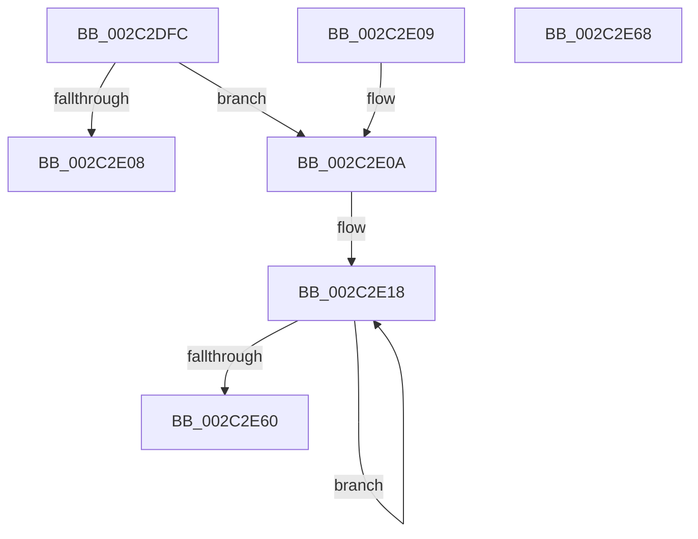

# MiHyperSpaceSize

- RVA: `0x002C2DFC`–`0x002C2E69` (길이 `109` bytes)
- VA: `0x00000001402C2DFC`
- 실행 섹션: `.text`
- PDB 이름 있음: `예`; PDB Function 태그: `아니요`
- unwind 정보 RVA: `0x000DB714`
- 디코드: `28`개 명령, `109/109` bytes 표시
- 미해석 바이트: `0` (있으면 어셈블리에 `.byte`로 보존)

> 이 문서는 커널 이미지의 기계어와 PDB 기호를 분석해 생성했습니다. 4번과 5번은 함수 원형과 자료형을 바이너리 사용 방식에서 추정한 C 해석이며 원본 소스 복구 결과는 아닙니다.

## 1. Dependencies

- 직접 호출 지점: **0**; 고유 호출 대상: **0**
- 직접 호출자로 확인된 함수: **6**
- RIP 상대 이미지 참조: **3**

### Outgoing calls
- 직접 디코드된 call 명령이 없습니다.

### Direct callers
- [MiStealPage](../2B/MiStealPage_function_002B28D0.md) at `0x002B3576`
- [MiInitializeWalkBounds](MiInitializeWalkBounds_function_002C2BCC.md) at `0x002C2C17`
- [MiSystemFault](../34/MiSystemFault_function_0034AA64.md) at `0x0034AD3D`
- [MiRealVaToFlushType](../68/MiRealVaToFlushType_function_0068619C.md) at `0x006861C0`
- [MiDeleteVadBitmap](../../page/A4/MiDeleteVadBitmap_function_00A45F18.md) at `0x00A45F95`
- [MiAssignTopLevelRanges](../../init/C6/MiAssignTopLevelRanges_function_00C65560.md) at `0x00C6567A`

### Static image references
- `0x002C2DFC` → RVA `0x00E2F3A0` (`.data`; read)
- `0x002C2E27` → RVA `0x00E2F3A8` (`.data`; read)
- `0x002C2E60` → RVA `0x00E2F3A0` (`.data`; write)

## 2. Other-region calls and transfers

- 다른 실행 섹션으로 향하는 call: **0**
- 별도 외부 분기/꼬리 이동을 확인하지 못했습니다.

## 3. Assembly (complete function range)

```asm
002C2DFC  48 8B 05 9D C5 B6 00            mov rax, qword ptr [rip + 0xb6c59d]
002C2E03  48 85 C0                        test rax, rax
002C2E06  74 02                           je 0x1402c2e0a
002C2E08  C3                              ret
002C2E09  CC                              int3
002C2E0A  B8 00 00 00 10                  mov eax, 0x10000000
002C2E0F  41 B8 00 00 00 04               mov r8d, 0x4000000
002C2E15  45 33 C9                        xor r9d, r9d
002C2E18  48 8D 90 FF 0F 00 00            lea rdx, [rax + 0xfff]
002C2E1F  B9 01 00 00 00                  mov ecx, 1
002C2E24  41 2B C9                        sub ecx, r9d
002C2E27  48 8D 05 7A C5 B6 00            lea rax, [rip + 0xb6c57a]
002C2E2E  48 81 E2 00 F0 FF FF            and rdx, 0xfffffffffffff000
002C2E35  41 F6 C0 3F                     test r8b, 0x3f
002C2E39  48 89 14 C8                     mov qword ptr [rax + rcx*8], rdx
002C2E3D  B9 00 00 00 00                  mov ecx, 0
002C2E42  0F 95 C1                        setne cl
002C2E45  49 8B C0                        mov rax, r8
002C2E48  48 C1 E8 06                     shr rax, 6
002C2E4C  41 FF C1                        inc r9d
002C2E4F  48 03 C8                        add rcx, rax
002C2E52  49 C1 E8 09                     shr r8, 9
002C2E56  48 8D 04 CA                     lea rax, [rdx + rcx*8]
002C2E5A  41 83 F9 02                     cmp r9d, 2
002C2E5E  72 B8                           jb 0x1402c2e18
002C2E60  48 89 05 39 C5 B6 00            mov qword ptr [rip + 0xb6c539], rax
002C2E67  C3                              ret
002C2E68  CC                              int3
```

## 4. C-style interpretation (structured pseudocode)

```c
__int64 __fastcall MiHyperSpaceSize(__int64 a1, __int64 a2, __int64 a3, int a4)
{
    __int64 result;

    if (*(unsigned __int64 *)(v_rip + 11978141) == 0) goto loc_002C2E0A;
    return *(unsigned __int64 *)(v_rip + 11978141);
loc_002C2E0A:
    a4 = 0;
loc_002C2E18:
    a1 = (unsigned int)((1) - (0));
    a2 = ((unsigned int)(0x10000000ULL) + 4095) & (0xFFFFFFFFFFFFF000ULL);
    *(unsigned __int64 *)(v_rip + 11978106 + a1 * 8) = a2;
    a1 = ((((unsigned __int8)((unsigned int)(0x4000000ULL))) & (63)) != 0) ? 1 : 0;
    result = ((unsigned int)(0x4000000ULL)) >> (6);
    a4 = (unsigned int)((a4) + 1);
    a1 = (a1) + (result);
    a3 = ((unsigned int)(0x4000000ULL)) >> (9);
    if (a4 < 2) goto loc_002C2E18;
    *(unsigned __int64 *)(v_rip + 11978041) = a2 + a1 * 8;
    return a2 + a1 * 8;
}
```

## 5. (Beta) C Style

```c
int64_t MiHyperSpaceSize(int64_t Arg1, int64_t Arg2, int64_t Arg3, int32_t Arg4)
{
    int64_t result;

    if (*(uint64_t *)(v_rip + 0xB6C59D) == 0) goto loc_002C2E0A;
    return *(uint64_t *)(v_rip + 0xB6C59D);
loc_002C2E0A:
    Arg4 = 0;
loc_002C2E18:
    Arg1 = (uint32_t)((1) - (0));
    Arg2 = ((uint32_t)(0x10000000ULL) + 4095) & (0xFFFFFFFFFFFFF000ULL);
    *(uint64_t *)(v_rip + 0xB6C57A + Arg1 * 8) = Arg2;
    Arg1 = ((((uint8_t)((uint32_t)(0x4000000ULL))) & (63)) != 0) ? 1 : 0;
    result = ((uint32_t)(0x4000000ULL)) >> (6);
    Arg4 = (uint32_t)((Arg4) + 1);
    Arg1 = (Arg1) + (result);
    Arg3 = ((uint32_t)(0x4000000ULL)) >> (9);
    if (Arg4 < 2) goto loc_002C2E18;
    *(uint64_t *)(v_rip + 0xB6C539) = Arg2 + Arg1 * 8;
    return Arg2 + Arg1 * 8;
}
```

## 6. Execution-region graph

[열기: 2D/3D 그래프와 함수 탐색 컨트롤 패널](../../../control-panel.html?section=text&rva=0x002C2DFC&view=graph)

- 2D 그래프는 위에서 아래로 흐르고, 3D 그래프는 빈 공간을 드래그해 회전합니다. Shift+드래그는 이동, 휠은 확대·축소, 함수 노드 선택은 대상 보고서 이동입니다.

### Static fallback


