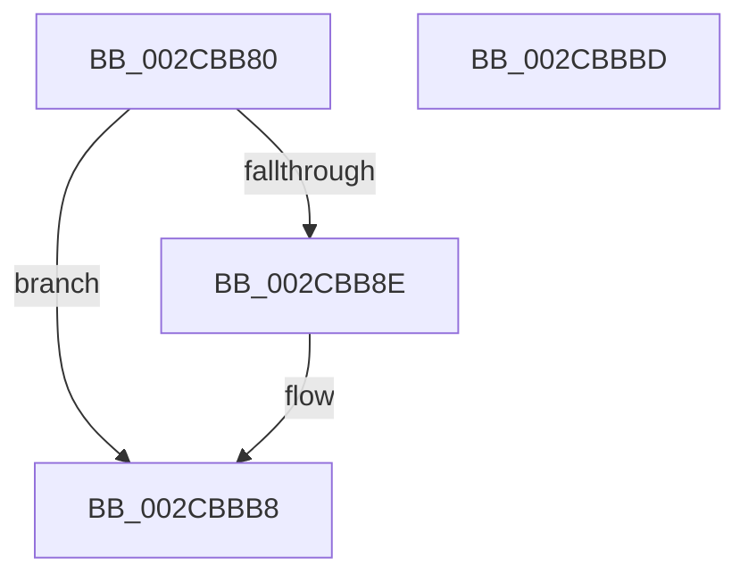

# MiIncrementZeroEngineThread

- RVA: `0x002CBB80`–`0x002CBBBE` (길이 `62` bytes)
- VA: `0x00000001402CBB80`
- 실행 섹션: `.text`
- PDB 이름 있음: `예`; PDB Function 태그: `아니요`
- unwind 정보 RVA: `0x0005C788`
- 디코드: `16`개 명령, `62/62` bytes 표시
- 미해석 바이트: `0` (있으면 어셈블리에 `.byte`로 보존)

> 이 문서는 커널 이미지의 기계어와 PDB 기호를 분석해 생성했습니다. 4번과 5번은 함수 원형과 자료형을 바이너리 사용 방식에서 추정한 C 해석이며 원본 소스 복구 결과는 아닙니다.

## 1. Dependencies

- 직접 호출 지점: **1**; 고유 호출 대상: **1**
- 직접 호출자로 확인된 함수: **3**
- RIP 상대 이미지 참조: **0**

### Outgoing calls
- `0x002CBBB3` → [KeSetEvent](../33/KeSetEvent_function_0033F310.md) (function, `0x0033F310`)

### Direct callers
- [MiAddZeroingThreads](MiAddZeroingThreads_function_002CBF78.md) at `0x002CC34E`
- [MiInsertNewZeroThread](../69/MiInsertNewZeroThread_function_00696140.md) at `0x0069620A`
- [sub_006DCCA8](../6D/Unknown_function_006DCCA8.md) at `0x006DCD1D`

### Static image references
- 디코드된 RIP-relative 메모리 참조가 없습니다.

## 2. Other-region calls and transfers

- 다른 실행 섹션으로 향하는 call: **0**
- 별도 외부 분기/꼬리 이동을 확인하지 못했습니다.

## 3. Assembly (complete function range)

```asm
002CBB80  48 83 EC 28                     sub rsp, 0x28
002CBB84  8B 81 80 01 00 00               mov eax, dword ptr [rcx + 0x180]
002CBB8A  A8 02                           test al, 2
002CBB8C  74 2A                           je 0x1402cbbb8
002CBB8E  48 8B 91 50 01 00 00            mov rdx, qword ptr [rcx + 0x150]
002CBB95  45 33 C0                        xor r8d, r8d
002CBB98  8B 81 80 01 00 00               mov eax, dword ptr [rcx + 0x180]
002CBB9E  83 E0 FD                        and eax, 0xfffffffd
002CBBA1  89 81 80 01 00 00               mov dword ptr [rcx + 0x180], eax
002CBBA7  48 81 C1 88 01 00 00            add rcx, 0x188
002CBBAE  FF 42 0C                        inc dword ptr [rdx + 0xc]
002CBBB1  33 D2                           xor edx, edx
002CBBB3  E8 58 37 07 00                  call 0x14033f310
002CBBB8  48 83 C4 28                     add rsp, 0x28
002CBBBC  C3                              ret
002CBBBD  CC                              int3
```

## 4. C-style interpretation (structured pseudocode)

```c
__int64 __fastcall MiIncrementZeroEngineThread(__int64 a1, __int64 a2, int a3)
{
    __int64 result;
    __int64 v_rsp;

    v_rsp = (v_rsp) - (40);
    result = (unsigned int)(*(unsigned int *)(a1 + 384));
    if ((((unsigned __int8)((unsigned int)(*(unsigned int *)(a1 + 384)))) & (2)) != 0) {
        a2 = *(unsigned __int64 *)(a1 + 336);
        a3 = 0;
        result = *(unsigned int *)(a1 + 384);
        result = (unsigned int)((result) & (0xFFFFFFFDULL));
        *(unsigned int *)(a1 + 384) = (unsigned int)(result);
        a1 = (a1) + (392);
        a2 = 0;
        result = KeSetEvent(a1, a2, a3, a4);
    }
    v_rsp = (v_rsp) + (40);
    return result;
}
```

## 5. (Beta) C Style

```c
int64_t MiIncrementZeroEngineThread(void *Arg1, int64_t Arg2, int32_t Arg3)
{
    uint8_t *arg1 = (uint8_t *)Arg1;

    int64_t result;
    int64_t local_rsp;

    local_rsp = (local_rsp) - (40);
    result = (uint32_t)(*(uint32_t *)(arg1 + 0x180));
    if ((((uint8_t)((uint32_t)(*(uint32_t *)(arg1 + 0x180)))) & (2)) != 0) {
        Arg2 = *(uint64_t *)(arg1 + 0x150);
        Arg3 = 0;
        result = *(uint32_t *)(arg1 + 0x180);
        result = (uint32_t)((result) & (0xFFFFFFFDULL));
        *(uint32_t *)(arg1 + 0x180) = (uint32_t)(result);
        Arg1 = (Arg1) + (392);
        Arg2 = 0;
        result = KeSetEvent(Arg1, Arg2, Arg3, a4);
    }
    local_rsp = (local_rsp) + (40);
    return result;
}
```

### 관측된 메모리 오프셋

구조체 형식이 확인되지 않은 접근은 인자 기준의 오프셋으로만 기록했습니다.

| 기준 인자 | 오프셋 표현 | 폭 (bit) | 접근 |
|---|---:|---:|---|
| `Arg1` | `+ 0x150` | `64` | `R` |
| `Arg1` | `+ 0x180` | `32` | `R` |
| `Arg1` | `+ 0x180` | `32` | `W` |

## 6. Execution-region graph

[열기: 2D/3D 그래프와 함수 탐색 컨트롤 패널](../../../control-panel.html?section=text&rva=0x002CBB80&view=graph)

- 2D 그래프는 위에서 아래로 흐르고, 3D 그래프는 빈 공간을 드래그해 회전합니다. Shift+드래그는 이동, 휠은 확대·축소, 함수 노드 선택은 대상 보고서 이동입니다.

### Static fallback


