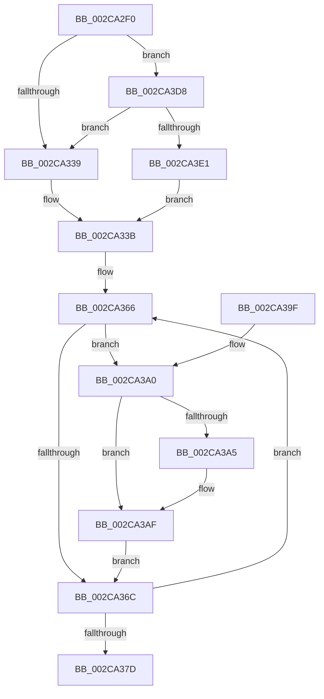

# MiInitializeAffinityWalker

- RVA: `0x002CA2F0`–`0x002CA3EF` (길이 `255` bytes)
- VA: `0x00000001402CA2F0`
- 실행 섹션: `.text`
- PDB 이름 있음: `예`; PDB Function 태그: `아니요`
- unwind 정보 RVA: `0x0006F180`
- 디코드: `76`개 명령, `255/255` bytes 표시
- 미해석 바이트: `0` (있으면 어셈블리에 `.byte`로 보존)

> 이 문서는 커널 이미지의 기계어와 PDB 기호를 분석해 생성했습니다. 4번과 5번은 함수 원형과 자료형을 바이너리 사용 방식에서 추정한 C 해석이며 원본 소스 복구 결과는 아닙니다.

## 1. Dependencies

- 직접 호출 지점: **2**; 고유 호출 대상: **2**
- 직접 호출자로 확인된 함수: **1**
- RIP 상대 이미지 참조: **2**

### Outgoing calls
- `0x002CA344` → [MiObtainParkedCoreMasks](../34/MiObtainParkedCoreMasks_function_00348DE0.md) (function, `0x00348DE0`)
- `0x002CA3CE` → [MiInitializeDpcGroupAffinity](MiInitializeDpcGroupAffinity_function_002CA6D0.md) (function, `0x002CA6D0`)

### Direct callers
- [MiInitializeZeroGroup](MiInitializeZeroGroup_function_002CA00C.md) at `0x002CA15C`

### Static image references
- `0x002CA30E` → RVA `0x00E2DBF8` (`.data`; read)
- `0x002CA3E1` → RVA `0x00E2DBD8` (`.data`; read)

## 2. Other-region calls and transfers

- 다른 실행 섹션으로 향하는 call: **0**
- 별도 외부 분기/꼬리 이동을 확인하지 못했습니다.

## 3. Assembly (complete function range)

```asm
002CA2F0  48 89 5C 24 10                  mov qword ptr [rsp + 0x10], rbx
002CA2F5  44 89 4C 24 20                  mov dword ptr [rsp + 0x20], r9d
002CA2FA  44 89 44 24 18                  mov dword ptr [rsp + 0x18], r8d
002CA2FF  55                              push rbp
002CA300  56                              push rsi
002CA301  57                              push rdi
002CA302  41 54                           push r12
002CA304  41 55                           push r13
002CA306  41 56                           push r14
002CA308  41 57                           push r15
002CA30A  48 83 EC 20                     sub rsp, 0x20
002CA30E  48 8B 05 E3 38 B6 00            mov rax, qword ptr [rip + 0xb638e3]
002CA315  4C 8B F2                        mov r14, rdx
002CA318  41 8B D8                        mov ebx, r8d
002CA31B  48 8B F1                        mov rsi, rcx
002CA31E  4C 8D 04 5B                     lea r8, [rbx + rbx*2]
002CA322  49 C1 E0 07                     shl r8, 7
002CA326  49 8B AC 00 78 01 00 00         mov rbp, qword ptr [r8 + rax + 0x178]
002CA32E  8B 45 24                        mov eax, dword ptr [rbp + 0x24]
002CA331  A8 01                           test al, 1
002CA333  0F 85 9F 00 00 00               jne 0x1402ca3d8
002CA339  32 C0                           xor al, al
002CA33B  88 41 08                        mov byte ptr [rcx + 8], al
002CA33E  33 D2                           xor edx, edx
002CA340  48 83 C1 10                     add rcx, 0x10
002CA344  E8 97 EA 07 00                  call 0x140348de0
002CA349  8B 7E 04                        mov edi, dword ptr [rsi + 4]
002CA34C  4C 8D AE 78 01 00 00            lea r13, [rsi + 0x178]
002CA353  8B DF                           mov ebx, edi
002CA355  4C 8D BE 20 01 00 00            lea r15, [rsi + 0x120]
002CA35C  48 C1 E3 04                     shl rbx, 4
002CA360  45 33 E4                        xor r12d, r12d
002CA363  45 33 C9                        xor r9d, r9d
002CA366  41 83 3E 00                     cmp dword ptr [r14], 0
002CA36A  75 34                           jne 0x1402ca3a0
002CA36C  41 FF C1                        inc r9d
002CA36F  49 83 C7 20                     add r15, 0x20
002CA373  49 83 C6 04                     add r14, 4
002CA377  41 83 F9 03                     cmp r9d, 3
002CA37B  7C E9                           jl 0x1402ca366
002CA37D  8B 5C 24 70                     mov ebx, dword ptr [rsp + 0x70]
002CA381  8B 7C 24 78                     mov edi, dword ptr [rsp + 0x78]
002CA385  89 1E                           mov dword ptr [rsi], ebx
002CA387  48 8B 5C 24 68                  mov rbx, qword ptr [rsp + 0x68]
002CA38C  89 7E 04                        mov dword ptr [rsi + 4], edi
002CA38F  48 83 C4 20                     add rsp, 0x20
002CA393  41 5F                           pop r15
002CA395  41 5E                           pop r14
002CA397  41 5D                           pop r13
002CA399  41 5C                           pop r12
002CA39B  5F                              pop rdi
002CA39C  5E                              pop rsi
002CA39D  5D                              pop rbp
002CA39E  C3                              ret
002CA39F  CC                              int3
002CA3A0  45 85 E4                        test r12d, r12d
002CA3A3  75 0A                           jne 0x1402ca3af
002CA3A5  44 89 4E 0C                     mov dword ptr [rsi + 0xc], r9d
002CA3A9  41 BC 01 00 00 00               mov r12d, 1
002CA3AF  8B 45 08                        mov eax, dword ptr [rbp + 8]
002CA3B2  44 8B C7                        mov r8d, edi
002CA3B5  41 89 47 14                     mov dword ptr [r15 + 0x14], eax
002CA3B9  49 8B CD                        mov rcx, r13
002CA3BC  41 8B 06                        mov eax, dword ptr [r14]
002CA3BF  41 89 47 F8                     mov dword ptr [r15 - 8], eax
002CA3C3  41 89 3F                        mov dword ptr [r15], edi
002CA3C6  4D 89 6F 08                     mov qword ptr [r15 + 8], r13
002CA3CA  48 8B 55 00                     mov rdx, qword ptr [rbp]
002CA3CE  E8 FD 02 00 00                  call 0x1402ca6d0
002CA3D3  4C 03 EB                        add r13, rbx
002CA3D6  EB 94                           jmp 0x1402ca36c
002CA3D8  83 3A 00                        cmp dword ptr [rdx], 0
002CA3DB  0F 85 58 FF FF FF               jne 0x1402ca339
002CA3E1  48 8D 2D F0 37 B6 00            lea rbp, [rip + 0xb637f0]
002CA3E8  B0 01                           mov al, 1
002CA3EA  E9 4C FF FF FF                  jmp 0x1402ca33b
```

## 4. C-style interpretation (structured pseudocode)

```c
__int64 __fastcall MiInitializeAffinityWalker(__int64 a1, __int64 a2, int a3, int a4)
{
    __int64 result;
    __int64 v_r12;
    __int64 v_r13;
    __int64 v_r14;
    __int64 v_r15;
    __int64 v_rbx;
    __int64 v_rsp;
    unsigned __int64 v_stack_p10;
    unsigned int v_stack_p18;
    unsigned int v_stack_p20;

    v_stack_p10 = v_rbx;
    v_stack_p20 = a4;
    v_stack_p18 = a3;
    v_rsp = (v_rsp) - (32);
    a3 = ((unsigned int)(a3) + (unsigned int)(a3) * 2) << (7);
    if ((((unsigned __int8)((unsigned int)(*(unsigned int *)(*(unsigned __int64 *)(a3 + *(unsigned __int64 *)(v_rip + 11942115) * 1 + 376) + 36)))) & (1)) != 0) goto loc_002CA3D8;
loc_002CA339:
    result = 0;
loc_002CA33B:
    *(unsigned __int8 *)(a1 + 8) = 0;
    a2 = 0;
    a1 = (a1) + (16);
    result = MiObtainParkedCoreMasks(a1, a2, a3, a4);
    v_rbx = ((unsigned int)((unsigned int)((unsigned int)(*(unsigned int *)(a1 + 4))))) << (4);
    v_r12 = 0;
    a4 = 0;
loc_002CA366:
    if ((*(unsigned int *)(a2)) != 0) goto loc_002CA3A0;
loc_002CA36C:
    a4 = (unsigned int)((a4) + 1);
    v_r15 = (a1 + 288) + (32);
    v_r14 = (a2) + (4);
    if (a4 < 3) goto loc_002CA366;
    *(unsigned int *)(a1) = (unsigned int)((unsigned int)(v_stack_p18));
    *(unsigned int *)(a1 + 4) = (unsigned int)((unsigned int)(v_stack_p20));
    v_rsp = (v_rsp) + (32);
    return result;
loc_002CA3A0:
    if (0 == 0) {
        *(unsigned int *)(a1 + 12) = a4;
        v_r12 = 1;
    }
    *(unsigned int *)(v_r15 + 20) = (unsigned int)((unsigned int)(*(unsigned int *)(*(unsigned __int64 *)(a3 + *(unsigned __int64 *)(v_rip + 11942115) * 1 + 376) + 8)));
    *(unsigned int *)(v_r15 - 8) = (unsigned int)((unsigned int)(*(unsigned int *)(v_r14)));
    *(unsigned int *)(v_r15) = (unsigned int)((unsigned int)(v_stack_p20));
    *(unsigned __int64 *)(v_r15 + 8) = a1 + 376;
    result = MiInitializeDpcGroupAffinity(a1 + 376, *(unsigned __int64 *)(*(unsigned __int64 *)(a3 + *(unsigned __int64 *)(v_rip + 11942115) * 1 + 376)), (unsigned int)((unsigned int)((unsigned int)(v_stack_p20))), a4);
    v_r13 = (a1 + 376) + (v_stack_p10);
    goto loc_002CA36C;
loc_002CA3D8:
    if ((*(unsigned int *)(*(unsigned __int64 *)(*(unsigned __int64 *)(a3 + *(unsigned __int64 *)(v_rip + 11942115) * 1 + 376)))) != 0) goto loc_002CA339;
    goto loc_002CA33B;
}
```

## 5. (Beta) C Style

```c
int64_t MiInitializeAffinityWalker(void *Arg1, void *Arg2, void *Arg3, int32_t Arg4)
{
    uint8_t *arg1 = (uint8_t *)Arg1;
    uint8_t *arg2 = (uint8_t *)Arg2;
    uint8_t *arg3 = (uint8_t *)Arg3;

    int64_t result;
    int64_t local_r12;
    int64_t local_r13;
    int64_t local_r14;
    int64_t local_r15;
    int64_t local_rbx;
    int64_t local_rsp;
    uint64_t v_stack_p10;
    uint32_t v_stack_p18;
    uint32_t v_stack_p20;

    v_stack_p10 = local_rbx;
    v_stack_p20 = Arg4;
    v_stack_p18 = Arg3;
    local_rsp = (local_rsp) - (32);
    Arg3 = ((uint32_t)(Arg3) + (uint32_t)(Arg3) * 2) << (7);
    if ((((uint8_t)((uint32_t)(*(uint32_t *)(*(uint64_t *)(arg3 + *(uint64_t *)(v_rip + 0xB638E3) * 1 + 0x178) + 0x24)))) & (1)) != 0) goto loc_002CA3D8;
loc_002CA339:
    result = 0;
loc_002CA33B:
    *(uint8_t *)(arg1 + 0x8) = 0;
    Arg2 = 0;
    Arg1 = (Arg1) + (16);
    result = MiObtainParkedCoreMasks(Arg1, Arg2, Arg3, Arg4);
    local_rbx = ((uint32_t)((uint32_t)((uint32_t)(*(uint32_t *)(arg1 + 0x4))))) << (4);
    local_r12 = 0;
    Arg4 = 0;
loc_002CA366:
    if ((*(uint32_t *)(arg2)) != 0) goto loc_002CA3A0;
loc_002CA36C:
    Arg4 = (uint32_t)((Arg4) + 1);
    local_r15 = (Arg1 + 288) + (32);
    local_r14 = (Arg2) + (4);
    if (Arg4 < 3) goto loc_002CA366;
    *(uint32_t *)(arg1) = (uint32_t)((uint32_t)(v_stack_p18));
    *(uint32_t *)(arg1 + 0x4) = (uint32_t)((uint32_t)(v_stack_p20));
    local_rsp = (local_rsp) + (32);
    return result;
loc_002CA3A0:
    if (0 == 0) {
        *(uint32_t *)(arg1 + 0xC) = Arg4;
        local_r12 = 1;
    }
    *(uint32_t *)(local_r15 + 0x14) = (uint32_t)((uint32_t)(*(uint32_t *)(*(uint64_t *)(arg3 + *(uint64_t *)(v_rip + 0xB638E3) * 1 + 0x178) + 0x8)));
    *(uint32_t *)(local_r15 - 0x8) = (uint32_t)((uint32_t)(*(uint32_t *)(local_r14)));
    *(uint32_t *)(local_r15) = (uint32_t)((uint32_t)(v_stack_p20));
    *(void **)(local_r15 + 0x8) = Arg1 + 376;
    result = MiInitializeDpcGroupAffinity(Arg1 + 376, *(uint64_t *)(*(uint64_t *)(arg3 + *(uint64_t *)(v_rip + 0xB638E3) * 1 + 0x178)), (uint32_t)((uint32_t)((uint32_t)(v_stack_p20))), Arg4);
    local_r13 = (Arg1 + 376) + (v_stack_p10);
    goto loc_002CA36C;
loc_002CA3D8:
    if ((*(uint32_t *)(*(uint64_t *)(*(uint64_t *)(arg3 + *(uint64_t *)(v_rip + 0xB638E3) * 1 + 0x178)))) != 0) goto loc_002CA339;
    goto loc_002CA33B;
}
```

### 관측된 메모리 오프셋

구조체 형식이 확인되지 않은 접근은 인자 기준의 오프셋으로만 기록했습니다.

| 기준 인자 | 오프셋 표현 | 폭 (bit) | 접근 |
|---|---:|---:|---|
| `Arg1` | `- 0x8` | `32` | `W` |
| `Arg1` | `+ 0x0` | `32` | `W` |
| `Arg1` | `+ 0x4` | `32` | `R` |
| `Arg1` | `+ 0x4` | `32` | `W` |
| `Arg1` | `+ 0x8` | `8` | `W` |
| `Arg1` | `+ 0x8` | `64` | `W` |
| `Arg1` | `+ 0xC` | `32` | `W` |
| `Arg1` | `+ 0x14` | `32` | `W` |
| `Arg1` | `+ 0x120` | `64` | `R` |
| `Arg1` | `+ 0x178` | `64` | `R` |
| `Arg2` | `+ 0x0` | `32` | `R` |
| `Arg3` | `+ 0x0 + rbx*2` | `64` | `R` |

## 6. Execution-region graph

[열기: 2D/3D 그래프와 함수 탐색 컨트롤 패널](../../../control-panel.html?section=text&rva=0x002CA2F0&view=graph)

- 2D 그래프는 위에서 아래로 흐르고, 3D 그래프는 빈 공간을 드래그해 회전합니다. Shift+드래그는 이동, 휠은 확대·축소, 함수 노드 선택은 대상 보고서 이동입니다.

### Static fallback


