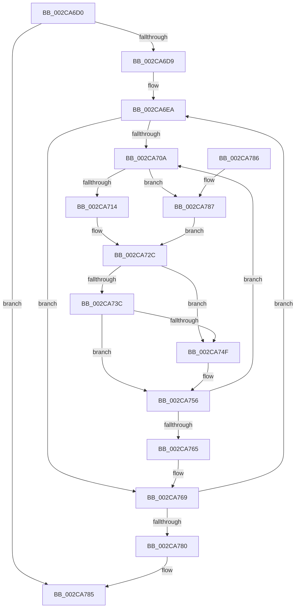

# MiInitializeDpcGroupAffinity

- RVA: `0x002CA6D0`–`0x002CA78E` (길이 `190` bytes)
- VA: `0x00000001402CA6D0`
- 실행 섹션: `.text`
- PDB 이름 있음: `예`; PDB Function 태그: `아니요`
- unwind 정보 RVA: `0x0006F1C8`
- 디코드: `52`개 명령, `190/190` bytes 표시
- 미해석 바이트: `0` (있으면 어셈블리에 `.byte`로 보존)

> 이 문서는 커널 이미지의 기계어와 PDB 기호를 분석해 생성했습니다. 4번과 5번은 함수 원형과 자료형을 바이너리 사용 방식에서 추정한 C 해석이며 원본 소스 복구 결과는 아닙니다.

## 1. Dependencies

- 직접 호출 지점: **0**; 고유 호출 대상: **0**
- 직접 호출자로 확인된 함수: **3**
- RIP 상대 이미지 참조: **2**

### Outgoing calls
- 직접 디코드된 call 명령이 없습니다.

### Direct callers
- [MiInitializeAffinityWalker](MiInitializeAffinityWalker_function_002CA2F0.md) at `0x002CA3CE`
- [MiComputeIdealDpcGang](../43/MiComputeIdealDpcGang_function_0043EAAC.md) at `0x0043ED17`
- [MiAbsorbPossibleEngineChanges](../69/MiAbsorbPossibleEngineChanges_function_006958B4.md) at `0x00695B97`

### Static image references
- `0x002CA722` → RVA `0x00F231B8` (`.data`; read)
- `0x002CA72C` → RVA `0x00FC8C40` (`ALMOSTRO`; read)

## 2. Other-region calls and transfers

- 다른 실행 섹션으로 향하는 call: **0**
- 별도 외부 분기/꼬리 이동을 확인하지 못했습니다.

## 3. Assembly (complete function range)

```asm
002CA6D0  45 85 C0                        test r8d, r8d
002CA6D3  0F 84 AC 00 00 00               je 0x1402ca785
002CA6D9  53                              push rbx
002CA6DA  48 83 EC 20                     sub rsp, 0x20
002CA6DE  4C 8B DA                        mov r11, rdx
002CA6E1  41 8B D8                        mov ebx, r8d
002CA6E4  4C 2B D9                        sub r11, rcx
002CA6E7  4C 8B D1                        mov r10, rcx
002CA6EA  43 0F 10 04 13                  movups xmm0, xmmword ptr [r11 + r10]
002CA6EF  45 33 C0                        xor r8d, r8d
002CA6F2  66 48 0F 7E C2                  movq rdx, xmm0
002CA6F7  66 0F 7F 04 24                  movdqa xmmword ptr [rsp], xmm0
002CA6FC  0F 29 44 24 10                  movaps xmmword ptr [rsp + 0x10], xmm0
002CA701  4C 89 04 24                     mov qword ptr [rsp], r8
002CA705  48 85 D2                        test rdx, rdx
002CA708  74 5F                           je 0x1402ca769
002CA70A  83 64 24 40 00                  and dword ptr [rsp + 0x40], 0
002CA70F  48 85 D2                        test rdx, rdx
002CA712  74 73                           je 0x1402ca787
002CA714  0F B7 44 24 18                  movzx eax, word ptr [rsp + 0x18]
002CA719  C1 E0 06                        shl eax, 6
002CA71C  48 0F BC CA                     bsf rcx, rdx
002CA720  03 C8                           add ecx, eax
002CA722  48 8B 05 8F 8A C5 00            mov rax, qword ptr [rip + 0xc58a8f]
002CA729  8B 04 88                        mov eax, dword ptr [rax + rcx*4]
002CA72C  48 8D 0D 0D E5 CF 00            lea rcx, [rip + 0xcfe50d]
002CA733  48 8B 0C C1                     mov rcx, qword ptr [rcx + rax*8]
002CA737  45 85 C9                        test r9d, r9d
002CA73A  74 13                           je 0x1402ca74f
002CA73C  33 C0                           xor eax, eax
002CA73E  80 B9 08 8A 00 00 01            cmp byte ptr [rcx + 0x8a08], 1
002CA745  0F 95 C0                        setne al
002CA748  FF C0                           inc eax
002CA74A  41 3B C1                        cmp eax, r9d
002CA74D  75 07                           jne 0x1402ca756
002CA74F  4C 0B 81 C8 00 00 00            or r8, qword ptr [rcx + 0xc8]
002CA756  48 8B 81 C8 00 00 00            mov rax, qword ptr [rcx + 0xc8]
002CA75D  48 F7 D0                        not rax
002CA760  48 23 D0                        and rdx, rax
002CA763  75 A5                           jne 0x1402ca70a
002CA765  4C 89 04 24                     mov qword ptr [rsp], r8
002CA769  0F 28 04 24                     movaps xmm0, xmmword ptr [rsp]
002CA76D  F3 41 0F 7F 02                  movdqu xmmword ptr [r10], xmm0
002CA772  49 83 C2 10                     add r10, 0x10
002CA776  48 83 EB 01                     sub rbx, 1
002CA77A  0F 85 6A FF FF FF               jne 0x1402ca6ea
002CA780  48 83 C4 20                     add rsp, 0x20
002CA784  5B                              pop rbx
002CA785  C3                              ret
002CA786  CC                              int3
002CA787  B8 FF FF FF FF                  mov eax, 0xffffffff
002CA78C  EB 9E                           jmp 0x1402ca72c
```

## 4. C-style interpretation (structured pseudocode)

```c
__int64 __fastcall MiInitializeDpcGroupAffinity(__int64 a1, __int64 a2, int a3, int a4)
{
    __int64 result;
    __int64 v_r10;
    __int64 v_r11;
    __int64 v_rbx;
    __int64 v_rsp;
    unsigned __int16 v_stack_m10;
    unsigned __int64 v_stack_m18;
    unsigned __int64 v_stack_m28;
    unsigned int v_stack_p18;

    if (a3 == 0) goto loc_002CA785;
    v_rsp = (v_rsp) - (32);
    v_r11 = (a2) - (a1);
loc_002CA6EA:
    a3 = 0;
    v_stack_m28 = v_xmm0;
    v_stack_m18 = v_xmm0;
    v_stack_m28 = 0;
    if (a2 == 0) goto loc_002CA769;
loc_002CA70A:
    if (a2 == 0) goto loc_002CA787;
    result = (unsigned int)((v_stack_m10) << (6));
    a1 = (unsigned int)((a1) + ((unsigned int)(result)));
loc_002CA72C:
    if (a4 == 0) goto loc_002CA74F;
    result = 0;
    result = ((*(unsigned __int8 *)(*(unsigned __int64 *)(v_rip + 13624589 + (unsigned int)(*(unsigned int *)(*(unsigned __int64 *)(v_rip + 12946063) + a1 * 4)) * 8) + 35336)) != 1) ? 1 : 0;
    result = (unsigned int)((result) + 1);
    if (((unsigned int)(result)) == a4) {
        a3 = (a3) | (*(unsigned __int64 *)(*(unsigned __int64 *)(v_rip + 13624589 + (unsigned int)(*(unsigned int *)(*(unsigned __int64 *)(v_rip + 12946063) + a1 * 4)) * 8) + 200));
    }
    result = ~(*(unsigned __int64 *)(*(unsigned __int64 *)(v_rip + 13624589 + (unsigned int)(*(unsigned int *)(*(unsigned __int64 *)(v_rip + 12946063) + a1 * 4)) * 8) + 200));
    a2 = (a2) & (result);
    if (condition_is_not_equal) goto loc_002CA70A;
    v_stack_m28 = a3;
loc_002CA769:
    *(unsigned __int64 *)(a1) = v_xmm0;
    v_r10 = (a1) + (16);
    v_rbx = ((unsigned int)(a3)) - (1);
    if (condition_is_not_equal) goto loc_002CA6EA;
    v_rsp = (v_rsp) + (32);
loc_002CA785:
    return result;
loc_002CA787:
    goto loc_002CA72C;
}
```

## 5. (Beta) C Style

```c
int64_t MiInitializeDpcGroupAffinity(void *Arg1, void *Arg2, int32_t Arg3, int32_t Arg4)
{
    uint8_t *arg1 = (uint8_t *)Arg1;
    uint8_t *arg2 = (uint8_t *)Arg2;

    int64_t result;
    int64_t local_r10;
    int64_t local_r11;
    int64_t local_rbx;
    int64_t local_rsp;
    uint16_t v_stack_m10;
    uint64_t v_stack_m18;
    uint64_t v_stack_m28;
    uint32_t v_stack_p18;

    if (Arg3 == 0) goto loc_002CA785;
    local_rsp = (local_rsp) - (32);
    local_r11 = (Arg2) - (Arg1);
loc_002CA6EA:
    Arg3 = 0;
    v_stack_m28 = v_xmm0;
    v_stack_m18 = v_xmm0;
    v_stack_m28 = 0;
    if (Arg2 == NULL) goto loc_002CA769;
loc_002CA70A:
    if (Arg2 == NULL) goto loc_002CA787;
    result = (uint32_t)((v_stack_m10) << (6));
    Arg1 = (uint32_t)((Arg1) + ((uint32_t)(result)));
loc_002CA72C:
    if (Arg4 == 0) goto loc_002CA74F;
    result = 0;
    result = ((*(uint8_t *)(*(uint64_t *)(v_rip + 0xCFE50D + (uint32_t)(*(uint32_t *)(*(uint64_t *)(v_rip + 0xC58A8F) + arg1 * 4)) * 8) + 0x8A08)) != 1) ? 1 : 0;
    result = (uint32_t)((result) + 1);
    if (((uint32_t)(result)) == Arg4) {
        Arg3 = (Arg3) | (*(uint64_t *)(*(uint64_t *)(v_rip + 0xCFE50D + (uint32_t)(*(uint32_t *)(*(uint64_t *)(v_rip + 0xC58A8F) + arg1 * 4)) * 8) + 0xC8));
    }
    result = ~(*(uint64_t *)(*(uint64_t *)(v_rip + 0xCFE50D + (uint32_t)(*(uint32_t *)(*(uint64_t *)(v_rip + 0xC58A8F) + arg1 * 4)) * 8) + 0xC8));
    Arg2 = (Arg2) & (result);
    if (condition_is_not_equal) goto loc_002CA70A;
    v_stack_m28 = Arg3;
loc_002CA769:
    *(uint64_t *)(arg1) = v_xmm0;
    local_r10 = (Arg1) + (16);
    local_rbx = ((uint32_t)(Arg3)) - (1);
    if (condition_is_not_equal) goto loc_002CA6EA;
    local_rsp = (local_rsp) + (32);
loc_002CA785:
    return result;
loc_002CA787:
    goto loc_002CA72C;
}
```

### 관측된 메모리 오프셋

구조체 형식이 확인되지 않은 접근은 인자 기준의 오프셋으로만 기록했습니다.

| 기준 인자 | 오프셋 표현 | 폭 (bit) | 접근 |
|---|---:|---:|---|
| `Arg1` | `+ 0x0` | `128` | `W` |
| `Arg2` | `+ 0x0 + r10*1` | `128` | `R` |

## 6. Execution-region graph

[열기: 2D/3D 그래프와 함수 탐색 컨트롤 패널](../../../control-panel.html?section=text&rva=0x002CA6D0&view=graph)

- 2D 그래프는 위에서 아래로 흐르고, 3D 그래프는 빈 공간을 드래그해 회전합니다. Shift+드래그는 이동, 휠은 확대·축소, 함수 노드 선택은 대상 보고서 이동입니다.

### Static fallback


