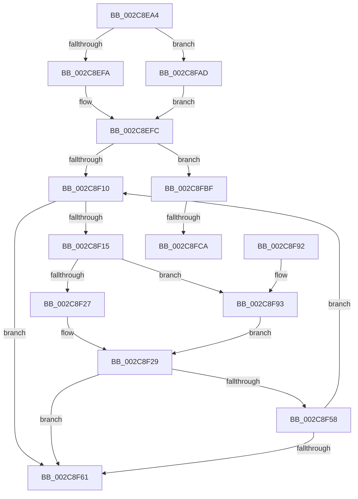

# MiInitializeLargeMdlLeafPfns

- RVA: `0x002C8EA4`–`0x002C8FD4` (길이 `304` bytes)
- VA: `0x00000001402C8EA4`
- 실행 섹션: `.text`
- PDB 이름 있음: `예`; PDB Function 태그: `예`
- unwind 정보 RVA: `0x0006EFCC`
- 디코드: `77`개 명령, `304/304` bytes 표시
- 미해석 바이트: `0` (있으면 어셈블리에 `.byte`로 보존)

> 이 문서는 커널 이미지의 기계어와 PDB 기호를 분석해 생성했습니다. 4번과 5번은 함수 원형과 자료형을 바이너리 사용 방식에서 추정한 C 해석이며 원본 소스 복구 결과는 아닙니다.

## 1. Dependencies

- 직접 호출 지점: **5**; 고유 호출 대상: **5**
- 직접 호출자로 확인된 함수: **1**
- RIP 상대 이미지 참조: **2**

### Outgoing calls
- `0x002C8F30` → [MiGetPfnPageSizeIndex](../31/MiGetPfnPageSizeIndex_function_0031C710.md) (function, `0x0031C710`)
- `0x002C8F4B` → [MiInitializeMdlLeafPfns](MiInitializeMdlLeafPfns_function_002C8FDC.md) (function, `0x002C8FDC`)
- `0x002C8F58` → [KeShouldYieldProcessor](../27/KeShouldYieldProcessor_function_002773E0.md) (function, `0x002773E0`)
- `0x002C8F6C` → [_security_check_cookie](../6A/_security_check_cookie_function_006AC640.md) (function, `0x006AC640`)
- `0x002C8FB2` → [MiMakeDemandZeroPte](../33/MiMakeDemandZeroPte_function_00337A00.md) (function, `0x00337A00`)

### Direct callers
- [MiDoGangAssignment](../4D/MiDoGangAssignment_function_004DE270.md) at `0x004DE2B6`

### Static image references
- `0x002C8EC3` → RVA `0x00E0A740` (`.data`; read)
- `0x002C8F00` → RVA `0x00011C60` (`.rdata`; read)

## 2. Other-region calls and transfers

- 다른 실행 섹션으로 향하는 call: **0**
- call이 아닌 외부 분기/꼬리 이동: **2**
  - `0x002C8FC4` → [sub_006DCA72](../6D/Unknown_function_006DCA72.md) (`tail-transfer`)
  - `0x002C8FCF` → [sub_006DCA72 + 0x1B](../6D/Unknown_function_006DCA72.md) (`tail-transfer`)

## 3. Assembly (complete function range)

```asm
002C8EA4  48 89 5C 24 10                  mov qword ptr [rsp + 0x10], rbx
002C8EA9  48 89 6C 24 18                  mov qword ptr [rsp + 0x18], rbp
002C8EAE  48 89 74 24 20                  mov qword ptr [rsp + 0x20], rsi
002C8EB3  57                              push rdi
002C8EB4  41 54                           push r12
002C8EB6  41 55                           push r13
002C8EB8  41 56                           push r14
002C8EBA  41 57                           push r15
002C8EBC  48 81 EC B0 00 00 00            sub rsp, 0xb0
002C8EC3  48 8B 05 76 18 B4 00            mov rax, qword ptr [rip + 0xb41876]
002C8ECA  48 33 C4                        xor rax, rsp
002C8ECD  48 89 84 24 A0 00 00 00         mov qword ptr [rsp + 0xa0], rax
002C8ED5  4C 8B 72 48                     mov r14, qword ptr [rdx + 0x48]
002C8ED9  48 8B EA                        mov rbp, rdx
002C8EDC  44 8B 42 38                     mov r8d, dword ptr [rdx + 0x38]
002C8EE0  4C 8B E9                        mov r13, rcx
002C8EE3  4C 89 74 24 38                  mov qword ptr [rsp + 0x38], r14
002C8EE8  48 89 54 24 30                  mov qword ptr [rsp + 0x30], rdx
002C8EED  41 F7 C0 00 02 00 80            test r8d, 0x80000200
002C8EF4  0F 84 B3 00 00 00               je 0x1402c8fad
002C8EFA  33 DB                           xor ebx, ebx
002C8EFC  49 8B 7D 00                     mov rdi, qword ptr [r13]
002C8F00  4C 8D 3D 59 8D D4 FF            lea r15, [rip - 0x2b72a7]
002C8F07  45 85 C0                        test r8d, r8d
002C8F0A  0F 88 AF 00 00 00               js 0x1402c8fbf
002C8F10  48 85 FF                        test rdi, rdi
002C8F13  74 4C                           je 0x1402c8f61
002C8F15  48 8B 37                        mov rsi, qword ptr [rdi]
002C8F18  48 B8 FE FF FF FF FF 0F 00 00   movabs rax, 0xffffffffffe
002C8F22  48 85 F0                        test rax, rsi
002C8F25  75 6C                           jne 0x1402c8f93
002C8F27  33 F6                           xor esi, esi
002C8F29  48 8B CF                        mov rcx, rdi
002C8F2C  49 89 75 00                     mov qword ptr [r13], rsi
002C8F30  E8 DB 37 05 00                  call 0x14031c710
002C8F35  8B D0                           mov edx, eax
002C8F37  4C 8B CB                        mov r9, rbx
002C8F3A  8B 45 38                        mov eax, dword ptr [rbp + 0x38]
002C8F3D  4D 8B C6                        mov r8, r14
002C8F40  48 8B CF                        mov rcx, rdi
002C8F43  89 44 24 20                     mov dword ptr [rsp + 0x20], eax
002C8F47  49 8B 14 D7                     mov rdx, qword ptr [r15 + rdx*8]
002C8F4B  E8 8C 00 00 00                  call 0x1402c8fdc
002C8F50  48 8B FE                        mov rdi, rsi
002C8F53  48 85 F6                        test rsi, rsi
002C8F56  74 09                           je 0x1402c8f61
002C8F58  E8 83 E4 FA FF                  call 0x1402773e0
002C8F5D  85 C0                           test eax, eax
002C8F5F  74 AF                           je 0x1402c8f10
002C8F61  48 8B 8C 24 A0 00 00 00         mov rcx, qword ptr [rsp + 0xa0]
002C8F69  48 33 CC                        xor rcx, rsp
002C8F6C  E8 CF 36 3E 00                  call 0x1406ac640
002C8F71  4C 8D 9C 24 B0 00 00 00         lea r11, [rsp + 0xb0]
002C8F79  49 8B 5B 38                     mov rbx, qword ptr [r11 + 0x38]
002C8F7D  49 8B 6B 40                     mov rbp, qword ptr [r11 + 0x40]
002C8F81  49 8B 73 48                     mov rsi, qword ptr [r11 + 0x48]
002C8F85  49 8B E3                        mov rsp, r11
002C8F88  41 5F                           pop r15
002C8F8A  41 5E                           pop r14
002C8F8C  41 5D                           pop r13
002C8F8E  41 5C                           pop r12
002C8F90  5F                              pop rdi
002C8F91  C3                              ret
002C8F92  CC                              int3
002C8F93  48 83 E6 FE                     and rsi, 0xfffffffffffffffe
002C8F97  48 B8 00 00 00 00 00 F0 FF FF   movabs rax, 0xfffff00000000000
002C8FA1  48 0B F0                        or rsi, rax
002C8FA4  48 C1 E6 03                     shl rsi, 3
002C8FA8  E9 7C FF FF FF                  jmp 0x1402c8f29
002C8FAD  B9 04 00 00 00                  mov ecx, 4
002C8FB2  E8 49 EA 06 00                  call 0x140337a00
002C8FB7  48 8B D8                        mov rbx, rax
002C8FBA  E9 3D FF FF FF                  jmp 0x1402c8efc
002C8FBF  41 0F BA E0 0C                  bt r8d, 0xc
002C8FC4  0F 83 A8 3A 41 00               jae 0x1406dca72
002C8FCA  BE 02 00 00 00                  mov esi, 2
002C8FCF  E9 B9 3A 41 00                  jmp 0x1406dca8d
```

## 4. C-style interpretation (structured pseudocode)

```c
__int64 __fastcall MiInitializeLargeMdlLeafPfns(__int64 a1, __int64 a2)
{
    __int64 result;
    __int64 v_rbx;
    __int64 v_rsi;
    __int64 v_rsp;
    unsigned __int64 v_stack_m28;
    unsigned __int64 v_stack_m38;
    unsigned __int64 v_stack_mA0;
    unsigned __int64 v_stack_mA8;
    unsigned int v_stack_mB8;
    unsigned __int64 v_stack_p10;
    unsigned __int64 v_stack_p18;
    unsigned __int64 v_stack_p20;

    v_stack_p10 = v_rbx;
    v_stack_p18 = v_rbp;
    v_stack_p20 = v_rsi;
    v_rsp = (v_rsp) - (176);
    result = (*(unsigned __int64 *)(v_rip + 11802742)) ^ (v_rsp);
    v_stack_m38 = result;
    v_stack_mA0 = *(unsigned __int64 *)(a2 + 72);
    v_stack_mA8 = a2;
    if ((((unsigned int)((unsigned int)(*(unsigned int *)(a2 + 56)))) & (0x80000200ULL)) == 0) goto loc_002C8FAD;
    v_rbx = 0;
loc_002C8EFC:
    if (sign_flag) goto loc_002C8FBF;
loc_002C8F10:
    if (*(unsigned __int64 *)(a1) == 0) goto loc_002C8F61;
    if (((result) & (*(unsigned __int64 *)(*(unsigned __int64 *)(a1)))) != 0) goto loc_002C8F93;
    v_rsi = 0;
loc_002C8F29:
    *(unsigned __int64 *)(a1) = 0;
    result = MiGetPfnPageSizeIndex(*(unsigned __int64 *)(a1), a2, (unsigned int)(*(unsigned int *)(a2 + 56)), a4);
    v_stack_mB8 = (unsigned int)((unsigned int)(*(unsigned int *)(a2 + 56)));
    result = MiInitializeMdlLeafPfns(*(unsigned __int64 *)(a1), *(unsigned __int64 *)(v_rip - 2847399 + (unsigned int)((unsigned int)(result)) * 8), *(unsigned __int64 *)(a2 + 72), 0);
    if (0 == 0) goto loc_002C8F61;
    result = KeShouldYieldProcessor(*(unsigned __int64 *)(a1), *(unsigned __int64 *)(v_rip - 2847399 + (unsigned int)((unsigned int)(result)) * 8), *(unsigned __int64 *)(a2 + 72), 0);
    if ((unsigned int)(result) == 0) goto loc_002C8F10;
loc_002C8F61:
    a1 = (v_stack_m38) ^ (v_rsp);
    result = _security_check_cookie(a1, *(unsigned __int64 *)(v_rip - 2847399 + (unsigned int)((unsigned int)(result)) * 8), *(unsigned __int64 *)(a2 + 72), 0);
    return result;
loc_002C8F93:
    v_rsi = (*(unsigned __int64 *)(v_stack_m28 + 72)) & (-2);
    v_rsi = (v_rsi) | (result);
    v_rsi = (v_rsi) << (3);
    goto loc_002C8F29;
loc_002C8FAD:
    result = MiMakeDemandZeroPte(4, *(unsigned __int64 *)(v_rip - 2847399 + (unsigned int)((unsigned int)(result)) * 8), *(unsigned __int64 *)(a2 + 72), 0);
    goto loc_002C8EFC;
loc_002C8FBF:
}
```

## 5. (Beta) C Style

```c
int64_t MiInitializeLargeMdlLeafPfns(void *Arg1, void *Arg2)
{
    uint8_t *arg1 = (uint8_t *)Arg1;
    uint8_t *arg2 = (uint8_t *)Arg2;

    int64_t result;
    int64_t local_rbx;
    int64_t local_rsi;
    int64_t local_rsp;
    uint64_t v_stack_m28;
    uint64_t v_stack_m38;
    uint64_t v_stack_mA0;
    uint64_t v_stack_mA8;
    uint32_t v_stack_mB8;
    uint64_t v_stack_p10;
    uint64_t v_stack_p18;
    uint64_t v_stack_p20;

    v_stack_p10 = local_rbx;
    v_stack_p18 = local_rbp;
    v_stack_p20 = local_rsi;
    local_rsp = (local_rsp) - (176);
    result = (*(uint64_t *)(v_rip + 0xB41876)) ^ (local_rsp);
    v_stack_m38 = result;
    v_stack_mA0 = *(uint64_t *)(arg2 + 0x48);
    v_stack_mA8 = Arg2;
    if ((((uint32_t)((uint32_t)(*(uint32_t *)(arg2 + 0x38)))) & (0x80000200ULL)) == 0) goto loc_002C8FAD;
    local_rbx = 0;
loc_002C8EFC:
    if (sign_flag) goto loc_002C8FBF;
loc_002C8F10:
    if (*(uint64_t *)(arg1) == 0) goto loc_002C8F61;
    if (((result) & (*(uint64_t *)(*(uint64_t *)(arg1)))) != 0) goto loc_002C8F93;
    local_rsi = 0;
loc_002C8F29:
    *(uint64_t *)(arg1) = 0;
    result = MiGetPfnPageSizeIndex(*(uint64_t *)(arg1), Arg2, (uint32_t)(*(uint32_t *)(arg2 + 0x38)), a4);
    v_stack_mB8 = (uint32_t)((uint32_t)(*(uint32_t *)(arg2 + 0x38)));
    result = MiInitializeMdlLeafPfns(*(uint64_t *)(arg1), *(uint64_t *)(v_rip - 0x2B72A7 + (uint32_t)((uint32_t)(result)) * 8), *(uint64_t *)(arg2 + 0x48), 0);
    if (0 == 0) goto loc_002C8F61;
    result = KeShouldYieldProcessor(*(uint64_t *)(arg1), *(uint64_t *)(v_rip - 0x2B72A7 + (uint32_t)((uint32_t)(result)) * 8), *(uint64_t *)(arg2 + 0x48), 0);
    if ((uint32_t)(result) == 0) goto loc_002C8F10;
loc_002C8F61:
    Arg1 = (v_stack_m38) ^ (local_rsp);
    result = _security_check_cookie(Arg1, *(uint64_t *)(v_rip - 0x2B72A7 + (uint32_t)((uint32_t)(result)) * 8), *(uint64_t *)(arg2 + 0x48), 0);
    return result;
loc_002C8F93:
    local_rsi = (*(uint64_t *)(v_stack_m28 + 0x48)) & (-2);
    local_rsi = (local_rsi) | (result);
    local_rsi = (local_rsi) << (3);
    goto loc_002C8F29;
loc_002C8FAD:
    result = MiMakeDemandZeroPte(4, *(uint64_t *)(v_rip - 0x2B72A7 + (uint32_t)((uint32_t)(result)) * 8), *(uint64_t *)(arg2 + 0x48), 0);
    goto loc_002C8EFC;
loc_002C8FBF:
}
```

### 관측된 메모리 오프셋

구조체 형식이 확인되지 않은 접근은 인자 기준의 오프셋으로만 기록했습니다.

| 기준 인자 | 오프셋 표현 | 폭 (bit) | 접근 |
|---|---:|---:|---|
| `Arg1` | `+ 0x0` | `64` | `R` |
| `Arg1` | `+ 0x0` | `64` | `W` |
| `Arg2` | `+ 0x38` | `32` | `R` |
| `Arg2` | `+ 0x48` | `64` | `R` |

## 6. Execution-region graph

[열기: 2D/3D 그래프와 함수 탐색 컨트롤 패널](../../../control-panel.html?section=text&rva=0x002C8EA4&view=graph)

- 2D 그래프는 위에서 아래로 흐르고, 3D 그래프는 빈 공간을 드래그해 회전합니다. Shift+드래그는 이동, 휠은 확대·축소, 함수 노드 선택은 대상 보고서 이동입니다.

### Static fallback


