# MiInitializeMdlBatchPages

- RVA: `0x002C90E4`–`0x002C9394` (길이 `688` bytes)
- VA: `0x00000001402C90E4`
- 실행 섹션: `.text`
- PDB 이름 있음: `예`; PDB Function 태그: `예`
- unwind 정보 RVA: `0x0006F028`
- 디코드: `174`개 명령, `688/688` bytes 표시
- 미해석 바이트: `0` (있으면 어셈블리에 `.byte`로 보존)

> 이 문서는 커널 이미지의 기계어와 PDB 기호를 분석해 생성했습니다. 4번과 5번은 함수 원형과 자료형을 바이너리 사용 방식에서 추정한 C 해석이며 원본 소스 복구 결과는 아닙니다.

## 1. Dependencies

- 직접 호출 지점: **12**; 고유 호출 대상: **9**
- 직접 호출자로 확인된 함수: **2**
- RIP 상대 이미지 참조: **3**

### Outgoing calls
- `0x002C9138` → [MiPageToNode](../33/MiPageToNode_function_00338CD0.md) (function, `0x00338CD0`)
- `0x002C9176` → [MiInitializeMdlOneNodeBatchPages](MiInitializeMdlOneNodeBatchPages_function_002C9480.md) (function, `0x002C9480`)
- `0x002C91A8` → [MiMakeDemandZeroPte](../33/MiMakeDemandZeroPte_function_00337A00.md) (function, `0x00337A00`)
- `0x002C921F` → [MiInitializeMdlSinglePage](MiInitializeMdlSinglePage_function_002C939C.md) (function, `0x002C939C`)
- `0x002C926C` → [KiLowerIrqlProcessIrqlFlags](../4F/KiLowerIrqlProcessIrqlFlags_function_004F5698.md) (function, `0x004F5698`)
- `0x002C92BC` → [KeShouldYieldProcessor](../27/KeShouldYieldProcessor_function_002773E0.md) (function, `0x002773E0`)
- `0x002C92DC` → [KiLowerIrqlProcessIrqlFlags](../4F/KiLowerIrqlProcessIrqlFlags_function_004F5698.md) (function, `0x004F5698`)
- `0x002C9301` → [KiRaiseIrqlProcessIrqlFlags](../4F/KiRaiseIrqlProcessIrqlFlags_function_004F56FC.md) (function, `0x004F56FC`)
- `0x002C931C` → [MiInitializeMdlOneNodeBatchPages](MiInitializeMdlOneNodeBatchPages_function_002C9480.md) (function, `0x002C9480`)
- `0x002C9336` → [KiRaiseIrqlProcessIrqlFlags](../4F/KiRaiseIrqlProcessIrqlFlags_function_004F56FC.md) (function, `0x004F56FC`)
- `0x002C934E` → [KiCheckVpBackingLongSpinWaitHypercall](../30/KiCheckVpBackingLongSpinWaitHypercall_function_0030F490.md) (function, `0x0030F490`)
- `0x002C935E` → [HvlNotifyLongSpinWait](../30/HvlNotifyLongSpinWait_function_0030F460.md) (function, `0x0030F460`)

### Direct callers
- [MiAllocatePagesForMdl](../3E/MiAllocatePagesForMdl_function_003EABEC.md) at `0x003EADB1`
- [MiReturnMdlExcess](../67/MiReturnMdlExcess_function_0067774C.md) at `0x006777E6`

### Static image references
- `0x002C91C7` → RVA `0x00FC6D20` (`ALMOSTRO`; read)
- `0x002C929E` → RVA `0x00FC52AC` (`ALMOSTRO`; reference)
- `0x002C9340` → RVA `0x00FC6AB8` (`ALMOSTRO`; read)

## 2. Other-region calls and transfers

- 다른 실행 섹션으로 향하는 call: **0**
- call이 아닌 외부 분기/꼬리 이동: **2**
  - `0x002C9387` → [sub_006DCBFA](../6D/Unknown_function_006DCBFA.md) (`tail-transfer`)
  - `0x002C938F` → [sub_006DCBFA + 0x15](../6D/Unknown_function_006DCBFA.md) (`tail-transfer`)

## 3. Assembly (complete function range)

```asm
002C90E4  48 89 5C 24 20                  mov qword ptr [rsp + 0x20], rbx
002C90E9  55                              push rbp
002C90EA  56                              push rsi
002C90EB  57                              push rdi
002C90EC  41 54                           push r12
002C90EE  41 55                           push r13
002C90F0  41 56                           push r14
002C90F2  41 57                           push r15
002C90F4  48 83 EC 30                     sub rsp, 0x30
002C90F8  4C 8B 79 40                     mov r15, qword ptr [rcx + 0x40]
002C90FC  33 C0                           xor eax, eax
002C90FE  4C 8B E9                        mov r13, rcx
002C9101  4C 89 7C 24 78                  mov qword ptr [rsp + 0x78], r15
002C9106  8B F8                           mov edi, eax
002C9108  8B F0                           mov esi, eax
002C910A  45 8B 67 28                     mov r12d, dword ptr [r15 + 0x28]
002C910E  49 8D 4F 30                     lea rcx, [r15 + 0x30]
002C9112  49 C1 EC 0C                     shr r12, 0xc
002C9116  4C 8B F1                        mov r14, rcx
002C9119  4C 89 A4 24 80 00 00 00         mov qword ptr [rsp + 0x80], r12
002C9121  48 8B E9                        mov rbp, rcx
002C9124  48 89 4C 24 70                  mov qword ptr [rsp + 0x70], rcx
002C9129  4D 85 E4                        test r12, r12
002C912C  0F 84 36 02 00 00               je 0x1402c9368
002C9132  4D 8B FC                        mov r15, r12
002C9135  49 8B 0E                        mov rcx, qword ptr [r14]
002C9138  E8 93 FB 06 00                  call 0x140338cd0
002C913D  8B D8                           mov ebx, eax
002C913F  48 85 F6                        test rsi, rsi
002C9142  0F 84 D9 01 00 00               je 0x1402c9321
002C9148  3B C7                           cmp eax, edi
002C914A  0F 85 C3 01 00 00               jne 0x1402c9313
002C9150  48 FF C6                        inc rsi
002C9153  49 83 C6 08                     add r14, 8
002C9157  49 83 EF 01                     sub r15, 1
002C915B  75 D8                           jne 0x1402c9135
002C915D  4C 8B A4 24 80 00 00 00         mov r12, qword ptr [rsp + 0x80]
002C9165  45 33 F6                        xor r14d, r14d
002C9168  48 85 F6                        test rsi, rsi
002C916B  74 0E                           je 0x1402c917b
002C916D  4C 8B C6                        mov r8, rsi
002C9170  48 8B D5                        mov rdx, rbp
002C9173  49 8B CD                        mov rcx, r13
002C9176  E8 05 03 00 00                  call 0x1402c9480
002C917B  4C 8B 7C 24 78                  mov r15, qword ptr [rsp + 0x78]
002C9180  48 8B 4C 24 70                  mov rcx, qword ptr [rsp + 0x70]
002C9185  49 8B 45 48                     mov rax, qword ptr [r13 + 0x48]
002C9189  BE 02 00 00 00                  mov esi, 2
002C918E  48 89 84 24 80 00 00 00         mov qword ptr [rsp + 0x80], rax
002C9196  41 8B 45 38                     mov eax, dword ptr [r13 + 0x38]
002C919A  A9 00 02 00 80                  test eax, 0x80000200
002C919F  0F 85 CB 01 00 00               jne 0x1402c9370
002C91A5  8D 4E 02                        lea ecx, [rsi + 2]
002C91A8  E8 53 E8 06 00                  call 0x140337a00
002C91AD  48 8B D8                        mov rbx, rax
002C91B0  41 8B 85 94 00 00 00            mov eax, dword ptr [r13 + 0x94]
002C91B7  A8 04                           test al, 4
002C91B9  0F 85 4C 01 00 00               jne 0x1402c930b
002C91BF  44 0F 20 C7                     mov rdi, cr8
002C91C3  44 0F 22 C6                     mov cr8, rsi
002C91C7  44 39 35 52 DB CF 00            cmp dword ptr [rip + 0xcfdb52], r14d
002C91CE  0F 85 5C 01 00 00               jne 0x1402c9330
002C91D4  49 8B EE                        mov rbp, r14
002C91D7  4D 85 E4                        test r12, r12
002C91DA  74 7B                           je 0x1402c9257
002C91DC  4C 8B 7C 24 70                  mov r15, qword ptr [rsp + 0x70]
002C91E1  49 8B 07                        mov rax, qword ptr [r15]
002C91E4  48 8D 34 40                     lea rsi, [rax + rax*2]
002C91E8  48 C1 E6 04                     shl rsi, 4
002C91EC  48 B8 00 00 00 00 00 DE FF FF   movabs rax, 0xffffde0000000000
002C91F6  48 03 F0                        add rsi, rax
002C91F9  F0 48 0F BA 6E 18 3F            lock bts qword ptr [rsi + 0x18], 0x3f
002C9200  0F 82 95 00 00 00               jb 0x1402c929b
002C9206  41 8B 45 38                     mov eax, dword ptr [r13 + 0x38]
002C920A  4C 8B CB                        mov r9, rbx
002C920D  4C 8B 84 24 80 00 00 00         mov r8, qword ptr [rsp + 0x80]
002C9215  48 8B D6                        mov rdx, rsi
002C9218  48 8B CE                        mov rcx, rsi
002C921B  89 44 24 20                     mov dword ptr [rsp + 0x20], eax
002C921F  E8 78 01 00 00                  call 0x1402c939c
002C9224  48 B8 FF FF FF FF FF FF FF 7F   movabs rax, 0x7fffffffffffffff
002C922E  F0 48 21 46 18                  lock and qword ptr [rsi + 0x18], rax
002C9233  BE 02 00 00 00                  mov esi, 2
002C9238  40 3A FE                        cmp dil, sil
002C923B  73 06                           jae 0x1402c9243
002C923D  40 F6 C5 0F                     test bpl, 0xf
002C9241  74 79                           je 0x1402c92bc
002C9243  45 33 F6                        xor r14d, r14d
002C9246  48 FF C5                        inc rbp
002C9249  49 83 C7 08                     add r15, 8
002C924D  49 3B EC                        cmp rbp, r12
002C9250  72 8F                           jb 0x1402c91e1
002C9252  4C 8B 7C 24 78                  mov r15, qword ptr [rsp + 0x78]
002C9257  40 3A FE                        cmp dil, sil
002C925A  73 1D                           jae 0x1402c9279
002C925C  44 39 35 BD DA CF 00            cmp dword ptr [rip + 0xcfdabd], r14d
002C9263  74 0C                           je 0x1402c9271
002C9265  44 0F 20 C1                     mov rcx, cr8
002C9269  40 8A D7                        mov dl, dil
002C926C  E8 27 C4 22 00                  call 0x1404f5698
002C9271  40 0F B6 C7                     movzx eax, dil
002C9275  44 0F 22 C0                     mov cr8, rax
002C9279  66 41 09 77 0A                  or word ptr [r15 + 0xa], si
002C927E  48 8B 9C 24 88 00 00 00         mov rbx, qword ptr [rsp + 0x88]
002C9286  4D 89 77 10                     mov qword ptr [r15 + 0x10], r14
002C928A  48 83 C4 30                     add rsp, 0x30
002C928E  41 5F                           pop r15
002C9290  41 5E                           pop r14
002C9292  41 5D                           pop r13
002C9294  41 5C                           pop r12
002C9296  5F                              pop rdi
002C9297  5E                              pop rsi
002C9298  5D                              pop rbp
002C9299  C3                              ret
002C929A  CC                              int3
002C929B  41 FF C6                        inc r14d
002C929E  44 85 35 07 C0 CF 00            test dword ptr [rip + 0xcfc007], r14d
002C92A5  0F 84 95 00 00 00               je 0x1402c9340
002C92AB  F3 90                           pause
002C92AD  48 8B 46 18                     mov rax, qword ptr [rsi + 0x18]
002C92B1  48 85 C0                        test rax, rax
002C92B4  0F 89 3F FF FF FF               jns 0x1402c91f9
002C92BA  EB DF                           jmp 0x1402c929b
002C92BC  E8 1F E1 FA FF                  call 0x1402773e0
002C92C1  45 33 F6                        xor r14d, r14d
002C92C4  85 C0                           test eax, eax
002C92C6  0F 84 7A FF FF FF               je 0x1402c9246
002C92CC  44 39 35 4D DA CF 00            cmp dword ptr [rip + 0xcfda4d], r14d
002C92D3  74 0C                           je 0x1402c92e1
002C92D5  44 0F 20 C1                     mov rcx, cr8
002C92D9  40 8A D7                        mov dl, dil
002C92DC  E8 B7 C3 22 00                  call 0x1404f5698
002C92E1  40 0F B6 C7                     movzx eax, dil
002C92E5  44 0F 22 C0                     mov cr8, rax
002C92E9  44 0F 20 C1                     mov rcx, cr8
002C92ED  44 0F 22 C6                     mov cr8, rsi
002C92F1  44 39 35 28 DA CF 00            cmp dword ptr [rip + 0xcfda28], r14d
002C92F8  0F 84 48 FF FF FF               je 0x1402c9246
002C92FE  40 8A D6                        mov dl, sil
002C9301  E8 F6 C3 22 00                  call 0x1404f56fc
002C9306  E9 3B FF FF FF                  jmp 0x1402c9246
002C930B  40 B7 11                        mov dil, 0x11
002C930E  E9 C1 FE FF FF                  jmp 0x1402c91d4
002C9313  4C 8B C6                        mov r8, rsi
002C9316  48 8B D5                        mov rdx, rbp
002C9319  49 8B CD                        mov rcx, r13
002C931C  E8 5F 01 00 00                  call 0x1402c9480
002C9321  BE 01 00 00 00                  mov esi, 1
002C9326  8B FB                           mov edi, ebx
002C9328  49 8B EE                        mov rbp, r14
002C932B  E9 23 FE FF FF                  jmp 0x1402c9153
002C9330  40 8A D6                        mov dl, sil
002C9333  40 8A CF                        mov cl, dil
002C9336  E8 C1 C3 22 00                  call 0x1404f56fc
002C933B  E9 94 FE FF FF                  jmp 0x1402c91d4
002C9340  8B 05 72 D7 CF 00               mov eax, dword ptr [rip + 0xcfd772]
002C9346  A8 40                           test al, 0x40
002C9348  0F 84 5D FF FF FF               je 0x1402c92ab
002C934E  E8 3D 61 04 00                  call 0x14030f490
002C9353  84 C0                           test al, al
002C9355  0F 84 50 FF FF FF               je 0x1402c92ab
002C935B  41 8B CE                        mov ecx, r14d
002C935E  E8 FD 60 04 00                  call 0x14030f460
002C9363  E9 45 FF FF FF                  jmp 0x1402c92ad
002C9368  45 33 F6                        xor r14d, r14d
002C936B  E9 15 FE FF FF                  jmp 0x1402c9185
002C9370  49 83 7D 30 01                  cmp qword ptr [r13 + 0x30], 1
002C9375  49 8B DE                        mov rbx, r14
002C9378  0F 84 32 FE FF FF               je 0x1402c91b0
002C937E  BF 03 00 00 00                  mov edi, 3
002C9383  0F BA E0 0C                     bt eax, 0xc
002C9387  0F 83 6D 38 41 00               jae 0x1406dcbfa
002C938D  8B FE                           mov edi, esi
002C938F  E9 7B 38 41 00                  jmp 0x1406dcc0f
```

## 4. C-style interpretation (structured pseudocode)

```c
__int64 __fastcall MiInitializeMdlBatchPages(__int64 a1)
{
    __int64 result;
    __int64 v_r12;
    __int64 v_r14;
    __int64 v_r15;
    __int64 v_rbp;
    __int64 v_rsi;
    __int64 v_rsp;
    unsigned int v_stack_m48;
    unsigned __int64 v_stack_p10;
    unsigned __int64 v_stack_p18;
    unsigned __int64 v_stack_p20;
    unsigned __int64 v_stack_p8;

    v_stack_p20 = v_rbx;
    v_rsp = (v_rsp) - (48);
    result = 0;
    v_stack_p10 = *(unsigned __int64 *)(a1 + 64);
    v_r12 = ((unsigned int)(*(unsigned int *)(*(unsigned __int64 *)(a1 + 64) + 40))) >> (12);
    v_stack_p18 = v_r12;
    v_stack_p8 = *(unsigned __int64 *)(a1 + 64) + 48;
    if (v_r12 == 0) goto loc_002C9368;
loc_002C9135:
    result = MiPageToNode(*(unsigned __int64 *)(*(unsigned __int64 *)(a1 + 64) + 48), a2, a3, a4);
    if (0 == 0) goto loc_002C9321;
    if (((unsigned int)(result)) != 0) goto loc_002C9313;
    v_rsi = (0) + 1;
loc_002C9153:
    v_r14 = (*(unsigned __int64 *)(a1 + 64) + 48) + (8);
    v_r15 = (v_r12) - (1);
    if (condition_is_not_equal) goto loc_002C9135;
    v_r14 = 0;
    if (v_rsi != 0) {
        a3 = v_rsi;
        a2 = *(unsigned __int64 *)(a1 + 64) + 48;
        a1 = a1;
        result = MiInitializeMdlOneNodeBatchPages(a1, a2, a3, a4);
    }
loc_002C9185:
    v_stack_p18 = *(unsigned __int64 *)(a1 + 72);
    if ((((unsigned int)((unsigned int)(*(unsigned int *)(a1 + 56)))) & (0x80000200ULL)) != 0) goto loc_002C9370;
    result = MiMakeDemandZeroPte(2 + 2, a2, a3, a4);
loc_002C91B0:
    if ((((unsigned __int8)((unsigned int)(*(unsigned int *)(a1 + 148)))) & (4)) != 0) goto loc_002C930B;
    if ((*(unsigned int *)(v_rip + 13622098)) != 0) goto loc_002C9330;
loc_002C91D4:
    if (v_stack_p18 == 0) goto loc_002C9257;
loc_002C91E1:
    v_rsi = (*(unsigned __int64 *)(v_stack_p8) + *(unsigned __int64 *)(v_stack_p8) * 2) << (4);
    v_rsi = (v_rsi) + (*(unsigned __int64 *)(v_stack_p8));
loc_002C91F9:
    if (condition_is_below) goto loc_002C929B;
    v_stack_m48 = (unsigned int)((unsigned int)(*(unsigned int *)(a1 + 56)));
    result = MiInitializeMdlSinglePage(v_rsi, v_rsi, v_stack_p18, result);
    if (((unsigned __int8)(v_cr8)) >= 2) goto loc_002C9243;
    if (((0) & (15)) == 0) goto loc_002C92BC;
loc_002C9243:
    v_r14 = 0;
loc_002C9246:
    v_rbp = (0) + 1;
    v_r15 = (v_stack_p8) + (8);
    if (v_rbp < v_stack_p18) goto loc_002C91E1;
loc_002C9257:
    if (((unsigned __int8)(v_cr8)) >= 2) goto loc_002C9279;
    if ((*(unsigned int *)(v_rip + 13621949)) != 0) {
        a1 = 2;
        a2 = (unsigned __int8)(v_cr8);
        result = KiLowerIrqlProcessIrqlFlags(a1, a2, v_stack_p18, result);
    }
loc_002C9279:
    *(unsigned __int64 *)(v_stack_p10 + 16) = 0;
    v_rsp = (v_rsp) + (48);
    return (unsigned __int8)(v_cr8);
loc_002C929B:
    v_r14 = (unsigned int)((v_r14) + 1);
    if (((*(unsigned int *)(v_rip + 13615111)) & ((unsigned int)(v_r14))) == 0) goto loc_002C9340;
loc_002C92AB:
loc_002C92AD:
    if (!sign_flag) goto loc_002C91F9;
    goto loc_002C929B;
loc_002C92BC:
    result = KeShouldYieldProcessor(a1, a2, v_stack_p18, result);
    v_r14 = 0;
    if ((unsigned int)(result) == 0) goto loc_002C9246;
    if ((*(unsigned int *)(v_rip + 13621837)) != 0) {
        a1 = (unsigned __int8)(v_cr8);
        a2 = (unsigned __int8)(v_cr8);
        result = KiLowerIrqlProcessIrqlFlags(a1, a2, v_stack_p18, result);
    }
    if ((*(unsigned int *)(v_rip + 13621800)) == 0) goto loc_002C9246;
    result = KiRaiseIrqlProcessIrqlFlags((unsigned __int8)(v_cr8), 2, v_stack_p18, result);
    goto loc_002C9246;
loc_002C930B:
    goto loc_002C91D4;
loc_002C9313:
    result = MiInitializeMdlOneNodeBatchPages(a1, v_rbp, 2, result);
loc_002C9321:
    goto loc_002C9153;
loc_002C9330:
    result = KiRaiseIrqlProcessIrqlFlags((unsigned __int8)((unsigned int)((unsigned int)(v_stack_p20))), 1, 2, result);
    goto loc_002C91D4;
loc_002C9340:
    if ((((unsigned __int8)((unsigned int)(*(unsigned int *)(v_rip + 13621106)))) & (64)) == 0) goto loc_002C92AB;
    result = KiCheckVpBackingLongSpinWaitHypercall((unsigned __int8)((unsigned int)((unsigned int)(v_stack_p20))), 1, 2, result);
    if ((unsigned __int8)(result) == 0) goto loc_002C92AB;
    result = HvlNotifyLongSpinWait(0, 1, 2, result);
    goto loc_002C92AD;
loc_002C9368:
    v_r14 = 0;
    goto loc_002C9185;
loc_002C9370:
    if ((*(unsigned __int64 *)(a1 + 48)) == 1) goto loc_002C91B0;
}
```

## 5. (Beta) C Style

```c
int64_t MiInitializeMdlBatchPages(void *Arg1)
{
    uint8_t *arg1 = (uint8_t *)Arg1;

    int64_t result;
    int64_t local_r12;
    int64_t local_r14;
    int64_t local_r15;
    int64_t local_rbp;
    int64_t local_rsi;
    int64_t local_rsp;
    uint32_t v_stack_m48;
    uint64_t v_stack_p10;
    uint64_t v_stack_p18;
    uint64_t v_stack_p20;
    uint64_t v_stack_p8;

    v_stack_p20 = local_rbx;
    local_rsp = (local_rsp) - (48);
    result = 0;
    v_stack_p10 = *(uint64_t *)(arg1 + 0x40);
    local_r12 = ((uint32_t)(*(uint32_t *)(*(uint64_t *)(arg1 + 0x40) + 0x28))) >> (12);
    v_stack_p18 = local_r12;
    v_stack_p8 = *(uint64_t *)(arg1 + 0x40) + 48;
    if (local_r12 == 0) goto loc_002C9368;
loc_002C9135:
    result = MiPageToNode(*(uint64_t *)(*(uint64_t *)(arg1 + 0x40) + 0x30), a2, a3, a4);
    if (0 == 0) goto loc_002C9321;
    if (((uint32_t)(result)) != 0) goto loc_002C9313;
    local_rsi = (0) + 1;
loc_002C9153:
    local_r14 = (*(uint64_t *)(arg1 + 0x40) + 48) + (8);
    local_r15 = (local_r12) - (1);
    if (condition_is_not_equal) goto loc_002C9135;
    local_r14 = 0;
    if (local_rsi != 0) {
        a3 = local_rsi;
        a2 = *(uint64_t *)(arg1 + 0x40) + 48;
        Arg1 = Arg1;
        result = MiInitializeMdlOneNodeBatchPages(Arg1, a2, a3, a4);
    }
loc_002C9185:
    v_stack_p18 = *(uint64_t *)(arg1 + 0x48);
    if ((((uint32_t)((uint32_t)(*(uint32_t *)(arg1 + 0x38)))) & (0x80000200ULL)) != 0) goto loc_002C9370;
    result = MiMakeDemandZeroPte(2 + 2, a2, a3, a4);
loc_002C91B0:
    if ((((uint8_t)((uint32_t)(*(uint32_t *)(arg1 + 0x94)))) & (4)) != 0) goto loc_002C930B;
    if ((*(uint32_t *)(v_rip + 0xCFDB52)) != 0) goto loc_002C9330;
loc_002C91D4:
    if (v_stack_p18 == 0) goto loc_002C9257;
loc_002C91E1:
    local_rsi = (*(uint64_t *)(v_stack_p8) + *(uint64_t *)(v_stack_p8) * 2) << (4);
    local_rsi = (local_rsi) + (*(uint64_t *)(v_stack_p8));
loc_002C91F9:
    if (condition_is_below) goto loc_002C929B;
    v_stack_m48 = (uint32_t)((uint32_t)(*(uint32_t *)(arg1 + 0x38)));
    result = MiInitializeMdlSinglePage(local_rsi, local_rsi, v_stack_p18, result);
    if (((uint8_t)(v_cr8)) >= 2) goto loc_002C9243;
    if (((0) & (15)) == 0) goto loc_002C92BC;
loc_002C9243:
    local_r14 = 0;
loc_002C9246:
    local_rbp = (0) + 1;
    local_r15 = (v_stack_p8) + (8);
    if (local_rbp < v_stack_p18) goto loc_002C91E1;
loc_002C9257:
    if (((uint8_t)(v_cr8)) >= 2) goto loc_002C9279;
    if ((*(uint32_t *)(v_rip + 0xCFDABD)) != 0) {
        Arg1 = 2;
        a2 = (uint8_t)(v_cr8);
        result = KiLowerIrqlProcessIrqlFlags(Arg1, a2, v_stack_p18, result);
    }
loc_002C9279:
    *(uint64_t *)(v_stack_p10 + 0x10) = 0;
    local_rsp = (local_rsp) + (48);
    return (uint8_t)(v_cr8);
loc_002C929B:
    local_r14 = (uint32_t)((local_r14) + 1);
    if (((*(uint32_t *)(v_rip + 0xCFC007)) & ((uint32_t)(local_r14))) == 0) goto loc_002C9340;
loc_002C92AB:
loc_002C92AD:
    if (!sign_flag) goto loc_002C91F9;
    goto loc_002C929B;
loc_002C92BC:
    result = KeShouldYieldProcessor(Arg1, a2, v_stack_p18, result);
    local_r14 = 0;
    if ((uint32_t)(result) == 0) goto loc_002C9246;
    if ((*(uint32_t *)(v_rip + 0xCFDA4D)) != 0) {
        Arg1 = (uint8_t)(v_cr8);
        a2 = (uint8_t)(v_cr8);
        result = KiLowerIrqlProcessIrqlFlags(Arg1, a2, v_stack_p18, result);
    }
    if ((*(uint32_t *)(v_rip + 0xCFDA28)) == 0) goto loc_002C9246;
    result = KiRaiseIrqlProcessIrqlFlags((uint8_t)(v_cr8), 2, v_stack_p18, result);
    goto loc_002C9246;
loc_002C930B:
    goto loc_002C91D4;
loc_002C9313:
    result = MiInitializeMdlOneNodeBatchPages(Arg1, local_rbp, 2, result);
loc_002C9321:
    goto loc_002C9153;
loc_002C9330:
    result = KiRaiseIrqlProcessIrqlFlags((uint8_t)((uint32_t)((uint32_t)(v_stack_p20))), 1, 2, result);
    goto loc_002C91D4;
loc_002C9340:
    if ((((uint8_t)((uint32_t)(*(uint32_t *)(v_rip + 0xCFD772)))) & (64)) == 0) goto loc_002C92AB;
    result = KiCheckVpBackingLongSpinWaitHypercall((uint8_t)((uint32_t)((uint32_t)(v_stack_p20))), 1, 2, result);
    if ((uint8_t)(result) == 0) goto loc_002C92AB;
    result = HvlNotifyLongSpinWait(0, 1, 2, result);
    goto loc_002C92AD;
loc_002C9368:
    local_r14 = 0;
    goto loc_002C9185;
loc_002C9370:
    if ((*(uint64_t *)(arg1 + 0x30)) == 1) goto loc_002C91B0;
}
```

### 관측된 메모리 오프셋

구조체 형식이 확인되지 않은 접근은 인자 기준의 오프셋으로만 기록했습니다.

| 기준 인자 | 오프셋 표현 | 폭 (bit) | 접근 |
|---|---:|---:|---|
| `Arg1` | `+ 0x30` | `64` | `R` |
| `Arg1` | `+ 0x38` | `32` | `R` |
| `Arg1` | `+ 0x40` | `64` | `R` |
| `Arg1` | `+ 0x48` | `64` | `R` |
| `Arg1` | `+ 0x94` | `32` | `R` |

## 6. Execution-region graph

[열기: 2D/3D 그래프와 함수 탐색 컨트롤 패널](../../../control-panel.html?section=text&rva=0x002C90E4&view=graph)

- 2D 그래프는 위에서 아래로 흐르고, 3D 그래프는 빈 공간을 드래그해 회전합니다. Shift+드래그는 이동, 휠은 확대·축소, 함수 노드 선택은 대상 보고서 이동입니다.

### Static fallback

```mermaid
flowchart TD
  bb_002C90E4[BB_002C90E4]
  bb_002C9132[BB_002C9132]
  bb_002C9135[BB_002C9135]
  bb_002C9148[BB_002C9148]
  bb_002C9150[BB_002C9150]
  bb_002C9153[BB_002C9153]
  bb_002C915D[BB_002C915D]
  bb_002C916D[BB_002C916D]
  bb_002C917B[BB_002C917B]
  bb_002C9185[BB_002C9185]
  bb_002C91A5[BB_002C91A5]
  bb_002C91B0[BB_002C91B0]
  bb_002C91BF[BB_002C91BF]
  bb_002C91D4[BB_002C91D4]
  bb_002C91DC[BB_002C91DC]
  bb_002C91E1[BB_002C91E1]
  bb_002C91F9[BB_002C91F9]
  bb_002C9206[BB_002C9206]
  bb_002C923D[BB_002C923D]
  bb_002C9243[BB_002C9243]
  bb_002C9246[BB_002C9246]
  bb_002C9252[BB_002C9252]
  bb_002C9257[BB_002C9257]
  bb_002C925C[BB_002C925C]
  bb_002C9265[BB_002C9265]
  bb_002C9271[BB_002C9271]
  bb_002C9279[BB_002C9279]
  bb_002C929A[BB_002C929A]
  bb_002C929B[BB_002C929B]
  bb_002C92AB[BB_002C92AB]
  bb_002C92AD[BB_002C92AD]
  bb_002C92BA[BB_002C92BA]
  bb_002C92BC[BB_002C92BC]
  bb_002C92CC[BB_002C92CC]
  bb_002C92D5[BB_002C92D5]
  bb_002C92E1[BB_002C92E1]
  bb_002C92FE[BB_002C92FE]
  bb_002C930B[BB_002C930B]
  bb_002C9313[BB_002C9313]
  bb_002C9321[BB_002C9321]
  bb_002C9330[BB_002C9330]
  bb_002C9340[BB_002C9340]
  bb_002C934E[BB_002C934E]
  bb_002C935B[BB_002C935B]
  bb_002C9368[BB_002C9368]
  bb_002C9370[BB_002C9370]
  bb_002C937E[BB_002C937E]
  bb_002C938D[BB_002C938D]
  bb_002C90E4 -->|branch| bb_002C9368
  bb_002C90E4 -->|fallthrough| bb_002C9132
  bb_002C9132 -->|flow| bb_002C9135
  bb_002C9135 -->|branch| bb_002C9321
  bb_002C9135 -->|fallthrough| bb_002C9148
  bb_002C9148 -->|branch| bb_002C9313
  bb_002C9148 -->|fallthrough| bb_002C9150
  bb_002C9150 -->|flow| bb_002C9153
  bb_002C9153 -->|branch| bb_002C9135
  bb_002C9153 -->|fallthrough| bb_002C915D
  bb_002C915D -->|branch| bb_002C917B
  bb_002C915D -->|fallthrough| bb_002C916D
  bb_002C916D -->|flow| bb_002C917B
  bb_002C917B -->|flow| bb_002C9185
  bb_002C9185 -->|branch| bb_002C9370
  bb_002C9185 -->|fallthrough| bb_002C91A5
  bb_002C91A5 -->|flow| bb_002C91B0
  bb_002C91B0 -->|branch| bb_002C930B
  bb_002C91B0 -->|fallthrough| bb_002C91BF
  bb_002C91BF -->|branch| bb_002C9330
  bb_002C91BF -->|fallthrough| bb_002C91D4
  bb_002C91D4 -->|branch| bb_002C9257
  bb_002C91D4 -->|fallthrough| bb_002C91DC
  bb_002C91DC -->|flow| bb_002C91E1
  bb_002C91E1 -->|flow| bb_002C91F9
  bb_002C91F9 -->|branch| bb_002C929B
  bb_002C91F9 -->|fallthrough| bb_002C9206
  bb_002C9206 -->|branch| bb_002C9243
  bb_002C9206 -->|fallthrough| bb_002C923D
  bb_002C923D -->|branch| bb_002C92BC
  bb_002C923D -->|fallthrough| bb_002C9243
  bb_002C9243 -->|flow| bb_002C9246
  bb_002C9246 -->|branch| bb_002C91E1
  bb_002C9246 -->|fallthrough| bb_002C9252
  bb_002C9252 -->|flow| bb_002C9257
  bb_002C9257 -->|branch| bb_002C9279
  bb_002C9257 -->|fallthrough| bb_002C925C
  bb_002C925C -->|branch| bb_002C9271
  bb_002C925C -->|fallthrough| bb_002C9265
  bb_002C9265 -->|flow| bb_002C9271
  bb_002C9271 -->|flow| bb_002C9279
  bb_002C929A -->|flow| bb_002C929B
  bb_002C929B -->|branch| bb_002C9340
  bb_002C929B -->|fallthrough| bb_002C92AB
  bb_002C92AB -->|flow| bb_002C92AD
  bb_002C92AD -->|branch| bb_002C91F9
  bb_002C92AD -->|fallthrough| bb_002C92BA
  bb_002C92BA -->|branch| bb_002C929B
  bb_002C92BC -->|branch| bb_002C9246
  bb_002C92BC -->|fallthrough| bb_002C92CC
  bb_002C92CC -->|branch| bb_002C92E1
  bb_002C92CC -->|fallthrough| bb_002C92D5
  bb_002C92D5 -->|flow| bb_002C92E1
  bb_002C92E1 -->|branch| bb_002C9246
  bb_002C92E1 -->|fallthrough| bb_002C92FE
  bb_002C92FE -->|branch| bb_002C9246
  bb_002C930B -->|branch| bb_002C91D4
  bb_002C9313 -->|flow| bb_002C9321
  bb_002C9321 -->|branch| bb_002C9153
  bb_002C9330 -->|branch| bb_002C91D4
  bb_002C9340 -->|branch| bb_002C92AB
  bb_002C9340 -->|fallthrough| bb_002C934E
  bb_002C934E -->|branch| bb_002C92AB
  bb_002C934E -->|fallthrough| bb_002C935B
  bb_002C935B -->|branch| bb_002C92AD
  bb_002C9368 -->|branch| bb_002C9185
  bb_002C9370 -->|branch| bb_002C91B0
  bb_002C9370 -->|fallthrough| bb_002C937E
  bb_002C937E -->|fallthrough| bb_002C938D
```


