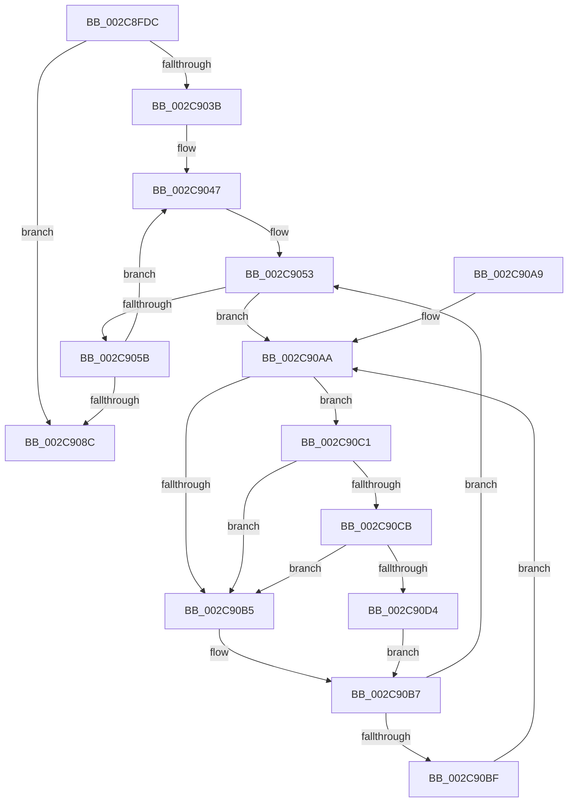

# MiInitializeMdlLeafPfns

- RVA: `0x002C8FDC`–`0x002C90DD` (길이 `257` bytes)
- VA: `0x00000001402C8FDC`
- 실행 섹션: `.text`
- PDB 이름 있음: `예`; PDB Function 태그: `아니요`
- unwind 정보 RVA: `0x0006F008`
- 디코드: `73`개 명령, `257/257` bytes 표시
- 미해석 바이트: `0` (있으면 어셈블리에 `.byte`로 보존)

> 이 문서는 커널 이미지의 기계어와 PDB 기호를 분석해 생성했습니다. 4번과 5번은 함수 원형과 자료형을 바이너리 사용 방식에서 추정한 C 해석이며 원본 소스 복구 결과는 아닙니다.

## 1. Dependencies

- 직접 호출 지점: **3**; 고유 호출 대상: **3**
- 직접 호출자로 확인된 함수: **1**
- RIP 상대 이미지 참조: **2**

### Outgoing calls
- `0x002C9074` → [MiInitializeMdlSinglePage](MiInitializeMdlSinglePage_function_002C939C.md) (function, `0x002C939C`)
- `0x002C90CB` → [KiCheckVpBackingLongSpinWaitHypercall](../30/KiCheckVpBackingLongSpinWaitHypercall_function_0030F490.md) (function, `0x0030F490`)
- `0x002C90D6` → [HvlNotifyLongSpinWait](../30/HvlNotifyLongSpinWait_function_0030F460.md) (function, `0x0030F460`)

### Direct callers
- [MiInitializeLargeMdlLeafPfns](MiInitializeLargeMdlLeafPfns_function_002C8EA4.md) at `0x002C8F4B`

### Static image references
- `0x002C90AD` → RVA `0x00FC52AC` (`ALMOSTRO`; reference)
- `0x002C90C1` → RVA `0x00FC6AB8` (`ALMOSTRO`; read)

## 2. Other-region calls and transfers

- 다른 실행 섹션으로 향하는 call: **0**
- 별도 외부 분기/꼬리 이동을 확인하지 못했습니다.

## 3. Assembly (complete function range)

```asm
002C8FDC  48 89 5C 24 08                  mov qword ptr [rsp + 8], rbx
002C8FE1  48 89 6C 24 10                  mov qword ptr [rsp + 0x10], rbp
002C8FE6  48 89 74 24 18                  mov qword ptr [rsp + 0x18], rsi
002C8FEB  57                              push rdi
002C8FEC  41 54                           push r12
002C8FEE  41 55                           push r13
002C8FF0  41 56                           push r14
002C8FF2  41 57                           push r15
002C8FF4  48 83 EC 30                     sub rsp, 0x30
002C8FF8  F7 84 24 80 00 00 00 00 10 00 03  test dword ptr [rsp + 0x80], 0x3001000
002C9003  48 8D 34 52                     lea rsi, [rdx + rdx*2]
002C9007  4C 8B F9                        mov r15, rcx
002C900A  49 8B D9                        mov rbx, r9
002C900D  41 0F 95 C1                     setne r9b
002C9011  B9 01 00 00 00                  mov ecx, 1
002C9016  0F BA A4 24 80 00 00 00 1F      bt dword ptr [rsp + 0x80], 0x1f
002C901F  4D 8B E8                        mov r13, r8
002C9022  0F 92 C0                        setb al
002C9025  44 84 C8                        test al, r9b
002C9028  48 8B C2                        mov rax, rdx
002C902B  48 0F 44 C1                     cmove rax, rcx
002C902F  48 C1 E6 04                     shl rsi, 4
002C9033  49 03 F7                        add rsi, r15
002C9036  49 3B F7                        cmp rsi, r15
002C9039  74 51                           je 0x1402c908c
002C903B  4C 8D 34 40                     lea r14, [rax + rax*2]
002C903F  49 C1 E6 04                     shl r14, 4
002C9043  48 8D 7E 18                     lea rdi, [rsi + 0x18]
002C9047  49 2B F6                        sub rsi, r14
002C904A  49 2B FE                        sub rdi, r14
002C904D  33 ED                           xor ebp, ebp
002C904F  44 8D 65 01                     lea r12d, [rbp + 1]
002C9053  F0 48 0F BA 2F 3F               lock bts qword ptr [rdi], 0x3f
002C9059  72 4F                           jb 0x1402c90aa
002C905B  44 8B A4 24 80 00 00 00         mov r12d, dword ptr [rsp + 0x80]
002C9063  4C 8B CB                        mov r9, rbx
002C9066  4D 8B C5                        mov r8, r13
002C9069  44 89 64 24 20                  mov dword ptr [rsp + 0x20], r12d
002C906E  48 8B D6                        mov rdx, rsi
002C9071  49 8B CF                        mov rcx, r15
002C9074  E8 23 03 00 00                  call 0x1402c939c
002C9079  48 B8 FF FF FF FF FF FF FF 7F   movabs rax, 0x7fffffffffffffff
002C9083  F0 48 21 07                     lock and qword ptr [rdi], rax
002C9087  49 3B F7                        cmp rsi, r15
002C908A  75 BB                           jne 0x1402c9047
002C908C  48 8B 5C 24 60                  mov rbx, qword ptr [rsp + 0x60]
002C9091  48 8B 6C 24 68                  mov rbp, qword ptr [rsp + 0x68]
002C9096  48 8B 74 24 70                  mov rsi, qword ptr [rsp + 0x70]
002C909B  48 83 C4 30                     add rsp, 0x30
002C909F  41 5F                           pop r15
002C90A1  41 5E                           pop r14
002C90A3  41 5D                           pop r13
002C90A5  41 5C                           pop r12
002C90A7  5F                              pop rdi
002C90A8  C3                              ret
002C90A9  CC                              int3
002C90AA  41 03 EC                        add ebp, r12d
002C90AD  85 2D F9 C1 CF 00               test dword ptr [rip + 0xcfc1f9], ebp
002C90B3  74 0C                           je 0x1402c90c1
002C90B5  F3 90                           pause
002C90B7  48 8B 07                        mov rax, qword ptr [rdi]
002C90BA  48 85 C0                        test rax, rax
002C90BD  79 94                           jns 0x1402c9053
002C90BF  EB E9                           jmp 0x1402c90aa
002C90C1  8B 05 F1 D9 CF 00               mov eax, dword ptr [rip + 0xcfd9f1]
002C90C7  A8 40                           test al, 0x40
002C90C9  74 EA                           je 0x1402c90b5
002C90CB  E8 C0 63 04 00                  call 0x14030f490
002C90D0  84 C0                           test al, al
002C90D2  74 E1                           je 0x1402c90b5
002C90D4  8B CD                           mov ecx, ebp
002C90D6  E8 85 63 04 00                  call 0x14030f460
002C90DB  EB DA                           jmp 0x1402c90b7
```

## 4. C-style interpretation (structured pseudocode)

```c
__int64 __fastcall MiInitializeMdlLeafPfns(__int64 a1, __int64 a2, __int64 a3, __int64 a4, unsigned int a5)
{
    __int64 result;
    __int64 v_r14;
    __int64 v_rbp;
    __int64 v_rdi;
    __int64 v_rsi;
    __int64 v_rsp;
    unsigned int v_stack_m38;
    unsigned __int64 v_stack_p10;
    unsigned __int64 v_stack_p18;
    unsigned __int64 v_stack_p8;

    v_stack_p8 = v_rbx;
    v_stack_p10 = v_rbp;
    v_stack_p18 = v_rsi;
    v_rsp = (v_rsp) - (48);
    a4 = (((a5) & (0x3001000ULL)) != 0) ? 1 : 0;
    result = (condition_is_below) ? 1 : 0;
    if ((((unsigned __int8)(result)) & ((unsigned __int8)(a4))) == 0) { a2 = 1; }
    v_rsi = (a2 + a2 * 2) << (4);
    v_rsi = (v_rsi) + (a1);
    if (v_rsi == a1) goto loc_002C908C;
    v_r14 = (a2 + a2 * 2) << (4);
loc_002C9047:
    v_rsi = (v_rsi) - (v_r14);
    v_rdi = (v_rsi + 24) - (v_r14);
    v_rbp = 0;
loc_002C9053:
    if (condition_is_below) goto loc_002C90AA;
    v_stack_m38 = (unsigned int)((unsigned int)(a5));
    result = MiInitializeMdlSinglePage(a1, v_rsi, a3, a4);
    if (v_rsi != a1) goto loc_002C9047;
loc_002C908C:
    v_rsp = (v_rsp) + (48);
    return result;
loc_002C90AA:
    v_rbp = (unsigned int)((v_stack_p10) + ((unsigned int)((unsigned int)(a5))));
    if (((*(unsigned int *)(v_rip + 13615609)) & ((unsigned int)(v_rbp))) == 0) goto loc_002C90C1;
loc_002C90B5:
loc_002C90B7:
    if (!sign_flag) goto loc_002C9053;
    goto loc_002C90AA;
loc_002C90C1:
    if ((((unsigned __int8)((unsigned int)(*(unsigned int *)(v_rip + 13621745)))) & (64)) == 0) goto loc_002C90B5;
    result = KiCheckVpBackingLongSpinWaitHypercall(a1, v_rsi, a3, a4);
    if ((unsigned __int8)(result) == 0) goto loc_002C90B5;
    result = HvlNotifyLongSpinWait((unsigned int)((unsigned int)(v_rbp)), v_rsi, a3, a4);
    goto loc_002C90B7;
}
```

## 5. (Beta) C Style

```c
int64_t MiInitializeMdlLeafPfns(int64_t Arg1, void *Arg2, int64_t Arg3, int64_t Arg4, uint32_t Arg5)
{
    uint8_t *arg2 = (uint8_t *)Arg2;

    int64_t result;
    int64_t local_r14;
    int64_t local_rbp;
    int64_t local_rdi;
    int64_t local_rsi;
    int64_t local_rsp;
    uint32_t v_stack_m38;
    uint64_t v_stack_p10;
    uint64_t v_stack_p18;
    uint64_t v_stack_p8;

    v_stack_p8 = local_rbx;
    v_stack_p10 = local_rbp;
    v_stack_p18 = local_rsi;
    local_rsp = (local_rsp) - (48);
    Arg4 = (((Arg5) & (0x3001000ULL)) != 0) ? 1 : 0;
    result = (condition_is_below) ? 1 : 0;
    if ((((uint8_t)(result)) & ((uint8_t)(Arg4))) == 0) { Arg2 = 1; }
    local_rsi = (Arg2 + Arg2 * 2) << (4);
    local_rsi = (local_rsi) + (Arg1);
    if (local_rsi == Arg1) goto loc_002C908C;
    local_r14 = (Arg2 + Arg2 * 2) << (4);
loc_002C9047:
    local_rsi = (local_rsi) - (local_r14);
    local_rdi = (local_rsi + 24) - (local_r14);
    local_rbp = 0;
loc_002C9053:
    if (condition_is_below) goto loc_002C90AA;
    v_stack_m38 = (uint32_t)((uint32_t)(Arg5));
    result = MiInitializeMdlSinglePage(Arg1, local_rsi, Arg3, Arg4);
    if (local_rsi != Arg1) goto loc_002C9047;
loc_002C908C:
    local_rsp = (local_rsp) + (48);
    return result;
loc_002C90AA:
    local_rbp = (uint32_t)((v_stack_p10) + ((uint32_t)((uint32_t)(Arg5))));
    if (((*(uint32_t *)(v_rip + 0xCFC1F9)) & ((uint32_t)(local_rbp))) == 0) goto loc_002C90C1;
loc_002C90B5:
loc_002C90B7:
    if (!sign_flag) goto loc_002C9053;
    goto loc_002C90AA;
loc_002C90C1:
    if ((((uint8_t)((uint32_t)(*(uint32_t *)(v_rip + 0xCFD9F1)))) & (64)) == 0) goto loc_002C90B5;
    result = KiCheckVpBackingLongSpinWaitHypercall(Arg1, local_rsi, Arg3, Arg4);
    if ((uint8_t)(result) == 0) goto loc_002C90B5;
    result = HvlNotifyLongSpinWait((uint32_t)((uint32_t)(local_rbp)), local_rsi, Arg3, Arg4);
    goto loc_002C90B7;
}
```

### 관측된 메모리 오프셋

구조체 형식이 확인되지 않은 접근은 인자 기준의 오프셋으로만 기록했습니다.

| 기준 인자 | 오프셋 표현 | 폭 (bit) | 접근 |
|---|---:|---:|---|
| `Arg2` | `+ 0x0 + rdx*2` | `64` | `R` |

## 6. Execution-region graph

[열기: 2D/3D 그래프와 함수 탐색 컨트롤 패널](../../../control-panel.html?section=text&rva=0x002C8FDC&view=graph)

- 2D 그래프는 위에서 아래로 흐르고, 3D 그래프는 빈 공간을 드래그해 회전합니다. Shift+드래그는 이동, 휠은 확대·축소, 함수 노드 선택은 대상 보고서 이동입니다.

### Static fallback


