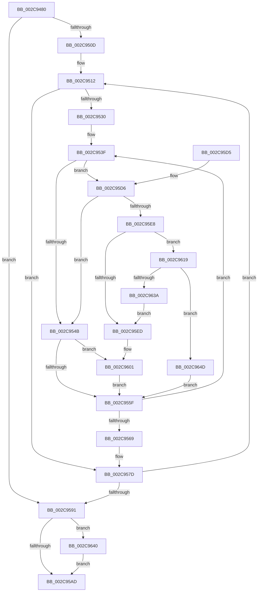

# MiInitializeMdlOneNodeBatchPages

- RVA: `0x002C9480`–`0x002C966A` (길이 `490` bytes)
- VA: `0x00000001402C9480`
- 실행 섹션: `.text`
- PDB 이름 있음: `예`; PDB Function 태그: `아니요`
- unwind 정보 RVA: `0x0006F06C`
- 디코드: `131`개 명령, `490/490` bytes 표시
- 미해석 바이트: `0` (있으면 어셈블리에 `.byte`로 보존)

> 이 문서는 커널 이미지의 기계어와 PDB 기호를 분석해 생성했습니다. 4번과 5번은 함수 원형과 자료형을 바이너리 사용 방식에서 추정한 C 해석이며 원본 소스 복구 결과는 아닙니다.

## 1. Dependencies

- 직접 호출 지점: **9**; 고유 호출 대상: **9**
- 직접 호출자로 확인된 함수: **1**
- RIP 상대 이미지 참조: **2**

### Outgoing calls
- `0x002C959F` → [MiChangePageAttributeAndZeroBatch](MiChangePageAttributeAndZeroBatch_function_002C98EC.md) (function, `0x002C98EC`)
- `0x002C95B5` → [_security_check_cookie](../6A/_security_check_cookie_function_006AC640.md) (function, `0x006AC640`)
- `0x002C95DB` → [MiPfnZeroingNeeded](../29/MiPfnZeroingNeeded_function_0029FA80.md) (function, `0x0029FA80`)
- `0x002C95F9` → [MiInsertMdlPageNeedsZero](../37/MiInsertMdlPageNeedsZero_function_00374D7C.md) (function, `0x00374D7C`)
- `0x002C960F` → [MiUpdateCacheAttributeListsForPage](MiUpdateCacheAttributeListsForPage_function_002C97CC.md) (function, `0x002C97CC`)
- `0x002C961C` → [MI_NODE_FROM_PFN](../2B/MI_NODE_FROM_PFN_function_002B0F30.md) (function, `0x002B0F30`)
- `0x002C962D` → [MiCreatePageChains](../49/MiCreatePageChains_function_0049ECD0.md) (function, `0x0049ECD0`)
- `0x002C9643` → [MiDereferencePageChains](MiDereferencePageChains_function_002C75E4.md) (function, `0x002C75E4`)
- `0x002C9660` → [MiZeroAndConvertPage](MiZeroAndConvertPage_function_002C8480.md) (function, `0x002C8480`)

### Direct callers
- [MiInitializeMdlBatchPages](MiInitializeMdlBatchPages_function_002C90E4.md) at `0x002C9176`
- [MiInitializeMdlBatchPages](MiInitializeMdlBatchPages_function_002C90E4.md) at `0x002C931C`

### Static image references
- `0x002C9497` → RVA `0x00E0A740` (`.data`; read)
- `0x002C94BB` → RVA `0x00010A90` (`.rdata`; read)

## 2. Other-region calls and transfers

- 다른 실행 섹션으로 향하는 call: **0**
- 별도 외부 분기/꼬리 이동을 확인하지 못했습니다.

## 3. Assembly (complete function range)

```asm
002C9480  48 89 5C 24 18                  mov qword ptr [rsp + 0x18], rbx
002C9485  55                              push rbp
002C9486  56                              push rsi
002C9487  57                              push rdi
002C9488  41 54                           push r12
002C948A  41 55                           push r13
002C948C  41 56                           push r14
002C948E  41 57                           push r15
002C9490  48 81 EC 80 00 00 00            sub rsp, 0x80
002C9497  48 8B 05 A2 12 B4 00            mov rax, qword ptr [rip + 0xb412a2]
002C949E  48 33 C4                        xor rax, rsp
002C94A1  48 89 44 24 78                  mov qword ptr [rsp + 0x78], rax
002C94A6  44 8B 49 38                     mov r9d, dword ptr [rcx + 0x38]
002C94AA  33 FF                           xor edi, edi
002C94AC  8B B1 94 00 00 00               mov esi, dword ptr [rcx + 0x94]
002C94B2  4C 8B E2                        mov r12, rdx
002C94B5  8B A9 90 00 00 00               mov ebp, dword ptr [rcx + 0x90]
002C94BB  66 0F 6F 05 CD 75 D4 FF         movdqa xmm0, xmmword ptr [rip - 0x2b8a33]
002C94C3  48 89 4C 24 48                  mov qword ptr [rsp + 0x48], rcx
002C94C8  48 89 54 24 38                  mov qword ptr [rsp + 0x38], rdx
002C94CD  48 8B 51 30                     mov rdx, qword ptr [rcx + 0x30]
002C94D1  41 8B C9                        mov ecx, r9d
002C94D4  83 E1 08                        and ecx, 8
002C94D7  4C 89 44 24 40                  mov qword ptr [rsp + 0x40], r8
002C94DC  83 C9 02                        or ecx, 2
002C94DF  44 89 4C 24 30                  mov dword ptr [rsp + 0x30], r9d
002C94E4  D1 E9                           shr ecx, 1
002C94E6  44 8B E9                        mov r13d, ecx
002C94E9  48 89 54 24 50                  mov qword ptr [rsp + 0x50], rdx
002C94EE  41 83 CD 08                     or r13d, 8
002C94F2  40 F6 C6 04                     test sil, 4
002C94F6  0F 11 44 24 58                  movups xmmword ptr [rsp + 0x58], xmm0
002C94FB  44 0F 44 E9                     cmove r13d, ecx
002C94FF  0F 11 44 24 68                  movups xmmword ptr [rsp + 0x68], xmm0
002C9504  4D 85 C0                        test r8, r8
002C9507  0F 84 84 00 00 00               je 0x1402c9591
002C950D  D1 EE                           shr esi, 1
002C950F  83 E6 02                        and esi, 2
002C9512  49 8B 04 24                     mov rax, qword ptr [r12]
002C9516  48 8D 1C 40                     lea rbx, [rax + rax*2]
002C951A  48 C1 E3 04                     shl rbx, 4
002C951E  48 B8 00 00 00 00 00 DE FF FF   movabs rax, 0xffffde0000000000
002C9528  48 03 D8                        add rbx, rax
002C952B  48 85 D2                        test rdx, rdx
002C952E  74 4D                           je 0x1402c957d
002C9530  4C 8B 64 24 48                  mov r12, qword ptr [rsp + 0x48]
002C9535  45 8B F1                        mov r14d, r9d
002C9538  41 83 E6 01                     and r14d, 1
002C953C  4C 8B FA                        mov r15, rdx
002C953F  83 E6 FE                        and esi, 0xfffffffe
002C9542  45 85 F6                        test r14d, r14d
002C9545  0F 84 8B 00 00 00               je 0x1402c95d6
002C954B  8B 43 20                        mov eax, dword ptr [rbx + 0x20]
002C954E  C1 E8 10                        shr eax, 0x10
002C9551  0F B6 C8                        movzx ecx, al
002C9554  C1 E9 06                        shr ecx, 6
002C9557  3B CD                           cmp ecx, ebp
002C9559  0F 85 A2 00 00 00               jne 0x1402c9601
002C955F  48 83 C3 30                     add rbx, 0x30
002C9563  49 83 EF 01                     sub r15, 1
002C9567  75 D6                           jne 0x1402c953f
002C9569  4C 8B 64 24 38                  mov r12, qword ptr [rsp + 0x38]
002C956E  4C 8B 44 24 40                  mov r8, qword ptr [rsp + 0x40]
002C9573  48 8B 54 24 50                  mov rdx, qword ptr [rsp + 0x50]
002C9578  44 8B 4C 24 30                  mov r9d, dword ptr [rsp + 0x30]
002C957D  49 83 C4 08                     add r12, 8
002C9581  49 83 E8 01                     sub r8, 1
002C9585  4C 89 64 24 38                  mov qword ptr [rsp + 0x38], r12
002C958A  4C 89 44 24 40                  mov qword ptr [rsp + 0x40], r8
002C958F  75 81                           jne 0x1402c9512
002C9591  45 33 C9                        xor r9d, r9d
002C9594  48 8D 4C 24 58                  lea rcx, [rsp + 0x58]
002C9599  44 8B C5                        mov r8d, ebp
002C959C  48 8B D7                        mov rdx, rdi
002C959F  E8 48 03 00 00                  call 0x1402c98ec
002C95A4  48 85 FF                        test rdi, rdi
002C95A7  0F 85 93 00 00 00               jne 0x1402c9640
002C95AD  48 8B 4C 24 78                  mov rcx, qword ptr [rsp + 0x78]
002C95B2  48 33 CC                        xor rcx, rsp
002C95B5  E8 86 30 3E 00                  call 0x1406ac640
002C95BA  48 8B 9C 24 D0 00 00 00         mov rbx, qword ptr [rsp + 0xd0]
002C95C2  48 81 C4 80 00 00 00            add rsp, 0x80
002C95C9  41 5F                           pop r15
002C95CB  41 5E                           pop r14
002C95CD  41 5D                           pop r13
002C95CF  41 5C                           pop r12
002C95D1  5F                              pop rdi
002C95D2  5E                              pop rsi
002C95D3  5D                              pop rbp
002C95D4  C3                              ret
002C95D5  CC                              int3
002C95D6  8B D5                           mov edx, ebp
002C95D8  48 8B CB                        mov rcx, rbx
002C95DB  E8 A0 64 FD FF                  call 0x14029fa80
002C95E0  85 C0                           test eax, eax
002C95E2  0F 84 63 FF FF FF               je 0x1402c954b
002C95E8  48 85 FF                        test rdi, rdi
002C95EB  74 2C                           je 0x1402c9619
002C95ED  41 B8 01 00 00 00               mov r8d, 1
002C95F3  48 8B D3                        mov rdx, rbx
002C95F6  48 8B CF                        mov rcx, rdi
002C95F9  E8 7E B7 0A 00                  call 0x140374d7c
002C95FE  41 0B F0                        or esi, r8d
002C9601  44 8B CE                        mov r9d, esi
002C9604  48 8D 4C 24 58                  lea rcx, [rsp + 0x58]
002C9609  44 8B C5                        mov r8d, ebp
002C960C  48 8B D3                        mov rdx, rbx
002C960F  E8 B8 01 00 00                  call 0x1402c97cc
002C9614  E9 46 FF FF FF                  jmp 0x1402c955f
002C9619  48 8B CB                        mov rcx, rbx
002C961C  E8 0F 79 FE FF                  call 0x1402b0f30
002C9621  49 8B 0C 24                     mov rcx, qword ptr [r12]
002C9625  8B D0                           mov edx, eax
002C9627  45 33 C9                        xor r9d, r9d
002C962A  44 8B C5                        mov r8d, ebp
002C962D  E8 9E 56 1D 00                  call 0x14049ecd0
002C9632  48 8B F8                        mov rdi, rax
002C9635  48 85 C0                        test rax, rax
002C9638  74 13                           je 0x1402c964d
002C963A  44 89 68 10                     mov dword ptr [rax + 0x10], r13d
002C963E  EB AD                           jmp 0x1402c95ed
002C9640  48 8B CF                        mov rcx, rdi
002C9643  E8 9C DF FF FF                  call 0x1402c75e4
002C9648  E9 60 FF FF FF                  jmp 0x1402c95ad
002C964D  44 8B CD                        mov r9d, ebp
002C9650  44 89 6C 24 20                  mov dword ptr [rsp + 0x20], r13d
002C9655  41 B8 03 00 00 00               mov r8d, 3
002C965B  48 8B D3                        mov rdx, rbx
002C965E  33 C9                           xor ecx, ecx
002C9660  E8 1B EE FF FF                  call 0x1402c8480
002C9665  E9 F5 FE FF FF                  jmp 0x1402c955f
```

## 4. C-style interpretation (structured pseudocode)

```c
__int64 __fastcall MiInitializeMdlOneNodeBatchPages(__int64 a1, __int64 a2, __int64 a3)
{
    __int64 result;
    __int64 v_r12;
    __int64 v_r13;
    __int64 v_r14;
    __int64 v_r15;
    __int64 v_rbx;
    __int64 v_rdi;
    __int64 v_rsi;
    __int64 v_rsp;
    unsigned __int64 v_stack_m40;
    unsigned __int64 v_stack_m50;
    unsigned __int64 v_stack_m60;
    unsigned __int64 v_stack_m68;
    unsigned __int64 v_stack_m70;
    unsigned __int64 v_stack_m78;
    unsigned __int64 v_stack_m80;
    unsigned int v_stack_m88;
    unsigned __int64 v_stack_p18;
    unsigned int v_stack_p20;
    unsigned __int64 v_stack_p58;

    v_stack_p18 = v_rbx;
    v_rsp = (v_rsp) - (128);
    result = (*(unsigned __int64 *)(v_rip + 11801250)) ^ (v_rsp);
    v_stack_m40 = result;
    v_rdi = 0;
    v_stack_m70 = a1;
    v_stack_m80 = a2;
    a1 = (unsigned int)(((unsigned int)((unsigned int)((unsigned int)(*(unsigned int *)(a1 + 56))))) & (8));
    v_stack_m78 = a3;
    a1 = (unsigned int)((a1) | (2));
    v_stack_m88 = (unsigned int)((unsigned int)(*(unsigned int *)(a1 + 56)));
    a1 = (unsigned int)((a1) >> (1));
    v_stack_m68 = *(unsigned __int64 *)(a1 + 48);
    v_r13 = (unsigned int)(((unsigned int)((unsigned int)(a1))) | (8));
    v_stack_m60 = v_xmm0;
    if ((((unsigned __int8)((unsigned int)(*(unsigned int *)(a1 + 148)))) & (4)) == 0) { v_r13 = (unsigned int)(a1); }
    v_stack_m50 = v_xmm0;
    if (a3 == 0) goto loc_002C9591;
    v_rsi = (unsigned int)(((unsigned int)(*(unsigned int *)(a1 + 148))) >> (1));
    v_rsi = (unsigned int)((v_rsi) & (2));
loc_002C9512:
    v_rbx = (*(unsigned __int64 *)(a2) + *(unsigned __int64 *)(a2) * 2) << (4);
    v_rbx = (v_rbx) + (*(unsigned __int64 *)(a2));
    if (*(unsigned __int64 *)(a1 + 48) == 0) goto loc_002C957D;
    v_r14 = (unsigned int)(((unsigned int)((unsigned int)((unsigned int)(*(unsigned int *)(a1 + 56))))) & (1));
loc_002C953F:
    v_rsi = (unsigned int)((v_rsi) & (0xFFFFFFFEULL));
    if ((unsigned int)(v_r14) == 0) goto loc_002C95D6;
loc_002C954B:
    result = (unsigned int)(((unsigned int)(*(unsigned int *)(v_rbx + 32))) >> (16));
    a1 = (unsigned int)(((unsigned __int8)(result)) >> (6));
    if (((unsigned int)(a1)) != ((unsigned int)((unsigned int)(*(unsigned int *)(a1 + 144))))) goto loc_002C9601;
loc_002C955F:
    v_rbx = (v_rbx) + (48);
    v_r15 = (*(unsigned __int64 *)(a1 + 48)) - (1);
    if (condition_is_not_equal) goto loc_002C953F;
loc_002C957D:
    v_r12 = (v_stack_m80) + (8);
    a3 = (v_stack_m78) - (1);
    v_stack_m80 = v_r12;
    v_stack_m78 = a3;
    if (condition_is_not_equal) goto loc_002C9512;
loc_002C9591:
    a4 = 0;
    result = MiChangePageAttributeAndZeroBatch(v_stack_m60, 0, (unsigned int)((unsigned int)((unsigned int)(*(unsigned int *)(a1 + 144)))), a4);
    if (0 != 0) goto loc_002C9640;
loc_002C95AD:
    a1 = (v_stack_m40) ^ (v_rsp);
    result = _security_check_cookie(a1, 0, (unsigned int)((unsigned int)((unsigned int)(*(unsigned int *)(a1 + 144)))), a4);
    v_rsp = (v_rsp) + (128);
    return result;
loc_002C95D6:
    result = MiPfnZeroingNeeded(v_stack_p18, (unsigned int)((unsigned int)((unsigned int)(*(unsigned int *)(a1 + 144)))), (unsigned int)((unsigned int)((unsigned int)(*(unsigned int *)(a1 + 144)))), a4);
    if ((unsigned int)(result) == 0) goto loc_002C954B;
    if (0 == 0) goto loc_002C9619;
loc_002C95ED:
    result = MiInsertMdlPageNeedsZero(0, v_stack_p18, 1, a4);
    v_rsi = (unsigned int)((v_rsi) | (1));
loc_002C9601:
    result = MiUpdateCacheAttributeListsForPage(v_stack_p58, v_stack_p18, (unsigned int)((unsigned int)((unsigned int)(*(unsigned int *)(a1 + 144)))), (unsigned int)((unsigned int)(v_rsi)));
    goto loc_002C955F;
loc_002C9619:
    result = MI_NODE_FROM_PFN(v_stack_p18, v_stack_p18, (unsigned int)((unsigned int)((unsigned int)(*(unsigned int *)(a1 + 144)))), (unsigned int)((unsigned int)(v_rsi)));
    a4 = 0;
    result = MiCreatePageChains(*(unsigned __int64 *)(v_r12), (unsigned int)((unsigned int)(result)), (unsigned int)((unsigned int)((unsigned int)(*(unsigned int *)(a1 + 144)))), a4);
    if (result == 0) goto loc_002C964D;
    *(unsigned int *)(result + 16) = (unsigned int)(v_r13);
    goto loc_002C95ED;
loc_002C9640:
    result = MiDereferencePageChains(result, (unsigned int)((unsigned int)(result)), (unsigned int)((unsigned int)((unsigned int)(*(unsigned int *)(a1 + 144)))), a4);
    goto loc_002C95AD;
loc_002C964D:
    v_stack_p20 = (unsigned int)(v_r13);
    a1 = 0;
    result = MiZeroAndConvertPage(a1, v_stack_p18, 3, (unsigned int)((unsigned int)((unsigned int)(*(unsigned int *)(a1 + 144)))));
    goto loc_002C955F;
}
```

## 5. (Beta) C Style

```c
int64_t MiInitializeMdlOneNodeBatchPages(void *Arg1, int64_t Arg2, int64_t Arg3)
{
    uint8_t *arg1 = (uint8_t *)Arg1;

    int64_t result;
    int64_t local_r12;
    int64_t local_r13;
    int64_t local_r14;
    int64_t local_r15;
    int64_t local_rbx;
    int64_t local_rdi;
    int64_t local_rsi;
    int64_t local_rsp;
    uint64_t v_stack_m40;
    uint64_t v_stack_m50;
    uint64_t v_stack_m60;
    uint64_t v_stack_m68;
    uint64_t v_stack_m70;
    uint64_t v_stack_m78;
    uint64_t v_stack_m80;
    uint32_t v_stack_m88;
    uint64_t v_stack_p18;
    uint32_t v_stack_p20;
    uint64_t v_stack_p58;

    v_stack_p18 = local_rbx;
    local_rsp = (local_rsp) - (128);
    result = (*(uint64_t *)(v_rip + 0xB412A2)) ^ (local_rsp);
    v_stack_m40 = result;
    local_rdi = 0;
    v_stack_m70 = Arg1;
    v_stack_m80 = Arg2;
    Arg1 = (uint32_t)(((uint32_t)((uint32_t)((uint32_t)(*(uint32_t *)(arg1 + 0x38))))) & (8));
    v_stack_m78 = Arg3;
    Arg1 = (uint32_t)((Arg1) | (2));
    v_stack_m88 = (uint32_t)((uint32_t)(*(uint32_t *)(arg1 + 0x38)));
    Arg1 = (uint32_t)((Arg1) >> (1));
    v_stack_m68 = *(uint64_t *)(arg1 + 0x30);
    local_r13 = (uint32_t)(((uint32_t)((uint32_t)(Arg1))) | (8));
    v_stack_m60 = v_xmm0;
    if ((((uint8_t)((uint32_t)(*(uint32_t *)(arg1 + 0x94)))) & (4)) == 0) { local_r13 = (uint32_t)(Arg1); }
    v_stack_m50 = v_xmm0;
    if (Arg3 == 0) goto loc_002C9591;
    local_rsi = (uint32_t)(((uint32_t)(*(uint32_t *)(arg1 + 0x94))) >> (1));
    local_rsi = (uint32_t)((local_rsi) & (2));
loc_002C9512:
    local_rbx = (*(uint64_t *)(Arg2) + *(uint64_t *)(Arg2) * 2) << (4);
    local_rbx = (local_rbx) + (*(uint64_t *)(Arg2));
    if (*(uint64_t *)(arg1 + 0x30) == 0) goto loc_002C957D;
    local_r14 = (uint32_t)(((uint32_t)((uint32_t)((uint32_t)(*(uint32_t *)(arg1 + 0x38))))) & (1));
loc_002C953F:
    local_rsi = (uint32_t)((local_rsi) & (0xFFFFFFFEULL));
    if ((uint32_t)(local_r14) == 0) goto loc_002C95D6;
loc_002C954B:
    result = (uint32_t)(((uint32_t)(*(uint32_t *)(local_rbx + 0x20))) >> (16));
    Arg1 = (uint32_t)(((uint8_t)(result)) >> (6));
    if (((uint32_t)(Arg1)) != ((uint32_t)((uint32_t)(*(uint32_t *)(arg1 + 0x90))))) goto loc_002C9601;
loc_002C955F:
    local_rbx = (local_rbx) + (48);
    local_r15 = (*(uint64_t *)(arg1 + 0x30)) - (1);
    if (condition_is_not_equal) goto loc_002C953F;
loc_002C957D:
    local_r12 = (v_stack_m80) + (8);
    Arg3 = (v_stack_m78) - (1);
    v_stack_m80 = local_r12;
    v_stack_m78 = Arg3;
    if (condition_is_not_equal) goto loc_002C9512;
loc_002C9591:
    a4 = 0;
    result = MiChangePageAttributeAndZeroBatch(v_stack_m60, 0, (uint32_t)((uint32_t)((uint32_t)(*(uint32_t *)(arg1 + 0x90)))), a4);
    if (0 != 0) goto loc_002C9640;
loc_002C95AD:
    Arg1 = (v_stack_m40) ^ (local_rsp);
    result = _security_check_cookie(Arg1, 0, (uint32_t)((uint32_t)((uint32_t)(*(uint32_t *)(arg1 + 0x90)))), a4);
    local_rsp = (local_rsp) + (128);
    return result;
loc_002C95D6:
    result = MiPfnZeroingNeeded(v_stack_p18, (uint32_t)((uint32_t)((uint32_t)(*(uint32_t *)(arg1 + 0x90)))), (uint32_t)((uint32_t)((uint32_t)(*(uint32_t *)(arg1 + 0x90)))), a4);
    if ((uint32_t)(result) == 0) goto loc_002C954B;
    if (0 == 0) goto loc_002C9619;
loc_002C95ED:
    result = MiInsertMdlPageNeedsZero(0, v_stack_p18, 1, a4);
    local_rsi = (uint32_t)((local_rsi) | (1));
loc_002C9601:
    result = MiUpdateCacheAttributeListsForPage(v_stack_p58, v_stack_p18, (uint32_t)((uint32_t)((uint32_t)(*(uint32_t *)(arg1 + 0x90)))), (uint32_t)((uint32_t)(local_rsi)));
    goto loc_002C955F;
loc_002C9619:
    result = MI_NODE_FROM_PFN(v_stack_p18, v_stack_p18, (uint32_t)((uint32_t)((uint32_t)(*(uint32_t *)(arg1 + 0x90)))), (uint32_t)((uint32_t)(local_rsi)));
    a4 = 0;
    result = MiCreatePageChains(*(uint64_t *)(local_r12), (uint32_t)((uint32_t)(result)), (uint32_t)((uint32_t)((uint32_t)(*(uint32_t *)(arg1 + 0x90)))), a4);
    if (result == 0) goto loc_002C964D;
    *(uint32_t *)(result + 0x10) = (uint32_t)(local_r13);
    goto loc_002C95ED;
loc_002C9640:
    result = MiDereferencePageChains(result, (uint32_t)((uint32_t)(result)), (uint32_t)((uint32_t)((uint32_t)(*(uint32_t *)(arg1 + 0x90)))), a4);
    goto loc_002C95AD;
loc_002C964D:
    v_stack_p20 = (uint32_t)(local_r13);
    Arg1 = 0;
    result = MiZeroAndConvertPage(Arg1, v_stack_p18, 3, (uint32_t)((uint32_t)((uint32_t)(*(uint32_t *)(arg1 + 0x90)))));
    goto loc_002C955F;
}
```

### 관측된 메모리 오프셋

구조체 형식이 확인되지 않은 접근은 인자 기준의 오프셋으로만 기록했습니다.

| 기준 인자 | 오프셋 표현 | 폭 (bit) | 접근 |
|---|---:|---:|---|
| `Arg1` | `+ 0x30` | `64` | `R` |
| `Arg1` | `+ 0x38` | `32` | `R` |
| `Arg1` | `+ 0x90` | `32` | `R` |
| `Arg1` | `+ 0x94` | `32` | `R` |

## 6. Execution-region graph

[열기: 2D/3D 그래프와 함수 탐색 컨트롤 패널](../../../control-panel.html?section=text&rva=0x002C9480&view=graph)

- 2D 그래프는 위에서 아래로 흐르고, 3D 그래프는 빈 공간을 드래그해 회전합니다. Shift+드래그는 이동, 휠은 확대·축소, 함수 노드 선택은 대상 보고서 이동입니다.

### Static fallback


