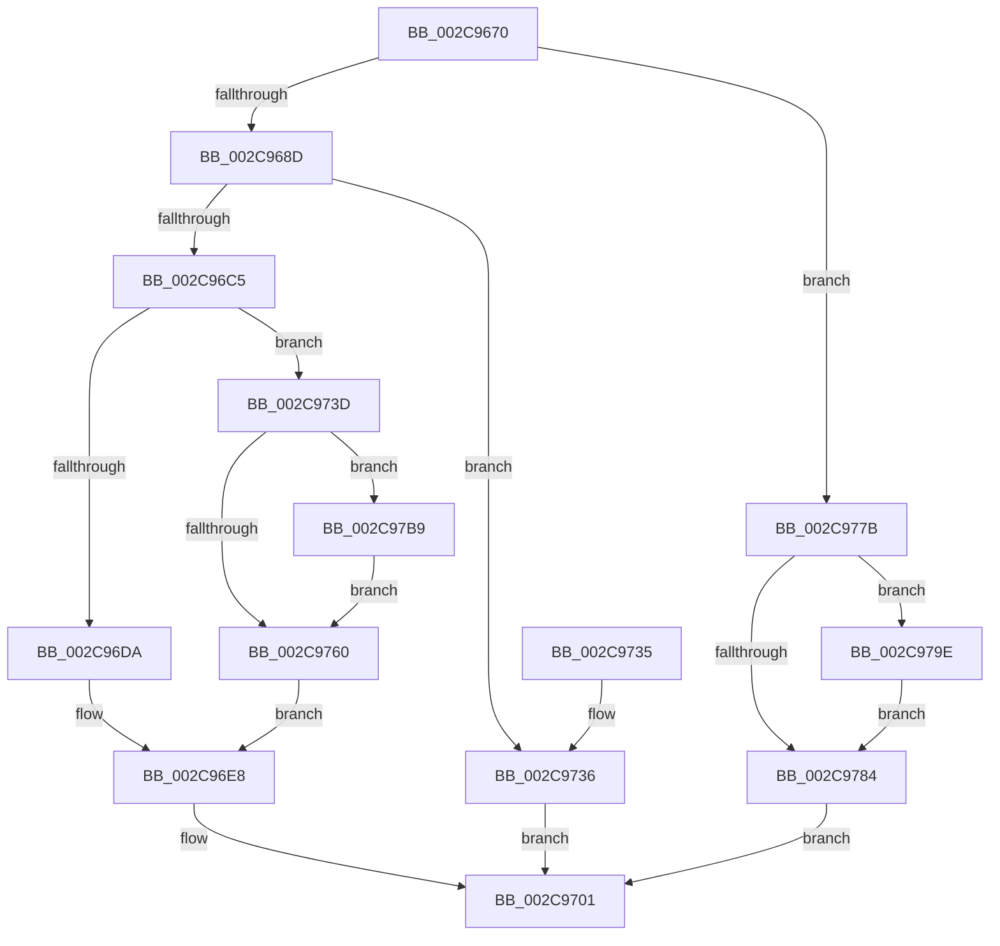

# MiInitializeMdlPfn

- RVA: `0x002C9670`–`0x002C97C3` (길이 `339` bytes)
- VA: `0x00000001402C9670`
- 실행 섹션: `.text`
- PDB 이름 있음: `예`; PDB Function 태그: `아니요`
- unwind 정보 RVA: `0x00068BEC`
- 디코드: `88`개 명령, `339/339` bytes 표시
- 미해석 바이트: `0` (있으면 어셈블리에 `.byte`로 보존)

> 이 문서는 커널 이미지의 기계어와 PDB 기호를 분석해 생성했습니다. 4번과 5번은 함수 원형과 자료형을 바이너리 사용 방식에서 추정한 C 해석이며 원본 소스 복구 결과는 아닙니다.

## 1. Dependencies

- 직접 호출 지점: **5**; 고유 호출 대상: **5**
- 직접 호출자로 확인된 함수: **3**
- RIP 상대 이미지 참조: **1**

### Outgoing calls
- `0x002C96CF` → [MiSetPfnContainingFrame](../36/MiSetPfnContainingFrame_function_00363FC0.md) (function, `0x00363FC0`)
- `0x002C9736` → [MiInitializeAwePfn](../4F/MiInitializeAwePfn_function_004F6D94.md) (function, `0x004F6D94`)
- `0x002C9748` → [MiAbortCombineScan](../2A/MiAbortCombineScan_function_002A1160.md) (function, `0x002A1160`)
- `0x002C9755` → [MiSetPfnIdentity](../2A/MiSetPfnIdentity_function_002A2350.md) (function, `0x002A2350`)
- `0x002C976D` → [MiUpdatePageFileHighInPte](../36/MiUpdatePageFileHighInPte_function_0036D840.md) (function, `0x0036D840`)

### Direct callers
- [MmAllocateNonChargedSecurePages](MmAllocateNonChargedSecurePages_function_002C886C.md) at `0x002C8A85`
- [MiInitializeMdlSinglePage](MiInitializeMdlSinglePage_function_002C939C.md) at `0x002C9431`
- [MmAllocateSecureKernelPages](../68/MmAllocateSecureKernelPages_function_0068F394.md) at `0x0068F5C9`

### Static image references
- `0x002C97B9` → RVA `0x00E2DCE8` (`.data`; read/write)

## 2. Other-region calls and transfers

- 다른 실행 섹션으로 향하는 call: **0**
- 별도 외부 분기/꼬리 이동을 확인하지 못했습니다.

## 3. Assembly (complete function range)

```asm
002C9670  48 89 5C 24 08                  mov qword ptr [rsp + 8], rbx
002C9675  57                              push rdi
002C9676  48 83 EC 20                     sub rsp, 0x20
002C967A  48 8B 41 10                     mov rax, qword ptr [rcx + 0x10]
002C967E  8B FA                           mov edi, edx
002C9680  48 8B D9                        mov rbx, rcx
002C9683  0F BA E2 08                     bt edx, 8
002C9687  0F 82 EE 00 00 00               jb 0x1402c977b
002C968D  48 8B 41 18                     mov rax, qword ptr [rcx + 0x18]
002C9691  48 B9 01 00 00 00 00 00 00 C0   movabs rcx, 0xc000000000000001
002C969B  48 23 C1                        and rax, rcx
002C969E  48 8B CB                        mov rcx, rbx
002C96A1  48 83 C8 01                     or rax, 1
002C96A5  48 89 43 18                     mov qword ptr [rbx + 0x18], rax
002C96A9  8B 43 20                        mov eax, dword ptr [rbx + 0x20]
002C96AC  89 44 24 38                     mov dword ptr [rsp + 0x38], eax
002C96B0  B8 02 00 00 00                  mov eax, 2
002C96B5  66 89 44 24 38                  mov word ptr [rsp + 0x38], ax
002C96BA  8B 44 24 38                     mov eax, dword ptr [rsp + 0x38]
002C96BE  89 43 20                        mov dword ptr [rbx + 0x20], eax
002C96C1  85 D2                           test edx, edx
002C96C3  78 71                           js 0x1402c9736
002C96C5  48 BA FE FF FF FF 3F 00 00 00   movabs rdx, 0x3ffffffffe
002C96CF  E8 EC A8 09 00                  call 0x140363fc0
002C96D4  0F BA E7 09                     bt edi, 9
002C96D8  72 63                           jb 0x1402c973d
002C96DA  48 B8 00 00 00 00 80 F6 FF FF   movabs rax, 0xfffff68000000000
002C96E4  48 89 43 08                     mov qword ptr [rbx + 8], rax
002C96E8  8B 43 20                        mov eax, dword ptr [rbx + 0x20]
002C96EB  89 44 24 38                     mov dword ptr [rsp + 0x38], eax
002C96EF  C1 E8 10                        shr eax, 0x10
002C96F2  24 FE                           and al, 0xfe
002C96F4  0C 06                           or al, 6
002C96F6  88 44 24 3A                     mov byte ptr [rsp + 0x3a], al
002C96FA  8B 44 24 38                     mov eax, dword ptr [rsp + 0x38]
002C96FE  89 43 20                        mov dword ptr [rbx + 0x20], eax
002C9701  80 63 23 F8                     and byte ptr [rbx + 0x23], 0xf8
002C9705  8B 43 24                        mov eax, dword ptr [rbx + 0x24]
002C9708  8B 4B 24                        mov ecx, dword ptr [rbx + 0x24]
002C970B  C7 43 24 00 00 00 00            mov dword ptr [rbx + 0x24], 0
002C9712  81 E1 00 00 00 F8               and ecx, 0xf8000000
002C9718  8B 43 24                        mov eax, dword ptr [rbx + 0x24]
002C971B  8B D1                           mov edx, ecx
002C971D  33 D0                           xor edx, eax
002C971F  81 E2 FF FF FF E7               and edx, 0xe7ffffff
002C9725  33 D1                           xor edx, ecx
002C9727  89 53 24                        mov dword ptr [rbx + 0x24], edx
002C972A  48 8B 5C 24 30                  mov rbx, qword ptr [rsp + 0x30]
002C972F  48 83 C4 20                     add rsp, 0x20
002C9733  5F                              pop rdi
002C9734  C3                              ret
002C9735  CC                              int3
002C9736  E8 59 D6 22 00                  call 0x1404f6d94
002C973B  EB C4                           jmp 0x1402c9701
002C973D  48 8B CB                        mov rcx, rbx
002C9740  48 C7 43 08 00 00 00 00         mov qword ptr [rbx + 8], 0
002C9748  E8 13 7A FD FF                  call 0x1402a1160
002C974D  BA 03 00 00 00                  mov edx, 3
002C9752  48 8B CB                        mov rcx, rbx
002C9755  E8 F6 8B FD FF                  call 0x1402a2350
002C975A  0F BA E7 11                     bt edi, 0x11
002C975E  73 59                           jae 0x1402c97b9
002C9760  48 8B 43 10                     mov rax, qword ptr [rbx + 0x10]
002C9764  BA 01 00 00 00                  mov edx, 1
002C9769  48 8B 4B 10                     mov rcx, qword ptr [rbx + 0x10]
002C976D  E8 CE 40 0A 00                  call 0x14036d840
002C9772  48 89 43 10                     mov qword ptr [rbx + 0x10], rax
002C9776  E9 6D FF FF FF                  jmp 0x1402c96e8
002C977B  8A 41 22                        mov al, byte ptr [rcx + 0x22]
002C977E  24 07                           and al, 7
002C9780  3C 05                           cmp al, 5
002C9782  75 1A                           jne 0x1402c979e
002C9784  48 8B 41 18                     mov rax, qword ptr [rcx + 0x18]
002C9788  48 B9 00 00 00 00 00 00 00 C0   movabs rcx, 0xc000000000000000
002C9792  48 23 C1                        and rax, rcx
002C9795  48 89 43 18                     mov qword ptr [rbx + 0x18], rax
002C9799  E9 63 FF FF FF                  jmp 0x1402c9701
002C979E  8B 41 20                        mov eax, dword ptr [rcx + 0x20]
002C97A1  89 44 24 38                     mov dword ptr [rsp + 0x38], eax
002C97A5  C1 E8 10                        shr eax, 0x10
002C97A8  24 FD                           and al, 0xfd
002C97AA  0C 05                           or al, 5
002C97AC  88 44 24 3A                     mov byte ptr [rsp + 0x3a], al
002C97B0  8B 44 24 38                     mov eax, dword ptr [rsp + 0x38]
002C97B4  89 41 20                        mov dword ptr [rcx + 0x20], eax
002C97B7  EB CB                           jmp 0x1402c9784
002C97B9  F0 48 FF 05 27 45 B6 00         lock inc qword ptr [rip + 0xb64527]
002C97C1  EB 9D                           jmp 0x1402c9760
```

## 4. C-style interpretation (structured pseudocode)

```c
__int64 __fastcall MiInitializeMdlPfn(__int64 a1, int a2)
{
    __int64 result;
    __int64 v_rsp;
    unsigned int v_stack_p10;
    unsigned __int8 v_stack_p12;
    unsigned int v_stack_p38;
    unsigned __int8 v_stack_p3A;
    unsigned __int64 v_stack_p8;

    v_stack_p8 = v_rbx;
    v_rsp = (v_rsp) - (32);
    if (condition_is_below) goto loc_002C977B;
    result = (*(unsigned __int64 *)(a1 + 24)) & (a1);
    result = (result) | (1);
    *(unsigned __int64 *)(a1 + 24) = result;
    v_stack_p10 = (unsigned int)((unsigned int)(*(unsigned int *)(a1 + 32)));
    v_stack_p10 = 2;
    *(unsigned int *)(a1 + 32) = (unsigned int)((unsigned int)(v_stack_p10));
    if (sign_flag) goto loc_002C9736;
    result = MiSetPfnContainingFrame(a1, a2, a3, a4);
    if (condition_is_below) goto loc_002C973D;
    *(unsigned __int64 *)(a1 + 8) = result;
loc_002C96E8:
    v_stack_p10 = (unsigned int)((unsigned int)(*(unsigned int *)(a1 + 32)));
    result = (unsigned int)(((unsigned int)(*(unsigned int *)(a1 + 32))) >> (16));
    result = (unsigned __int8)((result) & (254));
    result = (unsigned __int8)((result) | (6));
    v_stack_p12 = (unsigned __int8)(result);
    *(unsigned int *)(a1 + 32) = (unsigned int)((unsigned int)(v_stack_p10));
loc_002C9701:
    *(unsigned int *)(a1 + 36) = 0;
    a1 = (unsigned int)(((unsigned int)(*(unsigned int *)(a1 + 36))) & (0xF8000000ULL));
    a2 = (unsigned int)(((unsigned int)((unsigned int)(a1))) ^ ((unsigned int)((unsigned int)(*(unsigned int *)(a1 + 36)))));
    a2 = (unsigned int)((a2) & (0xE7FFFFFFULL));
    a2 = (unsigned int)((a2) ^ ((unsigned int)(a1)));
    *(unsigned int *)(a1 + 36) = a2;
    v_rsp = (v_rsp) + (32);
    return (unsigned int)(*(unsigned int *)(a1 + 36));
loc_002C9736:
    result = MiInitializeAwePfn(a1, a2, a3, a4);
    goto loc_002C9701;
loc_002C973D:
    *(unsigned __int64 *)(v_stack_p8 + 8) = 0;
    result = MiAbortCombineScan(v_stack_p8, a2, a3, a4);
    result = MiSetPfnIdentity(v_stack_p8, 3, a3, a4);
    if (condition_is_above_or_equal) goto loc_002C97B9;
loc_002C9760:
    result = MiUpdatePageFileHighInPte(*(unsigned __int64 *)(v_stack_p8 + 16), 1, a3, a4);
    *(unsigned __int64 *)(v_stack_p8 + 16) = result;
    goto loc_002C96E8;
loc_002C977B:
    result = (unsigned __int8)((*(unsigned __int8 *)(*(unsigned __int64 *)(v_stack_p8 + 16) + 34)) & (7));
    if (((unsigned __int8)(result)) != 5) goto loc_002C979E;
loc_002C9784:
    result = (*(unsigned __int64 *)(*(unsigned __int64 *)(v_stack_p8 + 16) + 24)) & (*(unsigned __int64 *)(v_stack_p8 + 16));
    *(unsigned __int64 *)(v_stack_p8 + 24) = result;
    goto loc_002C9701;
loc_002C979E:
    v_stack_p38 = (unsigned int)((unsigned int)(*(unsigned int *)(*(unsigned __int64 *)(v_stack_p8 + 16) + 32)));
    result = (unsigned int)(((unsigned int)(*(unsigned int *)(*(unsigned __int64 *)(v_stack_p8 + 16) + 32))) >> (16));
    result = (unsigned __int8)((result) & (253));
    result = (unsigned __int8)((result) | (5));
    v_stack_p3A = (unsigned __int8)(result);
    *(unsigned int *)(*(unsigned __int64 *)(v_stack_p8 + 16) + 32) = (unsigned int)((unsigned int)(v_stack_p38));
    goto loc_002C9784;
loc_002C97B9:
    goto loc_002C9760;
}
```

## 5. (Beta) C Style

```c
int64_t MiInitializeMdlPfn(void *Arg1, int32_t Arg2)
{
    uint8_t *arg1 = (uint8_t *)Arg1;

    int64_t result;
    int64_t local_rsp;
    uint32_t v_stack_p10;
    uint8_t v_stack_p12;
    uint32_t v_stack_p38;
    uint8_t v_stack_p3A;
    uint64_t v_stack_p8;

    v_stack_p8 = local_rbx;
    local_rsp = (local_rsp) - (32);
    if (condition_is_below) goto loc_002C977B;
    result = (*(uint64_t *)(arg1 + 0x18)) & (Arg1);
    result = (result) | (1);
    *(uint64_t *)(arg1 + 0x18) = result;
    v_stack_p10 = (uint32_t)((uint32_t)(*(uint32_t *)(arg1 + 0x20)));
    v_stack_p10 = 2;
    *(uint32_t *)(arg1 + 0x20) = (uint32_t)((uint32_t)(v_stack_p10));
    if (sign_flag) goto loc_002C9736;
    result = MiSetPfnContainingFrame(Arg1, Arg2, a3, a4);
    if (condition_is_below) goto loc_002C973D;
    *(uint64_t *)(arg1 + 0x8) = result;
loc_002C96E8:
    v_stack_p10 = (uint32_t)((uint32_t)(*(uint32_t *)(arg1 + 0x20)));
    result = (uint32_t)(((uint32_t)(*(uint32_t *)(arg1 + 0x20))) >> (16));
    result = (uint8_t)((result) & (254));
    result = (uint8_t)((result) | (6));
    v_stack_p12 = (uint8_t)(result);
    *(uint32_t *)(arg1 + 0x20) = (uint32_t)((uint32_t)(v_stack_p10));
loc_002C9701:
    *(uint32_t *)(arg1 + 0x24) = 0;
    Arg1 = (uint32_t)(((uint32_t)(*(uint32_t *)(arg1 + 0x24))) & (0xF8000000ULL));
    Arg2 = (uint32_t)(((uint32_t)((uint32_t)(Arg1))) ^ ((uint32_t)((uint32_t)(*(uint32_t *)(arg1 + 0x24)))));
    Arg2 = (uint32_t)((Arg2) & (0xE7FFFFFFULL));
    Arg2 = (uint32_t)((Arg2) ^ ((uint32_t)(Arg1)));
    *(uint32_t *)(arg1 + 0x24) = Arg2;
    local_rsp = (local_rsp) + (32);
    return (uint32_t)(*(uint32_t *)(arg1 + 0x24));
loc_002C9736:
    result = MiInitializeAwePfn(Arg1, Arg2, a3, a4);
    goto loc_002C9701;
loc_002C973D:
    *(uint64_t *)(v_stack_p8 + 0x8) = 0;
    result = MiAbortCombineScan(v_stack_p8, Arg2, a3, a4);
    result = MiSetPfnIdentity(v_stack_p8, 3, a3, a4);
    if (condition_is_above_or_equal) goto loc_002C97B9;
loc_002C9760:
    result = MiUpdatePageFileHighInPte(*(uint64_t *)(v_stack_p8 + 0x10), 1, a3, a4);
    *(uint64_t *)(v_stack_p8 + 0x10) = result;
    goto loc_002C96E8;
loc_002C977B:
    result = (uint8_t)((*(uint8_t *)(*(uint64_t *)(v_stack_p8 + 0x10) + 0x22)) & (7));
    if (((uint8_t)(result)) != 5) goto loc_002C979E;
loc_002C9784:
    result = (*(uint64_t *)(*(uint64_t *)(v_stack_p8 + 0x10) + 0x18)) & (*(uint64_t *)(v_stack_p8 + 0x10));
    *(uint64_t *)(v_stack_p8 + 0x18) = result;
    goto loc_002C9701;
loc_002C979E:
    v_stack_p38 = (uint32_t)((uint32_t)(*(uint32_t *)(*(uint64_t *)(v_stack_p8 + 0x10) + 0x20)));
    result = (uint32_t)(((uint32_t)(*(uint32_t *)(*(uint64_t *)(v_stack_p8 + 0x10) + 0x20))) >> (16));
    result = (uint8_t)((result) & (253));
    result = (uint8_t)((result) | (5));
    v_stack_p3A = (uint8_t)(result);
    *(uint32_t *)(*(uint64_t *)(v_stack_p8 + 0x10) + 0x20) = (uint32_t)((uint32_t)(v_stack_p38));
    goto loc_002C9784;
loc_002C97B9:
    goto loc_002C9760;
}
```

### 관측된 메모리 오프셋

구조체 형식이 확인되지 않은 접근은 인자 기준의 오프셋으로만 기록했습니다.

| 기준 인자 | 오프셋 표현 | 폭 (bit) | 접근 |
|---|---:|---:|---|
| `Arg1` | `+ 0x8` | `64` | `W` |
| `Arg1` | `+ 0x10` | `64` | `R` |
| `Arg1` | `+ 0x10` | `64` | `W` |
| `Arg1` | `+ 0x18` | `64` | `R` |
| `Arg1` | `+ 0x18` | `64` | `W` |
| `Arg1` | `+ 0x20` | `32` | `R` |
| `Arg1` | `+ 0x20` | `32` | `W` |
| `Arg1` | `+ 0x22` | `8` | `R` |
| `Arg1` | `+ 0x23` | `8` | `R/W` |
| `Arg1` | `+ 0x24` | `32` | `R` |
| `Arg1` | `+ 0x24` | `32` | `W` |

## 6. Execution-region graph

[열기: 2D/3D 그래프와 함수 탐색 컨트롤 패널](../../../control-panel.html?section=text&rva=0x002C9670&view=graph)

- 2D 그래프는 위에서 아래로 흐르고, 3D 그래프는 빈 공간을 드래그해 회전합니다. Shift+드래그는 이동, 휠은 확대·축소, 함수 노드 선택은 대상 보고서 이동입니다.

### Static fallback


