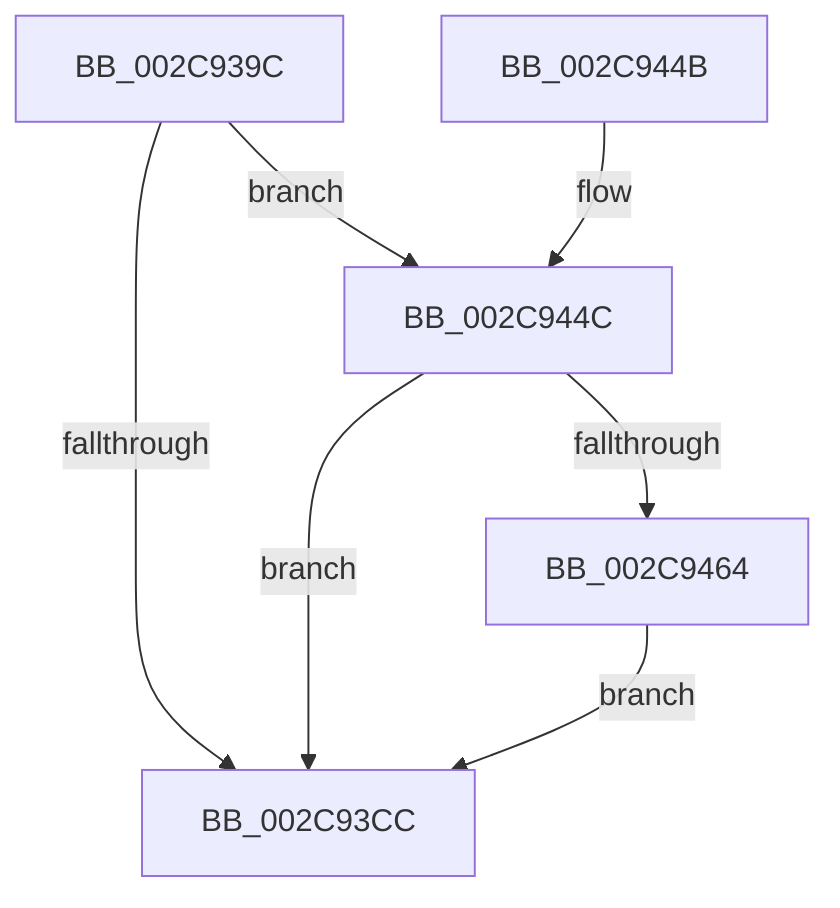

# MiInitializeMdlSinglePage

- RVA: `0x002C939C`–`0x002C9477` (길이 `219` bytes)
- VA: `0x00000001402C939C`
- 실행 섹션: `.text`
- PDB 이름 있음: `예`; PDB Function 태그: `아니요`
- unwind 정보 RVA: `0x0006F054`
- 디코드: `51`개 명령, `219/219` bytes 표시
- 미해석 바이트: `0` (있으면 어셈블리에 `.byte`로 보존)

> 이 문서는 커널 이미지의 기계어와 PDB 기호를 분석해 생성했습니다. 4번과 5번은 함수 원형과 자료형을 바이너리 사용 방식에서 추정한 C 해석이며 원본 소스 복구 결과는 아닙니다.

## 1. Dependencies

- 직접 호출 지점: **3**; 고유 호출 대상: **3**
- 직접 호출자로 확인된 함수: **3**
- RIP 상대 이미지 참조: **0**

### Outgoing calls
- `0x002C93FC` → [MiSetPfnContainingFrame](../36/MiSetPfnContainingFrame_function_00363FC0.md) (function, `0x00363FC0`)
- `0x002C9431` → [MiInitializeMdlPfn](MiInitializeMdlPfn_function_002C9670.md) (function, `0x002C9670`)
- `0x002C946D` → [MiConvertLargePfnToSmall](../42/MiConvertLargePfnToSmall_function_00420CA0.md) (function, `0x00420CA0`)

### Direct callers
- [MiAllocateKernelStackPages](../2A/MiAllocateKernelStackPages_function_002A1BEC.md) at `0x002A2115`
- [MiInitializeMdlLeafPfns](MiInitializeMdlLeafPfns_function_002C8FDC.md) at `0x002C9074`
- [MiInitializeMdlBatchPages](MiInitializeMdlBatchPages_function_002C90E4.md) at `0x002C921F`

### Static image references
- 디코드된 RIP-relative 메모리 참조가 없습니다.

## 2. Other-region calls and transfers

- 다른 실행 섹션으로 향하는 call: **0**
- 별도 외부 분기/꼬리 이동을 확인하지 못했습니다.

## 3. Assembly (complete function range)

```asm
002C939C  48 89 5C 24 08                  mov qword ptr [rsp + 8], rbx
002C93A1  48 89 6C 24 10                  mov qword ptr [rsp + 0x10], rbp
002C93A6  48 89 74 24 18                  mov qword ptr [rsp + 0x18], rsi
002C93AB  57                              push rdi
002C93AC  48 83 EC 20                     sub rsp, 0x20
002C93B0  48 8B 42 28                     mov rax, qword ptr [rdx + 0x28]
002C93B4  49 8B D9                        mov rbx, r9
002C93B7  48 0F BA E0 28                  bt rax, 0x28
002C93BC  8B 74 24 50                     mov esi, dword ptr [rsp + 0x50]
002C93C0  49 8B E8                        mov rbp, r8
002C93C3  48 8B FA                        mov rdi, rdx
002C93C6  0F 82 80 00 00 00               jb 0x1402c944c
002C93CC  48 B8 00 00 00 00 80 F6 FF FF   movabs rax, 0xfffff68000000000
002C93D6  48 89 47 08                     mov qword ptr [rdi + 8], rax
002C93DA  48 B9 FF FF FF FF FF FF FF 7F   movabs rcx, 0x7fffffffffffffff
002C93E4  48 8B 47 28                     mov rax, qword ptr [rdi + 0x28]
002C93E8  48 BA FE FF FF FF 3F 00 00 00   movabs rdx, 0x3ffffffffe
002C93F2  48 23 C1                        and rax, rcx
002C93F5  48 8B CF                        mov rcx, rdi
002C93F8  48 89 47 28                     mov qword ptr [rdi + 0x28], rax
002C93FC  E8 BF AB 09 00                  call 0x140363fc0
002C9401  48 89 5F 10                     mov qword ptr [rdi + 0x10], rbx
002C9405  8B D6                           mov edx, esi
002C9407  48 C1 ED 03                     shr rbp, 3
002C940B  48 C7 07 00 00 00 00            mov qword ptr [rdi], 0
002C9412  48 8B CD                        mov rcx, rbp
002C9415  48 8B 07                        mov rax, qword ptr [rdi]
002C9418  48 33 C8                        xor rcx, rax
002C941B  48 B8 01 00 00 00 00 F0 FF FF   movabs rax, 0xfffff00000000001
002C9425  48 23 C8                        and rcx, rax
002C9428  48 33 CD                        xor rcx, rbp
002C942B  48 89 0F                        mov qword ptr [rdi], rcx
002C942E  48 8B CF                        mov rcx, rdi
002C9431  E8 3A 02 00 00                  call 0x1402c9670
002C9436  48 8B 5C 24 30                  mov rbx, qword ptr [rsp + 0x30]
002C943B  48 8B 6C 24 38                  mov rbp, qword ptr [rsp + 0x38]
002C9440  48 8B 74 24 40                  mov rsi, qword ptr [rsp + 0x40]
002C9445  48 83 C4 20                     add rsp, 0x20
002C9449  5F                              pop rdi
002C944A  C3                              ret
002C944B  CC                              int3
002C944C  F7 C6 00 10 00 03               test esi, 0x3001000
002C9452  0F 95 C2                        setne dl
002C9455  0F BA E6 1F                     bt esi, 0x1f
002C9459  0F 92 C0                        setb al
002C945C  84 D0                           test al, dl
002C945E  0F 85 68 FF FF FF               jne 0x1402c93cc
002C9464  41 B8 01 00 00 00               mov r8d, 1
002C946A  48 8B D7                        mov rdx, rdi
002C946D  E8 2E 78 15 00                  call 0x140420ca0
002C9472  E9 55 FF FF FF                  jmp 0x1402c93cc
```

## 4. C-style interpretation (structured pseudocode)

```c
__int64 __fastcall MiInitializeMdlSinglePage(__int64 a1, __int64 a2, __int64 a3, __int64 a4, unsigned int a5)
{
    __int64 result;
    __int64 v_rbp;
    __int64 v_rsp;
    unsigned __int64 v_stack_p10;
    unsigned __int64 v_stack_p18;
    unsigned __int64 v_stack_p8;

    v_stack_p8 = v_rbx;
    v_stack_p10 = v_rbp;
    v_stack_p18 = v_rsi;
    v_rsp = (v_rsp) - (32);
    if (condition_is_below) goto loc_002C944C;
loc_002C93CC:
    *(unsigned __int64 *)(a2 + 8) = *(unsigned __int64 *)(a2 + 40);
    result = (*(unsigned __int64 *)(a2 + 40)) & (a1);
    *(unsigned __int64 *)(a2 + 40) = result;
    result = MiSetPfnContainingFrame(a2, a2, a3, a4);
    *(unsigned __int64 *)(a2 + 16) = a4;
    v_rbp = (a3) >> (3);
    *(unsigned __int64 *)(a2) = 0;
    a1 = (v_rbp) ^ (*(unsigned __int64 *)(a2));
    a1 = (a1) & (*(unsigned __int64 *)(a2));
    a1 = (a1) ^ (v_rbp);
    *(unsigned __int64 *)(a2) = a1;
    result = MiInitializeMdlPfn(a2, (unsigned int)((unsigned int)((unsigned int)(a5))), a3, a4);
    v_rsp = (v_rsp) + (32);
    return result;
loc_002C944C:
    a2 = ((((unsigned int)(v_stack_p18)) & (0x3001000ULL)) != 0) ? 1 : 0;
    result = (condition_is_below) ? 1 : 0;
    if ((((unsigned __int8)(result)) & ((unsigned __int8)(a2))) != 0) goto loc_002C93CC;
    result = MiConvertLargePfnToSmall(a2, a2, 1, a4);
    goto loc_002C93CC;
}
```

## 5. (Beta) C Style

```c
int64_t MiInitializeMdlSinglePage(int64_t Arg1, void *Arg2, int64_t Arg3, int64_t Arg4, uint32_t Arg5)
{
    uint8_t *arg2 = (uint8_t *)Arg2;

    int64_t result;
    int64_t local_rbp;
    int64_t local_rsp;
    uint64_t v_stack_p10;
    uint64_t v_stack_p18;
    uint64_t v_stack_p8;

    v_stack_p8 = local_rbx;
    v_stack_p10 = local_rbp;
    v_stack_p18 = local_rsi;
    local_rsp = (local_rsp) - (32);
    if (condition_is_below) goto loc_002C944C;
loc_002C93CC:
    *(uint64_t *)(arg2 + 0x8) = *(uint64_t *)(arg2 + 0x28);
    result = (*(uint64_t *)(arg2 + 0x28)) & (Arg1);
    *(uint64_t *)(arg2 + 0x28) = result;
    result = MiSetPfnContainingFrame(Arg2, Arg2, Arg3, Arg4);
    *(uint64_t *)(arg2 + 0x10) = Arg4;
    local_rbp = (Arg3) >> (3);
    *(uint64_t *)(arg2) = 0;
    Arg1 = (local_rbp) ^ (*(uint64_t *)(arg2));
    Arg1 = (Arg1) & (*(uint64_t *)(arg2));
    Arg1 = (Arg1) ^ (local_rbp);
    *(uint64_t *)(arg2) = Arg1;
    result = MiInitializeMdlPfn(Arg2, (uint32_t)((uint32_t)((uint32_t)(Arg5))), Arg3, Arg4);
    local_rsp = (local_rsp) + (32);
    return result;
loc_002C944C:
    Arg2 = ((((uint32_t)(v_stack_p18)) & (0x3001000ULL)) != 0) ? 1 : 0;
    result = (condition_is_below) ? 1 : 0;
    if ((((uint8_t)(result)) & ((uint8_t)(Arg2))) != 0) goto loc_002C93CC;
    result = MiConvertLargePfnToSmall(Arg2, Arg2, 1, Arg4);
    goto loc_002C93CC;
}
```

### 관측된 메모리 오프셋

구조체 형식이 확인되지 않은 접근은 인자 기준의 오프셋으로만 기록했습니다.

| 기준 인자 | 오프셋 표현 | 폭 (bit) | 접근 |
|---|---:|---:|---|
| `Arg2` | `+ 0x0` | `64` | `R` |
| `Arg2` | `+ 0x0` | `64` | `W` |
| `Arg2` | `+ 0x8` | `64` | `W` |
| `Arg2` | `+ 0x10` | `64` | `W` |
| `Arg2` | `+ 0x28` | `64` | `R` |
| `Arg2` | `+ 0x28` | `64` | `W` |

## 6. Execution-region graph

[열기: 2D/3D 그래프와 함수 탐색 컨트롤 패널](../../../control-panel.html?section=text&rva=0x002C939C&view=graph)

- 2D 그래프는 위에서 아래로 흐르고, 3D 그래프는 빈 공간을 드래그해 회전합니다. Shift+드래그는 이동, 휠은 확대·축소, 함수 노드 선택은 대상 보고서 이동입니다.

### Static fallback


