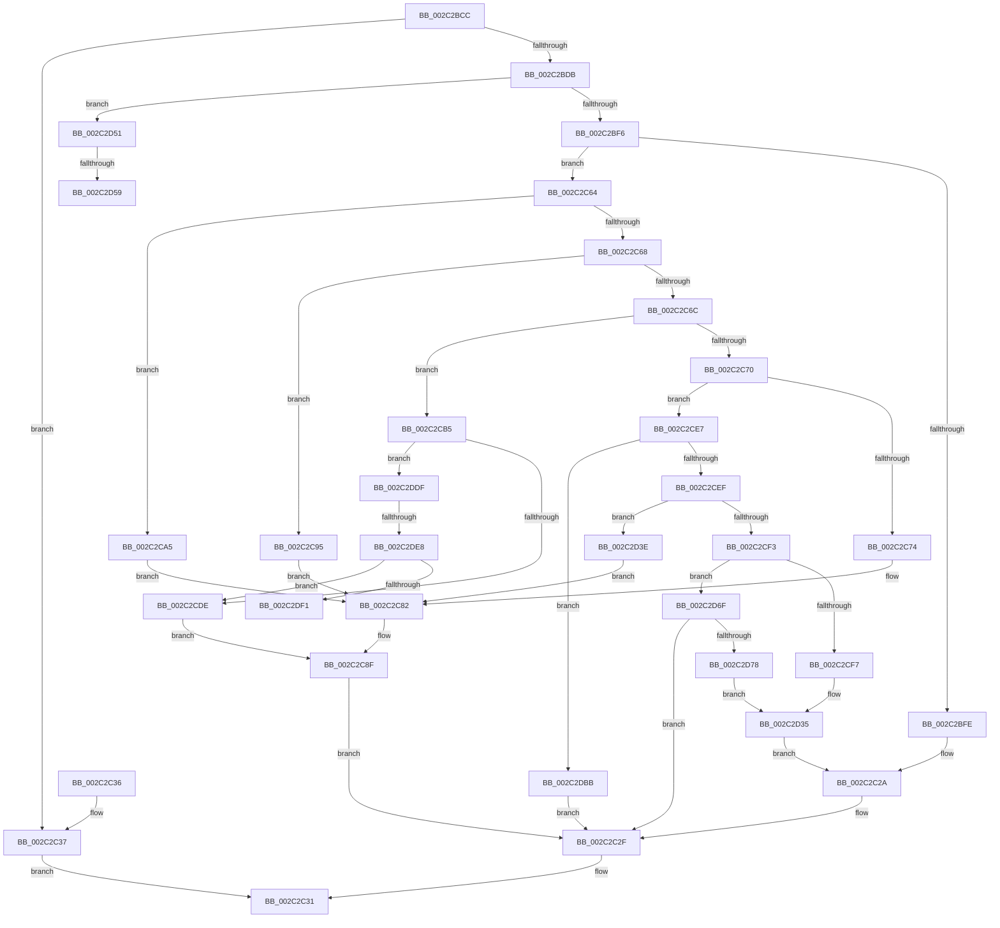

# MiInitializeWalkBounds

- RVA: `0x002C2BCC`–`0x002C2DF6` (길이 `554` bytes)
- VA: `0x00000001402C2BCC`
- 실행 섹션: `.text`
- PDB 이름 있음: `예`; PDB Function 태그: `예`
- unwind 정보 RVA: `0x0006E910`
- 디코드: `123`개 명령, `554/554` bytes 표시
- 미해석 바이트: `0` (있으면 어셈블리에 `.byte`로 보존)

> 이 문서는 커널 이미지의 기계어와 PDB 기호를 분석해 생성했습니다. 4번과 5번은 함수 원형과 자료형을 바이너리 사용 방식에서 추정한 C 해석이며 원본 소스 복구 결과는 아닙니다.

## 1. Dependencies

- 직접 호출 지점: **2**; 고유 호출 대상: **2**
- 직접 호출자로 확인된 함수: **1**
- RIP 상대 이미지 참조: **24**

### Outgoing calls
- `0x002C2C17` → [MiHyperSpaceSize](MiHyperSpaceSize_function_002C2DFC.md) (function, `0x002C2DFC`)
- `0x002C2C5D` → [MiSetExclusionWalkBounds](MiSetExclusionWalkBounds_function_002C0F74.md) (function, `0x002C0F74`)

### Direct callers
- [MiWalkPageTables](MiWalkPageTables_function_002C2710.md) at `0x002C280E`

### Static image references
- `0x002C2C10` → RVA `0x00E2F388` (`.data`; read)
- `0x002C2C74` → RVA `0x00E2F0E8` (`.data`; read)
- `0x002C2C7B` → RVA `0x00E2F0C8` (`.data`; read)
- `0x002C2C95` → RVA `0x00E2F058` (`.data`; read)
- `0x002C2C9C` → RVA `0x00E2F038` (`.data`; read)
- `0x002C2CA5` → RVA `0x00E2F0A0` (`.data`; read)
- `0x002C2CAC` → RVA `0x00E2F080` (`.data`; read)
- `0x002C2CB5` → RVA `0x00E38CB8` (`.data`; read)
- `0x002C2CBC` → RVA `0x00E38CC0` (`.data`; read)
- `0x002C2CC3` → RVA `0x00E2F158` (`.data`; read)
- `0x002C2CCA` → RVA `0x00E2F160` (`.data`; read)
- `0x002C2CF7` → RVA `0x00E38BB8` (`.data`; read)
- `0x002C2D01` → RVA `0x00E38BC0` (`.data`; read)
- `0x002C2D19` → RVA `0x00E38C88` (`.data`; read)
- `0x002C2D2E` → RVA `0x00E38C90` (`.data`; read)
- `0x002C2D3E` → RVA `0x00E2EEF0` (`.data`; read)
- `0x002C2D45` → RVA `0x00E2EED0` (`.data`; read)
- `0x002C2D63` → RVA `0x00E38C58` (`.data`; read)
- `0x002C2D78` → RVA `0x00E38C98` (`.data`; read)
- `0x002C2D82` → RVA `0x00E38CA0` (`.data`; read)
- `0x002C2D9A` → RVA `0x00E38C18` (`.data`; read)
- `0x002C2DAF` → RVA `0x00E38C20` (`.data`; read)
- `0x002C2DBB` → RVA `0x00E38BE8` (`.data`; read)
- `0x002C2DCF` → RVA `0x00E38BF0` (`.data`; read)

## 2. Other-region calls and transfers

- 다른 실행 섹션으로 향하는 call: **0**
- call이 아닌 외부 분기/꼬리 이동: **4**
  - `0x002C2D53` → [sub_006DC396](../6D/Unknown_function_006DC396.md) (`tail-transfer`)
  - `0x002C2D6A` → [sub_006DC396 + 0x7](../6D/Unknown_function_006DC396.md) (`tail-transfer`)
  - `0x002C2DE2` → [sub_006DC396 + 0x16](../6D/Unknown_function_006DC396.md) (`tail-transfer`)
  - `0x002C2DF1` → [sub_006DC396 + 0x16](../6D/Unknown_function_006DC396.md) (`tail-transfer`)

## 3. Assembly (complete function range)

```asm
002C2BCC  48 83 EC 38                     sub rsp, 0x38
002C2BD0  F7 01 00 20 00 00               test dword ptr [rcx], 0x2000
002C2BD6  4C 8B DA                        mov r11, rdx
002C2BD9  75 5C                           jne 0x1402c2c37
002C2BDB  48 8B 41 20                     mov rax, qword ptr [rcx + 0x20]
002C2BDF  BA 01 00 00 00                  mov edx, 1
002C2BE4  8B 80 B8 00 00 00               mov eax, dword ptr [rax + 0xb8]
002C2BEA  F7 01 00 08 00 00               test dword ptr [rcx], 0x800
002C2BF0  0F 85 5B 01 00 00               jne 0x1402c2d51
002C2BF6  0F B6 C8                        movzx ecx, al
002C2BF9  83 E1 0F                        and ecx, 0xf
002C2BFC  75 66                           jne 0x1402c2c64
002C2BFE  49 83 23 00                     and qword ptr [r11], 0
002C2C02  48 B8 FF FF FF FF FF 7F 00 00   movabs rax, 0x7fffffffffff
002C2C0C  49 89 43 08                     mov qword ptr [r11 + 8], rax
002C2C10  4C 8B 15 71 C7 B6 00            mov r10, qword ptr [rip + 0xb6c771]
002C2C17  E8 E0 01 00 00                  call 0x1402c2dfc
002C2C1C  48 FF C8                        dec rax
002C2C1F  4D 89 53 10                     mov qword ptr [r11 + 0x10], r10
002C2C23  49 03 C2                        add rax, r10
002C2C26  49 89 43 18                     mov qword ptr [r11 + 0x18], rax
002C2C2A  BA 02 00 00 00                  mov edx, 2
002C2C2F  8B C2                           mov eax, edx
002C2C31  48 83 C4 38                     add rsp, 0x38
002C2C35  C3                              ret
002C2C36  CC                              int3
002C2C37  49 B9 00 00 00 00 00 F7 FF FF   movabs r9, 0xfffff70000000000
002C2C41  48 B9 00 00 00 00 80 F6 FF FF   movabs rcx, 0xfffff68000000000
002C2C4B  48 8B C1                        mov rax, rcx
002C2C4E  4C 2B C8                        sub r9, rax
002C2C51  4C 8B C1                        mov r8, rcx
002C2C54  33 D2                           xor edx, edx
002C2C56  4C 89 5C 24 20                  mov qword ptr [rsp + 0x20], r11
002C2C5B  33 C9                           xor ecx, ecx
002C2C5D  E8 12 E3 FF FF                  call 0x1402c0f74
002C2C62  EB CD                           jmp 0x1402c2c31
002C2C64  2B CA                           sub ecx, edx
002C2C66  74 3D                           je 0x1402c2ca5
002C2C68  2B CA                           sub ecx, edx
002C2C6A  74 29                           je 0x1402c2c95
002C2C6C  2B CA                           sub ecx, edx
002C2C6E  74 45                           je 0x1402c2cb5
002C2C70  2B CA                           sub ecx, edx
002C2C72  75 73                           jne 0x1402c2ce7
002C2C74  48 8B 0D 6D C4 B6 00            mov rcx, qword ptr [rip + 0xb6c46d]
002C2C7B  48 8B 05 46 C4 B6 00            mov rax, qword ptr [rip + 0xb6c446]
002C2C82  48 C1 E0 15                     shl rax, 0x15
002C2C86  48 FF C8                        dec rax
002C2C89  49 89 0B                        mov qword ptr [r11], rcx
002C2C8C  48 03 C1                        add rax, rcx
002C2C8F  49 89 43 08                     mov qword ptr [r11 + 8], rax
002C2C93  EB 9A                           jmp 0x1402c2c2f
002C2C95  48 8B 0D BC C3 B6 00            mov rcx, qword ptr [rip + 0xb6c3bc]
002C2C9C  48 8B 05 95 C3 B6 00            mov rax, qword ptr [rip + 0xb6c395]
002C2CA3  EB DD                           jmp 0x1402c2c82
002C2CA5  48 8B 0D F4 C3 B6 00            mov rcx, qword ptr [rip + 0xb6c3f4]
002C2CAC  48 8B 05 CD C3 B6 00            mov rax, qword ptr [rip + 0xb6c3cd]
002C2CB3  EB CD                           jmp 0x1402c2c82
002C2CB5  48 8B 05 FC 5F B7 00            mov rax, qword ptr [rip + 0xb75ffc]
002C2CBC  4C 8B 15 FD 5F B7 00            mov r10, qword ptr [rip + 0xb75ffd]
002C2CC3  4C 8B 05 8E C4 B6 00            mov r8, qword ptr [rip + 0xb6c48e]
002C2CCA  4C 8B 0D 8F C4 B6 00            mov r9, qword ptr [rip + 0xb6c48f]
002C2CD1  49 8D 0C 02                     lea rcx, [r10 + rax]
002C2CD5  4C 3B C0                        cmp r8, rax
002C2CD8  0F 83 01 01 00 00               jae 0x1402c2ddf
002C2CDE  49 89 03                        mov qword ptr [r11], rax
002C2CE1  48 8D 41 FF                     lea rax, [rcx - 1]
002C2CE5  EB A8                           jmp 0x1402c2c8f
002C2CE7  2B CA                           sub ecx, edx
002C2CE9  0F 84 CC 00 00 00               je 0x1402c2dbb
002C2CEF  2B CA                           sub ecx, edx
002C2CF1  74 4B                           je 0x1402c2d3e
002C2CF3  2B CA                           sub ecx, edx
002C2CF5  75 78                           jne 0x1402c2d6f
002C2CF7  48 8B 05 BA 5E B7 00            mov rax, qword ptr [rip + 0xb75eba]
002C2CFE  49 89 03                        mov qword ptr [r11], rax
002C2D01  48 8B 05 B8 5E B7 00            mov rax, qword ptr [rip + 0xb75eb8]
002C2D08  48 8B 0D A9 5E B7 00            mov rcx, qword ptr [rip + 0xb75ea9]
002C2D0F  48 FF C8                        dec rax
002C2D12  48 03 C8                        add rcx, rax
002C2D15  49 89 4B 08                     mov qword ptr [r11 + 8], rcx
002C2D19  48 8B 05 68 5F B7 00            mov rax, qword ptr [rip + 0xb75f68]
002C2D20  49 89 43 10                     mov qword ptr [r11 + 0x10], rax
002C2D24  48 8B 0D 5D 5F B7 00            mov rcx, qword ptr [rip + 0xb75f5d]
002C2D2B  48 FF C9                        dec rcx
002C2D2E  48 03 0D 5B 5F B7 00            add rcx, qword ptr [rip + 0xb75f5b]
002C2D35  49 89 4B 18                     mov qword ptr [r11 + 0x18], rcx
002C2D39  E9 EC FE FF FF                  jmp 0x1402c2c2a
002C2D3E  48 8B 0D AB C1 B6 00            mov rcx, qword ptr [rip + 0xb6c1ab]
002C2D45  48 8B 05 84 C1 B6 00            mov rax, qword ptr [rip + 0xb6c184]
002C2D4C  E9 31 FF FF FF                  jmp 0x1402c2c82
002C2D51  A8 0F                           test al, 0xf
002C2D53  0F 85 3D 96 41 00               jne 0x1406dc396
002C2D59  48 B9 00 00 00 00 80 00 00 00   movabs rcx, 0x8000000000
002C2D63  48 03 0D EE 5E B7 00            add rcx, qword ptr [rip + 0xb75eee]
002C2D6A  E9 2E 96 41 00                  jmp 0x1406dc39d
002C2D6F  83 F9 02                        cmp ecx, 2
002C2D72  0F 85 B7 FE FF FF               jne 0x1402c2c2f
002C2D78  48 8B 05 19 5F B7 00            mov rax, qword ptr [rip + 0xb75f19]
002C2D7F  49 89 03                        mov qword ptr [r11], rax
002C2D82  48 8B 05 17 5F B7 00            mov rax, qword ptr [rip + 0xb75f17]
002C2D89  48 8B 0D 08 5F B7 00            mov rcx, qword ptr [rip + 0xb75f08]
002C2D90  48 FF C8                        dec rax
002C2D93  48 03 C8                        add rcx, rax
002C2D96  49 89 4B 08                     mov qword ptr [r11 + 8], rcx
002C2D9A  48 8B 05 77 5E B7 00            mov rax, qword ptr [rip + 0xb75e77]
002C2DA1  49 89 43 10                     mov qword ptr [r11 + 0x10], rax
002C2DA5  48 8B 0D 6C 5E B7 00            mov rcx, qword ptr [rip + 0xb75e6c]
002C2DAC  48 FF C9                        dec rcx
002C2DAF  48 03 0D 6A 5E B7 00            add rcx, qword ptr [rip + 0xb75e6a]
002C2DB6  E9 7A FF FF FF                  jmp 0x1402c2d35
002C2DBB  48 8B 05 26 5E B7 00            mov rax, qword ptr [rip + 0xb75e26]
002C2DC2  49 89 03                        mov qword ptr [r11], rax
002C2DC5  48 8B 0D 1C 5E B7 00            mov rcx, qword ptr [rip + 0xb75e1c]
002C2DCC  48 FF C9                        dec rcx
002C2DCF  48 03 0D 1A 5E B7 00            add rcx, qword ptr [rip + 0xb75e1a]
002C2DD6  49 89 4B 08                     mov qword ptr [r11 + 8], rcx
002C2DDA  E9 50 FE FF FF                  jmp 0x1402c2c2f
002C2DDF  4C 3B C1                        cmp r8, rcx
002C2DE2  0F 82 C4 95 41 00               jb 0x1406dc3ac
002C2DE8  48 85 C9                        test rcx, rcx
002C2DEB  0F 85 ED FE FF FF               jne 0x1402c2cde
002C2DF1  E9 B6 95 41 00                  jmp 0x1406dc3ac
```

## 4. C-style interpretation (structured pseudocode)

```c
__int64 __fastcall MiInitializeWalkBounds(__int64 a1, __int64 a2)
{
    __int64 result;
    __int64 v_rsp;
    unsigned __int64 v_stack_p20;

    v_rsp = (v_rsp) - (56);
    if (((*(unsigned int *)(a1)) & (0x2000ULL)) != 0) goto loc_002C2C37;
    if (((*(unsigned int *)(a1)) & (0x800ULL)) != 0) goto loc_002C2D51;
    a1 = (unsigned int)(((unsigned __int8)((unsigned int)(*(unsigned int *)(*(unsigned __int64 *)(a1 + 32) + 184)))) & (15));
    if (condition_is_not_equal) goto loc_002C2C64;
    *(unsigned __int64 *)(a2 + 8) = (unsigned int)(*(unsigned int *)(*(unsigned __int64 *)(a1 + 32) + 184));
    result = MiHyperSpaceSize(a1, 1, a3, a4);
    result = (result) - 1;
    *(unsigned __int64 *)(a2 + 16) = *(unsigned __int64 *)(v_rip + 11978609);
    result = (result) + (*(unsigned __int64 *)(v_rip + 11978609));
    *(unsigned __int64 *)(a2 + 24) = result;
loc_002C2C2A:
loc_002C2C2F:
loc_002C2C31:
    v_rsp = (v_rsp) + (56);
    return 2;
loc_002C2C37:
    a4 = (a4) - (a1);
    a2 = 0;
    v_stack_p20 = 0;
    a1 = 0;
    result = MiSetExclusionWalkBounds(a1, a2, a1, a4);
    goto loc_002C2C31;
loc_002C2C64:
    a1 = (unsigned int)((a1) - (0));
    if (condition_is_equal) goto loc_002C2CA5;
    a1 = (unsigned int)((a1) - (0));
    if (condition_is_equal) goto loc_002C2C95;
    a1 = (unsigned int)((a1) - (0));
    if (condition_is_equal) goto loc_002C2CB5;
    a1 = (unsigned int)((a1) - (0));
    if (condition_is_not_equal) goto loc_002C2CE7;
loc_002C2C82:
    result = (*(unsigned __int64 *)(v_rip + 11977798)) << (21);
    result = (result) - 1;
    *(unsigned __int64 *)(a2) = *(unsigned __int64 *)(v_rip + 11977837);
    result = (result) + (*(unsigned __int64 *)(v_rip + 11977837));
loc_002C2C8F:
    *(unsigned __int64 *)(a2 + 8) = result;
    goto loc_002C2C2F;
loc_002C2C95:
    goto loc_002C2C82;
loc_002C2CA5:
    goto loc_002C2C82;
loc_002C2CB5:
    if ((*(unsigned __int64 *)(v_rip + 11977870)) >= (*(unsigned __int64 *)(v_rip + 12017660))) goto loc_002C2DDF;
loc_002C2CDE:
    *(unsigned __int64 *)(a2) = *(unsigned __int64 *)(v_rip + 12017660);
    goto loc_002C2C8F;
loc_002C2CE7:
    a1 = (unsigned int)((*(unsigned __int64 *)(v_rip + 12017661) + *(unsigned __int64 *)(v_rip + 12017660) * 1) - (0));
    if (condition_is_equal) goto loc_002C2DBB;
    a1 = (unsigned int)((a1) - (0));
    if (condition_is_equal) goto loc_002C2D3E;
    a1 = (unsigned int)((a1) - (0));
    if (condition_is_not_equal) goto loc_002C2D6F;
    *(unsigned __int64 *)(a2) = *(unsigned __int64 *)(v_rip + 12017338);
    result = (*(unsigned __int64 *)(v_rip + 12017336)) - 1;
    a1 = (*(unsigned __int64 *)(v_rip + 12017321)) + (result);
    *(unsigned __int64 *)(a2 + 8) = a1;
    *(unsigned __int64 *)(a2 + 16) = *(unsigned __int64 *)(v_rip + 12017512);
    a1 = (*(unsigned __int64 *)(v_rip + 12017501)) - 1;
    a1 = (a1) + (*(unsigned __int64 *)(v_rip + 12017499));
loc_002C2D35:
    *(unsigned __int64 *)(a2 + 24) = a1;
    goto loc_002C2C2A;
loc_002C2D3E:
    goto loc_002C2C82;
loc_002C2D51:
    a1 = (*(unsigned __int64 *)(v_rip + 11977131)) + (*(unsigned __int64 *)(v_rip + 12017390));
loc_002C2D6F:
    if (((unsigned int)(a1)) != 2) goto loc_002C2C2F;
    *(unsigned __int64 *)(a2) = *(unsigned __int64 *)(v_rip + 12017433);
    result = (*(unsigned __int64 *)(v_rip + 12017431)) - 1;
    a1 = (*(unsigned __int64 *)(v_rip + 12017416)) + (result);
    *(unsigned __int64 *)(a2 + 8) = a1;
    *(unsigned __int64 *)(a2 + 16) = *(unsigned __int64 *)(v_rip + 12017271);
    a1 = (*(unsigned __int64 *)(v_rip + 12017260)) - 1;
    a1 = (a1) + (*(unsigned __int64 *)(v_rip + 12017258));
    goto loc_002C2D35;
loc_002C2DBB:
    *(unsigned __int64 *)(a2) = *(unsigned __int64 *)(v_rip + 12017190);
    a1 = (*(unsigned __int64 *)(v_rip + 12017180)) - 1;
    a1 = (a1) + (*(unsigned __int64 *)(v_rip + 12017178));
    *(unsigned __int64 *)(a2 + 8) = a1;
    goto loc_002C2C2F;
loc_002C2DDF:
    if (a1 != 0) goto loc_002C2CDE;
}
```

## 5. (Beta) C Style

```c
int64_t MiInitializeWalkBounds(void *Arg1, void *Arg2)
{
    uint8_t *arg1 = (uint8_t *)Arg1;
    uint8_t *arg2 = (uint8_t *)Arg2;

    int64_t result;
    int64_t local_rsp;
    uint64_t v_stack_p20;

    local_rsp = (local_rsp) - (56);
    if (((*(uint32_t *)(arg1)) & (0x2000ULL)) != 0) goto loc_002C2C37;
    if (((*(uint32_t *)(arg1)) & (0x800ULL)) != 0) goto loc_002C2D51;
    Arg1 = (uint32_t)(((uint8_t)((uint32_t)(*(uint32_t *)(*(uint64_t *)(arg1 + 0x20) + 0xB8)))) & (15));
    if (condition_is_not_equal) goto loc_002C2C64;
    *(uint64_t *)(arg2 + 0x8) = (uint32_t)(*(uint32_t *)(*(uint64_t *)(arg1 + 0x20) + 0xB8));
    result = MiHyperSpaceSize(Arg1, 1, a3, a4);
    result = (result) - 1;
    *(uint64_t *)(arg2 + 0x10) = *(uint64_t *)(v_rip + 0xB6C771);
    result = (result) + (*(uint64_t *)(v_rip + 0xB6C771));
    *(uint64_t *)(arg2 + 0x18) = result;
loc_002C2C2A:
loc_002C2C2F:
loc_002C2C31:
    local_rsp = (local_rsp) + (56);
    return 2;
loc_002C2C37:
    a4 = (a4) - (Arg1);
    Arg2 = 0;
    v_stack_p20 = 0;
    Arg1 = 0;
    result = MiSetExclusionWalkBounds(Arg1, Arg2, Arg1, a4);
    goto loc_002C2C31;
loc_002C2C64:
    Arg1 = (uint32_t)((Arg1) - (0));
    if (condition_is_equal) goto loc_002C2CA5;
    Arg1 = (uint32_t)((Arg1) - (0));
    if (condition_is_equal) goto loc_002C2C95;
    Arg1 = (uint32_t)((Arg1) - (0));
    if (condition_is_equal) goto loc_002C2CB5;
    Arg1 = (uint32_t)((Arg1) - (0));
    if (condition_is_not_equal) goto loc_002C2CE7;
loc_002C2C82:
    result = (*(uint64_t *)(v_rip + 0xB6C446)) << (21);
    result = (result) - 1;
    *(uint64_t *)(arg2) = *(uint64_t *)(v_rip + 0xB6C46D);
    result = (result) + (*(uint64_t *)(v_rip + 0xB6C46D));
loc_002C2C8F:
    *(uint64_t *)(arg2 + 0x8) = result;
    goto loc_002C2C2F;
loc_002C2C95:
    goto loc_002C2C82;
loc_002C2CA5:
    goto loc_002C2C82;
loc_002C2CB5:
    if ((*(uint64_t *)(v_rip + 0xB6C48E)) >= (*(uint64_t *)(v_rip + 0xB75FFC))) goto loc_002C2DDF;
loc_002C2CDE:
    *(uint64_t *)(arg2) = *(uint64_t *)(v_rip + 0xB75FFC);
    goto loc_002C2C8F;
loc_002C2CE7:
    Arg1 = (uint32_t)((*(uint64_t *)(v_rip + 0xB75FFD) + *(uint64_t *)(v_rip + 0xB75FFC) * 1) - (0));
    if (condition_is_equal) goto loc_002C2DBB;
    Arg1 = (uint32_t)((Arg1) - (0));
    if (condition_is_equal) goto loc_002C2D3E;
    Arg1 = (uint32_t)((Arg1) - (0));
    if (condition_is_not_equal) goto loc_002C2D6F;
    *(uint64_t *)(arg2) = *(uint64_t *)(v_rip + 0xB75EBA);
    result = (*(uint64_t *)(v_rip + 0xB75EB8)) - 1;
    Arg1 = (*(uint64_t *)(v_rip + 0xB75EA9)) + (result);
    *(void **)(arg2 + 0x8) = Arg1;
    *(uint64_t *)(arg2 + 0x10) = *(uint64_t *)(v_rip + 0xB75F68);
    Arg1 = (*(uint64_t *)(v_rip + 0xB75F5D)) - 1;
    Arg1 = (Arg1) + (*(uint64_t *)(v_rip + 0xB75F5B));
loc_002C2D35:
    *(void **)(arg2 + 0x18) = Arg1;
    goto loc_002C2C2A;
loc_002C2D3E:
    goto loc_002C2C82;
loc_002C2D51:
    Arg1 = (*(uint64_t *)(v_rip + 0xB6C1AB)) + (*(uint64_t *)(v_rip + 0xB75EEE));
loc_002C2D6F:
    if (((uint32_t)(Arg1)) != 2) goto loc_002C2C2F;
    *(uint64_t *)(arg2) = *(uint64_t *)(v_rip + 0xB75F19);
    result = (*(uint64_t *)(v_rip + 0xB75F17)) - 1;
    Arg1 = (*(uint64_t *)(v_rip + 0xB75F08)) + (result);
    *(void **)(arg2 + 0x8) = Arg1;
    *(uint64_t *)(arg2 + 0x10) = *(uint64_t *)(v_rip + 0xB75E77);
    Arg1 = (*(uint64_t *)(v_rip + 0xB75E6C)) - 1;
    Arg1 = (Arg1) + (*(uint64_t *)(v_rip + 0xB75E6A));
    goto loc_002C2D35;
loc_002C2DBB:
    *(uint64_t *)(arg2) = *(uint64_t *)(v_rip + 0xB75E26);
    Arg1 = (*(uint64_t *)(v_rip + 0xB75E1C)) - 1;
    Arg1 = (Arg1) + (*(uint64_t *)(v_rip + 0xB75E1A));
    *(void **)(arg2 + 0x8) = Arg1;
    goto loc_002C2C2F;
loc_002C2DDF:
    if (Arg1 != NULL) goto loc_002C2CDE;
}
```

### 관측된 메모리 오프셋

구조체 형식이 확인되지 않은 접근은 인자 기준의 오프셋으로만 기록했습니다.

| 기준 인자 | 오프셋 표현 | 폭 (bit) | 접근 |
|---|---:|---:|---|
| `Arg1` | `+ 0x0` | `32` | `R` |
| `Arg1` | `+ 0x20` | `64` | `R` |
| `Arg2` | `+ 0x0` | `64` | `R/W` |
| `Arg2` | `+ 0x0` | `64` | `W` |
| `Arg2` | `+ 0x8` | `64` | `W` |
| `Arg2` | `+ 0x10` | `64` | `W` |
| `Arg2` | `+ 0x18` | `64` | `W` |

## 6. Execution-region graph

[열기: 2D/3D 그래프와 함수 탐색 컨트롤 패널](../../../control-panel.html?section=text&rva=0x002C2BCC&view=graph)

- 2D 그래프는 위에서 아래로 흐르고, 3D 그래프는 빈 공간을 드래그해 회전합니다. Shift+드래그는 이동, 휠은 확대·축소, 함수 노드 선택은 대상 보고서 이동입니다.

### Static fallback


