# MiInitializeZeroGroup

- RVA: `0x002CA00C`–`0x002CA297` (길이 `651` bytes)
- VA: `0x00000001402CA00C`
- 실행 섹션: `.text`
- PDB 이름 있음: `예`; PDB Function 태그: `예`
- unwind 정보 RVA: `0x0006F148`
- 디코드: `156`개 명령, `651/651` bytes 표시
- 미해석 바이트: `0` (있으면 어셈블리에 `.byte`로 보존)

> 이 문서는 커널 이미지의 기계어와 PDB 기호를 분석해 생성했습니다. 4번과 5번은 함수 원형과 자료형을 바이너리 사용 방식에서 추정한 C 해석이며 원본 소스 복구 결과는 아닙니다.

## 1. Dependencies

- 직접 호출 지점: **5**; 고유 호출 대상: **5**
- 직접 호출자로 확인된 함수: **1**
- RIP 상대 이미지 참조: **3**

### Outgoing calls
- `0x002CA038` → [MiQuantifyZeroWork](MiQuantifyZeroWork_function_002CA2A0.md) (function, `0x002CA2A0`)
- `0x002CA15C` → [MiInitializeAffinityWalker](MiInitializeAffinityWalker_function_002CA2F0.md) (function, `0x002CA2F0`)
- `0x002CA239` → [KiLowerIrqlProcessIrqlFlags](../4F/KiLowerIrqlProcessIrqlFlags_function_004F5698.md) (function, `0x004F5698`)
- `0x002CA256` → [KiRaiseIrqlProcessIrqlFlags](../4F/KiRaiseIrqlProcessIrqlFlags_function_004F56FC.md) (function, `0x004F56FC`)
- `0x002CA263` → [MiGetZeroingDescriptors](../68/MiGetZeroingDescriptors_function_0068C2F4.md) (function, `0x0068C2F4`)

### Direct callers
- [MiZeroInParallel](MiZeroInParallel_function_002C9F78.md) at `0x002C9F81`

### Static image references
- `0x002CA0B5` → RVA `0x00FC6A88` (`ALMOSTRO`; read)
- `0x002CA113` → RVA `0x00E38D00` (`.data`; read)
- `0x002CA1B2` → RVA `0x00FC6D20` (`ALMOSTRO`; read)

## 2. Other-region calls and transfers

- 다른 실행 섹션으로 향하는 call: **0**
- call이 아닌 외부 분기/꼬리 이동: **1**
  - `0x002CA286` → [sub_006DCC38](../6D/Unknown_function_006DCC38.md) (`tail-transfer`)

## 3. Assembly (complete function range)

```asm
002CA00C  48 8B C4                        mov rax, rsp
002CA00F  48 89 58 08                     mov qword ptr [rax + 8], rbx
002CA013  48 89 68 10                     mov qword ptr [rax + 0x10], rbp
002CA017  48 89 70 18                     mov qword ptr [rax + 0x18], rsi
002CA01B  48 89 78 20                     mov qword ptr [rax + 0x20], rdi
002CA01F  41 57                           push r15
002CA021  48 83 EC 20                     sub rsp, 0x20
002CA025  65 48 8B 04 25 88 01 00 00      mov rax, qword ptr gs:[0x188]
002CA02E  48 8B D9                        mov rbx, rcx
002CA031  48 89 81 A0 00 00 00            mov qword ptr [rcx + 0xa0], rax
002CA038  E8 63 02 00 00                  call 0x1402ca2a0
002CA03D  48 8D 7B 60                     lea rdi, [rbx + 0x60]
002CA041  83 3F 00                        cmp dword ptr [rdi], 0
002CA044  0F 85 16 02 00 00               jne 0x1402ca260
002CA04A  8B 6B 28                        mov ebp, dword ptr [rbx + 0x28]
002CA04D  33 C9                           xor ecx, ecx
002CA04F  33 D2                           xor edx, edx
002CA051  4C 8B C7                        mov r8, rdi
002CA054  41 03 08                        add ecx, dword ptr [r8]
002CA057  FF C2                           inc edx
002CA059  4D 8D 40 04                     lea r8, [r8 + 4]
002CA05D  83 FA 03                        cmp edx, 3
002CA060  72 F2                           jb 0x1402ca054
002CA062  8B 53 10                        mov edx, dword ptr [rbx + 0x10]
002CA065  3B CD                           cmp ecx, ebp
002CA067  44 8B C5                        mov r8d, ebp
002CA06A  41 BF 02 00 00 00               mov r15d, 2
002CA070  44 0F 46 C1                     cmovbe r8d, ecx
002CA074  F6 C2 14                        test dl, 0x14
002CA077  0F 85 09 01 00 00               jne 0x1402ca186
002CA07D  65 48 8B 04 25 88 01 00 00      mov rax, qword ptr gs:[0x188]
002CA086  8B 88 A4 05 00 00               mov ecx, dword ptr [rax + 0x5a4]
002CA08C  41 84 CF                        test r15b, cl
002CA08F  0F 85 F1 00 00 00               jne 0x1402ca186
002CA095  44 0F 20 C0                     mov rax, cr8
002CA099  41 3A C7                        cmp al, r15b
002CA09C  0F 84 E4 00 00 00               je 0x1402ca186
002CA0A2  65 8B 04 25 3C 3A 00 00         mov eax, dword ptr gs:[0x3a3c]
002CA0AA  A9 01 00 01 00                  test eax, 0x10001
002CA0AF  0F 85 D1 00 00 00               jne 0x1402ca186
002CA0B5  F6 05 CC C9 CF 00 30            test byte ptr [rip + 0xcfc9cc], 0x30
002CA0BC  0F 84 C4 00 00 00               je 0x1402ca186
002CA0C2  65 48 8B 04 25 20 00 00 00      mov rax, qword ptr gs:[0x20]
002CA0CB  48 8B 88 C0 00 00 00            mov rcx, qword ptr [rax + 0xc0]
002CA0D2  0F B7 81 8A 00 00 00            movzx eax, word ptr [rcx + 0x8a]
002CA0D9  3B 43 5C                        cmp eax, dword ptr [rbx + 0x5c]
002CA0DC  0F 85 8B 01 00 00               jne 0x1402ca26d
002CA0E2  83 CA 40                        or edx, 0x40
002CA0E5  41 B9 5C 00 00 00               mov r9d, 0x5c
002CA0EB  0F BA F2 07                     btr edx, 7
002CA0EF  4C 8B D3                        mov r10, rbx
002CA0F2  89 53 10                        mov dword ptr [rbx + 0x10], edx
002CA0F5  44 89 43 1C                     mov dword ptr [rbx + 0x1c], r8d
002CA0F9  F0 44 01 43 70                  lock add dword ptr [rbx + 0x70], r8d
002CA0FE  8B 4B 10                        mov ecx, dword ptr [rbx + 0x10]
002CA101  41 8D 40 FF                     lea eax, [r8 - 1]
002CA105  F6 C1 40                        test cl, 0x40
002CA108  41 0F 44 C0                     cmove eax, r8d
002CA10C  0F BA F1 09                     btr ecx, 9
002CA110  89 4B 10                        mov dword ptr [rbx + 0x10], ecx
002CA113  48 8D 0D E6 EB B6 00            lea rcx, [rip + 0xb6ebe6]
002CA11A  89 43 20                        mov dword ptr [rbx + 0x20], eax
002CA11D  48 8B 03                        mov rax, qword ptr [rbx]
002CA120  48 3B C1                        cmp rax, rcx
002CA123  75 6C                           jne 0x1402ca191
002CA125  33 C0                           xor eax, eax
002CA127  48 89 43 08                     mov qword ptr [rbx + 8], rax
002CA12B  48 8B D7                        mov rdx, rdi
002CA12E  83 63 7C 00                     and dword ptr [rbx + 0x7c], 0
002CA132  48 8D 83 80 00 00 00            lea rax, [rbx + 0x80]
002CA139  66 C7 43 78 07 01               mov word ptr [rbx + 0x78], 0x107
002CA13F  C6 43 7A 06                     mov byte ptr [rbx + 0x7a], 6
002CA143  48 89 40 08                     mov qword ptr [rax + 8], rax
002CA147  48 89 00                        mov qword ptr [rax], rax
002CA14A  48 8B B3 90 00 00 00            mov rsi, qword ptr [rbx + 0x90]
002CA151  47 8B 0C 0A                     mov r9d, dword ptr [r10 + r9]
002CA155  48 8B CE                        mov rcx, rsi
002CA158  44 8B 43 58                     mov r8d, dword ptr [rbx + 0x58]
002CA15C  E8 8F 01 00 00                  call 0x1402ca2f0
002CA161  83 7B 20 00                     cmp dword ptr [rbx + 0x20], 0
002CA165  75 33                           jne 0x1402ca19a
002CA167  48 8B 74 24 40                  mov rsi, qword ptr [rsp + 0x40]
002CA16C  48 8B 7C 24 48                  mov rdi, qword ptr [rsp + 0x48]
002CA171  89 6B 6C                        mov dword ptr [rbx + 0x6c], ebp
002CA174  48 8B 5C 24 30                  mov rbx, qword ptr [rsp + 0x30]
002CA179  48 8B 6C 24 38                  mov rbp, qword ptr [rsp + 0x38]
002CA17E  48 83 C4 20                     add rsp, 0x20
002CA182  41 5F                           pop r15
002CA184  C3                              ret
002CA185  CC                              int3
002CA186  41 B8 01 00 00 00               mov r8d, 1
002CA18C  E9 51 FF FF FF                  jmp 0x1402ca0e2
002CA191  48 8B 80 B8 00 00 00            mov rax, qword ptr [rax + 0xb8]
002CA198  EB 8D                           jmp 0x1402ca127
002CA19A  8B 43 10                        mov eax, dword ptr [rbx + 0x10]
002CA19D  24 C0                           and al, 0xc0
002CA19F  3C 40                           cmp al, 0x40
002CA1A1  75 C4                           jne 0x1402ca167
002CA1A3  8B 07                           mov eax, dword ptr [rdi]
002CA1A5  39 43 1C                        cmp dword ptr [rbx + 0x1c], eax
002CA1A8  74 BD                           je 0x1402ca167
002CA1AA  44 0F 20 C7                     mov rdi, cr8
002CA1AE  45 0F 22 C7                     mov cr8, r15
002CA1B2  83 3D 67 CB CF 00 00            cmp dword ptr [rip + 0xcfcb67], 0
002CA1B9  0F 85 91 00 00 00               jne 0x1402ca250
002CA1BF  65 4C 8B 14 25 20 00 00 00      mov r10, qword ptr gs:[0x20]
002CA1C8  B9 38 01 00 00                  mov ecx, 0x138
002CA1CD  41 80 BA 08 8A 00 00 01         cmp byte ptr [r10 + 0x8a08], 1
002CA1D5  8D 41 20                        lea eax, [rcx + 0x20]
002CA1D8  0F 45 C8                        cmovne ecx, eax
002CA1DB  48 03 CE                        add rcx, rsi
002CA1DE  83 39 00                        cmp dword ptr [rcx], 0
002CA1E1  74 46                           je 0x1402ca229
002CA1E3  8B 71 08                        mov esi, dword ptr [rcx + 8]
002CA1E6  45 33 C0                        xor r8d, r8d
002CA1E9  44 3B C6                        cmp r8d, esi
002CA1EC  73 3B                           jae 0x1402ca229
002CA1EE  4C 8B 49 10                     mov r9, qword ptr [rcx + 0x10]
002CA1F2  41 0F B6 82 D0 00 00 00         movzx eax, byte ptr [r10 + 0xd0]
002CA1FA  41 8B D0                        mov edx, r8d
002CA1FD  48 03 D2                        add rdx, rdx
002CA200  66 41 3B 44 D1 08               cmp ax, word ptr [r9 + rdx*8 + 8]
002CA206  75 43                           jne 0x1402ca24b
002CA208  4D 8B 1C D1                     mov r11, qword ptr [r9 + rdx*8]
002CA20C  49 8B 82 60 8E 00 00            mov rax, qword ptr [r10 + 0x8e60]
002CA213  49 85 C3                        test r11, rax
002CA216  74 33                           je 0x1402ca24b
002CA218  48 F7 D0                        not rax
002CA21B  49 23 C3                        and rax, r11
002CA21E  49 89 04 D1                     mov qword ptr [r9 + rdx*8], rax
002CA222  FF 09                           dec dword ptr [rcx]
002CA224  0F BA 6B 10 08                  bts dword ptr [rbx + 0x10], 8
002CA229  83 3D F0 CA CF 00 00            cmp dword ptr [rip + 0xcfcaf0], 0
002CA230  74 0C                           je 0x1402ca23e
002CA232  44 0F 20 C1                     mov rcx, cr8
002CA236  40 8A D7                        mov dl, dil
002CA239  E8 5A B4 22 00                  call 0x1404f5698
002CA23E  40 0F B6 C7                     movzx eax, dil
002CA242  44 0F 22 C0                     mov cr8, rax
002CA246  E9 1C FF FF FF                  jmp 0x1402ca167
002CA24B  41 FF C0                        inc r8d
002CA24E  EB 99                           jmp 0x1402ca1e9
002CA250  41 8A D7                        mov dl, r15b
002CA253  40 8A CF                        mov cl, dil
002CA256  E8 A1 B4 22 00                  call 0x1404f56fc
002CA25B  E9 5F FF FF FF                  jmp 0x1402ca1bf
002CA260  48 8B CB                        mov rcx, rbx
002CA263  E8 8C 20 3C 00                  call 0x14068c2f4
002CA268  E9 DD FD FF FF                  jmp 0x1402ca04a
002CA26D  65 48 8B 04 25 88 01 00 00      mov rax, qword ptr gs:[0x188]
002CA276  4C 8B D3                        mov r10, rbx
002CA279  41 B9 5C 00 00 00               mov r9d, 0x5c
002CA27F  F7 40 74 00 04 00 00            test dword ptr [rax + 0x74], 0x400
002CA286  0F 84 AC 29 41 00               je 0x1406dcc38
002CA28C  81 CA C0 00 00 00               or edx, 0xc0
002CA292  E9 5B FE FF FF                  jmp 0x1402ca0f2
```

## 4. C-style interpretation (structured pseudocode)

```c
__int64 __fastcall MiInitializeZeroGroup(__int64 a1, int a2)
{
    __int64 result;
    __int64 v_rsp;
    unsigned __int64 v_stack_p10;
    unsigned __int64 v_stack_p18;
    unsigned __int64 v_stack_p20;
    unsigned __int64 v_stack_p8;

    *(unsigned __int64 *)(v_rsp + 8) = v_rbx;
    *(unsigned __int64 *)(v_rsp + 16) = v_rbp;
    *(unsigned __int64 *)(v_rsp + 24) = v_rsi;
    *(unsigned __int64 *)(v_rsp + 32) = v_rdi;
    v_rsp = (v_rsp) - (32);
    *(unsigned __int64 *)(a1 + 160) = *(unsigned __int64 *)(gs_base + (0 + 392));
    result = MiQuantifyZeroWork(a1, a2, a3, a4);
    if ((*(unsigned int *)(a1 + 96)) != 0) goto loc_002CA260;
loc_002CA04A:
    a1 = 0;
    a2 = 0;
loc_002CA054:
    a1 = (unsigned int)((a1) + (*(unsigned int *)(a1 + 96)));
    a2 = (unsigned int)((a2) + 1);
    if (a2 < 3) goto loc_002CA054;
    a3 = (unsigned int)((unsigned int)((unsigned int)(*(unsigned int *)(a1 + 40))));
    if (((unsigned int)(a1)) <= ((unsigned int)((unsigned int)(*(unsigned int *)(a1 + 40))))) { a3 = (unsigned int)(a1); }
    if ((((unsigned __int8)((unsigned int)(*(unsigned int *)(a1 + 16)))) & (20)) != 0) goto loc_002CA186;
    if (((2) & ((unsigned __int8)((unsigned int)(*(unsigned int *)(*(unsigned __int64 *)(gs_base + (0 + 392)) + 1444))))) != 0) goto loc_002CA186;
    if (((unsigned __int8)(v_cr8)) == 2) goto loc_002CA186;
    if ((((unsigned int)((unsigned int)(*(unsigned int *)(gs_base + (0 + 14908))))) & (0x10001ULL)) != 0) goto loc_002CA186;
    if (((*(unsigned __int8 *)(v_rip + 13617612)) & (48)) == 0) goto loc_002CA186;
    if (((unsigned int)(*(unsigned __int16 *)(*(unsigned __int64 *)(*(unsigned __int64 *)(gs_base + (0 + 32)) + 192) + 138))) != (*(unsigned int *)(a1 + 92))) goto loc_002CA26D;
loc_002CA0E2:
    a2 = (unsigned int)(((unsigned int)(*(unsigned int *)(a1 + 16))) | (64));
loc_002CA0F2:
    *(unsigned int *)(a1 + 16) = a2;
    *(unsigned int *)(a1 + 28) = (unsigned int)(a3);
    result = a3 - 1;
    if ((((unsigned __int8)((unsigned int)(*(unsigned int *)(a1 + 16)))) & (64)) == 0) { result = (unsigned int)(a3); }
    *(unsigned int *)(a1 + 16) = (unsigned int)((unsigned int)(*(unsigned int *)(a1 + 16)));
    *(unsigned int *)(a1 + 32) = (unsigned int)(result);
    if ((*(unsigned __int64 *)(a1)) != (v_rip + 11987942)) goto loc_002CA191;
    result = 0;
loc_002CA127:
    *(unsigned __int64 *)(a1 + 8) = 0;
    *(unsigned __int16 *)(a1 + 120) = 263;
    *(unsigned __int8 *)(a1 + 122) = 6;
    *(unsigned __int64 *)(a1 + 128 + 8) = a1 + 128;
    *(unsigned __int64 *)(a1 + 128) = a1 + 128;
    result = MiInitializeAffinityWalker(*(unsigned __int64 *)(a1 + 144), a1 + 96, (unsigned int)(*(unsigned int *)(a1 + 88)), (unsigned int)(*(unsigned int *)(a1 + 92 * 1)));
    if ((*(unsigned int *)(a1 + 32)) != 0) goto loc_002CA19A;
loc_002CA167:
    *(unsigned int *)(a1 + 108) = (unsigned int)((unsigned int)(*(unsigned int *)(a1 + 40)));
    v_rsp = (v_rsp) + (32);
    return result;
loc_002CA186:
    goto loc_002CA0E2;
loc_002CA191:
    goto loc_002CA127;
loc_002CA19A:
    result = (unsigned __int8)(((unsigned int)(*(unsigned int *)(v_stack_p8 + 16))) & (192));
    if (((unsigned __int8)(result)) != 64) goto loc_002CA167;
    if ((*(unsigned int *)(v_stack_p8 + 28)) == ((unsigned int)((unsigned int)(*(unsigned int *)(v_stack_p20))))) goto loc_002CA167;
    if ((*(unsigned int *)(v_rip + 13618023)) != 0) goto loc_002CA250;
loc_002CA1BF:
    a1 = 312;
    if ((*(unsigned __int8 *)(*(unsigned __int64 *)(gs_base + (0 + 32)) + 35336)) != 1) { a1 = (unsigned int)(312 + 32); }
    a1 = (a1) + (v_stack_p18);
    if ((*(unsigned int *)(a1)) == 0) goto loc_002CA229;
    a3 = 0;
loc_002CA1E9:
    if (0 >= ((unsigned int)((unsigned int)(*(unsigned int *)(a1 + 8))))) goto loc_002CA229;
    a2 = (0) + (0);
    if (((unsigned __int16)(*(unsigned __int8 *)(*(unsigned __int64 *)(gs_base + (0 + 32)) + 208))) != (*(unsigned __int16 *)(*(unsigned __int64 *)(a1 + 16) + a2 * 8 + 8))) goto loc_002CA24B;
    if (((*(unsigned __int64 *)(*(unsigned __int64 *)(a1 + 16) + a2 * 8)) & (*(unsigned __int64 *)(*(unsigned __int64 *)(gs_base + (0 + 32)) + 36448))) == 0) goto loc_002CA24B;
    result = ~(*(unsigned __int64 *)(*(unsigned __int64 *)(gs_base + (0 + 32)) + 36448));
    result = (result) & (*(unsigned __int64 *)(*(unsigned __int64 *)(a1 + 16) + a2 * 8));
    *(unsigned __int64 *)(*(unsigned __int64 *)(a1 + 16) + a2 * 8) = result;
loc_002CA229:
    if ((*(unsigned int *)(v_rip + 13617904)) != 0) {
        a1 = 2;
        a2 = (unsigned __int8)(v_cr8);
        result = KiLowerIrqlProcessIrqlFlags(a1, a2, a3, *(unsigned __int64 *)(a1 + 16));
    }
    goto loc_002CA167;
loc_002CA24B:
    a3 = (unsigned int)((a3) + 1);
    goto loc_002CA1E9;
loc_002CA250:
    result = KiRaiseIrqlProcessIrqlFlags((unsigned __int8)(v_cr8), 2, a3, *(unsigned __int64 *)(a1 + 16));
    goto loc_002CA1BF;
loc_002CA260:
    result = MiGetZeroingDescriptors(v_stack_p8, 2, a3, *(unsigned __int64 *)(a1 + 16));
    goto loc_002CA04A;
loc_002CA26D:
    a2 = (unsigned int)((2) | (192));
    goto loc_002CA0F2;
}
```

## 5. (Beta) C Style

```c
int64_t MiInitializeZeroGroup(void *Arg1, int32_t Arg2)
{
    uint8_t *arg1 = (uint8_t *)Arg1;

    int64_t result;
    int64_t local_rsp;
    uint64_t v_stack_p10;
    uint64_t v_stack_p18;
    uint64_t v_stack_p20;
    uint64_t v_stack_p8;

    *(uint64_t *)(local_rsp + 0x8) = local_rbx;
    *(uint64_t *)(local_rsp + 0x10) = local_rbp;
    *(uint64_t *)(local_rsp + 0x18) = local_rsi;
    *(uint64_t *)(local_rsp + 0x20) = local_rdi;
    local_rsp = (local_rsp) - (32);
    *(uint64_t *)(arg1 + 0xA0) = *(uint64_t *)(gs_base + (0 + 0x188));
    result = MiQuantifyZeroWork(Arg1, Arg2, a3, a4);
    if ((*(uint32_t *)(arg1 + 0x60)) != 0) goto loc_002CA260;
loc_002CA04A:
    Arg1 = 0;
    Arg2 = 0;
loc_002CA054:
    Arg1 = (uint32_t)((Arg1) + (*(uint32_t *)(arg1 + 0x60)));
    Arg2 = (uint32_t)((Arg2) + 1);
    if (Arg2 < 3) goto loc_002CA054;
    a3 = (uint32_t)((uint32_t)((uint32_t)(*(uint32_t *)(arg1 + 0x28))));
    if (((uint32_t)(Arg1)) <= ((uint32_t)((uint32_t)(*(uint32_t *)(arg1 + 0x28))))) { a3 = (uint32_t)(Arg1); }
    if ((((uint8_t)((uint32_t)(*(uint32_t *)(arg1 + 0x10)))) & (20)) != 0) goto loc_002CA186;
    if (((2) & ((uint8_t)((uint32_t)(*(uint32_t *)(*(uint64_t *)(gs_base + (0 + 0x188)) + 0x5A4))))) != 0) goto loc_002CA186;
    if (((uint8_t)(v_cr8)) == 2) goto loc_002CA186;
    if ((((uint32_t)((uint32_t)(*(uint32_t *)(gs_base + (0 + 0x3A3C))))) & (0x10001ULL)) != 0) goto loc_002CA186;
    if (((*(uint8_t *)(v_rip + 0xCFC9CC)) & (48)) == 0) goto loc_002CA186;
    if (((uint32_t)(*(uint16_t *)(*(uint64_t *)(*(uint64_t *)(gs_base + (0 + 0x20)) + 0xC0) + 0x8A))) != (*(uint32_t *)(arg1 + 0x5C))) goto loc_002CA26D;
loc_002CA0E2:
    Arg2 = (uint32_t)(((uint32_t)(*(uint32_t *)(arg1 + 0x10))) | (64));
loc_002CA0F2:
    *(uint32_t *)(arg1 + 0x10) = Arg2;
    *(uint32_t *)(arg1 + 0x1C) = (uint32_t)(a3);
    result = a3 - 1;
    if ((((uint8_t)((uint32_t)(*(uint32_t *)(arg1 + 0x10)))) & (64)) == 0) { result = (uint32_t)(a3); }
    *(uint32_t *)(arg1 + 0x10) = (uint32_t)((uint32_t)(*(uint32_t *)(arg1 + 0x10)));
    *(uint32_t *)(arg1 + 0x20) = (uint32_t)(result);
    if ((*(uint64_t *)(arg1)) != (v_rip + 11987942)) goto loc_002CA191;
    result = 0;
loc_002CA127:
    *(uint64_t *)(arg1 + 0x8) = 0;
    *(uint16_t *)(arg1 + 0x78) = 263;
    *(uint8_t *)(arg1 + 0x7A) = 6;
    *(void **)(arg1 + 0x80 + 0x8) = Arg1 + 128;
    *(void **)(arg1 + 0x80) = Arg1 + 128;
    result = MiInitializeAffinityWalker(*(uint64_t *)(arg1 + 0x90), Arg1 + 96, (uint32_t)(*(uint32_t *)(arg1 + 0x58)), (uint32_t)(*(uint32_t *)(arg1 + 0x5C * 1)));
    if ((*(uint32_t *)(arg1 + 0x20)) != 0) goto loc_002CA19A;
loc_002CA167:
    *(uint32_t *)(arg1 + 0x6C) = (uint32_t)((uint32_t)(*(uint32_t *)(arg1 + 0x28)));
    local_rsp = (local_rsp) + (32);
    return result;
loc_002CA186:
    goto loc_002CA0E2;
loc_002CA191:
    goto loc_002CA127;
loc_002CA19A:
    result = (uint8_t)(((uint32_t)(*(uint32_t *)(v_stack_p8 + 0x10))) & (192));
    if (((uint8_t)(result)) != 64) goto loc_002CA167;
    if ((*(uint32_t *)(v_stack_p8 + 0x1C)) == ((uint32_t)((uint32_t)(*(uint32_t *)(v_stack_p20))))) goto loc_002CA167;
    if ((*(uint32_t *)(v_rip + 0xCFCB67)) != 0) goto loc_002CA250;
loc_002CA1BF:
    Arg1 = 312;
    if ((*(uint8_t *)(*(uint64_t *)(gs_base + (0 + 0x20)) + 0x8A08)) != 1) { Arg1 = (uint32_t)(312 + 32); }
    Arg1 = (Arg1) + (v_stack_p18);
    if ((*(uint32_t *)(arg1)) == 0) goto loc_002CA229;
    a3 = 0;
loc_002CA1E9:
    if (0 >= ((uint32_t)((uint32_t)(*(uint32_t *)(arg1 + 0x8))))) goto loc_002CA229;
    Arg2 = (0) + (0);
    if (((uint16_t)(*(uint8_t *)(*(uint64_t *)(gs_base + (0 + 0x20)) + 0xD0))) != (*(uint16_t *)(*(uint64_t *)(arg1 + 0x10) + Arg2 * 8 + 0x8))) goto loc_002CA24B;
    if (((*(uint64_t *)(*(uint64_t *)(arg1 + 0x10) + Arg2 * 8)) & (*(uint64_t *)(*(uint64_t *)(gs_base + (0 + 0x20)) + 0x8E60))) == 0) goto loc_002CA24B;
    result = ~(*(uint64_t *)(*(uint64_t *)(gs_base + (0 + 0x20)) + 0x8E60));
    result = (result) & (*(uint64_t *)(*(uint64_t *)(arg1 + 0x10) + Arg2 * 8));
    *(uint64_t *)(*(uint64_t *)(arg1 + 0x10) + Arg2 * 8) = result;
loc_002CA229:
    if ((*(uint32_t *)(v_rip + 0xCFCAF0)) != 0) {
        Arg1 = 2;
        Arg2 = (uint8_t)(v_cr8);
        result = KiLowerIrqlProcessIrqlFlags(Arg1, Arg2, a3, *(uint64_t *)(arg1 + 0x10));
    }
    goto loc_002CA167;
loc_002CA24B:
    a3 = (uint32_t)((a3) + 1);
    goto loc_002CA1E9;
loc_002CA250:
    result = KiRaiseIrqlProcessIrqlFlags((uint8_t)(v_cr8), 2, a3, *(uint64_t *)(arg1 + 0x10));
    goto loc_002CA1BF;
loc_002CA260:
    result = MiGetZeroingDescriptors(v_stack_p8, 2, a3, *(uint64_t *)(arg1 + 0x10));
    goto loc_002CA04A;
loc_002CA26D:
    Arg2 = (uint32_t)((2) | (192));
    goto loc_002CA0F2;
}
```

### 관측된 메모리 오프셋

구조체 형식이 확인되지 않은 접근은 인자 기준의 오프셋으로만 기록했습니다.

| 기준 인자 | 오프셋 표현 | 폭 (bit) | 접근 |
|---|---:|---:|---|
| `Arg1` | `+ 0x0` | `32` | `R` |
| `Arg1` | `+ 0x0` | `64` | `R` |
| `Arg1` | `+ 0x0` | `64` | `W` |
| `Arg1` | `+ 0x0 + r9*1` | `32` | `R` |
| `Arg1` | `+ 0x4` | `64` | `R` |
| `Arg1` | `+ 0x8` | `64` | `W` |
| `Arg1` | `+ 0x10` | `32` | `R` |
| `Arg1` | `+ 0x10` | `32` | `R/W` |
| `Arg1` | `+ 0x10` | `32` | `W` |
| `Arg1` | `+ 0x1C` | `32` | `R` |
| `Arg1` | `+ 0x1C` | `32` | `W` |
| `Arg1` | `+ 0x20` | `32` | `R` |
| `Arg1` | `+ 0x20` | `32` | `W` |
| `Arg1` | `+ 0x28` | `32` | `R` |
| `Arg1` | `+ 0x58` | `32` | `R` |
| `Arg1` | `+ 0x5C` | `32` | `R` |
| `Arg1` | `+ 0x60` | `64` | `R` |
| `Arg1` | `+ 0x6C` | `32` | `W` |
| `Arg1` | `+ 0x70` | `32` | `R/W` |
| `Arg1` | `+ 0x78` | `16` | `W` |
| `Arg1` | `+ 0x7A` | `8` | `W` |
| `Arg1` | `+ 0x7C` | `32` | `R/W` |
| `Arg1` | `+ 0x80` | `64` | `R` |
| `Arg1` | `+ 0x90` | `64` | `R` |
| `Arg1` | `+ 0xA0` | `64` | `W` |

## 6. Execution-region graph

[열기: 2D/3D 그래프와 함수 탐색 컨트롤 패널](../../../control-panel.html?section=text&rva=0x002CA00C&view=graph)

- 2D 그래프는 위에서 아래로 흐르고, 3D 그래프는 빈 공간을 드래그해 회전합니다. Shift+드래그는 이동, 휠은 확대·축소, 함수 노드 선택은 대상 보고서 이동입니다.

### Static fallback

```mermaid
flowchart TD
  bb_002CA00C[BB_002CA00C]
  bb_002CA04A[BB_002CA04A]
  bb_002CA054[BB_002CA054]
  bb_002CA062[BB_002CA062]
  bb_002CA07D[BB_002CA07D]
  bb_002CA095[BB_002CA095]
  bb_002CA0A2[BB_002CA0A2]
  bb_002CA0B5[BB_002CA0B5]
  bb_002CA0C2[BB_002CA0C2]
  bb_002CA0E2[BB_002CA0E2]
  bb_002CA0F2[BB_002CA0F2]
  bb_002CA125[BB_002CA125]
  bb_002CA127[BB_002CA127]
  bb_002CA167[BB_002CA167]
  bb_002CA185[BB_002CA185]
  bb_002CA186[BB_002CA186]
  bb_002CA191[BB_002CA191]
  bb_002CA19A[BB_002CA19A]
  bb_002CA1A3[BB_002CA1A3]
  bb_002CA1AA[BB_002CA1AA]
  bb_002CA1BF[BB_002CA1BF]
  bb_002CA1E3[BB_002CA1E3]
  bb_002CA1E9[BB_002CA1E9]
  bb_002CA1EE[BB_002CA1EE]
  bb_002CA208[BB_002CA208]
  bb_002CA218[BB_002CA218]
  bb_002CA229[BB_002CA229]
  bb_002CA232[BB_002CA232]
  bb_002CA23E[BB_002CA23E]
  bb_002CA24B[BB_002CA24B]
  bb_002CA250[BB_002CA250]
  bb_002CA260[BB_002CA260]
  bb_002CA26D[BB_002CA26D]
  bb_002CA28C[BB_002CA28C]
  bb_002CA00C -->|branch| bb_002CA260
  bb_002CA00C -->|fallthrough| bb_002CA04A
  bb_002CA04A -->|flow| bb_002CA054
  bb_002CA054 -->|branch| bb_002CA054
  bb_002CA054 -->|fallthrough| bb_002CA062
  bb_002CA062 -->|branch| bb_002CA186
  bb_002CA062 -->|fallthrough| bb_002CA07D
  bb_002CA07D -->|branch| bb_002CA186
  bb_002CA07D -->|fallthrough| bb_002CA095
  bb_002CA095 -->|branch| bb_002CA186
  bb_002CA095 -->|fallthrough| bb_002CA0A2
  bb_002CA0A2 -->|branch| bb_002CA186
  bb_002CA0A2 -->|fallthrough| bb_002CA0B5
  bb_002CA0B5 -->|branch| bb_002CA186
  bb_002CA0B5 -->|fallthrough| bb_002CA0C2
  bb_002CA0C2 -->|branch| bb_002CA26D
  bb_002CA0C2 -->|fallthrough| bb_002CA0E2
  bb_002CA0E2 -->|flow| bb_002CA0F2
  bb_002CA0F2 -->|branch| bb_002CA191
  bb_002CA0F2 -->|fallthrough| bb_002CA125
  bb_002CA125 -->|flow| bb_002CA127
  bb_002CA127 -->|branch| bb_002CA19A
  bb_002CA127 -->|fallthrough| bb_002CA167
  bb_002CA185 -->|flow| bb_002CA186
  bb_002CA186 -->|branch| bb_002CA0E2
  bb_002CA191 -->|branch| bb_002CA127
  bb_002CA19A -->|branch| bb_002CA167
  bb_002CA19A -->|fallthrough| bb_002CA1A3
  bb_002CA1A3 -->|branch| bb_002CA167
  bb_002CA1A3 -->|fallthrough| bb_002CA1AA
  bb_002CA1AA -->|branch| bb_002CA250
  bb_002CA1AA -->|fallthrough| bb_002CA1BF
  bb_002CA1BF -->|branch| bb_002CA229
  bb_002CA1BF -->|fallthrough| bb_002CA1E3
  bb_002CA1E3 -->|flow| bb_002CA1E9
  bb_002CA1E9 -->|branch| bb_002CA229
  bb_002CA1E9 -->|fallthrough| bb_002CA1EE
  bb_002CA1EE -->|branch| bb_002CA24B
  bb_002CA1EE -->|fallthrough| bb_002CA208
  bb_002CA208 -->|branch| bb_002CA24B
  bb_002CA208 -->|fallthrough| bb_002CA218
  bb_002CA218 -->|flow| bb_002CA229
  bb_002CA229 -->|branch| bb_002CA23E
  bb_002CA229 -->|fallthrough| bb_002CA232
  bb_002CA232 -->|flow| bb_002CA23E
  bb_002CA23E -->|branch| bb_002CA167
  bb_002CA24B -->|branch| bb_002CA1E9
  bb_002CA250 -->|branch| bb_002CA1BF
  bb_002CA260 -->|branch| bb_002CA04A
  bb_002CA26D -->|fallthrough| bb_002CA28C
  bb_002CA28C -->|branch| bb_002CA0F2
```


