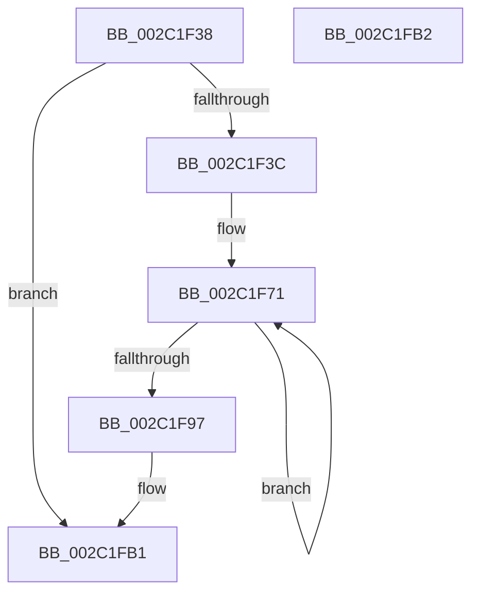

# MiInsertRecursiveTbFlushEntries

- RVA: `0x002C1F38`–`0x002C1FB3` (길이 `123` bytes)
- VA: `0x00000001402C1F38`
- 실행 섹션: `.text`
- PDB 이름 있음: `예`; PDB Function 태그: `아니요`
- unwind 정보 RVA: `0x0006E820`
- 디코드: `34`개 명령, `123/123` bytes 표시
- 미해석 바이트: `0` (있으면 어셈블리에 `.byte`로 보존)

> 이 문서는 커널 이미지의 기계어와 PDB 기호를 분석해 생성했습니다. 4번과 5번은 함수 원형과 자료형을 바이너리 사용 방식에서 추정한 C 해석이며 원본 소스 복구 결과는 아닙니다.

## 1. Dependencies

- 직접 호출 지점: **1**; 고유 호출 대상: **1**
- 직접 호출자로 확인된 함수: **4**
- RIP 상대 이미지 참조: **0**

### Outgoing calls
- `0x002C1F88` → [MiInsertTbFlushEntry](../29/MiInsertTbFlushEntry_function_00293670.md) (function, `0x00293670`)

### Direct callers
- [sub_002C1D11](Unknown_function_002C1D11.md) at `0x002C1DC1`
- [MiFlushValidPteFromTb](../37/MiFlushValidPteFromTb_function_00376878.md) at `0x003768D7`
- [MiWritePteHighLevel](../68/MiWritePteHighLevel_function_0068AA08.md) at `0x0068AAD9`
- [sub_006F15CE](../6F/Unknown_function_006F15CE.md) at `0x006F1715`

### Static image references
- 디코드된 RIP-relative 메모리 참조가 없습니다.

## 2. Other-region calls and transfers

- 다른 실행 섹션으로 향하는 call: **0**
- 별도 외부 분기/꼬리 이동을 확인하지 못했습니다.

## 3. Assembly (complete function range)

```asm
002C1F38  85 D2                           test edx, edx
002C1F3A  78 75                           js 0x1402c1fb1
002C1F3C  48 8B C4                        mov rax, rsp
002C1F3F  48 89 58 08                     mov qword ptr [rax + 8], rbx
002C1F43  48 89 68 10                     mov qword ptr [rax + 0x10], rbp
002C1F47  48 89 70 18                     mov qword ptr [rax + 0x18], rsi
002C1F4B  48 89 78 20                     mov qword ptr [rax + 0x20], rdi
002C1F4F  41 56                           push r14
002C1F51  48 83 EC 20                     sub rsp, 0x20
002C1F55  49 8B D8                        mov rbx, r8
002C1F58  4C 8B F1                        mov r14, rcx
002C1F5B  BE 01 00 00 00                  mov esi, 1
002C1F60  48 BF 00 00 00 00 80 F6 FF FF   movabs rdi, 0xfffff68000000000
002C1F6A  48 C1 E7 19                     shl rdi, 0x19
002C1F6E  8D 6A 01                        lea ebp, [rdx + 1]
002C1F71  48 C1 E3 19                     shl rbx, 0x19
002C1F75  45 33 C9                        xor r9d, r9d
002C1F78  48 2B DF                        sub rbx, rdi
002C1F7B  4C 8B C6                        mov r8, rsi
002C1F7E  48 C1 FB 10                     sar rbx, 0x10
002C1F82  49 8B CE                        mov rcx, r14
002C1F85  48 8B D3                        mov rdx, rbx
002C1F88  E8 E3 16 FD FF                  call 0x140293670
002C1F8D  48 C1 E6 09                     shl rsi, 9
002C1F91  48 83 ED 01                     sub rbp, 1
002C1F95  75 DA                           jne 0x1402c1f71
002C1F97  48 8B 5C 24 30                  mov rbx, qword ptr [rsp + 0x30]
002C1F9C  48 8B 6C 24 38                  mov rbp, qword ptr [rsp + 0x38]
002C1FA1  48 8B 74 24 40                  mov rsi, qword ptr [rsp + 0x40]
002C1FA6  48 8B 7C 24 48                  mov rdi, qword ptr [rsp + 0x48]
002C1FAB  48 83 C4 20                     add rsp, 0x20
002C1FAF  41 5E                           pop r14
002C1FB1  C3                              ret
002C1FB2  CC                              int3
```

## 4. C-style interpretation (structured pseudocode)

```c
__int64 __fastcall MiInsertRecursiveTbFlushEntries(__int64 a1, __int64 a2, __int64 a3, int a4)
{
    __int64 result;
    __int64 v_rbp;
    __int64 v_rbx;
    __int64 v_rdi;
    __int64 v_rsi;
    __int64 v_rsp;
    unsigned __int64 v_stack_p10;
    unsigned __int64 v_stack_p18;
    unsigned __int64 v_stack_p20;
    unsigned __int64 v_stack_p8;

    if (sign_flag) goto loc_002C1FB1;
    *(unsigned __int64 *)(v_rsp + 8) = v_rbx;
    *(unsigned __int64 *)(v_rsp + 16) = v_rbp;
    *(unsigned __int64 *)(v_rsp + 24) = v_rsi;
    *(unsigned __int64 *)(v_rsp + 32) = v_rdi;
    v_rsp = (v_rsp) - (32);
    v_rdi = (v_rdi) << (25);
loc_002C1F71:
    v_rbx = (a3) << (25);
    a4 = 0;
    v_rbx = (v_rbx) - (v_rdi);
    v_rbx = (v_rbx) >> (16);
    result = MiInsertTbFlushEntry(a1, v_rbx, 1, a4);
    v_rsi = (1) << (9);
    v_rbp = (a2 + 1) - (1);
    if (condition_is_not_equal) goto loc_002C1F71;
    v_rsp = (v_rsp) + (32);
loc_002C1FB1:
    return result;
}
```

## 5. (Beta) C Style

```c
int64_t MiInsertRecursiveTbFlushEntries(int64_t Arg1, int64_t Arg2, int64_t Arg3, int32_t Arg4)
{
    int64_t result;
    int64_t local_rbp;
    int64_t local_rbx;
    int64_t local_rdi;
    int64_t local_rsi;
    int64_t local_rsp;
    uint64_t v_stack_p10;
    uint64_t v_stack_p18;
    uint64_t v_stack_p20;
    uint64_t v_stack_p8;

    if (sign_flag) goto loc_002C1FB1;
    *(uint64_t *)(local_rsp + 0x8) = local_rbx;
    *(uint64_t *)(local_rsp + 0x10) = local_rbp;
    *(uint64_t *)(local_rsp + 0x18) = local_rsi;
    *(uint64_t *)(local_rsp + 0x20) = local_rdi;
    local_rsp = (local_rsp) - (32);
    local_rdi = (local_rdi) << (25);
loc_002C1F71:
    local_rbx = (Arg3) << (25);
    Arg4 = 0;
    local_rbx = (local_rbx) - (local_rdi);
    local_rbx = (local_rbx) >> (16);
    result = MiInsertTbFlushEntry(Arg1, local_rbx, 1, Arg4);
    local_rsi = (1) << (9);
    local_rbp = (Arg2 + 1) - (1);
    if (condition_is_not_equal) goto loc_002C1F71;
    local_rsp = (local_rsp) + (32);
loc_002C1FB1:
    return result;
}
```

## 6. Execution-region graph

[열기: 2D/3D 그래프와 함수 탐색 컨트롤 패널](../../../control-panel.html?section=text&rva=0x002C1F38&view=graph)

- 2D 그래프는 위에서 아래로 흐르고, 3D 그래프는 빈 공간을 드래그해 회전합니다. Shift+드래그는 이동, 휠은 확대·축소, 함수 노드 선택은 대상 보고서 이동입니다.

### Static fallback


