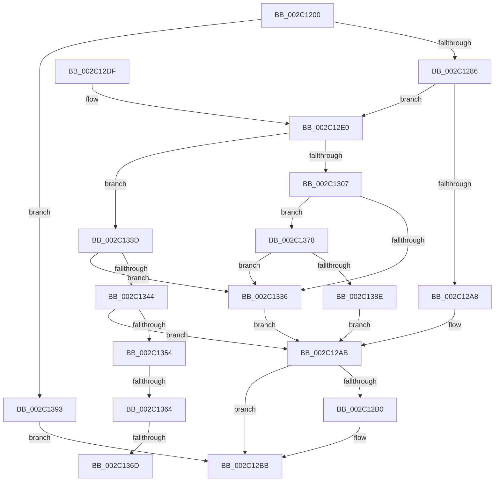

# MiIsCfgBitMapPageShared

- RVA: `0x002C1200`–`0x002C139D` (길이 `413` bytes)
- VA: `0x00000001402C1200`
- 실행 섹션: `.text`
- PDB 이름 있음: `예`; PDB Function 태그: `예`
- unwind 정보 RVA: `0x0006E6C4`
- 디코드: `105`개 명령, `413/413` bytes 표시
- 미해석 바이트: `0` (있으면 어셈블리에 `.byte`로 보존)

> 이 문서는 커널 이미지의 기계어와 PDB 기호를 분석해 생성했습니다. 4번과 5번은 함수 원형과 자료형을 바이너리 사용 방식에서 추정한 C 해석이며 원본 소스 복구 결과는 아닙니다.

## 1. Dependencies

- 직접 호출 지점: **6**; 고유 호출 대상: **6**
- 직접 호출자로 확인된 함수: **1**
- RIP 상대 이미지 참조: **1**

### Outgoing calls
- `0x002C125A` → [MiLockWorkingSetShared](../27/MiLockWorkingSetShared_function_0027CBF0.md) (function, `0x0027CBF0`)
- `0x002C1278` → [MiGetNextPageTable](MiGetNextPageTable_function_002C2EE0.md) (function, `0x002C2EE0`)
- `0x002C12B6` → [MiUnlockPageTable](../21/MiUnlockPageTable_function_00216EC0.md) (function, `0x00216EC0`)
- `0x002C12C1` → [MiUnlockWorkingSetShared](../27/MiUnlockWorkingSetShared_function_0027D690.md) (function, `0x0027D690`)
- `0x002C12F5` → [MiGetProtoPteAddress](../32/MiGetProtoPteAddress_function_0032E970.md) (function, `0x0032E970`)
- `0x002C1347` → [MiIsPrototypePteVadLookup](../32/MiIsPrototypePteVadLookup_function_00328B70.md) (function, `0x00328B70`)

### Direct callers
- [MiMarkSharedImageCfgBits](../../page/8D/MiMarkSharedImageCfgBits_function_008D0CC4.md) at `0x008D0E05`

### Static image references
- `0x002C1354` → RVA `0x00E2DC80` (`.data`; read)

## 2. Other-region calls and transfers

- 다른 실행 섹션으로 향하는 call: **0**
- call이 아닌 외부 분기/꼬리 이동: **3**
  - `0x002C135E` → [sub_006DC208 + 0x4](../6D/Unknown_function_006DC208.md) (`tail-transfer`)
  - `0x002C1367` → [sub_006DC208](../6D/Unknown_function_006DC208.md) (`tail-transfer`)
  - `0x002C1373` → [sub_006DC208 + 0x4](../6D/Unknown_function_006DC208.md) (`tail-transfer`)

## 3. Assembly (complete function range)

```asm
002C1200  48 89 5C 24 10                  mov qword ptr [rsp + 0x10], rbx
002C1205  48 89 6C 24 18                  mov qword ptr [rsp + 0x18], rbp
002C120A  56                              push rsi
002C120B  57                              push rdi
002C120C  41 55                           push r13
002C120E  41 56                           push r14
002C1210  41 57                           push r15
002C1212  48 83 EC 30                     sub rsp, 0x30
002C1216  48 8B D9                        mov rbx, rcx
002C1219  49 BD 00 00 00 00 80 F6 FF FF   movabs r13, 0xfffff68000000000
002C1223  48 C1 EB 09                     shr rbx, 9
002C1227  48 B8 F8 FF FF FF 7F 00 00 00   movabs rax, 0x7ffffffff8
002C1231  48 23 D8                        and rbx, rax
002C1234  4C 8B F2                        mov r14, rdx
002C1237  48 8B F9                        mov rdi, rcx
002C123A  49 8B C5                        mov rax, r13
002C123D  48 03 D8                        add rbx, rax
002C1240  65 48 8B 04 25 88 01 00 00      mov rax, qword ptr gs:[0x188]
002C1249  48 8B A8 B8 00 00 00            mov rbp, qword ptr [rax + 0xb8]
002C1250  48 81 C5 00 04 00 00            add rbp, 0x400
002C1257  48 8B CD                        mov rcx, rbp
002C125A  E8 91 B9 FB FF                  call 0x14027cbf0
002C125F  44 8A F8                        mov r15b, al
002C1262  45 33 C9                        xor r9d, r9d
002C1265  48 8D 44 24 60                  lea rax, [rsp + 0x60]
002C126A  45 8A C7                        mov r8b, r15b
002C126D  48 8B D3                        mov rdx, rbx
002C1270  48 89 44 24 20                  mov qword ptr [rsp + 0x20], rax
002C1275  48 8B CB                        mov rcx, rbx
002C1278  E8 63 1C 00 00                  call 0x1402c2ee0
002C127D  48 3B D8                        cmp rbx, rax
002C1280  0F 85 0D 01 00 00               jne 0x1402c1393
002C1286  48 8B F3                        mov rsi, rbx
002C1289  48 B8 F8 FF FF FF 7F 00 00 00   movabs rax, 0x7ffffffff8
002C1293  48 C1 EE 09                     shr rsi, 9
002C1297  48 23 F0                        and rsi, rax
002C129A  49 8B C5                        mov rax, r13
002C129D  48 8B 1B                        mov rbx, qword ptr [rbx]
002C12A0  48 03 F0                        add rsi, rax
002C12A3  48 85 DB                        test rbx, rbx
002C12A6  75 38                           jne 0x1402c12e0
002C12A8  8D 7B 02                        lea edi, [rbx + 2]
002C12AB  48 85 F6                        test rsi, rsi
002C12AE  74 0B                           je 0x1402c12bb
002C12B0  48 8B D6                        mov rdx, rsi
002C12B3  48 8B CD                        mov rcx, rbp
002C12B6  E8 05 5C F5 FF                  call 0x140216ec0
002C12BB  41 8A D7                        mov dl, r15b
002C12BE  48 8B CD                        mov rcx, rbp
002C12C1  E8 CA C3 FB FF                  call 0x14027d690
002C12C6  48 8B 5C 24 68                  mov rbx, qword ptr [rsp + 0x68]
002C12CB  8B C7                           mov eax, edi
002C12CD  48 8B 6C 24 70                  mov rbp, qword ptr [rsp + 0x70]
002C12D2  48 83 C4 30                     add rsp, 0x30
002C12D6  41 5F                           pop r15
002C12D8  41 5E                           pop r14
002C12DA  41 5D                           pop r13
002C12DC  5F                              pop rdi
002C12DD  5E                              pop rsi
002C12DE  C3                              ret
002C12DF  CC                              int3
002C12E0  48 C1 EF 0C                     shr rdi, 0xc
002C12E4  4C 8D 4C 24 60                  lea r9, [rsp + 0x60]
002C12E9  48 8B D7                        mov rdx, rdi
002C12EC  41 B8 08 00 00 00               mov r8d, 8
002C12F2  49 8B CE                        mov rcx, r14
002C12F5  E8 76 D6 06 00                  call 0x14032e970
002C12FA  BF 01 00 00 00                  mov edi, 1
002C12FF  4C 8B C0                        mov r8, rax
002C1302  40 84 DF                        test dil, bl
002C1305  74 36                           je 0x1402c133d
002C1307  48 C1 EB 0C                     shr rbx, 0xc
002C130B  48 B8 FF FF FF FF FF 00 00 00   movabs rax, 0xffffffffff
002C1315  48 23 D8                        and rbx, rax
002C1318  48 8D 0C 5B                     lea rcx, [rbx + rbx*2]
002C131C  48 C1 E1 04                     shl rcx, 4
002C1320  48 B8 00 00 00 00 00 DE FF FF   movabs rax, 0xffffde0000000000
002C132A  48 03 C8                        add rcx, rax
002C132D  48 8B 41 28                     mov rax, qword ptr [rcx + 0x28]
002C1331  48 85 C0                        test rax, rax
002C1334  78 42                           js 0x1402c1378
002C1336  33 FF                           xor edi, edi
002C1338  E9 6E FF FF FF                  jmp 0x1402c12ab
002C133D  48 0F BA E3 0A                  bt rbx, 0xa
002C1342  73 F2                           jae 0x1402c1336
002C1344  48 8B CB                        mov rcx, rbx
002C1347  E8 24 78 06 00                  call 0x140328b70
002C134C  85 C0                           test eax, eax
002C134E  0F 85 57 FF FF FF               jne 0x1402c12ab
002C1354  48 8B 05 25 C9 B6 00            mov rax, qword ptr [rip + 0xb6c925]
002C135B  48 85 C0                        test rax, rax
002C135E  0F 84 A8 AE 41 00               je 0x1406dc20c
002C1364  F6 C3 10                        test bl, 0x10
002C1367  0F 85 9B AE 41 00               jne 0x1406dc208
002C136D  48 F7 D0                        not rax
002C1370  48 23 D8                        and rbx, rax
002C1373  E9 94 AE 41 00                  jmp 0x1406dc20c
002C1378  48 8B 41 08                     mov rax, qword ptr [rcx + 8]
002C137C  48 B9 00 00 00 00 00 00 00 80   movabs rcx, 0x8000000000000000
002C1386  48 0B C1                        or rax, rcx
002C1389  49 3B C0                        cmp rax, r8
002C138C  75 A8                           jne 0x1402c1336
002C138E  E9 18 FF FF FF                  jmp 0x1402c12ab
002C1393  BF 03 00 00 00                  mov edi, 3
002C1398  E9 1E FF FF FF                  jmp 0x1402c12bb
```

## 4. C-style interpretation (structured pseudocode)

```c
__int64 __fastcall MiIsCfgBitMapPageShared(__int64 a1, __int64 a2, __int64 a3, int a4)
{
    __int64 result;
    __int64 v_rbp;
    __int64 v_rbx;
    __int64 v_rdi;
    __int64 v_rsi;
    __int64 v_rsp;
    unsigned __int64 v_stack_m38;
    unsigned __int64 v_stack_p10;
    unsigned __int64 v_stack_p18;
    unsigned __int64 v_stack_p60;
    unsigned __int64 v_stack_p8;

    v_stack_p10 = v_rbx;
    v_stack_p18 = v_rbp;
    v_rsp = (v_rsp) - (48);
    v_rbx = (a1) >> (9);
    v_rbx = (v_rbx) & (result);
    v_rbx = (v_rbx) + (v_r13);
    v_rbp = (*(unsigned __int64 *)(*(unsigned __int64 *)(gs_base + (0 + 392)) + 184)) + (0x400ULL);
    result = MiLockWorkingSetShared(v_rbp, a2, a3, a4);
    a4 = 0;
    v_stack_m38 = v_stack_p8;
    result = MiGetNextPageTable(v_rbx, v_rbx, (unsigned __int8)((unsigned __int8)(result)), a4);
    if (v_rbx != result) goto loc_002C1393;
    v_rsi = (v_rbx) >> (9);
    v_rsi = (v_rsi) & (result);
    v_rsi = (v_rsi) + (v_r13);
    if (*(unsigned __int64 *)(v_rbx) != 0) goto loc_002C12E0;
loc_002C12AB:
    result = v_r13;
    if (v_rsi != 0) {
        a2 = v_rsi;
        a1 = v_rbp;
        result = MiUnlockPageTable(a1, a2, (unsigned __int8)((unsigned __int8)(result)), a4);
    }
    result = MiUnlockWorkingSetShared(v_rbp, (unsigned __int8)((unsigned __int8)(result)), (unsigned __int8)((unsigned __int8)(result)), a4);
    v_rsp = (v_rsp) + (48);
    return (unsigned int)((unsigned int)(*(unsigned __int64 *)(v_rbx) + 2));
loc_002C12E0:
    v_rdi = (*(unsigned __int64 *)(v_rbx) + 2) >> (12);
    result = MiGetProtoPteAddress(a2, v_rdi, 8, v_stack_p60);
    if (((1) & ((unsigned __int8)(v_stack_p10))) == 0) goto loc_002C133D;
    v_rbx = (v_stack_p10) >> (12);
    v_rbx = (v_rbx) & (result);
    a1 = (v_rbx + v_rbx * 2) << (4);
    a1 = (a1) + (result);
    if (sign_flag) goto loc_002C1378;
loc_002C1336:
    v_rdi = 0;
    goto loc_002C12AB;
loc_002C133D:
    if (condition_is_above_or_equal) goto loc_002C1336;
    result = MiIsPrototypePteVadLookup(v_rbx, v_rdi, result, v_stack_p60);
    if ((unsigned int)(result) != 0) goto loc_002C12AB;
    result = ~(*(unsigned __int64 *)(v_rip + 11979045));
    v_rbx = (v_rbx) & (result);
loc_002C1378:
    result = (*(unsigned __int64 *)(v_rbx + 8)) | (v_rbx);
    if (result != result) goto loc_002C1336;
    goto loc_002C12AB;
loc_002C1393:
    goto loc_002C12BB;
}
```

## 5. (Beta) C Style

```c
int64_t MiIsCfgBitMapPageShared(int64_t Arg1, int64_t Arg2, int64_t Arg3, int32_t Arg4)
{
    int64_t result;
    int64_t local_rbp;
    int64_t local_rbx;
    int64_t local_rdi;
    int64_t local_rsi;
    int64_t local_rsp;
    uint64_t v_stack_m38;
    uint64_t v_stack_p10;
    uint64_t v_stack_p18;
    uint64_t v_stack_p60;
    uint64_t v_stack_p8;

    v_stack_p10 = local_rbx;
    v_stack_p18 = local_rbp;
    local_rsp = (local_rsp) - (48);
    local_rbx = (Arg1) >> (9);
    local_rbx = (local_rbx) & (result);
    local_rbx = (local_rbx) + (local_r13);
    local_rbp = (*(uint64_t *)(*(uint64_t *)(gs_base + (0 + 0x188)) + 0xB8)) + (0x400ULL);
    result = MiLockWorkingSetShared(local_rbp, Arg2, Arg3, Arg4);
    Arg4 = 0;
    v_stack_m38 = v_stack_p8;
    result = MiGetNextPageTable(local_rbx, local_rbx, (uint8_t)((uint8_t)(result)), Arg4);
    if (local_rbx != result) goto loc_002C1393;
    local_rsi = (local_rbx) >> (9);
    local_rsi = (local_rsi) & (result);
    local_rsi = (local_rsi) + (local_r13);
    if (*(uint64_t *)(local_rbx) != 0) goto loc_002C12E0;
loc_002C12AB:
    result = local_r13;
    if (local_rsi != 0) {
        Arg2 = local_rsi;
        Arg1 = local_rbp;
        result = MiUnlockPageTable(Arg1, Arg2, (uint8_t)((uint8_t)(result)), Arg4);
    }
    result = MiUnlockWorkingSetShared(local_rbp, (uint8_t)((uint8_t)(result)), (uint8_t)((uint8_t)(result)), Arg4);
    local_rsp = (local_rsp) + (48);
    return (uint32_t)((uint32_t)(*(uint64_t *)(local_rbx) + 2));
loc_002C12E0:
    local_rdi = (*(uint64_t *)(local_rbx) + 2) >> (12);
    result = MiGetProtoPteAddress(Arg2, local_rdi, 8, v_stack_p60);
    if (((1) & ((uint8_t)(v_stack_p10))) == 0) goto loc_002C133D;
    local_rbx = (v_stack_p10) >> (12);
    local_rbx = (local_rbx) & (result);
    Arg1 = (local_rbx + local_rbx * 2) << (4);
    Arg1 = (Arg1) + (result);
    if (sign_flag) goto loc_002C1378;
loc_002C1336:
    local_rdi = 0;
    goto loc_002C12AB;
loc_002C133D:
    if (condition_is_above_or_equal) goto loc_002C1336;
    result = MiIsPrototypePteVadLookup(local_rbx, local_rdi, result, v_stack_p60);
    if ((uint32_t)(result) != 0) goto loc_002C12AB;
    result = ~(*(uint64_t *)(v_rip + 0xB6C925));
    local_rbx = (local_rbx) & (result);
loc_002C1378:
    result = (*(uint64_t *)(local_rbx + 0x8)) | (local_rbx);
    if (result != result) goto loc_002C1336;
    goto loc_002C12AB;
loc_002C1393:
    goto loc_002C12BB;
}
```

## 6. Execution-region graph

[열기: 2D/3D 그래프와 함수 탐색 컨트롤 패널](../../../control-panel.html?section=text&rva=0x002C1200&view=graph)

- 2D 그래프는 위에서 아래로 흐르고, 3D 그래프는 빈 공간을 드래그해 회전합니다. Shift+드래그는 이동, 휠은 확대·축소, 함수 노드 선택은 대상 보고서 이동입니다.

### Static fallback


