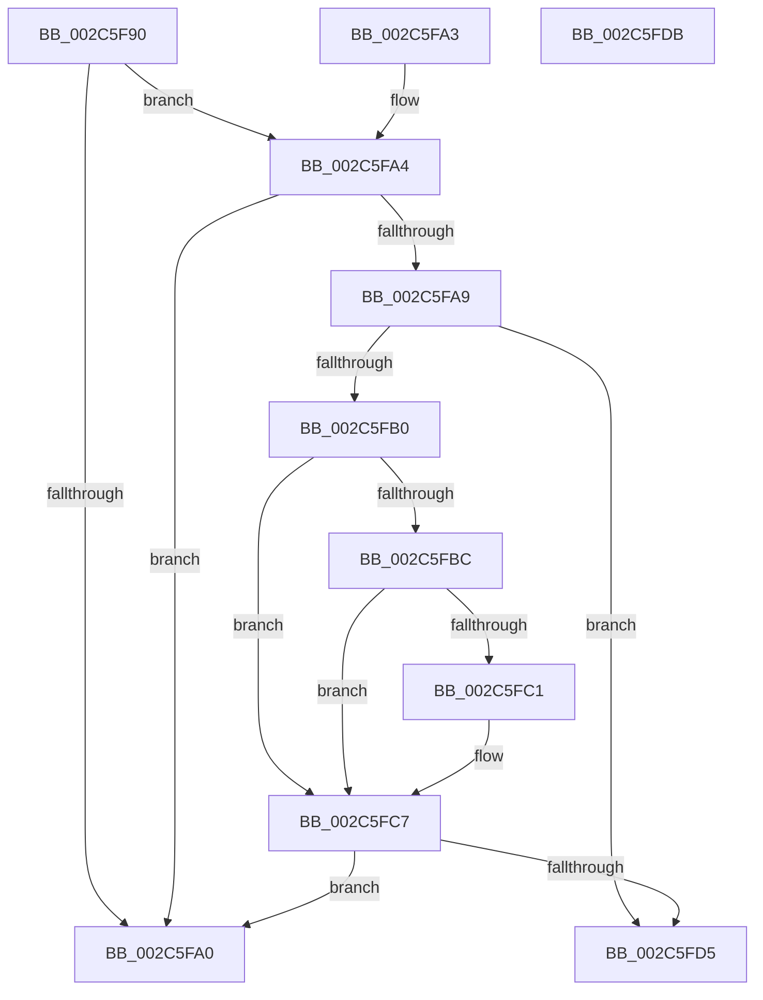

# MiIsPteDecommittedPage

- RVA: `0x002C5F90`–`0x002C5FDC` (길이 `76` bytes)
- VA: `0x00000001402C5F90`
- 실행 섹션: `.text`
- PDB 이름 있음: `예`; PDB Function 태그: `아니요`
- unwind 정보 RVA: `0x000DB714`
- 디코드: `25`개 명령, `76/76` bytes 표시
- 미해석 바이트: `0` (있으면 어셈블리에 `.byte`로 보존)

> 이 문서는 커널 이미지의 기계어와 PDB 기호를 분석해 생성했습니다. 4번과 5번은 함수 원형과 자료형을 바이너리 사용 방식에서 추정한 C 해석이며 원본 소스 복구 결과는 아닙니다.

## 1. Dependencies

- 직접 호출 지점: **0**; 고유 호출 대상: **0**
- 직접 호출자로 확인된 함수: **2**
- RIP 상대 이미지 참조: **1**

### Outgoing calls
- 직접 디코드된 call 명령이 없습니다.

### Direct callers
- [MiComputePageCommitment](MiComputePageCommitment_function_002C5C34.md) at `0x002C5D73`
- [MiCommitExistingVad](../32/MiCommitExistingVad_function_0032A860.md) at `0x0032AEC5`

### Static image references
- `0x002C5FB0` → RVA `0x00E2DC80` (`.data`; read)

## 2. Other-region calls and transfers

- 다른 실행 섹션으로 향하는 call: **0**
- 별도 외부 분기/꼬리 이동을 확인하지 못했습니다.

## 3. Assembly (complete function range)

```asm
002C5F90  48 8B C1                        mov rax, rcx
002C5F93  25 E0 03 00 00                  and eax, 0x3e0
002C5F98  48 3D 00 02 00 00               cmp rax, 0x200
002C5F9E  74 04                           je 0x1402c5fa4
002C5FA0  33 C0                           xor eax, eax
002C5FA2  C3                              ret
002C5FA3  CC                              int3
002C5FA4  F6 C1 01                        test cl, 1
002C5FA7  75 F7                           jne 0x1402c5fa0
002C5FA9  48 0F BA E1 0A                  bt rcx, 0xa
002C5FAE  73 25                           jae 0x1402c5fd5
002C5FB0  48 8B 05 C9 7C B6 00            mov rax, qword ptr [rip + 0xb67cc9]
002C5FB7  48 85 C0                        test rax, rax
002C5FBA  74 0B                           je 0x1402c5fc7
002C5FBC  F6 C1 10                        test cl, 0x10
002C5FBF  75 06                           jne 0x1402c5fc7
002C5FC1  48 F7 D0                        not rax
002C5FC4  48 23 C8                        and rcx, rax
002C5FC7  48 C1 E9 20                     shr rcx, 0x20
002C5FCB  B8 FF FF FF FF                  mov eax, 0xffffffff
002C5FD0  48 3B C8                        cmp rcx, rax
002C5FD3  75 CB                           jne 0x1402c5fa0
002C5FD5  B8 01 00 00 00                  mov eax, 1
002C5FDA  C3                              ret
002C5FDB  CC                              int3
```

## 4. C-style interpretation (structured pseudocode)

```c
__int64 __fastcall MiIsPteDecommittedPage(__int64 a1)
{
    __int64 result;

    result = (unsigned int)((a1) & (992));
    if (result == 512) goto loc_002C5FA4;
loc_002C5FA0:
    result = 0;
    return result;
loc_002C5FA4:
    if ((((unsigned __int8)(a1)) & (1)) != 0) goto loc_002C5FA0;
    if (condition_is_above_or_equal) goto loc_002C5FD5;
    if (*(unsigned __int64 *)(v_rip + 11959497) == 0) goto loc_002C5FC7;
    result = *(unsigned __int64 *)(v_rip + 11959497);
    if ((((unsigned __int8)(a1)) & (16)) == 0) {
        result = ~(*(unsigned __int64 *)(v_rip + 11959497));
        a1 = (a1) & (result);
    }
    a1 = (a1) >> (32);
    if (a1 != ((unsigned int)(0xFFFFFFFFULL))) goto loc_002C5FA0;
loc_002C5FD5:
    return 1;
}
```

## 5. (Beta) C Style

```c
int64_t MiIsPteDecommittedPage(int64_t Arg1)
{
    int64_t result;

    result = (uint32_t)((Arg1) & (992));
    if (result == 512) goto loc_002C5FA4;
loc_002C5FA0:
    result = 0;
    return result;
loc_002C5FA4:
    if ((((uint8_t)(Arg1)) & (1)) != 0) goto loc_002C5FA0;
    if (condition_is_above_or_equal) goto loc_002C5FD5;
    if (*(uint64_t *)(v_rip + 0xB67CC9) == 0) goto loc_002C5FC7;
    result = *(uint64_t *)(v_rip + 0xB67CC9);
    if ((((uint8_t)(Arg1)) & (16)) == 0) {
        result = ~(*(uint64_t *)(v_rip + 0xB67CC9));
        Arg1 = (Arg1) & (result);
    }
    Arg1 = (Arg1) >> (32);
    if (Arg1 != ((uint32_t)(0xFFFFFFFFULL))) goto loc_002C5FA0;
loc_002C5FD5:
    return 1;
}
```

## 6. Execution-region graph

[열기: 2D/3D 그래프와 함수 탐색 컨트롤 패널](../../../control-panel.html?section=text&rva=0x002C5F90&view=graph)

- 2D 그래프는 위에서 아래로 흐르고, 3D 그래프는 빈 공간을 드래그해 회전합니다. Shift+드래그는 이동, 휠은 확대·축소, 함수 노드 선택은 대상 보고서 이동입니다.

### Static fallback


